**🟩 RELEASE COMPLETE**
**🟩 COMPILER VERIFIED** · **🟦 IMAGES 6/6 RELEASED** · **🟪 VISUAL QA 24/24 PASS**

# Daily AI Brief — Unified Production After-Action Report
**Edition:** October 13, 2026 · **Production evening:** 2026-10-12 · **Timezone:** America/Chicago
**Primary public reader:** [Open 2026-10-13 Brief](https://gttome.github.io/Daily-AI-Brief-Compiler/briefs/2026-10-13/) · **Repository:** [Daily-AI-Brief-Compiler](https://github.com/gttome/Daily-AI-Brief-Compiler)

> **IMPORTANT — VERIFIED PRODUCTION RESULT**
> **Executive result: COMPLETE.** This is the single management-facing report combining the editorial Compiler and premium-image publication. Compiler public status: **VERIFIED**. Image release: **RELEASED_VERIFIED**. Direct 24-context visual quality: **24/24 PASS**. Missing evidence must not be promoted to a success claim.

**🕒 Production stage durations:** **Compiler 18m 02s** · **Premium Images 18m 04s** (evidence-bounded elapsed times; the start/end events differ).

## Performance dashboard

| Measure | Recorded result | Source / caveat |
|:--|:--:|:--|
| Editorial publication | **PASS** | State and public reader integrity receipt |
| Articles | **6** | Exactly 2 technical / 2 knowledge-worker / 2 agents required |
| Media | **2 videos + 2 podcasts** | Sealed bundle |
| **Compiler stage duration** | **18m 02s (18.0 min)** | First persisted Compiler state → verified public reader; not a host scheduler attestation |
| **Image processing stage duration** | **18m 04s** | First accepted PNG Git checkpoint → final 24/24 review; auditable stage elapsed time |
| Image scheduled-to-final-review window | **38m 09s** | Only with a saved one-cycle schedule anchor; does not attest exact generation start |
| Accepted premium PNGs | **6 / 6** | Exact package and public release hashes |
| Native image generation attempts | **8** | Image worker AAR; no estimation |
| Rejected candidates | **2** | Image worker AAR |
| Saved visual contexts | **24 / 24 PASS** | Dated/permanent desktop/mobile review |
| Public SHA-256 checks | **44** | Image release receipt |
| October 8 immutable history | **17 / 17** | Independent content-preservation checks |
| **Owner-reported weekly Work usage for this run** | **2%** | User-reported for this cycle only; not account-metered |

> **EFFICIENCY NOTE**
> **Resource reporting policy:** The owner reported 2% of weekly Work usage for this run; the internal target is under 5%. This number is not GitHub billing telemetry. Future runs show **Not reported** unless the owner supplies new cycle-specific usage metadata. No approval or extra step is required to generate the AAR.

## Production architecture and checkpoints

```mermaid
flowchart LR
  A["Compiler 19:15 Chicago"] --> B["Sealed editorial bundle"]
  B --> C["Published reader verified"]
  C --> D["Current-date six-story image job"]
  D --> E["Six source-bound premium PNGs"]
  E --> F["Protected PR and CI"]
  F --> G["Pages release and 24 visual reviews"]
  classDef done fill:#dff6eb,color:#165c39,stroke:#168052,stroke-width:2px
  classDef uncertain fill:#fef3c7,color:#804c14,stroke:#d99412,stroke-width:2px
  class A,B,C,D done
  class E,F,G done
```

## Track 1 — Compiler

**State:** `SHADOW_VERIFIED` · **Bundle:** `BUNDLE_READY` · **Compiler duration:** 18m 02s (18.0 min).

| Publication gate | Result |
|---|:---:|
| Canonical reader build | ✅ |
| Reader parity | ✅ |
| Public verification of dated edition | ✅ |
| Previous editions preserved | ✅ |
| Permanent story routes and feeds | ✅ |

**Selected coverage:**

| Lane | Story |
|---|---|
| Technical AI Engineering | Microsoft's Maia 300 shifts the inference bottleneck toward data movement |
| Technical AI Engineering | Meta's Muse Wonder introduces persistent agent memory and recovery behavior |
| Applied Generative AI for Knowledge Workers | Looker Data Apps connects natural-language app creation to governed business metrics |
| Applied Generative AI for Knowledge Workers | Alteryx and BigQuery demonstrate a controlled invoice-exception pipeline |
| Agents for Everyone | Build one reusable quality-check Agent Skill for a GitHub project |
| Agents for Everyone | Anthropic's agent incidents show why browser permissions require technical limits |

## Track 2 — Premium images

**Public status:** `RELEASED_VERIFIED` · **Saved images:** 6/6 · **Actual generation attempts:** 8 · **Rejected candidates:** 2.

### Image production duration — Git-verified milestones

**Auditable image stage duration:** **18m 04s** (first accepted binary saved in Git → final 24-context quality-review merge). **First asset to public image release:** **8m 02s**.
**Scheduled-to-final-review window:** **38m 09s**. This is a scheduled-clock comparison only when a separately recorded exact-date schedule exists; it is **not** measured native image-generation runtime.

| Production milestone | Chicago local time | Evidence |
|---|---|---|
| Scheduled image start (if exact-date record exists) | 8:15:00 PM | Time planned, not actual execution start |
| First accepted PNG bytes saved to Git | 8:35:05 PM | Immutable binary-stage commit |
| Six-image package / reviews committed | 8:39:30 PM | Exact-head PR source commit |
| Protected package merged | 8:42:22 PM | Merge SHA and required CI |
| Public images verified | 8:43:06 PM | Image-release receipt |
| Final 24/24 semantic visual review approved | 8:53:09 PM | Immutable first review-approval commit |

> **Duration interpretation:** The audited stage excludes unobservable pre-checkpoint creative work. The scheduled-start window includes it but must not be interpreted as precise active processing time. Missing timestamps appear as **Not independently recorded**, never an estimate.

| Source-bound image | Attempts | File size | Public page |
|---|---:|---:|---|
| Microsoft's Maia 300 shifts the inference bottleneck toward data movement | 1 | 1.12 MiB | [View original](https://gttome.github.io/Daily-AI-Brief-Compiler/briefs/images/2026-10-13/dab-edition-2026-10-13-m01.png) |
| Meta's Muse Wonder introduces persistent agent memory and recovery behavior | 1 | 0.78 MiB | [View original](https://gttome.github.io/Daily-AI-Brief-Compiler/briefs/images/2026-10-13/dab-edition-2026-10-13-m02.png) |
| Looker Data Apps connects natural-language app creation to governed business metrics | 3 | 0.70 MiB | [View original](https://gttome.github.io/Daily-AI-Brief-Compiler/briefs/images/2026-10-13/dab-edition-2026-10-13-m10.png) |
| Alteryx and BigQuery demonstrate a controlled invoice-exception pipeline | 1 | 0.73 MiB | [View original](https://gttome.github.io/Daily-AI-Brief-Compiler/briefs/images/2026-10-13/dab-edition-2026-10-13-m11.png) |
| Build one reusable quality-check Agent Skill for a GitHub project | 1 | 0.81 MiB | [View original](https://gttome.github.io/Daily-AI-Brief-Compiler/briefs/images/2026-10-13/dab-edition-2026-10-13-m12.png) |
| Anthropic's agent incidents show why browser permissions require technical limits | 1 | 1.02 MiB | [View original](https://gttome.github.io/Daily-AI-Brief-Compiler/briefs/images/2026-10-13/dab-edition-2026-10-13-m14.png) |

**Immutable-release and visual gates:**

| Release gate | Result |
|---|:---:|
| Protected public image receipt | ✅ |
| Accepted-image Git hash bindings | ✅ |
| Six live PNGs | 6/6 |
| Dated/permanent story placements | 12/12 recorded in release evidence |
| Desktop/mobile visual inspection | 24/24 PASS |
| Historical Oct 8 integrity | 17/17 |

### Published premium illustrations

<table>
<tr><td width="50%"> <b>Microsoft's Maia 300 shifts the inference bottleneck toward data movement</b></td><td width="50%"> <b>Meta's Muse Wonder introduces persistent agent memory and recovery behavior</b></td></tr>
<tr><td width="50%"> <b>Looker Data Apps connects natural-language app creation to governed business metrics</b></td><td width="50%"> <b>Alteryx and BigQuery demonstrate a controlled invoice-exception pipeline</b></td></tr>
<tr><td width="50%"> <b>Build one reusable quality-check Agent Skill for a GitHub project</b></td><td width="50%"> <b>Anthropic's agent incidents show why browser permissions require technical limits</b></td></tr>
</table>

## Incidents, corrections and learning

| Stage | Verified issue | Corrective action |
|---|---|---|
| looker_generation | The first candidate misspelled the runtime-token caveat. | Rejected it and generated a new candidate with the exact caveat. |
| looker_generation | The second candidate used human-avatar glyphs in the row-access module. | Rejected it and generated the accepted version using only policy gates and locks. |
| connector_transport | A shell base64 read was truncated at the connector output ceiling. | Used the native saved-image data stream for Git blob creation and matched all six returned Git object IDs to locally computed blob IDs. |

> **OPERATIONAL NOTE**
> This report distinguishes a published and verified production outcome from scheduler metadata exposed to another conversation. Lack of a live host heartbeat in a separate normal chat is not a Compiler production failure.

## Usage and cost stewardship

| Item | Per-cycle value |
|---|---|
| **Weekly Work usage reported by owner** | **2%** (owner reported) |
| Internal weekly usage reference | Target under 5% |
| Genuine image-generation attempts | 8 |
| Accepted diagrams | 6 |
| Regeneration after acceptance | 0 |
| Account-level billing telemetry | Not independently accessible to deterministic GitHub reporting |

**Future reporting rule:** For cycles without an optional owner-usage record, publish the complete AAR with `Not reported`; do not reuse prior percentages, guess remaining weekly credits or delay tomorrow's production.

## Next-edition operating handoff

| Control | Recurring contract |
|---|---|
| Primary Compiler | Sole existing task · 19:15 America/Chicago |
| Premium image production | Sole existing task · standard 21:15 America/Chicago |
| Exact image job selection | Newly published next-date `PUBLISHED_PENDING` only |
| AAR | Combined report generated automatically from new GitHub receipts |
| Optional Work usage | Owner-supplied per cycle, otherwise `Not reported` |

> **SCHEDULE RESTORATION NOTE**
> A temporary scheduling exception must be explicitly restored before claiming standard-time readiness. This deterministic document generator reads existing state only; it does not modify production schedules.

## Evidence register

| Evidence | Link |
|---|---|
| Compiler state | [Open receipt](https://github.com/gttome/Daily-AI-Brief-Compiler/blob/shadow/2026-10-13/shadow-runs/2026-10-13/compiler-state.json) |
| Compiler compile receipt | [Open receipt](https://github.com/gttome/Daily-AI-Brief-Compiler/blob/shadow/2026-10-13/shadow-runs/2026-10-13/compiler/compile-receipt.json) |
| Compiler public integrity | [Open receipt](https://github.com/gttome/Daily-AI-Brief-Compiler/blob/shadow/2026-10-13/shadow-runs/2026-10-13/compiler/postpublish-integrity.json) |
| Image release receipt | [Open receipt](https://github.com/gttome/Daily-AI-Brief-Compiler/blob/shadow-pages-history/site/image-jobs/2026-10-13/release.json) |
| Image review | [Open receipt](https://github.com/gttome/Daily-AI-Brief-Compiler/blob/main/external-image-packages/2026-10-13/reviews/live/image-element24/semantic-reviews.json) |
| Original image AAR | [Open receipt](https://github.com/gttome/Daily-AI-Brief-Compiler/blob/main/external-image-packages/2026-10-13/reviews/after-action.md) |

**Image workflow:** [Workflow evidence](https://github.com/gttome/Daily-AI-Brief-Compiler/actions/runs/38333405791).

---

*Generated deterministically from edition-specific GitHub records. Primary report is a synthesis; original Compiler, image, hash, and review receipts remain immutable. This reporting action creates no stories, images, releases, extra AI tasks, or schedule changes.*
