**🟩 RELEASE COMPLETE**
**🟩 COMPILER VERIFIED** · **🟦 IMAGES 6/6 RELEASED** · **🟪 VISUAL QA 24/24 PASS**

# Daily AI Brief — Unified Production After-Action Report
**Edition:** October 15, 2026 · **Production evening:** 2026-10-14 · **Timezone:** America/Chicago
**Primary public reader:** [Open 2026-10-15 Brief](https://gttome.github.io/Daily-AI-Brief-Compiler/briefs/2026-10-15/) · **Repository:** [Daily-AI-Brief-Compiler](https://github.com/gttome/Daily-AI-Brief-Compiler)

> **IMPORTANT — VERIFIED PRODUCTION RESULT**
> **Executive result: COMPLETE.** This is the single management-facing report combining the editorial Compiler and premium-image publication. Compiler public status: **VERIFIED**. Image release: **RELEASED_VERIFIED**. Direct 24-context visual quality: **24/24 PASS**. Autonomous completion: **UNPROVEN**. Missing evidence must not be promoted to a success claim.

**🕒 Production stage durations:** **Compiler 21m 41s** · **Premium Images 16m 30s** (evidence-bounded elapsed times; the start/end events differ).

## Performance dashboard

| Measure | Recorded result | Source / caveat |
|:--|:--:|:--|
| Editorial publication | **PASS** | State and public reader integrity receipt |
| **Unattended autonomy (separate from publication)** | **UNPROVEN** | Owner incident receipt takes precedence over unverified producer self-attestation |
| Recorded protected publishing gate failures | **0** | Actual same-edition GitHub failure sidecar only; earlier unrecorded failures remain unknown |
| Articles | **6** | Exactly 2 technical / 2 knowledge-worker / 2 agents required |
| Verified original sources within preceding 24 hours | **0 / 6** | Original publisher dates only; other sources require a documented fallback rationale |
| Distinct selected article publishers | **2** | Six different primary organizations preferred |
| Videos over seven days old | **2** | Must be labeled evergreen, not a new development |
| Distinct selected video publishers | **2** | One channel is one publisher even across multiple videos |
| Duplicate active Watchlist display titles | **Not recorded** | Published canonical Watchlist only; historical evidence retained |
| Live published video playback after release | **NOT_RECORDED** | Actual displayed public media links, not prepublish metadata | 
| Postpublication reader incidents | **NOT_RECORDED** | Edition-specific owner reports and corrective PRs, not inferred absence | 
| Recorded scheduler capability route | **UNPROVEN** | Same-invocation route receipt only; GitHub is not scheduler authentication |
| Avoidable incomplete-staging CI failures | **Not independently audited** | Existing image-package push CI is disabled; exact-head protected PR CI remains required. A failure count requires actual workflow evidence |
| Media | **2 videos + 2 podcasts** | Sealed bundle |
| **Compiler stage duration** | **21m 41s (21.7 min)** | First persisted Compiler state → verified public reader; not a host scheduler attestation |
| **Image processing stage duration** | **16m 30s** | First accepted PNG Git checkpoint → final 24/24 review; auditable stage elapsed time |
| Image scheduled-to-final-review window | **Not independently recorded** | Only with a saved one-cycle schedule anchor; does not attest exact generation start |
| Executor-observed generation-to-final-review | **Not independently recorded** | Only if the worker recorded a same-execution clock before its first native call; not independently verified provider runtime |
| Accepted premium PNGs | **6 / 6** | Exact package and public release hashes |
| Native image generation attempts | **11** | Image worker AAR; no estimation |
| Rejected candidates | **5** | Image worker AAR |
| Final worker checkpoint reconciliation | **HISTORICAL_NOT_GATED** | Oct25+ verifies exact generation count, per-story attempts, six accepted story/image/hash bindings and final release |
| Saved visual contexts | **24 / 24 PASS** | Dated/permanent desktop/mobile review |
| Public SHA-256 checks | **44** | Image release receipt |
| October 8 immutable history | **17 / 17** | Independent content-preservation checks |
| **Owner-reported weekly Work usage for this run** | **Not reported** | No per-cycle usage supplied |

> **EFFICIENCY NOTE**
> **Resource reporting policy:** No usage figure was supplied for this cycle, so none is assumed. Future runs show **Not reported** unless the owner supplies new cycle-specific usage metadata. No approval or extra step is required to generate the AAR.

## Production architecture and checkpoints

```mermaid
flowchart LR
  A["Compiler 19:15 Chicago"] --> B["Sealed editorial bundle"]
  B --> C["Published reader verified"]
  C --> D["Current-date six-story image job"]
  D --> E["Six source-bound premium PNGs"]
  E --> F["Protected PR and CI"]
  F --> G["Pages release and 24 visual reviews"]
  classDef done fill:#dff6eb,color:#165c39,stroke:#168052,stroke-width:2px
  classDef uncertain fill:#fef3c7,color:#804c14,stroke:#d99412,stroke-width:2px
  class A,B,C,D done
  class E,F,G done
```

## Track 1 — Compiler

**State:** `SHADOW_VERIFIED` · **Bundle:** `BUNDLE_READY` · **Compiler duration:** 21m 41s (21.7 min).

| Publication gate | Result |
|---|:---:|
| Canonical reader build | ✅ |
| Reader parity | ✅ |
| Public verification of dated edition | ✅ |
| Previous editions preserved | ✅ |
| Permanent story routes and feeds | ✅ |

**Selected coverage:**

| Lane | Story |
|---|---|
| Technical AI Engineering | GitHub tests multi-model critique and repair in Copilot workflows |
| Technical AI Engineering | Workflow lockfiles give agent CI a reproducible dependency boundary |
| Applied Generative AI for Knowledge Workers | An AWS reference design turns cited enterprise documents into slide decks |
| Applied Generative AI for Knowledge Workers | A document-processing agent learns from failed extraction checks |
| Agents for Everyone | Create a reusable Agent Skill to audit app permissions before installation |
| Agents for Everyone | ShipStation's Slack helpdesk shows how agents can escalate safely |

## Track 2 — Premium images

**Public status:** `RELEASED_VERIFIED` · **Saved images:** 6/6 · **Actual generation attempts:** 11 · **Rejected candidates:** 5.

### Image production duration — Git-verified milestones

**Auditable image stage duration:** **16m 30s** (first accepted binary saved in Git → final 24-context quality-review merge). **First asset to public image release:** **8m 45s**.
**Scheduled-to-final-review window:** **Not independently recorded**. This is a scheduled-clock comparison only when a separately recorded exact-date schedule exists; it is **not** measured native image-generation runtime.

| Production milestone | Chicago local time | Evidence |
|---|---|---|
| Scheduled image start (if exact-date record exists) | Not independently recorded | Time planned, not actual execution start |
| First executor-observed start | Not independently recorded | Worker self-attestation, not a first-party scheduler event |
| First native generation observation | Not independently recorded | Worker clock recorded immediately before first native call, not model-provider telemetry |
| First accepted PNG bytes saved to Git | 9:49:28 PM | Immutable binary-stage commit |
| Six-image package / reviews committed | 9:54:29 PM | Exact-head PR source commit |
| Protected package merged | 9:57:26 PM | Merge SHA and required CI |
| Public images verified | 9:58:12 PM | Image-release receipt |
| Final 24/24 semantic visual review approved | 10:05:58 PM | Immutable first review-approval commit |

> **Duration interpretation:** The audited stage excludes unobservable pre-checkpoint creative work. The scheduled-start window includes it but must not be interpreted as precise active processing time. Missing timestamps appear as **Not independently recorded**, never an estimate.

| Source-bound image | Attempts | File size | Public page |
|---|---:|---:|---|
| GitHub tests multi-model critique and repair in Copilot workflows | — | 0.83 MiB | [View original](https://gttome.github.io/Daily-AI-Brief-Compiler/briefs/images/2026-10-15/dab-edition-2026-10-15-m01.png) |
| Workflow lockfiles give agent CI a reproducible dependency boundary | — | 0.61 MiB | [View original](https://gttome.github.io/Daily-AI-Brief-Compiler/briefs/images/2026-10-15/dab-edition-2026-10-15-m02.png) |
| An AWS reference design turns cited enterprise documents into slide decks | — | 0.78 MiB | [View original](https://gttome.github.io/Daily-AI-Brief-Compiler/briefs/images/2026-10-15/dab-edition-2026-10-15-m10.png) |
| A document-processing agent learns from failed extraction checks | — | 0.54 MiB | [View original](https://gttome.github.io/Daily-AI-Brief-Compiler/briefs/images/2026-10-15/dab-edition-2026-10-15-m11.png) |
| Create a reusable Agent Skill to audit app permissions before installation | — | 0.72 MiB | [View original](https://gttome.github.io/Daily-AI-Brief-Compiler/briefs/images/2026-10-15/dab-edition-2026-10-15-m12.png) |
| ShipStation's Slack helpdesk shows how agents can escalate safely | — | 0.55 MiB | [View original](https://gttome.github.io/Daily-AI-Brief-Compiler/briefs/images/2026-10-15/dab-edition-2026-10-15-m14.png) |

**Immutable-release and visual gates:**

| Release gate | Result |
|---|:---:|
| Protected public image receipt | ✅ |
| Accepted-image Git hash bindings | ✅ |
| Six live PNGs | 6/6 |
| Dated/permanent story placements | 12/12 recorded in release evidence |
| Desktop/mobile visual inspection | 24/24 PASS |
| Historical Oct 8 integrity | 17/17 |

### Published premium illustrations

<table>
<tr><td width="50%"> <b>GitHub tests multi-model critique and repair in Copilot workflows</b></td><td width="50%"> <b>Workflow lockfiles give agent CI a reproducible dependency boundary</b></td></tr>
<tr><td width="50%"> <b>An AWS reference design turns cited enterprise documents into slide decks</b></td><td width="50%"> <b>A document-processing agent learns from failed extraction checks</b></td></tr>
<tr><td width="50%"> <b>Create a reusable Agent Skill to audit app permissions before installation</b></td><td width="50%"> <b>ShipStation's Slack helpdesk shows how agents can escalate safely</b></td></tr>
</table>

## Incidents, corrections and learning

### Postpublication reader incidents (updated when new evidence is merged)

No current-edition postpublication incident register was available; this is **NOT_RECORDED**, not a certification of zero incidents.

**Editor recovery classification:** UNPROVEN. **Owner intervention:** Unproven either way. **Protected same-edition failures recorded:** 0. 
**Latest failed protected stage:** Not in same-edition receipts; [Action evidence](https://github.com/gttome/Daily-AI-Brief-Compiler/actions). Exact stage durations are available only where real source timestamps exist.

No image-stage correction receipts were available for this cycle.

> **OPERATIONAL NOTE**
> This report distinguishes a published and verified production outcome from scheduler metadata exposed to another conversation. Lack of a live host heartbeat in a separate normal chat is not a Compiler production failure.

## Usage and cost stewardship

| Item | Per-cycle value |
|---|---|
| **Weekly Work usage reported by owner** | **Not reported** |
| Internal weekly usage reference | Target under 5% |
| Genuine image-generation attempts | 11 |
| Accepted diagrams | 6 |
| Regeneration after acceptance | 0 |
| Account-level billing telemetry | Not independently accessible to deterministic GitHub reporting |

**Future reporting rule:** For cycles without an optional owner-usage record, publish the complete AAR with `Not reported`; do not reuse prior percentages, guess remaining weekly credits or delay tomorrow's production.

## Next-edition operating handoff

| Control | Recurring contract |
|---|---|
| Primary Compiler | Sole existing task · 19:15 America/Chicago |
| Premium image production | Sole existing task · standard 21:15 America/Chicago |
| Exact image job selection | Newly published next-date `PUBLISHED_PENDING` only |
| AAR | Combined report generated automatically from new GitHub receipts |
| Optional Work usage | Owner-supplied per cycle, otherwise `Not reported` |

> **SCHEDULE RESTORATION NOTE**
> A temporary scheduling exception must be explicitly restored before claiming standard-time readiness. This deterministic document generator reads existing state only; it does not modify production schedules.

## Evidence register

| Evidence | Link |
|---|---|
| Compiler state | [Open receipt](https://github.com/gttome/Daily-AI-Brief-Compiler/blob/shadow/2026-10-15/shadow-runs/2026-10-15/compiler-state.json) |
| Compiler compile receipt | [Open receipt](https://github.com/gttome/Daily-AI-Brief-Compiler/blob/shadow/2026-10-15/shadow-runs/2026-10-15/compiler/compile-receipt.json) |
| Compiler public integrity | [Open receipt](https://github.com/gttome/Daily-AI-Brief-Compiler/blob/shadow/2026-10-15/shadow-runs/2026-10-15/compiler/postpublish-integrity.json) |
| Image release receipt | [Open receipt](https://github.com/gttome/Daily-AI-Brief-Compiler/blob/shadow-pages-history/site/image-jobs/2026-10-15/release.json) |
| Image review | [Open receipt](https://github.com/gttome/Daily-AI-Brief-Compiler/blob/main/external-image-packages/2026-10-15/reviews/live/image-element24/semantic-reviews.json) |
| Original image AAR | [Open receipt](https://github.com/gttome/Daily-AI-Brief-Compiler/blob/main/external-image-packages/2026-10-15/reviews/after-action.md) |

**Image workflow:** [Workflow evidence](https://github.com/gttome/Daily-AI-Brief-Compiler/actions/runs/38673724814).

---

*Generated deterministically from edition-specific GitHub records. Primary report is a synthesis; original Compiler, image, hash, and review receipts remain immutable. This reporting action creates no stories, images, releases, extra AI tasks, or schedule changes.*
