**🟩 RELEASE COMPLETE**
**🟩 COMPILER VERIFIED** · **🟦 IMAGES 6/6 RELEASED** · **🟪 VISUAL QA 24/24 PASS**

# Daily AI Brief — Unified Production After-Action Report
**Edition:** October 21, 2026 · **Production evening:** 2026-10-20 · **Timezone:** America/Chicago
**Primary public reader:** [Open 2026-10-21 Brief](https://gttome.github.io/Daily-AI-Brief-Compiler/briefs/2026-10-21/) · **Repository:** [Daily-AI-Brief-Compiler](https://github.com/gttome/Daily-AI-Brief-Compiler)

> **IMPORTANT — VERIFIED PRODUCTION RESULT**
> **Executive result: COMPLETE.** This is the single management-facing report combining the editorial Compiler and premium-image publication. Compiler public status: **VERIFIED**. Image release: **RELEASED_VERIFIED**. Direct 24-context visual quality: **24/24 PASS**. Missing evidence must not be promoted to a success claim.

**🕒 Production stage durations:** **Compiler 15m 50s** · **Premium Images 24m 36s** (evidence-bounded elapsed times; the start/end events differ).

## Performance dashboard

| Measure | Recorded result | Source / caveat |
|:--|:--:|:--|
| Editorial publication | **PASS** | State and public reader integrity receipt |
| Articles | **6** | Exactly 2 technical / 2 knowledge-worker / 2 agents required |
| Media | **2 videos + 2 podcasts** | Sealed bundle |
| **Compiler stage duration** | **15m 50s (15.8 min)** | First persisted Compiler state → verified public reader; not a host scheduler attestation |
| **Image processing stage duration** | **24m 36s** | First accepted PNG Git checkpoint → final 24/24 review; auditable stage elapsed time |
| Image scheduled-to-final-review window | **Not independently recorded** | Only with a saved one-cycle schedule anchor; does not attest exact generation start |
| Accepted premium PNGs | **6 / 6** | Exact package and public release hashes |
| Native image generation attempts | **10** | Image worker AAR; no estimation |
| Rejected candidates | **4** | Image worker AAR |
| Saved visual contexts | **24 / 24 PASS** | Dated/permanent desktop/mobile review |
| Public SHA-256 checks | **44** | Image release receipt |
| October 8 immutable history | **17 / 17** | Independent content-preservation checks |
| **Owner-reported weekly Work usage for this run** | **Not reported** | No per-cycle usage supplied |

> **EFFICIENCY NOTE**
> **Resource reporting policy:** No usage figure was supplied for this cycle, so none is assumed. Future runs show **Not reported** unless the owner supplies new cycle-specific usage metadata. No approval or extra step is required to generate the AAR.

## Production architecture and checkpoints

```mermaid
flowchart LR
  A["Compiler 19:15 Chicago"] --> B["Sealed editorial bundle"]
  B --> C["Published reader verified"]
  C --> D["Current-date six-story image job"]
  D --> E["Six source-bound premium PNGs"]
  E --> F["Protected PR and CI"]
  F --> G["Pages release and 24 visual reviews"]
  classDef done fill:#dff6eb,color:#165c39,stroke:#168052,stroke-width:2px
  classDef uncertain fill:#fef3c7,color:#804c14,stroke:#d99412,stroke-width:2px
  class A,B,C,D done
  class E,F,G done
```

## Track 1 — Compiler

**State:** `SHADOW_VERIFIED` · **Bundle:** `BUNDLE_READY` · **Compiler duration:** 15m 50s (15.8 min).

| Publication gate | Result |
|---|:---:|
| Canonical reader build | ✅ |
| Reader parity | ✅ |
| Public verification of dated edition | ✅ |
| Previous editions preserved | ✅ |
| Permanent story routes and feeds | ✅ |

**Selected coverage:**

| Lane | Story |
|---|---|
| Technical AI Engineering | llm-d v1.0 makes inference operations the product |
| Technical AI Engineering | Meta narrows the agent orchestrator to routing and handoffs |
| Applied Generative AI for Knowledge Workers | Zoom proposes a governed context layer for conversation work |
| Applied Generative AI for Knowledge Workers | Gemini for Government Services centers citations and controls |
| Agents for Everyone | Orchestra Bio brings agent coordination to drug programs |
| Agents for Everyone | Turn meeting review into one reusable Plaud Skill |

## Track 2 — Premium images

**Public status:** `RELEASED_VERIFIED` · **Saved images:** 6/6 · **Actual generation attempts:** 10 · **Rejected candidates:** 4.

### Image production duration — Git-verified milestones

**Auditable image stage duration:** **24m 36s** (first accepted binary saved in Git → final 24-context quality-review merge). **First asset to public image release:** **19m 29s**.
**Scheduled-to-final-review window:** **Not independently recorded**. This is a scheduled-clock comparison only when a separately recorded exact-date schedule exists; it is **not** measured native image-generation runtime.

| Production milestone | Chicago local time | Evidence |
|---|---|---|
| Scheduled image start (if exact-date record exists) | Not independently recorded | Time planned, not actual execution start |
| First accepted PNG bytes saved to Git | 10:03:24 PM | Immutable binary-stage commit |
| Six-image package / reviews committed | 10:18:23 PM | Exact-head PR source commit |
| Protected package merged | 10:22:05 PM | Merge SHA and required CI |
| Public images verified | 10:22:52 PM | Image-release receipt |
| Final 24/24 semantic visual review approved | 10:28:00 PM | Immutable first review-approval commit |

> **Duration interpretation:** The audited stage excludes unobservable pre-checkpoint creative work. The scheduled-start window includes it but must not be interpreted as precise active processing time. Missing timestamps appear as **Not independently recorded**, never an estimate.

| Source-bound image | Attempts | File size | Public page |
|---|---:|---:|---|
| llm-d v1.0 makes inference operations the product | 2 | 0.59 MiB | [View original](https://gttome.github.io/Daily-AI-Brief-Compiler/briefs/images/2026-10-21/dab-edition-2026-10-21-m01.png) |
| Meta narrows the agent orchestrator to routing and handoffs | 2 | 0.78 MiB | [View original](https://gttome.github.io/Daily-AI-Brief-Compiler/briefs/images/2026-10-21/dab-edition-2026-10-21-m02.png) |
| Zoom proposes a governed context layer for conversation work | 2 | 0.65 MiB | [View original](https://gttome.github.io/Daily-AI-Brief-Compiler/briefs/images/2026-10-21/dab-edition-2026-10-21-m10.png) |
| Gemini for Government Services centers citations and controls | 1 | 0.54 MiB | [View original](https://gttome.github.io/Daily-AI-Brief-Compiler/briefs/images/2026-10-21/dab-edition-2026-10-21-m11.png) |
| Orchestra Bio brings agent coordination to drug programs | 2 | 0.50 MiB | [View original](https://gttome.github.io/Daily-AI-Brief-Compiler/briefs/images/2026-10-21/dab-edition-2026-10-21-m12.png) |
| Turn meeting review into one reusable Plaud Skill | 1 | 0.58 MiB | [View original](https://gttome.github.io/Daily-AI-Brief-Compiler/briefs/images/2026-10-21/dab-edition-2026-10-21-m14.png) |

**Immutable-release and visual gates:**

| Release gate | Result |
|---|:---:|
| Protected public image receipt | ✅ |
| Accepted-image Git hash bindings | ✅ |
| Six live PNGs | 6/6 |
| Dated/permanent story placements | 12/12 recorded in release evidence |
| Desktop/mobile visual inspection | 24/24 PASS |
| Historical Oct 8 integrity | 17/17 |

### Published premium illustrations

<table>
<tr><td width="50%"> <b>llm-d v1.0 makes inference operations the product</b></td><td width="50%"> <b>Meta narrows the agent orchestrator to routing and handoffs</b></td></tr>
<tr><td width="50%"> <b>Zoom proposes a governed context layer for conversation work</b></td><td width="50%"> <b>Gemini for Government Services centers citations and controls</b></td></tr>
<tr><td width="50%"> <b>Orchestra Bio brings agent coordination to drug programs</b></td><td width="50%"> <b>Turn meeting review into one reusable Plaud Skill</b></td></tr>
</table>

## Incidents, corrections and learning

| Stage | Verified issue | Corrective action |
|---|---|---|
| Source and contract retrieval | Initial history index lookup treated branch name as a directory and returned 404. | Read the index from shadow-pages-history ref and retained exact current-edition bindings. |
| Pre-generation capability check | Local browser launch failed because executable was absent; browser download returned a truncated archive. | Use the existing authorized image-release workflow for real desktop/mobile capture; inspect its exact-release artifact bytes after deployment. |
| First inference candidate review | Candidate added unallowlisted labels and an unsupported traffic path into incomplete serving pair. | Removed extra labels and blocked all traffic to incomplete pair; retained waiting tokens and correct compatible pair. |
| Orchestrator candidate review | Document glyphs contained forbidden simulated paragraph writing and panel marks. | Removed every document writing stroke while preserving procedural gate, specialist walls and tool boundaries. |
| Context-layer candidate review | Meetings source contained forbidden humanoid head-and-body glyphs. | Replaced only that region with blank transcript slabs and a conceptual conversation loop. |
| Accepted PNG binary transport | Single large base64 output produced a corrupt committed orchestrator PNG, caught by exact readback and PNG CRC verification. | Recovered four exact fixed 256-KiB-offset segments; reassembled and matched original accepted 813292-byte PNG, SHA-256 and Git blob. No regeneration. |
| Biopharma candidate review | Lower connector implied unsupported return feedback; evidence slab contained simulated writing strokes. | Removed the return connector and evidence strokes; response analysis now stops at program leader decision. |

> **OPERATIONAL NOTE**
> This report distinguishes a published and verified production outcome from scheduler metadata exposed to another conversation. Lack of a live host heartbeat in a separate normal chat is not a Compiler production failure.

## Usage and cost stewardship

| Item | Per-cycle value |
|---|---|
| **Weekly Work usage reported by owner** | **Not reported** |
| Internal weekly usage reference | Target under 5% |
| Genuine image-generation attempts | 10 |
| Accepted diagrams | 6 |
| Regeneration after acceptance | 0 |
| Account-level billing telemetry | Not independently accessible to deterministic GitHub reporting |

**Future reporting rule:** For cycles without an optional owner-usage record, publish the complete AAR with `Not reported`; do not reuse prior percentages, guess remaining weekly credits or delay tomorrow's production.

## Next-edition operating handoff

| Control | Recurring contract |
|---|---|
| Primary Compiler | Sole existing task · 19:15 America/Chicago |
| Premium image production | Sole existing task · standard 21:15 America/Chicago |
| Exact image job selection | Newly published next-date `PUBLISHED_PENDING` only |
| AAR | Combined report generated automatically from new GitHub receipts |
| Optional Work usage | Owner-supplied per cycle, otherwise `Not reported` |

> **SCHEDULE RESTORATION NOTE**
> A temporary scheduling exception must be explicitly restored before claiming standard-time readiness. This deterministic document generator reads existing state only; it does not modify production schedules.

## Evidence register

| Evidence | Link |
|---|---|
| Compiler state | [Open receipt](https://github.com/gttome/Daily-AI-Brief-Compiler/blob/shadow/2026-10-21/shadow-runs/2026-10-21/compiler-state.json) |
| Compiler compile receipt | [Open receipt](https://github.com/gttome/Daily-AI-Brief-Compiler/blob/shadow/2026-10-21/shadow-runs/2026-10-21/compiler/compile-receipt.json) |
| Compiler public integrity | [Open receipt](https://github.com/gttome/Daily-AI-Brief-Compiler/blob/shadow/2026-10-21/shadow-runs/2026-10-21/compiler/postpublish-integrity.json) |
| Image release receipt | [Open receipt](https://github.com/gttome/Daily-AI-Brief-Compiler/blob/shadow-pages-history/site/image-jobs/2026-10-21/release.json) |
| Image review | [Open receipt](https://github.com/gttome/Daily-AI-Brief-Compiler/blob/main/external-image-packages/2026-10-21/reviews/live/semantic-pixel-review.json) |
| Original image AAR | [Open receipt](https://github.com/gttome/Daily-AI-Brief-Compiler/blob/main/external-image-packages/2026-10-21/reviews/after-action.md) |

**Image workflow:** [Workflow evidence](https://github.com/gttome/Daily-AI-Brief-Compiler/actions/runs/39538176754).

---

*Generated deterministically from edition-specific GitHub records. Primary report is a synthesis; original Compiler, image, hash, and review receipts remain immutable. This reporting action creates no stories, images, releases, extra AI tasks, or schedule changes.*
