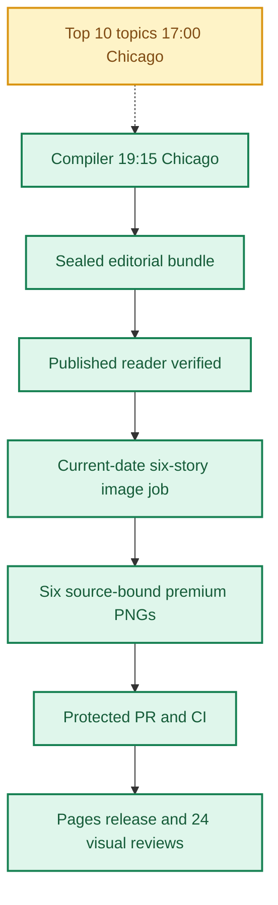

**🟩 RELEASE COMPLETE**
**TOP 10 NOT_APPLICABLE** · **🟩 COMPILER VERIFIED** · **🟦 IMAGES 6/6 RELEASED** · **🟪 VISUAL QA 24/24 PASS**

# Daily AI Brief — Unified Production After-Action Report
**Edition:** October 22, 2026 · **Production evening:** 2026-10-21 · **Timezone:** America/Chicago
**Primary public reader:** [Open 2026-10-22 Brief](https://gttome.github.io/Daily-AI-Brief-Compiler/briefs/2026-10-22/) · **Repository:** [Daily-AI-Brief-Compiler](https://github.com/gttome/Daily-AI-Brief-Compiler)

> **IMPORTANT — VERIFIED PRODUCTION RESULT**
> **Executive release result: COMPLETE.** This is the single management-facing report covering Top 10 topic discovery, the editorial Compiler, published Brief and premium-image run. **Entire-system evidence: NOT_APPLICABLE.** Top 10 report: **Not reported**; Compiler handoff: **NOT_APPLICABLE**; guided searches: **NOT_APPLICABLE**. Compiler public status: **VERIFIED**. Image release: **RELEASED_VERIFIED**. Direct 24-context visual quality: **24/24 PASS**. Autonomous completion: **UNPROVEN**. Missing evidence must not be promoted to a success claim.

**🕒 Production stage durations:** **Top 10 Not recorded** · **Compiler final seal window 42m 01s** · **Premium Images 51m 39s** (evidence-bounded elapsed times; the start/end events differ).

## Evidence reconciliation

Compiler final seal window: 42m 01s. Initial execution start not established; final seal window is not total runtime.
Image capability route preflight: NOT OBSERVED; scheduler origin remains UNPROVEN.
Image efficiency: 1/6 first-pass accepts; 14 total attempts. November 3–5 target: at least 3/6 first-pass and at most 2 attempts per image, with unchanged quality floor.
Image review completed: 2026-10-22T03:10:44Z; review-record commit: 2026-10-22T03:17:33.000Z; protected review merge: 2026-10-22T03:25:53.000Z.

## Performance dashboard

| Measure | Recorded result | Source / caveat |
|:--|:--:|:--|
| Entire-system evidence | **NOT_APPLICABLE** | Full Top 10 list, bound Compiler input, all-format search receipts and existing release checks; separate from publication and autonomy |
| Top 10 report | **Not reported · Not recorded topics** | Same Chicago cycle report; provisional/partial coverage remains disclosed |
| Top 10 received by Compiler | **NOT_APPLICABLE** | Exact report snapshot bytes; consumed commit separately corroborated: UNPROVEN |
| Top 10 guided article/video/podcast searches | **NOT_APPLICABLE** | Actual source-search receipts and selected/rejected topic outcomes |
| Top 10 stage duration | **Not recorded** | Same-cycle run receipt only; no runtime or usage estimate |
| Editorial publication | **PASS** | State and public reader integrity receipt |
| **Unattended autonomy (separate from publication)** | **UNPROVEN** | Owner incident receipt takes precedence over unverified producer self-attestation |
| Recorded protected publishing gate failures | **0** | Actual same-edition GitHub failure sidecar only; earlier unrecorded failures remain unknown |
| Articles | **6** | Exactly 2 technical / 2 knowledge-worker / 2 agents required |
| Verified original sources within preceding 24 hours | **1 / 6** | Original publisher dates only; other sources require a documented fallback rationale |
| Distinct selected article publishers | **6** | Six different primary organizations preferred |
| Videos over seven days old | **2** | Must be labeled evergreen, not a new development |
| Distinct selected video publishers | **1** | One channel is one publisher even across multiple videos |
| Duplicate active Watchlist display titles | **Not recorded** | Published canonical Watchlist only; historical evidence retained |
| Original-release video playback (historical) | **NOT_RECORDED** | Later reader corrections may replace these originally verified videos; see incident register | 
| Postpublication reader incidents | **NOT_RECORDED** | Edition-specific owner reports and corrective PRs, not inferred absence | 
| Verified postpublication video corrections | **NOT_RECORDED** | Incident register tracks correction PR, actual playback evidence and reader preservation |
| Editorial index second-pass attempts | **NOT_RECORDED** | Bounded public GET retries only; never proof of original article reading |
| Editorial index reads recovered | **NOT_RECORDED** | Successful page fetch can still yield zero eligible dated items |
| Recorded scheduler capability route | **UNPROVEN** | Same-invocation route receipt only; GitHub is not scheduler authentication |
| Avoidable incomplete-staging CI failures | **Not independently audited** | Existing image-package push CI is disabled; exact-head protected PR CI remains required. A failure count requires actual workflow evidence |
| Media | **2 videos + 2 podcasts** | Sealed bundle |
| **Compiler final seal window** | **42m 01s (42.0 min)** | Final sealed-state timestamp → verified public reader; initial execution is separate |
| **Image processing stage duration** | **51m 39s** | First accepted PNG Git checkpoint → final 24/24 review; auditable stage elapsed time |
| Image scheduled-to-final-review window | **Not independently recorded** | Only with a saved one-cycle schedule anchor; does not attest exact generation start |
| Executor-observed generation-to-final-review | **57m 00s** | Only if the worker recorded a same-execution clock before its first native call; not independently verified provider runtime |
| Accepted premium PNGs | **6 / 6** | Exact package and public release hashes |
| Native image generation attempts | **14** | Image worker AAR; no estimation |
| Rejected candidates | **8** | Image worker AAR |
| Final worker checkpoint reconciliation | **HISTORICAL_NOT_GATED** | Oct25+ verifies exact generation count, per-story attempts, six accepted story/image/hash bindings and final release |
| Saved visual contexts | **24 / 24 PASS** | Dated/permanent desktop/mobile review |
| Public SHA-256 checks | **44** | Image release receipt |
| October 8 immutable history | **17 / 17** | Independent content-preservation checks |
| **Owner-reported weekly Work usage for this run** | **Not reported** | No per-cycle usage supplied |

> **EFFICIENCY NOTE**
> **Resource reporting policy:** No usage figure was supplied for this cycle, so none is assumed. Future runs show **Not reported** unless the owner supplies new cycle-specific usage metadata. No approval or extra step is required to generate the AAR.

## Production architecture and checkpoints

## Daily AI Topic Top 10 and Compiler handoff

**Research cycle:** 2026-10-21 · **Target Brief:** 2026-10-22 · **Scheduled start:** 17:00 America/Chicago

| Dimension | Recorded evidence |
|---|---|
| Run/report result | NOT\_APPLICABLE |
| Report status / topics | Not reported |
| Freshness | NOT\_OBSERVED |
| Compiler handoff | NOT\_APPLICABLE |
| Search coverage | NOT\_APPLICABLE |
| Selection mapping verification | NONE\_RECORDED |
| Observed start / finish | Not reported |
| Elapsed minutes | Not reported |
| Usage percent | Not reported |
| Cost USD | Not reported |
| Independent scheduler autonomy | UNPROVEN |
| Compiler-recorded consumed commit | Not reported |
| Report SHA-256 | Not reported |

The Top 10 handoff was not applicable before the November 2, 2026 research cycle.

No valid cycle-specific ranked list is available in the collected evidence.

**Sample scope:** Not reported. **Ranking basis:** Not reported.

| Search format | Receipt rows | Attempts recorded | Explicitly not attempted |
|---|---:|---:|---:|
| article | 0 | 0 | 0 |
| video | 0 | 0 | 0 |
| podcast | 0 | 0 | 0 |

**Selected Brief items linked to trends:**

No validated selection-to-topic mapping was recorded.

Report, source-readback and search receipts are separate observations. Snapshot binding verifies the collected report bytes; the consumed commit is independently corroborated only when the separately fetched source bytes match. These records do not independently attest scheduler identity or source truth. Top 10 reporting does not change Brief/image release status.

## Track 1 — Compiler

**State:** `SHADOW_VERIFIED` · **Bundle:** `BUNDLE_READY` · **Compiler final seal window:** 42m 01s (42.0 min).

| Publication gate | Result |
|---|:---:|
| Canonical reader build | ✅ |
| Reader parity | ✅ |
| Public verification of dated edition | ✅ |
| Previous editions preserved | ✅ |
| Permanent story routes and feeds | ✅ |

**Selected coverage:**

| Lane | Story |
|---|---|
| Technical AI Engineering | NVIDIA splits agent retrieval into embedding, reranking and document parsing |
| Technical AI Engineering | CrowdStrike documents threat actors experimenting with agentic attack workflows |
| Applied Generative AI for Knowledge Workers | Yorkshire Ambulance Service keeps Copilot on the administrative side of care |
| Applied Generative AI for Knowledge Workers | Asana puts prebuilt AI Teammates inside ordinary project handoffs |
| Agents for Everyone | Claude Duet tests proactive briefs with approval gates for consequential actions |
| Agents for Everyone | Salesforce turns a repeated office workflow into a reviewable reusable Skill |

## Track 2 — Premium images

**Public status:** `RELEASED_VERIFIED` · **Saved images:** 6/6 · **Actual generation attempts:** 14 · **Rejected candidates:** 8.

### Image production duration — Git-verified milestones

**Auditable image stage duration:** **51m 39s** (first accepted binary saved in Git → first persisted 24-context quality-review record). **First asset to public image release:** **34m 24s**.
**Scheduled-to-final-review window:** **Not independently recorded**. This is a scheduled-clock comparison only when a separately recorded exact-date schedule exists; it is **not** measured native image-generation runtime.

| Production milestone | Chicago local time | Evidence |
|---|---|---|
| Scheduled image start (if exact-date record exists) | Not independently recorded | Time planned, not actual execution start |
| First executor-observed start | 9:12:44 PM | Worker self-attestation, not a first-party scheduler event |
| First native generation observation | 9:20:33 PM | Worker clock recorded immediately before first native call, not model-provider telemetry |
| First accepted PNG bytes saved to Git | 9:25:54 PM | Immutable binary-stage commit |
| Six-image package / reviews committed | 9:49:31 PM | Exact-head PR source commit |
| Protected package merged | 9:59:32 PM | Merge SHA and required CI |
| Public images verified | 10:00:18 PM | Image-release receipt |
| 24/24 review record committed | 10:17:33 PM | Immutable first review-approval commit |

> **Duration interpretation:** The audited stage excludes unobservable pre-checkpoint creative work. The scheduled-start window includes it but must not be interpreted as precise active processing time. Missing timestamps appear as **Not independently recorded**, never an estimate.

| Source-bound image | Attempts | File size | Public page |
|---|---:|---:|---|
| NVIDIA splits agent retrieval into embedding, reranking and document parsing | 3 | 0.48 MiB | [View original](https://gttome.github.io/Daily-AI-Brief-Compiler/briefs/images/2026-10-22/dab-edition-2026-10-22-m01.png) |
| CrowdStrike documents threat actors experimenting with agentic attack workflows | 2 | 0.59 MiB | [View original](https://gttome.github.io/Daily-AI-Brief-Compiler/briefs/images/2026-10-22/dab-edition-2026-10-22-m02.png) |
| Yorkshire Ambulance Service keeps Copilot on the administrative side of care | 3 | 0.55 MiB | [View original](https://gttome.github.io/Daily-AI-Brief-Compiler/briefs/images/2026-10-22/dab-edition-2026-10-22-m10.png) |
| Asana puts prebuilt AI Teammates inside ordinary project handoffs | 1 | 0.65 MiB | [View original](https://gttome.github.io/Daily-AI-Brief-Compiler/briefs/images/2026-10-22/dab-edition-2026-10-22-m11.png) |
| Claude Duet tests proactive briefs with approval gates for consequential actions | 3 | 0.64 MiB | [View original](https://gttome.github.io/Daily-AI-Brief-Compiler/briefs/images/2026-10-22/dab-edition-2026-10-22-m12.png) |
| Salesforce turns a repeated office workflow into a reviewable reusable Skill | 2 | 0.48 MiB | [View original](https://gttome.github.io/Daily-AI-Brief-Compiler/briefs/images/2026-10-22/dab-edition-2026-10-22-m14.png) |

**Immutable-release and visual gates:**

| Release gate | Result |
|---|:---:|
| Protected public image receipt | ✅ |
| Accepted-image Git hash bindings | ✅ |
| Six live PNGs | 6/6 |
| Dated/permanent story placements | 12/12 recorded in release evidence |
| Desktop/mobile visual inspection | 24/24 PASS |
| Historical Oct 8 integrity | 17/17 |

### Published premium illustrations

<table>
<tr><td width="50%"> <b>NVIDIA splits agent retrieval into embedding, reranking and document parsing</b></td><td width="50%"> <b>CrowdStrike documents threat actors experimenting with agentic attack workflows</b></td></tr>
<tr><td width="50%"> <b>Yorkshire Ambulance Service keeps Copilot on the administrative side of care</b></td><td width="50%"> <b>Asana puts prebuilt AI Teammates inside ordinary project handoffs</b></td></tr>
<tr><td width="50%"> <b>Claude Duet tests proactive briefs with approval gates for consequential actions</b></td><td width="50%"> <b>Salesforce turns a repeated office workflow into a reviewable reusable Skill</b></td></tr>
</table>

## Incidents, corrections and learning

### Postpublication reader incidents (updated when new evidence is merged)

No current-edition postpublication incident register was available; this is **NOT_RECORDED**, not a certification of zero incidents.

**Editor recovery classification:** UNPROVEN. **Owner intervention:** Unproven either way. **Protected same-edition failures recorded:** 0. 
**Latest failed protected stage:** Not in same-edition receipts; [Action evidence](https://github.com/gttome/Daily-AI-Brief-Compiler/actions). Exact stage durations are available only where real source timestamps exist.

| Stage | Verified issue | Corrective action |
|---|---|---|
| Saved-pixel candidate review: oct22-t1-multimodal-retrieval | Simulated writing, landscape icons and quantitative-looking bars. | Replaced all unsupported marks with blank geometric evidence patches. |
| Saved-pixel candidate review: oct22-t1-multimodal-retrieval | Parse arrow attached to wrong path. | Moved Parse to structure branch and separated direct image embedding. |
| Saved-pixel candidate review: oct22-t2-agentic-threat-campaigns | Simulated writing on investigation papers and decorative executor gear. | Removed strokes and gear; split right-side alternatives. |
| Saved-pixel candidate review: oct22-k1-nhs-admin-copilot | Simulated writing in lower clinical exclusion area. | Removed every writing-like stroke. |
| Saved-pixel candidate review: oct22-k1-nhs-admin-copilot | Output labels were too small after exact1200x630 export. | Enlarged label typography and wrapped words without changing mechanism. |
| Saved-pixel candidate review: oct22-a1-claude-duet | Writing-like marks and unsupported preparation-to-action pipes. | Blank folios and common approval boundary replaced false pipes. |
| Saved-pixel candidate review: oct22-a1-claude-duet | Small captions after final-size export. | Doubled caption height and wrapped stage/action labels. |
| Saved-pixel candidate review: oct22-a2-salesforce-skills | Invented window chrome and sparse review/test boxes. | Removed UI and exposed package inspection, sample comparison, decision gate and reuse copies. |
| Initial repository discovery | History branch name was initially used as a directory path; several referenced documents were first tried at incorrect locations. | Read exact shadow-pages-history ref and canonical root/docs paths; current immutable job and source bundle hashes matched. |
| Connected binary transport | Local Git push had no credentials; generic fetch_blob attempted UTF-8 decoding of PNG bytes and failed. | Used connected GitHub create_blob, expected-head tree/commit/ref writes and base64 fetch_file readback; all six bytes matched. |
| Saved image readback timing | One image-open attempt raced an unfinished local lazy Git blob download. | Waited for completion and matched SHA-256; later verified all six through connected base64 readback and Git objects. |
| Rejected-original evidence transport | A large native PNG base64 JSON output was truncated by the local command output limit before upload. | Read bounded slices, checked complete encoded length and matched returned Git blob SHA for all eight preserved rejected originals. |
| Combined report convergence | Initial terminal receipt used custom lease-release fields that the existing combined reporter did not recognize. | Added canonical lease_status RELEASED and all six accepted_hashes without changing accepted PNGs or manifest. |

> **OPERATIONAL NOTE**
> This report distinguishes a published and verified production outcome from scheduler metadata exposed to another conversation. Lack of a live host heartbeat in a separate normal chat is not a Compiler production failure.

## Usage and cost stewardship

| Item | Per-cycle value |
|---|---|
| **Weekly Work usage reported by owner** | **Not reported** |
| Internal weekly usage reference | Target under 5% |
| Genuine image-generation attempts | 14 |
| Accepted diagrams | 6 |
| Regeneration after acceptance | 0 |
| Top 10 reported usage | Not reported |
| Top 10 reported cost | Not reported |
| Account-level billing telemetry | Not independently accessible to deterministic GitHub reporting |

**Future reporting rule:** For cycles without an optional owner-usage record, publish the complete AAR with `Not reported`; do not reuse prior percentages, guess remaining weekly credits or delay tomorrow's production.

## Next-edition operating handoff

| Control | Recurring contract |
|---|---|
| AI Topic Top 10 | Sole report task · 17:00 America/Chicago · saved dated list guides same-evening research |
| Primary Compiler | Sole existing task · 19:15 America/Chicago |
| Premium image production | Sole existing task · standard 21:15 America/Chicago |
| Exact image job selection | Newly published next-date `PUBLISHED_PENDING` only |
| AAR | Combined report generated automatically from new GitHub receipts |
| Optional Work usage | Owner-supplied per cycle, otherwise `Not reported` |

> **SCHEDULE RESTORATION NOTE**
> A temporary scheduling exception must be explicitly restored before claiming standard-time readiness. This deterministic document generator reads existing state only; it does not modify production schedules.

## Evidence register

| Evidence | Link |
|---|---|
| Compiler state | [Open receipt](https://github.com/gttome/Daily-AI-Brief-Compiler/blob/shadow/2026-10-22/shadow-runs/2026-10-22/compiler-state.json) |
| Compiler compile receipt | [Open receipt](https://github.com/gttome/Daily-AI-Brief-Compiler/blob/shadow/2026-10-22/shadow-runs/2026-10-22/compiler/compile-receipt.json) |
| Compiler public integrity | [Open receipt](https://github.com/gttome/Daily-AI-Brief-Compiler/blob/shadow/2026-10-22/shadow-runs/2026-10-22/compiler/postpublish-integrity.json) |
| Image release receipt | [Open receipt](https://github.com/gttome/Daily-AI-Brief-Compiler/blob/shadow-pages-history/site/image-jobs/2026-10-22/release.json) |
| Image review | [Open receipt](https://github.com/gttome/Daily-AI-Brief-Compiler/blob/main/external-image-packages/2026-10-22/reviews/live/semantic-pixel-review.json) |
| Original image AAR | [Open receipt](https://github.com/gttome/Daily-AI-Brief-Compiler/blob/main/external-image-packages/2026-10-22/reviews/after-action.md) |

**Image workflow:** [Workflow evidence](https://github.com/gttome/Daily-AI-Brief-Compiler/actions/runs/39714386655).

---

*Generated deterministically from cycle- and edition-specific GitHub records. The report combines the ranked Top 10, its Compiler handoff and searches, the published Brief, and the image run; original research, Compiler, image, hash, and review receipts remain immutable. This reporting action creates no stories, images, releases, extra AI tasks, or schedule changes.*
