**🟩 RELEASE COMPLETE**
**🟩 COMPILER VERIFIED** · **🟦 IMAGES 6/6 RELEASED** · **🟪 VISUAL QA 24/24 PASS**

# Daily AI Brief — Unified Production After-Action Report
**Edition:** October 26, 2026 · **Production evening:** 2026-10-25 · **Timezone:** America/Chicago
**Primary public reader:** [Open 2026-10-26 Brief](https://gttome.github.io/Daily-AI-Brief-Compiler/briefs/2026-10-26/) · **Repository:** [Daily-AI-Brief-Compiler](https://github.com/gttome/Daily-AI-Brief-Compiler)

> **IMPORTANT — VERIFIED PRODUCTION RESULT**
> **Executive result: COMPLETE.** This is the single management-facing report combining the editorial Compiler and premium-image publication. Compiler public status: **VERIFIED**. Image release: **RELEASED_VERIFIED**. Direct 24-context visual quality: **24/24 PASS**. Autonomous completion: **FAIL_OWNER_RECOVERY**. Missing evidence must not be promoted to a success claim.

**🕒 Production stage durations:** **Compiler 15m 33s** · **Premium Images 32m 11s** (evidence-bounded elapsed times; the start/end events differ).

## Performance dashboard

| Measure | Recorded result | Source / caveat |
|:--|:--:|:--|
| Editorial publication | **PASS** | State and public reader integrity receipt |
| **Unattended autonomy (separate from publication)** | **FAIL_OWNER_RECOVERY** | Owner incident receipt takes precedence over unverified producer self-attestation |
| Recorded protected publishing gate failures | **1** | Actual same-edition GitHub failure sidecar only; earlier unrecorded failures remain unknown |
| Articles | **6** | Exactly 2 technical / 2 knowledge-worker / 2 agents required |
| Verified original sources within preceding 24 hours | **0 / 6** | Original publisher dates only; other sources require a documented fallback rationale |
| Distinct selected article publishers | **6** | Six different primary organizations preferred |
| Videos over seven days old | **2** | Must be labeled evergreen, not a new development |
| Distinct selected video publishers | **1** | One channel is one publisher even across multiple videos |
| Duplicate active Watchlist display titles | **Not recorded** | Published canonical Watchlist only; historical evidence retained |
| Recorded scheduler capability route | **CAPABILITY_ROUTE_PROVEN** | Same-invocation route receipt only; GitHub is not scheduler authentication |
| Avoidable incomplete-staging CI failures | **Not independently audited** | Existing image-package push CI is disabled; exact-head protected PR CI remains required. A failure count requires actual workflow evidence |
| Media | **2 videos + 2 podcasts** | Sealed bundle |
| **Compiler stage duration** | **15m 33s (15.6 min)** | First persisted Compiler state → verified public reader; not a host scheduler attestation |
| **Image processing stage duration** | **32m 11s** | First accepted PNG Git checkpoint → final 24/24 review; auditable stage elapsed time |
| Image scheduled-to-final-review window | **Not independently recorded** | Only with a saved one-cycle schedule anchor; does not attest exact generation start |
| Executor-observed generation-to-final-review | **39m 09s** | Only if the worker recorded a same-execution clock before its first native call; not independently verified provider runtime |
| Accepted premium PNGs | **6 / 6** | Exact package and public release hashes |
| Native image generation attempts | **16** | Image worker AAR; no estimation |
| Rejected candidates | **10** | Image worker AAR |
| Final worker checkpoint reconciliation | **PASS** | Oct25+ verifies exact generation count, per-story attempts, six accepted story/image/hash bindings and final release |
| Saved visual contexts | **24 / 24 PASS** | Dated/permanent desktop/mobile review |
| Public SHA-256 checks | **44** | Image release receipt |
| October 8 immutable history | **17 / 17** | Independent content-preservation checks |
| **Owner-reported weekly Work usage for this run** | **Not reported** | No per-cycle usage supplied |

> **EFFICIENCY NOTE**
> **Resource reporting policy:** No usage figure was supplied for this cycle, so none is assumed. Future runs show **Not reported** unless the owner supplies new cycle-specific usage metadata. No approval or extra step is required to generate the AAR.

## Production architecture and checkpoints

```mermaid
flowchart LR
  A["Compiler 19:15 Chicago"] --> B["Sealed editorial bundle"]
  B --> C["Published reader verified"]
  C --> D["Current-date six-story image job"]
  D --> E["Six source-bound premium PNGs"]
  E --> F["Protected PR and CI"]
  F --> G["Pages release and 24 visual reviews"]
  classDef done fill:#dff6eb,color:#165c39,stroke:#168052,stroke-width:2px
  classDef uncertain fill:#fef3c7,color:#804c14,stroke:#d99412,stroke-width:2px
  class A,B,C,D done
  class E,F,G done
```

## Track 1 — Compiler

**State:** `SHADOW_VERIFIED` · **Bundle:** `BUNDLE_READY` · **Compiler duration:** 15m 33s (15.6 min).

| Publication gate | Result |
|---|:---:|
| Canonical reader build | ✅ |
| Reader parity | ✅ |
| Public verification of dated edition | ✅ |
| Previous editions preserved | ✅ |
| Permanent story routes and feeds | ✅ |

**Selected coverage:**

| Lane | Story |
|---|---|
| Technical AI Engineering | Databricks tests declarative pipelines as a safer target for coding agents |
| Technical AI Engineering | OpenAI explains how Habitat rebalanced storage for more than one billion users |
| Applied Generative AI for Knowledge Workers | UT Austin builds a cross-disciplinary sports analytics lab on Google Cloud |
| Applied Generative AI for Knowledge Workers | Salesforce outlines conversational agents for hardware-asset lifecycle work |
| Agents for Everyone | Microsoft publishes a reusable Skill-authoring lab for business workflows |
| Agents for Everyone | Oracle adds human-approved command centers for recruiting and workforce operations |

## Track 2 — Premium images

**Public status:** `RELEASED_VERIFIED` · **Saved images:** 6/6 · **Actual generation attempts:** 16 · **Rejected candidates:** 10.

### Image production duration — Git-verified milestones

**Auditable image stage duration:** **32m 11s** (first accepted binary saved in Git → final 24-context quality-review merge). **First asset to public image release:** **25m 17s**.
**Scheduled-to-final-review window:** **Not independently recorded**. This is a scheduled-clock comparison only when a separately recorded exact-date schedule exists; it is **not** measured native image-generation runtime.

| Production milestone | Chicago local time | Evidence |
|---|---|---|
| Scheduled image start (if exact-date record exists) | Not independently recorded | Time planned, not actual execution start |
| First executor-observed start | 9:16:47 PM | Worker self-attestation, not a first-party scheduler event |
| First native generation observation | 9:21:45 PM | Worker clock recorded immediately before first native call, not model-provider telemetry |
| First accepted PNG bytes saved to Git | 9:28:43 PM | Immutable binary-stage commit |
| Six-image package / reviews committed | 9:49:27 PM | Exact-head PR source commit |
| Protected package merged | 9:53:09 PM | Merge SHA and required CI |
| Public images verified | 9:54:00 PM | Image-release receipt |
| Final 24/24 semantic visual review approved | 10:00:54 PM | Immutable first review-approval commit |

> **Duration interpretation:** The audited stage excludes unobservable pre-checkpoint creative work. The scheduled-start window includes it but must not be interpreted as precise active processing time. Missing timestamps appear as **Not independently recorded**, never an estimate.

| Source-bound image | Attempts | File size | Public page |
|---|---:|---:|---|
| Databricks tests declarative pipelines as a safer target for coding agents | 4 | 0.54 MiB | [View original](https://gttome.github.io/Daily-AI-Brief-Compiler/briefs/images/2026-10-26/dab-edition-2026-10-26-m01.png) |
| OpenAI explains how Habitat rebalanced storage for more than one billion users | 2 | 0.59 MiB | [View original](https://gttome.github.io/Daily-AI-Brief-Compiler/briefs/images/2026-10-26/dab-edition-2026-10-26-m02.png) |
| UT Austin builds a cross-disciplinary sports analytics lab on Google Cloud | 2 | 0.58 MiB | [View original](https://gttome.github.io/Daily-AI-Brief-Compiler/briefs/images/2026-10-26/dab-edition-2026-10-26-m10.png) |
| Salesforce outlines conversational agents for hardware-asset lifecycle work | 4 | 0.61 MiB | [View original](https://gttome.github.io/Daily-AI-Brief-Compiler/briefs/images/2026-10-26/dab-edition-2026-10-26-m11.png) |
| Microsoft publishes a reusable Skill-authoring lab for business workflows | 2 | 0.57 MiB | [View original](https://gttome.github.io/Daily-AI-Brief-Compiler/briefs/images/2026-10-26/dab-edition-2026-10-26-m12.png) |
| Oracle adds human-approved command centers for recruiting and workforce operations | 2 | 0.61 MiB | [View original](https://gttome.github.io/Daily-AI-Brief-Compiler/briefs/images/2026-10-26/dab-edition-2026-10-26-m14.png) |

**Immutable-release and visual gates:**

| Release gate | Result |
|---|:---:|
| Protected public image receipt | ✅ |
| Accepted-image Git hash bindings | ✅ |
| Six live PNGs | 6/6 |
| Dated/permanent story placements | 12/12 recorded in release evidence |
| Desktop/mobile visual inspection | 24/24 PASS |
| Historical Oct 8 integrity | 17/17 |

### Published premium illustrations

<table>
<tr><td width="50%"> <b>Databricks tests declarative pipelines as a safer target for coding agents</b></td><td width="50%"> <b>OpenAI explains how Habitat rebalanced storage for more than one billion users</b></td></tr>
<tr><td width="50%"> <b>UT Austin builds a cross-disciplinary sports analytics lab on Google Cloud</b></td><td width="50%"> <b>Salesforce outlines conversational agents for hardware-asset lifecycle work</b></td></tr>
<tr><td width="50%"> <b>Microsoft publishes a reusable Skill-authoring lab for business workflows</b></td><td width="50%"> <b>Oracle adds human-approved command centers for recruiting and workforce operations</b></td></tr>
</table>

## Incidents, corrections and learning

**Editor recovery classification:** FAIL_OWNER_RECOVERY. **Owner intervention:** Documented and required. **Protected same-edition failures recorded:** 1. 
**Latest failed protected stage:** IMAGE_HANDOFF; [Action evidence](https://github.com/gttome/Daily-AI-Brief-Compiler/actions/runs/40248965568). Exact stage durations are available only where real source timestamps exist.
**Owner-initiated recovery record:** [DAB-COMPILER-20261026-IMAGE-HANDOFF-001](https://github.com/gttome/Daily-AI-Brief-Compiler/blob/main/docs/after-action/2026-10-26-compiler-production-aar.json). Corrected in [PR #253](https://github.com/gttome/Daily-AI-Brief-Compiler/pull/253). Owner-message timing and independent scheduler identity remain unproven.

| Stage | Verified issue | Corrective action |
|---|---|---|
| Native saved-pixel review | oct26-t1-declarative-agent-pipelines attempt 1: Decorative gears and pseudo-mechanical filler; Benchmark caveat incorrectly downstream of output test; Unsafe edge margins | Corrected only rejected candidate with native image editing; exported and inspected saved pixels again before locking. |
| Native saved-pixel review | oct26-t1-declarative-agent-pipelines attempt 2: Final-export text too small | Corrected only rejected candidate with native image editing; exported and inspected saved pixels again before locking. |
| Native saved-pixel review | oct26-t1-declarative-agent-pipelines attempt 3: Unlisted explanatory sentences; Pipeline-to-execution connector bypassed validation | Corrected only rejected candidate with native image editing; exported and inspected saved pixels again before locking. |
| Native saved-pixel review | oct26-t2-habitat-cosmos-scaling attempt 1: Unsupported throttle-to-proxy arrows; Selective replication drawn as cache input; Capacity caveat drawn with causal outputs | Corrected only rejected candidate with native image editing; exported and inspected saved pixels again before locking. |
| Native saved-pixel review | oct26-k1-bevo-sports-analytics attempt 1: Unapproved simulated document strokes; Unsupported bar charts suggest measured results | Corrected only rejected candidate with native image editing; exported and inspected saved pixels again before locking. |
| Native saved-pixel review | oct26-k2-agentic-hardware-assets attempt 1: Unlisted Request intent label and simulated writing; Decorative gear and policy shield; Vendor caveat connected as workflow terminal | Corrected only rejected candidate with native image editing; exported and inspected saved pixels again before locking. |
| Native saved-pixel review | oct26-k2-agentic-hardware-assets attempt 2: Correct relations but insufficient exposed mechanism detail | Corrected only rejected candidate with native image editing; exported and inspected saved pixels again before locking. |
| Native saved-pixel review | oct26-k2-agentic-hardware-assets attempt 3: Mechanism correct but final-export secondary label type too small | Corrected only rejected candidate with native image editing; exported and inspected saved pixels again before locking. |
| Native saved-pixel review | oct26-a1-copilot-skill-authoring attempt 1: Insufficient exposed target-testing and evidence-comparison detail; Caveat dominates composition and adds unlisted period | Corrected only rejected candidate with native image editing; exported and inspected saved pixels again before locking. |
| Native saved-pixel review | oct26-a2-oracle-recruiting-command attempt 1: Simulated writing inside interview/feedback symbols; Size-graded recommendation tokens may imply unsupported scores | Corrected only rejected candidate with native image editing; exported and inspected saved pixels again before locking. |
| GitHub binary readback | fetch_blob tried UTF-8 decoding of PNG and raised UnicodeDecodeError | Used connected fetch_file encoding base64 at exact image commit; verified complete base64 bytes equal local accepted PNG. |
| Local package preflight | Single-branch shallow checkout initially lacked remote main/source refs and ancestry proof. | Fetched exact main/history/source refs and full ancestry, then obtained PRE_PR_PACKAGE_PASS before opening PR #255. |

> **OPERATIONAL NOTE**
> This report distinguishes a published and verified production outcome from scheduler metadata exposed to another conversation. Lack of a live host heartbeat in a separate normal chat is not a Compiler production failure.

## Usage and cost stewardship

| Item | Per-cycle value |
|---|---|
| **Weekly Work usage reported by owner** | **Not reported** |
| Internal weekly usage reference | Target under 5% |
| Genuine image-generation attempts | 16 |
| Accepted diagrams | 6 |
| Regeneration after acceptance | 0 |
| Account-level billing telemetry | Not independently accessible to deterministic GitHub reporting |

**Future reporting rule:** For cycles without an optional owner-usage record, publish the complete AAR with `Not reported`; do not reuse prior percentages, guess remaining weekly credits or delay tomorrow's production.

## Next-edition operating handoff

| Control | Recurring contract |
|---|---|
| Primary Compiler | Sole existing task · 19:15 America/Chicago |
| Premium image production | Sole existing task · standard 21:15 America/Chicago |
| Exact image job selection | Newly published next-date `PUBLISHED_PENDING` only |
| AAR | Combined report generated automatically from new GitHub receipts |
| Optional Work usage | Owner-supplied per cycle, otherwise `Not reported` |

> **SCHEDULE RESTORATION NOTE**
> A temporary scheduling exception must be explicitly restored before claiming standard-time readiness. This deterministic document generator reads existing state only; it does not modify production schedules.

## Evidence register

| Evidence | Link |
|---|---|
| Compiler state | [Open receipt](https://github.com/gttome/Daily-AI-Brief-Compiler/blob/shadow/2026-10-26/shadow-runs/2026-10-26/compiler-state.json) |
| Compiler compile receipt | [Open receipt](https://github.com/gttome/Daily-AI-Brief-Compiler/blob/shadow/2026-10-26/shadow-runs/2026-10-26/compiler/compile-receipt.json) |
| Compiler public integrity | [Open receipt](https://github.com/gttome/Daily-AI-Brief-Compiler/blob/shadow/2026-10-26/shadow-runs/2026-10-26/compiler/postpublish-integrity.json) |
| Image release receipt | [Open receipt](https://github.com/gttome/Daily-AI-Brief-Compiler/blob/shadow-pages-history/site/image-jobs/2026-10-26/release.json) |
| Image review | [Open receipt](https://github.com/gttome/Daily-AI-Brief-Compiler/blob/main/external-image-packages/2026-10-26/reviews/live/semantic-pixel-review.json) |
| Original image AAR | [Open receipt](https://github.com/gttome/Daily-AI-Brief-Compiler/blob/main/external-image-packages/2026-10-26/reviews/after-action.md) |

**Image workflow:** [Workflow evidence](https://github.com/gttome/Daily-AI-Brief-Compiler/actions/runs/40261305734).

---

*Generated deterministically from edition-specific GitHub records. Primary report is a synthesis; original Compiler, image, hash, and review receipts remain immutable. This reporting action creates no stories, images, releases, extra AI tasks, or schedule changes.*
