**🟨 RELEASE PARTIAL**
**🟩 COMPILER VERIFIED** · **🟨 IMAGES NOT YET COMPLETE** · **🟨 VISUAL QA NOT YET VERIFIED**

# Daily AI Brief — Unified Production After-Action Report
**Edition:** October 28, 2026 · **Production evening:** 2026-10-27 · **Timezone:** America/Chicago
**Primary public reader:** [Open 2026-10-28 Brief](https://gttome.github.io/Daily-AI-Brief-Compiler/briefs/2026-10-28/) · **Repository:** [Daily-AI-Brief-Compiler](https://github.com/gttome/Daily-AI-Brief-Compiler)

> **IMPORTANT — VERIFIED PRODUCTION RESULT**
> **Executive result: PARTIAL.** This is the single management-facing report combining the editorial Compiler and premium-image publication. Compiler public status: **VERIFIED**. Image release: **not complete**. Direct 24-context visual quality: **not yet evidenced**. Autonomous completion: **UNPROVEN**. Missing evidence must not be promoted to a success claim.

**🕒 Production stage durations:** **Compiler 59m 58s** · **Premium Images Not independently recorded** (evidence-bounded elapsed times; the start/end events differ).

> **CLOSEOUT WARNING:** The exact image worker has not released its lease and recorded PUBLISHED_COMPLETE with the six accepted hashes.

## Performance dashboard

| Measure | Recorded result | Source / caveat |
|:--|:--:|:--|
| Editorial publication | **PASS** | State and public reader integrity receipt |
| **Unattended autonomy (separate from publication)** | **UNPROVEN** | Owner incident receipt takes precedence over unverified producer self-attestation |
| Recorded protected publishing gate failures | **8** | Actual same-edition GitHub failure sidecar only; earlier unrecorded failures remain unknown |
| Articles | **6** | Exactly 2 technical / 2 knowledge-worker / 2 agents required |
| Verified original sources within preceding 24 hours | **0 / 6** | Original publisher dates only; other sources require a documented fallback rationale |
| Distinct selected article publishers | **5** | Six different primary organizations preferred |
| Videos over seven days old | **2** | Must be labeled evergreen, not a new development |
| Distinct selected video publishers | **2** | One channel is one publisher even across multiple videos |
| Duplicate active Watchlist display titles | **0** | Published canonical Watchlist only; historical evidence retained |
| Recorded scheduler capability route | **CAPABILITY_ROUTE_PROVEN** | Same-invocation route receipt only; GitHub is not scheduler authentication |
| Avoidable incomplete-staging CI failures | **Not independently audited** | Existing image-package push CI is disabled; exact-head protected PR CI remains required. A failure count requires actual workflow evidence |
| Media | **2 videos + 2 podcasts** | Sealed bundle |
| **Compiler stage duration** | **59m 58s (60.0 min)** | First persisted Compiler state → verified public reader; not a host scheduler attestation |
| **Image processing stage duration** | **Not independently recorded** | First accepted PNG Git checkpoint → final 24/24 review; auditable stage elapsed time |
| Image scheduled-to-final-review window | **Not independently recorded** | Only with a saved one-cycle schedule anchor; does not attest exact generation start |
| Executor-observed generation-to-final-review | **Not independently recorded** | Only if the worker recorded a same-execution clock before its first native call; not independently verified provider runtime |
| Accepted premium PNGs | **Not complete / 6** | Exact package and public release hashes |
| Native image generation attempts | **19** | Image worker AAR; no estimation |
| Rejected candidates | **13** | Image worker AAR |
| Final worker checkpoint reconciliation | **MISMATCH** | Oct25+ verifies exact generation count, per-story attempts, six accepted story/image/hash bindings and final release |
| Saved visual contexts | **Unverified** | Dated/permanent desktop/mobile review |
| Public SHA-256 checks | **Not recorded** | Image release receipt |
| October 8 immutable history | **17 / 17** | Independent content-preservation checks |
| **Owner-reported weekly Work usage for this run** | **Not reported** | No per-cycle usage supplied |

> **EFFICIENCY NOTE**
> **Resource reporting policy:** No usage figure was supplied for this cycle, so none is assumed. Future runs show **Not reported** unless the owner supplies new cycle-specific usage metadata. No approval or extra step is required to generate the AAR.

## Production architecture and checkpoints

```mermaid
flowchart LR
  A["Compiler 19:15 Chicago"] --> B["Sealed editorial bundle"]
  B --> C["Published reader verified"]
  C --> D["Current-date six-story image job"]
  D --> E["Six source-bound premium PNGs"]
  E --> F["Protected PR and CI"]
  F --> G["Pages release and 24 visual reviews"]
  classDef done fill:#dff6eb,color:#165c39,stroke:#168052,stroke-width:2px
  classDef uncertain fill:#fef3c7,color:#804c14,stroke:#d99412,stroke-width:2px
  class A,B,C,D done
  class E,F,G uncertain
```

## Track 1 — Compiler

**State:** `SHADOW_VERIFIED` · **Bundle:** `BUNDLE_READY` · **Compiler duration:** 59m 58s (60.0 min).

| Publication gate | Result |
|---|:---:|
| Canonical reader build | ✅ |
| Reader parity | ✅ |
| Public verification of dated edition | ✅ |
| Previous editions preserved | ✅ |
| Permanent story routes and feeds | ✅ |

**Selected coverage:**

| Lane | Story |
|---|---|
| Technical AI Engineering | Google DeepMind adds native audio and steering to Genie 4 world simulation |
| Technical AI Engineering | Salesforce links continuous agent evaluation to quarantine and cost limits |
| Applied Generative AI for Knowledge Workers | Anthropic reports early Claude-assisted results across six drug-development partners |
| Applied Generative AI for Knowledge Workers | Salesforce survey finds isolated AI work creates duplication and handoff delays |
| Agents for Everyone | Oracle puts approved business workflows behind a ChatGPT workspace |
| Agents for Everyone | IBM turns agent identity and short-lived access into a reusable review procedure |

## Track 2 — Premium images

**Public status:** `NOT_OBSERVED` · **Saved images:** 0/6 · **Actual generation attempts:** 19 · **Rejected candidates:** 13.

### Image production duration — Git-verified milestones

**Auditable image stage duration:** **Not independently recorded** (first accepted binary saved in Git → final 24-context quality-review merge). **First asset to public image release:** **Not independently recorded**.
**Scheduled-to-final-review window:** **Not independently recorded**. This is a scheduled-clock comparison only when a separately recorded exact-date schedule exists; it is **not** measured native image-generation runtime.

| Production milestone | Chicago local time | Evidence |
|---|---|---|
| Scheduled image start (if exact-date record exists) | Not independently recorded | Time planned, not actual execution start |
| First executor-observed start | Not independently recorded | Worker self-attestation, not a first-party scheduler event |
| First native generation observation | Not independently recorded | Worker clock recorded immediately before first native call, not model-provider telemetry |
| First accepted PNG bytes saved to Git | Not independently recorded | Immutable binary-stage commit |
| Six-image package / reviews committed | Not independently recorded | Exact-head PR source commit |
| Protected package merged | Not independently recorded | Merge SHA and required CI |
| Public images verified | Not independently recorded | Image-release receipt |
| Final 24/24 semantic visual review approved | Not independently recorded | Immutable first review-approval commit |

> **Duration interpretation:** The audited stage excludes unobservable pre-checkpoint creative work. The scheduled-start window includes it but must not be interpreted as precise active processing time. Missing timestamps appear as **Not independently recorded**, never an estimate.

| Source-bound image | Attempts | File size | Public page |
|---|---:|---:|---|

**Immutable-release and visual gates:**

| Release gate | Result |
|---|:---:|
| Protected public image receipt | Not yet evidenced |
| Accepted-image Git hash bindings | Not yet evidenced |
| Six live PNGs | Not verified |
| Dated/permanent story placements | Not verified |
| Desktop/mobile visual inspection | Not verified |
| Historical Oct 8 integrity | Not verified |

### Published premium illustrations

No six-image public release gallery available yet.

## Incidents, corrections and learning

**Editor recovery classification:** UNPROVEN. **Owner intervention:** Unproven either way. **Protected same-edition failures recorded:** 8. 
**Latest failed protected stage:** PUBLICATION_PIPELINE; [Action evidence](https://github.com/gttome/Daily-AI-Brief-Compiler/actions/runs/40613096082). Exact stage durations are available only where real source timestamps exist.

| Stage | Verified issue | Corrective action |
|---|---|---|
| Native saved-pixel review | oct28-t1-genie4-world-simulation attempt 1: Candidate contains simulated text strokes in prompt box, landscape scenery and unsupported control sliders. Correct those regions; preserve source-supported observation loop and exact labels. | Rejected original preserved at external-image-packages/2026-10-28/reviews/rejected-oct28-t1-genie4-world-simulation-attempt-1.png. Targeted native correction and final-size reinspection produced the accepted version. Inspected final RGB pixels: nine exact readable labels, 40px safe text margins, three schematic temporal frame states, native audio and observation/planning/steering cycle. No UI strokes, scenery, logos or unsupported benchmark. Caveats detached; source preview and drift limitations explicit. Immutable GitHub base64 equals exported reviewed bytes. |
| Native saved-pixel review | oct28-t1-genie4-world-simulation attempt 2: Scenery and fake writing removed, but repeated blank frames provide insufficient explanatory detail, steering label is undersized at final export, and outer labels need larger margins. | Rejected original preserved at external-image-packages/2026-10-28/reviews/rejected-oct28-t1-genie4-world-simulation-attempt-2.png. Targeted native correction and final-size reinspection produced the accepted version. Inspected final RGB pixels: nine exact readable labels, 40px safe text margins, three schematic temporal frame states, native audio and observation/planning/steering cycle. No UI strokes, scenery, logos or unsupported benchmark. Caveats detached; source preview and drift limitations explicit. Immutable GitHub base64 equals exported reviewed bytes. |
| Native saved-pixel review | oct28-t1-genie4-world-simulation attempt 3: Improved state frames and legibility, but a second direct branch from Generate frames feeds planning, bypassing the intended observation origin. Correct only that connector. | Rejected original preserved at external-image-packages/2026-10-28/reviews/rejected-oct28-t1-genie4-world-simulation-attempt-3.png. Targeted native correction and final-size reinspection produced the accepted version. Inspected final RGB pixels: nine exact readable labels, 40px safe text margins, three schematic temporal frame states, native audio and observation/planning/steering cycle. No UI strokes, scenery, logos or unsupported benchmark. Caveats detached; source preview and drift limitations explicit. Immutable GitHub base64 equals exported reviewed bytes. |
| Native saved-pixel review | oct28-t2-agent-fabric-evals attempt 1: Candidate invents machinery, gears, badge/check symbols, quantitative budget meter and an upper threshold-bypass route. Replace with a clean source-bounded state diagram. | Rejected original preserved at external-image-packages/2026-10-28/reviews/rejected-oct28-t2-agent-fabric-evals-attempt-1.png. Targeted native correction and final-size reinspection produced the accepted version. Inspected exact final exported pixels: thirteen exact explanatory labels; priority labels enlarged, all full-size text readable. Test-generation band, conditional approval/quarantine/revision/retest/return path, independent budget cutoff and detached availability note. No simulated writing, scatter charts, machinery, success badges or bypass. Conceptual blank comparison planes are qualitative; no measured performance represented. Matching immutable connected GitHub base64 readback. |
| Native saved-pixel review | oct28-t2-agent-fabric-evals attempt 2: Sparse state chart lacks full mechanism detail and invents a retest-to-policy-approval connector. Enrich frozen plan with the actual source's agent testing and API-specification test generation; remove unsupported edge. | Rejected original preserved at external-image-packages/2026-10-28/reviews/rejected-oct28-t2-agent-fabric-evals-attempt-2.png. Targeted native correction and final-size reinspection produced the accepted version. Inspected exact final exported pixels: thirteen exact explanatory labels; priority labels enlarged, all full-size text readable. Test-generation band, conditional approval/quarantine/revision/retest/return path, independent budget cutoff and detached availability note. No simulated writing, scatter charts, machinery, success badges or bypass. Conceptual blank comparison planes are qualitative; no measured performance represented. Matching immutable connected GitHub base64 readback. |
| Native saved-pixel review | oct28-t2-agent-fabric-evals attempt 3: Source sequence and richer testing concepts now present, but simulated document writing and chart-like scatter/dashed axes violate the frozen exclusions. Strip these without adding metrics or shortcuts. | Rejected original preserved at external-image-packages/2026-10-28/reviews/rejected-oct28-t2-agent-fabric-evals-attempt-3.png. Targeted native correction and final-size reinspection produced the accepted version. Inspected exact final exported pixels: thirteen exact explanatory labels; priority labels enlarged, all full-size text readable. Test-generation band, conditional approval/quarantine/revision/retest/return path, independent budget cutoff and detached availability note. No simulated writing, scatter charts, machinery, success badges or bypass. Conceptual blank comparison planes are qualitative; no measured performance represented. Matching immutable connected GitHub base64 readback. |
| Native saved-pixel review | oct28-t2-agent-fabric-evals attempt 4: Faux writing and scatter plots removed. Return-to-service branch still originates before conditional Return if passing state, and detached availability note retains unsupported decorative objects. Correct those two regions. | Rejected original preserved at external-image-packages/2026-10-28/reviews/rejected-oct28-t2-agent-fabric-evals-attempt-4.png. Targeted native correction and final-size reinspection produced the accepted version. Inspected exact final exported pixels: thirteen exact explanatory labels; priority labels enlarged, all full-size text readable. Test-generation band, conditional approval/quarantine/revision/retest/return path, independent budget cutoff and detached availability note. No simulated writing, scatter charts, machinery, success badges or bypass. Conceptual blank comparison planes are qualitative; no measured performance represented. Matching immutable connected GitHub base64 readback. |
| Native saved-pixel review | oct28-t2-agent-fabric-evals attempt 5: Final 1200x630 export is source-consistent with corrected conditional return, but two priority labels need enlargement to the frozen 32px effective type target. | Rejected original preserved at external-image-packages/2026-10-28/reviews/rejected-oct28-t2-agent-fabric-evals-attempt-5.png. Targeted native correction and final-size reinspection produced the accepted version. Inspected exact final exported pixels: thirteen exact explanatory labels; priority labels enlarged, all full-size text readable. Test-generation band, conditional approval/quarantine/revision/retest/return path, independent budget cutoff and detached availability note. No simulated writing, scatter charts, machinery, success badges or bypass. Conceptual blank comparison planes are qualitative; no measured performance represented. Matching immutable connected GitHub base64 readback. |
| Native saved-pixel review | oct28-k1-claude-drug-development attempt 1: Candidate has source-unsupported goal-to-evidence and reversed goal/proposal arrows, faux writing in evidence stack, decorative manufacturing tanks, chart-like trial bars and undersized assay property labels. Preserve variant and assay detail; repair named regions. | Rejected original preserved at external-image-packages/2026-10-28/reviews/rejected-oct28-k1-claude-drug-development-attempt-1.png. Targeted native correction and final-size reinspection produced the accepted version. Actual final RGB pixels inspected: twelve exact readable labels; orbital proposal/test/raw-analysis/protocol-retest path now has correct origins. Lab outputs feed reviewed evidence, and manufacturing review/trial planning remain separate. All evidence sheets blank, no numerical charts, industrial scenery, success marks, people or unsupported cure claims. Mostly preclinical is detached. Full-size mobile viewing required for fine assay labels. Immutable connected GitHub bytes match export. |
| Native saved-pixel review | oct28-k2-isolated-ai-work attempt 1: Topology and caveats correct, but rocky terrain/shrubs, tiny mock-window controls and one simulated prompt stroke violate scenery/writing exclusions. Preserve labels and reported-association topology; remove those elements. | Rejected original preserved at external-image-packages/2026-10-28/reviews/rejected-oct28-k2-isolated-ai-work-attempt-1.png. Targeted native correction and final-size reinspection produced the accepted version. Exact final pixels show olive disconnected-context topology, repeated problem fragments, missing handoff gap and tool switching. Nine labels readable, caveats detached and audit brace separate from observed associations; no claims of measured gains. Scenery, faux UI controls and simulated writing removed. No people, logos, quantitative charts or success marks. Immutable GitHub base64 equals reviewed PNG. |
| Native saved-pixel review | oct28-a1-oracle-ai-workspace attempt 1: Label quality and clean source-bound layers pass, but an extra workspace-to-approval arrow bypasses Review permissions. Remove only that lower connector. | Rejected original preserved at external-image-packages/2026-10-28/reviews/rejected-oct28-a1-oracle-ai-workspace-attempt-1.png. Targeted native correction and final-size reinspection produced the accepted version. Inspected exact final RGB export: tiered system/approved-record fan-in feeds a goal-driven workspace, followed only by permission review, approval and authorized workflow. Removed extra workspace-to-approval bypass. Nine exact readable labels and generous safe margins; no fake UI, writing strokes, branding, people, unsupported outcomes or success badges. Planned-capabilities caveat detached. Immutable connected readback equals reviewed bytes. |
| Native saved-pixel review | oct28-a2-agent-access-review-skill attempt 1: Clean labels and finite credential boundary, but approval directly enters credentials instead of first passing least privilege; revocation arrow needs an explicit out-of-scope condition rather than implying all credentials are denied. | Rejected original preserved at external-image-packages/2026-10-28/reviews/rejected-oct28-a2-agent-access-review-skill-attempt-1.png. Targeted native correction and final-size reinspection produced the accepted version. Final exported pixels inspected: eleven exact readable labels, radial owner/task/system mandate feeds human approval, then least privilege and finite short-lived credentials. Dashed out-of-scope branch condition precedes denial/revocation; decision and revocation evidence reach a separate audit rail. Enlarged conditional label readable. Vendor-claim caveat detached; no people, brand marks, fake writing, security trophies or guaranteed safety. Immutable GitHub bytes match reviewed export. |
| Native saved-pixel review | oct28-a2-agent-access-review-skill attempt 2: Approval now precedes least privilege, and revocation is explicitly conditional. New Out-of-scope action label is too small in final export; enlarge only that text. | Rejected original preserved at external-image-packages/2026-10-28/reviews/rejected-oct28-a2-agent-access-review-skill-attempt-2.png. Targeted native correction and final-size reinspection produced the accepted version. Final exported pixels inspected: eleven exact readable labels, radial owner/task/system mandate feeds human approval, then least privilege and finite short-lived credentials. Dashed out-of-scope branch condition precedes denial/revocation; decision and revocation evidence reach a separate audit rail. Enlarged conditional label readable. Vendor-claim caveat detached; no people, brand marks, fake writing, security trophies or guaranteed safety. Immutable GitHub bytes match reviewed export. |
| GitHub source lookup | Initial index request treated shadow-pages-history as a folder on default main and returned 404. | Resolved the authoritative site/image-jobs/index.json on the actual shadow-pages-history ref; selected only October 28 PUBLISHED_PENDING and verified immutable job and bundle hashes. |
| Local Git publication route | A local dry-run Git push had no authenticated username route; no remote ref was changed by that attempt. | Used connected GitHub immutable blobs, trees and expected-head non-force ref updates, followed by exact-commit base64 readback; accepted images were never regenerated for transport. |

> **OPERATIONAL NOTE**
> This report distinguishes a published and verified production outcome from scheduler metadata exposed to another conversation. Lack of a live host heartbeat in a separate normal chat is not a Compiler production failure.

## Usage and cost stewardship

| Item | Per-cycle value |
|---|---|
| **Weekly Work usage reported by owner** | **Not reported** |
| Internal weekly usage reference | Target under 5% |
| Genuine image-generation attempts | 19 |
| Accepted diagrams | 6 |
| Regeneration after acceptance | 0 |
| Account-level billing telemetry | Not independently accessible to deterministic GitHub reporting |

**Future reporting rule:** For cycles without an optional owner-usage record, publish the complete AAR with `Not reported`; do not reuse prior percentages, guess remaining weekly credits or delay tomorrow's production.

## Next-edition operating handoff

| Control | Recurring contract |
|---|---|
| Primary Compiler | Sole existing task · 19:15 America/Chicago |
| Premium image production | Sole existing task · standard 21:15 America/Chicago |
| Exact image job selection | Newly published next-date `PUBLISHED_PENDING` only |
| AAR | Combined report generated automatically from new GitHub receipts |
| Optional Work usage | Owner-supplied per cycle, otherwise `Not reported` |

> **SCHEDULE RESTORATION NOTE**
> A temporary scheduling exception must be explicitly restored before claiming standard-time readiness. This deterministic document generator reads existing state only; it does not modify production schedules.

## Evidence register

| Evidence | Link |
|---|---|
| Compiler state | [Open receipt](https://github.com/gttome/Daily-AI-Brief-Compiler/blob/shadow/2026-10-28/shadow-runs/2026-10-28/compiler-state.json) |
| Compiler compile receipt | [Open receipt](https://github.com/gttome/Daily-AI-Brief-Compiler/blob/shadow/2026-10-28/shadow-runs/2026-10-28/compiler/compile-receipt.json) |
| Compiler public integrity | [Open receipt](https://github.com/gttome/Daily-AI-Brief-Compiler/blob/shadow/2026-10-28/shadow-runs/2026-10-28/compiler/postpublish-integrity.json) |
| Image release receipt | [Open receipt](https://github.com/gttome/Daily-AI-Brief-Compiler/blob/shadow-pages-history/site/image-jobs/2026-10-28/release.json) |
| Image review | [Open receipt](https://github.com/gttome/Daily-AI-Brief-Compiler/blob/main/external-image-packages/2026-10-28/reviews/live/image-element24/semantic-reviews.json) |
| Original image AAR | [Open receipt](https://github.com/gttome/Daily-AI-Brief-Compiler/blob/main/external-image-packages/2026-10-28/reviews/after-action.md) |

**Image workflow:** Not yet available.

---

*Generated deterministically from edition-specific GitHub records. Primary report is a synthesis; original Compiler, image, hash, and review receipts remain immutable. This reporting action creates no stories, images, releases, extra AI tasks, or schedule changes.*
