**🟩 RELEASE COMPLETE**
**🟩 COMPILER VERIFIED** · **🟦 IMAGES 6/6 RELEASED** · **🟪 VISUAL QA 24/24 PASS**

# Daily AI Brief — Unified Production After-Action Report
**Edition:** October 29, 2026 · **Production evening:** 2026-10-28 · **Timezone:** America/Chicago
**Primary public reader:** [Open 2026-10-29 Brief](https://gttome.github.io/Daily-AI-Brief-Compiler/briefs/2026-10-29/) · **Repository:** [Daily-AI-Brief-Compiler](https://github.com/gttome/Daily-AI-Brief-Compiler)

> **IMPORTANT — VERIFIED PRODUCTION RESULT**
> **Executive result: COMPLETE.** This is the single management-facing report combining the editorial Compiler and premium-image publication. Compiler public status: **VERIFIED**. Image release: **RELEASED_VERIFIED**. Direct 24-context visual quality: **24/24 PASS**. Autonomous completion: **UNPROVEN**. Missing evidence must not be promoted to a success claim.

**🕒 Production stage durations:** **Compiler 55m 22s** · **Premium Images 32m 11s** (evidence-bounded elapsed times; the start/end events differ).

## Performance dashboard

| Measure | Recorded result | Source / caveat |
|:--|:--:|:--|
| Editorial publication | **PASS** | State and public reader integrity receipt |
| **Unattended autonomy (separate from publication)** | **UNPROVEN** | Owner incident receipt takes precedence over unverified producer self-attestation |
| Recorded protected publishing gate failures | **3** | Actual same-edition GitHub failure sidecar only; earlier unrecorded failures remain unknown |
| Articles | **6** | Exactly 2 technical / 2 knowledge-worker / 2 agents required |
| Verified original sources within preceding 24 hours | **0 / 6** | Original publisher dates only; other sources require a documented fallback rationale |
| Distinct selected article publishers | **6** | Six different primary organizations preferred |
| Videos over seven days old | **2** | Must be labeled evergreen, not a new development |
| Distinct selected video publishers | **1** | One channel is one publisher even across multiple videos |
| Duplicate active Watchlist display titles | **0** | Published canonical Watchlist only; historical evidence retained |
| Live published video playback after release | **TWO_PUBLISHED_VIDEOS_PLAYBACK_PASS** | Actual displayed public media links, not prepublish metadata | 
| Postpublication reader incidents | **1** | Edition-specific owner reports and corrective PRs, not inferred absence | 
| Recorded scheduler capability route | **UNPROVEN** | Same-invocation route receipt only; GitHub is not scheduler authentication |
| Avoidable incomplete-staging CI failures | **Not independently audited** | Existing image-package push CI is disabled; exact-head protected PR CI remains required. A failure count requires actual workflow evidence |
| Media | **2 videos + 2 podcasts** | Sealed bundle |
| **Compiler stage duration** | **55m 22s (55.4 min)** | First persisted Compiler state → verified public reader; not a host scheduler attestation |
| **Image processing stage duration** | **32m 11s** | First accepted PNG Git checkpoint → final 24/24 review; auditable stage elapsed time |
| Image scheduled-to-final-review window | **Not independently recorded** | Only with a saved one-cycle schedule anchor; does not attest exact generation start |
| Executor-observed generation-to-final-review | **36m 21s** | Only if the worker recorded a same-execution clock before its first native call; not independently verified provider runtime |
| Accepted premium PNGs | **6 / 6** | Exact package and public release hashes |
| Native image generation attempts | **17** | Image worker AAR; no estimation |
| Rejected candidates | **11** | Image worker AAR |
| Final worker checkpoint reconciliation | **PASS** | Oct25+ verifies exact generation count, per-story attempts, six accepted story/image/hash bindings and final release |
| Saved visual contexts | **24 / 24 PASS** | Dated/permanent desktop/mobile review |
| Public SHA-256 checks | **44** | Image release receipt |
| October 8 immutable history | **17 / 17** | Independent content-preservation checks |
| **Owner-reported weekly Work usage for this run** | **Not reported** | No per-cycle usage supplied |

> **EFFICIENCY NOTE**
> **Resource reporting policy:** No usage figure was supplied for this cycle, so none is assumed. Future runs show **Not reported** unless the owner supplies new cycle-specific usage metadata. No approval or extra step is required to generate the AAR.

## Production architecture and checkpoints

```mermaid
flowchart LR
  A["Compiler 19:15 Chicago"] --> B["Sealed editorial bundle"]
  B --> C["Published reader verified"]
  C --> D["Current-date six-story image job"]
  D --> E["Six source-bound premium PNGs"]
  E --> F["Protected PR and CI"]
  F --> G["Pages release and 24 visual reviews"]
  classDef done fill:#dff6eb,color:#165c39,stroke:#168052,stroke-width:2px
  classDef uncertain fill:#fef3c7,color:#804c14,stroke:#d99412,stroke-width:2px
  class A,B,C,D done
  class E,F,G done
```

## Track 1 — Compiler

**State:** `SHADOW_VERIFIED` · **Bundle:** `BUNDLE_READY` · **Compiler duration:** 55m 22s (55.4 min).

| Publication gate | Result |
|---|:---:|
| Canonical reader build | ✅ |
| Reader parity | ✅ |
| Public verification of dated edition | ✅ |
| Previous editions preserved | ✅ |
| Permanent story routes and feeds | ✅ |

**Selected coverage:**

| Lane | Story |
|---|---|
| Technical AI Engineering | Vercel lets teams reroute AI models without redeploying applications |
| Technical AI Engineering | Google outlines zero-downtime embedding upgrades in AlloyDB AI |
| Applied Generative AI for Knowledge Workers | Anthropic expands AI-for-science access across twenty research institutions |
| Applied Generative AI for Knowledge Workers | Microsoft introduces a multi-model harness for Copilot work |
| Agents for Everyone | OpenAI and ServiceNow expand agents for governed service workflows |
| Agents for Everyone | Oracle adds reusable business capabilities to a visual agent builder |

## Track 2 — Premium images

**Public status:** `RELEASED_VERIFIED` · **Saved images:** 6/6 · **Actual generation attempts:** 17 · **Rejected candidates:** 11.

### Image production duration — Git-verified milestones

**Auditable image stage duration:** **32m 11s** (first accepted binary saved in Git → final 24-context quality-review merge). **First asset to public image release:** **25m 35s**.
**Scheduled-to-final-review window:** **Not independently recorded**. This is a scheduled-clock comparison only when a separately recorded exact-date schedule exists; it is **not** measured native image-generation runtime.

| Production milestone | Chicago local time | Evidence |
|---|---|---|
| Scheduled image start (if exact-date record exists) | Not independently recorded | Time planned, not actual execution start |
| First executor-observed start | 9:13:47 PM | Worker self-attestation, not a first-party scheduler event |
| First native generation observation | 9:18:36 PM | Worker clock recorded immediately before first native call, not model-provider telemetry |
| First accepted PNG bytes saved to Git | 9:22:46 PM | Immutable binary-stage commit |
| Six-image package / reviews committed | 9:44:15 PM | Exact-head PR source commit |
| Protected package merged | 9:47:12 PM | Merge SHA and required CI |
| Public images verified | 9:48:20 PM | Image-release receipt |
| Final 24/24 semantic visual review approved | 9:54:57 PM | Immutable first review-approval commit |

> **Duration interpretation:** The audited stage excludes unobservable pre-checkpoint creative work. The scheduled-start window includes it but must not be interpreted as precise active processing time. Missing timestamps appear as **Not independently recorded**, never an estimate.

| Source-bound image | Attempts | File size | Public page |
|---|---:|---:|---|
| Vercel lets teams reroute AI models without redeploying applications | 3 | 0.53 MiB | [View original](https://gttome.github.io/Daily-AI-Brief-Compiler/briefs/images/2026-10-29/dab-edition-2026-10-29-m01.png) |
| Google outlines zero-downtime embedding upgrades in AlloyDB AI | 2 | 0.56 MiB | [View original](https://gttome.github.io/Daily-AI-Brief-Compiler/briefs/images/2026-10-29/dab-edition-2026-10-29-m02.png) |
| Anthropic expands AI-for-science access across twenty research institutions | 3 | 0.52 MiB | [View original](https://gttome.github.io/Daily-AI-Brief-Compiler/briefs/images/2026-10-29/dab-edition-2026-10-29-m10.png) |
| Microsoft introduces a multi-model harness for Copilot work | 2 | 0.61 MiB | [View original](https://gttome.github.io/Daily-AI-Brief-Compiler/briefs/images/2026-10-29/dab-edition-2026-10-29-m11.png) |
| OpenAI and ServiceNow expand agents for governed service workflows | 3 | 0.57 MiB | [View original](https://gttome.github.io/Daily-AI-Brief-Compiler/briefs/images/2026-10-29/dab-edition-2026-10-29-m12.png) |
| Oracle adds reusable business capabilities to a visual agent builder | 4 | 0.64 MiB | [View original](https://gttome.github.io/Daily-AI-Brief-Compiler/briefs/images/2026-10-29/dab-edition-2026-10-29-m14.png) |

**Immutable-release and visual gates:**

| Release gate | Result |
|---|:---:|
| Protected public image receipt | ✅ |
| Accepted-image Git hash bindings | ✅ |
| Six live PNGs | 6/6 |
| Dated/permanent story placements | 12/12 recorded in release evidence |
| Desktop/mobile visual inspection | 24/24 PASS |
| Historical Oct 8 integrity | 17/17 |

### Published premium illustrations

<table>
<tr><td width="50%"> <b>Vercel lets teams reroute AI models without redeploying applications</b></td><td width="50%"> <b>Google outlines zero-downtime embedding upgrades in AlloyDB AI</b></td></tr>
<tr><td width="50%"> <b>Anthropic expands AI-for-science access across twenty research institutions</b></td><td width="50%"> <b>Microsoft introduces a multi-model harness for Copilot work</b></td></tr>
<tr><td width="50%"> <b>OpenAI and ServiceNow expand agents for governed service workflows</b></td><td width="50%"> <b>Oracle adds reusable business capabilities to a visual agent builder</b></td></tr>
</table>

## Incidents, corrections and learning

### Postpublication reader incidents (updated when new evidence is merged)

| Incident | Impact | Disposition | Verified correction |
|---|---|---|---|
| oct29-workday-product-marketing-pair | Both videos were selected from the same original company and are first-party Workday product-configuration lessons rather than source-diverse independent AI instruction. | OPEN_PUBLISHED_READER_UNCHANGED | Not recorded |

**Editor recovery classification:** UNPROVEN. **Owner intervention:** Unproven either way. **Protected same-edition failures recorded:** 3. 
**Latest failed protected stage:** VIDEO_PLAYBACK; [Action evidence](https://github.com/gttome/Daily-AI-Brief-Compiler/actions/runs/40797510810). Exact stage durations are available only where real source timestamps exist.

| Stage | Verified issue | Corrective action |
|---|---|---|
| Native saved-pixel inspection | oct29-t1-vercel-virtual-models attempt 1: Person icon, pseudo-writing/document strokes, gears, extra provider labels, sequential property arrows and unsafe margins. | Original rejection preserved at external-image-packages/2026-10-29/reviews/rejected-oct29-t1-vercel-virtual-models-attempt-1.png. Targeted native edits and actual final-size reinspection produced the accepted source-faithful PNG. Actual exported RGB pixels show stable application and identifier, central provider-priority and retention section, failure-conditioned fallback, and two role/evaluation inputs to model change. Gray associations mark no-redeployment and provider-option properties; no fake writing, gears, people, unlisted labels or policy bypass. Detached vendor caveat and safe margins. Connected exact-commit base64 readback equals the inspected PNG. |
| Native saved-pixel inspection | oct29-t1-vercel-virtual-models attempt 2: Lower control inputs remained an unclear shared bracket; text touched outer edges and needed enlargement. | Original rejection preserved at external-image-packages/2026-10-29/reviews/rejected-oct29-t1-vercel-virtual-models-attempt-2.png. Targeted native edits and actual final-size reinspection produced the accepted source-faithful PNG. Actual exported RGB pixels show stable application and identifier, central provider-priority and retention section, failure-conditioned fallback, and two role/evaluation inputs to model change. Gray associations mark no-redeployment and provider-option properties; no fake writing, gears, people, unlisted labels or policy bypass. Detached vendor caveat and safe margins. Connected exact-commit base64 readback equals the inspected PNG. |
| Native saved-pixel inspection | oct29-t2-alloydb-embedding-upgrade attempt 1: Manual-mode caveat used a fake written document; source rows had writing-like marks and smaller migration labels. | Original rejection preserved at external-image-packages/2026-10-29/reviews/rejected-oct29-t2-alloydb-embedding-upgrade-attempt-1.png. Targeted native edits and actual final-size reinspection produced the accepted source-faithful PNG. Actual exported RGB pixels show shared source rows feeding old/new vector paths, backfill and refresh, retrieval validation and new-index construction before matching-pair cutover. Old-path rollback remains available and retirement is conditional on stability. Manual-mode swap and resource overhead stay detached. No cross-vector-space comparison, fake document writing or measured chart. Connected exact-commit base64 readback equals the inspected PNG. |
| Native saved-pixel inspection | oct29-k1-anthropic-science-expansion attempt 1: Human expert group and botanical scenery violated exclusions; research task typography needed enlargement. | Original rejection preserved at external-image-packages/2026-10-29/reviews/rejected-oct29-k1-anthropic-science-expansion-attempt-1.png. Targeted native edits and actual final-size reinspection produced the accepted source-faithful PNG. Actual exported RGB pixels show program credits distributed through organization groupings into four independent research-use branches. The lower pilot/expert comparison brace is editorial evaluation, not a product guarantee. Early-stage examples and gains-not-established caveats remain detached plain text. Removed human figures and plant decoration; no claims of scientific gains. Connected exact-commit base64 readback equals the inspected PNG. |
| Native saved-pixel inspection | oct29-k1-anthropic-science-expansion attempt 2: Remaining decorative shape trios beside evidence caveats were unsupported padding. | Original rejection preserved at external-image-packages/2026-10-29/reviews/rejected-oct29-k1-anthropic-science-expansion-attempt-2.png. Targeted native edits and actual final-size reinspection produced the accepted source-faithful PNG. Actual exported RGB pixels show program credits distributed through organization groupings into four independent research-use branches. The lower pilot/expert comparison brace is editorial evaluation, not a product guarantee. Early-stage examples and gains-not-established caveats remain detached plain text. Removed human figures and plant decoration; no claims of scientific gains. Connected exact-commit base64 readback equals the inspected PNG. |
| Native saved-pixel inspection | oct29-k2-microsoft-copilot-harness attempt 1: The tall native canvas reduced several exported secondary labels below the required legibility plan. | Original rejection preserved at external-image-packages/2026-10-29/reviews/rejected-oct29-k2-microsoft-copilot-harness-attempt-1.png. Targeted native edits and actual final-size reinspection produced the accepted source-faithful PNG. Actual exported RGB pixels show an open concentric harness around alternative model geometries, with instructions, context, tools/skills, execution, governance and optimization. Agent-loop and work-surface associations remain conceptual anatomy, not an invented required gate sequence or guarantee. Enlarged exact labels, blank surfaces, detached first-party caveat and safe margins. Connected exact-commit base64 readback equals the inspected PNG. |
| Native saved-pixel inspection | oct29-a1-servicenow-partnership attempt 1: Compressed panoramic card strip contained faux document writing and undersized labels. | Original rejection preserved at external-image-packages/2026-10-29/reviews/rejected-oct29-a1-servicenow-partnership-attempt-1.png. Targeted native edits and actual final-size reinspection produced the accepted source-faithful PNG. Actual exported RGB pixels show instance-scoped capabilities and incident context feeding risk assessment and a proposed record update. The outgoing action passes business rules then permissions; a separate dashed denial spur never enters the authorized result. All record and comparison surfaces are blank; removed faux writing. Availability caveat detached, no claim of guaranteed resolution. Connected exact-commit base64 readback equals the inspected PNG. |
| Native saved-pixel inspection | oct29-a1-servicenow-partnership attempt 2: Paired writing-like slots remained on the risk-comparison planes. | Original rejection preserved at external-image-packages/2026-10-29/reviews/rejected-oct29-a1-servicenow-partnership-attempt-2.png. Targeted native edits and actual final-size reinspection produced the accepted source-faithful PNG. Actual exported RGB pixels show instance-scoped capabilities and incident context feeding risk assessment and a proposed record update. The outgoing action passes business rules then permissions; a separate dashed denial spur never enters the authorized result. All record and comparison surfaces are blank; removed faux writing. Availability caveat detached, no claim of guaranteed resolution. Connected exact-commit base64 readback equals the inspected PNG. |
| Native saved-pixel inspection | oct29-a2-oracle-agent-skills attempt 1: Avatar, shield, gear and pseudo-writing appeared despite explicit prompt exclusions. | Original rejection preserved at external-image-packages/2026-10-29/reviews/rejected-oct29-a2-oracle-agent-skills-attempt-1.png. Targeted native edits and actual final-size reinspection produced the accepted source-faithful PNG. Actual exported RGB pixels show instruction/expertise/upload inputs assembled into a reusable skill and visual builder. History/tool outputs feed context, while memory settings remains unconnected and runtime identity leads independently to platform permissions. No skill-to-permission shortcut, automatic memory sharing, avatar, shield, gear, control knob, writing strokes or success claim. Connected exact-commit base64 readback equals the inspected PNG. |
| Native saved-pixel inspection | oct29-a2-oracle-agent-skills attempt 2: Memory settings retained an invented control knob. | Original rejection preserved at external-image-packages/2026-10-29/reviews/rejected-oct29-a2-oracle-agent-skills-attempt-2.png. Targeted native edits and actual final-size reinspection produced the accepted source-faithful PNG. Actual exported RGB pixels show instruction/expertise/upload inputs assembled into a reusable skill and visual builder. History/tool outputs feed context, while memory settings remains unconnected and runtime identity leads independently to platform permissions. No skill-to-permission shortcut, automatic memory sharing, avatar, shield, gear, control knob, writing strokes or success claim. Connected exact-commit base64 readback equals the inspected PNG. |
| Native saved-pixel inspection | oct29-a2-oracle-agent-skills attempt 3: A dotted arrow still implied automatic memory flow into context. | Original rejection preserved at external-image-packages/2026-10-29/reviews/rejected-oct29-a2-oracle-agent-skills-attempt-3.png. Targeted native edits and actual final-size reinspection produced the accepted source-faithful PNG. Actual exported RGB pixels show instruction/expertise/upload inputs assembled into a reusable skill and visual builder. History/tool outputs feed context, while memory settings remains unconnected and runtime identity leads independently to platform permissions. No skill-to-permission shortcut, automatic memory sharing, avatar, shield, gear, control knob, writing strokes or success claim. Connected exact-commit base64 readback equals the inspected PNG. |
| Initial GitHub path resolution | The first index request treated shadow-pages-history as a directory on main and returned 404. | Read the authoritative site/image-jobs/index.json on shadow-pages-history, selected only October 29 PUBLISHED_PENDING and preserved all older released editions. |
| Original-source retrieval | The Google Cloud original article timed out on direct opening despite repeated bounded attempts. | Retrieved and read the complete indexed original Google Cloud article through first-party web search, including manual-mode restrictions, matching vector spaces, cutover, rollback and resource caveats. |
| Exact release artifact retrieval | The scratch Python environment lacked the optional requests module during the initial download command. | Used standard-library urllib to download the same existing workflow artifact; exact artifact SHA-256 verified before extraction. No extra service, workflow or deployment was created. |

> **OPERATIONAL NOTE**
> This report distinguishes a published and verified production outcome from scheduler metadata exposed to another conversation. Lack of a live host heartbeat in a separate normal chat is not a Compiler production failure.

## Usage and cost stewardship

| Item | Per-cycle value |
|---|---|
| **Weekly Work usage reported by owner** | **Not reported** |
| Internal weekly usage reference | Target under 5% |
| Genuine image-generation attempts | 17 |
| Accepted diagrams | 6 |
| Regeneration after acceptance | 0 |
| Account-level billing telemetry | Not independently accessible to deterministic GitHub reporting |

**Future reporting rule:** For cycles without an optional owner-usage record, publish the complete AAR with `Not reported`; do not reuse prior percentages, guess remaining weekly credits or delay tomorrow's production.

## Next-edition operating handoff

| Control | Recurring contract |
|---|---|
| Primary Compiler | Sole existing task · 19:15 America/Chicago |
| Premium image production | Sole existing task · standard 21:15 America/Chicago |
| Exact image job selection | Newly published next-date `PUBLISHED_PENDING` only |
| AAR | Combined report generated automatically from new GitHub receipts |
| Optional Work usage | Owner-supplied per cycle, otherwise `Not reported` |

> **SCHEDULE RESTORATION NOTE**
> A temporary scheduling exception must be explicitly restored before claiming standard-time readiness. This deterministic document generator reads existing state only; it does not modify production schedules.

## Evidence register

| Evidence | Link |
|---|---|
| Compiler state | [Open receipt](https://github.com/gttome/Daily-AI-Brief-Compiler/blob/shadow/2026-10-29/shadow-runs/2026-10-29/compiler-state.json) |
| Compiler compile receipt | [Open receipt](https://github.com/gttome/Daily-AI-Brief-Compiler/blob/shadow/2026-10-29/shadow-runs/2026-10-29/compiler/compile-receipt.json) |
| Compiler public integrity | [Open receipt](https://github.com/gttome/Daily-AI-Brief-Compiler/blob/shadow/2026-10-29/shadow-runs/2026-10-29/compiler/postpublish-integrity.json) |
| Image release receipt | [Open receipt](https://github.com/gttome/Daily-AI-Brief-Compiler/blob/shadow-pages-history/site/image-jobs/2026-10-29/release.json) |
| Image review | [Open receipt](https://github.com/gttome/Daily-AI-Brief-Compiler/blob/main/external-image-packages/2026-10-29/reviews/live/semantic-pixel-review.json) |
| Original image AAR | [Open receipt](https://github.com/gttome/Daily-AI-Brief-Compiler/blob/main/external-image-packages/2026-10-29/reviews/after-action.md) |
| Postpublication incident register | [Open receipt](https://github.com/gttome/Daily-AI-Brief-Compiler/blob/main/docs/after-action/incidents/2026-10-29.json) |
| Published player playback receipt | [Open receipt](https://github.com/gttome/Daily-AI-Brief-Compiler/blob/shadow/2026-10-29/shadow-runs/2026-10-29/compiler/postpublish-video-playback.json) |

**Image workflow:** [Workflow evidence](https://github.com/gttome/Daily-AI-Brief-Compiler/actions/runs/40808413435).

---

*Generated deterministically from edition-specific GitHub records. Primary report is a synthesis; original Compiler, image, hash, and review receipts remain immutable. This reporting action creates no stories, images, releases, extra AI tasks, or schedule changes.*
