**🟩 RELEASE COMPLETE**
**🟩 COMPILER VERIFIED** · **🟦 IMAGES 6/6 RELEASED** · **🟪 VISUAL QA 24/24 PASS**

# Daily AI Brief — Unified Production After-Action Report
**Edition:** October 30, 2026 · **Production evening:** 2026-10-29 · **Timezone:** America/Chicago
**Primary public reader:** [Open 2026-10-30 Brief](https://gttome.github.io/Daily-AI-Brief-Compiler/briefs/2026-10-30/) · **Repository:** [Daily-AI-Brief-Compiler](https://github.com/gttome/Daily-AI-Brief-Compiler)

> **IMPORTANT — VERIFIED PRODUCTION RESULT**
> **Executive result: COMPLETE.** This is the single management-facing report combining the editorial Compiler and premium-image publication. Compiler public status: **VERIFIED**. Image release: **RELEASED_VERIFIED**. Direct 24-context visual quality: **24/24 PASS**. Autonomous completion: **UNPROVEN**. Missing evidence must not be promoted to a success claim.

**🕒 Production stage durations:** **Compiler 30m 12s** · **Premium Images 64m 49s** (evidence-bounded elapsed times; the start/end events differ).

## Performance dashboard

| Measure | Recorded result | Source / caveat |
|:--|:--:|:--|
| Editorial publication | **PASS** | State and public reader integrity receipt |
| **Unattended autonomy (separate from publication)** | **UNPROVEN** | Owner incident receipt takes precedence over unverified producer self-attestation |
| Recorded protected publishing gate failures | **2** | Actual same-edition GitHub failure sidecar only; earlier unrecorded failures remain unknown |
| Articles | **6** | Exactly 2 technical / 2 knowledge-worker / 2 agents required |
| Verified original sources within preceding 24 hours | **0 / 6** | Original publisher dates only; other sources require a documented fallback rationale |
| Distinct selected article publishers | **6** | Six different primary organizations preferred |
| Videos over seven days old | **2** | Must be labeled evergreen, not a new development |
| Distinct selected video publishers | **2** | One channel is one publisher even across multiple videos |
| Duplicate active Watchlist display titles | **Not recorded** | Published canonical Watchlist only; historical evidence retained |
| Original-release video playback (historical) | **TWO_PUBLISHED_VIDEOS_PLAYBACK_PASS** | Later reader corrections may replace these originally verified videos; see incident register | 
| Postpublication reader incidents | **NOT_RECORDED** | Edition-specific owner reports and corrective PRs, not inferred absence | 
| Verified postpublication video corrections | **NOT_RECORDED** | Incident register tracks correction PR, actual playback evidence and reader preservation |
| Editorial index second-pass attempts | **5** | Bounded public GET retries only; never proof of original article reading |
| Editorial index reads recovered | **3** | Successful page fetch can still yield zero eligible dated items |
| Recorded scheduler capability route | **CAPABILITY_ROUTE_PROVEN** | Same-invocation route receipt only; GitHub is not scheduler authentication |
| Avoidable incomplete-staging CI failures | **Not independently audited** | Existing image-package push CI is disabled; exact-head protected PR CI remains required. A failure count requires actual workflow evidence |
| Media | **2 videos + 2 podcasts** | Sealed bundle |
| **Compiler stage duration** | **30m 12s (30.2 min)** | First persisted Compiler state → verified public reader; not a host scheduler attestation |
| **Image processing stage duration** | **64m 49s** | First accepted PNG Git checkpoint → final 24/24 review; auditable stage elapsed time |
| Image scheduled-to-final-review window | **Not independently recorded** | Only with a saved one-cycle schedule anchor; does not attest exact generation start |
| Executor-observed generation-to-final-review | **69m 27s** | Only if the worker recorded a same-execution clock before its first native call; not independently verified provider runtime |
| Accepted premium PNGs | **6 / 6** | Exact package and public release hashes |
| Native image generation attempts | **16** | Image worker AAR; no estimation |
| Rejected candidates | **10** | Image worker AAR |
| Final worker checkpoint reconciliation | **PASS** | Oct25+ verifies exact generation count, per-story attempts, six accepted story/image/hash bindings and final release |
| Saved visual contexts | **24 / 24 PASS** | Dated/permanent desktop/mobile review |
| Public SHA-256 checks | **44** | Image release receipt |
| October 8 immutable history | **17 / 17** | Independent content-preservation checks |
| **Owner-reported weekly Work usage for this run** | **Not reported** | No per-cycle usage supplied |

> **EFFICIENCY NOTE**
> **Resource reporting policy:** No usage figure was supplied for this cycle, so none is assumed. Future runs show **Not reported** unless the owner supplies new cycle-specific usage metadata. No approval or extra step is required to generate the AAR.

## Production architecture and checkpoints

```mermaid
flowchart LR
  A["Compiler 19:15 Chicago"] --> B["Sealed editorial bundle"]
  B --> C["Published reader verified"]
  C --> D["Current-date six-story image job"]
  D --> E["Six source-bound premium PNGs"]
  E --> F["Protected PR and CI"]
  F --> G["Pages release and 24 visual reviews"]
  classDef done fill:#dff6eb,color:#165c39,stroke:#168052,stroke-width:2px
  classDef uncertain fill:#fef3c7,color:#804c14,stroke:#d99412,stroke-width:2px
  class A,B,C,D done
  class E,F,G done
```

## Track 1 — Compiler

**State:** `SHADOW_VERIFIED` · **Bundle:** `BUNDLE_READY` · **Compiler duration:** 30m 12s (30.2 min).

| Publication gate | Result |
|---|:---:|
| Canonical reader build | ✅ |
| Reader parity | ✅ |
| Public verification of dated edition | ✅ |
| Previous editions preserved | ✅ |
| Permanent story routes and feeds | ✅ |

**Selected coverage:**

| Lane | Story |
|---|---|
| Technical AI Engineering | AWS shows intent-driven UI testing as a managed browser service |
| Technical AI Engineering | NVIDIA brings local speech models and agent controls to RTX Spark laptops |
| Applied Generative AI for Knowledge Workers | OpenAI reorganizes its Model Spec around five operating values |
| Applied Generative AI for Knowledge Workers | n8n shifts its automation team from service desk to enablement |
| Agents for Everyone | Google and NIQ outline product-data grounding for agentic commerce |
| Agents for Everyone | Agent Builder turns release-note triage into a repeatable review |

## Track 2 — Premium images

**Public status:** `RELEASED_VERIFIED` · **Saved images:** 6/6 · **Actual generation attempts:** 16 · **Rejected candidates:** 10.

### Image production duration — Git-verified milestones

**Auditable image stage duration:** **64m 49s** (first accepted binary saved in Git → final 24-context quality-review merge). **First asset to public image release:** **34m 36s**.
**Scheduled-to-final-review window:** **Not independently recorded**. This is a scheduled-clock comparison only when a separately recorded exact-date schedule exists; it is **not** measured native image-generation runtime.

| Production milestone | Chicago local time | Evidence |
|---|---|---|
| Scheduled image start (if exact-date record exists) | Not independently recorded | Time planned, not actual execution start |
| First executor-observed start | 9:18:45 PM | Worker self-attestation, not a first-party scheduler event |
| First native generation observation | 9:24:04 PM | Worker clock recorded immediately before first native call, not model-provider telemetry |
| First accepted PNG bytes saved to Git | 9:28:42 PM | Immutable binary-stage commit |
| Six-image package / reviews committed | 9:59:38 PM | Exact-head PR source commit |
| Protected package merged | 10:02:17 PM | Merge SHA and required CI |
| Public images verified | 10:03:17 PM | Image-release receipt |
| Final 24/24 semantic visual review approved | 10:33:31 PM | Immutable first review-approval commit |

> **Duration interpretation:** The audited stage excludes unobservable pre-checkpoint creative work. The scheduled-start window includes it but must not be interpreted as precise active processing time. Missing timestamps appear as **Not independently recorded**, never an estimate.

| Source-bound image | Attempts | File size | Public page |
|---|---:|---:|---|
| AWS shows intent-driven UI testing as a managed browser service | 2 | 0.63 MiB | [View original](https://gttome.github.io/Daily-AI-Brief-Compiler/briefs/images/2026-10-30/dab-edition-2026-10-30-m01.png) |
| NVIDIA brings local speech models and agent controls to RTX Spark laptops | 2 | 0.55 MiB | [View original](https://gttome.github.io/Daily-AI-Brief-Compiler/briefs/images/2026-10-30/dab-edition-2026-10-30-m02.png) |
| OpenAI reorganizes its Model Spec around five operating values | 2 | 0.65 MiB | [View original](https://gttome.github.io/Daily-AI-Brief-Compiler/briefs/images/2026-10-30/dab-edition-2026-10-30-m10.png) |
| n8n shifts its automation team from service desk to enablement | 3 | 0.55 MiB | [View original](https://gttome.github.io/Daily-AI-Brief-Compiler/briefs/images/2026-10-30/dab-edition-2026-10-30-m11.png) |
| Google and NIQ outline product-data grounding for agentic commerce | 3 | 0.60 MiB | [View original](https://gttome.github.io/Daily-AI-Brief-Compiler/briefs/images/2026-10-30/dab-edition-2026-10-30-m12.png) |
| Agent Builder turns release-note triage into a repeatable review | 4 | 0.57 MiB | [View original](https://gttome.github.io/Daily-AI-Brief-Compiler/briefs/images/2026-10-30/dab-edition-2026-10-30-m14.png) |

**Immutable-release and visual gates:**

| Release gate | Result |
|---|:---:|
| Protected public image receipt | ✅ |
| Accepted-image Git hash bindings | ✅ |
| Six live PNGs | 6/6 |
| Dated/permanent story placements | 12/12 recorded in release evidence |
| Desktop/mobile visual inspection | 24/24 PASS |
| Historical Oct 8 integrity | 17/17 |

### Published premium illustrations

<table>
<tr><td width="50%"> <b>AWS shows intent-driven UI testing as a managed browser service</b></td><td width="50%"> <b>NVIDIA brings local speech models and agent controls to RTX Spark laptops</b></td></tr>
<tr><td width="50%"> <b>OpenAI reorganizes its Model Spec around five operating values</b></td><td width="50%"> <b>n8n shifts its automation team from service desk to enablement</b></td></tr>
<tr><td width="50%"> <b>Google and NIQ outline product-data grounding for agentic commerce</b></td><td width="50%"> <b>Agent Builder turns release-note triage into a repeatable review</b></td></tr>
</table>

## Incidents, corrections and learning

### Postpublication reader incidents (updated when new evidence is merged)

No current-edition postpublication incident register was available; this is **NOT_RECORDED**, not a certification of zero incidents.

**Editor recovery classification:** UNPROVEN. **Owner intervention:** Unproven either way. **Protected same-edition failures recorded:** 2. 
**Latest failed protected stage:** MEDIA_HISTORY; [Action evidence](https://github.com/gttome/Daily-AI-Brief-Compiler/actions/runs/40981018674). Exact stage durations are available only where real source timestamps exist.

| Stage | Verified issue | Corrective action |
|---|---|---|
| Native saved-pixel inspection | oct30-t1-nova-act-ui-testing attempt 1: Avatar beneath Scoped role; Simulated writing in intent, results, Playwright and caveat; Decorative mountain screenshot icons; Secondary labels undersized after original export; Final export elements inside 40px margin | Remove every avatar and writing stroke; replace document props with actual clean mechanism geometry, enlarge all explanatory text and preserve 40px margins. Rejected exported PNG retained under reviews; actual corrected original and390px rendition reinspected before acceptance. |
| Native saved-pixel inspection | oct30-t2-rtx-spark-local-ai attempt 1: Simulated writing in transcription and translation props; Priority title violates safe top margin; Memory visually conflated with GPU allocation; Decorative megaphone and blocks not meaningful mechanism | Remove fake text and props; separate actual nondirectional memory sharing from directed GPU allocation; preserve truthful forthcoming-version caveat. Rejected exported PNG retained under reviews; actual corrected original and390px rendition reinspected before acceptance. |
| Native saved-pixel inspection | oct30-k1-openai-model-spec-values attempt 1: Secondary text too small after exact1200x630 safe-margin export | Increase all secondary labels to effective28px minimum while preserving the nested authority and normative value relationships. Rejected exported PNG retained under reviews; actual corrected original and390px rendition reinspected before acceptance. |
| Native saved-pixel inspection | oct30-k2-n8n-automation-enablement attempt 1: Unsupported extra edge from tool choice to workflow ownership; Unapproved exclamation glyph and agent sparkle; Decorative rays around coaching book | Remove shortcut and glyphs; preserve three tool alternatives and nondirectional ownership maintenance associations. Rejected exported PNG retained under reviews; actual corrected original and390px rendition reinspected before acceptance. |
| Native saved-pixel inspection | oct30-k2-n8n-automation-enablement attempt 2: Agent triad resembles a person shape; Exception pictogram resembles invented control knob | Remove unnecessary endpoint pictograms and retain exact endpoint labels plus source-supported branching geometry. Rejected exported PNG retained under reviews; actual corrected original and390px rendition reinspected before acceptance. |
| Native saved-pixel inspection | oct30-a1-agentic-commerce-grounding attempt 1: Pseudo-writing on discovery and retail-sale records; Unsupported rising outcome bar chart; Unapproved exclamation glyph; Unsupported extra discovery-to-availability arrow; Priority labels insufficiently prominent | Remove fake writing/quantitative marks and extra arrow; use source-supported evidence relations and enlarge two priority labels. Rejected exported PNG retained under reviews; actual corrected original and390px rendition reinspected before acceptance. |
| Native saved-pixel inspection | oct30-a1-agentic-commerce-grounding attempt 2: Priority labels still too small after exact safe-border export | Increase only Product intelligence and Local availability to at least50px final-export design size; preserve passing causal geometry. Rejected exported PNG retained under reviews; actual corrected original and390px rendition reinspected before acceptance. |
| Native saved-pixel inspection | oct30-a2-microsoft-agent-skills-lab attempt 1: Simulated writing on merged-change input; Invented play control in fresh test; Perspective-shrunk secondary and priority labels | Remove faux writing/control; use front-facing enlarged text and neutral inspection/fresh-input geometry. Rejected exported PNG retained under reviews; actual corrected original and390px rendition reinspected before acceptance. |
| Native saved-pixel inspection | oct30-a2-microsoft-agent-skills-lab attempt 2: Native output overly wide, requiring letterbox that makes text too small; Fresh-input trial not visibly distinct enough | Reflow sorting, package and test regions into1.904:1 layout while preserving correct labels and relationships. Rejected exported PNG retained under reviews; actual corrected original and390px rendition reinspected before acceptance. |
| Native saved-pixel inspection | oct30-a2-microsoft-agent-skills-lab attempt 3: Unsupported extra arrow from Format changelog into Instructions/package | Delete only horizontal arrow into package; preserve formatting-to-output and package-to-review relationships. Rejected exported PNG retained under reviews; actual corrected original and390px rendition reinspected before acceptance. |
| Initial GitHub index resolution | Initial request treated shadow-pages-history as a directory on main and returned404. | Used the actual shadow-pages-history branch and site/image-jobs/index.json; selected only the current October30 PUBLISHED_PENDING job. |
| Git transport capability check | A local dry-run push lacked an authenticated HTTPS username; no repository mutation occurred. | Used connected GitHub create_blob/base64, Git tree/commit and expected-head non-force ref updates; all six original binaries read back exactly. |
| Connector branch read path | An encoded branch endpoint failed to return the expected payload. | Used the supported Git ref/heads endpoint and checked real exact head plus owner token before every generation/checkpoint. |
| Local pre-PR checkpoint synchronization | The first local preflight ran while the Git checkout was still finishing lazy-object materialization, so HEAD had not yet moved to the complete package. | Waited for the observed Git reset completion, confirmed exact HEAD and clean worktree, then reran the same package preflight. Accepted PNGs and manifest remained byte-identical. |
| Original release after deployment | Image-only workflow 40995087318 deployed the approved14 objects and passed44 HTTP/SHA checks, then Chrome exited during fourth-route screenshot capture before 24-target QA and history finalization. | Preserved failed artifact 12950951870 and all accepted bytes. Independently verified6 live hashes,12 pairings and17 protected objects. Reconciled history to the exact14 already-deployed approved objects and ran the existing finalizer, then existing verification/sync workflow 40996235562; no image-content redeployment, new producer or production-code change. |
| Existing public status synchronization | Existing verification/sync workflow 40996235562 captured24 real targets with24 RGB proof passes and deployed same-content metadata, but canonical release.json returned404 during its five bounded status polls while the public index already matched. | Retained the actual workflow failure and artifact 12951960494. Reused all 24 saved capture bytes for individual semantic review; continue independent read-only canonical receipt checks without another deployment or generation. The canonical release receipt subsequently returned 200 and matched the exact expected SHA-256. Existing postrelease verification then returned PUBLIC_STATUS_VERIFIED on an independent read; no additional deployment or capture job was run. |

> **OPERATIONAL NOTE**
> This report distinguishes a published and verified production outcome from scheduler metadata exposed to another conversation. Lack of a live host heartbeat in a separate normal chat is not a Compiler production failure.

## Usage and cost stewardship

| Item | Per-cycle value |
|---|---|
| **Weekly Work usage reported by owner** | **Not reported** |
| Internal weekly usage reference | Target under 5% |
| Genuine image-generation attempts | 16 |
| Accepted diagrams | 6 |
| Regeneration after acceptance | 0 |
| Account-level billing telemetry | Not independently accessible to deterministic GitHub reporting |

**Future reporting rule:** For cycles without an optional owner-usage record, publish the complete AAR with `Not reported`; do not reuse prior percentages, guess remaining weekly credits or delay tomorrow's production.

## Next-edition operating handoff

| Control | Recurring contract |
|---|---|
| Primary Compiler | Sole existing task · 19:15 America/Chicago |
| Premium image production | Sole existing task · standard 21:15 America/Chicago |
| Exact image job selection | Newly published next-date `PUBLISHED_PENDING` only |
| AAR | Combined report generated automatically from new GitHub receipts |
| Optional Work usage | Owner-supplied per cycle, otherwise `Not reported` |

> **SCHEDULE RESTORATION NOTE**
> A temporary scheduling exception must be explicitly restored before claiming standard-time readiness. This deterministic document generator reads existing state only; it does not modify production schedules.

## Evidence register

| Evidence | Link |
|---|---|
| Compiler state | [Open receipt](https://github.com/gttome/Daily-AI-Brief-Compiler/blob/shadow/2026-10-30/shadow-runs/2026-10-30/compiler-state.json) |
| Compiler compile receipt | [Open receipt](https://github.com/gttome/Daily-AI-Brief-Compiler/blob/shadow/2026-10-30/shadow-runs/2026-10-30/compiler/compile-receipt.json) |
| Compiler public integrity | [Open receipt](https://github.com/gttome/Daily-AI-Brief-Compiler/blob/shadow/2026-10-30/shadow-runs/2026-10-30/compiler/postpublish-integrity.json) |
| Image release receipt | [Open receipt](https://github.com/gttome/Daily-AI-Brief-Compiler/blob/shadow-pages-history/site/image-jobs/2026-10-30/release.json) |
| Image review | [Open receipt](https://github.com/gttome/Daily-AI-Brief-Compiler/blob/main/external-image-packages/2026-10-30/reviews/live/semantic-pixel-review.json) |
| Original image AAR | [Open receipt](https://github.com/gttome/Daily-AI-Brief-Compiler/blob/main/external-image-packages/2026-10-30/reviews/after-action.md) |
| Observed editorial index retries | [Open receipt](https://github.com/gttome/Daily-AI-Brief-Compiler/blob/shadow/2026-10-30/shadow-runs/2026-10-30/editorial/source-item-retries.json) |
| Published player playback receipt | [Open receipt](https://github.com/gttome/Daily-AI-Brief-Compiler/blob/shadow/2026-10-30/shadow-runs/2026-10-30/compiler/postpublish-video-playback.json) |

**Image workflow:** [Workflow evidence](https://github.com/gttome/Daily-AI-Brief-Compiler/actions/runs/40995087318).

---

*Generated deterministically from edition-specific GitHub records. Primary report is a synthesis; original Compiler, image, hash, and review receipts remain immutable. This reporting action creates no stories, images, releases, extra AI tasks, or schedule changes.*
