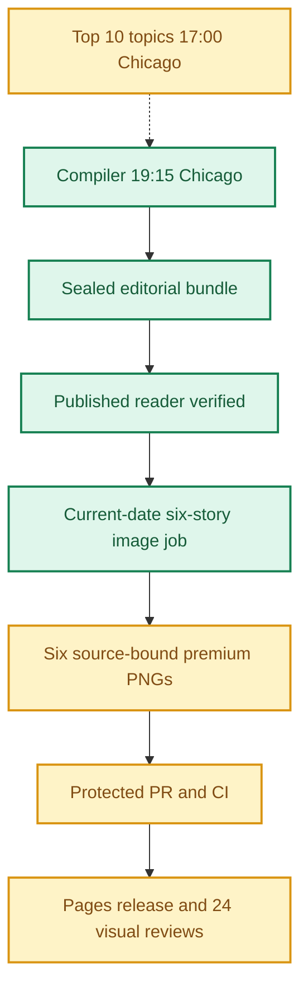

**🟨 RELEASE PARTIAL**
**TOP 10 NOT_APPLICABLE** · **🟩 COMPILER VERIFIED** · **🟦 IMAGES 6/6 RELEASED** · **🟨 VISUAL QA NOT YET VERIFIED**

# Daily AI Brief — Unified Production After-Action Report
**Edition:** November 2, 2026 · **Production evening:** 2026-11-01 · **Timezone:** America/Chicago
**Primary public reader:** [Open 2026-11-02 Brief](https://gttome.github.io/Daily-AI-Brief-Compiler/briefs/2026-11-02/) · **Repository:** [Daily-AI-Brief-Compiler](https://github.com/gttome/Daily-AI-Brief-Compiler)

> **IMPORTANT — VERIFIED PRODUCTION RESULT**
> **Executive release result: PARTIAL.** This is the single management-facing report covering Top 10 topic discovery, the editorial Compiler, published Brief and premium-image run. **Entire-system evidence: NOT_APPLICABLE.** Top 10 report: **Not reported**; Compiler handoff: **NOT_APPLICABLE**; guided searches: **NOT_APPLICABLE**. Compiler public status: **VERIFIED**. Image release: **RELEASED_VERIFIED**. Direct 24-context visual quality: **not yet evidenced**. Autonomous completion: **FAIL_OWNER_RECOVERY**. Missing evidence must not be promoted to a success claim.

**🕒 Production stage durations:** **Top 10 Not recorded** · **Compiler 4m 48s** · **Premium Images Not independently recorded** (evidence-bounded elapsed times; the start/end events differ).

> **CLOSEOUT WARNING:** The exact image worker has not released its lease and recorded PUBLISHED_COMPLETE with the six accepted hashes.

## Performance dashboard

| Measure | Recorded result | Source / caveat |
|:--|:--:|:--|
| Entire-system evidence | **NOT_APPLICABLE** | Full Top 10 list, bound Compiler input, all-format search receipts and existing release checks; separate from publication and autonomy |
| Top 10 report | **Not reported · Not recorded topics** | Same Chicago cycle report; provisional/partial coverage remains disclosed |
| Top 10 received by Compiler | **NOT_APPLICABLE** | Exact report snapshot bytes; consumed commit is Compiler-recorded, not independently fetched |
| Top 10 guided article/video/podcast searches | **NOT_APPLICABLE** | Actual source-search receipts and selected/rejected topic outcomes |
| Top 10 stage duration | **Not recorded** | Same-cycle run receipt only; no runtime or usage estimate |
| Editorial publication | **PASS** | State and public reader integrity receipt |
| **Unattended autonomy (separate from publication)** | **FAIL_OWNER_RECOVERY** | Owner incident receipt takes precedence over unverified producer self-attestation |
| Recorded protected publishing gate failures | **5** | Actual same-edition GitHub failure sidecar only; earlier unrecorded failures remain unknown |
| Articles | **6** | Exactly 2 technical / 2 knowledge-worker / 2 agents required |
| Verified original sources within preceding 24 hours | **0 / 6** | Original publisher dates only; other sources require a documented fallback rationale |
| Distinct selected article publishers | **6** | Six different primary organizations preferred |
| Videos over seven days old | **2** | Must be labeled evergreen, not a new development |
| Distinct selected video publishers | **2** | One channel is one publisher even across multiple videos |
| Duplicate active Watchlist display titles | **0** | Published canonical Watchlist only; historical evidence retained |
| Original-release video playback (historical) | **TWO_PUBLISHED_VIDEOS_PLAYBACK_PASS** | Later reader corrections may replace these originally verified videos; see incident register | 
| Postpublication reader incidents | **1** | Edition-specific owner reports and corrective PRs, not inferred absence | 
| Verified postpublication video corrections | **0** | Incident register tracks correction PR, actual playback evidence and reader preservation |
| Editorial index second-pass attempts | **0** | Bounded public GET retries only; never proof of original article reading |
| Editorial index reads recovered | **0** | Successful page fetch can still yield zero eligible dated items |
| Recorded scheduler capability route | **UNPROVEN** | Same-invocation route receipt only; GitHub is not scheduler authentication |
| Avoidable incomplete-staging CI failures | **Not independently audited** | Existing image-package push CI is disabled; exact-head protected PR CI remains required. A failure count requires actual workflow evidence |
| Media | **2 videos + 2 podcasts** | Sealed bundle |
| **Compiler stage duration** | **4m 48s (4.8 min)** | First persisted Compiler state → verified public reader; not a host scheduler attestation |
| **Image processing stage duration** | **Not independently recorded** | First accepted PNG Git checkpoint → final 24/24 review; auditable stage elapsed time |
| Image scheduled-to-final-review window | **Not independently recorded** | Only with a saved one-cycle schedule anchor; does not attest exact generation start |
| Executor-observed generation-to-final-review | **Not independently recorded** | Only if the worker recorded a same-execution clock before its first native call; not independently verified provider runtime |
| Accepted premium PNGs | **6 / 6** | Exact package and public release hashes |
| Native image generation attempts | **19** | Image worker AAR; no estimation |
| Rejected candidates | **13** | Image worker AAR |
| Final worker checkpoint reconciliation | **MISMATCH** | Oct25+ verifies exact generation count, per-story attempts, six accepted story/image/hash bindings and final release |
| Saved visual contexts | **Unverified** | Dated/permanent desktop/mobile review |
| Public SHA-256 checks | **44** | Image release receipt |
| October 8 immutable history | **17 / 17** | Independent content-preservation checks |
| **Owner-reported weekly Work usage for this run** | **Not reported** | No per-cycle usage supplied |

> **EFFICIENCY NOTE**
> **Resource reporting policy:** No usage figure was supplied for this cycle, so none is assumed. Future runs show **Not reported** unless the owner supplies new cycle-specific usage metadata. No approval or extra step is required to generate the AAR.

## Production architecture and checkpoints

## Daily AI Topic Top 10 and Compiler handoff

**Research cycle:** 2026-11-01 · **Target Brief:** 2026-11-02 · **Scheduled start:** 17:00 America/Chicago

| Dimension | Recorded evidence |
|---|---|
| Run/report result | NOT\_APPLICABLE |
| Report status / topics | Not reported |
| Freshness | NOT\_OBSERVED |
| Compiler handoff | NOT\_APPLICABLE |
| Search coverage | NOT\_APPLICABLE |
| Selection mapping verification | NONE\_RECORDED |
| Observed start / finish | Not reported |
| Elapsed minutes | Not reported |
| Usage percent | Not reported |
| Cost USD | Not reported |
| Independent scheduler autonomy | UNPROVEN |
| Compiler-recorded consumed commit | Not reported |
| Report SHA-256 | Not reported |

The Top 10 handoff was not applicable before the November 2, 2026 research cycle.

No valid cycle-specific ranked list is available in the collected evidence.

**Sample scope:** Not reported. **Ranking basis:** Not reported.

| Search format | Receipt rows | Attempts recorded | Explicitly not attempted |
|---|---:|---:|---:|
| article | 0 | 0 | 0 |
| video | 0 | 0 | 0 |
| podcast | 0 | 0 | 0 |

**Selected Brief items linked to trends:**

No validated selection-to-topic mapping was recorded.

Report, source-readback and search receipts are separate observations. Snapshot binding verifies the collected report bytes; the Compiler-recorded consumed commit is not independently fetched here. These records do not independently attest scheduler identity or source truth. Top 10 reporting does not change Brief/image release status.

## Track 1 — Compiler

**State:** `SHADOW_VERIFIED` · **Bundle:** `BUNDLE_READY` · **Compiler duration:** 4m 48s (4.8 min).

| Publication gate | Result |
|---|:---:|
| Canonical reader build | ✅ |
| Reader parity | ✅ |
| Public verification of dated edition | ✅ |
| Previous editions preserved | ✅ |
| Permanent story routes and feeds | ✅ |

**Selected coverage:**

| Lane | Story |
|---|---|
| Technical AI Engineering | NVIDIA maps a local voice-and-vision pipeline with Nemotron |
| Technical AI Engineering | Behavioral evals catch model changes provenance cannot |
| Applied Generative AI for Knowledge Workers | Project ProtoStar asks scientists to publish AI-ready artifacts |
| Applied Generative AI for Knowledge Workers | Gemini now lets knowledge workers edit files inside the chat |
| Agents for Everyone | Client onboarding agents need governed case context |
| Agents for Everyone | A recommendation-audit Skill tests whether agents surface your work |

## Track 2 — Premium images

**Public status:** `RELEASED_VERIFIED` · **Saved images:** 6/6 · **Actual generation attempts:** 19 · **Rejected candidates:** 13.

### Image production duration — Git-verified milestones

**Auditable image stage duration:** **Not independently recorded** (first accepted binary saved in Git → final 24-context quality-review merge). **First asset to public image release:** **Not independently recorded**.
**Scheduled-to-final-review window:** **Not independently recorded**. This is a scheduled-clock comparison only when a separately recorded exact-date schedule exists; it is **not** measured native image-generation runtime.

| Production milestone | Chicago local time | Evidence |
|---|---|---|
| Scheduled image start (if exact-date record exists) | Not independently recorded | Time planned, not actual execution start |
| First executor-observed start | Not independently recorded | Worker self-attestation, not a first-party scheduler event |
| First native generation observation | Not independently recorded | Worker clock recorded immediately before first native call, not model-provider telemetry |
| First accepted PNG bytes saved to Git | Not independently recorded | Immutable binary-stage commit |
| Six-image package / reviews committed | Not independently recorded | Exact-head PR source commit |
| Protected package merged | Not independently recorded | Merge SHA and required CI |
| Public images verified | Not independently recorded | Image-release receipt |
| Final 24/24 semantic visual review approved | Not independently recorded | Immutable first review-approval commit |

> **Duration interpretation:** The audited stage excludes unobservable pre-checkpoint creative work. The scheduled-start window includes it but must not be interpreted as precise active processing time. Missing timestamps appear as **Not independently recorded**, never an estimate.

| Source-bound image | Attempts | File size | Public page |
|---|---:|---:|---|
| NVIDIA maps a local voice-and-vision pipeline with Nemotron | 4 | 0.67 MiB | [View original](https://gttome.github.io/Daily-AI-Brief-Compiler/briefs/images/2026-11-02/dab-edition-2026-11-02-m01.png) |
| Behavioral evals catch model changes provenance cannot | 3 | 0.66 MiB | [View original](https://gttome.github.io/Daily-AI-Brief-Compiler/briefs/images/2026-11-02/dab-edition-2026-11-02-m02.png) |
| Project ProtoStar asks scientists to publish AI-ready artifacts | 3 | 0.67 MiB | [View original](https://gttome.github.io/Daily-AI-Brief-Compiler/briefs/images/2026-11-02/dab-edition-2026-11-02-m10.png) |
| Gemini now lets knowledge workers edit files inside the chat | 2 | 0.55 MiB | [View original](https://gttome.github.io/Daily-AI-Brief-Compiler/briefs/images/2026-11-02/dab-edition-2026-11-02-m11.png) |
| Client onboarding agents need governed case context | 3 | 0.61 MiB | [View original](https://gttome.github.io/Daily-AI-Brief-Compiler/briefs/images/2026-11-02/dab-edition-2026-11-02-m12.png) |
| A recommendation-audit Skill tests whether agents surface your work | 4 | 0.63 MiB | [View original](https://gttome.github.io/Daily-AI-Brief-Compiler/briefs/images/2026-11-02/dab-edition-2026-11-02-m14.png) |

**Immutable-release and visual gates:**

| Release gate | Result |
|---|:---:|
| Protected public image receipt | ✅ |
| Accepted-image Git hash bindings | ✅ |
| Six live PNGs | 6/6 |
| Dated/permanent story placements | 12/12 recorded in release evidence |
| Desktop/mobile visual inspection | Not verified |
| Historical Oct 8 integrity | 17/17 |

### Published premium illustrations

<table>
<tr><td width="50%"> <b>NVIDIA maps a local voice-and-vision pipeline with Nemotron</b></td><td width="50%"> <b>Behavioral evals catch model changes provenance cannot</b></td></tr>
<tr><td width="50%"> <b>Project ProtoStar asks scientists to publish AI-ready artifacts</b></td><td width="50%"> <b>Gemini now lets knowledge workers edit files inside the chat</b></td></tr>
<tr><td width="50%"> <b>Client onboarding agents need governed case context</b></td><td width="50%"> <b>A recommendation-audit Skill tests whether agents surface your work</b></td></tr>
</table>

## Incidents, corrections and learning

### Postpublication reader incidents (updated when new evidence is merged)

| Incident | Impact | Disposition | Verified correction |
|---|---|---|---|
| nov02-rev8-image-job-scheduler-provenance | The pending six-image job serialized unattended_schedule_proven=true even though the protected compile receipt says SCHEDULED_INVOCATION_NOT_ESTABLISHED. | CODE_CORRECTED_CURRENT_DIAGNOSTIC_TREATED_UNKNOWN | [PR #304](https://github.com/gttome/Daily-AI-Brief-Compiler/pull/304) |

**Editor recovery classification:** FAIL_OWNER_RECOVERY. **Owner intervention:** Documented and required. **Protected same-edition failures recorded:** 5. 
**Latest failed protected stage:** VIDEO_PLAYBACK; [Action evidence](https://github.com/gttome/Daily-AI-Brief-Compiler/actions/runs/41374499329). Exact stage durations are available only where real source timestamps exist.
**Owner-initiated recovery record:** [DAB-COMPILER-20261102-PUBLICATION-RECOVERY-001](https://github.com/gttome/Daily-AI-Brief-Compiler/blob/main/docs/after-action/2026-11-02-compiler-production-aar.json). Corrected in [PR #303](https://github.com/gttome/Daily-AI-Brief-Compiler/pull/303). Owner-message timing and independent scheduler identity remain unproven.

| Stage | Verified issue | Corrective action |
|---|---|---|
| Native saved-pixel inspection | t1 attempt 1: Extra Audience output label, simulated text boundary, undersized/safe-margin text and cache returning to synthesis. | Removed unapproved label and writing; source-bounded cache bypass and enlarged safe text were reinspected. Rejected saved PNG retained under reviews. |
| Native saved-pixel inspection | t1 attempt 2: Dialogue surfaces still simulated writing; cache path dangling and animation did not share cache input. | Removed faux strokes and joined synthesis/cache to shared clean-speech branch. Rejected saved PNG retained under reviews. |
| Native saved-pixel inspection | t1 attempt 3: Cache arrow pointed into stored audio; outer object/text margins insufficient. | Reversed cache flow and completed proportional safe-border RGB export; final pixels reinspected. Rejected saved PNG retained under reviews. |
| Native saved-pixel inspection | t2 attempt 1: Fake code/citation writing, invented runtime sliders, decorative evidence and undersized labels. | Removed strokes/controls/scenery, retained smooth actual configuration and paired assays. Rejected saved PNG retained under reviews. |
| Native saved-pixel inspection | t2 attempt 2: Four component labels and text geometry too small at exact final size. | Reflowed inventory into two rows, enlarged required labels and reviewed safe final export. Rejected saved PNG retained under reviews. |
| Native saved-pixel inspection | k1 attempt 1: Decorative satellite/globe/cracked earth, unsupported weather-map patterns and small labels. | Replaced scenery/data with source package anatomy and qualitative comparison planes; enlarged text. Rejected saved PNG retained under reviews. |
| Native saved-pixel inspection | k1 attempt 2: Challenge arrow incorrectly produced observed weather; source/package connector origins misleading. | Separated observed evidence and challenge inputs at baseline comparison and corrected origins. Rejected saved PNG retained under reviews. |
| Native saved-pixel inspection | k2 attempt 1: Faux writing in app surface, card-grid treatment and misleading platform-scope brackets. | Removed writing/card panels and detached the web/mobile scope notes from export branches. Rejected saved PNG retained under reviews. |
| Native saved-pixel inspection | a1 attempt 1: Extra permitted-specialist label, avatar-like workflow glyph, exclamation and fake history writing; title inside margin. | Removed all unapproved labels and motifs, enlarged safe type and kept explicit authority boundary. Rejected saved PNG retained under reviews. |
| Native saved-pixel inspection | a1 attempt 2: Top context-to-supervisor feed had an unintended reverse arrow; detached caveat too small. | Removed reverse arrow and enlarged source limitation, retaining separate specialist return. Rejected saved PNG retained under reviews. |
| Native saved-pixel inspection | a2 attempt 1: Faux question/citation/review writing, counted-looking rows and undersized labels. | Replaced rows with qualitative source traces and omission gaps, smooth planes and editorial boundary. Rejected saved PNG retained under reviews. |
| Native saved-pixel inspection | a2 attempt 2: Second priority Same questions again label too small at final1200x630. | Enlarged into two lines and preserved fixed-question shared feed. Rejected saved PNG retained under reviews. |
| Native saved-pixel inspection | a2 attempt 3: Required simulation caveat lost during typography edit. | Restored detached exact caveat without changing passing mechanism regions. Rejected saved PNG retained under reviews. |
| Initial GitHub index resolution | Initial request treated shadow-pages-history as a directory on main and returned404. | Used actual shadow-pages-history branch with site/image-jobs/index.json; selected only exact November2 job. |
| Local Git transport readiness | Read-only Git clone worked; dry-run push lacked authenticated HTTPS username. | Used connected GitHub blobs/trees/commits and expected-head non-force ref updates; exact accepted binary readbacks matched. |
| Primary source page retrieval | Job aliases for ProtoStar and Every returned unavailable404/403 routes. | Read complete matching first-party articles at announcing-project-protostar and also-true-for-humans routes; immutable job/source references preserved. |

> **OPERATIONAL NOTE**
> This report distinguishes a published and verified production outcome from scheduler metadata exposed to another conversation. Lack of a live host heartbeat in a separate normal chat is not a Compiler production failure.

## Usage and cost stewardship

| Item | Per-cycle value |
|---|---|
| **Weekly Work usage reported by owner** | **Not reported** |
| Internal weekly usage reference | Target under 5% |
| Genuine image-generation attempts | 19 |
| Accepted diagrams | 6 |
| Regeneration after acceptance | 0 |
| Top 10 reported usage | Not reported |
| Top 10 reported cost | Not reported |
| Account-level billing telemetry | Not independently accessible to deterministic GitHub reporting |

**Future reporting rule:** For cycles without an optional owner-usage record, publish the complete AAR with `Not reported`; do not reuse prior percentages, guess remaining weekly credits or delay tomorrow's production.

## Next-edition operating handoff

| Control | Recurring contract |
|---|---|
| AI Topic Top 10 | Sole report task · 17:00 America/Chicago · saved dated list guides same-evening research |
| Primary Compiler | Sole existing task · 19:15 America/Chicago |
| Premium image production | Sole existing task · standard 21:15 America/Chicago |
| Exact image job selection | Newly published next-date `PUBLISHED_PENDING` only |
| AAR | Combined report generated automatically from new GitHub receipts |
| Optional Work usage | Owner-supplied per cycle, otherwise `Not reported` |

> **SCHEDULE RESTORATION NOTE**
> A temporary scheduling exception must be explicitly restored before claiming standard-time readiness. This deterministic document generator reads existing state only; it does not modify production schedules.

## Evidence register

| Evidence | Link |
|---|---|
| Compiler state | [Open receipt](https://github.com/gttome/Daily-AI-Brief-Compiler/blob/shadow/2026-11-02/shadow-runs/2026-11-02/compiler-state.json) |
| Compiler compile receipt | [Open receipt](https://github.com/gttome/Daily-AI-Brief-Compiler/blob/shadow/2026-11-02/shadow-runs/2026-11-02/compiler/compile-receipt.json) |
| Compiler public integrity | [Open receipt](https://github.com/gttome/Daily-AI-Brief-Compiler/blob/shadow/2026-11-02/shadow-runs/2026-11-02/compiler/postpublish-integrity.json) |
| Image release receipt | [Open receipt](https://github.com/gttome/Daily-AI-Brief-Compiler/blob/shadow-pages-history/site/image-jobs/2026-11-02/release.json) |
| Image review | [Open receipt](https://github.com/gttome/Daily-AI-Brief-Compiler/blob/main/external-image-packages/2026-11-02/reviews/live/image-element24/semantic-reviews.json) |
| Original image AAR | [Open receipt](https://github.com/gttome/Daily-AI-Brief-Compiler/blob/main/external-image-packages/2026-11-02/reviews/after-action.md) |
| Observed editorial index retries | [Open receipt](https://github.com/gttome/Daily-AI-Brief-Compiler/blob/shadow/2026-11-02/shadow-runs/2026-11-02/editorial/source-item-retries.json) |
| Postpublication incident register | [Open receipt](https://github.com/gttome/Daily-AI-Brief-Compiler/blob/main/docs/after-action/incidents/2026-11-02.json) |
| Published player playback receipt | [Open receipt](https://github.com/gttome/Daily-AI-Brief-Compiler/blob/shadow/2026-11-02/shadow-runs/2026-11-02/compiler/postpublish-video-playback.json) |

**Image workflow:** [Workflow evidence](https://github.com/gttome/Daily-AI-Brief-Compiler/actions/runs/41385927277).

---

*Generated deterministically from cycle- and edition-specific GitHub records. The report combines the ranked Top 10, its Compiler handoff and searches, the published Brief, and the image run; original research, Compiler, image, hash, and review receipts remain immutable. This reporting action creates no stories, images, releases, extra AI tasks, or schedule changes.*
