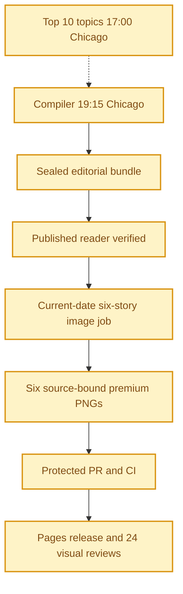

**🟨 RELEASE NOT VERIFIED**
**TOP 10 PARTIAL** · **🟨 COMPILER UNVERIFIED** · **🟨 IMAGES NOT YET COMPLETE** · **🟨 VISUAL QA NOT YET VERIFIED**

# Daily AI Brief — Unified Production After-Action Report
**Edition:** November 3, 2026 · **Production evening:** 2026-11-02 · **Timezone:** America/Chicago
**Primary public reader:** [Open 2026-11-03 Brief](https://gttome.github.io/Daily-AI-Brief-Compiler/briefs/2026-11-03/) · **Repository:** [Daily-AI-Brief-Compiler](https://github.com/gttome/Daily-AI-Brief-Compiler)

> **IMPORTANT — VERIFIED PRODUCTION RESULT**
> **Executive release result: NOT VERIFIED.** This is the single management-facing report covering Top 10 topic discovery, the editorial Compiler, published Brief and premium-image run. **Entire-system evidence: PARTIAL.** Top 10 report: **partial**; Compiler handoff: **RECEIVED_SNAPSHOT_BOUND**; guided searches: **NOT_OBSERVED**. Compiler public status: **NOT VERIFIED**. Image release: **not complete**. Direct 24-context visual quality: **not yet evidenced**. Autonomous completion: **UNPROVEN**. Missing evidence must not be promoted to a success claim.

**🕒 Production stage durations:** **Top 10 15m 13s** · **Compiler final seal window 0m 00s** · **Premium Images Not independently recorded** (evidence-bounded elapsed times; the start/end events differ).

> **AAR SCHEMA WARNING:** Cannot read properties of null (reading 'stories')

> **CLOSEOUT WARNING:** The exact image worker has not released its lease and recorded PUBLISHED_COMPLETE with the six accepted hashes.

## Evidence reconciliation

Compiler final seal window: 0m 00s. Observed execution and final seal windows are distinct.
Image capability route preflight: NOT OBSERVED; scheduler origin remains UNPROVEN.
Image efficiency: Unknown/6 first-pass accepts; Unknown total attempts. November 3–5 target: at least 3/6 first-pass and at most 2 attempts per image, with unchanged quality floor.
Image review completed: Not recorded; review-record commit: Not recorded; protected review merge: Not recorded.

## Performance dashboard

| Measure | Recorded result | Source / caveat |
|:--|:--:|:--|
| Entire-system evidence | **PARTIAL** | Full Top 10 list, bound Compiler input, all-format search receipts and existing release checks; separate from publication and autonomy |
| Top 10 report | **partial · 10 topics** | Same Chicago cycle report; provisional/partial coverage remains disclosed |
| Top 10 received by Compiler | **RECEIVED_SNAPSHOT_BOUND** | Exact report snapshot bytes; consumed commit separately corroborated: YES |
| Top 10 guided article/video/podcast searches | **NOT_OBSERVED** | Actual source-search receipts and selected/rejected topic outcomes |
| Top 10 stage duration | **15m 13s** | Same-cycle run receipt only; no runtime or usage estimate |
| Editorial publication | **NOT VERIFIED** | State and public reader integrity receipt |
| **Unattended autonomy (separate from publication)** | **UNPROVEN** | Owner incident receipt takes precedence over unverified producer self-attestation |
| Recorded protected publishing gate failures | **0** | Actual same-edition GitHub failure sidecar only; earlier unrecorded failures remain unknown |
| Articles | **Not recorded** | Exactly 2 technical / 2 knowledge-worker / 2 agents required |
| Verified original sources within preceding 24 hours | **0 / 0** | Original publisher dates only; other sources require a documented fallback rationale |
| Distinct selected article publishers | **0** | Six different primary organizations preferred |
| Videos over seven days old | **0** | Must be labeled evergreen, not a new development |
| Distinct selected video publishers | **0** | One channel is one publisher even across multiple videos |
| Duplicate active Watchlist display titles | **Not recorded** | Published canonical Watchlist only; historical evidence retained |
| Original-release video playback (historical) | **NOT_RECORDED** | Later reader corrections may replace these originally verified videos; see incident register | 
| Postpublication reader incidents | **NOT_RECORDED** | Edition-specific owner reports and corrective PRs, not inferred absence | 
| Verified postpublication video corrections | **NOT_RECORDED** | Incident register tracks correction PR, actual playback evidence and reader preservation |
| Editorial index second-pass attempts | **NOT_RECORDED** | Bounded public GET retries only; never proof of original article reading |
| Editorial index reads recovered | **NOT_RECORDED** | Successful page fetch can still yield zero eligible dated items |
| Recorded scheduler capability route | **UNPROVEN** | Same-invocation route receipt only; GitHub is not scheduler authentication |
| Avoidable incomplete-staging CI failures | **Not independently audited** | Existing image-package push CI is disabled; exact-head protected PR CI remains required. A failure count requires actual workflow evidence |
| Media | **Source receipt incomplete** | Sealed bundle |
| **Compiler final seal window** | **0m 00s (0.0 min)** | Final sealed-state timestamp → verified public reader; initial execution is separate |
| **Image processing stage duration** | **Not independently recorded** | First accepted PNG Git checkpoint → final 24/24 review; auditable stage elapsed time |
| Image scheduled-to-final-review window | **Not independently recorded** | Only with a saved one-cycle schedule anchor; does not attest exact generation start |
| Executor-observed generation-to-final-review | **Not independently recorded** | Only if the worker recorded a same-execution clock before its first native call; not independently verified provider runtime |
| Accepted premium PNGs | **Not complete / 6** | Exact package and public release hashes |
| Native image generation attempts | **Not reported** | Image worker AAR; no estimation |
| Rejected candidates | **Not reported** | Image worker AAR |
| Final worker checkpoint reconciliation | **MISMATCH** | Oct25+ verifies exact generation count, per-story attempts, six accepted story/image/hash bindings and final release |
| Saved visual contexts | **Unverified** | Dated/permanent desktop/mobile review |
| Public SHA-256 checks | **Not recorded** | Image release receipt |
| October 8 immutable history | **Not recorded / 17** | Independent content-preservation checks |
| **Owner-reported weekly Work usage for this run** | **Not reported** | No per-cycle usage supplied |

> **EFFICIENCY NOTE**
> **Resource reporting policy:** No usage figure was supplied for this cycle, so none is assumed. Future runs show **Not reported** unless the owner supplies new cycle-specific usage metadata. No approval or extra step is required to generate the AAR.

## Production architecture and checkpoints

## Daily AI Topic Top 10 and Compiler handoff

**Research cycle:** 2026-11-02 · **Target Brief:** 2026-11-03 · **Scheduled start:** 17:00 America/Chicago

| Dimension | Recorded evidence |
|---|---|
| Run/report result | PARTIAL |
| Report status / topics | partial / 10 |
| Freshness | FRESH\_AT\_CONSUMPTION |
| Compiler handoff | RECEIVED\_SNAPSHOT\_BOUND |
| Search coverage | NOT\_OBSERVED |
| Selection mapping verification | NONE\_RECORDED |
| Observed start / finish | 2026-11-03T00:42:14.191Z / 2026-11-03T00:57:27.168Z |
| Elapsed minutes | 15.22 |
| Usage percent | Not reported |
| Cost USD | Not reported |
| Independent scheduler autonomy | UNPROVEN |
| Compiler-recorded consumed commit | e76763522d93ba2152b6d8a2b22b64a051fb2297 |
| Report SHA-256 | 059ee675574a3ba7e257828e8b062a638f808d29870e49ca924791d51d47735d |

**Order:** discovery sequence only; entries are unranked within qualitative evidence bands.

| Discovery order | AI topic | Summary | Confidence | Evidence |
|---:|---|---|---|---|
| 1 | Altman’s RAM remarks: cloud utilization versus local inference | Recent commentary revisits the October 29 interview’s argument about scarce memory and cloud utilization. | low | [Source](https://cheekypint.transistor.fm/39/transcript) · [Source](https://trendreport.com/trends/ai-and-data/) |
| 2 | Genie 4 preview: interactive worlds and their limits | The October 27 preview continues to attract video and community discussion. | medium | [Source](https://deepmind.google/blog/genie-4-a-new-generation-of-world-simulation/) · [Source](https://news.ycombinator.com/item?id=50261319) |
| 3 | Gemini 4 Carbon: restricted rollout and task-specific results | Google’s October 28 announcement is followed by model-comparison videos and evaluation-board discussion. | medium | [Source](https://blog.google/innovation-and-ai/models-and-research/gemini-models/introducing-gemini-4-carbon/) · [Source](https://zlio.com/videos/) |
| 4 | Anthropic’s IPO filings draw renewed revenue and loss scrutiny | The November 2 amendment supplies a current filing-related development. | low | [Source](https://www.sec.gov/Archives/edgar/data/2130357/000162828026068676/0001628280-26-068676-index.htm) · [Source](https://news.ycombinator.com/item?id=50344958) |
| 5 | Renewed discussion of OpenAI’s September Navier–Stokes claim | Recent mathematics commentary revisits an older AI-assisted proof claim. | low | [Source](https://openai.com/index/navier-stokes-solution/) · [Source](https://www.youtube.com/watch?v=ZAzWPE9CItg) |
| 6 | DeepSeek comparison videos: verify the model and deployment claims | Recent creator comparisons bring DeepSeek back into discussion; the exact variants and test setups still need verification. | low | [Source](https://huggingface.co/deepseek-ai/DeepSeek-V4.1-Flash-1017) · [Source](https://www.youtube.com/watch?v=DDZ-a6bAn3Y) |
| 7 | Momentic’s QA Bench: agents search running apps for bugs | A November 2 launch discussion and updated technical write-up describe a concrete testing workflow. | low | [Source](https://momentic.ai/blog/qa-bench) · [Source](https://news.ycombinator.com/item?id=50339913) |
| 8 | ChatGPT and Codex: a shared allowance planned for December | Official documentation describes a December transition; recent user discussion concerns its implications. | low | [Source](https://help.openai.com/en/articles/20001625-understanding-chatgpt-and-codex-usage-limits) · [Source](https://news.ycombinator.com/item?id=50321622) |
| 9 | Anthropic’s analyst study: when experts adopt an agent’s judgment | Recent video discussion revisits a bounded study of expert decision-making with an AI agent. | low | [Source](https://www.anthropic.com/research/agents-judgment-calls) · [Source](https://www.youtube.com/watch?v=BlbxhsItZPg) |
| 10 | GDPx launches: what its 206 agent tasks actually measure | SemiAnalysis introduces a task suite across eleven domains on November 2. | low | [Source](https://gdpx.semianalysis.com/) · [Source](https://whatisthelatest.ai/top-10/) |

**Sample scope:** {"new\_metadata\_screened\_records":63,"new\_metadata\_distinct\_channels":21,"retained\_prior\_snapshot\_records":16,"combined\_observation\_records":79,"combined\_unique\_video\_ids":71,"direct\_counter\_verifications":0,"videos\_watched":0,"transcripts\_reviewed":0,"original\_interview\_texts\_reviewed":1,"target\_40\_to\_80\_full\_reviews\_met":false,"additional\_validation\_resources":14,"additional\_resources\_directly\_retrieved":11,"additional\_resources\_indexed\_only":3,"freshness":"Relative video ages 4h–7d; exact publication times unavailable for new tracker records. Seven-day labels may exceed a strict 168-hour cutoff. Older primary work and guidance are explicitly background.","source\_urls":\["https://whatisthelatest.ai/top-10/","https://trendreport.com/trends/ai-and-data/","https://dailycurry.com/","https://zlio.com/videos/","https://aua.aicrossing.org/news/videos/","https://www.ai-roundup.dev/"\],"coverage\_note":"Metadata screening does not constitute full video review. Public index sample is selected, not exhaustive or representative."}. **Ranking basis:** {"type":"qualitative\_attention\_evidence\_bands","exact\_rank\_established":false,"rank\_field\_semantics":"Numbered Compiler discovery sequence; not a measured relative-popularity rank.","within\_band\_order":"Unranked; no superiority implied by item number.","bands":{"broader":"Multiple event-relevant creator/community signals or a multi-channel event cluster; provenance and format caveats remain visible.","limited":"Single-platform, narrow discussion, contextual platform aggregates or uncertain coverage.","unverified":"No reliable event-specific attention evidence; keep outside the attention list."},"reader\_value\_used\_as\_popularity":false,"resource\_count\_used\_as\_popularity":false,"numeric\_score":null,"growth\_observations":"Unavailable; no comparable video measurement pair established."}.

| Search format | Receipt rows | Attempts recorded | Explicitly not attempted |
|---|---:|---:|---:|
| article | 0 | 0 | 0 |
| video | 0 | 0 | 0 |
| podcast | 0 | 0 | 0 |

**Selected Brief items linked to trends:**

No validated selection-to-topic mapping was recorded.

**Gaps and limitations:**

- No per-topic article/video/podcast search receipt was observed.
- The report labels its research partial.
- Ranking remains provisional and research coverage partial: metadata expanded, full-video review target unfinished.
- All video counts are third-party reported, mostly rounded; direct YouTube counter access was throttled or unavailable.
- No video playback, direct video transcript review, channel baseline or measured current velocity.
- Google Trends retrieval was blocked; no search-interest measurements used.
- SEC, Reuters and The Verge were accessible through indexed evidence only.
- Fourteen validation resources are not fourteen independent confirmations of every topic.
- Older Stanford/CISA guidance and September mathematics research do not establish current news freshness.
- Source audiences overlap; counts are never summed into total unique reach.
- Four-resource extension keeps the attention ranking provisional; community scores and benchmark performance cannot be compared directly with video reach.
- No exact popularity order is claimed. Numbers are the Compiler discovery sequence; entries are unranked within bands.
- Primary-source refresh used official indexed excerpts or direct HTTP fallback where necessary; no full video playback completed.
- The previous 14-resource validation matrix applies to previous topic scopes. Current source roles and exclusions govern this correction.

**Recorded run issues:**

- {"issue":"Broad-theme counts had been assigned to narrower stories","correction":"Removed or relabeled as background; no addition across platforms or duplicated event counts."}
- {"issue":"Security video counts did not reliably match the Microsoft report","correction":"Moved to editorial watchlist; restored the specific analyst-judgment study with matching metadata."}
- {"issue":"Primary web fetches incomplete","correction":"Momentic official Markdown retrieved through direct HTTP; Carbon and usage policy rechecked using official indexed excerpts; SEC direct retrieval remained blocked."}
- {"issue":"Two local draft build errors","correction":"Unsupported clone helper and duplicate patch operation corrected before any final report write; content/schema/readback checks passed."}

**Recorded improvements:**

- {"status":"IMPLEMENTED\_THIS\_RUN","action":"Ten concrete event-led headlines and reader questions."}
- {"status":"IMPLEMENTED\_THIS\_RUN","action":"Explicit exclusions separate model rollout, evaluation methodology and practical QA workflow."}
- {"status":"IMPLEMENTED\_THIS\_RUN","action":"Date-aware freshness labels, including September research and December future policy."}
- {"status":"IMPLEMENTED\_THIS\_RUN","action":"Source roles and event-matched metrics; exact popularity ordering withdrawn."}
- {"status":"IMPLEMENTED\_THIS\_RUN","action":"Readable one-column report with evidence, confidence, reader value and two links per item."}

### Daily improvement and effect on the Brief

**Fixed baseline:** nov03-2026-v1 / INPUT\_FROZEN. **Outcome baseline:** PENDING. **Prior cycle:** 2026-11-01.

| Input measure | Current | November 3 baseline | Change from baseline | Change from prior cycle |
|---|---:|---:|---:|---:|
| topic count | 10 | 10 | 0 | Not reported |
| validation resource count | 14 | 14 | 0 | Not reported |
| additional video metadata records | 63 | 63 | 0 | Not reported |
| additional video channels | 21 | 21 | 0 | Not reported |
| total video observations | 79 | 79 | 0 | Not reported |
| unique videos | 71 | 71 | 0 | Not reported |
| full video reviews | 0 | 0 | 0 | Not reported |
| direct youtube counter verifications | 0 | 0 | 0 | Not reported |
| broader evidence band topics | 3 | 3 | 0 | Not reported |
| limited evidence band topics | 7 | 7 | 0 | Not reported |

**Observed downstream measurements:** PENDING\_OR\_INCOMPLETE.

| Outcome measure | Current | Change from frozen outcome | Change from prior cycle |
|---|---:|---:|---:|
| expected topic format pairs | 30 | Not reported | Not reported |
| attempted topic format pairs | Not reported | Not reported | Not reported |
| explicitly unattempted pairs | Not reported | Not reported | Not reported |
| discovered candidate count | Not reported | Not reported | Not reported |
| searched source host count | Not reported | Not reported | Not reported |
| selected article count | Not reported | Not reported | Not reported |
| selected video count | Not reported | Not reported | Not reported |
| selected podcast count | Not reported | Not reported | Not reported |

**Source changes:** Not reported.

**Method/resource review:** {"baseline\_id":"nov03-2026-v1","previous\_report\_date":null,"method\_version":"2026-11-02-validation-expansion","changes":\[{"change":"Accepted November 3 specific-event list pinned for Compiler discovery","reason":"Preserve owner-approved scope, freshness labels and honest evidence bands","expected\_effect":"More focused article/video/podcast queries; actual search and selection outcomes remain pending"},{"change":"Fixed baseline and daily source/method change ledger","reason":"Measure improvements against a stable reference and prior comparable cycle","expected\_effect":"Separate expanded coverage from measured improvements"}\],"resource\_candidates":\[\],"observed\_effects":\[{"observation":"Existing Top 10 and Compiler automation prompts updated successfully; schedules unchanged","scope":"configuration only","downstream\_outcome":null},{"observation":"Compiler persisted the exact accepted November 3 report snapshot","retrieved\_at":"2026-11-03T01:19:55Z","source\_url":"https://github.com/gttome/Daily-AI-Brief-Compiler/blob/shadow/2026-11-03/shadow-runs/2026-11-03/editorial/trend-input.json","receipt\_blob\_sha":"2f21a2d5a9aa59e34f800d6288475f585087783d","report\_sha256":"059ee675574a3ba7e257828e8b062a638f808d29870e49ca924791d51d47735d","verification":"Receipt commit/blob/hash and complete parsed report match the accepted input","scope":"input adoption only; actual search, selection and publication effects remain pending"}\],"next\_improvement":"Verify actual topic-format searches, candidate quality and final selected-item mappings; evaluate a new event-relevant resource during the next research cycle.","limitations":\["This implementation session did not research an additional resource candidate.","Compiler input adoption is observed; publication impact, audience growth and causal benefit are not established."\]}.

**Reported effects and gaps:** Not reported.

**Next improvement:** Verify actual topic-format searches, candidate quality and final selected-item mappings; evaluate a new event-relevant resource during the next research cycle.

Counts show coverage and observed association, not audience popularity, source independence, candidate quality or causal uplift. Compare source/method changes before interpreting deltas. Unknown values are not zero. Publication, reader corrections, runtime and image outcomes retain their separate AAR evidence.

Report, source-readback and search receipts are separate observations. Snapshot binding verifies the collected report bytes; the consumed commit is independently corroborated only when the separately fetched source bytes match. These records do not independently attest scheduler identity or source truth. Top 10 reporting does not change Brief/image release status.

## Track 1 — Compiler

**State:** `EDITORIAL_IN_PROGRESS` · **Bundle:** `NOT_READY` · **Compiler final seal window:** 0m 00s (0.0 min).

| Publication gate | Result |
|---|:---:|
| Canonical reader build | Not yet evidenced |
| Reader parity | Not yet evidenced |
| Public verification of dated edition | Not yet evidenced |
| Previous editions preserved | Not yet evidenced |
| Permanent story routes and feeds | Not yet evidenced |

**Selected coverage:**

| Lane | Story |
|---|---|

## Track 2 — Premium images

**Public status:** `NOT_OBSERVED` · **Saved images:** 0/6 · **Actual generation attempts:** Not reported · **Rejected candidates:** Not reported.

### Image production duration — Git-verified milestones

**Auditable image stage duration:** **Not independently recorded** (first accepted binary saved in Git → first persisted 24-context quality-review record). **First asset to public image release:** **Not independently recorded**.
**Scheduled-to-final-review window:** **Not independently recorded**. This is a scheduled-clock comparison only when a separately recorded exact-date schedule exists; it is **not** measured native image-generation runtime.

| Production milestone | Chicago local time | Evidence |
|---|---|---|
| Scheduled image start (if exact-date record exists) | Not independently recorded | Time planned, not actual execution start |
| First executor-observed start | Not independently recorded | Worker self-attestation, not a first-party scheduler event |
| First native generation observation | Not independently recorded | Worker clock recorded immediately before first native call, not model-provider telemetry |
| First accepted PNG bytes saved to Git | Not independently recorded | Immutable binary-stage commit |
| Six-image package / reviews committed | Not independently recorded | Exact-head PR source commit |
| Protected package merged | Not independently recorded | Merge SHA and required CI |
| Public images verified | Not independently recorded | Image-release receipt |
| 24/24 review record committed | Not independently recorded | Immutable first review-approval commit |

> **Duration interpretation:** The audited stage excludes unobservable pre-checkpoint creative work. The scheduled-start window includes it but must not be interpreted as precise active processing time. Missing timestamps appear as **Not independently recorded**, never an estimate.

| Source-bound image | Attempts | File size | Public page |
|---|---:|---:|---|

**Immutable-release and visual gates:**

| Release gate | Result |
|---|:---:|
| Protected public image receipt | Not yet evidenced |
| Accepted-image Git hash bindings | Not yet evidenced |
| Six live PNGs | Not verified |
| Dated/permanent story placements | Not verified |
| Desktop/mobile visual inspection | Not verified |
| Historical Oct 8 integrity | Not verified |

### Published premium illustrations

No six-image public release gallery available yet.

## Incidents, corrections and learning

### Postpublication reader incidents (updated when new evidence is merged)

No current-edition postpublication incident register was available; this is **NOT_RECORDED**, not a certification of zero incidents.

**Editor recovery classification:** UNPROVEN. **Owner intervention:** Unproven either way. **Protected same-edition failures recorded:** 0. 
**Latest failed protected stage:** Not in same-edition receipts; [Action evidence](https://github.com/gttome/Daily-AI-Brief-Compiler/actions). Exact stage durations are available only where real source timestamps exist.

No image-stage correction receipts were available for this cycle.

> **OPERATIONAL NOTE**
> This report distinguishes a published and verified production outcome from scheduler metadata exposed to another conversation. Lack of a live host heartbeat in a separate normal chat is not a Compiler production failure.

## Usage and cost stewardship

| Item | Per-cycle value |
|---|---|
| **Weekly Work usage reported by owner** | **Not reported** |
| Internal weekly usage reference | Target under 5% |
| Genuine image-generation attempts | Not reported |
| Accepted diagrams | Not reported |
| Regeneration after acceptance | Not reported |
| Top 10 reported usage | Not reported |
| Top 10 reported cost | Not reported |
| Account-level billing telemetry | Not independently accessible to deterministic GitHub reporting |

**Future reporting rule:** For cycles without an optional owner-usage record, publish the complete AAR with `Not reported`; do not reuse prior percentages, guess remaining weekly credits or delay tomorrow's production.

## Next-edition operating handoff

| Control | Recurring contract |
|---|---|
| AI Topic Top 10 | Sole report task · 17:00 America/Chicago · saved dated list guides same-evening research |
| Primary Compiler | Sole existing task · 19:15 America/Chicago |
| Premium image production | Sole existing task · standard 21:15 America/Chicago |
| Exact image job selection | Newly published next-date `PUBLISHED_PENDING` only |
| AAR | Combined report generated automatically from new GitHub receipts |
| Optional Work usage | Owner-supplied per cycle, otherwise `Not reported` |

> **SCHEDULE RESTORATION NOTE**
> A temporary scheduling exception must be explicitly restored before claiming standard-time readiness. This deterministic document generator reads existing state only; it does not modify production schedules.

## Evidence register

| Evidence | Link |
|---|---|
| Compiler state | [Open receipt](https://github.com/gttome/Daily-AI-Brief-Compiler/blob/shadow/2026-11-03/shadow-runs/2026-11-03/compiler-state.json) |
| Compiler compile receipt | [Open receipt](https://github.com/gttome/Daily-AI-Brief-Compiler/blob/shadow/2026-11-03/shadow-runs/2026-11-03/compiler/compile-receipt.json) |
| Compiler public integrity | [Open receipt](https://github.com/gttome/Daily-AI-Brief-Compiler/blob/shadow/2026-11-03/shadow-runs/2026-11-03/compiler/postpublish-integrity.json) |
| Image release receipt | [Open receipt](https://github.com/gttome/Daily-AI-Brief-Compiler/blob/shadow-pages-history/site/image-jobs/2026-11-03/release.json) |
| Image review | [Open receipt](https://github.com/gttome/Daily-AI-Brief-Compiler/blob/main/external-image-packages/2026-11-03/reviews/live/image-element24/semantic-reviews.json) |
| Original image AAR | [Open receipt](https://github.com/gttome/Daily-AI-Brief-Compiler/blob/main/external-image-packages/2026-11-03/reviews/after-action.md) |
| Top 10 ranked topic report | [Open receipt](https://github.com/gttome/Daily-AI-Brief-Compiler/blob/d8e3c9478610b8b74bccc0d0ad09437dbba8d248/signals/ai-topic-top10/2026-11-02.json) |
| Top 10 run after-action receipt | [Open receipt](https://github.com/gttome/Daily-AI-Brief-Compiler/blob/d8e3c9478610b8b74bccc0d0ad09437dbba8d248/signals/ai-topic-top10/2026-11-02.aar.json) |
| Compiler Top 10 input snapshot | [Open receipt](https://github.com/gttome/Daily-AI-Brief-Compiler/blob/shadow/2026-11-03/shadow-runs/2026-11-03/editorial/trend-input.json) |

**Image workflow:** Not yet available.

---

*Generated deterministically from cycle- and edition-specific GitHub records. The report combines the Top 10 discovery priorities, its Compiler handoff and searches, the published Brief, and the image run; original research, Compiler, image, hash, and review receipts remain immutable. This reporting action creates no stories, images, releases, extra AI tasks, or schedule changes.*
