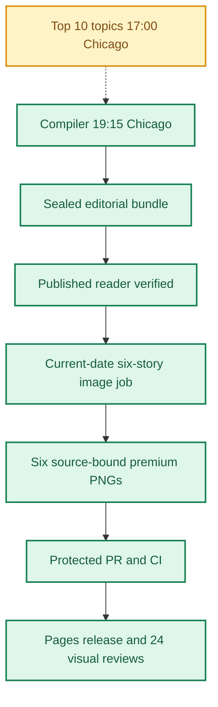

**🟨 RELEASE PARTIAL**
**TOP 10 PARTIAL** · **🟩 COMPILER VERIFIED** · **🟦 IMAGES 6/6 RELEASED** · **🟪 VISUAL QA 24/24 PASS**

# Daily AI Brief — Unified Production After-Action Report
**Edition:** November 3, 2026 · **Production evening:** 2026-11-02 · **Timezone:** America/Chicago
**Primary public reader:** [Open 2026-11-03 Brief](https://gttome.github.io/Daily-AI-Brief-Compiler/briefs/2026-11-03/) · **Repository:** [Daily-AI-Brief-Compiler](https://github.com/gttome/Daily-AI-Brief-Compiler)

> **IMPORTANT — VERIFIED PRODUCTION RESULT**
> **Executive release result: PARTIAL.** This is the single management-facing report covering Top 10 topic discovery, the editorial Compiler, published Brief and premium-image run. **Entire-system evidence: PARTIAL.** Top 10 report: **partial**; Compiler handoff: **RECEIVED_SNAPSHOT_BOUND**; guided searches: **RECEIPTS_OBSERVED**. Compiler public status: **VERIFIED**. Image release: **RELEASED_VERIFIED**. Direct 24-context visual quality: **24/24 PASS**. Autonomous completion: **FAIL_OWNER_RECOVERY**. Missing evidence must not be promoted to a success claim.

**🕒 Production stage durations:** **Top 10 15m 13s** · **Compiler final seal window 44m 32s** · **Premium Images 33m 51s** (evidence-bounded elapsed times; the start/end events differ).

> **CLOSEOUT WARNING:** The exact image worker has not released its lease and recorded PUBLISHED_COMPLETE with the six accepted hashes.

## Evidence reconciliation

Compiler final seal window: 44m 32s. Observed execution and final seal windows are distinct.
Image capability route preflight: RECORDED; scheduler origin remains UNPROVEN.
Image efficiency: 1/6 first-pass accepts; 12 total attempts. November 3–5 target: at least 3/6 first-pass and at most 2 attempts per image, with unchanged quality floor.
Image review completed: 2026-11-03T03:54:20Z; review-record commit: 2026-11-03T03:57:05.000Z; protected review merge: 2026-11-03T04:01:18.000Z.
Eligible source indexes: 87; editorial inspections reported: 27 (31%); inaccessible in editorial audit: Unknown; explicitly unreviewed IDs: 60; unclassified editorial IDs: 0. Automated index parsing is separate from editorial inspection and cannot substantiate exhaustive freshness claims.

## Performance dashboard

| Measure | Recorded result | Source / caveat |
|:--|:--:|:--|
| Entire-system evidence | **PARTIAL** | Full Top 10 list, bound Compiler input, all-format search receipts and existing release checks; separate from publication and autonomy |
| Top 10 report | **partial · 10 topics** | Same Chicago cycle report; provisional/partial coverage remains disclosed |
| Top 10 received by Compiler | **RECEIVED_SNAPSHOT_BOUND** | Exact report snapshot bytes; consumed commit separately corroborated: YES |
| Top 10 guided article/video/podcast searches | **RECEIPTS_OBSERVED** | Actual source-search receipts and selected/rejected topic outcomes |
| Top 10 stage duration | **15m 13s** | Same-cycle run receipt only; no runtime or usage estimate |
| Editorial publication | **PASS** | State and public reader integrity receipt |
| **Unattended autonomy (separate from publication)** | **FAIL_OWNER_RECOVERY** | Owner incident receipt takes precedence over unverified producer self-attestation |
| Recorded protected publishing gate failures | **5** | Actual same-edition GitHub failure sidecar only; earlier unrecorded failures remain unknown |
| Articles | **6** | Exactly 2 technical / 2 knowledge-worker / 2 agents required |
| Verified original sources within preceding 24 hours | **1 / 6** | Original publisher dates only; other sources require a documented fallback rationale |
| Distinct selected article publishers | **6** | Six different primary organizations preferred |
| Videos over seven days old | **2** | Must be labeled evergreen, not a new development |
| Distinct selected video publishers | **2** | One channel is one publisher even across multiple videos |
| Duplicate active Watchlist display titles | **0** | Published canonical Watchlist only; historical evidence retained |
| Original-release video playback (historical) | **TWO_PUBLISHED_VIDEOS_PLAYBACK_PASS** | Later reader corrections may replace these originally verified videos; see incident register | 
| Postpublication reader incidents | **NOT_RECORDED** | Edition-specific owner reports and corrective PRs, not inferred absence | 
| Verified postpublication video corrections | **NOT_RECORDED** | Incident register tracks correction PR, actual playback evidence and reader preservation |
| Editorial index second-pass attempts | **0** | Bounded public GET retries only; never proof of original article reading |
| Editorial index reads recovered | **0** | Successful page fetch can still yield zero eligible dated items |
| Recorded scheduler capability route | **UNPROVEN** | Same-invocation route receipt only; GitHub is not scheduler authentication |
| Avoidable incomplete-staging CI failures | **Not independently audited** | Existing image-package push CI is disabled; exact-head protected PR CI remains required. A failure count requires actual workflow evidence |
| Media | **2 videos + 2 podcasts** | Sealed bundle |
| **Compiler final seal window** | **44m 32s (44.5 min)** | Final sealed-state timestamp → verified public reader; initial execution is separate |
| **Image processing stage duration** | **33m 51s** | First accepted PNG Git checkpoint → final 24/24 review; auditable stage elapsed time |
| Image scheduled-to-final-review window | **Not independently recorded** | Only with a saved one-cycle schedule anchor; does not attest exact generation start |
| Executor-observed generation-to-final-review | **39m 33s** | Only if the worker recorded a same-execution clock before its first native call; not independently verified provider runtime |
| Accepted premium PNGs | **6 / 6** | Exact package and public release hashes |
| Native image generation attempts | **12** | Image worker AAR; no estimation |
| Rejected candidates | **6** | Image worker AAR |
| Final worker checkpoint reconciliation | **MISMATCH** | Oct25+ verifies exact generation count, per-story attempts, six accepted story/image/hash bindings and final release |
| Saved visual contexts | **24 / 24 PASS** | Dated/permanent desktop/mobile review |
| Public SHA-256 checks | **44** | Image release receipt |
| October 8 immutable history | **17 / 17** | Independent content-preservation checks |
| **Owner-reported weekly Work usage for this run** | **Not reported** | No per-cycle usage supplied |

> **EFFICIENCY NOTE**
> **Resource reporting policy:** No usage figure was supplied for this cycle, so none is assumed. Future runs show **Not reported** unless the owner supplies new cycle-specific usage metadata. No approval or extra step is required to generate the AAR.

## Production architecture and checkpoints

## Daily AI Topic Top 10 and Compiler handoff

**Research cycle:** 2026-11-02 · **Target Brief:** 2026-11-03 · **Scheduled start:** 17:00 America/Chicago

| Dimension | Recorded evidence |
|---|---|
| Run/report result | PARTIAL |
| Report status / topics | partial / 10 |
| Freshness | FRESH\_AT\_CONSUMPTION |
| Compiler handoff | RECEIVED\_SNAPSHOT\_BOUND |
| Search coverage | RECEIPTS\_OBSERVED |
| Selection mapping verification | MATCHES\_EDITION\_BUNDLE |
| Observed start / finish | 2026-11-03T00:42:14.191Z / 2026-11-03T00:57:27.168Z |
| Elapsed minutes | 15.22 |
| Usage percent | Not reported |
| Cost USD | Not reported |
| Independent scheduler autonomy | UNPROVEN |
| Compiler-recorded consumed commit | e76763522d93ba2152b6d8a2b22b64a051fb2297 |
| Report SHA-256 | 059ee675574a3ba7e257828e8b062a638f808d29870e49ca924791d51d47735d |

**Order:** discovery sequence only; entries are unranked within qualitative evidence bands.

| Discovery order | AI topic | Summary | Confidence | Evidence |
|---:|---|---|---|---|
| 1 | Altman’s RAM remarks: cloud utilization versus local inference | Recent commentary revisits the October 29 interview’s argument about scarce memory and cloud utilization. | low | [Source](https://cheekypint.transistor.fm/39/transcript) · [Source](https://trendreport.com/trends/ai-and-data/) |
| 2 | Genie 4 preview: interactive worlds and their limits | The October 27 preview continues to attract video and community discussion. | medium | [Source](https://deepmind.google/blog/genie-4-a-new-generation-of-world-simulation/) · [Source](https://news.ycombinator.com/item?id=50261319) |
| 3 | Gemini 4 Carbon: restricted rollout and task-specific results | Google’s October 28 announcement is followed by model-comparison videos and evaluation-board discussion. | medium | [Source](https://blog.google/innovation-and-ai/models-and-research/gemini-models/introducing-gemini-4-carbon/) · [Source](https://zlio.com/videos/) |
| 4 | Anthropic’s IPO filings draw renewed revenue and loss scrutiny | The November 2 amendment supplies a current filing-related development. | low | [Source](https://www.sec.gov/Archives/edgar/data/2130357/000162828026068676/0001628280-26-068676-index.htm) · [Source](https://news.ycombinator.com/item?id=50344958) |
| 5 | Renewed discussion of OpenAI’s September Navier–Stokes claim | Recent mathematics commentary revisits an older AI-assisted proof claim. | low | [Source](https://openai.com/index/navier-stokes-solution/) · [Source](https://www.youtube.com/watch?v=ZAzWPE9CItg) |
| 6 | DeepSeek comparison videos: verify the model and deployment claims | Recent creator comparisons bring DeepSeek back into discussion; the exact variants and test setups still need verification. | low | [Source](https://huggingface.co/deepseek-ai/DeepSeek-V4.1-Flash-1017) · [Source](https://www.youtube.com/watch?v=DDZ-a6bAn3Y) |
| 7 | Momentic’s QA Bench: agents search running apps for bugs | A November 2 launch discussion and updated technical write-up describe a concrete testing workflow. | low | [Source](https://momentic.ai/blog/qa-bench) · [Source](https://news.ycombinator.com/item?id=50339913) |
| 8 | ChatGPT and Codex: a shared allowance planned for December | Official documentation describes a December transition; recent user discussion concerns its implications. | low | [Source](https://help.openai.com/en/articles/20001625-understanding-chatgpt-and-codex-usage-limits) · [Source](https://news.ycombinator.com/item?id=50321622) |
| 9 | Anthropic’s analyst study: when experts adopt an agent’s judgment | Recent video discussion revisits a bounded study of expert decision-making with an AI agent. | low | [Source](https://www.anthropic.com/research/agents-judgment-calls) · [Source](https://www.youtube.com/watch?v=BlbxhsItZPg) |
| 10 | GDPx launches: what its 206 agent tasks actually measure | SemiAnalysis introduces a task suite across eleven domains on November 2. | low | [Source](https://gdpx.semianalysis.com/) · [Source](https://whatisthelatest.ai/top-10/) |

**Sample scope:** {"new\_metadata\_screened\_records":63,"new\_metadata\_distinct\_channels":21,"retained\_prior\_snapshot\_records":16,"combined\_observation\_records":79,"combined\_unique\_video\_ids":71,"direct\_counter\_verifications":0,"videos\_watched":0,"transcripts\_reviewed":0,"original\_interview\_texts\_reviewed":1,"target\_40\_to\_80\_full\_reviews\_met":false,"additional\_validation\_resources":14,"additional\_resources\_directly\_retrieved":11,"additional\_resources\_indexed\_only":3,"freshness":"Relative video ages 4h–7d; exact publication times unavailable for new tracker records. Seven-day labels may exceed a strict 168-hour cutoff. Older primary work and guidance are explicitly background.","source\_urls":\["https://whatisthelatest.ai/top-10/","https://trendreport.com/trends/ai-and-data/","https://dailycurry.com/","https://zlio.com/videos/","https://aua.aicrossing.org/news/videos/","https://www.ai-roundup.dev/"\],"coverage\_note":"Metadata screening does not constitute full video review. Public index sample is selected, not exhaustive or representative."}. **Ranking basis:** {"type":"qualitative\_attention\_evidence\_bands","exact\_rank\_established":false,"rank\_field\_semantics":"Numbered Compiler discovery sequence; not a measured relative-popularity rank.","within\_band\_order":"Unranked; no superiority implied by item number.","bands":{"broader":"Multiple event-relevant creator/community signals or a multi-channel event cluster; provenance and format caveats remain visible.","limited":"Single-platform, narrow discussion, contextual platform aggregates or uncertain coverage.","unverified":"No reliable event-specific attention evidence; keep outside the attention list."},"reader\_value\_used\_as\_popularity":false,"resource\_count\_used\_as\_popularity":false,"numeric\_score":null,"growth\_observations":"Unavailable; no comparable video measurement pair established."}.

| Search format | Receipt rows | Attempts recorded | Explicitly not attempted |
|---|---:|---:|---:|
| article | 10 | 10 | 0 |
| video | 10 | 10 | 0 |
| podcast | 10 | 10 | 0 |

**Selected Brief items linked to trends:**

| Topic | Format | Selected item | Reason |
|---|---|---|---|
| interactive-world-models | article | nov03-t2-cosmos-interactive-simulation · [Source](https://developer.nvidia.com/blog/build-world-models-for-interactive-simulation-with-nvidia-cosmos/) | A current original article supplied a qualified interactive-simulation engineering pipeline with explicit limitations. |
| interactive-world-models | podcast | https://podcasts.apple.com/sg/podcast/ai-is-moving-too-fast-two-new-models-in-two-weeks/id1682409647?i=1000798873721 · [Source](https://podcasts.apple.com/sg/podcast/ai-is-moving-too-fast-two-new-models-in-two-weeks/id1682409647?i=1000798873721) | The chaptered episode devotes a substantive segment to the specific Genie 4 release and links the original source. |
| frontier-model-comparisons | podcast | https://podcasts.apple.com/sg/podcast/ai-is-moving-too-fast-two-new-models-in-two-weeks/id1682409647?i=1000798873721 · [Source](https://podcasts.apple.com/sg/podcast/ai-is-moving-too-fast-two-new-models-in-two-weeks/id1682409647?i=1000798873721) | The exact episode includes a timecoded Gemini 4 Carbon comparison while preserving preview and availability limits. |
| frontier-agent-evaluation | article | nov03-t1-gdpx-professional-task-benchmark · [Source](https://gdpx.semianalysis.com/) | The selected article is the Top 10 event's original GDPx methodology and survived full reading, novelty and technical-lane review. |
| ai-financing-ipo | article | nov03-k1-anthropic-ipo-compute-risks · [Source](https://www.reuters.com/business/anthropics-quarterly-loss-shrinks-revenue-jumps-ahead-blockbuster-ipo-2026-11-02/) | The selected complete Reuters report covers the exact November 2 amended-filing event and survived source reading, filing cross-check, timestamp, novelty and Applied knowledge-work review. |

**Gaps and limitations:**

- The report labels its research partial.
- Ranking remains provisional and research coverage partial: metadata expanded, full-video review target unfinished.
- All video counts are third-party reported, mostly rounded; direct YouTube counter access was throttled or unavailable.
- No video playback, direct video transcript review, channel baseline or measured current velocity.
- Google Trends retrieval was blocked; no search-interest measurements used.
- SEC, Reuters and The Verge were accessible through indexed evidence only.
- Fourteen validation resources are not fourteen independent confirmations of every topic.
- Older Stanford/CISA guidance and September mathematics research do not establish current news freshness.
- Source audiences overlap; counts are never summed into total unique reach.
- Four-resource extension keeps the attention ranking provisional; community scores and benchmark performance cannot be compared directly with video reach.
- No exact popularity order is claimed. Numbers are the Compiler discovery sequence; entries are unranked within bands.
- Primary-source refresh used official indexed excerpts or direct HTTP fallback where necessary; no full video playback completed.
- The previous 14-resource validation matrix applies to previous topic scopes. Current source roles and exclusions govern this correction.

**Recorded run issues:**

- {"issue":"Broad-theme counts had been assigned to narrower stories","correction":"Removed or relabeled as background; no addition across platforms or duplicated event counts."}
- {"issue":"Security video counts did not reliably match the Microsoft report","correction":"Moved to editorial watchlist; restored the specific analyst-judgment study with matching metadata."}
- {"issue":"Primary web fetches incomplete","correction":"Momentic official Markdown retrieved through direct HTTP; Carbon and usage policy rechecked using official indexed excerpts; SEC direct retrieval remained blocked."}
- {"issue":"Two local draft build errors","correction":"Unsupported clone helper and duplicate patch operation corrected before any final report write; content/schema/readback checks passed."}

**Recorded improvements:**

- {"status":"IMPLEMENTED\_THIS\_RUN","action":"Ten concrete event-led headlines and reader questions."}
- {"status":"IMPLEMENTED\_THIS\_RUN","action":"Explicit exclusions separate model rollout, evaluation methodology and practical QA workflow."}
- {"status":"IMPLEMENTED\_THIS\_RUN","action":"Date-aware freshness labels, including September research and December future policy."}
- {"status":"IMPLEMENTED\_THIS\_RUN","action":"Source roles and event-matched metrics; exact popularity ordering withdrawn."}
- {"status":"IMPLEMENTED\_THIS\_RUN","action":"Readable one-column report with evidence, confidence, reader value and two links per item."}

### Daily improvement and effect on the Brief

**Fixed baseline:** nov03-2026-v1 / INPUT\_FROZEN. **Outcome baseline:** FROZEN\_AFTER\_VERIFIED\_PUBLICATION. **Prior cycle:** 2026-11-01.

| Input measure | Current | November 3 baseline | Change from baseline | Change from prior cycle |
|---|---:|---:|---:|---:|
| topic count | 10 | 10 | 0 | Not reported |
| validation resource count | 14 | 14 | 0 | Not reported |
| additional video metadata records | 63 | 63 | 0 | Not reported |
| additional video channels | 21 | 21 | 0 | Not reported |
| total video observations | 79 | 79 | 0 | Not reported |
| unique videos | 71 | 71 | 0 | Not reported |
| full video reviews | 0 | 0 | 0 | Not reported |
| direct youtube counter verifications | 0 | 0 | 0 | Not reported |
| broader evidence band topics | 3 | 3 | 0 | Not reported |
| limited evidence band topics | 7 | 7 | 0 | Not reported |

**Observed downstream measurements:** OBSERVED.

| Outcome measure | Current | Change from frozen outcome | Change from prior cycle |
|---|---:|---:|---:|
| expected topic format pairs | 30 | 0 | Not reported |
| attempted topic format pairs | 30 | 0 | Not reported |
| explicitly unattempted pairs | 0 | 0 | Not reported |
| discovered candidate count | 40 | 0 | Not reported |
| searched source host count | 16 | 0 | Not reported |
| selected article count | 3 | 0 | Not reported |
| selected video count | 0 | 0 | Not reported |
| selected podcast count | 1 | 0 | Not reported |

**Source changes:** Not reported.

**Method/resource review:** {"baseline\_id":"nov03-2026-v1","previous\_report\_date":null,"method\_version":"2026-11-02-validation-expansion","changes":\[{"change":"Accepted November 3 specific-event list pinned for Compiler discovery","reason":"Preserve owner-approved scope, freshness labels and honest evidence bands","expected\_effect":"More focused article/video/podcast queries; actual search and selection outcomes remain pending"},{"change":"Fixed baseline and daily source/method change ledger","reason":"Measure improvements against a stable reference and prior comparable cycle","expected\_effect":"Separate expanded coverage from measured improvements"}\],"resource\_candidates":\[\],"observed\_effects":\[{"observation":"Existing Top 10 and Compiler automation prompts updated successfully; schedules unchanged","scope":"configuration only","downstream\_outcome":null},{"observation":"Compiler persisted the exact accepted November 3 report snapshot","retrieved\_at":"2026-11-03T01:19:55Z","source\_url":"https://github.com/gttome/Daily-AI-Brief-Compiler/blob/shadow/2026-11-03/shadow-runs/2026-11-03/editorial/trend-input.json","receipt\_blob\_sha":"2f21a2d5a9aa59e34f800d6288475f585087783d","report\_sha256":"059ee675574a3ba7e257828e8b062a638f808d29870e49ca924791d51d47735d","verification":"Receipt commit/blob/hash and complete parsed report match the accepted input","scope":"input adoption only; actual search, selection and publication effects remain pending"}\],"next\_improvement":"Verify actual topic-format searches, candidate quality and final selected-item mappings; evaluate a new event-relevant resource during the next research cycle.","limitations":\["This implementation session did not research an additional resource candidate.","Compiler input adoption is observed; publication impact, audience growth and causal benefit are not established."\]}.

**Reported effects and gaps:** {"observed\_at":"2026-11-03T02:00:23.538Z","input\_adoption":{"usable\_report\_consumed":true,"exact\_raw\_sha256\_verified":true,"topic\_count":10,"ranking\_interpretation":"unranked\_within\_qualitative\_evidence\_bands; integers used only as discovery sequence"},"search\_coverage":{"topic\_format\_rows":30,"article\_rows":10,"video\_rows":10,"podcast\_rows":10,"skipped\_rows":0},"candidate\_yield":{"useful\_qualified\_candidate\_ids":\["cand-cheekypint-39","cand-genie4-2026-10-27","cand-nvidia-cosmos-2026-11-02","cand-gemini4-carbon-2026-10-28","cand-ai-for-humans-201","cand-anthropic-s1-amendment-2026-11-02","cand-openai-navier-stokes-2026-09-08","cand-deepseek-v4-1-flash-1017","cand-momentic-qa-bench-2026-11-02","cand-twiml-782","cand-openai-shared-usage-limits","cand-anthropic-judgment-2026-10-27","cand-gdpx-2026-11-02","cand-ted-ai-data-center-energy","cand-cbs-ai-oversight","cand-reuters-anthropic-ipo-2026-11-02"\],"bundle\_verified\_selected\_mappings":5,"actual\_source\_additions":\[{"candidate\_id":"cand-ted-ai-data-center-energy","url":"https://www.ted.com/talks/sajan\_saini\_why\_are\_ai\_data\_centers\_using\_so\_much\_electricity","qualification":"Complete transcript-supported program plus genuine signed-out advancing 06:16 playback; selected through same-edition media recovery."},{"candidate\_id":"cand-cbs-ai-oversight","url":"https://www.cbsnews.com/video/ai-whos-keeping-it-in-check/","qualification":"Complete independent report plus genuine signed-out advancing 269.636-second playback; selected through same-edition media recovery."},{"candidate\_id":"cand-reuters-anthropic-ipo-2026-11-02","url":"https://www.reuters.com/business/anthropics-quarterly-loss-shrinks-revenue-jumps-ahead-blockbuster-ipo-2026-11-02/","qualification":"Complete original Reuters report, exact 14:50 UTC publication time, and underlying November 2 SEC S-1/A cross-check; selected through same-edition freshness recovery."}\]},"freshness":{"selected\_story\_latest\_24h":1,"selected\_story\_72h\_fallback":3,"selected\_story\_168h\_fallback":2,"interpretation":"The Reuters replacement has a verified 14:50 UTC publication time inside the rolling 24-hour window. Three November 2 date-only sources remain conservatively counted as 72-hour fallbacks, and two October 30 sources use justified extended fallback."},"rejections":{"duplicate":\[\],"promotion":\[\],"quality\_or\_fit":\["cand-openai-shared-usage-limits: official policy update did not displace stronger reader-value stories","cand-momentic-qa-bench-2026-11-02: valuable technical QA evidence, but not selected as the sole noncoding Agent Skill","cand-anthropic-judgment-2026-10-27: protected reader validation placed the date-only source outside the supported 168-hour window at edition noon"\]},"gaps":\["The initial YouTube pair was not admitted after a protected stable-channel-identity failure. Same-edition recovery used distinct TED and CBS publishers with genuine advancing signed-out playback; the protected gate remains decisive.","60 enabled editorial indexes and all 110 disabled sources were not editorially inspected in this bounded run and remain explicit unreviewed IDs.","No previous comparable completed Top 10 consumer cycle exists; comparison remains NOT\_APPLICABLE rather than inferred."\],"timing":{"execution\_observed\_at":"2026-11-03T01:19:55Z","selection\_locked\_at":"2026-11-03T02:00:23.538Z","sealed\_at":"2026-11-03T02:00:24.538Z","elapsed\_seconds\_to\_seal":2430},"usage\_percent":null,"cost\_usd":null,"source\_links":\["https://github.com/gttome/Daily-AI-Brief-Compiler/blob/e76763522d93ba2152b6d8a2b22b64a051fb2297/signals/ai-topic-top10/2026-11-02.json","https://github.com/gttome/Daily-AI-Brief-Compiler/blob/aebc04de2173c37b2c041eb0e9f964e27325ee26/signals/ai-topic-top10/baselines/2026-11-03.json"\],"baseline\_comparison":{"baseline\_id":"nov03-2026-v1","input\_metrics\_preserved":true,"outcome\_baseline\_status":"pending","previous\_comparable\_completed\_cycle":null,"incremental\_benefit":null,"causal\_uplift":null,"interpretation":"The report was adopted and five final bundle selections map to supported topics, including the exact November 2 Anthropic filing event after a protected freshness recovery. Association does not establish incremental benefit; the frozen baseline has no completed outcome and there is no prior comparable cycle."},"method\_changes":\["Used owner-pinned exact report bytes instead of the generic latest-branch rule for this edition only.","Ran all thirty suggested topic-by-format queries, then preserved broader registry discovery and ordinary selection gates.","Added explicit candidate IDs, rejection reasons, timing, source links and unknown usage/cost without turning resource count into success.","A real protected MEDIA\_HISTORY failure triggered same-edition media-only recovery: stable-channel-deficient YouTube entries were replaced by distinct TED and CBS programs with genuine signed-out advancing playback.","A second protected MEDIA\_HISTORY check exposed an invalid podcast source-character label; the existing completed multi-source review was corrected to synthetic\_roundup with two exact independently verified original sources, without changing the episode selection.","Protected reader compatibility conservatively reclassified all date-only November 2 sources from unproven 24-hour freshness to individualized 72-hour fallbacks; same-date rejected candidates and limited search scope were preserved.","Protected reader compatibility rejected the date-only October 27 judgment study outside its strict 168-hour edition-noon window; it was replaced by the fully read, filing-cross-checked Reuters report on the exact November 2 Anthropic S-1/A event without changing the 2/2/2 allocation.","Protected recent-source discovery required each older selection to compare an authentically recent researched candidate. The precisely timed Reuters report was therefore recorded in all five individualized older-story comparisons with explicit lane-mismatch reasons; editorial relevance still overrode any recency quota."\],"next\_improvement":"On the next completed comparable cycle, measure qualified candidate yield and bundle-verified selections against this frozen baseline while separating source-sample changes from method changes."}.

**Next improvement:** Verify actual topic-format searches, candidate quality and final selected-item mappings; evaluate a new event-relevant resource during the next research cycle.

Counts show coverage and observed association, not audience popularity, source independence, candidate quality or causal uplift. Compare source/method changes before interpreting deltas. Unknown values are not zero. Publication, reader corrections, runtime and image outcomes retain their separate AAR evidence.

Report, source-readback and search receipts are separate observations. Snapshot binding verifies the collected report bytes; the consumed commit is independently corroborated only when the separately fetched source bytes match. These records do not independently attest scheduler identity or source truth. Top 10 reporting does not change Brief/image release status.

## Track 1 — Compiler

**State:** `SHADOW_VERIFIED` · **Bundle:** `BUNDLE_READY` · **Compiler final seal window:** 44m 32s (44.5 min).

| Publication gate | Result |
|---|:---:|
| Canonical reader build | ✅ |
| Reader parity | ✅ |
| Public verification of dated edition | ✅ |
| Previous editions preserved | ✅ |
| Permanent story routes and feeds | ✅ |

**Selected coverage:**

| Lane | Story |
|---|---|
| Technical AI Engineering | GDPx tests frontier agents on 206 professional tasks |
| Technical AI Engineering | NVIDIA turns Cosmos models into interactive simulation pipelines |
| Applied Generative AI for Knowledge Workers | Anthropic’s S-1 exposes the economics behind enterprise AI |
| Applied Generative AI for Knowledge Workers | Mistral adds managed search indexes for grounded knowledge work |
| Agents for Everyone | LifeVal tests AI help on everyday planning decisions |
| Agents for Everyone | A decision-review Skill keeps AI initiatives tied to evidence |

## Track 2 — Premium images

**Public status:** `RELEASED_VERIFIED` · **Saved images:** 6/6 · **Actual generation attempts:** 12 · **Rejected candidates:** 6.

### Image production duration — Git-verified milestones

**Auditable image stage duration:** **33m 51s** (first accepted binary saved in Git → first persisted 24-context quality-review record). **First asset to public image release:** **19m 31s**.
**Scheduled-to-final-review window:** **Not independently recorded**. This is a scheduled-clock comparison only when a separately recorded exact-date schedule exists; it is **not** measured native image-generation runtime.

| Production milestone | Chicago local time | Evidence |
|---|---|---|
| Scheduled image start (if exact-date record exists) | Not independently recorded | Time planned, not actual execution start |
| First executor-observed start | 9:10:30 PM | Worker self-attestation, not a first-party scheduler event |
| First native generation observation | 9:17:32 PM | Worker clock recorded immediately before first native call, not model-provider telemetry |
| First accepted PNG bytes saved to Git | 9:23:14 PM | Immutable binary-stage commit |
| Six-image package / reviews committed | 9:39:33 PM | Exact-head PR source commit |
| Protected package merged | 9:41:43 PM | Merge SHA and required CI |
| Public images verified | 9:42:44 PM | Image-release receipt |
| 24/24 review record committed | 9:57:05 PM | Immutable first review-approval commit |

> **Duration interpretation:** The audited stage excludes unobservable pre-checkpoint creative work. The scheduled-start window includes it but must not be interpreted as precise active processing time. Missing timestamps appear as **Not independently recorded**, never an estimate.

| Source-bound image | Attempts | File size | Public page |
|---|---:|---:|---|
| GDPx tests frontier agents on 206 professional tasks | 3 | 0.55 MiB | [View original](https://gttome.github.io/Daily-AI-Brief-Compiler/briefs/images/2026-11-03/dab-edition-2026-11-03-m01.png) |
| NVIDIA turns Cosmos models into interactive simulation pipelines | 1 | 0.53 MiB | [View original](https://gttome.github.io/Daily-AI-Brief-Compiler/briefs/images/2026-11-03/dab-edition-2026-11-03-m02.png) |
| Anthropic’s S-1 exposes the economics behind enterprise AI | 2 | 0.67 MiB | [View original](https://gttome.github.io/Daily-AI-Brief-Compiler/briefs/images/2026-11-03/dab-edition-2026-11-03-m10.png) |
| Mistral adds managed search indexes for grounded knowledge work | 2 | 0.61 MiB | [View original](https://gttome.github.io/Daily-AI-Brief-Compiler/briefs/images/2026-11-03/dab-edition-2026-11-03-m11.png) |
| LifeVal tests AI help on everyday planning decisions | 2 | 0.56 MiB | [View original](https://gttome.github.io/Daily-AI-Brief-Compiler/briefs/images/2026-11-03/dab-edition-2026-11-03-m12.png) |
| A decision-review Skill keeps AI initiatives tied to evidence | 2 | 0.53 MiB | [View original](https://gttome.github.io/Daily-AI-Brief-Compiler/briefs/images/2026-11-03/dab-edition-2026-11-03-m14.png) |

**Immutable-release and visual gates:**

| Release gate | Result |
|---|:---:|
| Protected public image receipt | ✅ |
| Accepted-image Git hash bindings | ✅ |
| Six live PNGs | 6/6 |
| Dated/permanent story placements | 12/12 recorded in release evidence |
| Desktop/mobile visual inspection | 24/24 PASS |
| Historical Oct 8 integrity | 17/17 |

### Published premium illustrations

<table>
<tr><td width="50%"> <b>GDPx tests frontier agents on 206 professional tasks</b></td><td width="50%"> <b>NVIDIA turns Cosmos models into interactive simulation pipelines</b></td></tr>
<tr><td width="50%"> <b>Anthropic’s S-1 exposes the economics behind enterprise AI</b></td><td width="50%"> <b>Mistral adds managed search indexes for grounded knowledge work</b></td></tr>
<tr><td width="50%"> <b>LifeVal tests AI help on everyday planning decisions</b></td><td width="50%"> <b>A decision-review Skill keeps AI initiatives tied to evidence</b></td></tr>
</table>

## Incidents, corrections and learning

### Postpublication reader incidents (updated when new evidence is merged)

No current-edition postpublication incident register was available; this is **NOT_RECORDED**, not a certification of zero incidents.

**Editor recovery classification:** FAIL_OWNER_RECOVERY. **Owner intervention:** Documented and required. **Protected same-edition failures recorded:** 5. 
**Latest failed protected stage:** READER_COMPATIBILITY; [Action evidence](https://github.com/gttome/Daily-AI-Brief-Compiler/actions/runs/41563209615). Exact stage durations are available only where real source timestamps exist.
**Owner-initiated recovery record:** [DAB-COMPILER-20261103-PUBLICATION-RECOVERY-001](https://github.com/gttome/Daily-AI-Brief-Compiler/blob/main/docs/after-action/2026-11-03-compiler-production-aar.json). Owner-message timing and independent scheduler identity remain unproven.

| Stage | Verified issue | Corrective action |
|---|---|---|
| Native saved-pixel inspection | nov03-t1-gdpx-professional-task-benchmark attempt 1: Simulated writing strokes on task/artifact/rubric documents; filled bars imply unsupported quantitative results; repetitive panel enclosure. | Revised the exact source-bound prompt, preserved rejected saved PNG and corrected only this candidate; re-inspected actual exported original and both mobile renditions. |
| Native saved-pixel inspection | nov03-t1-gdpx-professional-task-benchmark attempt 2: Gold arrow originates beneath Attempt costs and points to Equal domain weights, falsely implying cost weighting. | Revised the exact source-bound prompt, preserved rejected saved PNG and corrected only this candidate; re-inspected actual exported original and both mobile renditions. |
| Native saved-pixel inspection | nov03-k1-anthropic-ipo-compute-risks attempt 1: Generic flat-card board with unlabeled outcome slots and insufficient meaningful internal components; extra commitment-to-risk arrow not in the frozen causal plan. | Revised the exact source-bound prompt, preserved rejected saved PNG and corrected only this candidate; re-inspected actual exported original and both mobile renditions. |
| Native saved-pixel inspection | nov03-k2-managed-search-index attempt 1: Invented slider controls beside Query and filters; Schema fields brace incorrectly identifies embedding vectors instead of document metadata fields. | Revised the exact source-bound prompt, preserved rejected saved PNG and corrected only this candidate; re-inspected actual exported original and both mobile renditions. |
| Native saved-pixel inspection | nov03-a1-lifeval-daily-planning attempt 1: Three thick paragraph-like horizontal strips inside the AI proposal simulate writing rather than showing actual source-supported alternatives. | Revised the exact source-bound prompt, preserved rejected saved PNG and corrected only this candidate; re-inspected actual exported original and both mobile renditions. |
| Native saved-pixel inspection | nov03-a2-ai-initiative-decision-review-skill attempt 1: Unallowlisted role grid and repeated Source/Assumption words; added Stop/Expand condition and Date/Owner/Observation words not in the exact allowed label set. | Revised the exact source-bound prompt, preserved rejected saved PNG and corrected only this candidate; re-inspected actual exported original and both mobile renditions. |
| Postdeployment image-region capture | Original release41573726204 deployed accepted bytes then failed at LifeVal dated/mobile saved RGB proof with match_ratio0.402. The failed artifact retained18 partial captures; no completed24-row receipt existed. | Preserved the failed original artifact. Independently re-read all14 approved deployed objects,6 image hashes,12 pairings and17 protected objects; reconciled exact existing bytes plus finalizer metadata at fenced history129c769. Existing postrelease verification captured24 genuine contexts with24 RGB PASS, all individually reviewed. |
| Public metadata propagation polling | Verification workflow41574426119 completed24 targets and same-content status sync but exhausted bounded polling because canonical release.json returned404 in that runner while index bytes matched. | Preserved the failed after.json and run conclusion. Two independent later read-only postrelease checks returned PUBLIC_STATUS_VERIFIED with exact public index and release bytes; no extra publication or image regeneration. |
| Protected reporting-only closeout admission | PR315 used the image-package branch for reporting-only changes. Workflow41575215160 stopped at image_prepr:FORBIDDEN_OR_MODIFIED_PATH:external-image-packages/2026-11-03/reviews/after-action.json because fresh-package admission permits added package files, not updates to an existing released package. It did not merge. | Closed315 and moved the identical review/report-only diff to reports/2026-11-03-image-closeout with required protected validation; no accepted PNG, manifest, assignment or production gate changed. |

> **OPERATIONAL NOTE**
> This report distinguishes a published and verified production outcome from scheduler metadata exposed to another conversation. Lack of a live host heartbeat in a separate normal chat is not a Compiler production failure.

## Usage and cost stewardship

| Item | Per-cycle value |
|---|---|
| **Weekly Work usage reported by owner** | **Not reported** |
| Internal weekly usage reference | Target under 5% |
| Genuine image-generation attempts | 12 |
| Accepted diagrams | 6 |
| Regeneration after acceptance | 0 |
| Top 10 reported usage | Not reported |
| Top 10 reported cost | Not reported |
| Account-level billing telemetry | Not independently accessible to deterministic GitHub reporting |

**Future reporting rule:** For cycles without an optional owner-usage record, publish the complete AAR with `Not reported`; do not reuse prior percentages, guess remaining weekly credits or delay tomorrow's production.

## Next-edition operating handoff

| Control | Recurring contract |
|---|---|
| AI Topic Top 10 | Sole report task · 17:00 America/Chicago · saved dated list guides same-evening research |
| Primary Compiler | Sole existing task · 19:15 America/Chicago |
| Premium image production | Sole existing task · standard 21:15 America/Chicago |
| Exact image job selection | Newly published next-date `PUBLISHED_PENDING` only |
| AAR | Combined report generated automatically from new GitHub receipts |
| Optional Work usage | Owner-supplied per cycle, otherwise `Not reported` |

> **SCHEDULE RESTORATION NOTE**
> A temporary scheduling exception must be explicitly restored before claiming standard-time readiness. This deterministic document generator reads existing state only; it does not modify production schedules.

## Evidence register

| Evidence | Link |
|---|---|
| Compiler state | [Open receipt](https://github.com/gttome/Daily-AI-Brief-Compiler/blob/shadow/2026-11-03/shadow-runs/2026-11-03/compiler-state.json) |
| Compiler compile receipt | [Open receipt](https://github.com/gttome/Daily-AI-Brief-Compiler/blob/shadow/2026-11-03/shadow-runs/2026-11-03/compiler/compile-receipt.json) |
| Compiler public integrity | [Open receipt](https://github.com/gttome/Daily-AI-Brief-Compiler/blob/shadow/2026-11-03/shadow-runs/2026-11-03/compiler/postpublish-integrity.json) |
| Image release receipt | [Open receipt](https://github.com/gttome/Daily-AI-Brief-Compiler/blob/shadow-pages-history/site/image-jobs/2026-11-03/release.json) |
| Image review | [Open receipt](https://github.com/gttome/Daily-AI-Brief-Compiler/blob/main/external-image-packages/2026-11-03/reviews/live/semantic-pixel-review.json) |
| Original image AAR | [Open receipt](https://github.com/gttome/Daily-AI-Brief-Compiler/blob/main/external-image-packages/2026-11-03/reviews/after-action.md) |
| Observed editorial index retries | [Open receipt](https://github.com/gttome/Daily-AI-Brief-Compiler/blob/shadow/2026-11-03/shadow-runs/2026-11-03/editorial/source-item-retries.json) |
| Published player playback receipt | [Open receipt](https://github.com/gttome/Daily-AI-Brief-Compiler/blob/shadow/2026-11-03/shadow-runs/2026-11-03/compiler/postpublish-video-playback.json) |
| Top 10 ranked topic report | [Open receipt](https://github.com/gttome/Daily-AI-Brief-Compiler/blob/07e46e0725233e2a20711ae6a20cfb175acb7248/signals/ai-topic-top10/2026-11-02.json) |
| Top 10 run after-action receipt | [Open receipt](https://github.com/gttome/Daily-AI-Brief-Compiler/blob/07e46e0725233e2a20711ae6a20cfb175acb7248/signals/ai-topic-top10/2026-11-02.aar.json) |
| Compiler Top 10 input snapshot | [Open receipt](https://github.com/gttome/Daily-AI-Brief-Compiler/blob/shadow/2026-11-03/shadow-runs/2026-11-03/editorial/trend-input.json) |
| Top 10 article/video/podcast search coverage | [Open receipt](https://github.com/gttome/Daily-AI-Brief-Compiler/blob/shadow/2026-11-03/shadow-runs/2026-11-03/editorial/trend-search-coverage.json) |

**Image workflow:** [Workflow evidence](https://github.com/gttome/Daily-AI-Brief-Compiler/actions/runs/41573726204).

---

*Generated deterministically from cycle- and edition-specific GitHub records. The report combines the Top 10 discovery priorities, its Compiler handoff and searches, the published Brief, and the image run; original research, Compiler, image, hash, and review receipts remain immutable. This reporting action creates no stories, images, releases, extra AI tasks, or schedule changes.*
