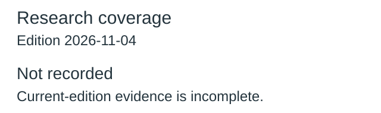
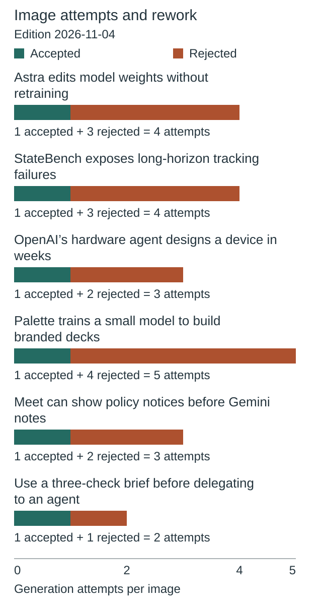
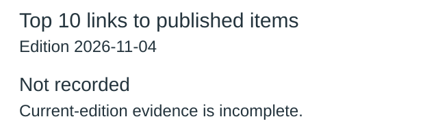
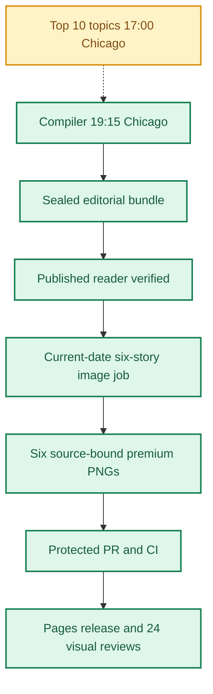
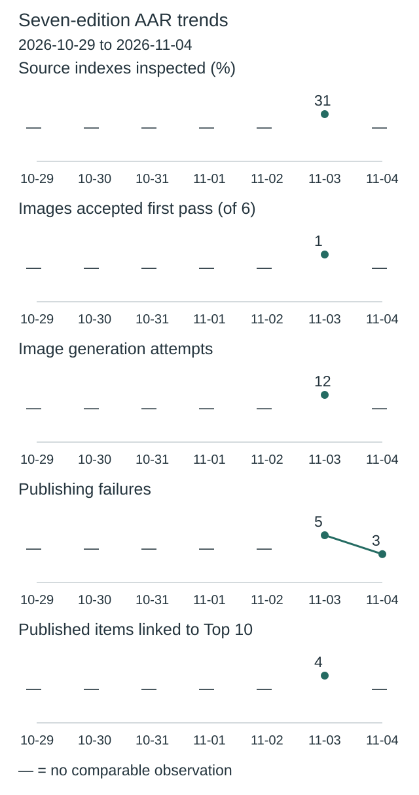
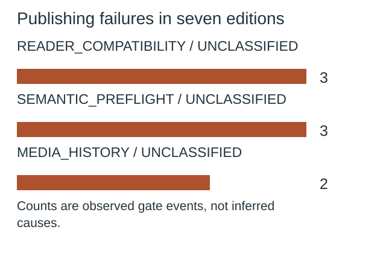
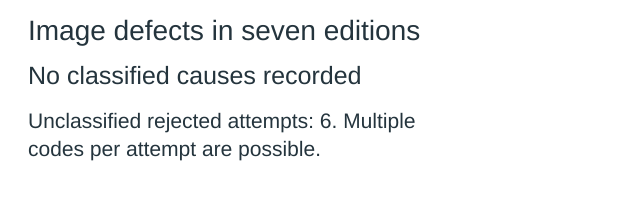

**🟩 RELEASE COMPLETE**
**TOP 10 PARTIAL** · **🟩 COMPILER VERIFIED** · **🟦 IMAGES 6/6 RELEASED** · **🟪 VISUAL QA 24/24 PASS**

# Daily AI Brief — Unified Production After-Action Report
**Edition:** November 4, 2026 · **Production evening:** 2026-11-03 · **Timezone:** America/Chicago
**Primary public reader:** [Open 2026-11-04 Brief](https://gttome.github.io/Daily-AI-Brief-Compiler/briefs/2026-11-04/) · **Repository:** [Daily-AI-Brief-Compiler](https://github.com/gttome/Daily-AI-Brief-Compiler)

> **IMPORTANT — VERIFIED PRODUCTION RESULT**
> **Executive release result: COMPLETE.** This is the single management-facing report covering Top 10 topic discovery, the editorial Compiler, published Brief and premium-image run. **Entire-system evidence: PARTIAL.** Top 10 report: **provisional**; Compiler handoff: **RECEIVED_SNAPSHOT_BOUND**; guided searches: **INVALID**. Compiler public status: **VERIFIED**. Image release: **RELEASED_VERIFIED**. Direct 24-context visual quality: **24/24 PASS**. Autonomous completion: **FAIL_OWNER_RECOVERY**. Missing evidence must not be promoted to a success claim.

**🕒 Production stage durations:** **Top 10 5m 20s** · **Compiler final seal window 4m 17s** · **Premium Images 47m 13s** (evidence-bounded elapsed times; the start/end events differ).

## Evidence reconciliation

Compiler final seal window: 4m 17s. Compiler state start to public verification: 49m 10s. Observed execution and final seal windows are distinct.
Image capability route preflight: RECORDED; scheduler origin remains UNPROVEN.
Image efficiency: 0/6 first-pass accepts; 21 total attempts. November 3–5 target: at least 3/6 first-pass and at most 2 attempts per image, with unchanged quality floor.
Image review completed: 2026-11-04T04:11:34Z; review-record commit: 2026-11-04T04:16:04.000Z; protected review merge: 2026-11-04T04:17:59.000Z.
Eligible source indexes: 87; editorial inspections reported: Unknown (Unknown%); inaccessible in editorial audit: Unknown; explicitly unreviewed IDs: Unknown; unclassified editorial IDs: Unknown. Automated index parsing is separate from editorial inspection and cannot substantiate exhaustive freshness claims.


## Daily AAR charts

These charts use this edition’s receipts. Missing data is not zero.

### Research coverage



**Not recorded:** current-edition evidence is missing or inconsistent.

Not inspected includes every index without a recorded editorial inspection; this is not proof of missed stories.

### Image attempts and rework



**21 attempts; 0 of 6 images accepted on their first attempt.**

Recorded November 3–5, 2026 target: at least 3/6 first-pass accepts; no more than 2 attempts per image. This is an efficiency target, not a quality cutoff.

| Image | Accepted | Rejected | Total attempts |
|---|---:|---:|---:|
| Astra edits model weights without retraining | 1 | 3 | 4 |
| StateBench exposes long-horizon tracking failures | 1 | 3 | 4 |
| OpenAI’s hardware agent designs a device in weeks | 1 | 2 | 3 |
| Palette trains a small model to build branded decks | 1 | 4 | 5 |
| Meet can show policy notices before Gemini notes | 1 | 2 | 3 |
| Use a three-check brief before delegating to an agent | 1 | 1 | 2 |

Generation attempts measure rework, not runtime or cost. Quality and publication checks remain separate.

### Top 10 links to published items



**Not recorded:** current-edition evidence is missing or inconsistent.

No selection quota. Topic linkage does not establish better quality, popularity or causal improvement.

[Chart data](charts.json)

One edition at a time. Missing evidence is not zero. Trend claims require comparable recorded cycles.

## Performance dashboard

| Measure | Recorded result | Source / caveat |
|:--|:--:|:--|
| Entire-system evidence | **PARTIAL** | Full Top 10 list, bound Compiler input, all-format search receipts and existing release checks; separate from publication and autonomy |
| Top 10 report | **provisional · 10 topics** | Same Chicago cycle report; provisional/partial coverage remains disclosed |
| Top 10 received by Compiler | **RECEIVED_SNAPSHOT_BOUND** | Exact report snapshot bytes; consumed commit separately corroborated: YES |
| Top 10 guided article/video/podcast searches | **INVALID** | Actual source-search receipts and selected/rejected topic outcomes |
| Top 10 stage duration | **5m 20s** | Same-cycle run receipt only; no runtime or usage estimate |
| Editorial publication | **PASS** | State and public reader integrity receipt |
| **Unattended autonomy (separate from publication)** | **FAIL_OWNER_RECOVERY** | Owner incident receipt takes precedence over unverified producer self-attestation |
| Recorded protected publishing gate failures | **3** | Actual same-edition GitHub failure sidecar only; earlier unrecorded failures remain unknown |
| Articles | **6** | Exactly 2 technical / 2 knowledge-worker / 2 agents required |
| Verified original sources within preceding 24 hours | **0 / 6** | Original publisher dates only; other sources require a documented fallback rationale |
| Distinct selected article publishers | **6** | Six different primary organizations preferred |
| Videos over seven days old | **2** | Must be labeled evergreen, not a new development |
| Distinct selected video publishers | **2** | One channel is one publisher even across multiple videos |
| Video discovery source attempts | **NOT_RECORDED / NOT_RECORDED** | Attempt evidence across enabled and qualification-only leads; NOT_RECORDED. Not a claim of full content review or player verification | 
| Duplicate active Watchlist display titles | **Not recorded** | Published canonical Watchlist only; historical evidence retained |
| Original-release video playback (historical) | **TWO_PUBLISHED_VIDEOS_PLAYBACK_PASS** | Later reader corrections may replace these originally verified videos; see incident register | 
| Postpublication reader incidents | **NOT_RECORDED** | Edition-specific owner reports and corrective PRs, not inferred absence | 
| Verified postpublication video corrections | **NOT_RECORDED** | Incident register tracks correction PR, actual playback evidence and reader preservation |
| Editorial index second-pass attempts | **0** | Bounded public GET retries only; never proof of original article reading |
| Editorial index reads recovered | **0** | Successful page fetch can still yield zero eligible dated items |
| Recorded scheduler capability route | **UNPROVEN** | Same-invocation route receipt only; GitHub is not scheduler authentication |
| Avoidable incomplete-staging CI failures | **Not independently audited** | Existing image-package push CI is disabled; exact-head protected PR CI remains required. A failure count requires actual workflow evidence |
| Media | **2 videos + 2 podcasts** | Sealed bundle |
| **Compiler final seal window** | **4m 17s (4.3 min)** | Final sealed-state timestamp → verified public reader; initial execution is separate |
| **Image processing stage duration** | **47m 13s** | First accepted PNG Git checkpoint → final 24/24 review; auditable stage elapsed time |
| Image scheduled-to-final-review window | **Not independently recorded** | Only with a saved one-cycle schedule anchor; does not attest exact generation start |
| Executor-observed generation-to-final-review | **54m 36s** | Only if the worker recorded a same-execution clock before its first native call; not independently verified provider runtime |
| Accepted premium PNGs | **6 / 6** | Exact package and public release hashes |
| Native image generation attempts | **21** | Image worker AAR; no estimation |
| Rejected candidates | **15** | Image worker AAR |
| Final worker checkpoint reconciliation | **PASS** | Oct25+ verifies exact generation count, per-story attempts, six accepted story/image/hash bindings and final release |
| Saved visual contexts | **24 / 24 PASS** | Dated/permanent desktop/mobile review |
| Public SHA-256 checks | **44** | Image release receipt |
| October 8 immutable history | **17 / 17** | Independent content-preservation checks |
| **Owner-reported weekly Work usage for this run** | **Not reported** | No per-cycle usage supplied |

> **EFFICIENCY NOTE**
> **Resource reporting policy:** No usage figure was supplied for this cycle, so none is assumed. Future runs show **Not reported** unless the owner supplies new cycle-specific usage metadata. No approval or extra step is required to generate the AAR.

## Production architecture and checkpoints



## Daily AI Topic Top 10 and Compiler handoff

**Research cycle:** 2026-11-03 · **Target Brief:** 2026-11-04 · **Scheduled start:** 17:00 America/Chicago

| Dimension | Recorded evidence |
|---|---|
| Run/report result | PARTIAL |
| Report status / topics | provisional / 10 |
| Freshness | FRESH\_AT\_CONSUMPTION |
| Compiler handoff | RECEIVED\_SNAPSHOT\_BOUND |
| Search coverage | INVALID |
| Selection mapping verification | INVALID |
| Observed start / finish | 2026-11-03T23:04:35.597Z / 2026-11-03T23:09:55.307Z |
| Elapsed minutes | 5.33 |
| Usage percent | Not reported |
| Cost USD | Not reported |
| Independent scheduler autonomy | UNPROVEN |
| Compiler-recorded consumed commit | 4cd175ca264002fe4217101dd9b5aea03b5e8a7a |
| Report SHA-256 | 3286ec50e70f3bb16e2dd2686e07c8d238e53dac159127073649c8d2975bf313 |

| Discovery order | AI topic | Summary | Confidence | Evidence |
|---:|---|---|---|---|
| 1 | MIT's Qwen weight edit: targeted loop repair, not general self-improvement | The authors report a narrow model repair with a contrasting Gemma result. | medium | [Source](https://zlio.com/videos/) · [Source](https://rikiyat.github.io/blog/weight-space-programming/) · [Source](https://whatisthelatest.ai/top-10/) |
| 2 | DeepSeek Harness Creator Mode receives a new hands-on explainer | A new review examines the plugin-based developer preview. | medium | [Source](https://whatisthelatest.ai/top-10/) · [Source](https://github.com/deepseek-ai/deepseek-harness) |
| 3 | AI Engineer publishes a graph-engineering agent talk | The presentation offers an approach to predictable agent structure. | medium | [Source](https://whatisthelatest.ai/top-10/) |
| 4 | Cole Medin explains management of an AI software factory | A dated workflow demonstration focuses on oversight of generated pull requests. | medium | [Source](https://whatisthelatest.ai/top-10/) |
| 5 | OpenAI explains Pando's Git scaling tradeoffs | OpenAI describes infrastructure for parallel coding work. | medium | [Source](https://openai.com/index/scaling-git-at-openai/) · [Source](https://superpowerdaily.com/videos/fd963481-8df7-4ec2-ba4f-039bfcb9e157) |
| 6 | Anthropic's FlashProve brings renewed provable-inference discussion | A research prototype addresses verification of which model generated output. | medium | [Source](https://www.anthropic.com/research/provable-inference) · [Source](https://github.com/anthropics/FlashProve) · [Source](https://whatisthelatest.ai/top-10/) |
| 7 | A new Duet explainer revisits the October preview | Today's video discusses an existing proactive-agent waitlist preview. | medium | [Source](https://whatisthelatest.ai/top-10/) · [Source](https://claude.com/resources/articles/claude-duet) |
| 8 | OpenAI posts a Voice-in-Finances demonstration | A new publisher video shows a conversational-finance interface. | medium | [Source](https://zlio.com/videos/) |
| 9 | OpenAI posts Qodo context-aware code-review coverage | A publisher demonstration focuses on company context in code review. | medium | [Source](https://zlio.com/videos/) |
| 10 | OpenAI publishes the TamaGPT hardware demonstration | A new video presents AI-assisted physical prototyping. | medium | [Source](https://zlio.com/videos/) |

**Sample scope:** {"retained\_video\_observations":9,"metadata\_screened\_videos":9,"distinct\_retained\_channels":7,"full\_video\_reviews":0,"transcript\_reviews":1,"direct\_youtube\_counter\_verifications":0,"additional\_inventory\_titles":"Screened as discovery leads; no deduplicated total claimed.","target\_40\_to\_80\_full\_reviews\_met":false,"validation\_resources\_registered":14,"new\_resource\_candidates\_evaluated":1,"freshness":"Named Nov 2-3 publications/coverage preferred. Duet Oct 21 announcement is background, explicitly not a new release."}. **Ranking basis:** {"method":"Qualitative limited evidence bands; all positions uncertain.","signals":\["Named-event public coverage","Reported source-specific counters","Fresh publication and discussion dates","Original document cross-checks"\],"not\_established":\["Global popularity order","Growth or audience velocity","Independent experimental replication"\]}.

| Search format | Receipt rows | Attempts recorded | Explicitly not attempted |
|---|---:|---:|---:|
| article | 3 | 3 | 0 |
| video | 8 | 8 | 0 |
| podcast | 1 | 1 | 0 |

**Selected Brief items linked to trends:**

No validated selection-to-topic mapping was recorded.

**Gaps and limitations:**

- Claimed trend-to-selection mappings are not verified against the same-edition selected bundle.
- Per-topic article/video/podcast search coverage is incomplete, invalid or bound to a different input.
- The report labels its ranking provisional.
- Direct watch-page requests were throttled; no full audiovisual review or direct counter verification.
- Autogenerated transcript is imperfect and is distinguished from playback.
- Some original video timestamps and sponsorship disclosures unavailable; null fields remain unknown.
- Attention sources are sampled and can overlap or change their inventory; no exact rank claims.
- Compiler consumption, actual searches and bundle-verified selections require later separate receipts.
- Frozen November 3 input and outcome baselines were read and preserved.

**Recorded run issues:**

- {"issue":"Direct video and X access limited","correction":"Use provenance-labeled metadata, primary documents and one complete autogenerated transcript; no playback/direct-counter claims."}
- {"issue":"Dynamic discovery indexes changed links between retrievals","correction":"Use newer event-matched index identities; obsolete exploratory clicks not treated as reviewed metadata."}
- {"issue":"Full-video coverage below aim","correction":"Report nine retained records, one transcript and zero full audiovisual reviews; do not substitute larger metadata counts."}

**Recorded improvements:**

- {"change":"Event-specific headlines and source roles rechecked against current coverage","reason":"The prior AAR recorded no substantive candidate-review depth and the expanded baseline did not establish audience growth.","expected\_effect":"More precise leads and fewer claims inferred from unrelated engagement."}
- {"change":"Read one complete automatically generated transcript and verify its main weight-edit claim against the original study","reason":"Metadata expansion alone does not establish what a video explains.","expected\_effect":"A substantive review observation without falsely claiming audiovisual playback."}
- {"change":"Record one publisher-family removal assessment","reason":"Prior improvement metrics had zero recorded sensitivity reviews.","expected\_effect":"Expose a topic supported by only one editorial attention family."}

### Daily improvement and effect on the Brief

**Fixed baseline:** nov03-2026-v1 / INPUT\_FROZEN. **Outcome baseline:** FROZEN\_AFTER\_VERIFIED\_PUBLICATION. **Prior cycle:** 2026-11-02.

| Input measure | Current | November 3 baseline | Change from baseline | Change from prior cycle |
|---|---:|---:|---:|---:|
| topic count | 10 | 10 | 0 | 0 |
| validation resource count | Not reported | 14 | Not reported | Not reported |
| additional video metadata records | Not reported | 63 | Not reported | Not reported |
| additional video channels | Not reported | 21 | Not reported | Not reported |
| total video observations | Not reported | 79 | Not reported | Not reported |
| unique videos | Not reported | 71 | Not reported | Not reported |
| full video reviews | Not reported | 0 | Not reported | Not reported |
| direct youtube counter verifications | Not reported | 0 | Not reported | Not reported |
| broader evidence band topics | 0 | 3 | -3 | -3 |
| limited evidence band topics | 10 | 7 | 3 | 3 |

**Observed downstream measurements:** PENDING\_OR\_INCOMPLETE.

| Outcome measure | Current | Change from frozen outcome | Change from prior cycle |
|---|---:|---:|---:|
| expected topic format pairs | 30 | 0 | 0 |
| attempted topic format pairs | Not reported | Not reported | Not reported |
| explicitly unattempted pairs | Not reported | Not reported | Not reported |
| discovered candidate count | Not reported | Not reported | Not reported |
| searched source host count | Not reported | Not reported | Not reported |
| selected article count | Not reported | Not reported | Not reported |
| selected video count | Not reported | Not reported | Not reported |
| selected podcast count | Not reported | Not reported | Not reported |

**Source changes:** {"added":\[\],"removed":\["cheeky-pint","sec-edgar","reuters","the-verge","hugging-face","artificial-analysis","stanford-hai","nist","github-originals","cisa","trendforce","arena","epoch-ai","hacker-news"\]}.

**Candidate review depth:** NOT\_RECORDED.

| Review measure | Current | Change from prior comparable cycle |
|---|---:|---:|
| reviewed candidate count | Not reported | Not reported |
| qualified candidate count | Not reported | Not reported |
| rejected candidate count | Not reported | Not reported |
| metadata only count | Not reported | Not reported |
| full video reviews | Not reported | Not reported |
| transcript reviews | Not reported | Not reported |

The frozen November 3 baseline has no candidate-level review ledger; no retrospective value is invented. Recorded reviews do not independently establish content quality, audience interest or causal benefit.

**Method/resource review:** {"baseline\_id":"nov03-2026-v1","previous\_report\_date":"2026-11-02","method\_version":"2026-11-03.2-event-review","changes":\[{"change":"Event-specific headlines and source roles rechecked against current coverage","reason":"The prior AAR recorded no substantive candidate-review depth and the expanded baseline did not establish audience growth.","expected\_effect":"More precise leads and fewer claims inferred from unrelated engagement."},{"change":"Read one complete automatically generated transcript and verify its main weight-edit claim against the original study","reason":"Metadata expansion alone does not establish what a video explains.","expected\_effect":"A substantive review observation without falsely claiming audiovisual playback."},{"change":"Record one publisher-family removal assessment","reason":"Prior improvement metrics had zero recorded sensitivity reviews.","expected\_effect":"Expose a topic supported by only one editorial attention family."}\],"resource\_candidates":\[{"url":"https://superpowerdaily.com/videos/fd963481-8df7-4ec2-ba4f-039bfcb9e157","role":"original\_video\_transcript","access":"direct","review\_scope":"Complete displayed 0:00-9:44 autogenerated transcript read; video not played.","independence":"Original editorial briefing, dependent on underlying research; not an independent experiment.","decision":"accepted","reason":"Provides an inspectable Pando segment and a bounded Qwen/Gemma explanation that can be compared with original sources.","contribution":"One transcript review; identified limits on autonomous-improvement claims.","limitations":\["Transcript's specific investigation-time figure was not confirmed in the displayed original post.","The cyber segment asserts stronger causality than its own account establishes; rejected for cyber claim validation."\]}\],"observed\_effects":\[{"observation":"Original Duet announcement is October 21 despite a November 3 explainer title.","effect":"Labeled new discussion of an older preview; reduced Brief priority."},{"observation":"TrendReport's 2.0 cluster mixes football and gaming with AI.","effect":"Rejected that cluster; no counts copied into any topic."},{"observation":"Pando attention becomes insufficient when its only retained editorial family is removed.","effect":"Recorded sensitivity limitation; claim evidence is not counted as attention."}\],"next\_improvement":"Review a second event-matched transcript from a different publisher and seek known-time direct or comparable counters; confirm original video dates for the three OpenAI demos.","limitations":\["No verified production improvement is claimed; target edition has not been produced.","A nine-video retained sample is smaller than the frozen input baseline and is not comparable audience movement.","Forty-to-eighty full-video-review target remains unmet."\],"change\_evaluations":\[\],"pending\_change\_evaluations":\["NOV03-04","AAR-02","AAR-03","AAR-10"\],"review\_due\_edition":"2026-11-11","feedback":{"aar\_url":"https://github.com/gttome/Daily-AI-Brief-Compiler/blob/operations-reports/daily/2026-11-02/combined.md","charts\_url":"https://github.com/gttome/Daily-AI-Brief-Compiler/blob/operations-reports/daily/2026-11-02/charts.json","metrics\_url":"https://github.com/gttome/Daily-AI-Brief-Compiler/blob/operations-reports/daily/2026-11-02/improvement-metrics.json","observed":{"inspected\_indexes":27,"eligible\_indexes":87,"image\_attempts":12,"first\_pass\_images":1,"linked\_articles":3,"linked\_videos":0,"linked\_podcasts":1,"source\_candidate\_review\_depth":"NOT\_RECORDED","publisher\_family\_reviews\_recorded":0},"interpretation":"Observed prior outcomes describe that edition. Trend linkage is association; code implementation and today's research do not prove later production improvement."}}.

**Current reconciled conclusion:** PENDING\_OR\_INCOMPLETE; outcome baseline FROZEN\_AFTER\_VERIFIED\_PUBLICATION; candidate review ledger NOT\_RECORDED.

**Historical producer observations (not current status):** The following snapshot preserves what the producer reported at the time. Its pending statuses and candidate-quality claims are not independently reconciled conclusions. Use the current tables above for publication-bound measurements; an absent candidate review ledger remains unknown.

<details><summary>Original producer effects and gaps — historical snapshot</summary>

```json
null
```

</details>

**Next improvement:** Review a second event-matched transcript from a different publisher and seek known-time direct or comparable counters; confirm original video dates for the three OpenAI demos.

Counts show coverage and observed association, not audience popularity, source independence, candidate quality or causal uplift. Compare source/method changes before interpreting deltas. Unknown values are not zero. Publication, reader corrections, runtime and image outcomes retain their separate AAR evidence.

Report, source-readback and search receipts are separate observations. Snapshot binding verifies the collected report bytes; the consumed commit is independently corroborated only when the separately fetched source bytes match. These records do not independently attest scheduler identity or source truth. Top 10 reporting does not change Brief/image release status.


## Track 1 — Compiler

**State:** `SHADOW_VERIFIED` · **Bundle:** `BUNDLE_READY` · **Compiler final seal window:** 4m 17s (4.3 min).

| Publication gate | Result |
|---|:---:|
| Canonical reader build | ✅ |
| Reader parity | ✅ |
| Public verification of dated edition | ✅ |
| Previous editions preserved | ✅ |
| Permanent story routes and feeds | ✅ |

**Selected coverage:**

| Lane | Story |
|---|---|
| Technical AI Engineering | Astra edits model weights without retraining |
| Technical AI Engineering | StateBench exposes long-horizon tracking failures |
| Applied Generative AI for Knowledge Workers | OpenAI’s hardware agent designs a device in weeks |
| Applied Generative AI for Knowledge Workers | Palette trains a small model to build branded decks |
| Agents for Everyone | Meet can show policy notices before Gemini notes |
| Agents for Everyone | Use a three-check brief before delegating to an agent |

## Track 2 — Premium images

**Public status:** `RELEASED_VERIFIED` · **Saved images:** 6/6 · **Actual generation attempts:** 21 · **Rejected candidates:** 15.

### Image production duration — Git-verified milestones

**Auditable image stage duration:** **47m 13s** (first accepted binary saved in Git → first persisted 24-context quality-review record). **First asset to public image release:** **38m 42s**.
**Scheduled-to-final-review window:** **Not independently recorded**. This is a scheduled-clock comparison only when a separately recorded exact-date schedule exists; it is **not** measured native image-generation runtime.

| Production milestone | Chicago local time | Evidence |
|---|---|---|
| Scheduled image start (if exact-date record exists) | Not independently recorded | Time planned, not actual execution start |
| First executor-observed start | 9:14:35 PM | Worker self-attestation, not a first-party scheduler event |
| First native generation observation | 9:21:28 PM | Worker clock recorded immediately before first native call, not model-provider telemetry |
| First accepted PNG bytes saved to Git | 9:28:51 PM | Immutable binary-stage commit |
| Six-image package / reviews committed | 10:01:36 PM | Exact-head PR source commit |
| Protected package merged | 10:06:24 PM | Merge SHA and required CI |
| Public images verified | 10:07:32 PM | Image-release receipt |
| 24/24 review record committed | 10:16:04 PM | Immutable first review-approval commit |

> **Duration interpretation:** The audited stage excludes unobservable pre-checkpoint creative work. The scheduled-start window includes it but must not be interpreted as precise active processing time. Missing timestamps appear as **Not independently recorded**, never an estimate.


| Source-bound image | Attempts | File size | Public page |
|---|---:|---:|---|
| Astra edits model weights without retraining | 4 | 0.75 MiB | [View original](https://gttome.github.io/Daily-AI-Brief-Compiler/briefs/images/2026-11-04/dab-edition-2026-11-04-m01.png) |
| StateBench exposes long-horizon tracking failures | 4 | 0.65 MiB | [View original](https://gttome.github.io/Daily-AI-Brief-Compiler/briefs/images/2026-11-04/dab-edition-2026-11-04-m02.png) |
| OpenAI’s hardware agent designs a device in weeks | 3 | 0.71 MiB | [View original](https://gttome.github.io/Daily-AI-Brief-Compiler/briefs/images/2026-11-04/dab-edition-2026-11-04-m10.png) |
| Palette trains a small model to build branded decks | 5 | 0.57 MiB | [View original](https://gttome.github.io/Daily-AI-Brief-Compiler/briefs/images/2026-11-04/dab-edition-2026-11-04-m11.png) |
| Meet can show policy notices before Gemini notes | 3 | 0.57 MiB | [View original](https://gttome.github.io/Daily-AI-Brief-Compiler/briefs/images/2026-11-04/dab-edition-2026-11-04-m12.png) |
| Use a three-check brief before delegating to an agent | 2 | 0.56 MiB | [View original](https://gttome.github.io/Daily-AI-Brief-Compiler/briefs/images/2026-11-04/dab-edition-2026-11-04-m14.png) |

**Immutable-release and visual gates:**

| Release gate | Result |
|---|:---:|
| Protected public image receipt | ✅ |
| Accepted-image Git hash bindings | ✅ |
| Six live PNGs | 6/6 |
| Dated/permanent story placements | 12/12 recorded in release evidence |
| Desktop/mobile visual inspection | 24/24 PASS |
| Historical Oct 8 integrity | 17/17 |

### Published premium illustrations

<table>
<tr><td width="50%"><a href="https://gttome.github.io/Daily-AI-Brief-Compiler/briefs/images/2026-11-04/dab-edition-2026-11-04-m01.png"></a><br/><b>Astra edits model weights without retraining</b></td><td width="50%"><a href="https://gttome.github.io/Daily-AI-Brief-Compiler/briefs/images/2026-11-04/dab-edition-2026-11-04-m02.png"></a><br/><b>StateBench exposes long-horizon tracking failures</b></td></tr>
<tr><td width="50%"><a href="https://gttome.github.io/Daily-AI-Brief-Compiler/briefs/images/2026-11-04/dab-edition-2026-11-04-m10.png"></a><br/><b>OpenAI’s hardware agent designs a device in weeks</b></td><td width="50%"><a href="https://gttome.github.io/Daily-AI-Brief-Compiler/briefs/images/2026-11-04/dab-edition-2026-11-04-m11.png"></a><br/><b>Palette trains a small model to build branded decks</b></td></tr>
<tr><td width="50%"><a href="https://gttome.github.io/Daily-AI-Brief-Compiler/briefs/images/2026-11-04/dab-edition-2026-11-04-m12.png"></a><br/><b>Meet can show policy notices before Gemini notes</b></td><td width="50%"><a href="https://gttome.github.io/Daily-AI-Brief-Compiler/briefs/images/2026-11-04/dab-edition-2026-11-04-m14.png"></a><br/><b>Use a three-check brief before delegating to an agent</b></td></tr>
</table>

## Incidents, corrections and learning

### Postpublication reader incidents (updated when new evidence is merged)

No current-edition postpublication incident register was available; this is **NOT_RECORDED**, not a certification of zero incidents.


**Editor recovery classification:** FAIL_OWNER_RECOVERY. **Owner intervention:** Documented and required. **Protected same-edition failures recorded:** 3. 
**Latest failed protected stage:** SEMANTIC_PREFLIGHT; [Action evidence](https://github.com/gttome/Daily-AI-Brief-Compiler/actions/runs/41758454931). Exact stage durations are available only where real source timestamps exist.

| Stage | Verified issue | Corrective action |
|---|---|---|
| Native saved-pixel inspection | nov04-t1-weight-space-repair attempt 1: Extra Input, Output, MLP and Held-out evaluation labels; 0.016% brace attached under unchanged blue cells; extra arithmetic glyphs; repeated enclosing cards; outer strokes cross 40px safe margin. | TARGETED CORRECTION after actual saved-pixel rejection: Delete every extra Input, Output, MLP, 15, 19 and Held-out evaluation caption outside the nine exact labels. Remove the minus and equals glyphs and their vector strips. Keep a magnified selected orange column edit only. Put the 0.016% edited brace directly beneath the orange EDITED COLUMNS, never beneath unchanged blue cells. Move all boundary strokes inside 40px; bottom caveat text baseline inside y590. No repeated enclosing cards: leave the large model lattice unboxed. Preserve the source-correct main hierarchy and the nine exact mandatory labels. |
| Native saved-pixel inspection | nov04-t1-weight-space-repair attempt 2: Layers 15 and 19 caption remains undersized at final 1200px output; outer borders and bottom caveat violate 40px safe inset. Corrected unallowlisted text and edited-column brace are preserved. | Applied the recorded same-story native correction, preserved passing features, exported a complete PNG and reinspected the actual full-size and mobile pixels before acceptance. |
| Native saved-pixel inspection | nov04-t1-weight-space-repair attempt 3: Correct labels and brace, readable 320px priorities; bottom caveat enclosing stroke still extends beyond 40px safe inset. Removing only those outer frames; no semantic defect found. | Applied the recorded same-story native correction, preserved passing features, exported a complete PNG and reinspected the actual full-size and mobile pixels before acceptance. |
| Native saved-pixel inspection | nov04-t2-statebench-state-tracking attempt 1: Variable/subscript and assignment/function formula glyphs are not in the frozen nine-label allowlist; enclosing frames cross safe margins. Preserve the four comparison mechanisms; replace glyphs with clean unlabeled shapes. | Applied the recorded same-story native correction, preserved passing features, exported a complete PNG and reinspected the actual full-size and mobile pixels before acceptance. |
| Native saved-pixel inspection | nov04-t2-statebench-state-tracking attempt 2: Identical blank tokens obscure state identity and update effects; left captions cross safe margin; unplanned green feedback link remains. Replace with distinct conceptual shapes per immutable/overwrite/accumulate/copy relationship and remove feedback. | Applied the recorded same-story native correction, preserved passing features, exported a complete PNG and reinspected the actual full-size and mobile pixels before acceptance. |
| Native saved-pixel inspection | nov04-t2-statebench-state-tracking attempt 3: Mechanisms now distinguish immutable, overwritten, accumulated and copied values without formulas. Filled heading banners and right evidence frame still extend outside safe margins; remove only those frames and preserve text. | Applied the recorded same-story native correction, preserved passing features, exported a complete PNG and reinspected the actual full-size and mobile pixels before acceptance. |
| Native saved-pixel inspection | nov04-k1-openai-physical-engineering attempt 1: Interface and firmware show rows of simulated writing/code. Manufacturer review depicts completed-device replicas instead of inspection; bottom caveat glyphs extend below safe area. Preserve actual exploded hardware and review gaps; remove fake writing and success implication. | Applied the recorded same-story native correction, preserved passing features, exported a complete PNG and reinspected the actual full-size and mobile pixels before acceptance. |
| Native saved-pixel inspection | nov04-k1-openai-physical-engineering attempt 2: Source-bound hardware, review boundary and clean artifact planes now pass; bottom caveat still extends below final y590. Reduce only its font to existing Firmware label size and raise baseline; preserve all passing features. | Applied the recorded same-story native correction, preserved passing features, exported a complete PNG and reinspected the actual full-size and mobile pixels before acceptance. |
| Native saved-pixel inspection | nov04-k2-palette-deck-building attempt 1: Designer then coder caption under repair misstates chronology; source-supported flow otherwise correct. Window dot controls and overflow burst strokes are unneeded invented decoration. Top brief and bottom caveat violate margins. Remove misleading caption from revised frozen allowlist and correct only failed details. | Applied the recorded same-story native correction, preserved passing features, exported a complete PNG and reinspected the actual full-size and mobile pixels before acceptance. |
| Native saved-pixel inspection | nov04-k2-palette-deck-building attempt 2: Main labels, clean artifact blocks and conditional repair source fidelity pass; caveat still exceeds bottom safe margin. Reformat the same exact phrase over two lines inside reviewed bottom region without changing mechanism. | Applied the recorded same-story native correction, preserved passing features, exported a complete PNG and reinspected the actual full-size and mobile pixels before acceptance. |
| Native saved-pixel inspection | nov04-k2-palette-deck-building attempt 3: Two-line caveat placed too low beneath retained-original panel, exceeding final y590. Move unchanged phrase to genuinely clear bottom-left area under repair artifact with reviewed safe text rectangle. | Applied the recorded same-story native correction, preserved passing features, exported a complete PNG and reinspected the actual full-size and mobile pixels before acceptance. |
| Native saved-pixel inspection | nov04-k2-palette-deck-building attempt 4: Caveat correctly moved to clear bottom-left, but second line still falls below final y590. Raise the existing two lines without resizing or reflow; all other regions preserved. | Applied the recorded same-story native correction, preserved passing features, exported a complete PNG and reinspected the actual full-size and mobile pixels before acceptance. |
| Native saved-pixel inspection | nov04-a1-meet-policy-notices attempt 1: Unallowlisted lowercase i information glyph, brand-like four-point AI sparkles and an invented laptop/button UI. Actual scope/trigger/pre-join notice order is correct. Replace with conceptual notice plane, chain-link and plain note artifacts; preserve all exact captions. | Applied the recorded same-story native correction, preserved passing features, exported a complete PNG and reinspected the actual full-size and mobile pixels before acceptance. |
| Native saved-pixel inspection | nov04-a1-meet-policy-notices attempt 2: Brand-like sparkles, i glyph and invented UI removed, but a large unexplained gold circle remains decorative. Replace only that filler with the existing Custom notice caption moved into its actual notice plane; preserve source-correct scope and triggers. | Applied the recorded same-story native correction, preserved passing features, exported a complete PNG and reinspected the actual full-size and mobile pixels before acceptance. |
| Native saved-pixel inspection | nov04-a2-three-check-agent-brief attempt 1: Source, webpage and draft artifacts contain fake prose strips; video has invented slider knob, webpage has dot controls, and opportunity opening became a scenic door with glow. Preserve correct source/date/check/format/draft sequence; replace only these unsupported details. | Applied the recorded same-story native correction, preserved passing features, exported a complete PNG and reinspected the actual full-size and mobile pixels before acceptance. |

> **OPERATIONAL NOTE**
> This report distinguishes a published and verified production outcome from scheduler metadata exposed to another conversation. Lack of a live host heartbeat in a separate normal chat is not a Compiler production failure.

## Usage and cost stewardship

| Item | Per-cycle value |
|---|---|
| **Weekly Work usage reported by owner** | **Not reported** |
| Internal weekly usage reference | Target under 5% |
| Genuine image-generation attempts | 21 |
| Accepted diagrams | 6 |
| Regeneration after acceptance | 0 |
| Top 10 reported usage | Not reported |
| Top 10 reported cost | Not reported |
| Account-level billing telemetry | Not independently accessible to deterministic GitHub reporting |

**Future reporting rule:** For cycles without an optional owner-usage record, publish the complete AAR with `Not reported`; do not reuse prior percentages, guess remaining weekly credits or delay tomorrow's production.

## Next-edition operating handoff

| Control | Recurring contract |
|---|---|
| AI Topic Top 10 | Sole report task · 17:00 America/Chicago · saved dated list guides same-evening research |
| Primary Compiler | Sole existing task · 19:15 America/Chicago |
| Premium image production | Sole existing task · standard 21:15 America/Chicago |
| Exact image job selection | Newly published next-date `PUBLISHED_PENDING` only |
| AAR | Combined report generated automatically from new GitHub receipts |
| Optional Work usage | Owner-supplied per cycle, otherwise `Not reported` |

> **SCHEDULE RESTORATION NOTE**
> A temporary scheduling exception must be explicitly restored before claiming standard-time readiness. This deterministic document generator reads existing state only; it does not modify production schedules.

## Evidence register

| Evidence | Link |
|---|---|
| Compiler state | [Open receipt](https://github.com/gttome/Daily-AI-Brief-Compiler/blob/shadow/2026-11-04/shadow-runs/2026-11-04/compiler-state.json) |
| Compiler compile receipt | [Open receipt](https://github.com/gttome/Daily-AI-Brief-Compiler/blob/shadow/2026-11-04/shadow-runs/2026-11-04/compiler/compile-receipt.json) |
| Compiler public integrity | [Open receipt](https://github.com/gttome/Daily-AI-Brief-Compiler/blob/shadow/2026-11-04/shadow-runs/2026-11-04/compiler/postpublish-integrity.json) |
| Image release receipt | [Open receipt](https://github.com/gttome/Daily-AI-Brief-Compiler/blob/shadow-pages-history/site/image-jobs/2026-11-04/release.json) |
| Image review | [Open receipt](https://github.com/gttome/Daily-AI-Brief-Compiler/blob/main/external-image-packages/2026-11-04/reviews/live/semantic-pixel-review.json) |
| Original image AAR | [Open receipt](https://github.com/gttome/Daily-AI-Brief-Compiler/blob/main/external-image-packages/2026-11-04/reviews/after-action.md) |
| Observed editorial index retries | [Open receipt](https://github.com/gttome/Daily-AI-Brief-Compiler/blob/shadow/2026-11-04/shadow-runs/2026-11-04/editorial/source-item-retries.json) |
| Published player playback receipt | [Open receipt](https://github.com/gttome/Daily-AI-Brief-Compiler/blob/shadow/2026-11-04/shadow-runs/2026-11-04/compiler/postpublish-video-playback.json) |
| Top 10 ranked topic report | [Open receipt](https://github.com/gttome/Daily-AI-Brief-Compiler/blob/49e4f35d34c7b4c7a223b4a587a1d5aeedb890ff/signals/ai-topic-top10/2026-11-03.json) |
| Top 10 run after-action receipt | [Open receipt](https://github.com/gttome/Daily-AI-Brief-Compiler/blob/49e4f35d34c7b4c7a223b4a587a1d5aeedb890ff/signals/ai-topic-top10/2026-11-03.aar.json) |
| Compiler Top 10 input snapshot | [Open receipt](https://github.com/gttome/Daily-AI-Brief-Compiler/blob/shadow/2026-11-04/shadow-runs/2026-11-04/editorial/trend-input.json) |
| Top 10 article/video/podcast search coverage | [Open receipt](https://github.com/gttome/Daily-AI-Brief-Compiler/blob/shadow/2026-11-04/shadow-runs/2026-11-04/editorial/trend-search-coverage.json) |

**Image workflow:** [Workflow evidence](https://github.com/gttome/Daily-AI-Brief-Compiler/actions/runs/41771161566).

---

*Generated deterministically from cycle- and edition-specific GitHub records. The report combines the Top 10 discovery priorities, its Compiler handoff and searches, the published Brief, and the image run; original research, Compiler, image, hash, and review receipts remain immutable. This reporting action creates no stories, images, releases, extra AI tasks, or schedule changes.*

<!-- continuous-improvement:start -->
## Continuous improvement review

Edition **2026-11-04**. Measurements use 2/7 recorded editions in this window. Missing data stays **Not recorded**.

### Daily corrective-action review

**4 evidence-based findings**; open production blockers: 0. Cumulative evaluation checkpoint: **2026-11-11**. The daily review never waits for that date to act on a safe live problem.

| Priority | Observed issue | Existing owner / next correction | When |
|---|---|---|---|
| P1 | This edition has invalid Top 10 search-coverage receipts. | Compiler: Verify event-to-format searches and actual selected mappings in the next unlocked edition; do not rewrite a sealed historical bundle. | Next genuine run |
| P1 | 3 failed protected publication gates were recorded (3 unclassified causes). | Compiler / Recovery: Read original failed job logs, record real causes and move the relevant existing validation before the next readiness signal; do not replay the released edition. | Next genuine run |
| P1 | Source inspection coverage is not verifiable from the current bundled receipts. | Compiler: Bind genuine exact source IDs and original preselection review times into the next draft bundle; do not infer inspection from HTTP access. | Next genuine run |
| P1 | 15 rejected image candidates preceded the verified six-image release. | Images: Inspect saved rejection evidence and apply source-specific geometry, causal-arrow and label corrections before the next native generation. | Next genuine run |

Findings are observational and do not claim a repair was executed by the reporter.

### Approved change evaluations

| Change | Evaluate by | Outcome status | Latest decision |
|---|---|---|---|
| NOV03-01 — Earlier publication checks and precise recovery | 2026-11-11 | PENDING | Not recorded |
| NOV03-02 — Broader genuine source review | 2026-11-11 | PENDING | Not recorded |
| NOV03-03 — Source-bound image rejection lessons | 2026-11-11 | PENDING | Not recorded |
| NOV03-04 — Substantive Top 10 review evidence | 2026-11-11 | PENDING | Not recorded |
| AAR-01 — Current conclusions separated from historical claims | 2026-11-11 | PENDING | Not recorded |
| AAR-02 — Consolidated current task contracts | 2026-11-11 | PENDING | Not recorded |
| AAR-03 — Dated improvement evaluations | 2026-11-11 | PENDING | Not recorded |
| AAR-04 — Seven-edition trend charts | 2026-11-11 | PENDING | Not recorded |
| AAR-05 — Recurring publication failure causes | 2026-11-11 | PENDING | Not recorded |
| AAR-06 — Recovery interval reporting | 2026-11-11 | PENDING | Not recorded |
| AAR-07 — Source inspection history | 2026-11-11 | PENDING | Not recorded |
| AAR-08 — Rolling source contribution | 2026-11-11 | PENDING | Not recorded |
| AAR-09 — Recurring image defect categories | 2026-11-11 | PENDING | Not recorded |
| AAR-10 — Top 10 publisher-family sensitivity | 2026-11-11 | PENDING | Not recorded |

Pending: 14; overdue: 0; reviewed: 0. Implemented controls await measured results; review decisions do not disable controls.

### Seven-edition trends



| Edition | Coverage | First pass / 6 | Image attempts | Publishing failures | Top 10 links |
|---|---|---:|---:|---:|---:|
| 2026-10-29 | Not recorded | Not recorded | Not recorded | Not recorded | Not recorded |
| 2026-10-30 | Not recorded | Not recorded | Not recorded | Not recorded | Not recorded |
| 2026-10-31 | Not recorded | Not recorded | Not recorded | Not recorded | Not recorded |
| 2026-11-01 | Not recorded | Not recorded | Not recorded | Not recorded | Not recorded |
| 2026-11-02 | Not recorded | Not recorded | Not recorded | Not recorded | Not recorded |
| 2026-11-03 | 27/87 (31%) | 1 | 12 | 5 | 4 |
| 2026-11-04 | Not recorded | 0 | 21 | 3 | Not recorded |

| Measure | Recorded editions | Window median |
|---|---:|---:|
| coverage percent | 1 | 31 |
| first pass accepted | 2 | 0.5 |
| image attempts | 2 | 16.5 |
| top10 linked items | 1 | 4 |
| publication failures | 2 | 4 |

**Source-set comparability is unknown:** historical aggregate counts do not establish identical source membership.

### Publishing failures by stage and recorded cause



| Stage | Recorded cause | Failures | Editions | Recurred | Delay median (seconds; documented samples only) |
|---|---|---:|---|---|---:|
| READER_COMPATIBILITY | UNCLASSIFIED | 3 | 2026-11-03 | No within observed window | Not recorded (0 samples) |
| SEMANTIC_PREFLIGHT | UNCLASSIFIED | 3 | 2026-11-04 | No within observed window | Not recorded (0 samples) |
| MEDIA_HISTORY | UNCLASSIFIED | 2 | 2026-11-03 | No within observed window | Not recorded (0 samples) |

Unclassified means the original gate is known but no structured cause review is recorded. Stage names do not establish root causes. No rows establish no failures only when the recorded receipt explicitly has none.

### Recovery intervals

| Recorded mode | Incidents | Detection seconds | Queue seconds | Repair seconds | Verification seconds | Total seconds |
|---|---:|---:|---:|---:|---:|---:|

**Not recorded:** no valid incident has all required timing and evidence references.

### Source inspection history

| Source | Last inspected edition | Editions since inspection |
|---|---|---:|
| acl-anthology | Not recorded | Not recorded |
| anthropic | Not recorded | Not recorded |
| anthropic-news | Not recorded | Not recorded |
| article-databricks-ai-research | Not recorded | Not recorded |
| article-ibm-research-ai | Not recorded | Not recorded |
| article-nvidia-technical-ai | Not recorded | Not recorded |
| arxiv-cs-ai | Not recorded | Not recorded |
| arxiv-cs-cl | Not recorded | Not recorded |
| arxiv-cs-lg | Not recorded | Not recorded |
| berkeley-bair | Not recorded | Not recorded |
| deep-20261026-a01-google-research | Not recorded | Not recorded |
| deep-20261026-a02-microsoft-ai | Not recorded | Not recorded |
| deep-20261026-a03-nvidia-news | Not recorded | Not recorded |
| deep-20261026-p02-data-skeptic | Not recorded | Not recorded |
| deep-20261026-v01-two-minute-papers | Not recorded | Not recorded |
| deepseek-news | Not recorded | Not recorded |
| directory-0dffb60aadd4ba31b5c090dc | Not recorded | Not recorded |
| directory-1c6f5db2559c3c226a112873 | Not recorded | Not recorded |
| directory-242c2a2fc81a43d41f199129 | Not recorded | Not recorded |
| directory-3834a0112c0e3a754320b557 | Not recorded | Not recorded |
| directory-3ccc18a956cae0b1e24b5968 | Not recorded | Not recorded |
| directory-411bf5f837e28f35220736eb | Not recorded | Not recorded |
| directory-4852e367f74118ff2dc1eec9 | Not recorded | Not recorded |
| directory-48665d874f6008894d0d9385 | Not recorded | Not recorded |
| directory-4c16d138c4a736e78a68127e | Not recorded | Not recorded |
| directory-54d90ff964a74ff98851ae11 | Not recorded | Not recorded |
| directory-5c5d3d02a420135949164552 | Not recorded | Not recorded |
| directory-64f0886a6793aa8858a4b62d | Not recorded | Not recorded |
| directory-6ea6e283349c7b62ac1ced9d | Not recorded | Not recorded |
| directory-79e16cd5beb5c662c4022a9f | Not recorded | Not recorded |
| directory-8263ca4c9f560c8d9c4df0de | Not recorded | Not recorded |
| directory-8df3614a9972a25fc59475ed | Not recorded | Not recorded |
| directory-8ec4fd458a38bc0447f4cded | Not recorded | Not recorded |
| directory-935fbe5ba89ff5f91fc8c69b | Not recorded | Not recorded |
| directory-970506fbc577e6091a33c64d | Not recorded | Not recorded |
| directory-9ad7c274f2d56274bcd5ddcc | Not recorded | Not recorded |
| directory-9c0885bdb370f69c9262b88c | Not recorded | Not recorded |
| directory-9f7087ce2c030a4b9da58499 | Not recorded | Not recorded |
| directory-a74f303f4b0c39344c1314cf | Not recorded | Not recorded |
| directory-b93e2368e85f0f95c066463e | Not recorded | Not recorded |
| directory-c6b8a33e7fa162cc41136fa5 | Not recorded | Not recorded |
| directory-d1527db7c06b4e83370b7546 | Not recorded | Not recorded |
| directory-d5428d030dfff7d4639258e3 | Not recorded | Not recorded |
| directory-d6cf3f9fa167b8173a35228b | Not recorded | Not recorded |
| directory-db682c52794328eb69ebc377 | Not recorded | Not recorded |
| directory-e2f33b502b264e51983a338a | Not recorded | Not recorded |
| directory-e7b100b6b999ac748e052327 | Not recorded | Not recorded |
| directory-ecf69ec2f036e803388f40ca | Not recorded | Not recorded |
| directory-f8085f0f6e72cfbdfde3a0f8 | Not recorded | Not recorded |
| directory-fd36049347d409f38c9f9a67 | Not recorded | Not recorded |
| github-ai-agents | Not recorded | Not recorded |
| github-generative-ai | Not recorded | Not recorded |
| github-llm | Not recorded | Not recorded |
| github-trending | Not recorded | Not recorded |
| google-deepmind-blog | Not recorded | Not recorded |
| hacker-news-newest | Not recorded | Not recorded |
| hacker-news-show | Not recorded | Not recorded |
| hugging-face-daily-papers | Not recorded | Not recorded |
| hugging-face-datasets | Not recorded | Not recorded |
| hugging-face-models | Not recorded | Not recorded |
| hugging-face-spaces | Not recorded | Not recorded |
| iclr | Not recorded | Not recorded |
| icml | Not recorded | Not recorded |
| meta-ai-blog | Not recorded | Not recorded |
| mistral-news | Not recorded | Not recorded |
| mit-csail | Not recorded | Not recorded |
| neurips | Not recorded | Not recorded |
| openai-news | Not recorded | Not recorded |
| openreview | Not recorded | Not recorded |
| podcast-a16z-show | Not recorded | Not recorded |
| podcast-agora-briefing | Not recorded | Not recorded |
| podcast-ai-daily-brief | Not recorded | Not recorded |
| podcast-ai-for-humans | Not recorded | Not recorded |
| podcast-ai-future-work | Not recorded | Not recorded |
| podcast-ai-inside | Not recorded | Not recorded |
| podcast-artificial-intelligence-show | Not recorded | Not recorded |
| podcast-cognitive-revolution | Not recorded | Not recorded |
| podcast-data-exchange | Not recorded | Not recorded |
| podcast-everyday-ai | Not recorded | Not recorded |
| podcast-eye-on-ai | Not recorded | Not recorded |
| podcast-gradient-dissent | Not recorded | Not recorded |
| podcast-latent-space | Not recorded | Not recorded |
| podcast-no-priors | Not recorded | Not recorded |
| podcast-nvidia-ai | Not recorded | Not recorded |
| podcast-practical-ai | Not recorded | Not recorded |
| podcast-twiml | Not recorded | Not recorded |
| qwen-blog | Not recorded | Not recorded |
| reddit-localllama | Not recorded | Not recorded |
| reddit-machinelearning | Not recorded | Not recorded |
| research-20261026-a01 | Not recorded | Not recorded |
| research-20261026-a04 | Not recorded | Not recorded |
| research-20261026-a05 | Not recorded | Not recorded |
| research-20261026-a12 | Not recorded | Not recorded |
| research-20261026-p03 | Not recorded | Not recorded |
| research-20261026-v01 | Not recorded | Not recorded |
| research-20261026-v02 | Not recorded | Not recorded |
| research-20261026-v04 | Not recorded | Not recorded |
| research-20261026-v05 | Not recorded | Not recorded |
| research-20261026-v06 | Not recorded | Not recorded |
| research-20261026-v07 | Not recorded | Not recorded |
| specialized-discords | Not recorded | Not recorded |
| stanford-hai | Not recorded | Not recorded |
| the-batch | Not recorded | Not recorded |
| universe-20261026-every-ai-editorial | Not recorded | Not recorded |
| x-research-feeds | Not recorded | Not recorded |
| xai-news | Not recorded | Not recorded |
| youtube-anthropic | Not recorded | Not recorded |
| youtube-google-deepmind | Not recorded | Not recorded |
| youtube-openai | Not recorded | Not recorded |

Only exact inspected source IDs and pre-selection review timestamps count. No observation means history is unavailable.

### Source contribution in this window

| Source | Substantively reviewed | Qualified | Selected | Editions with attributed reviews |
|---|---:|---:|---:|---:|

**Not recorded:** no validated substantive reviews have registry source IDs.

### Image rejection causes



| Recorded defect | Rejected attempts with defect | Recurred across editions |
|---|---:|---|
| LAYOUT | 12 | No within observed window |
| OTHER | 5 | No within observed window |
| CAUSAL_CONNECTOR | 3 | No within observed window |
| UNALLOWLISTED_TEXT | 3 | No within observed window |
| PSEUDO_WRITING | 2 | No within observed window |
| TYPOGRAPHY | 1 | No within observed window |
| UNSUPPORTED_CLAIM | 1 | No within observed window |

Total rejected: 21; unclassified: 6. A rejected attempt can have several defect codes.

### Top 10 publisher-family sensitivity

| Topic | Review status | Families | Evidence weakened after removal |
|---|---|---:|---|
| weight-space-programming-nov02 | NOT_RECORDED | Not recorded | Not recorded |
| deepseek-harness-creator-nov02 | NOT_RECORDED | Not recorded | Not recorded |
| graph-engineering-talk-nov03 | NOT_RECORDED | Not recorded | Not recorded |
| software-factory-control-nov02 | NOT_RECORDED | Not recorded | Not recorded |
| pando-engineering-nov02 | RECORDED_EDITORIAL_ASSESSMENT | 1 | Yes |
| flashprove-research-nov02 | NOT_RECORDED | Not recorded | Not recorded |
| duet-explainer-nov03 | NOT_RECORDED | Not recorded | Not recorded |
| finances-voice-demo-nov03 | NOT_RECORDED | Not recorded | Not recorded |
| qodo-codex-demo-nov03 | NOT_RECORDED | Not recorded | Not recorded |
| tamagpt-demo-nov03 | NOT_RECORDED | Not recorded | Not recorded |

Overall status: **PARTIAL**. Band changes are documented editorial assessments; source counts do not establish popularity.

[Full measurement data](improvement-metrics.json) · [Exact observation inputs](improvement-observations.json)

- Seven calendar edition dates; missing observations are gaps, never zero.
- Source counts and registry/method changes limit comparison; no causal improvement claim.
- Source contribution covers only resource-attributed substantive review records; it is not an exhaustive source ranking.
- No last inspection record means not recorded, not proof the source was never read.
- Image defects may have multiple codes per rejected attempt; category totals are not attempt totals.
- Recorded recovery mode is not first-party scheduler attestation.
- Keep/revise/retire reviews do not automatically change production controls.
<!-- continuous-improvement:end -->
