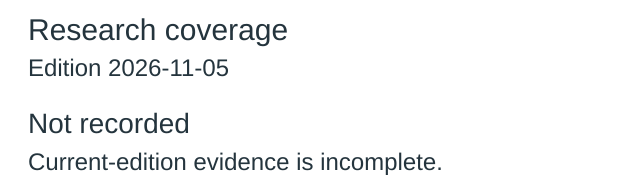
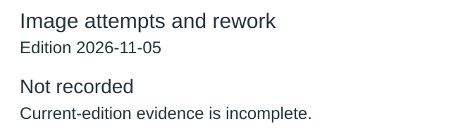
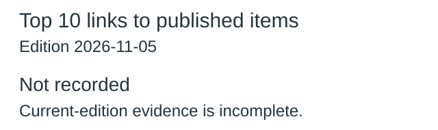
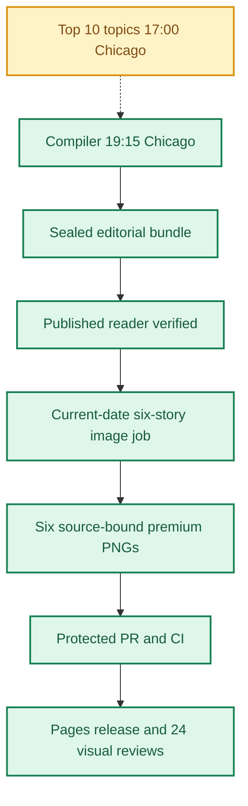
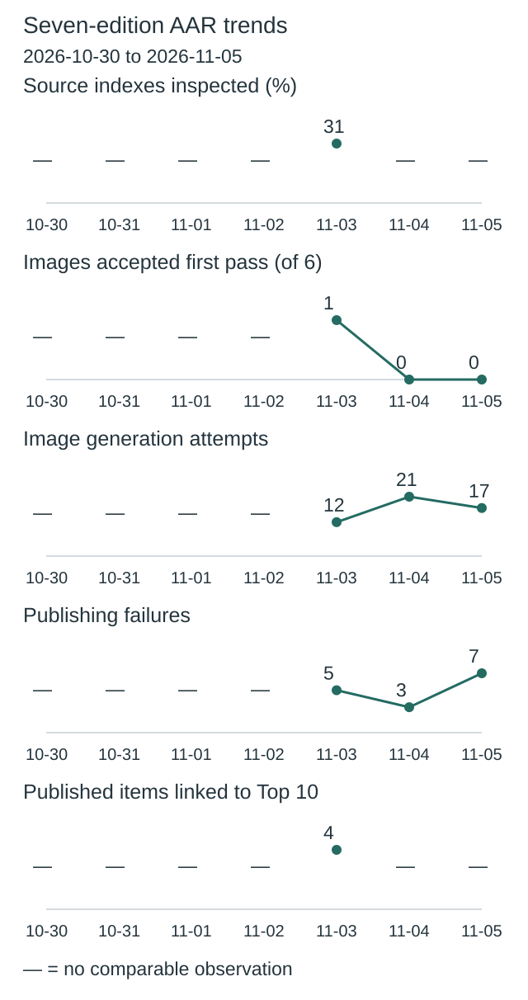
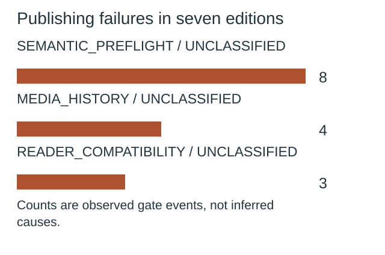
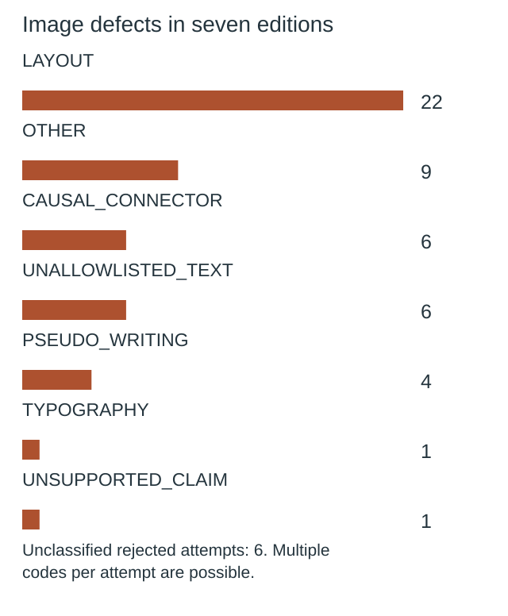

**🟩 RELEASE COMPLETE**
**TOP 10 PARTIAL** · **🟩 COMPILER VERIFIED** · **🟦 IMAGES 6/6 RELEASED** · **🟪 VISUAL QA 24/24 PASS**

# Daily AI Brief — Unified Production After-Action Report
**Edition:** November 5, 2026 · **Production evening:** 2026-11-04 · **Timezone:** America/Chicago
**Primary public reader:** [Open 2026-11-05 Brief](https://gttome.github.io/Daily-AI-Brief-Compiler/briefs/2026-11-05/) · **Repository:** [Daily-AI-Brief-Compiler](https://github.com/gttome/Daily-AI-Brief-Compiler)

> **IMPORTANT — VERIFIED PRODUCTION RESULT**
> **Executive release result: COMPLETE.** This is the single management-facing report covering Top 10 topic discovery, the editorial Compiler, published Brief and premium-image run. **Entire-system evidence: PARTIAL.** Top 10 report: **provisional**; Compiler handoff: **RECEIVED_SNAPSHOT_BOUND**; guided searches: **INVALID**. Compiler public status: **VERIFIED**. Image release: **RELEASED_VERIFIED**. Direct 24-context visual quality: **24/24 PASS**. Autonomous completion: **UNPROVEN**. Missing evidence must not be promoted to a success claim.

**🕒 Production stage durations:** **Top 10 8m 38s** · **Compiler final seal window 54m 10s** · **Premium Images 42m 57s** (evidence-bounded elapsed times; the start/end events differ).

## Evidence reconciliation

Compiler final seal window: 54m 10s. Observed execution and final seal windows are distinct.
Image capability route preflight: RECORDED; scheduler origin remains UNPROVEN.
Image efficiency: 0/6 first-pass accepts; 17 total attempts. November 3–5 target: at least 3/6 first-pass and at most 2 attempts per image, with unchanged quality floor.
Image review completed: 2026-11-05T04:04:39Z; review-record commit: 2026-11-05T04:08:57.000Z; protected review merge: 2026-11-05T04:11:27.000Z.
Eligible source indexes: 87; editorial inspections reported: Unknown (Unknown%); inaccessible in editorial audit: Unknown; explicitly unreviewed IDs: Unknown; unclassified editorial IDs: Unknown. Automated index parsing is separate from editorial inspection and cannot substantiate exhaustive freshness claims.


## Daily AAR charts

These charts use this edition’s receipts. Missing data is not zero.

### Research coverage



**Not recorded:** current-edition evidence is missing or inconsistent.

Not inspected includes every index without a recorded editorial inspection; this is not proof of missed stories.

### Image attempts and rework



**17 attempts; 0 of 6 images accepted on their first attempt.**

Recorded November 3–5, 2026 target: at least 3/6 first-pass accepts; no more than 2 attempts per image. This is an efficiency target, not a quality cutoff.

| Image | Accepted | Rejected | Total attempts |
|---|---:|---:|---:|
| FlashProve makes model identity cryptographically checkable | 1 | 1 | 2 |
| NVIDIA turns agent failure traces into executable evaluations | 1 | 2 | 3 |
| OpenAI plans to acquire Pierre for interface-driven coding | 1 | 2 | 3 |
| Databricks argues for governed open-weight model portfolios | 1 | 2 | 3 |
| Cloudflare adds per-agent access policies for personal assistants | 1 | 2 | 3 |
| A review loop turns expert judgment into stronger agent evaluations | 1 | 2 | 3 |

Generation attempts measure rework, not runtime or cost. Quality and publication checks remain separate.

### Top 10 links to published items



**Not recorded:** current-edition evidence is missing or inconsistent.

No selection quota. Topic linkage does not establish better quality, popularity or causal improvement.

[Chart data](charts.json)

One edition at a time. Missing evidence is not zero. Trend claims require comparable recorded cycles.

## Performance dashboard

| Measure | Recorded result | Source / caveat |
|:--|:--:|:--|
| Entire-system evidence | **PARTIAL** | Full Top 10 list, bound Compiler input, all-format search receipts and existing release checks; separate from publication and autonomy |
| Top 10 report | **provisional · 10 topics** | Same Chicago cycle report; provisional/partial coverage remains disclosed |
| Top 10 received by Compiler | **RECEIVED_SNAPSHOT_BOUND** | Exact report snapshot bytes; consumed commit separately corroborated: YES |
| Top 10 guided article/video/podcast searches | **INVALID** | Actual source-search receipts and selected/rejected topic outcomes |
| Top 10 stage duration | **8m 38s** | Same-cycle run receipt only; no runtime or usage estimate |
| Editorial publication | **PASS** | State and public reader integrity receipt |
| **Unattended autonomy (separate from publication)** | **UNPROVEN** | Owner incident receipt takes precedence over unverified producer self-attestation |
| Recorded protected publishing gate failures | **7** | Actual same-edition GitHub failure sidecar only; earlier unrecorded failures remain unknown |
| Articles | **6** | Exactly 2 technical / 2 knowledge-worker / 2 agents required |
| Verified original sources within preceding 24 hours | **0 / 6** | Original publisher dates only; other sources require a documented fallback rationale |
| Distinct selected article publishers | **6** | Six different primary organizations preferred |
| Videos over seven days old | **2** | Must be labeled evergreen, not a new development |
| Distinct selected video publishers | **2** | One channel is one publisher even across multiple videos |
| Video discovery source attempts | **NOT_RECORDED / NOT_RECORDED** | Attempt evidence across enabled and qualification-only leads; NOT_RECORDED. Not a claim of full content review or player verification | 
| Duplicate active Watchlist display titles | **Not recorded** | Published canonical Watchlist only; historical evidence retained |
| Original-release video playback (historical) | **TWO_PUBLISHED_VIDEOS_PLAYBACK_PASS** | Later reader corrections may replace these originally verified videos; see incident register | 
| Postpublication reader incidents | **NOT_RECORDED** | Edition-specific owner reports and corrective PRs, not inferred absence | 
| Verified postpublication video corrections | **NOT_RECORDED** | Incident register tracks correction PR, actual playback evidence and reader preservation |
| Editorial index second-pass attempts | **0** | Bounded public GET retries only; never proof of original article reading |
| Editorial index reads recovered | **0** | Successful page fetch can still yield zero eligible dated items |
| Recorded scheduler capability route | **UNPROVEN** | Same-invocation route receipt only; GitHub is not scheduler authentication |
| Avoidable incomplete-staging CI failures | **Not independently audited** | Existing image-package push CI is disabled; exact-head protected PR CI remains required. A failure count requires actual workflow evidence |
| Media | **2 videos + 2 podcasts** | Sealed bundle |
| **Compiler final seal window** | **54m 10s (54.2 min)** | Final sealed-state timestamp → verified public reader; initial execution is separate |
| **Image processing stage duration** | **42m 57s** | First accepted PNG Git checkpoint → final 24/24 review; auditable stage elapsed time |
| Image scheduled-to-final-review window | **Not independently recorded** | Only with a saved one-cycle schedule anchor; does not attest exact generation start |
| Executor-observed generation-to-final-review | **48m 28s** | Only if the worker recorded a same-execution clock before its first native call; not independently verified provider runtime |
| Accepted premium PNGs | **6 / 6** | Exact package and public release hashes |
| Native image generation attempts | **17** | Image worker AAR; no estimation |
| Rejected candidates | **11** | Image worker AAR |
| Final worker checkpoint reconciliation | **PASS** | Oct25+ verifies exact generation count, per-story attempts, six accepted story/image/hash bindings and final release |
| Saved visual contexts | **24 / 24 PASS** | Dated/permanent desktop/mobile review |
| Public SHA-256 checks | **44** | Image release receipt |
| October 8 immutable history | **17 / 17** | Independent content-preservation checks |
| **Owner-reported weekly Work usage for this run** | **Not reported** | No per-cycle usage supplied |

> **EFFICIENCY NOTE**
> **Resource reporting policy:** No usage figure was supplied for this cycle, so none is assumed. Future runs show **Not reported** unless the owner supplies new cycle-specific usage metadata. No approval or extra step is required to generate the AAR.

## Production architecture and checkpoints



## Daily AI Topic Top 10 and Compiler handoff

**Research cycle:** 2026-11-04 · **Target Brief:** 2026-11-05 · **Scheduled start:** 17:00 America/Chicago

| Dimension | Recorded evidence |
|---|---|
| Run/report result | PARTIAL |
| Report status / topics | provisional / 10 |
| Freshness | FRESH\_AT\_CONSUMPTION |
| Compiler handoff | RECEIVED\_SNAPSHOT\_BOUND |
| Search coverage | INVALID |
| Selection mapping verification | MATCHES\_EDITION\_BUNDLE |
| Observed start / finish | 2026-11-04T16:58:18-06:00 / 2026-11-04T17:06:56.000-06:00 |
| Elapsed minutes | 8.63 |
| Usage percent | Not reported |
| Cost USD | Not reported |
| Independent scheduler autonomy | UNPROVEN |
| Compiler-recorded consumed commit | a112987adb4b275893658a363d1cbd77e0dc4870 |
| Report SHA-256 | e9b39cfdae2d2c680b1aedba3534611f7adeab94949c0d4ac238a86849e85b71 |

| Discovery order | AI topic | Summary | Confidence | Evidence |
|---:|---|---|---|---|
| 1 | Spare-phone cluster demonstration | A new creator video explores distributing local AI inference across spare mobile devices. | low | [Source](https://www.youtube.com/watch?v=reOeczuEzOA) |
| 2 | Claude-assisted video-editing workflow | Matt Wolfe publishes a workflow for turning raw footage into edited short videos. | medium | [Source](https://www.youtube.com/watch?v=ep4psgAFOqc) · [Source](https://moderncreator.app/2026-11-04-matt-wolfe-how-i-get-claude-to-edit-my-videos-no-code-needed) |
| 3 | DeepSeek Harness preview draws continued hands-on attention | Sam Witteveen's explainer examines DeepSeek's plugin-based agent harness. | medium | [Source](https://www.youtube.com/watch?v=OrcsMi2-IcM) · [Source](https://www.deepseek.com/en/harness/) |
| 4 | Graph-engineering talk on auditable agent procedures | AI Engineer's presentation discusses explicit routes and traces for agent decisions. | medium | [Source](https://www.youtube.com/watch?v=g_NgCLTibiM) · [Source](https://ai.engineer/talks/g_NgCLTibiM-make-your-ai-agents-predictable-graph-engineering) |
| 5 | Grok Bot running-cost discussion | A new Nate B Jones video examines agent economics amid reported allowance complaints. | low | [Source](https://www.youtube.com/watch?v=-5cDYPwNf5g) · [Source](https://thenextweb.com/news/grok-bot-costs-unsustainably-high-musk-usage-limits) |
| 6 | Claude desktop explainer and unified-work rollout | A new Futurepedia explainer discusses the changing Claude experience. | medium | [Source](https://www.youtube.com/watch?v=tM0dwXhOv2o) · [Source](https://support.claude.com/en/articles/17444462-set-up-and-manage-the-new-unified-claude-experience-for-your-enterprise-organization) |
| 7 | OpenAI announces planned Pierre acquisition | OpenAI plans to acquire Pierre, whose developer libraries already appear in Codex. | medium | [Source](https://x.com/OpenAINewsroom/status/2117999237745049883) · [Source](https://news.ycombinator.com/item?id=50366863) · [Source](https://openai.com/index/openai-to-acquire-pierre/) |
| 8 | Kimi K3.1 Pro weights become available | Moonshot's weight release creates a new deployment decision for an existing model. | medium | [Source](https://x.com/Kimi_Moonshot/status/2118010528123773297) · [Source](https://news.ycombinator.com/item?id=50366999) · [Source](https://huggingface.co/moonshotai/Kimi-K3.1-Pro) · [Source](https://huggingface.co/moonshotai/Kimi-K3.1-Pro/blob/main/LICENSE) |
| 9 | Ricursive releases Ripple-65B Preview | Ricursive publishes a dense open-weight model focused on agentic coding. | medium | [Source](https://x.com/RicursiveAI/status/2118046765857546733) · [Source](https://news.ycombinator.com/item?id=50369925) · [Source](https://www.ricursive.com/ripple) · [Source](https://huggingface.co/ricursiveAI/Ripple-65B-Preview) |
| 10 | FlashProve gets renewed model-identity scrutiny | Anthropic's research prototype proves bounded inference claims about committed model weights. | medium | [Source](https://x.com/AnthropicAI/status/2117710942826123294) · [Source](https://news.ycombinator.com/item?id=50368626) · [Source](https://www.anthropic.com/research/provable-inference) |

**Sample scope:** {"metadata\_screened\_videos":10,"retained\_video\_observations":10,"unique\_videos":10,"distinct\_retained\_channels":10,"total\_video\_observations":10,"full\_video\_reviews":0,"transcript\_reviews":0,"partial\_transcript\_reviews":1,"direct\_youtube\_counter\_verifications":0,"primary\_documents\_inspected":7,"primary\_document\_scope":"Complete displayed FlashProve research post, Pierre announcement, Ripple launch and DeepSeek preview page; selected Kimi/Ripple model-card and Claude Enterprise-help sections. No software or experiment executed.","validation\_resource\_count":14,"validation\_resources\_registered":14,"new\_resource\_candidates\_evaluated":3,"target\_40\_to\_80\_full\_reviews\_met":false,"additional\_inventory\_titles":"Zlio current inventory and public news/discussion search were screened for leads; no exact additional unique-video count claimed.","freshness":"Three Nov 4 and seven Nov 2–3 retained video uploads as reported by tracker. Six topic leads have video attention and four have X/community attention. Underlying Grok remark Nov 1 is older; rollout Nov 16 is future. No unsupported older carryover promoted as new."}. **Ranking basis:** {"method":"Bounded qualitative attention watchlist: video attention, matched public discussion and source-specific reported engagement; all bands limited.","signals":\["Event-matched YouTube metadata is the principal discovery surface, augmented with public discussion and primary documents.","Two same-video long-form observations from the same publicly described tracker method show rounded interval increases.","No raw view summation across platforms, formats, overlapping indexes or publishers."\],"not\_established":\["Global popularity order","Current instantaneous viewing velocity","Channel age/format-matched outperformance","Independent benchmark replication","Exact full-video coverage"\]}.

| Search format | Receipt rows | Attempts recorded | Explicitly not attempted |
|---|---:|---:|---:|
| article | 10 | 10 | 0 |
| video | 10 | 4 | 6 |
| podcast | 10 | 2 | 8 |

**Selected Brief items linked to trends:**

No validated selection-to-topic mapping was recorded.

**Gaps and limitations:**

- Per-topic article/video/podcast search coverage is incomplete, invalid or bound to a different input.
- 14 topic/format searches are explicitly not attempted.
- The report labels its ranking provisional.
- Public YouTube watch pages were throttled; all ten retained video counters and timestamps are third-party reported.
- No full audiovisual review or direct YouTube counter verification; the 40–80 full-review aim is unmet.
- No full transcript retrieved today; only one partial indexed-caption review. Original publication dates or sponsorship disclosures unavailable remain null.
- Cross-source attention is bounded and can be promotional. X original posts and targeted HN pages could not be directly retrieved; indexed HN measurement times remain unknown.
- All ten topics have limited evidence bands, uncertain positions and distinct discovery queries; not a global trend census.
- Compiler consumption, genuine searches, candidate qualification, selected mappings and publication require separate later receipts.
- Usage, cost and scheduler attestation are unavailable; no values or unattended success inferred.
- Frozen November 3 baseline preserved.

**Recorded run issues:**

- {"issue":"YouTube original watch-page requests were throttled","effect":"No direct counters, playback, original description or sponsor verification.","correction":"Retain ten provenance-labeled third-party records, with unavailable fields null."}
- {"issue":"Original X posts denied retrieval and targeted HN pages unavailable","effect":"Announcement attention uses third-party reported X snapshots and indexed community evidence; HN measurement times unknown.","correction":"Preserve source/observation times separately; no cross-source growth or independent truth claim."}
- {"issue":"Original publisher transcript and third-party full-caption pages unavailable","effect":"Zero full transcripts reviewed today.","correction":"Record only one partial indexed-caption review; evaluate additional source candidates with bounded decisions."}
- {"issue":"Pre-write validation caught freshness-count wording mismatch","effect":"Initial scratch draft said four Nov 4 videos; actual retained table has three.","correction":"Corrected to three Nov 4 and seven Nov 2–3 before the first repository write."}
- {"issue":"Scratch apply\_patch rejected delete/add of the same local path in one patch","effect":"No repository write occurred in that failed operation.","correction":"Prepared a separate final scratch file and reran validation before persistence."}

**Recorded improvements:**

- {"change":"Check complete FlashProve research limitations after prior original-page access gap","reason":"Prior metadata and summaries did not establish the prototype's guarantee boundaries.","expected\_effect":"Avoid conflating model identity proofs with truthful or safe output.","status":"implemented\_in\_this\_research\_run"}
- {"change":"Try original publisher data and caption resources before expanding metadata","reason":"Prior AAR records candidate-review depth NOT\_RECORDED and incomplete consumer search evidence.","expected\_effect":"Retain inspectable review scope and honestly distinguish full, partial and unavailable access.","status":"implemented\_in\_this\_research\_run"}
- {"change":"Add one complete publisher-family removal assessment","reason":"Prior AAR has one recorded sensitivity assessment; each new event needs its own evidence.","expected\_effect":"Expose the graph-talk topic's dependence on a single attention family.","status":"implemented\_in\_this\_research\_run"}
- {"change":"Obtain an accessible complete original transcript for a high-priority creator event and confirm original upload timestamps/counters without assuming a tracker is direct YouTube.","status":"proposed\_follow\_up"}

### Daily improvement and effect on the Brief

**Fixed baseline:** nov03-2026-v1 / INPUT\_FROZEN. **Outcome baseline:** FROZEN\_AFTER\_VERIFIED\_PUBLICATION. **Prior cycle:** 2026-11-03.

| Input measure | Current | November 3 baseline | Change from baseline | Change from prior cycle |
|---|---:|---:|---:|---:|
| topic count | 10 | 10 | 0 | 0 |
| validation resource count | Not reported | 14 | Not reported | Not reported |
| additional video metadata records | Not reported | 63 | Not reported | Not reported |
| additional video channels | Not reported | 21 | Not reported | Not reported |
| total video observations | Not reported | 79 | Not reported | Not reported |
| unique videos | Not reported | 71 | Not reported | Not reported |
| full video reviews | Not reported | 0 | Not reported | Not reported |
| direct youtube counter verifications | Not reported | 0 | Not reported | Not reported |
| broader evidence band topics | 0 | 3 | -3 | 0 |
| limited evidence band topics | 10 | 7 | 3 | 0 |

**Observed downstream measurements:** PENDING\_OR\_INCOMPLETE.

| Outcome measure | Current | Change from frozen outcome | Change from prior cycle |
|---|---:|---:|---:|
| expected topic format pairs | 30 | 0 | Not reported |
| attempted topic format pairs | Not reported | Not reported | Not reported |
| explicitly unattempted pairs | Not reported | Not reported | Not reported |
| discovered candidate count | Not reported | Not reported | Not reported |
| searched source host count | Not reported | Not reported | Not reported |
| selected article count | Not reported | Not reported | Not reported |
| selected video count | Not reported | Not reported | Not reported |
| selected podcast count | Not reported | Not reported | Not reported |

**Source changes:** {"added":\[\],"removed":\[\]}.

**Candidate review depth:** NOT\_RECORDED.

| Review measure | Current | Change from prior comparable cycle |
|---|---:|---:|
| reviewed candidate count | Not reported | Not reported |
| qualified candidate count | Not reported | Not reported |
| rejected candidate count | Not reported | Not reported |
| metadata only count | Not reported | Not reported |
| full video reviews | Not reported | Not reported |
| transcript reviews | Not reported | Not reported |

The frozen November 3 baseline has no candidate-level review ledger; no retrospective value is invented. Recorded reviews do not independently establish content quality, audience interest or causal benefit.

**Method/resource review:** {"baseline\_id":"nov03-2026-v1","previous\_report\_date":"2026-11-03","method\_version":"2026-11-03.2-event-review","changes":\[{"change":"Check complete FlashProve research limitations after prior original-page access gap","reason":"Prior metadata and summaries did not establish the prototype's guarantee boundaries.","expected\_effect":"Avoid conflating model identity proofs with truthful or safe output."},{"change":"Try original publisher data and caption resources before expanding metadata","reason":"Prior AAR records candidate-review depth NOT\_RECORDED and incomplete consumer search evidence.","expected\_effect":"Retain inspectable review scope and honestly distinguish full, partial and unavailable access."},{"change":"Add one complete publisher-family removal assessment","reason":"Prior AAR has one recorded sensitivity assessment; each new event needs its own evidence.","expected\_effect":"Expose the graph-talk topic's dependence on a single attention family."}\],"resource\_candidates":\[{"url":"https://ai.engineer/data","role":"original\_publisher\_transcript\_discovery","access":"direct data/catalog; indexed matching talk; direct transcript unavailable","review\_scope":"Public collection/status documentation and matching talk excerpt; two targeted transcript GETs failed.","independence":"Original AI Engineer publisher; same family as its YouTube talk, not another confirmation.","decision":"accepted","reason":"Useful free original-publisher catalog and provenance, with explicit automated-transcript limitations. Bounded use only; not accepted as a completed transcript review.","contribution":"Identified an auditable route for later original transcript review and verified publisher-family context.","limitations":\["No new MCP server installed, no paid API or service invoked.","Unavailable target transcript means no full transcript count."\]},{"url":"https://moderncreator.app/2026-11-04-matt-wolfe-how-i-get-claude-to-edit-my-videos-no-code-needed","role":"third\_party\_caption\_excerpt","access":"search\_index\_only; direct page unavailable","review\_scope":"Specific indexed timestamped excerpts, not full transcript.","independence":"Derived from Matt Wolfe video; not independent technical validation or extra publisher breadth.","decision":"accepted","reason":"Reveals concrete editing corrections and a promotional offer that metadata alone omits.","contribution":"One partial transcript-excerpt review; no full transcript/playback count.","limitations":\["Third-party duration 32:44 differs from tracker 32:45.","Its 3.9K/253 snapshot has unknown measurement time and is excluded from growth."\]},{"url":"https://prepublish.ai/youtube-transcript/ep4psgAFOqc","role":"public\_caption\_retrieval\_candidate","access":"unavailable","review\_scope":"Attempted free public GET for this video and the phone-cluster video; no transcript returned.","independence":"Would rehost the same captions; not an independent source family.","decision":"deferred","reason":"Actual retrieval failed, so no caption content or metrics from this resource are asserted.","contribution":"Documented access gap only."}\],"observed\_effects":\[{"observation":"Original FlashProve post is now directly accessible.","effect":"Added integer/greedy, short-context, overhead and fast-code-guarantee limitations."},{"observation":"Official Claude help names November 16 default enablement for existing Enterprise organizations.","effect":"Separated future policy date from new explainer date."},{"observation":"Removing the AI Engineer family leaves no event-matched attention for the graph talk.","effect":"Band weakens from limited to insufficient in the recorded editorial assessment."},{"observation":"Targeted original-transcript access failed; indexed Matt Wolfe excerpts were accessible.","effect":"Full transcript reviews remain zero; one partial review is disclosed."}\],"next\_improvement":"Obtain an accessible complete original transcript for a high-priority creator event and confirm original upload timestamps/counters without assuming a tracker is direct YouTube.","limitations":\["No production outcome improvement proven. The prior Compiler's invalid/incomplete receipt does not authorize this producer to alter it.","No source-count or full-review target claimed met.","A candidate's acceptance as a bounded research resource does not qualify it for the Brief."\],"change\_evaluations":\[\],"pending\_change\_evaluations":\["NOV03-04","AAR-02","AAR-03","AAR-10"\],"review\_due\_edition":"2026-11-11","evaluation\_status":"PENDING\_NOT\_YET\_DUE","feedback":{"aar\_url":"https://github.com/gttome/Daily-AI-Brief-Compiler/blob/operations-reports/daily/2026-11-03/combined.md","aar\_blob\_sha":"8810e352c1914e7909c3f1feecd80c97173a1f63","charts\_url":"https://github.com/gttome/Daily-AI-Brief-Compiler/blob/operations-reports/daily/2026-11-03/charts.json","metrics\_url":"https://github.com/gttome/Daily-AI-Brief-Compiler/blob/operations-reports/daily/2026-11-03/improvement-metrics.json","observed":{"edition\_date":"2026-11-04","system\_status":"PARTIAL","handoff":"RECEIVED\_SNAPSHOT\_BOUND","search\_status":"INVALID","selection\_mapping\_status":"INVALID","source\_inspections":null,"trend\_linked\_selections":null,"candidate\_review\_depth":"NOT\_RECORDED","image\_attempts":21,"first\_pass\_images":0,"publication\_failures":3,"publisher\_family\_reviews\_recorded":1,"publisher\_family\_topics\_weakened":1,"change\_reviews\_pending":14,"change\_reviews\_overdue":0},"interpretation":"Prior edition associations only. Invalid/incomplete downstream evidence stays unknown, never zero; today's producer cannot certify consumer execution or better future output."}}.

**Current reconciled conclusion:** PENDING\_OR\_INCOMPLETE; outcome baseline FROZEN\_AFTER\_VERIFIED\_PUBLICATION; candidate review ledger NOT\_RECORDED.

**Historical producer observations (not current status):** The following snapshot preserves what the producer reported at the time. Its pending statuses and candidate-quality claims are not independently reconciled conclusions. Use the current tables above for publication-bound measurements; an absent candidate review ledger remains unknown.

<details><summary>Original producer effects and gaps — historical snapshot</summary>

```json
null
```

</details>

**Next improvement:** Obtain an accessible complete original transcript for a high-priority creator event and confirm original upload timestamps/counters without assuming a tracker is direct YouTube.

Counts show coverage and observed association, not audience popularity, source independence, candidate quality or causal uplift. Compare source/method changes before interpreting deltas. Unknown values are not zero. Publication, reader corrections, runtime and image outcomes retain their separate AAR evidence.

Report, source-readback and search receipts are separate observations. Snapshot binding verifies the collected report bytes; the consumed commit is independently corroborated only when the separately fetched source bytes match. These records do not independently attest scheduler identity or source truth. Top 10 reporting does not change Brief/image release status.


## Track 1 — Compiler

**State:** `SHADOW_VERIFIED` · **Bundle:** `BUNDLE_READY` · **Compiler final seal window:** 54m 10s (54.2 min).

| Publication gate | Result |
|---|:---:|
| Canonical reader build | ✅ |
| Reader parity | ✅ |
| Public verification of dated edition | ✅ |
| Previous editions preserved | ✅ |
| Permanent story routes and feeds | ✅ |

**Selected coverage:**

| Lane | Story |
|---|---|
| Technical AI Engineering | FlashProve makes model identity cryptographically checkable |
| Technical AI Engineering | NVIDIA turns agent failure traces into executable evaluations |
| Applied Generative AI for Knowledge Workers | OpenAI plans to acquire Pierre for interface-driven coding |
| Applied Generative AI for Knowledge Workers | Databricks argues for governed open-weight model portfolios |
| Agents for Everyone | Cloudflare adds per-agent access policies for personal assistants |
| Agents for Everyone | A review loop turns expert judgment into stronger agent evaluations |

## Track 2 — Premium images

**Public status:** `RELEASED_VERIFIED` · **Saved images:** 6/6 · **Actual generation attempts:** 17 · **Rejected candidates:** 11.

### Image production duration — Git-verified milestones

**Auditable image stage duration:** **42m 57s** (first accepted binary saved in Git → first persisted 24-context quality-review record). **First asset to public image release:** **33m 36s**.
**Scheduled-to-final-review window:** **Not independently recorded**. This is a scheduled-clock comparison only when a separately recorded exact-date schedule exists; it is **not** measured native image-generation runtime.

| Production milestone | Chicago local time | Evidence |
|---|---|---|
| Scheduled image start (if exact-date record exists) | Not independently recorded | Time planned, not actual execution start |
| First executor-observed start | 9:13:12 PM | Worker self-attestation, not a first-party scheduler event |
| First native generation observation | 9:20:29 PM | Worker clock recorded immediately before first native call, not model-provider telemetry |
| First accepted PNG bytes saved to Git | 9:26:00 PM | Immutable binary-stage commit |
| Six-image package / reviews committed | 9:54:57 PM | Exact-head PR source commit |
| Protected package merged | 9:58:31 PM | Merge SHA and required CI |
| Public images verified | 9:59:35 PM | Image-release receipt |
| 24/24 review record committed | 10:08:57 PM | Immutable first review-approval commit |

> **Duration interpretation:** The audited stage excludes unobservable pre-checkpoint creative work. The scheduled-start window includes it but must not be interpreted as precise active processing time. Missing timestamps appear as **Not independently recorded**, never an estimate.


| Source-bound image | Attempts | File size | Public page |
|---|---:|---:|---|
| FlashProve makes model identity cryptographically checkable | 2 | 0.75 MiB | [View original](https://gttome.github.io/Daily-AI-Brief-Compiler/briefs/images/2026-11-05/dab-edition-2026-11-05-m01.png) |
| NVIDIA turns agent failure traces into executable evaluations | 3 | 0.60 MiB | [View original](https://gttome.github.io/Daily-AI-Brief-Compiler/briefs/images/2026-11-05/dab-edition-2026-11-05-m02.png) |
| OpenAI plans to acquire Pierre for interface-driven coding | 3 | 0.53 MiB | [View original](https://gttome.github.io/Daily-AI-Brief-Compiler/briefs/images/2026-11-05/dab-edition-2026-11-05-m10.png) |
| Databricks argues for governed open-weight model portfolios | 3 | 0.71 MiB | [View original](https://gttome.github.io/Daily-AI-Brief-Compiler/briefs/images/2026-11-05/dab-edition-2026-11-05-m11.png) |
| Cloudflare adds per-agent access policies for personal assistants | 3 | 0.65 MiB | [View original](https://gttome.github.io/Daily-AI-Brief-Compiler/briefs/images/2026-11-05/dab-edition-2026-11-05-m12.png) |
| A review loop turns expert judgment into stronger agent evaluations | 3 | 0.68 MiB | [View original](https://gttome.github.io/Daily-AI-Brief-Compiler/briefs/images/2026-11-05/dab-edition-2026-11-05-m14.png) |

**Immutable-release and visual gates:**

| Release gate | Result |
|---|:---:|
| Protected public image receipt | ✅ |
| Accepted-image Git hash bindings | ✅ |
| Six live PNGs | 6/6 |
| Dated/permanent story placements | 12/12 recorded in release evidence |
| Desktop/mobile visual inspection | 24/24 PASS |
| Historical Oct 8 integrity | 17/17 |

### Published premium illustrations

<table>
<tr><td width="50%"><a href="https://gttome.github.io/Daily-AI-Brief-Compiler/briefs/images/2026-11-05/dab-edition-2026-11-05-m01.png"></a><br/><b>FlashProve makes model identity cryptographically checkable</b></td><td width="50%"><a href="https://gttome.github.io/Daily-AI-Brief-Compiler/briefs/images/2026-11-05/dab-edition-2026-11-05-m02.png"></a><br/><b>NVIDIA turns agent failure traces into executable evaluations</b></td></tr>
<tr><td width="50%"><a href="https://gttome.github.io/Daily-AI-Brief-Compiler/briefs/images/2026-11-05/dab-edition-2026-11-05-m10.png"></a><br/><b>OpenAI plans to acquire Pierre for interface-driven coding</b></td><td width="50%"><a href="https://gttome.github.io/Daily-AI-Brief-Compiler/briefs/images/2026-11-05/dab-edition-2026-11-05-m11.png"></a><br/><b>Databricks argues for governed open-weight model portfolios</b></td></tr>
<tr><td width="50%"><a href="https://gttome.github.io/Daily-AI-Brief-Compiler/briefs/images/2026-11-05/dab-edition-2026-11-05-m12.png"></a><br/><b>Cloudflare adds per-agent access policies for personal assistants</b></td><td width="50%"><a href="https://gttome.github.io/Daily-AI-Brief-Compiler/briefs/images/2026-11-05/dab-edition-2026-11-05-m14.png"></a><br/><b>A review loop turns expert judgment into stronger agent evaluations</b></td></tr>
</table>

## Incidents, corrections and learning

### Postpublication reader incidents (updated when new evidence is merged)

No current-edition postpublication incident register was available; this is **NOT_RECORDED**, not a certification of zero incidents.


**Editor recovery classification:** UNPROVEN. **Owner intervention:** Unproven either way. **Protected same-edition failures recorded:** 7. 
**Latest failed protected stage:** MEDIA_HISTORY; [Action evidence](https://github.com/gttome/Daily-AI-Brief-Compiler/actions/runs/41952756246). Exact stage durations are available only where real source timestamps exist.

| Stage | Verified issue | Corrective action |
|---|---|---|
| Native saved-pixel inspection | nov05-t1-flashprove attempt1: Upper model-commitment arrow terminates at CPU verifier label instead of its comparison input; the separate internal upper rail lacks a visible commitment connection. Upper bridge lies inside the required40px safe margin. | Route commitment within safe canvas to a real upper comparator input port, keep both proof and commitment visibly attached, remove label enclosure clutter. |
| Native saved-pixel inspection | nov05-t2-nemo-trace-evals attempt1: Horizontal strokes simulate writing on documents; warning exclamation and pause-like glyph are outside the allowlist. Generic enclosed cards, decorative wrench and caveat package icon replace source-supported mechanism detail. | Replace simulated writing and UI controls with meaningful abstract state/fixture shapes; remove region enclosures and decorative props. |
| Native saved-pixel inspection | nov05-t2-nemo-trace-evals attempt2: Development result arrow crosses the held-out test specimen path; the rendered crossing makes independently held-out evaluation ambiguous. | Move development results into a separate outer gutter and retain an independent held-out results arrow. |
| Native saved-pixel inspection | nov05-k1-pierre attempt1: Parallel branches heading lies above the40px safe text boundary in actual final-size pixels. | Move heading and graph into the frozen safe top region and remove unnecessary panel outlines. |
| Native saved-pixel inspection | nov05-k1-pierre attempt2: Top lettering still reaches y39 and bottom caveat lettering extends beyond y590 after actual1200x630 export. | Increase top text margin20px and raise caveat30px without changing clean mechanisms or shrinking text. |
| Native saved-pixel inspection | nov05-k2-openweights attempt1: Documents/audit sheets contain simulated writing; code brackets and waveform marks are unallowlisted. Landscape image icons and lock motif add unsupported decorative content; top heading violates safe text margin. | Use distinct meaningful workload/event shapes, no writing or controls; restore safe text margins and open architecture composition. |
| Native saved-pixel inspection | nov05-k2-openweights attempt2: Cleaned gateway still puts top heading above40px and bottom caveat below590px text boundaries. | Move only heading25px down and caveat25px up; preserve actual mechanisms and typography. |
| Native saved-pixel inspection | nov05-a1-agent-access attempt1: Robot faces and antennas violate the no-humanoids requirement. Unallowlisted /news, /docs and slash paths appear; resource surfaces have invented browser window controls. Policy boundary has decorative bolts/wheel housing, and bottom caveat extends too low. | Use featureless identity polygons, smooth resource surfaces, simple abstract boundaries and safe footer typography. |
| Native saved-pixel inspection | nov05-a1-agent-access attempt2: Bottom caveat letters occupy y560..599, beyond the590px safe text boundary. | Move only the bottom line upward; preserve the complete source-faithful policy mechanism. |
| Native saved-pixel inspection | nov05-a2-human-review-skill attempt1: Evaluator revision is depicted as invented slider controls. Crossing evaluator-revision and golden-example arrows lack explicit separation. Top headings and bottom caveat violate40px text margins. | Replace sliders with rubric layers, separate crossing using a clear overpass, and reflow heading/footer into safe label space. |
| Native saved-pixel inspection | nov05-a2-human-review-skill attempt2: Slider and crossing defects are corrected, but top headings and footer still extend outside safe text margins. | Move only top heading groups and footer while preserving the clean evaluation mechanism. |
| Completed native PNG export | Initial exact exporter import failed because the sparse checkout omitted an unchanged compiler dependency. | Fetched the existing compiler directory at the same repository revision and completed export from the identical native original; no additional creative call was made. |

> **OPERATIONAL NOTE**
> This report distinguishes a published and verified production outcome from scheduler metadata exposed to another conversation. Lack of a live host heartbeat in a separate normal chat is not a Compiler production failure.

## Usage and cost stewardship

| Item | Per-cycle value |
|---|---|
| **Weekly Work usage reported by owner** | **Not reported** |
| Internal weekly usage reference | Target under 5% |
| Genuine image-generation attempts | 17 |
| Accepted diagrams | 6 |
| Regeneration after acceptance | 0 |
| Top 10 reported usage | Not reported |
| Top 10 reported cost | Not reported |
| Account-level billing telemetry | Not independently accessible to deterministic GitHub reporting |

**Future reporting rule:** For cycles without an optional owner-usage record, publish the complete AAR with `Not reported`; do not reuse prior percentages, guess remaining weekly credits or delay tomorrow's production.

## Next-edition operating handoff

| Control | Recurring contract |
|---|---|
| AI Topic Top 10 | Sole report task · 17:00 America/Chicago · saved dated list guides same-evening research |
| Primary Compiler | Sole existing task · 19:15 America/Chicago |
| Premium image production | Sole existing task · standard 21:15 America/Chicago |
| Exact image job selection | Newly published next-date `PUBLISHED_PENDING` only |
| AAR | Combined report generated automatically from new GitHub receipts |
| Optional Work usage | Owner-supplied per cycle, otherwise `Not reported` |

> **SCHEDULE RESTORATION NOTE**
> A temporary scheduling exception must be explicitly restored before claiming standard-time readiness. This deterministic document generator reads existing state only; it does not modify production schedules.

## Evidence register

| Evidence | Link |
|---|---|
| Compiler state | [Open receipt](https://github.com/gttome/Daily-AI-Brief-Compiler/blob/shadow/2026-11-05/shadow-runs/2026-11-05/compiler-state.json) |
| Compiler compile receipt | [Open receipt](https://github.com/gttome/Daily-AI-Brief-Compiler/blob/shadow/2026-11-05/shadow-runs/2026-11-05/compiler/compile-receipt.json) |
| Compiler public integrity | [Open receipt](https://github.com/gttome/Daily-AI-Brief-Compiler/blob/shadow/2026-11-05/shadow-runs/2026-11-05/compiler/postpublish-integrity.json) |
| Image release receipt | [Open receipt](https://github.com/gttome/Daily-AI-Brief-Compiler/blob/shadow-pages-history/site/image-jobs/2026-11-05/release.json) |
| Image review | [Open receipt](https://github.com/gttome/Daily-AI-Brief-Compiler/blob/main/external-image-packages/2026-11-05/reviews/live/semantic-pixel-review.json) |
| Original image AAR | [Open receipt](https://github.com/gttome/Daily-AI-Brief-Compiler/blob/main/external-image-packages/2026-11-05/reviews/after-action.md) |
| Observed editorial index retries | [Open receipt](https://github.com/gttome/Daily-AI-Brief-Compiler/blob/shadow/2026-11-05/shadow-runs/2026-11-05/editorial/source-item-retries.json) |
| Published player playback receipt | [Open receipt](https://github.com/gttome/Daily-AI-Brief-Compiler/blob/shadow/2026-11-05/shadow-runs/2026-11-05/compiler/postpublish-video-playback.json) |
| Top 10 ranked topic report | [Open receipt](https://github.com/gttome/Daily-AI-Brief-Compiler/blob/d8dd7ece406642f8a8639d3b4fde8c66e446a096/signals/ai-topic-top10/2026-11-04.json) |
| Top 10 run after-action receipt | [Open receipt](https://github.com/gttome/Daily-AI-Brief-Compiler/blob/d8dd7ece406642f8a8639d3b4fde8c66e446a096/signals/ai-topic-top10/2026-11-04.aar.json) |
| Compiler Top 10 input snapshot | [Open receipt](https://github.com/gttome/Daily-AI-Brief-Compiler/blob/shadow/2026-11-05/shadow-runs/2026-11-05/editorial/trend-input.json) |
| Top 10 article/video/podcast search coverage | [Open receipt](https://github.com/gttome/Daily-AI-Brief-Compiler/blob/shadow/2026-11-05/shadow-runs/2026-11-05/editorial/trend-search-coverage.json) |

**Image workflow:** [Workflow evidence](https://github.com/gttome/Daily-AI-Brief-Compiler/actions/runs/41964882515).

---

*Generated deterministically from cycle- and edition-specific GitHub records. The report combines the Top 10 discovery priorities, its Compiler handoff and searches, the published Brief, and the image run; original research, Compiler, image, hash, and review receipts remain immutable. This reporting action creates no stories, images, releases, extra AI tasks, or schedule changes.*

<!-- continuous-improvement:start -->
## Continuous improvement review

Edition **2026-11-05**. Measurements use 3/7 recorded editions in this window. Missing data stays **Not recorded**.

### Daily corrective-action review

**5 evidence-based findings**; open production blockers: 0. Cumulative evaluation checkpoint: **2026-11-11**. The daily review never waits for that date to act on a safe live problem.

| Priority | Observed issue | Existing owner / next correction | When |
|---|---|---|---|
| P1 | This edition has invalid Top 10 search-coverage receipts. | Compiler: Verify event-to-format searches and actual selected mappings in the next unlocked edition; do not rewrite a sealed historical bundle. | Next genuine run |
| P1 | 7 failed protected publication gates were recorded (7 unclassified causes). | Compiler / Recovery: Read original failed job logs, record real causes and move the relevant existing validation before the next readiness signal; do not replay the released edition. | Next genuine run |
| P1 | Source inspection coverage is not verifiable from the current bundled receipts. | Compiler: Bind genuine exact source IDs and original preselection review times into the next draft bundle; do not infer inspection from HTTP access. | Next genuine run |
| P1 | 11 rejected image candidates preceded the verified six-image release. | Images: Inspect saved rejection evidence and apply source-specific geometry, causal-arrow and label corrections before the next native generation. | Next genuine run |
| P2 | Publication success does not independently attest the originating scheduler. | Compiler / Recovery: Capture real first-party scheduler and execution evidence if available; do not convert unknown provenance into a failure or a success. | Next genuine run |

Findings are observational and do not claim a repair was executed by the reporter.

### Approved change evaluations

| Change | Evaluate by | Outcome status | Latest decision |
|---|---|---|---|
| NOV03-01 — Earlier publication checks and precise recovery | 2026-11-11 | PENDING | Not recorded |
| NOV03-02 — Broader genuine source review | 2026-11-11 | PENDING | Not recorded |
| NOV03-03 — Source-bound image rejection lessons | 2026-11-11 | PENDING | Not recorded |
| NOV03-04 — Substantive Top 10 review evidence | 2026-11-11 | PENDING | Not recorded |
| AAR-01 — Current conclusions separated from historical claims | 2026-11-11 | PENDING | Not recorded |
| AAR-02 — Consolidated current task contracts | 2026-11-11 | PENDING | Not recorded |
| AAR-03 — Dated improvement evaluations | 2026-11-11 | PENDING | Not recorded |
| AAR-04 — Seven-edition trend charts | 2026-11-11 | PENDING | Not recorded |
| AAR-05 — Recurring publication failure causes | 2026-11-11 | PENDING | Not recorded |
| AAR-06 — Recovery interval reporting | 2026-11-11 | PENDING | Not recorded |
| AAR-07 — Source inspection history | 2026-11-11 | PENDING | Not recorded |
| AAR-08 — Rolling source contribution | 2026-11-11 | PENDING | Not recorded |
| AAR-09 — Recurring image defect categories | 2026-11-11 | PENDING | Not recorded |
| AAR-10 — Top 10 publisher-family sensitivity | 2026-11-11 | PENDING | Not recorded |

Pending: 14; overdue: 0; reviewed: 0. Implemented controls await measured results; review decisions do not disable controls.

### Seven-edition trends



| Edition | Coverage | First pass / 6 | Image attempts | Publishing failures | Top 10 links |
|---|---|---:|---:|---:|---:|
| 2026-10-30 | Not recorded | Not recorded | Not recorded | Not recorded | Not recorded |
| 2026-10-31 | Not recorded | Not recorded | Not recorded | Not recorded | Not recorded |
| 2026-11-01 | Not recorded | Not recorded | Not recorded | Not recorded | Not recorded |
| 2026-11-02 | Not recorded | Not recorded | Not recorded | Not recorded | Not recorded |
| 2026-11-03 | 27/87 (31%) | 1 | 12 | 5 | 4 |
| 2026-11-04 | Not recorded | 0 | 21 | 3 | Not recorded |
| 2026-11-05 | Not recorded | 0 | 17 | 7 | Not recorded |

| Measure | Recorded editions | Window median |
|---|---:|---:|
| coverage percent | 1 | 31 |
| first pass accepted | 3 | 0 |
| image attempts | 3 | 17 |
| top10 linked items | 1 | 4 |
| publication failures | 3 | 5 |

**Source-set comparability is unknown:** historical aggregate counts do not establish identical source membership.

### Publishing failures by stage and recorded cause



| Stage | Recorded cause | Failures | Editions | Recurred | Delay median (seconds; documented samples only) |
|---|---|---:|---|---|---:|
| SEMANTIC_PREFLIGHT | UNCLASSIFIED | 8 | 2026-11-04, 2026-11-05 | Yes | Not recorded (0 samples) |
| MEDIA_HISTORY | UNCLASSIFIED | 4 | 2026-11-03, 2026-11-05 | Yes | Not recorded (0 samples) |
| READER_COMPATIBILITY | UNCLASSIFIED | 3 | 2026-11-03 | No within observed window | Not recorded (0 samples) |

Unclassified means the original gate is known but no structured cause review is recorded. Stage names do not establish root causes. No rows establish no failures only when the recorded receipt explicitly has none.

### Recovery intervals

| Recorded mode | Incidents | Detection seconds | Queue seconds | Repair seconds | Verification seconds | Total seconds |
|---|---:|---:|---:|---:|---:|---:|

**Not recorded:** no valid incident has all required timing and evidence references.

### Source inspection history

| Source | Last inspected edition | Editions since inspection |
|---|---|---:|
| acl-anthology | Not recorded | Not recorded |
| anthropic | Not recorded | Not recorded |
| anthropic-news | Not recorded | Not recorded |
| article-databricks-ai-research | Not recorded | Not recorded |
| article-ibm-research-ai | Not recorded | Not recorded |
| article-nvidia-technical-ai | Not recorded | Not recorded |
| arxiv-cs-ai | Not recorded | Not recorded |
| arxiv-cs-cl | Not recorded | Not recorded |
| arxiv-cs-lg | Not recorded | Not recorded |
| berkeley-bair | Not recorded | Not recorded |
| deep-20261026-a01-google-research | Not recorded | Not recorded |
| deep-20261026-a02-microsoft-ai | Not recorded | Not recorded |
| deep-20261026-a03-nvidia-news | Not recorded | Not recorded |
| deep-20261026-p02-data-skeptic | Not recorded | Not recorded |
| deep-20261026-v01-two-minute-papers | Not recorded | Not recorded |
| deepseek-news | Not recorded | Not recorded |
| directory-0dffb60aadd4ba31b5c090dc | Not recorded | Not recorded |
| directory-1c6f5db2559c3c226a112873 | Not recorded | Not recorded |
| directory-242c2a2fc81a43d41f199129 | Not recorded | Not recorded |
| directory-3834a0112c0e3a754320b557 | Not recorded | Not recorded |
| directory-3ccc18a956cae0b1e24b5968 | Not recorded | Not recorded |
| directory-411bf5f837e28f35220736eb | Not recorded | Not recorded |
| directory-4852e367f74118ff2dc1eec9 | Not recorded | Not recorded |
| directory-48665d874f6008894d0d9385 | Not recorded | Not recorded |
| directory-4c16d138c4a736e78a68127e | Not recorded | Not recorded |
| directory-54d90ff964a74ff98851ae11 | Not recorded | Not recorded |
| directory-5c5d3d02a420135949164552 | Not recorded | Not recorded |
| directory-64f0886a6793aa8858a4b62d | Not recorded | Not recorded |
| directory-6ea6e283349c7b62ac1ced9d | Not recorded | Not recorded |
| directory-79e16cd5beb5c662c4022a9f | Not recorded | Not recorded |
| directory-8263ca4c9f560c8d9c4df0de | Not recorded | Not recorded |
| directory-8df3614a9972a25fc59475ed | Not recorded | Not recorded |
| directory-8ec4fd458a38bc0447f4cded | Not recorded | Not recorded |
| directory-935fbe5ba89ff5f91fc8c69b | Not recorded | Not recorded |
| directory-970506fbc577e6091a33c64d | Not recorded | Not recorded |
| directory-9ad7c274f2d56274bcd5ddcc | Not recorded | Not recorded |
| directory-9c0885bdb370f69c9262b88c | Not recorded | Not recorded |
| directory-9f7087ce2c030a4b9da58499 | Not recorded | Not recorded |
| directory-a74f303f4b0c39344c1314cf | Not recorded | Not recorded |
| directory-b93e2368e85f0f95c066463e | Not recorded | Not recorded |
| directory-c6b8a33e7fa162cc41136fa5 | Not recorded | Not recorded |
| directory-d1527db7c06b4e83370b7546 | Not recorded | Not recorded |
| directory-d5428d030dfff7d4639258e3 | Not recorded | Not recorded |
| directory-d6cf3f9fa167b8173a35228b | Not recorded | Not recorded |
| directory-db682c52794328eb69ebc377 | Not recorded | Not recorded |
| directory-e2f33b502b264e51983a338a | Not recorded | Not recorded |
| directory-e7b100b6b999ac748e052327 | Not recorded | Not recorded |
| directory-ecf69ec2f036e803388f40ca | Not recorded | Not recorded |
| directory-f8085f0f6e72cfbdfde3a0f8 | Not recorded | Not recorded |
| directory-fd36049347d409f38c9f9a67 | Not recorded | Not recorded |
| github-ai-agents | Not recorded | Not recorded |
| github-generative-ai | Not recorded | Not recorded |
| github-llm | Not recorded | Not recorded |
| github-trending | Not recorded | Not recorded |
| google-deepmind-blog | Not recorded | Not recorded |
| hacker-news-newest | Not recorded | Not recorded |
| hacker-news-show | Not recorded | Not recorded |
| hugging-face-daily-papers | Not recorded | Not recorded |
| hugging-face-datasets | Not recorded | Not recorded |
| hugging-face-models | Not recorded | Not recorded |
| hugging-face-spaces | Not recorded | Not recorded |
| iclr | Not recorded | Not recorded |
| icml | Not recorded | Not recorded |
| meta-ai-blog | Not recorded | Not recorded |
| mistral-news | Not recorded | Not recorded |
| mit-csail | Not recorded | Not recorded |
| neurips | Not recorded | Not recorded |
| openai-news | Not recorded | Not recorded |
| openreview | Not recorded | Not recorded |
| podcast-a16z-show | Not recorded | Not recorded |
| podcast-agora-briefing | Not recorded | Not recorded |
| podcast-ai-daily-brief | Not recorded | Not recorded |
| podcast-ai-for-humans | Not recorded | Not recorded |
| podcast-ai-future-work | Not recorded | Not recorded |
| podcast-ai-inside | Not recorded | Not recorded |
| podcast-artificial-intelligence-show | Not recorded | Not recorded |
| podcast-cognitive-revolution | Not recorded | Not recorded |
| podcast-data-exchange | Not recorded | Not recorded |
| podcast-everyday-ai | Not recorded | Not recorded |
| podcast-eye-on-ai | Not recorded | Not recorded |
| podcast-gradient-dissent | Not recorded | Not recorded |
| podcast-latent-space | Not recorded | Not recorded |
| podcast-no-priors | Not recorded | Not recorded |
| podcast-nvidia-ai | Not recorded | Not recorded |
| podcast-practical-ai | Not recorded | Not recorded |
| podcast-twiml | Not recorded | Not recorded |
| qwen-blog | Not recorded | Not recorded |
| reddit-localllama | Not recorded | Not recorded |
| reddit-machinelearning | Not recorded | Not recorded |
| research-20261026-a01 | Not recorded | Not recorded |
| research-20261026-a04 | Not recorded | Not recorded |
| research-20261026-a05 | Not recorded | Not recorded |
| research-20261026-a12 | Not recorded | Not recorded |
| research-20261026-p03 | Not recorded | Not recorded |
| research-20261026-v01 | Not recorded | Not recorded |
| research-20261026-v02 | Not recorded | Not recorded |
| research-20261026-v04 | Not recorded | Not recorded |
| research-20261026-v05 | Not recorded | Not recorded |
| research-20261026-v06 | Not recorded | Not recorded |
| research-20261026-v07 | Not recorded | Not recorded |
| specialized-discords | Not recorded | Not recorded |
| stanford-hai | Not recorded | Not recorded |
| the-batch | Not recorded | Not recorded |
| universe-20261026-every-ai-editorial | Not recorded | Not recorded |
| x-research-feeds | Not recorded | Not recorded |
| xai-news | Not recorded | Not recorded |
| youtube-anthropic | Not recorded | Not recorded |
| youtube-google-deepmind | Not recorded | Not recorded |
| youtube-openai | Not recorded | Not recorded |

Only exact inspected source IDs and pre-selection review timestamps count. No observation means history is unavailable.

### Source contribution in this window

| Source | Substantively reviewed | Qualified | Selected | Editions with attributed reviews |
|---|---:|---:|---:|---:|

**Not recorded:** no validated substantive reviews have registry source IDs.

### Image rejection causes



| Recorded defect | Rejected attempts with defect | Recurred across editions |
|---|---:|---|
| LAYOUT | 22 | Yes |
| OTHER | 9 | Yes |
| CAUSAL_CONNECTOR | 6 | Yes |
| UNALLOWLISTED_TEXT | 6 | Yes |
| PSEUDO_WRITING | 4 | Yes |
| TYPOGRAPHY | 1 | No within observed window |
| UNSUPPORTED_CLAIM | 1 | No within observed window |

Total rejected: 32; unclassified: 6. A rejected attempt can have several defect codes.

### Top 10 publisher-family sensitivity

| Topic | Review status | Families | Evidence weakened after removal |
|---|---|---:|---|
| phone-cluster-demo-nov04 | NOT_RECORDED | Not recorded | Not recorded |
| claude-video-editing-demo-nov04 | NOT_RECORDED | Not recorded | Not recorded |
| deepseek-harness-creator-nov02 | NOT_RECORDED | Not recorded | Not recorded |
| graph-engineering-talk-nov03 | RECORDED_EDITORIAL_ASSESSMENT | 1 | Yes |
| grok-bot-serving-cost-discussion-nov04 | NOT_RECORDED | Not recorded | Not recorded |
| claude-unified-explainer-nov03 | NOT_RECORDED | Not recorded | Not recorded |
| pierre-acquisition-announcement-nov04 | NOT_RECORDED | Not recorded | Not recorded |
| kimi-weights-release-nov04 | NOT_RECORDED | Not recorded | Not recorded |
| ripple-preview-release-nov04 | NOT_RECORDED | Not recorded | Not recorded |
| flashprove-research-nov02 | NOT_RECORDED | Not recorded | Not recorded |

Overall status: **PARTIAL**. Band changes are documented editorial assessments; source counts do not establish popularity.

[Full measurement data](improvement-metrics.json) · [Exact observation inputs](improvement-observations.json)

- Seven calendar edition dates; missing observations are gaps, never zero.
- Source counts and registry/method changes limit comparison; no causal improvement claim.
- Source contribution covers only resource-attributed substantive review records; it is not an exhaustive source ranking.
- No last inspection record means not recorded, not proof the source was never read.
- Image defects may have multiple codes per rejected attempt; category totals are not attempt totals.
- Recorded recovery mode is not first-party scheduler attestation.
- Keep/revise/retire reviews do not automatically change production controls.
<!-- continuous-improvement:end -->
