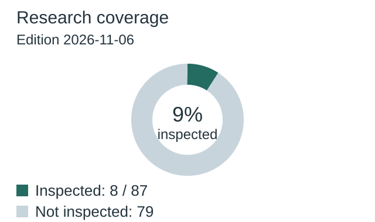
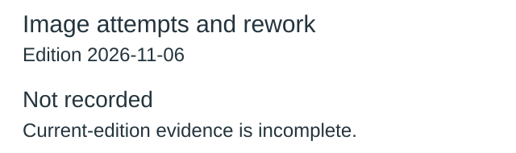
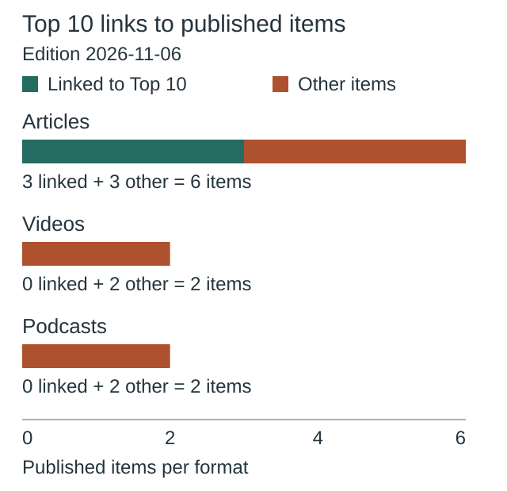
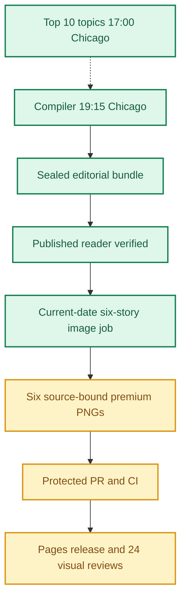
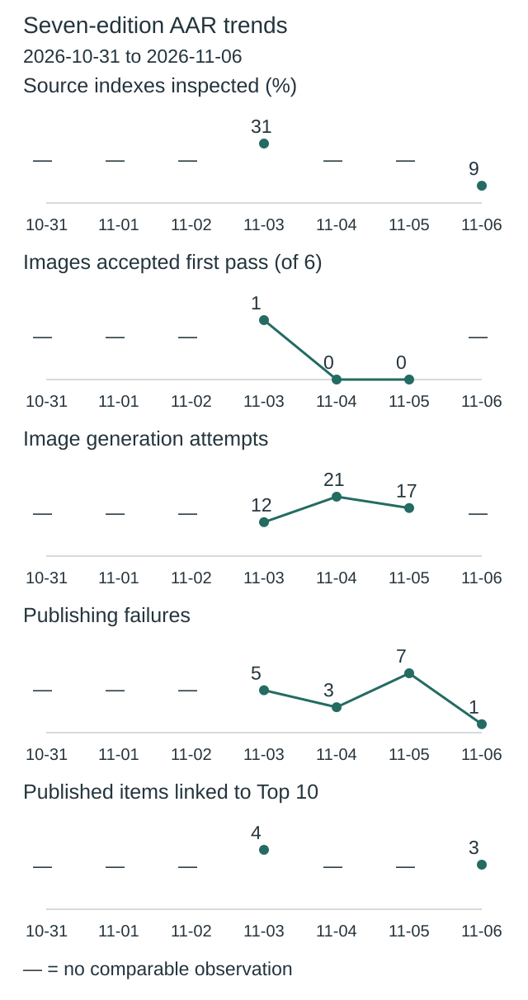
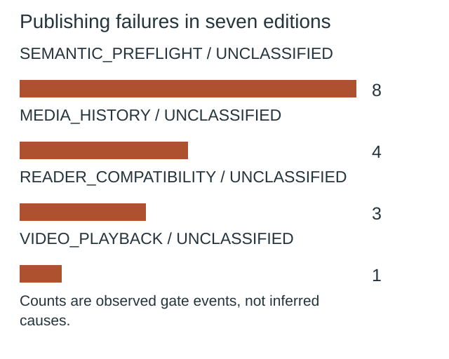
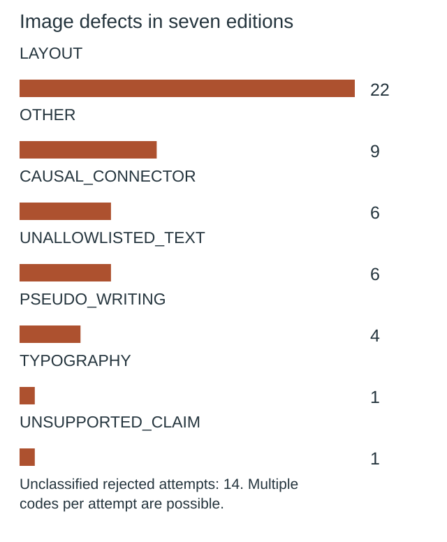

**🟨 RELEASE PARTIAL**
**TOP 10 REPORT_AND_SEARCH_RECEIPTS_OBSERVED** · **🟩 COMPILER VERIFIED** · **🟦 IMAGES 6/6 RELEASED** · **🟨 VISUAL QA NOT YET VERIFIED**

# Daily AI Brief — Unified Production After-Action Report
**Edition:** November 6, 2026 · **Production evening:** 2026-11-05 · **Timezone:** America/Chicago
**Primary public reader:** [Open 2026-11-06 Brief](https://gttome.github.io/Daily-AI-Brief-Compiler/briefs/2026-11-06/) · **Repository:** [Daily-AI-Brief-Compiler](https://github.com/gttome/Daily-AI-Brief-Compiler)

> **IMPORTANT — VERIFIED PRODUCTION RESULT**
> **Executive release result: PARTIAL.** This is the single management-facing report covering Top 10 topic discovery, the editorial Compiler, published Brief and premium-image run. **Entire-system evidence: PARTIAL.** Top 10 report: **provisional**; Compiler handoff: **RECEIVED_SNAPSHOT_BOUND**; guided searches: **RECEIPTS_OBSERVED**. Compiler public status: **VERIFIED**. Image release: **RELEASED_VERIFIED**. Direct 24-context visual quality: **not yet evidenced**. Autonomous completion: **UNPROVEN**. Missing evidence must not be promoted to a success claim.

**🕒 Production stage durations:** **Top 10 6m 09s** · **Compiler final seal window 5m 57s** · **Premium Images Not independently recorded** (evidence-bounded elapsed times; the start/end events differ).

> **CLOSEOUT WARNING:** The exact image worker has not released its lease and recorded PUBLISHED_COMPLETE with the six accepted hashes.

## Evidence reconciliation

Compiler final seal window: 5m 57s. Compiler state start to public verification: 50m 42s. Observed execution and final seal windows are distinct.
Image capability route preflight: RECORDED; scheduler origin remains UNPROVEN.
Image efficiency: 0/6 first-pass accepts; 14 total attempts. November 3–5 target: at least 3/6 first-pass and at most 2 attempts per image, with unchanged quality floor.
Image review completed: Not recorded; review-record commit: Not recorded; protected review merge: Not recorded.
Eligible source indexes: 87; editorial inspections reported: 8 (9.2%); inaccessible in editorial audit: 0; explicitly unreviewed IDs: 79; unclassified editorial IDs: 0. Automated index parsing is separate from editorial inspection and cannot substantiate exhaustive freshness claims.


## Daily AAR charts

These charts use this edition’s receipts. Missing data is not zero.

### Research coverage



**8 of 87 indexes inspected (9%).**

| Editorial inspection | Indexes |
|---|---:|
| Inspected | 8 |
| Not inspected | 79 |

Not inspected includes every index without a recorded editorial inspection; this is not proof of missed stories.

### Image attempts and rework



**14 attempts; 0 of 6 images accepted on their first attempt.**

| Image | Accepted | Rejected | Total attempts |
|---|---:|---:|---:|
| GPT-6 Cyber pairs stronger exploit research with restricted access | 1 | 1 | 2 |
| Ripple-65B targets coding performance with a dense open-weight design | 1 | 1 | 2 |
| Gemini Omni 1.2 Flash extends clips and lowers API pricing | 1 | 2 | 3 |
| Anthropic models how Claude could change scientific work | 1 | 1 | 2 |
| Cloudflare proposes identity and accountability for hosted agents | 1 | 1 | 2 |
| A verification loop turns Forms insights into a reusable agent skill | 1 | 2 | 3 |

Generation attempts measure rework, not runtime or cost. Quality and publication checks remain separate.

### Top 10 links to published items



**3 of 10 unique published items link to Top 10 topics.**

| Format | Linked to Top 10 | Other items |
|---|---:|---:|
| Articles | 3 | 3 |
| Videos | 0 | 2 |
| Podcasts | 0 | 2 |

No selection quota. Topic linkage does not establish better quality, popularity or causal improvement.

[Chart data](charts.json)

One edition at a time. Missing evidence is not zero. Trend claims require comparable recorded cycles.

## Performance dashboard

| Measure | Recorded result | Source / caveat |
|:--|:--:|:--|
| Entire-system evidence | **PARTIAL** | Full Top 10 list, bound Compiler input, all-format search receipts and existing release checks; separate from publication and autonomy |
| Top 10 report | **provisional · 10 topics** | Same Chicago cycle report; provisional/partial coverage remains disclosed |
| Top 10 received by Compiler | **RECEIVED_SNAPSHOT_BOUND** | Exact report snapshot bytes; consumed commit separately corroborated: YES |
| Top 10 guided article/video/podcast searches | **RECEIPTS_OBSERVED** | Actual source-search receipts and selected/rejected topic outcomes |
| Top 10 stage duration | **6m 09s** | Same-cycle run receipt only; no runtime or usage estimate |
| Editorial publication | **PASS** | State and public reader integrity receipt |
| **Unattended autonomy (separate from publication)** | **UNPROVEN** | Owner incident receipt takes precedence over unverified producer self-attestation |
| Recorded protected publishing gate failures | **1** | Actual same-edition GitHub failure sidecar only; earlier unrecorded failures remain unknown |
| Articles | **6** | Exactly 2 technical / 2 knowledge-worker / 2 agents required |
| Verified original sources within preceding 24 hours | **0 / 6** | Original publisher dates only; other sources require a documented fallback rationale |
| Distinct selected article publishers | **6** | Six different primary organizations preferred |
| Videos over seven days old | **2** | Must be labeled evergreen, not a new development |
| Distinct selected video publishers | **2** | One channel is one publisher even across multiple videos |
| Video discovery source attempts | **NOT_RECORDED / NOT_RECORDED** | Attempt evidence across enabled and qualification-only leads; NOT_RECORDED. Not a claim of full content review or player verification | 
| Duplicate active Watchlist display titles | **Not recorded** | Published canonical Watchlist only; historical evidence retained |
| Original-release video playback (historical) | **TWO_PUBLISHED_VIDEOS_PLAYBACK_PASS** | Later reader corrections may replace these originally verified videos; see incident register | 
| Postpublication reader incidents | **NOT_RECORDED** | Edition-specific owner reports and corrective PRs, not inferred absence | 
| Verified postpublication video corrections | **NOT_RECORDED** | Incident register tracks correction PR, actual playback evidence and reader preservation |
| Editorial index second-pass attempts | **0** | Bounded public GET retries only; never proof of original article reading |
| Editorial index reads recovered | **0** | Successful page fetch can still yield zero eligible dated items |
| Recorded scheduler capability route | **UNPROVEN** | Same-invocation route receipt only; GitHub is not scheduler authentication |
| Avoidable incomplete-staging CI failures | **Not independently audited** | Existing image-package push CI is disabled; exact-head protected PR CI remains required. A failure count requires actual workflow evidence |
| Media | **2 videos + 2 podcasts** | Sealed bundle |
| **Compiler final seal window** | **5m 57s (6.0 min)** | Final sealed-state timestamp → verified public reader; initial execution is separate |
| **Image processing stage duration** | **Not independently recorded** | First accepted PNG Git checkpoint → final 24/24 review; auditable stage elapsed time |
| Image scheduled-to-final-review window | **Not independently recorded** | Only with a saved one-cycle schedule anchor; does not attest exact generation start |
| Executor-observed generation-to-final-review | **Not independently recorded** | Only if the worker recorded a same-execution clock before its first native call; not independently verified provider runtime |
| Accepted premium PNGs | **6 / 6** | Exact package and public release hashes |
| Native image generation attempts | **14** | Image worker AAR; no estimation |
| Rejected candidates | **8** | Image worker AAR |
| Final worker checkpoint reconciliation | **MISMATCH** | Oct25+ verifies exact generation count, per-story attempts, six accepted story/image/hash bindings and final release |
| Saved visual contexts | **Unverified** | Dated/permanent desktop/mobile review |
| Public SHA-256 checks | **44** | Image release receipt |
| October 8 immutable history | **17 / 17** | Independent content-preservation checks |
| **Owner-reported weekly Work usage for this run** | **Not reported** | No per-cycle usage supplied |

> **EFFICIENCY NOTE**
> **Resource reporting policy:** No usage figure was supplied for this cycle, so none is assumed. Future runs show **Not reported** unless the owner supplies new cycle-specific usage metadata. No approval or extra step is required to generate the AAR.

## Production architecture and checkpoints



## Daily AI Topic Top 10 and Compiler handoff

**Research cycle:** 2026-11-05 · **Target Brief:** 2026-11-06 · **Scheduled start:** 17:00 America/Chicago

| Dimension | Recorded evidence |
|---|---|
| Run/report result | REPORT\_AND\_SEARCH\_RECEIPTS\_OBSERVED |
| Report status / topics | provisional / 10 |
| Freshness | FRESH\_AT\_CONSUMPTION |
| Compiler handoff | RECEIVED\_SNAPSHOT\_BOUND |
| Search coverage | RECEIPTS\_OBSERVED |
| Selection mapping verification | MATCHES\_EDITION\_BUNDLE |
| Observed start / finish | 2026-11-05T22:59:02Z / 2026-11-05T23:05:11Z |
| Elapsed minutes | 6.15 |
| Usage percent | Not reported |
| Cost USD | Not reported |
| Independent scheduler autonomy | UNPROVEN |
| Compiler-recorded consumed commit | 3750de9bf04086a6e7eaac449d1ce6cb7c426fab |
| Report SHA-256 | 334e6e7e9f8fc30fc49b1d15462f95dc3b4c3ef7ffd0d9bb950b9561591768ef |

| Discovery order | AI topic | Summary | Confidence | Evidence |
|---:|---|---|---|---|
| 1 | Ripple-65B gets a follow-up coding analysis | A new creator analysis revisits Ricursive’s open-weight coding model and its selected benchmark comparisons. | medium | [Source](https://www.youtube.com/watch?v=2dD4HXg-YJ4) · [Source](https://x.com/RicursiveAI/status/2118046765857546733) · [Source](https://www.ricursive.com/ripple) |
| 2 | Kimi K3.1 Pro weights draw deployment discussion | Moonshot’s download release prompts questions about hardware and licensing. | medium | [Source](https://x.com/Kimi_Moonshot/status/2118010528123773297) · [Source](https://www.youtube.com/watch?v=-M62vWrZh54) · [Source](https://huggingface.co/moonshotai/Kimi-K3.1-Pro) |
| 3 | Spare-phone inference demo keeps drawing viewers | A creator demonstrates a local AI setup built around spare phones. | low | [Source](https://www.youtube.com/watch?v=reOeczuEzOA) |
| 4 | Claude video-editing workflow gets a second day of attention | Matt Wolfe’s demonstration explores agent-assisted video editing with human review. | low | [Source](https://www.youtube.com/watch?v=ep4psgAFOqc) |
| 5 | OpenAI introduces GPT-6 Cyber for vetted defenders | OpenAI released the model through restricted Daybreak Red access and described its role in a controlled Linux study. | medium | [Source](https://x.com/OpenAI/status/2118390190246879554) · [Source](https://openai.com/index/introducing-gpt-6-cyber/) · [Source](https://openai.com/index/a-thousand-fewer-paths-to-root/) · [Source](https://www.mozilla.org/en-US/security/advisories/mfsa2026-118/) |
| 6 | Claude Code changes how background agents report progress | An Anthropic developer announcement says status summaries now use short notes and Haiku. | low | [Source](https://x.com/ClaudeDevs/status/2118063143167693011) |
| 7 | ChatGPT Images 2.6 adds frame-level GIF edits | The release lets users generate short GIFs and revise individual frames. | medium | [Source](https://superpowerdaily.com/videos/0850b3b3-4421-4157-8150-22d3bd8f201f) · [Source](https://openai.com/index/introducing-images-2-6/) |
| 8 | Gemini Omni 1.2 Flash adds longer clips | Google’s video model update introduces native 15-second clips and conversational editing. | medium | [Source](https://x.com/OfficialLoganK/status/2118390838434693281) · [Source](https://blog.google/innovation-and-ai/technology/developers-tools/introducing-gemini-omni-1-2-flash/) |
| 9 | Grok Bot usage limits keep agent costs in focus | A creator analysis and fresh reporting revisit the relationship between agent serving costs and weekly allowances. | low | [Source](https://www.youtube.com/watch?v=-5cDYPwNf5g) · [Source](https://www.businessinsider.com/grok-bot-usage-limits-costs-unsustainably-high-elon-musk-agents-2026-11) |
| 10 | Kindi 0.4 demo revisits inference on older GPUs | Kindi’s maintainer documents a 33B configuration on a 12 GB Quadro K6000 that uses host memory and CPU offload. | medium | [Source](https://www.youtube.com/watch?v=RLXjscqnp6A) · [Source](https://amirhusain.com/software/kindi/changelog/) · [Source](https://github.com/ahtx/kindi) |

**Sample scope:** {"metadata\_screened\_videos":11,"unique\_videos":11,"total\_video\_observations":11,"distinct\_retained\_channels":11,"full\_video\_reviews":0,"transcript\_reviews":1,"partial\_transcript\_reviews":0,"direct\_youtube\_counter\_verifications":0,"original\_watch\_attempts":11,"original\_watch\_title\_only":1,"tracker\_counter\_records":10,"within\_24h\_reported\_publications":6,"additional\_within\_72h\_reported\_publications":5,"target\_40\_to\_80\_full\_reviews\_met":false,"validation\_resources\_registered":14,"new\_resource\_candidates\_evaluated":3,"scope":"Ten indexed videos plus one original publisher episode. Screened a mix of creative work, AI engineering, local inference, business and security. Tracker search and channel sample is bounded."}. **Ranking basis:** {"method":"Prioritize matched video observations and repeat measurements. Add dated source-backed announcements and relevant original coverage. Keep each event and metric separate.","limitations":\["No cross-platform numerical scoring, summed audience counts or inferred viewing velocity.","Mixed-topic roundup counters are retained only as metadata.","Same publisher product and media materials are not independent families."\]}.

| Search format | Receipt rows | Attempts recorded | Explicitly not attempted |
|---|---:|---:|---:|
| article | 10 | 10 | 0 |
| video | 10 | 10 | 0 |
| podcast | 10 | 10 | 0 |

**Selected Brief items linked to trends:**

| Topic | Format | Selected item | Reason |
|---|---|---|---|
| ripple-preview-release-nov04 | article | nov06-t2-ripple · [Source](https://www.ricursive.com/ripple) | The primary Ripple release directly matches the event and passed story selection. |
| gpt6-cyber-release-nov05 | article | nov06-t1-gpt6-cyber · [Source](https://openai.com/index/introducing-gpt-6-cyber/) | The original GPT-6 Cyber release directly matches the event and passed technical selection. |
| gemini-omni-12-flash-nov05 | article | nov06-k1-gemini-omni · [Source](https://blog.google/innovation-and-ai/technology/developers-tools/introducing-gemini-omni-1-2-flash/) | The original Gemini Omni 1.2 Flash release passed applied-story selection. |

**Gaps and limitations:**

- The report labels its ranking provisional.
- Ten original YouTube watch-page requests were throttled and one exposed only a title. No playback or first-party counters were available.
- Comments, subscribers and sponsorship disclosures are unavailable. Tracker counters are third-party and rounded where displayed with K or M.
- X announcement retrieval returned 403. The sampled posts and counters come from the dated tracker view.
- Research completed within available sources. The 40–80 full-video aim was unmet.
- Usage, cost, scheduler origin, Compiler consumption and publication impact remain unverified for this run.

**Recorded run issues:**

- {"issue":"Ten original watch-page requests throttled and one returned title only.","effect":"No audiovisual review or first-party counter verification.","correction":"Recorded tracker measurements and separately read one complete displayed publisher transcript."}
- {"issue":"Original X posts returned 403.","effect":"Announcement engagement is available only through a third-party tracker.","correction":"Retained original URLs, dated tracker source and reported precision."}
- {"issue":"Kindi video headline omits host participation.","effect":"A reader could infer the 33B model fits entirely on the older card.","correction":"Read the maintainer’s compatibility and 33B sections. Recorded 13 host-memory layers and partial CPU computation.","evidence\_ref":"https://github.com/ahtx/kindi"}
- {"issue":"Prior unified AAR reported invalid Compiler search evidence.","effect":"Prior downstream coverage and outcome rollup are limited.","correction":"Consulted the prior receipt and kept the downstream result separate. Current producer JSON includes all 30 distinct format queries and exact verified source identity."}

**Recorded improvements:**

- {"change":"Read the full published November 5 Superpower Daily transcript and cross-check its lead event and security segment.","reason":"Prior run retained a partial caption excerpt only. Current contract prioritizes source depth.","expected\_effect":"More precise GIF claim and separation of Linux validation from maintainer adoption.","status":"implemented\_in\_current\_research"}
- {"change":"Check the Kindi maintainer’s compatibility and benchmark sections before using the hardware headline.","reason":"Single-publisher hardware claim could imply the model fits entirely on the card.","expected\_effect":"Preserve the model-specific CPU and host-memory dependency.","status":"implemented\_in\_current\_research"}
- {"change":"Find complete original coverage for a high-priority single-publisher video and preserve direct counters when actually exposed.","status":"proposed"}

### Daily improvement and effect on the Brief

**Fixed baseline:** nov03-2026-v1 / INPUT\_FROZEN. **Outcome baseline:** FROZEN\_AFTER\_VERIFIED\_PUBLICATION. **Prior cycle:** 2026-11-04.

| Input measure | Current | November 3 baseline | Change from baseline | Change from prior cycle |
|---|---:|---:|---:|---:|
| topic count | 10 | 10 | 0 | 0 |
| validation resource count | Not reported | 14 | Not reported | Not reported |
| additional video metadata records | Not reported | 63 | Not reported | Not reported |
| additional video channels | Not reported | 21 | Not reported | Not reported |
| total video observations | Not reported | 79 | Not reported | Not reported |
| unique videos | Not reported | 71 | Not reported | Not reported |
| full video reviews | Not reported | 0 | Not reported | Not reported |
| direct youtube counter verifications | Not reported | 0 | Not reported | Not reported |
| broader evidence band topics | 0 | 3 | -3 | 0 |
| limited evidence band topics | 10 | 7 | 3 | 0 |

**Observed downstream measurements:** OBSERVED.

| Outcome measure | Current | Change from frozen outcome | Change from prior cycle |
|---|---:|---:|---:|
| expected topic format pairs | 30 | 0 | Not reported |
| attempted topic format pairs | 30 | 0 | Not reported |
| explicitly unattempted pairs | 0 | 0 | Not reported |
| discovered candidate count | 30 | -10 | Not reported |
| searched source host count | 12 | -4 | Not reported |
| selected article count | 3 | 0 | Not reported |
| selected video count | 0 | 0 | Not reported |
| selected podcast count | 0 | -1 | Not reported |

**Source changes:** {"added":\[\],"removed":\[\]}.

**Candidate review depth:** INVALID.

| Review measure | Current | Change from prior comparable cycle |
|---|---:|---:|
| reviewed candidate count | Not reported | Not reported |
| qualified candidate count | Not reported | Not reported |
| rejected candidate count | Not reported | Not reported |
| metadata only count | Not reported | Not reported |
| full video reviews | Not reported | Not reported |
| transcript reviews | Not reported | Not reported |

The frozen November 3 baseline has no candidate-level review ledger; no retrospective value is invented. Recorded reviews do not independently establish content quality, audience interest or causal benefit.

**Method/resource review:** {"baseline\_id":"nov03-2026-v1","previous\_report\_date":"2026-11-04","method\_version":"2026-11-03.2-event-review","feedback":{"aar\_url":"https://github.com/gttome/Daily-AI-Brief-Compiler/blob/cabcb0b6f1cf7fecffc6a9e3a4c24323fc5c755a/daily/2026-11-04/combined.md","charts\_url":"https://github.com/gttome/Daily-AI-Brief-Compiler/blob/cabcb0b6f1cf7fecffc6a9e3a4c24323fc5c755a/daily/2026-11-04/charts.json","metrics\_url":"https://github.com/gttome/Daily-AI-Brief-Compiler/blob/cabcb0b6f1cf7fecffc6a9e3a4c24323fc5c755a/daily/2026-11-04/improvement-metrics.json","original\_producer\_receipt":"https://github.com/gttome/Daily-AI-Brief-Compiler/blob/cabcb0b6f1cf7fecffc6a9e3a4c24323fc5c755a/signals/ai-topic-top10/2026-11-04.aar.json","original\_search\_receipt":"https://github.com/gttome/Daily-AI-Brief-Compiler/blob/shadow/2026-11-05/shadow-runs/2026-11-05/editorial/trend-search-coverage.json","original\_search\_receipt\_blob":"c1700ef3736b219b4a0105172b15b9dc362100b0","observed":{"edition\_date":"2026-11-05","handoff":"RECEIVED\_SNAPSHOT\_BOUND","search\_status":"INVALID","recorded\_search\_rows":30,"reported\_attempted\_by\_format":{"article":10,"video":4,"podcast":2},"selection\_mapping\_status":"MATCHES\_EDITION\_BUNDLE","trend\_linked\_outcome\_metric":null,"image\_attempts":17,"first\_pass\_images":0,"recorded\_failed\_gates":7,"source\_coverage":null,"previous\_family\_assessments":1},"interpretation":"Compiler owns the next consumer search evidence. The prior coverage defect does not establish a producer write defect or a zero selection count."},"changes":\[{"change":"Read the full published November 5 Superpower Daily transcript and cross-check its lead event and security segment.","reason":"Prior run retained a partial caption excerpt only. Current contract prioritizes source depth.","expected\_effect":"More precise GIF claim and separation of Linux validation from maintainer adoption."},{"change":"Check the Kindi maintainer’s compatibility and benchmark sections before using the hardware headline.","reason":"Single-publisher hardware claim could imply the model fits entirely on the card.","expected\_effect":"Preserve the model-specific CPU and host-memory dependency."}\],"resource\_candidates":\[{"url":"https://www.mozilla.org/en-US/security/advisories/mfsa2026-118/","role":"maintainer fix confirmation","access":"direct","review\_scope":"Selected CVE descriptions and reporter credits in Firefox 159 advisory.","independence":"Mozilla records its own product fixes. OpenAI supplied some findings, so this is not independent model evaluation.","decision":"accepted","reason":"Corroborates specific Firefox fixes independently of the launch page.","contribution":"Separates actual Firefox fixes from Linux candidate patches and headline counts."},{"url":"https://github.com/ahtx/kindi","role":"maintainer implementation evidence","access":"direct public web","review\_scope":"Compatibility, performance, 33B configuration and limitations sections.","independence":"Same maintainer family as the Kindi video and changelog.","decision":"accepted","reason":"Provides exact host-memory and CPU offload qualifications.","contribution":"Corrected a hardware headline without adding artificial publisher breadth."},{"url":"https://sylt.ing/search/hashtag/Video?lang=nl\_nl","role":"potential creator-workflow corroboration","access":"indexed page","review\_scope":"Read same-video user summaries, which repeat claims without playback evidence.","independence":"Derivative description of the same Matt Wolfe video.","decision":"rejected","reason":"No original transcript, test data or independent verification of savings.","contribution":"Excluded from attention and claim support."}\],"observed\_effects":\[{"observation":"One complete displayed transcript read today. Prior run had no complete transcript.","effect":"Bounded gain in source depth for one program. Playback and direct counters remain unavailable."},{"observation":"Kindi README gives CPU and host-memory details.","effect":"Replaced the headline shorthand with the documented hybrid configuration."},{"observation":"Two publisher-family removals eliminate retained attention for their respective topics.","effect":"Recorded limited resilience despite credible primary claim evidence."}\],"next\_improvement":"Find complete original coverage for a high-priority single-publisher video and preserve direct counters when actually exposed.","limitations":\["Observed source-depth change does not establish better production outcomes.","The next Compiler’s search and selection receipts remain unobserved."\],"change\_evaluations":\[\],"pending\_change\_evaluations":\["NOV03-04","AAR-02","AAR-03","AAR-10"\],"review\_due\_edition":"2026-11-11"}.

**Current reconciled conclusion:** OBSERVED; outcome baseline FROZEN\_AFTER\_VERIFIED\_PUBLICATION; candidate review ledger INVALID.

**Historical producer observations (not current status):** The following snapshot preserves what the producer reported at the time. Its pending statuses and candidate-quality claims are not independently reconciled conclusions. Use the current tables above for publication-bound measurements; an absent candidate review ledger remains unknown.

<details><summary>Original producer effects and gaps — historical snapshot</summary>

```json
{
  "source_additions": [
    "https://www.ricursive.com/ripple",
    "https://openai.com/index/introducing-gpt-6-cyber/",
    "https://blog.google/innovation-and-ai/technology/developers-tools/introducing-gemini-omni-1-2-flash/",
    "https://www.ted.com/talks/anil_seth_why_ai_isn_t_going_to_become_conscious",
    "https://www.pbs.org/video/clip2-ianlwl/"
  ],
  "useful_qualified_candidate_ids": [
    "ripple-primary",
    "ripple-video-analysis",
    "ripple-podcast-lead",
    "kimi-model-card",
    "kimi-video-review",
    "kimi-inference-podcast-lead",
    "phone-companion-summary",
    "phone-cluster-video",
    "distributed-inference-podcast-lead",
    "claude-editing-search-lead",
    "claude-editing-video",
    "creator-workflow-podcast-lead",
    "gpt6-cyber-primary",
    "gpt6-cyber-video-lead",
    "cyber-bio-monitoring-podcast-lead",
    "claude-background-status-lead",
    "claude-background-video-lead",
    "background-agent-podcast-lead",
    "images26-primary",
    "images26-video-lead",
    "images26-podcast-lead",
    "gemini-omni-primary",
    "gemini-omni-video-lead",
    "gemini-omni-podcast-lead",
    "grok-cost-article",
    "grok-cost-video",
    "grok-cost-podcast-lead",
    "kindi-primary",
    "kindi-video",
    "kindi-inference-podcast-lead",
    "ted-anil-consciousness-video",
    "pbs-washington-week-agent-oversight-video"
  ],
  "rejection_reasons": {
    "freshness": "Older or date-only leads did not outrank complete current primary evidence.",
    "duplicate": "Exact archive repeats were not selected.",
    "promotion": "Medium-promotional vendor media did not displace two low-promotion winners.",
    "playback": "Two initial YouTube winners were removed after the protected runner observed public identity but no advancing signed-out full-length playback."
  },
  "gaps": [
    "Several podcast searches produced adjacent inference or agent episodes rather than exact topic-specific current episodes.",
    "The trend-linked phone-cluster video did not survive the protected playback gate; recovery media are not claimed as Top 10 mappings.",
    "The trend-linked phone-cluster video did not survive the protected playback gate; recovery media are not claimed as Top 10 mappings.",
    "The trend-linked phone-cluster video did not survive the protected playback gate; recovery media are not claimed as Top 10 mappings."
  ],
  "timing": {
    "report_retrieved_at": "2026-11-06T01:17:45.000Z",
    "search_started_at": "2026-11-06T01:33:20.000Z",
    "selection_locked_at": "2026-11-06T02:02:00.000Z",
    "observed_minutes": 2.33
  },
  "cost_usd": 0,
  "causal_uplift": null,
  "note": "Observed search and selection linkage does not prove incremental benefit or causal uplift."
}
```

</details>

**Next improvement:** Find complete original coverage for a high-priority single-publisher video and preserve direct counters when actually exposed.

Counts show coverage and observed association, not audience popularity, source independence, candidate quality or causal uplift. Compare source/method changes before interpreting deltas. Unknown values are not zero. Publication, reader corrections, runtime and image outcomes retain their separate AAR evidence.

Report, source-readback and search receipts are separate observations. Snapshot binding verifies the collected report bytes; the consumed commit is independently corroborated only when the separately fetched source bytes match. These records do not independently attest scheduler identity or source truth. Top 10 reporting does not change Brief/image release status.


## Track 1 — Compiler

**State:** `SHADOW_VERIFIED` · **Bundle:** `BUNDLE_READY` · **Compiler final seal window:** 5m 57s (6.0 min).

| Publication gate | Result |
|---|:---:|
| Canonical reader build | ✅ |
| Reader parity | ✅ |
| Public verification of dated edition | ✅ |
| Previous editions preserved | ✅ |
| Permanent story routes and feeds | ✅ |

**Selected coverage:**

| Lane | Story |
|---|---|
| Technical AI Engineering | GPT-6 Cyber pairs stronger exploit research with restricted access |
| Technical AI Engineering | Ripple-65B targets coding performance with a dense open-weight design |
| Applied Generative AI for Knowledge Workers | Gemini Omni 1.2 Flash extends clips and lowers API pricing |
| Applied Generative AI for Knowledge Workers | Anthropic models how Claude could change scientific work |
| Agents for Everyone | Cloudflare proposes identity and accountability for hosted agents |
| Agents for Everyone | A verification loop turns Forms insights into a reusable agent skill |

## Track 2 — Premium images

**Public status:** `RELEASED_VERIFIED` · **Saved images:** 6/6 · **Actual generation attempts:** 14 · **Rejected candidates:** 8.

### Image production duration — Git-verified milestones

**Auditable image stage duration:** **Not independently recorded** (first accepted binary saved in Git → first persisted 24-context quality-review record). **First asset to public image release:** **Not independently recorded**.
**Scheduled-to-final-review window:** **Not independently recorded**. This is a scheduled-clock comparison only when a separately recorded exact-date schedule exists; it is **not** measured native image-generation runtime.

| Production milestone | Chicago local time | Evidence |
|---|---|---|
| Scheduled image start (if exact-date record exists) | Not independently recorded | Time planned, not actual execution start |
| First executor-observed start | Not independently recorded | Worker self-attestation, not a first-party scheduler event |
| First native generation observation | Not independently recorded | Worker clock recorded immediately before first native call, not model-provider telemetry |
| First accepted PNG bytes saved to Git | Not independently recorded | Immutable binary-stage commit |
| Six-image package / reviews committed | Not independently recorded | Exact-head PR source commit |
| Protected package merged | Not independently recorded | Merge SHA and required CI |
| Public images verified | Not independently recorded | Image-release receipt |
| 24/24 review record committed | Not independently recorded | Immutable first review-approval commit |

> **Duration interpretation:** The audited stage excludes unobservable pre-checkpoint creative work. The scheduled-start window includes it but must not be interpreted as precise active processing time. Missing timestamps appear as **Not independently recorded**, never an estimate.


| Source-bound image | Attempts | File size | Public page |
|---|---:|---:|---|
| GPT-6 Cyber pairs stronger exploit research with restricted access | 2 | 0.71 MiB | [View original](https://gttome.github.io/Daily-AI-Brief-Compiler/briefs/images/2026-11-06/dab-edition-2026-11-06-m01.png) |
| Ripple-65B targets coding performance with a dense open-weight design | 2 | 0.54 MiB | [View original](https://gttome.github.io/Daily-AI-Brief-Compiler/briefs/images/2026-11-06/dab-edition-2026-11-06-m02.png) |
| Gemini Omni 1.2 Flash extends clips and lowers API pricing | 3 | 0.58 MiB | [View original](https://gttome.github.io/Daily-AI-Brief-Compiler/briefs/images/2026-11-06/dab-edition-2026-11-06-m10.png) |
| Anthropic models how Claude could change scientific work | 2 | 0.63 MiB | [View original](https://gttome.github.io/Daily-AI-Brief-Compiler/briefs/images/2026-11-06/dab-edition-2026-11-06-m11.png) |
| Cloudflare proposes identity and accountability for hosted agents | 2 | 0.58 MiB | [View original](https://gttome.github.io/Daily-AI-Brief-Compiler/briefs/images/2026-11-06/dab-edition-2026-11-06-m12.png) |
| A verification loop turns Forms insights into a reusable agent skill | 3 | 0.53 MiB | [View original](https://gttome.github.io/Daily-AI-Brief-Compiler/briefs/images/2026-11-06/dab-edition-2026-11-06-m14.png) |

**Immutable-release and visual gates:**

| Release gate | Result |
|---|:---:|
| Protected public image receipt | ✅ |
| Accepted-image Git hash bindings | ✅ |
| Six live PNGs | 6/6 |
| Dated/permanent story placements | 12/12 recorded in release evidence |
| Desktop/mobile visual inspection | Not verified |
| Historical Oct 8 integrity | 17/17 |

### Published premium illustrations

<table>
<tr><td width="50%"><a href="https://gttome.github.io/Daily-AI-Brief-Compiler/briefs/images/2026-11-06/dab-edition-2026-11-06-m01.png"></a><br/><b>GPT-6 Cyber pairs stronger exploit research with restricted access</b></td><td width="50%"><a href="https://gttome.github.io/Daily-AI-Brief-Compiler/briefs/images/2026-11-06/dab-edition-2026-11-06-m02.png"></a><br/><b>Ripple-65B targets coding performance with a dense open-weight design</b></td></tr>
<tr><td width="50%"><a href="https://gttome.github.io/Daily-AI-Brief-Compiler/briefs/images/2026-11-06/dab-edition-2026-11-06-m10.png"></a><br/><b>Gemini Omni 1.2 Flash extends clips and lowers API pricing</b></td><td width="50%"><a href="https://gttome.github.io/Daily-AI-Brief-Compiler/briefs/images/2026-11-06/dab-edition-2026-11-06-m11.png"></a><br/><b>Anthropic models how Claude could change scientific work</b></td></tr>
<tr><td width="50%"><a href="https://gttome.github.io/Daily-AI-Brief-Compiler/briefs/images/2026-11-06/dab-edition-2026-11-06-m12.png"></a><br/><b>Cloudflare proposes identity and accountability for hosted agents</b></td><td width="50%"><a href="https://gttome.github.io/Daily-AI-Brief-Compiler/briefs/images/2026-11-06/dab-edition-2026-11-06-m14.png"></a><br/><b>A verification loop turns Forms insights into a reusable agent skill</b></td></tr>
</table>

## Incidents, corrections and learning

### Postpublication reader incidents (updated when new evidence is merged)

No current-edition postpublication incident register was available; this is **NOT_RECORDED**, not a certification of zero incidents.


**Editor recovery classification:** UNPROVEN. **Owner intervention:** Unproven either way. **Protected same-edition failures recorded:** 1. 
**Latest failed protected stage:** VIDEO_PLAYBACK; [Action evidence](https://github.com/gttome/Daily-AI-Brief-Compiler/actions/runs/42146079831). Exact stage durations are available only where real source timestamps exist.

| Stage | Verified issue | Corrective action |
|---|---|---|
| Native saved-pixel inspection | Simulated patch writing and an unsupported monitor trace. | Use blank fixtures, no displays, and plain labels. |
| Native saved-pixel inspection | Simulated document lines and unintended directional connectors. | Use solid layers and nondirectional comparison guides. |
| Native saved-pixel inspection | Unchanged film frames and extra arrows obscured revision. | Show a single lighting edit and three arrows only. |
| Native saved-pixel inspection | The edit arrow missed its target and the review label ran too close to the edge. | Connect strip to strip and wrap the review label. |
| Native saved-pixel inspection | The analysis arrow pointed to label text. | Connect the digital path to an analysis output port. |
| Native saved-pixel inspection | Fake writing and label-terminating arrows obscured policy. | Use blank tokens and a hardware policy gate. |
| Native saved-pixel inspection | A route bypassed response verification. | Bind the decision path to the original-response check. |
| Native saved-pixel inspection | Bars and a pie implied unsupported quantitative results. | Use equal-size neutral pattern marks. |

> **OPERATIONAL NOTE**
> This report distinguishes a published and verified production outcome from scheduler metadata exposed to another conversation. Lack of a live host heartbeat in a separate normal chat is not a Compiler production failure.

## Usage and cost stewardship

| Item | Per-cycle value |
|---|---|
| **Weekly Work usage reported by owner** | **Not reported** |
| Internal weekly usage reference | Target under 5% |
| Genuine image-generation attempts | 14 |
| Accepted diagrams | 6 |
| Regeneration after acceptance | 0 |
| Top 10 reported usage | Not reported |
| Top 10 reported cost | Not reported |
| Account-level billing telemetry | Not independently accessible to deterministic GitHub reporting |

**Future reporting rule:** For cycles without an optional owner-usage record, publish the complete AAR with `Not reported`; do not reuse prior percentages, guess remaining weekly credits or delay tomorrow's production.

## Next-edition operating handoff

| Control | Recurring contract |
|---|---|
| AI Topic Top 10 | Sole report task · 17:00 America/Chicago · saved dated list guides same-evening research |
| Primary Compiler | Sole existing task · 19:15 America/Chicago |
| Premium image production | Sole existing task · standard 21:15 America/Chicago |
| Exact image job selection | Newly published next-date `PUBLISHED_PENDING` only |
| AAR | Combined report generated automatically from new GitHub receipts |
| Optional Work usage | Owner-supplied per cycle, otherwise `Not reported` |

> **SCHEDULE RESTORATION NOTE**
> A temporary scheduling exception must be explicitly restored before claiming standard-time readiness. This deterministic document generator reads existing state only; it does not modify production schedules.

## Evidence register

| Evidence | Link |
|---|---|
| Compiler state | [Open receipt](https://github.com/gttome/Daily-AI-Brief-Compiler/blob/shadow/2026-11-06/shadow-runs/2026-11-06/compiler-state.json) |
| Compiler compile receipt | [Open receipt](https://github.com/gttome/Daily-AI-Brief-Compiler/blob/shadow/2026-11-06/shadow-runs/2026-11-06/compiler/compile-receipt.json) |
| Compiler public integrity | [Open receipt](https://github.com/gttome/Daily-AI-Brief-Compiler/blob/shadow/2026-11-06/shadow-runs/2026-11-06/compiler/postpublish-integrity.json) |
| Image release receipt | [Open receipt](https://github.com/gttome/Daily-AI-Brief-Compiler/blob/shadow-pages-history/site/image-jobs/2026-11-06/release.json) |
| Image review | [Open receipt](https://github.com/gttome/Daily-AI-Brief-Compiler/blob/main/external-image-packages/2026-11-06/reviews/live/image-element24/semantic-reviews.json) |
| Original image AAR | [Open receipt](https://github.com/gttome/Daily-AI-Brief-Compiler/blob/main/external-image-packages/2026-11-06/reviews/after-action.md) |
| Observed editorial index retries | [Open receipt](https://github.com/gttome/Daily-AI-Brief-Compiler/blob/shadow/2026-11-06/shadow-runs/2026-11-06/editorial/source-item-retries.json) |
| Published player playback receipt | [Open receipt](https://github.com/gttome/Daily-AI-Brief-Compiler/blob/shadow/2026-11-06/shadow-runs/2026-11-06/compiler/postpublish-video-playback.json) |
| Top 10 ranked topic report | [Open receipt](https://github.com/gttome/Daily-AI-Brief-Compiler/blob/49e4f35d34c7b4c7a223b4a587a1d5aeedb890ff/signals/ai-topic-top10/2026-11-05.json) |
| Top 10 run after-action receipt | [Open receipt](https://github.com/gttome/Daily-AI-Brief-Compiler/blob/49e4f35d34c7b4c7a223b4a587a1d5aeedb890ff/signals/ai-topic-top10/2026-11-05.aar.json) |
| Compiler Top 10 input snapshot | [Open receipt](https://github.com/gttome/Daily-AI-Brief-Compiler/blob/shadow/2026-11-06/shadow-runs/2026-11-06/editorial/trend-input.json) |
| Top 10 article/video/podcast search coverage | [Open receipt](https://github.com/gttome/Daily-AI-Brief-Compiler/blob/shadow/2026-11-06/shadow-runs/2026-11-06/editorial/trend-search-coverage.json) |

**Image workflow:** [Workflow evidence](https://github.com/gttome/Daily-AI-Brief-Compiler/actions/runs/42261038716).

---

*Generated deterministically from cycle- and edition-specific GitHub records. The report combines the Top 10 discovery priorities, its Compiler handoff and searches, the published Brief, and the image run; original research, Compiler, image, hash, and review receipts remain immutable. This reporting action creates no stories, images, releases, extra AI tasks, or schedule changes.*

<!-- continuous-improvement:start -->
## Continuous improvement review

Edition **2026-11-06**. Measurements use 4/7 recorded editions in this window. Missing data stays **Not recorded**.

### Daily corrective-action review

**2 evidence-based findings**; open production blockers: 0. Cumulative evaluation checkpoint: **2026-11-11**. The daily review never waits for that date to act on a safe live problem.

| Priority | Observed issue | Existing owner / next correction | When |
|---|---|---|---|
| P1 | 1 failed protected publication gates were recorded (1 unclassified causes). | Compiler / Recovery: Read original failed job logs, record real causes and move the relevant existing validation before the next readiness signal; do not replay the released edition. | Immediate, if ownership and gates allow |
| P2 | Publication success does not independently attest the originating scheduler. | Compiler / Recovery: Capture real first-party scheduler and execution evidence if available; do not convert unknown provenance into a failure or a success. | Next genuine run |

Findings are observational and do not claim a repair was executed by the reporter.

### Approved change evaluations

| Change | Evaluate by | Outcome status | Latest decision |
|---|---|---|---|
| NOV03-01 — Earlier publication checks and precise recovery | 2026-11-11 | PENDING | Not recorded |
| NOV03-02 — Broader genuine source review | 2026-11-11 | PENDING | Not recorded |
| NOV03-03 — Source-bound image rejection lessons | 2026-11-11 | PENDING | Not recorded |
| NOV03-04 — Substantive Top 10 review evidence | 2026-11-11 | PENDING | Not recorded |
| AAR-01 — Current conclusions separated from historical claims | 2026-11-11 | PENDING | Not recorded |
| AAR-02 — Consolidated current task contracts | 2026-11-11 | PENDING | Not recorded |
| AAR-03 — Dated improvement evaluations | 2026-11-11 | PENDING | Not recorded |
| AAR-04 — Seven-edition trend charts | 2026-11-11 | PENDING | Not recorded |
| AAR-05 — Recurring publication failure causes | 2026-11-11 | PENDING | Not recorded |
| AAR-06 — Recovery interval reporting | 2026-11-11 | PENDING | Not recorded |
| AAR-07 — Source inspection history | 2026-11-11 | PENDING | Not recorded |
| AAR-08 — Rolling source contribution | 2026-11-11 | PENDING | Not recorded |
| AAR-09 — Recurring image defect categories | 2026-11-11 | PENDING | Not recorded |
| AAR-10 — Top 10 publisher-family sensitivity | 2026-11-11 | PENDING | Not recorded |

Pending: 14; overdue: 0; reviewed: 0. Implemented controls await measured results; review decisions do not disable controls.

### Seven-edition trends



| Edition | Coverage | First pass / 6 | Image attempts | Publishing failures | Top 10 links |
|---|---|---:|---:|---:|---:|
| 2026-10-31 | Not recorded | Not recorded | Not recorded | Not recorded | Not recorded |
| 2026-11-01 | Not recorded | Not recorded | Not recorded | Not recorded | Not recorded |
| 2026-11-02 | Not recorded | Not recorded | Not recorded | Not recorded | Not recorded |
| 2026-11-03 | 27/87 (31%) | 1 | 12 | 5 | 4 |
| 2026-11-04 | Not recorded | 0 | 21 | 3 | Not recorded |
| 2026-11-05 | Not recorded | 0 | 17 | 7 | Not recorded |
| 2026-11-06 | 8/87 (9%) | 0 | 14 | 1 | 3 |

| Measure | Recorded editions | Window median |
|---|---:|---:|
| coverage percent | 2 | 20 |
| first pass accepted | 4 | 0 |
| image attempts | 4 | 15.5 |
| top10 linked items | 2 | 3.5 |
| publication failures | 4 | 4 |

**Source-set comparability is unknown:** historical aggregate counts do not establish identical source membership.

### Publishing failures by stage and recorded cause



| Stage | Recorded cause | Failures | Editions | Recurred | Delay median (seconds; documented samples only) |
|---|---|---:|---|---|---:|
| SEMANTIC_PREFLIGHT | UNCLASSIFIED | 8 | 2026-11-04, 2026-11-05 | Yes | Not recorded (0 samples) |
| MEDIA_HISTORY | UNCLASSIFIED | 4 | 2026-11-03, 2026-11-05 | Yes | Not recorded (0 samples) |
| READER_COMPATIBILITY | UNCLASSIFIED | 3 | 2026-11-03 | No within observed window | Not recorded (0 samples) |
| VIDEO_PLAYBACK | UNCLASSIFIED | 1 | 2026-11-06 | No within observed window | Not recorded (0 samples) |

Unclassified means the original gate is known but no structured cause review is recorded. Stage names do not establish root causes. No rows establish no failures only when the recorded receipt explicitly has none.

### Recovery intervals

| Recorded mode | Incidents | Detection seconds | Queue seconds | Repair seconds | Verification seconds | Total seconds |
|---|---:|---:|---:|---:|---:|---:|

**Not recorded:** no valid incident has all required timing and evidence references.

### Source inspection history

| Source | Last inspected edition | Editions since inspection |
|---|---|---:|
| acl-anthology | Not recorded | Not recorded |
| anthropic | Not recorded | Not recorded |
| anthropic-news | 2026-11-06 | 0 |
| article-databricks-ai-research | 2026-11-06 | 0 |
| article-ibm-research-ai | Not recorded | Not recorded |
| article-nvidia-technical-ai | Not recorded | Not recorded |
| arxiv-cs-ai | Not recorded | Not recorded |
| arxiv-cs-cl | Not recorded | Not recorded |
| arxiv-cs-lg | Not recorded | Not recorded |
| berkeley-bair | Not recorded | Not recorded |
| deep-20261026-a01-google-research | Not recorded | Not recorded |
| deep-20261026-a02-microsoft-ai | Not recorded | Not recorded |
| deep-20261026-a03-nvidia-news | Not recorded | Not recorded |
| deep-20261026-p02-data-skeptic | Not recorded | Not recorded |
| deep-20261026-v01-two-minute-papers | Not recorded | Not recorded |
| deepseek-news | Not recorded | Not recorded |
| directory-0dffb60aadd4ba31b5c090dc | Not recorded | Not recorded |
| directory-1c6f5db2559c3c226a112873 | Not recorded | Not recorded |
| directory-242c2a2fc81a43d41f199129 | 2026-11-06 | 0 |
| directory-3834a0112c0e3a754320b557 | Not recorded | Not recorded |
| directory-3ccc18a956cae0b1e24b5968 | Not recorded | Not recorded |
| directory-411bf5f837e28f35220736eb | Not recorded | Not recorded |
| directory-4852e367f74118ff2dc1eec9 | Not recorded | Not recorded |
| directory-48665d874f6008894d0d9385 | Not recorded | Not recorded |
| directory-4c16d138c4a736e78a68127e | Not recorded | Not recorded |
| directory-54d90ff964a74ff98851ae11 | Not recorded | Not recorded |
| directory-5c5d3d02a420135949164552 | Not recorded | Not recorded |
| directory-64f0886a6793aa8858a4b62d | Not recorded | Not recorded |
| directory-6ea6e283349c7b62ac1ced9d | Not recorded | Not recorded |
| directory-79e16cd5beb5c662c4022a9f | Not recorded | Not recorded |
| directory-8263ca4c9f560c8d9c4df0de | Not recorded | Not recorded |
| directory-8df3614a9972a25fc59475ed | Not recorded | Not recorded |
| directory-8ec4fd458a38bc0447f4cded | Not recorded | Not recorded |
| directory-935fbe5ba89ff5f91fc8c69b | Not recorded | Not recorded |
| directory-970506fbc577e6091a33c64d | Not recorded | Not recorded |
| directory-9ad7c274f2d56274bcd5ddcc | Not recorded | Not recorded |
| directory-9c0885bdb370f69c9262b88c | Not recorded | Not recorded |
| directory-9f7087ce2c030a4b9da58499 | Not recorded | Not recorded |
| directory-a74f303f4b0c39344c1314cf | 2026-11-06 | 0 |
| directory-b93e2368e85f0f95c066463e | Not recorded | Not recorded |
| directory-c6b8a33e7fa162cc41136fa5 | Not recorded | Not recorded |
| directory-d1527db7c06b4e83370b7546 | Not recorded | Not recorded |
| directory-d5428d030dfff7d4639258e3 | Not recorded | Not recorded |
| directory-d6cf3f9fa167b8173a35228b | Not recorded | Not recorded |
| directory-db682c52794328eb69ebc377 | Not recorded | Not recorded |
| directory-e2f33b502b264e51983a338a | Not recorded | Not recorded |
| directory-e7b100b6b999ac748e052327 | Not recorded | Not recorded |
| directory-ecf69ec2f036e803388f40ca | Not recorded | Not recorded |
| directory-f8085f0f6e72cfbdfde3a0f8 | Not recorded | Not recorded |
| directory-fd36049347d409f38c9f9a67 | Not recorded | Not recorded |
| github-ai-agents | Not recorded | Not recorded |
| github-generative-ai | Not recorded | Not recorded |
| github-llm | Not recorded | Not recorded |
| github-trending | Not recorded | Not recorded |
| google-deepmind-blog | Not recorded | Not recorded |
| hacker-news-newest | Not recorded | Not recorded |
| hacker-news-show | Not recorded | Not recorded |
| hugging-face-daily-papers | Not recorded | Not recorded |
| hugging-face-datasets | Not recorded | Not recorded |
| hugging-face-models | Not recorded | Not recorded |
| hugging-face-spaces | Not recorded | Not recorded |
| iclr | Not recorded | Not recorded |
| icml | Not recorded | Not recorded |
| meta-ai-blog | Not recorded | Not recorded |
| mistral-news | Not recorded | Not recorded |
| mit-csail | Not recorded | Not recorded |
| neurips | Not recorded | Not recorded |
| openai-news | 2026-11-06 | 0 |
| openreview | Not recorded | Not recorded |
| podcast-a16z-show | Not recorded | Not recorded |
| podcast-agora-briefing | Not recorded | Not recorded |
| podcast-ai-daily-brief | 2026-11-06 | 0 |
| podcast-ai-for-humans | Not recorded | Not recorded |
| podcast-ai-future-work | Not recorded | Not recorded |
| podcast-ai-inside | Not recorded | Not recorded |
| podcast-artificial-intelligence-show | Not recorded | Not recorded |
| podcast-cognitive-revolution | 2026-11-06 | 0 |
| podcast-data-exchange | Not recorded | Not recorded |
| podcast-everyday-ai | Not recorded | Not recorded |
| podcast-eye-on-ai | Not recorded | Not recorded |
| podcast-gradient-dissent | Not recorded | Not recorded |
| podcast-latent-space | Not recorded | Not recorded |
| podcast-no-priors | Not recorded | Not recorded |
| podcast-nvidia-ai | Not recorded | Not recorded |
| podcast-practical-ai | Not recorded | Not recorded |
| podcast-twiml | Not recorded | Not recorded |
| qwen-blog | Not recorded | Not recorded |
| reddit-localllama | Not recorded | Not recorded |
| reddit-machinelearning | Not recorded | Not recorded |
| research-20261026-a01 | Not recorded | Not recorded |
| research-20261026-a04 | Not recorded | Not recorded |
| research-20261026-a05 | Not recorded | Not recorded |
| research-20261026-a12 | Not recorded | Not recorded |
| research-20261026-p03 | Not recorded | Not recorded |
| research-20261026-v01 | Not recorded | Not recorded |
| research-20261026-v02 | Not recorded | Not recorded |
| research-20261026-v04 | Not recorded | Not recorded |
| research-20261026-v05 | Not recorded | Not recorded |
| research-20261026-v06 | Not recorded | Not recorded |
| research-20261026-v07 | Not recorded | Not recorded |
| specialized-discords | Not recorded | Not recorded |
| stanford-hai | Not recorded | Not recorded |
| the-batch | Not recorded | Not recorded |
| universe-20261026-every-ai-editorial | Not recorded | Not recorded |
| x-research-feeds | Not recorded | Not recorded |
| xai-news | Not recorded | Not recorded |
| youtube-anthropic | Not recorded | Not recorded |
| youtube-google-deepmind | 2026-11-06 | 0 |
| youtube-openai | Not recorded | Not recorded |

Only exact inspected source IDs and pre-selection review timestamps count. No observation means history is unavailable.

### Source contribution in this window

| Source | Substantively reviewed | Qualified | Selected | Editions with attributed reviews |
|---|---:|---:|---:|---:|

**Not recorded:** no validated substantive reviews have registry source IDs.

### Image rejection causes



| Recorded defect | Rejected attempts with defect | Recurred across editions |
|---|---:|---|
| LAYOUT | 22 | Yes |
| OTHER | 9 | Yes |
| CAUSAL_CONNECTOR | 6 | Yes |
| UNALLOWLISTED_TEXT | 6 | Yes |
| PSEUDO_WRITING | 4 | Yes |
| TYPOGRAPHY | 1 | No within observed window |
| UNSUPPORTED_CLAIM | 1 | No within observed window |

Total rejected: 40; unclassified: 14. A rejected attempt can have several defect codes.

### Top 10 publisher-family sensitivity

| Topic | Review status | Families | Evidence weakened after removal |
|---|---|---:|---|
| ripple-preview-release-nov04 | NOT_RECORDED | Not recorded | Not recorded |
| kimi-weights-release-nov04 | NOT_RECORDED | Not recorded | Not recorded |
| phone-cluster-demo-nov04 | NOT_RECORDED | Not recorded | Not recorded |
| claude-video-editing-demo-nov04 | NOT_RECORDED | Not recorded | Not recorded |
| gpt6-cyber-release-nov05 | NOT_RECORDED | Not recorded | Not recorded |
| claude-background-status-cost-nov04 | NOT_RECORDED | Not recorded | Not recorded |
| images-26-gif-nov04 | RECORDED_EDITORIAL_ASSESSMENT | 1 | Yes |
| gemini-omni-12-flash-nov05 | NOT_RECORDED | Not recorded | Not recorded |
| grok-bot-serving-cost-discussion-nov04 | NOT_RECORDED | Not recorded | Not recorded |
| kindi-04-demonstration-nov04 | RECORDED_EDITORIAL_ASSESSMENT | 1 | Yes |

Overall status: **PARTIAL**. Band changes are documented editorial assessments; source counts do not establish popularity.

[Full measurement data](improvement-metrics.json) · [Exact observation inputs](improvement-observations.json)

- Seven calendar edition dates; missing observations are gaps, never zero.
- Source counts and registry/method changes limit comparison; no causal improvement claim.
- Source contribution covers only resource-attributed substantive review records; it is not an exhaustive source ranking.
- No last inspection record means not recorded, not proof the source was never read.
- Image defects may have multiple codes per rejected attempt; category totals are not attempt totals.
- Recorded recovery mode is not first-party scheduler attestation.
- Keep/revise/retire reviews do not automatically change production controls.
<!-- continuous-improvement:end -->
