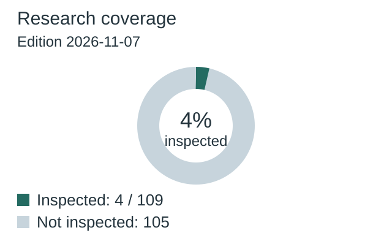
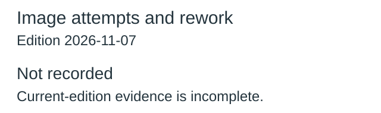
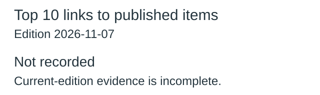
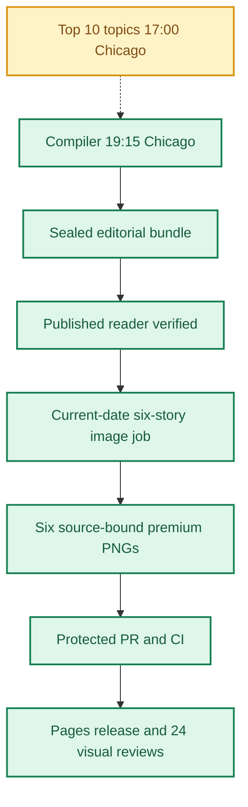
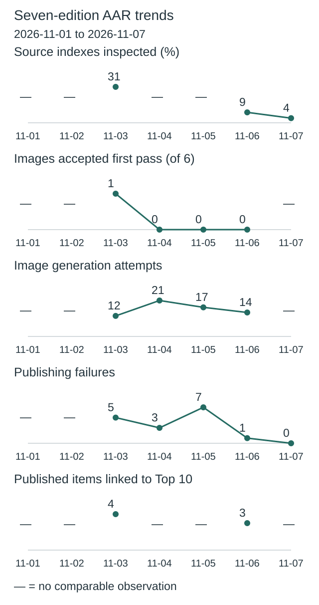
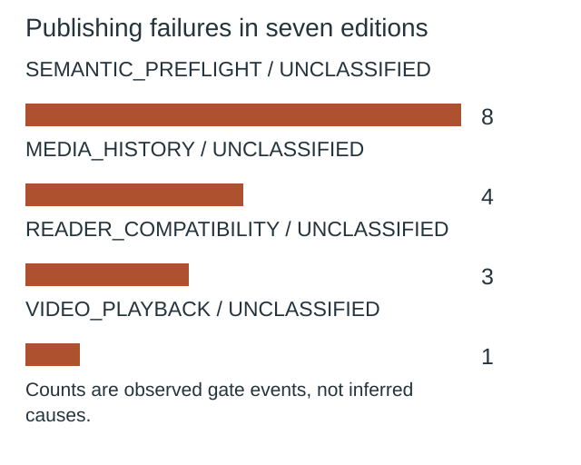
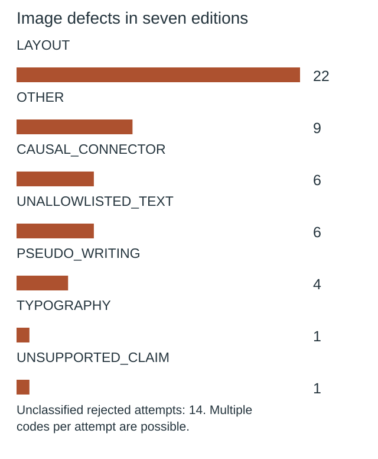

**🟩 RELEASE COMPLETE**
**TOP 10 PARTIAL** · **🟩 COMPILER VERIFIED** · **🟦 IMAGES 6/6 RELEASED** · **🟪 VISUAL QA 24/24 PASS**

# Daily AI Brief — Unified Production After-Action Report
**Edition:** November 7, 2026 · **Production evening:** 2026-11-06 · **Timezone:** America/Chicago
**Primary public reader:** [Open 2026-11-07 Brief](https://gttome.github.io/Daily-AI-Brief-Compiler/briefs/2026-11-07/) · **Repository:** [Daily-AI-Brief-Compiler](https://github.com/gttome/Daily-AI-Brief-Compiler)

> **IMPORTANT — VERIFIED PRODUCTION RESULT**
> **Executive release result: COMPLETE.** This is the single management-facing report covering Top 10 topic discovery, the editorial Compiler, published Brief and premium-image run. **Entire-system evidence: PARTIAL.** Top 10 report: **provisional**; Compiler handoff: **RECEIVED_SNAPSHOT_BOUND**; guided searches: **NOT_OBSERVED**. Compiler public status: **VERIFIED**. Image release: **RELEASED_VERIFIED**. Direct 24-context visual quality: **24/24 PASS**. Autonomous completion: **FAIL_OWNER_RECOVERY**. Missing evidence must not be promoted to a success claim.

**🕒 Production stage durations:** **Top 10 5m 22s** · **Compiler final seal window 5m 51s** · **Premium Images 25m 59s** (evidence-bounded elapsed times; the start/end events differ).

## Evidence reconciliation

Compiler final seal window: 5m 51s. Compiler state start to public verification: 787m 00s. Observed execution and final seal windows are distinct.
Image capability route preflight: RECORDED; scheduler origin remains UNPROVEN.
Image efficiency: 2/6 first-pass accepts; 11 total attempts. November 3–5 target: at least 3/6 first-pass and at most 2 attempts per image, with unchanged quality floor.
Image review completed: 2026-11-07T15:06:24Z; review-record commit: 2026-11-07T15:08:03.000Z; protected review merge: 2026-11-07T15:09:36.000Z.
Eligible source indexes: 109; editorial inspections reported: 4 (3.7%); inaccessible in editorial audit: 0; explicitly unreviewed IDs: 105; unclassified editorial IDs: 0. Automated index parsing is separate from editorial inspection and cannot substantiate exhaustive freshness claims.

Registered video sources: 29; attempted this edition: 29; unattempted: 0; enabled: 28; qualification-only: 1; sources yielding candidate URLs: 9. Status: REPORTED_ALL_ATTEMPTED. Attempt evidence is not automatic proof of source-content review or playback.

## Daily AAR charts

These charts use this edition’s receipts. Missing data is not zero.

### Research coverage



**4 of 109 indexes inspected (4%).**

| Editorial inspection | Indexes |
|---|---:|
| Inspected | 4 |
| Not inspected | 105 |

Not inspected includes every index without a recorded editorial inspection; this is not proof of missed stories.

### Image attempts and rework



**11 attempts; 2 of 6 images accepted on their first attempt.**

| Image | Accepted | Rejected | Total attempts |
|---|---:|---:|---:|
| BioBasicsBench tests agents on raw wet-lab protocols | 1 | 0 | 1 |
| METR estimates Anthropic benchmark scores advanced 1.9 times faster | 1 | 2 | 3 |
| Cursor agents can scaffold and publish live applications | 1 | 0 | 1 |
| Australian universities redesign assessment for AI-native graduates | 1 | 1 | 2 |
| Airbnb plans a visual travel agent for 2027 | 1 | 1 | 2 |
| Claude’s finance beta supports a read-only verification Skill | 1 | 1 | 2 |

Generation attempts measure rework, not runtime or cost. Quality and publication checks remain separate.

### Top 10 links to published items



**Not recorded:** current-edition evidence is missing or inconsistent.

No selection quota. Topic linkage does not establish better quality, popularity or causal improvement.

[Chart data](charts.json)

One edition at a time. Missing evidence is not zero. Trend claims require comparable recorded cycles.

## Performance dashboard

| Measure | Recorded result | Source / caveat |
|:--|:--:|:--|
| Entire-system evidence | **PARTIAL** | Full Top 10 list, bound Compiler input, all-format search receipts and existing release checks; separate from publication and autonomy |
| Top 10 report | **provisional · 10 topics** | Same Chicago cycle report; provisional/partial coverage remains disclosed |
| Top 10 received by Compiler | **RECEIVED_SNAPSHOT_BOUND** | Exact report snapshot bytes; consumed commit separately corroborated: YES |
| Top 10 guided article/video/podcast searches | **NOT_OBSERVED** | Actual source-search receipts and selected/rejected topic outcomes |
| Top 10 stage duration | **5m 22s** | Same-cycle run receipt only; no runtime or usage estimate |
| Editorial publication | **PASS** | State and public reader integrity receipt |
| **Unattended autonomy (separate from publication)** | **FAIL_OWNER_RECOVERY** | Owner incident receipt takes precedence over unverified producer self-attestation |
| Recorded protected publishing gate failures | **0** | Actual same-edition GitHub failure sidecar only; earlier unrecorded failures remain unknown |
| Articles | **6** | Exactly 2 technical / 2 knowledge-worker / 2 agents required |
| Verified original sources within preceding 24 hours | **0 / 6** | Original publisher dates only; other sources require a documented fallback rationale |
| Distinct selected article publishers | **5** | Six different primary organizations preferred |
| Videos over seven days old | **0** | Must be labeled evergreen, not a new development |
| Distinct selected video publishers | **2** | One channel is one publisher even across multiple videos |
| Video discovery source attempts | **29 / 29** | Attempt evidence across enabled and qualification-only leads; REPORTED_ALL_ATTEMPTED. Not a claim of full content review or player verification | 
| Duplicate active Watchlist display titles | **Not recorded** | Published canonical Watchlist only; historical evidence retained |
| Original-release video playback (historical) | **TWO_PUBLISHED_VIDEOS_PLAYBACK_PASS** | Later reader corrections may replace these originally verified videos; see incident register | 
| Postpublication reader incidents | **NOT_RECORDED** | Edition-specific owner reports and corrective PRs, not inferred absence | 
| Verified postpublication video corrections | **NOT_RECORDED** | Incident register tracks correction PR, actual playback evidence and reader preservation |
| Editorial index second-pass attempts | **0** | Bounded public GET retries only; never proof of original article reading |
| Editorial index reads recovered | **0** | Successful page fetch can still yield zero eligible dated items |
| Recorded scheduler capability route | **UNPROVEN** | Same-invocation route receipt only; GitHub is not scheduler authentication |
| Avoidable incomplete-staging CI failures | **Not independently audited** | Existing image-package push CI is disabled; exact-head protected PR CI remains required. A failure count requires actual workflow evidence |
| Media | **2 videos + 2 podcasts** | Sealed bundle |
| **Compiler final seal window** | **5m 51s (5.8 min)** | Final sealed-state timestamp → verified public reader; initial execution is separate |
| **Image processing stage duration** | **25m 59s** | First accepted PNG Git checkpoint → final 24/24 review; auditable stage elapsed time |
| Image scheduled-to-final-review window | **Not independently recorded** | Only with a saved one-cycle schedule anchor; does not attest exact generation start |
| Executor-observed generation-to-final-review | **28m 36s** | Only if the worker recorded a same-execution clock before its first native call; not independently verified provider runtime |
| Accepted premium PNGs | **6 / 6** | Exact package and public release hashes |
| Native image generation attempts | **11** | Image worker AAR; no estimation |
| Rejected candidates | **5** | Image worker AAR |
| Final worker checkpoint reconciliation | **PASS** | Oct25+ verifies exact generation count, per-story attempts, six accepted story/image/hash bindings and final release |
| Saved visual contexts | **24 / 24 PASS** | Dated/permanent desktop/mobile review |
| Public SHA-256 checks | **44** | Image release receipt |
| October 8 immutable history | **17 / 17** | Independent content-preservation checks |
| **Owner-reported weekly Work usage for this run** | **Not reported** | No per-cycle usage supplied |

> **EFFICIENCY NOTE**
> **Resource reporting policy:** No usage figure was supplied for this cycle, so none is assumed. Future runs show **Not reported** unless the owner supplies new cycle-specific usage metadata. No approval or extra step is required to generate the AAR.

## Production architecture and checkpoints



## Daily AI Topic Top 10 and Compiler handoff

**Research cycle:** 2026-11-06 · **Target Brief:** 2026-11-07 · **Scheduled start:** 17:00 America/Chicago

| Dimension | Recorded evidence |
|---|---|
| Run/report result | PARTIAL |
| Report status / topics | provisional / 10 |
| Freshness | FRESH\_AT\_CONSUMPTION |
| Compiler handoff | RECEIVED\_SNAPSHOT\_BOUND |
| Search coverage | NOT\_OBSERVED |
| Selection mapping verification | NONE\_RECORDED |
| Observed start / finish | 2026-11-06T22:56:02Z / 2026-11-06T23:01:24Z |
| Elapsed minutes | 5.37 |
| Usage percent | Not reported |
| Cost USD | Not reported |
| Independent scheduler autonomy | UNPROVEN |
| Compiler-recorded consumed commit | b42c9ac06ba959678d440e1491ce22af163e516e |
| Report SHA-256 | f49f95eecdbf618d0feaf1a627d9f203ae893c9d0b0fc1fffba5b8ca9339428f |

| Discovery order | AI topic | Summary | Confidence | Evidence |
|---:|---|---|---|---|
| 1 | Spare-phone inference demo gains another 66K reported views | A creator demonstrates using spare mobile devices for local AI. | low | [Source](https://www.youtube.com/watch?v=reOeczuEzOA) |
| 2 | Social deduction game tests model coordination | A November 5 Dwarkesh Patel video discusses a model experiment using Blood on the Clock Tower. | low | [Source](https://www.youtube.com/watch?v=1NQwfImTseU) · [Source](https://readtube.co/videos/which-ai-is-the-best-liar-1NQwfImTseU) |
| 3 | AREX-2 explainer revisits iterative problem solving | A new explainer discusses a model trained to improve proposed solutions over multiple test-time attempts. | medium | [Source](https://www.youtube.com/watch?v=C9HS3zMrGo0) · [Source](https://arxiv.org/abs/2609.38288) |
| 4 | IBM revisits vector database choices for RAG | IBM Technology’s explainer asks when vector databases still help retrieval and agent search. | low | [Source](https://www.youtube.com/watch?v=rXFV1ivDe6c) · [Source](https://www.ibm.com/think/topics/rag-vector-database) |
| 5 | George Colony discusses AI spending during a selloff | A Bloomberg Television interview presents Colony’s view that AI investment will continue. | low | [Source](https://www.youtube.com/watch?v=-604wcjbg6Y) · [Source](https://www.voicetube.com/videos/223804) |
| 6 | Kindi’s 33B demo continues to draw attention | The maintainer documents a quantized 33B setup on a K6000 with host memory and CPU offload. | medium | [Source](https://www.youtube.com/watch?v=RLXjscqnp6A) · [Source](https://github.com/ahtx/kindi) |
| 7 | Airbnb outlines a visual trip-planning agent | Airbnb plans a guest rollout for an agent that assembles maps, photos and trip comparisons. | medium | [Source](https://superpowerdaily.com/videos/10611b19-4339-443e-abbb-9301a62c95e9) · [Source](https://news.airbnb.com/airbnb-q3-2026-financial-results) |
| 8 | Claude launches a read-only personal finance beta | The U.S. beta connects chosen accounts for questions about transactions and balances. | medium | [Source](https://x.com/claudeai/status/2118403114890137895) · [Source](https://claude.com/resources/articles/introducing-personal-finance-in-claude) |
| 9 | Cursor adds hosted app publishing | Cursor describes building and sharing apps through a publish flow with security checks. | medium | [Source](https://x.com/cursor_ai/status/2118458629091426304) · [Source](https://cursor.com/changelog/build-live-apps) · [Source](https://superpowerdaily.com/videos/10611b19-4339-443e-abbb-9301a62c95e9) |
| 10 | METR assesses Anthropic’s pace of AI R&D | METR estimates faster progress on a specific benchmark index and tests how sensitive that estimate is to its assumptions. | medium | [Source](https://x.com/METR_Evals/status/2118412183860351084) · [Source](https://metr.org/blog/2026-11-05-anthropic-ai-rd-acceleration-assessment/) |

**Sample scope:** {"metadata\_screened\_videos":11,"distinct\_retained\_channels":11,"total\_video\_observations":11,"unique\_videos":11,"full\_video\_reviews":0,"transcript\_reviews":1,"partial\_transcript\_reviews":1,"direct\_youtube\_counter\_verifications":0,"within\_24h\_reported\_publications":4,"additional\_within\_72h\_reported\_publications":7,"validation\_resources\_registered":14,"target\_40\_to\_80\_full\_reviews\_met":false,"tracker\_counter\_records":10,"original\_watch\_attempts":11,"scope":"Bounded third-party tracker sample plus original episode narration and selected direct primary documents."}. **Ranking basis:** {"method":"Use event-matched video coverage and repeated same-source measurements first. Add directly documented events with dated public discussion signals. All topics remain in the limited attention band.","limitations":\["No cross-platform totals or exact popularity ranks.","Mixed-topic roundup counts remain attached to the programs."\]}.

| Search format | Receipt rows | Attempts recorded | Explicitly not attempted |
|---|---:|---:|---:|
| article | 0 | 0 | 0 |
| video | 0 | 0 | 0 |
| podcast | 0 | 0 | 0 |

**Selected Brief items linked to trends:**

No validated selection-to-topic mapping was recorded.

**Gaps and limitations:**

- No per-topic article/video/podcast search receipt was observed.
- The report labels its ranking provisional.
- Ten original watch requests throttled and one returned a title-only extract. Full video review aim unmet.
- One complete displayed publisher transcript and one indexed caption excerpt. Derived chapter summaries do not count as transcripts.
- Comments, channel subscriber counts and sponsorship disclosures were unavailable.
- Tracker counters are dated third-party values with display rounding. Direct X retrieval returned 403.
- Compiler use, selection, production impact, usage and cost are unverified for this run.

**Recorded run issues:**

- {"issue":"Ten watch pages throttled and one title-only page retrieved.","effect":"No direct counters or full video review.","correction":"Retained dated tracker provenance, one complete displayed publisher transcript and one indexed caption excerpt."}
- {"issue":"Direct X retrieval denied.","effect":"Three announcement counts come from the tracker.","correction":"Kept original post IDs, distinct measurement clock and rounded precision."}
- {"issue":"Coverage headlines could imply current availability or new release dates.","effect":"Airbnb and AREX-2 could be misclassified.","correction":"Checked the earnings release and preprint. Recorded future rollout target and older research date."}
- {"issue":"A market interview caption excerpt was indexed but inaccessible in direct page text.","effect":"Depth is limited to the excerpt and retrieved metadata.","correction":"Explicitly labeled derivative provenance and deferred use as a complete transcript."}

**Recorded improvements:**

- {"change":"Cross-check date and scope against original releases or research.","reason":"Fresh commentary can make an older paper or future product look newly shipped.","expected\_effect":"AREX-2 is classified as new discussion of a September paper and Airbnb as a future rollout.","status":"implemented\_during\_research"}
- {"change":"Review original publisher narration and test derivative caption resources for depth.","reason":"Prior run had one full displayed transcript but no playback or first-party counters.","expected\_effect":"Retain substantive source depth and describe unsupported technical or performance claims as unresolved.","status":"implemented\_during\_research"}
- {"change":"Try another original publisher transcript for a high-attention creator video and verify the attribution before admitting full-program counters.","status":"proposed"}

### Daily improvement and effect on the Brief

**Fixed baseline:** nov03-2026-v1 / INPUT\_FROZEN. **Outcome baseline:** FROZEN\_AFTER\_VERIFIED\_PUBLICATION. **Prior cycle:** 2026-11-05.

| Input measure | Current | November 3 baseline | Change from baseline | Change from prior cycle |
|---|---:|---:|---:|---:|
| topic count | 10 | 10 | 0 | 0 |
| validation resource count | Not reported | 14 | Not reported | Not reported |
| additional video metadata records | Not reported | 63 | Not reported | Not reported |
| additional video channels | Not reported | 21 | Not reported | Not reported |
| total video observations | Not reported | 79 | Not reported | Not reported |
| unique videos | Not reported | 71 | Not reported | Not reported |
| full video reviews | Not reported | 0 | Not reported | Not reported |
| direct youtube counter verifications | Not reported | 0 | Not reported | Not reported |
| broader evidence band topics | 0 | 3 | -3 | 0 |
| limited evidence band topics | 10 | 7 | 3 | 0 |

**Observed downstream measurements:** PENDING\_OR\_INCOMPLETE.

| Outcome measure | Current | Change from frozen outcome | Change from prior cycle |
|---|---:|---:|---:|
| expected topic format pairs | 30 | 0 | 0 |
| attempted topic format pairs | Not reported | Not reported | Not reported |
| explicitly unattempted pairs | Not reported | Not reported | Not reported |
| discovered candidate count | Not reported | Not reported | Not reported |
| searched source host count | Not reported | Not reported | Not reported |
| selected article count | Not reported | Not reported | Not reported |
| selected video count | Not reported | Not reported | Not reported |
| selected podcast count | Not reported | Not reported | Not reported |

**Source changes:** {"added":\[\],"removed":\[\]}.

**Candidate review depth:** NOT\_RECORDED.

| Review measure | Current | Change from prior comparable cycle |
|---|---:|---:|
| reviewed candidate count | Not reported | Not reported |
| qualified candidate count | Not reported | Not reported |
| rejected candidate count | Not reported | Not reported |
| metadata only count | Not reported | Not reported |
| full video reviews | Not reported | Not reported |
| transcript reviews | Not reported | Not reported |

The frozen November 3 baseline has no candidate-level review ledger; no retrospective value is invented. Recorded reviews do not independently establish content quality, audience interest or causal benefit.

**Method/resource review:** {"baseline\_id":"nov03-2026-v1","previous\_report\_date":"2026-11-05","method\_version":"2026-11-03.2-event-review","changes":\[{"change":"Cross-check date and scope against original releases or research.","reason":"Fresh commentary can make an older paper or future product look newly shipped.","expected\_effect":"AREX-2 is classified as new discussion of a September paper and Airbnb as a future rollout."},{"change":"Review original publisher narration and test derivative caption resources for depth.","reason":"Prior run had one full displayed transcript but no playback or first-party counters.","expected\_effect":"Retain substantive source depth and describe unsupported technical or performance claims as unresolved."}\],"feedback":{"aar\_url":"https://github.com/gttome/Daily-AI-Brief-Compiler/blob/07bfe75dcace228a0ea620a88bad328c68e2381f/daily/2026-11-05/combined.md","charts\_url":"https://github.com/gttome/Daily-AI-Brief-Compiler/blob/07bfe75dcace228a0ea620a88bad328c68e2381f/daily/2026-11-05/charts.json","metrics\_url":"https://github.com/gttome/Daily-AI-Brief-Compiler/blob/07bfe75dcace228a0ea620a88bad328c68e2381f/daily/2026-11-05/improvement-metrics.json","original\_search\_receipt":"https://github.com/gttome/Daily-AI-Brief-Compiler/blob/shadow/2026-11-06/shadow-runs/2026-11-06/editorial/trend-search-coverage.json","original\_search\_receipt\_blob":"3e156a08ce0324913813db39ae8ca850c3430d26","observed":{"edition\_date":"2026-11-06","unified\_result":"PARTIAL","handoff":"RECEIVED\_SNAPSHOT\_BOUND","search\_status":"RECEIPTS\_OBSERVED","attempted\_pairs":30,"selection\_mapping\_status":"MATCHES\_EDITION\_BUNDLE","linked\_items":3,"inspected\_source\_indexes":8,"eligible\_source\_indexes":87,"image\_attempts":14,"first\_pass\_images":0,"recorded\_failed\_gates":1,"publisher\_family\_reviews":2},"interpretation":"Observed prior association only. The prior corrective-action findings concern protected gate diagnosis and scheduler origin under Compiler or Recovery ownership. No Top 10 transfer defect was recorded. The new Compiler video-source sweep is a separate obligation."},"resource\_candidates":\[{"url":"https://readtube.co/videos/which-ai-is-the-best-liar-1NQwfImTseU","role":"candidate transcript aid","access":"direct","review\_scope":"Timestamped generated chapter summaries and experiment description.","independence":"Derivative of the same Dwarkesh program.","decision":"accepted","reason":"Identifies the specific game and scope of discussion. Does not count as a transcript or independent benchmark validation.","contribution":"Changed the discovery lead from general lying to a named social deduction experiment."},{"url":"https://www.voicetube.com/videos/223804","role":"candidate caption mirror","access":"direct metadata and indexed excerpt","review\_scope":"Program identity and indexed interviewer question. Direct passage lookup failed.","independence":"Derivative of the same Bloomberg interview.","decision":"deferred","reason":"Full interview text was not exposed in this access path.","contribution":"Limited context only. No additional attention family or confirmed transcript."}\],"observed\_effects":\[{"observation":"AREX-2 preprint is dated September 29.","effect":"Removed implied November model launch."},{"observation":"Airbnb’s earnings release gives a first-half 2027 target.","effect":"Separated announcement and November coverage from planned rollout."},{"observation":"METR’s alternate fit yields a materially different estimate.","effect":"Scoped the 1.9× figure to its index and model assumptions."},{"observation":"One complete displayed transcript reviewed, the same count as the prior run.","effect":"Substantive coverage preserved for one program. No improvement in playback or direct counters."}\],"next\_improvement":"Try another original publisher transcript for a high-attention creator video and verify the attribution before admitting full-program counters.","limitations":\["No causal production improvement inferred from prior association or current research checks."\],"change\_evaluations":\[\],"pending\_change\_evaluations":\["NOV03-04","AAR-02","AAR-03","AAR-10"\],"review\_due\_edition":"2026-11-11"}.

**Current reconciled conclusion:** PENDING\_OR\_INCOMPLETE; outcome baseline FROZEN\_AFTER\_VERIFIED\_PUBLICATION; candidate review ledger NOT\_RECORDED.

**Historical producer observations (not current status):** The following snapshot preserves what the producer reported at the time. Its pending statuses and candidate-quality claims are not independently reconciled conclusions. Use the current tables above for publication-bound measurements; an absent candidate review ledger remains unknown.

<details><summary>Original producer effects and gaps — historical snapshot</summary>

```json
null
```

</details>

**Next improvement:** Try another original publisher transcript for a high-attention creator video and verify the attribution before admitting full-program counters.

Counts show coverage and observed association, not audience popularity, source independence, candidate quality or causal uplift. Compare source/method changes before interpreting deltas. Unknown values are not zero. Publication, reader corrections, runtime and image outcomes retain their separate AAR evidence.

Report, source-readback and search receipts are separate observations. Snapshot binding verifies the collected report bytes; the consumed commit is independently corroborated only when the separately fetched source bytes match. These records do not independently attest scheduler identity or source truth. Top 10 reporting does not change Brief/image release status.


## Track 1 — Compiler

**State:** `SHADOW_VERIFIED` · **Bundle:** `BUNDLE_READY` · **Compiler final seal window:** 5m 51s (5.8 min).

| Publication gate | Result |
|---|:---:|
| Canonical reader build | ✅ |
| Reader parity | ✅ |
| Public verification of dated edition | ✅ |
| Previous editions preserved | ✅ |
| Permanent story routes and feeds | ✅ |

**Selected coverage:**

| Lane | Story |
|---|---|
| Technical AI Engineering | BioBasicsBench tests agents on raw wet-lab protocols |
| Technical AI Engineering | METR estimates Anthropic benchmark scores advanced 1.9 times faster |
| Applied Generative AI for Knowledge Workers | Cursor agents can scaffold and publish live applications |
| Applied Generative AI for Knowledge Workers | Australian universities redesign assessment for AI-native graduates |
| Agents for Everyone | Airbnb plans a visual travel agent for 2027 |
| Agents for Everyone | Claude’s finance beta supports a read-only verification Skill |

## Track 2 — Premium images

**Public status:** `RELEASED_VERIFIED` · **Saved images:** 6/6 · **Actual generation attempts:** 11 · **Rejected candidates:** 5.

### Image production duration — Git-verified milestones

**Auditable image stage duration:** **25m 59s** (first accepted binary saved in Git → first persisted 24-context quality-review record). **First asset to public image release:** **17m 34s**.
**Scheduled-to-final-review window:** **Not independently recorded**. This is a scheduled-clock comparison only when a separately recorded exact-date schedule exists; it is **not** measured native image-generation runtime.

| Production milestone | Chicago local time | Evidence |
|---|---|---|
| Scheduled image start (if exact-date record exists) | Not independently recorded | Time planned, not actual execution start |
| First executor-observed start | 8:35:47 AM | Worker self-attestation, not a first-party scheduler event |
| First native generation observation | 8:39:27 AM | Worker clock recorded immediately before first native call, not model-provider telemetry |
| First accepted PNG bytes saved to Git | 8:42:04 AM | Immutable binary-stage commit |
| Six-image package / reviews committed | 8:55:48 AM | Exact-head PR source commit |
| Protected package merged | 8:58:40 AM | Merge SHA and required CI |
| Public images verified | 8:59:38 AM | Image-release receipt |
| 24/24 review record committed | 9:08:03 AM | Immutable first review-approval commit |

> **Duration interpretation:** The audited stage excludes unobservable pre-checkpoint creative work. The scheduled-start window includes it but must not be interpreted as precise active processing time. Missing timestamps appear as **Not independently recorded**, never an estimate.


| Source-bound image | Attempts | File size | Public page |
|---|---:|---:|---|
| BioBasicsBench tests agents on raw wet-lab protocols | 1 | 0.67 MiB | [View original](https://gttome.github.io/Daily-AI-Brief-Compiler/briefs/images/2026-11-07/dab-edition-2026-11-07-m01.png) |
| METR estimates Anthropic benchmark scores advanced 1.9 times faster | 3 | 0.62 MiB | [View original](https://gttome.github.io/Daily-AI-Brief-Compiler/briefs/images/2026-11-07/dab-edition-2026-11-07-m02.png) |
| Cursor agents can scaffold and publish live applications | 1 | 0.65 MiB | [View original](https://gttome.github.io/Daily-AI-Brief-Compiler/briefs/images/2026-11-07/dab-edition-2026-11-07-m10.png) |
| Australian universities redesign assessment for AI-native graduates | 2 | 0.65 MiB | [View original](https://gttome.github.io/Daily-AI-Brief-Compiler/briefs/images/2026-11-07/dab-edition-2026-11-07-m11.png) |
| Airbnb plans a visual travel agent for 2027 | 2 | 0.83 MiB | [View original](https://gttome.github.io/Daily-AI-Brief-Compiler/briefs/images/2026-11-07/dab-edition-2026-11-07-m12.png) |
| Claude’s finance beta supports a read-only verification Skill | 2 | 0.64 MiB | [View original](https://gttome.github.io/Daily-AI-Brief-Compiler/briefs/images/2026-11-07/dab-edition-2026-11-07-m14.png) |

**Immutable-release and visual gates:**

| Release gate | Result |
|---|:---:|
| Protected public image receipt | ✅ |
| Accepted-image Git hash bindings | ✅ |
| Six live PNGs | 6/6 |
| Dated/permanent story placements | 12/12 recorded in release evidence |
| Desktop/mobile visual inspection | 24/24 PASS |
| Historical Oct 8 integrity | 17/17 |

### Published premium illustrations

<table>
<tr><td width="50%"><a href="https://gttome.github.io/Daily-AI-Brief-Compiler/briefs/images/2026-11-07/dab-edition-2026-11-07-m01.png"></a><br/><b>BioBasicsBench tests agents on raw wet-lab protocols</b></td><td width="50%"><a href="https://gttome.github.io/Daily-AI-Brief-Compiler/briefs/images/2026-11-07/dab-edition-2026-11-07-m02.png"></a><br/><b>METR estimates Anthropic benchmark scores advanced 1.9 times faster</b></td></tr>
<tr><td width="50%"><a href="https://gttome.github.io/Daily-AI-Brief-Compiler/briefs/images/2026-11-07/dab-edition-2026-11-07-m10.png"></a><br/><b>Cursor agents can scaffold and publish live applications</b></td><td width="50%"><a href="https://gttome.github.io/Daily-AI-Brief-Compiler/briefs/images/2026-11-07/dab-edition-2026-11-07-m11.png"></a><br/><b>Australian universities redesign assessment for AI-native graduates</b></td></tr>
<tr><td width="50%"><a href="https://gttome.github.io/Daily-AI-Brief-Compiler/briefs/images/2026-11-07/dab-edition-2026-11-07-m12.png"></a><br/><b>Airbnb plans a visual travel agent for 2027</b></td><td width="50%"><a href="https://gttome.github.io/Daily-AI-Brief-Compiler/briefs/images/2026-11-07/dab-edition-2026-11-07-m14.png"></a><br/><b>Claude’s finance beta supports a read-only verification Skill</b></td></tr>
</table>

## Incidents, corrections and learning

### Postpublication reader incidents (updated when new evidence is merged)

No current-edition postpublication incident register was available; this is **NOT_RECORDED**, not a certification of zero incidents.


**Editor recovery classification:** FAIL_OWNER_RECOVERY. **Owner intervention:** Documented and required. **Protected same-edition failures recorded:** 0. 
**Latest failed protected stage:** Not in same-edition receipts; [Action evidence](https://github.com/gttome/Daily-AI-Brief-Compiler/actions). Exact stage durations are available only where real source timestamps exist.

| Stage | Verified issue | Corrective action |
|---|---|---|
| Native saved-pixel inspection | The map arrow crosses the calendar and misses the itinerary port. Simulated text strokes and an airplane imply unsupported interface details or airfare booking. | Moved the arrow under the calendar, removed simulated text and used lodging imagery in place of the airplane. |
| Native saved-pixel inspection | Rows of simulated text appeared on both ledgers. The category output arrow headed toward the mismatch label rather than the bank statement check. | Replaced simulated writing with color tokens and attached the arrow to the bank-statement object. |
| Native saved-pixel inspection | The left and right category branches gained arrowheads beyond the frozen plan. Repeated exam forms contained simulated writing bars and ruled lines. | Removed the unplanned arrowheads and replaced simulated writing with distinct assessment objects. |
| Native saved-pixel inspection | Three earlier tiles and four later tiles could imply a measured numerical ratio the illustration does not report. | Replaced countable tiles with unnumbered strips so the illustration does not imply a measured ratio. |
| Native saved-pixel inspection | The arrow originates from the earlier pace strip only, rather than the combined earlier/later benchmark comparison. | Moved the arrow to the shared comparison boundary so both bands inform the attribution review. |

> **OPERATIONAL NOTE**
> This report distinguishes a published and verified production outcome from scheduler metadata exposed to another conversation. Lack of a live host heartbeat in a separate normal chat is not a Compiler production failure.

## Usage and cost stewardship

| Item | Per-cycle value |
|---|---|
| **Weekly Work usage reported by owner** | **Not reported** |
| Internal weekly usage reference | Target under 5% |
| Genuine image-generation attempts | 11 |
| Accepted diagrams | 6 |
| Regeneration after acceptance | 0 |
| Top 10 reported usage | Not reported |
| Top 10 reported cost | Not reported |
| Account-level billing telemetry | Not independently accessible to deterministic GitHub reporting |

**Future reporting rule:** For cycles without an optional owner-usage record, publish the complete AAR with `Not reported`; do not reuse prior percentages, guess remaining weekly credits or delay tomorrow's production.

## Next-edition operating handoff

| Control | Recurring contract |
|---|---|
| AI Topic Top 10 | Sole report task · 17:00 America/Chicago · saved dated list guides same-evening research |
| Primary Compiler | Sole existing task · 19:15 America/Chicago |
| Premium image production | Sole existing task · standard 21:15 America/Chicago |
| Exact image job selection | Newly published next-date `PUBLISHED_PENDING` only |
| AAR | Combined report generated automatically from new GitHub receipts |
| Optional Work usage | Owner-supplied per cycle, otherwise `Not reported` |

> **SCHEDULE RESTORATION NOTE**
> A temporary scheduling exception must be explicitly restored before claiming standard-time readiness. This deterministic document generator reads existing state only; it does not modify production schedules.

## Evidence register

| Evidence | Link |
|---|---|
| Compiler state | [Open receipt](https://github.com/gttome/Daily-AI-Brief-Compiler/blob/shadow/2026-11-07/shadow-runs/2026-11-07/compiler-state.json) |
| Compiler compile receipt | [Open receipt](https://github.com/gttome/Daily-AI-Brief-Compiler/blob/shadow/2026-11-07/shadow-runs/2026-11-07/compiler/compile-receipt.json) |
| Compiler public integrity | [Open receipt](https://github.com/gttome/Daily-AI-Brief-Compiler/blob/shadow/2026-11-07/shadow-runs/2026-11-07/compiler/postpublish-integrity.json) |
| Image release receipt | [Open receipt](https://github.com/gttome/Daily-AI-Brief-Compiler/blob/shadow-pages-history/site/image-jobs/2026-11-07/release.json) |
| Image review | [Open receipt](https://github.com/gttome/Daily-AI-Brief-Compiler/blob/main/external-image-packages/2026-11-07/reviews/live/semantic-pixel-review.json) |
| Original image AAR | [Open receipt](https://github.com/gttome/Daily-AI-Brief-Compiler/blob/main/external-image-packages/2026-11-07/reviews/after-action.md) |
| Observed editorial index retries | [Open receipt](https://github.com/gttome/Daily-AI-Brief-Compiler/blob/shadow/2026-11-07/shadow-runs/2026-11-07/editorial/source-item-retries.json) |
| Published player playback receipt | [Open receipt](https://github.com/gttome/Daily-AI-Brief-Compiler/blob/shadow/2026-11-07/shadow-runs/2026-11-07/compiler/postpublish-video-playback.json) |
| Top 10 ranked topic report | [Open receipt](https://github.com/gttome/Daily-AI-Brief-Compiler/blob/56273ec39454c9456917ece48dd20d0f4055553a/signals/ai-topic-top10/2026-11-06.json) |
| Top 10 run after-action receipt | [Open receipt](https://github.com/gttome/Daily-AI-Brief-Compiler/blob/56273ec39454c9456917ece48dd20d0f4055553a/signals/ai-topic-top10/2026-11-06.aar.json) |
| Compiler Top 10 input snapshot | [Open receipt](https://github.com/gttome/Daily-AI-Brief-Compiler/blob/shadow/2026-11-07/shadow-runs/2026-11-07/editorial/trend-input.json) |

**Image workflow:** [Workflow evidence](https://github.com/gttome/Daily-AI-Brief-Compiler/actions/runs/42384104653).

---

*Generated deterministically from cycle- and edition-specific GitHub records. The report combines the Top 10 discovery priorities, its Compiler handoff and searches, the published Brief, and the image run; original research, Compiler, image, hash, and review receipts remain immutable. This reporting action creates no stories, images, releases, extra AI tasks, or schedule changes.*

<!-- continuous-improvement:start -->
## Continuous improvement review

Edition **2026-11-07**. Measurements use 5/7 recorded editions in this window. Missing data stays **Not recorded**.

### Daily corrective-action review

**1 evidence-based findings**; open production blockers: 0. Cumulative evaluation checkpoint: **2026-11-11**. The daily review never waits for that date to act on a safe live problem.

| Priority | Observed issue | Existing owner / next correction | When |
|---|---|---|---|
| P1 | 5 rejected image candidates preceded the verified six-image release. | Images: Inspect saved rejection evidence and apply source-specific geometry, causal-arrow and label corrections before the next native generation. | Next genuine run |

Findings are observational and do not claim a repair was executed by the reporter.

### Approved change evaluations

| Change | Evaluate by | Outcome status | Latest decision |
|---|---|---|---|
| NOV03-01 — Earlier publication checks and precise recovery | 2026-11-11 | PENDING | Not recorded |
| NOV03-02 — Broader genuine source review | 2026-11-11 | PENDING | Not recorded |
| NOV03-03 — Source-bound image rejection lessons | 2026-11-11 | PENDING | Not recorded |
| NOV03-04 — Substantive Top 10 review evidence | 2026-11-11 | PENDING | Not recorded |
| AAR-01 — Current conclusions separated from historical claims | 2026-11-11 | PENDING | Not recorded |
| AAR-02 — Consolidated current task contracts | 2026-11-11 | PENDING | Not recorded |
| AAR-03 — Dated improvement evaluations | 2026-11-11 | PENDING | Not recorded |
| AAR-04 — Seven-edition trend charts | 2026-11-11 | PENDING | Not recorded |
| AAR-05 — Recurring publication failure causes | 2026-11-11 | PENDING | Not recorded |
| AAR-06 — Recovery interval reporting | 2026-11-11 | PENDING | Not recorded |
| AAR-07 — Source inspection history | 2026-11-11 | PENDING | Not recorded |
| AAR-08 — Rolling source contribution | 2026-11-11 | PENDING | Not recorded |
| AAR-09 — Recurring image defect categories | 2026-11-11 | PENDING | Not recorded |
| AAR-10 — Top 10 publisher-family sensitivity | 2026-11-11 | PENDING | Not recorded |

Pending: 14; overdue: 0; reviewed: 0. Implemented controls await measured results; review decisions do not disable controls.

### Seven-edition trends



| Edition | Coverage | First pass / 6 | Image attempts | Publishing failures | Top 10 links |
|---|---|---:|---:|---:|---:|
| 2026-11-01 | Not recorded | Not recorded | Not recorded | Not recorded | Not recorded |
| 2026-11-02 | Not recorded | Not recorded | Not recorded | Not recorded | Not recorded |
| 2026-11-03 | 27/87 (31%) | 1 | 12 | 5 | 4 |
| 2026-11-04 | Not recorded | 0 | 21 | 3 | Not recorded |
| 2026-11-05 | Not recorded | 0 | 17 | 7 | Not recorded |
| 2026-11-06 | 8/87 (9%) | 0 | 14 | 1 | 3 |
| 2026-11-07 | 4/109 (4%) | 2 | 11 | 0 | Not recorded |

| Measure | Recorded editions | Window median |
|---|---:|---:|
| coverage percent | 3 | 9 |
| first pass accepted | 5 | 0 |
| image attempts | 5 | 14 |
| top10 linked items | 2 | 3.5 |
| publication failures | 5 | 3 |

**Registry changed in this window; coverage percentages use different source sets.**

### Publishing failures by stage and recorded cause



| Stage | Recorded cause | Failures | Editions | Recurred | Delay median (seconds; documented samples only) |
|---|---|---:|---|---|---:|
| SEMANTIC_PREFLIGHT | UNCLASSIFIED | 8 | 2026-11-04, 2026-11-05 | Yes | Not recorded (0 samples) |
| MEDIA_HISTORY | UNCLASSIFIED | 4 | 2026-11-03, 2026-11-05 | Yes | Not recorded (0 samples) |
| READER_COMPATIBILITY | UNCLASSIFIED | 3 | 2026-11-03 | No within observed window | Not recorded (0 samples) |
| VIDEO_PLAYBACK | UNCLASSIFIED | 1 | 2026-11-06 | No within observed window | Not recorded (0 samples) |

Unclassified means the original gate is known but no structured cause review is recorded. Stage names do not establish root causes. No rows establish no failures only when the recorded receipt explicitly has none.

### Recovery intervals

| Recorded mode | Incidents | Detection seconds | Queue seconds | Repair seconds | Verification seconds | Total seconds |
|---|---:|---:|---:|---:|---:|---:|

**Not recorded:** no valid incident has all required timing and evidence references.

### Source inspection history

| Source | Last inspected edition | Editions since inspection |
|---|---|---:|
| acl-anthology | Not recorded | Not recorded |
| anthropic | Not recorded | Not recorded |
| anthropic-news | 2026-11-07 | 0 |
| article-databricks-ai-research | 2026-11-06 | 1 |
| article-ibm-research-ai | Not recorded | Not recorded |
| article-nvidia-technical-ai | Not recorded | Not recorded |
| arxiv-cs-ai | Not recorded | Not recorded |
| arxiv-cs-cl | Not recorded | Not recorded |
| arxiv-cs-lg | Not recorded | Not recorded |
| berkeley-bair | Not recorded | Not recorded |
| deep-20261026-a01-google-research | Not recorded | Not recorded |
| deep-20261026-a02-microsoft-ai | Not recorded | Not recorded |
| deep-20261026-a03-nvidia-news | Not recorded | Not recorded |
| deep-20261026-p02-data-skeptic | Not recorded | Not recorded |
| deep-20261026-v01-two-minute-papers | Not recorded | Not recorded |
| deepseek-news | Not recorded | Not recorded |
| directory-0dffb60aadd4ba31b5c090dc | Not recorded | Not recorded |
| directory-1c6f5db2559c3c226a112873 | Not recorded | Not recorded |
| directory-242c2a2fc81a43d41f199129 | 2026-11-06 | 1 |
| directory-3834a0112c0e3a754320b557 | Not recorded | Not recorded |
| directory-3ccc18a956cae0b1e24b5968 | Not recorded | Not recorded |
| directory-411bf5f837e28f35220736eb | Not recorded | Not recorded |
| directory-4852e367f74118ff2dc1eec9 | Not recorded | Not recorded |
| directory-48665d874f6008894d0d9385 | Not recorded | Not recorded |
| directory-4c16d138c4a736e78a68127e | Not recorded | Not recorded |
| directory-54d90ff964a74ff98851ae11 | Not recorded | Not recorded |
| directory-5c5d3d02a420135949164552 | Not recorded | Not recorded |
| directory-64f0886a6793aa8858a4b62d | Not recorded | Not recorded |
| directory-6ea6e283349c7b62ac1ced9d | Not recorded | Not recorded |
| directory-79e16cd5beb5c662c4022a9f | Not recorded | Not recorded |
| directory-8263ca4c9f560c8d9c4df0de | Not recorded | Not recorded |
| directory-8df3614a9972a25fc59475ed | 2026-11-07 | 0 |
| directory-8ec4fd458a38bc0447f4cded | Not recorded | Not recorded |
| directory-935fbe5ba89ff5f91fc8c69b | Not recorded | Not recorded |
| directory-970506fbc577e6091a33c64d | Not recorded | Not recorded |
| directory-9ad7c274f2d56274bcd5ddcc | Not recorded | Not recorded |
| directory-9c0885bdb370f69c9262b88c | 2026-11-07 | 0 |
| directory-9f7087ce2c030a4b9da58499 | Not recorded | Not recorded |
| directory-a74f303f4b0c39344c1314cf | 2026-11-06 | 1 |
| directory-b93e2368e85f0f95c066463e | Not recorded | Not recorded |
| directory-c6b8a33e7fa162cc41136fa5 | Not recorded | Not recorded |
| directory-d1527db7c06b4e83370b7546 | Not recorded | Not recorded |
| directory-d5428d030dfff7d4639258e3 | Not recorded | Not recorded |
| directory-d6cf3f9fa167b8173a35228b | Not recorded | Not recorded |
| directory-db682c52794328eb69ebc377 | Not recorded | Not recorded |
| directory-e2f33b502b264e51983a338a | Not recorded | Not recorded |
| directory-e7b100b6b999ac748e052327 | Not recorded | Not recorded |
| directory-ecf69ec2f036e803388f40ca | Not recorded | Not recorded |
| directory-f8085f0f6e72cfbdfde3a0f8 | Not recorded | Not recorded |
| directory-fd36049347d409f38c9f9a67 | Not recorded | Not recorded |
| github-ai-agents | Not recorded | Not recorded |
| github-generative-ai | Not recorded | Not recorded |
| github-llm | Not recorded | Not recorded |
| github-trending | Not recorded | Not recorded |
| google-deepmind-blog | Not recorded | Not recorded |
| hacker-news-newest | Not recorded | Not recorded |
| hacker-news-show | Not recorded | Not recorded |
| hugging-face-daily-papers | Not recorded | Not recorded |
| hugging-face-datasets | Not recorded | Not recorded |
| hugging-face-models | Not recorded | Not recorded |
| hugging-face-spaces | Not recorded | Not recorded |
| iclr | Not recorded | Not recorded |
| icml | Not recorded | Not recorded |
| meta-ai-blog | Not recorded | Not recorded |
| mistral-news | Not recorded | Not recorded |
| mit-csail | Not recorded | Not recorded |
| neurips | Not recorded | Not recorded |
| openai-news | 2026-11-07 | 0 |
| openreview | Not recorded | Not recorded |
| podcast-a16z-show | Not recorded | Not recorded |
| podcast-agora-briefing | Not recorded | Not recorded |
| podcast-ai-daily-brief | 2026-11-06 | 1 |
| podcast-ai-for-humans | Not recorded | Not recorded |
| podcast-ai-future-work | Not recorded | Not recorded |
| podcast-ai-inside | Not recorded | Not recorded |
| podcast-artificial-intelligence-show | Not recorded | Not recorded |
| podcast-cognitive-revolution | 2026-11-06 | 1 |
| podcast-data-exchange | Not recorded | Not recorded |
| podcast-everyday-ai | Not recorded | Not recorded |
| podcast-eye-on-ai | Not recorded | Not recorded |
| podcast-gradient-dissent | Not recorded | Not recorded |
| podcast-latent-space | Not recorded | Not recorded |
| podcast-no-priors | Not recorded | Not recorded |
| podcast-nvidia-ai | Not recorded | Not recorded |
| podcast-practical-ai | Not recorded | Not recorded |
| podcast-twiml | Not recorded | Not recorded |
| qwen-blog | Not recorded | Not recorded |
| reddit-localllama | Not recorded | Not recorded |
| reddit-machinelearning | Not recorded | Not recorded |
| research-20261026-a01 | Not recorded | Not recorded |
| research-20261026-a04 | Not recorded | Not recorded |
| research-20261026-a05 | Not recorded | Not recorded |
| research-20261026-a12 | Not recorded | Not recorded |
| research-20261026-p03 | Not recorded | Not recorded |
| research-20261026-v01 | Not recorded | Not recorded |
| research-20261026-v02 | Not recorded | Not recorded |
| research-20261026-v04 | Not recorded | Not recorded |
| research-20261026-v05 | Not recorded | Not recorded |
| research-20261026-v06 | Not recorded | Not recorded |
| research-20261026-v07 | Not recorded | Not recorded |
| specialized-discords | Not recorded | Not recorded |
| stanford-hai | Not recorded | Not recorded |
| the-batch | Not recorded | Not recorded |
| universe-20261026-every-ai-editorial | Not recorded | Not recorded |
| x-research-feeds | Not recorded | Not recorded |
| xai-news | Not recorded | Not recorded |
| youtube-anthropic | Not recorded | Not recorded |
| youtube-google-deepmind | 2026-11-06 | 1 |
| youtube-openai | Not recorded | Not recorded |

Only exact inspected source IDs and pre-selection review timestamps count. No observation means history is unavailable.

### Source contribution in this window

| Source | Substantively reviewed | Qualified | Selected | Editions with attributed reviews |
|---|---:|---:|---:|---:|

**Not recorded:** no validated substantive reviews have registry source IDs.

### Image rejection causes



| Recorded defect | Rejected attempts with defect | Recurred across editions |
|---|---:|---|
| LAYOUT | 22 | Yes |
| CAUSAL_CONNECTOR | 10 | Yes |
| OTHER | 9 | Yes |
| PSEUDO_WRITING | 7 | Yes |
| UNALLOWLISTED_TEXT | 6 | Yes |
| UNSUPPORTED_CLAIM | 3 | Yes |
| TYPOGRAPHY | 1 | No within observed window |

Total rejected: 45; unclassified: 14. A rejected attempt can have several defect codes.

### Top 10 publisher-family sensitivity

| Topic | Review status | Families | Evidence weakened after removal |
|---|---|---:|---|
| phone-cluster-demo-nov04 | NOT_RECORDED | Not recorded | Not recorded |
| clocktower-model-deception-discussion-nov05 | NOT_RECORDED | Not recorded | Not recorded |
| arex2-explainer-nov06 | NOT_RECORDED | Not recorded | Not recorded |
| ibm-vector-retrieval-discussion-nov05 | NOT_RECORDED | Not recorded | Not recorded |
| ai-investment-colony-interview-nov05 | NOT_RECORDED | Not recorded | Not recorded |
| kindi-04-demonstration-nov04 | RECORDED_EDITORIAL_ASSESSMENT | 1 | Yes |
| airbnb-visual-travel-agent-plan-nov05 | RECORDED_EDITORIAL_ASSESSMENT | 1 | Yes |
| claude-personal-finance-beta-nov05 | NOT_RECORDED | Not recorded | Not recorded |
| cursor-live-apps-nov05 | NOT_RECORDED | Not recorded | Not recorded |
| metr-anthropic-rd-assessment-nov05 | NOT_RECORDED | Not recorded | Not recorded |

Overall status: **PARTIAL**. Band changes are documented editorial assessments; source counts do not establish popularity.

[Full measurement data](improvement-metrics.json) · [Exact observation inputs](improvement-observations.json)

- Seven calendar edition dates; missing observations are gaps, never zero.
- Source counts and registry/method changes limit comparison; no causal improvement claim.
- Source contribution covers only resource-attributed substantive review records; it is not an exhaustive source ranking.
- No last inspection record means not recorded, not proof the source was never read.
- Image defects may have multiple codes per rejected attempt; category totals are not attempt totals.
- Recorded recovery mode is not first-party scheduler attestation.
- Keep/revise/retire reviews do not automatically change production controls.
<!-- continuous-improvement:end -->
