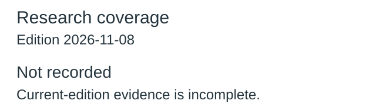
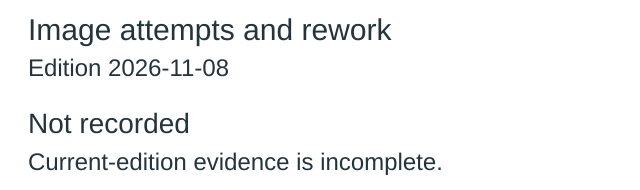
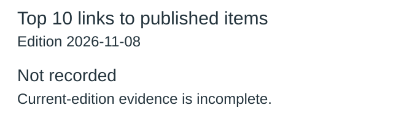
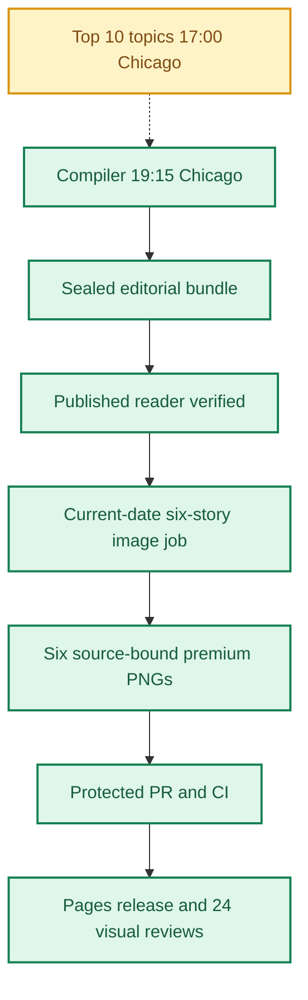
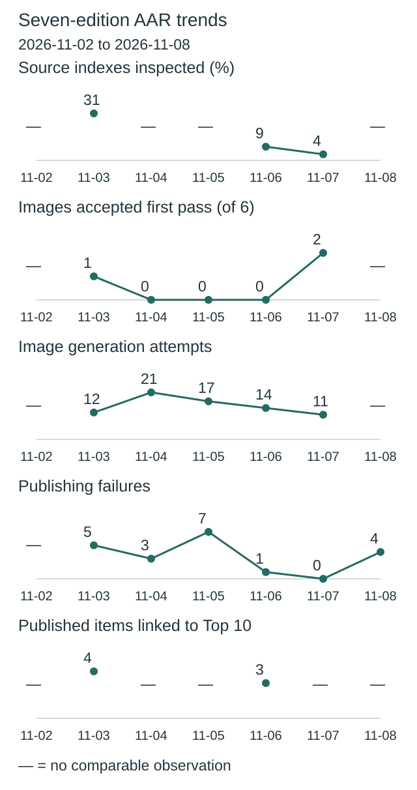
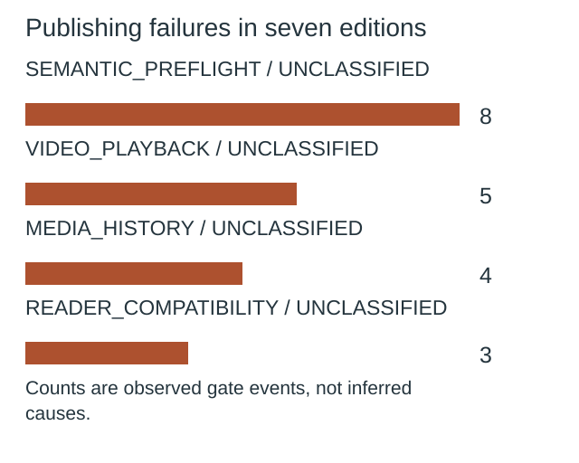
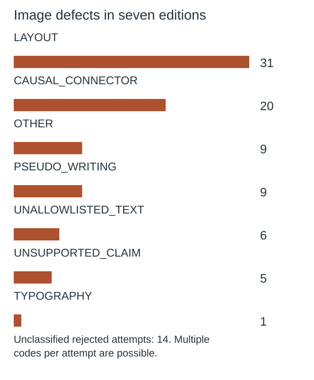

**🟩 RELEASE COMPLETE**
**TOP 10 PARTIAL** · **🟩 COMPILER VERIFIED** · **🟦 IMAGES 6/6 RELEASED** · **🟪 VISUAL QA 24/24 PASS**

# Daily AI Brief — Unified Production After-Action Report
**Edition:** November 8, 2026 · **Production evening:** 2026-11-07 · **Timezone:** America/Chicago
**Primary public reader:** [Open 2026-11-08 Brief](https://gttome.github.io/Daily-AI-Brief-Compiler/briefs/2026-11-08/) · **Repository:** [Daily-AI-Brief-Compiler](https://github.com/gttome/Daily-AI-Brief-Compiler)

> **IMPORTANT — VERIFIED PRODUCTION RESULT**
> **Executive release result: COMPLETE.** This is the single management-facing report covering Top 10 topic discovery, the editorial Compiler, published Brief and premium-image run. **Entire-system evidence: PARTIAL.** Top 10 report: **partial**; Compiler handoff: **RECEIVED_SNAPSHOT_BOUND**; guided searches: **INVALID**. Compiler public status: **VERIFIED**. Image release: **RELEASED_VERIFIED**. Direct 24-context visual quality: **24/24 PASS**. Autonomous completion: **FAIL_OWNER_RECOVERY**. Missing evidence must not be promoted to a success claim.

**🕒 Production stage durations:** **Top 10 7m 12s** · **Compiler final seal window 4m 08s** · **Premium Images 20m 06s** (evidence-bounded elapsed times; the start/end events differ).

## Evidence reconciliation

Compiler final seal window: 4m 08s. Compiler state start to public verification: 125m 02s. Observed execution and final seal windows are distinct.
Image capability route preflight: RECORDED; scheduler origin remains UNPROVEN.
Image efficiency: 0/6 first-pass accepts; 20 total attempts. Current efficiency target: at least 3/6 first-pass and at most 2 attempts per image, with unchanged quality floor.
Image review completed: 2026-11-08T04:07:28Z; review-record commit: 2026-11-08T04:09:22.000Z; protected review merge: 2026-11-08T04:11:38.000Z.
Eligible source indexes: 109; editorial inspections reported: Unknown (Unknown%); inaccessible in editorial audit: Unknown; explicitly unreviewed IDs: 105; unclassified editorial IDs: Unknown. Automated index parsing is separate from editorial inspection and cannot substantiate exhaustive freshness claims.

Registered video sources: 29; attempted this edition: 29; unattempted: 0; enabled: 28; qualification-only: 1; sources yielding candidate URLs: 0. Status: REPORTED_ALL_ATTEMPTED. Attempt evidence is not automatic proof of source-content review or playback.

## Daily AAR charts

These charts use this edition’s receipts. Missing data is not zero.

### Research coverage



**Not recorded:** current-edition evidence is missing or inconsistent.

Not inspected includes every index without a recorded editorial inspection; this is not proof of missed stories.

### Image attempts and rework



**20 attempts; 0 of 6 images accepted on their first attempt.**

Recorded ongoing from November 8 target: at least 3/6 first-pass accepts; no more than 2 attempts per image. This is an efficiency target, not a quality cutoff.

| Image | Accepted | Rejected | Total attempts |
|---|---:|---:|---:|
| Anthropic tests an offline pass for agent memory | 1 | 5 | 6 |
| Inkling 2 Small opens for hosted fine-tuning | 1 | 2 | 3 |
| Microsoft shows how acceptance criteria can become software proofs | 1 | 2 | 3 |
| Hightouch tests a second opinion for uncertain record matches | 1 | 1 | 2 |
| BMO brings transaction evidence into contact-center calls | 1 | 2 | 3 |
| Salesforce makes renewal review a reusable Agentforce Skill | 1 | 2 | 3 |

Generation attempts measure rework, not runtime or cost. Quality and publication checks remain separate.

### Top 10 links to published items



**Not recorded:** current-edition evidence is missing or inconsistent.

No selection quota. Topic linkage does not establish better quality, popularity or causal improvement.

[Chart data](charts.json)

One edition at a time. Missing evidence is not zero. Trend claims require comparable recorded cycles.

## Performance dashboard

| Measure | Recorded result | Source / caveat |
|:--|:--:|:--|
| Entire-system evidence | **PARTIAL** | Full Top 10 list, bound Compiler input, all-format search receipts and existing release checks; separate from publication and autonomy |
| Top 10 report | **partial · 10 topics** | Same Chicago cycle report; provisional/partial coverage remains disclosed |
| Top 10 received by Compiler | **RECEIVED_SNAPSHOT_BOUND** | Exact report snapshot bytes; consumed commit separately corroborated: YES |
| Top 10 guided article/video/podcast searches | **INVALID** | Actual source-search receipts and selected/rejected topic outcomes |
| Top 10 stage duration | **7m 12s** | Same-cycle run receipt only; no runtime or usage estimate |
| Editorial publication | **PASS** | State and public reader integrity receipt |
| **Unattended autonomy (separate from publication)** | **FAIL_OWNER_RECOVERY** | Owner incident receipt takes precedence over unverified producer self-attestation |
| Recorded protected publishing gate failures | **4** | Actual same-edition GitHub failure sidecar only; earlier unrecorded failures remain unknown |
| Articles | **6** | Exactly 2 technical / 2 knowledge-worker / 2 agents required |
| Original scientific-paper-led articles | **Not recorded** | Rolling target: one qualified original paper in seven editions; NOT_RECORDED. Preprints are not peer-reviewed by default |
| Verified original sources within preceding 24 hours | **0 / 6** | Original publisher dates only; other sources require a documented fallback rationale |
| Distinct selected article publishers | **6** | Six different primary organizations preferred |
| Videos over seven days old | **0** | Must be labeled evergreen, not a new development |
| Distinct selected video publishers | **2** | One channel is one publisher even across multiple videos |
| Video discovery source attempts | **29 / 29** | Attempt evidence across enabled and qualification-only leads; REPORTED_ALL_ATTEMPTED. Not a claim of full content review or player verification | 
| Duplicate active Watchlist display titles | **Not recorded** | Published canonical Watchlist only; historical evidence retained |
| Original-release video playback (historical) | **TWO_PUBLISHED_VIDEOS_PLAYBACK_PASS** | Later reader corrections may replace these originally verified videos; see incident register | 
| Postpublication reader incidents | **NOT_RECORDED** | Edition-specific owner reports and corrective PRs, not inferred absence | 
| Verified postpublication video corrections | **NOT_RECORDED** | Incident register tracks correction PR, actual playback evidence and reader preservation |
| Editorial index second-pass attempts | **0** | Bounded public GET retries only; never proof of original article reading |
| Editorial index reads recovered | **0** | Successful page fetch can still yield zero eligible dated items |
| Recorded scheduler capability route | **UNPROVEN** | Same-invocation route receipt only; GitHub is not scheduler authentication |
| Avoidable incomplete-staging CI failures | **Not independently audited** | Existing image-package push CI is disabled; exact-head protected PR CI remains required. A failure count requires actual workflow evidence |
| Media | **2 videos + 2 podcasts** | Sealed bundle |
| **Compiler final seal window** | **4m 08s (4.1 min)** | Final sealed-state timestamp → verified public reader; initial execution is separate |
| **Image processing stage duration** | **20m 06s** | First accepted PNG Git checkpoint → final 24/24 review; auditable stage elapsed time |
| Image scheduled-to-final-review window | **Not independently recorded** | Only with a saved one-cycle schedule anchor; does not attest exact generation start |
| Executor-observed generation-to-final-review | **34m 05s** | Only if the worker recorded a same-execution clock before its first native call; not independently verified provider runtime |
| Accepted premium PNGs | **6 / 6** | Exact package and public release hashes |
| Native image generation attempts | **20** | Image worker AAR; no estimation |
| Rejected candidates | **14** | Image worker AAR |
| Final worker checkpoint reconciliation | **PASS** | Oct25+ verifies exact generation count, per-story attempts, six accepted story/image/hash bindings and final release |
| Saved visual contexts | **24 / 24 PASS** | Dated/permanent desktop/mobile review |
| Public SHA-256 checks | **44** | Image release receipt |
| October 8 immutable history | **17 / 17** | Independent content-preservation checks |
| **Owner-reported weekly Work usage for this run** | **Not reported** | No per-cycle usage supplied |

> **EFFICIENCY NOTE**
> **Resource reporting policy:** No usage figure was supplied for this cycle, so none is assumed. Future runs show **Not reported** unless the owner supplies new cycle-specific usage metadata. No approval or extra step is required to generate the AAR.

## Production architecture and checkpoints



## Daily AI Topic Top 10 and Compiler handoff

**Research cycle:** 2026-11-07 · **Target Brief:** 2026-11-08 · **Scheduled start:** 17:00 America/Chicago

| Dimension | Recorded evidence |
|---|---|
| Run/report result | PARTIAL |
| Report status / topics | partial / 10 |
| Freshness | FRESH\_AT\_CONSUMPTION |
| Compiler handoff | RECEIVED\_SNAPSHOT\_BOUND |
| Search coverage | INVALID |
| Selection mapping verification | NONE\_RECORDED |
| Observed start / finish | 2026-11-07T23:02:17Z / 2026-11-07T23:09:29Z |
| Elapsed minutes | 7.2 |
| Usage percent | Not reported |
| Cost USD | Not reported |
| Independent scheduler autonomy | UNPROVEN |
| Compiler-recorded consumed commit | 3533ff33c604026a6da6ae7fc6212968e70ed1e8 |
| Report SHA-256 | 2ab8b09a10eb90072936fb9f4a88ab8b99cb751e89b79329ee85e8f615cf1335 |

| Discovery order | AI topic | Summary | Confidence | Evidence |
|---:|---|---|---|---|
| 1 | Google’s 15-second Gemini video update | Gemini Omni 1.2 Flash extends clips to 15 seconds and lets creators revise the same clip in successive turns. | medium | [Source](https://www.youtube.com/watch?v=IrAHINf0M6E) · [Source](https://news.ycombinator.com/item?id=50392118) · [Source](https://blog.google/innovation-and-ai/technology/developers-tools/introducing-gemini-omni-1-2-flash/) · [Source](https://deepmind.google/models/model-cards/gemini-omni-1-2-flash/) |
| 2 | Inkling 2 Small opens on Tinker | Thinking Machines made its multimodal model available for hosted inference and fine-tuning, with downloadable weights planned separately. | medium | [Source](https://x.com/thinkymachines/status/2118489527362912566) · [Source](https://news.ycombinator.com/item?id=50386338) · [Source](https://thinkingmachines.ai/news/inkling-2-small/) |
| 3 | AI infrastructure stocks slide after the U.S. midterms | BBC and Bloomberg covered the same selloff, including concerns about AI infrastructure spending and the outlook for continued investment. | medium | [Source](https://www.youtube.com/watch?v=DHWc0uonVbA) · [Source](https://www.youtube.com/watch?v=-604wcjbg6Y) · [Source](https://apnews.com/article/stock-market-winners-losers-defense-ai-musk-4ac9a6a3c35aeec37374fc8083bf9395) · [Source](https://www.reuters.com/world/china/tech-selloff-wipes-out-hedge-fund-gains-prompting-risk-cuts-layoffs-2026-11-06/) |
| 4 | IBM’s four choices for retrieving AI context | IBM’s explainer separates keyword search, an existing vector index and dedicated vector storage from simply putting documents in a prompt. | medium | [Source](https://www.youtube.com/watch?v=rXFV1ivDe6c) · [Source](https://ainotes.us/summary/are-vector-databases-still-needed-rag-ai-agents-search) |
| 5 | Moonshot’s Kimi K3.1 Pro weights draw deployment interest | Moonshot’s published model card documents downloadable weights for its multimodal agent model, giving teams a way to assess deployment and license terms. | medium | [Source](https://www.youtube.com/watch?v=-M62vWrZh54) · [Source](https://huggingface.co/moonshotai/Kimi-K3.1-Pro/blob/main/README.md) · [Source](https://onthewire.ai/article/moonshot-ai-launches-kimi-k3-1-pro-with-open-weights-promised-by-4-november) |
| 6 | Anthropic tests offline cleanup of agent memory | Anthropic describes a process that reviews and reorganizes an agent’s stored notes between sessions. | medium | [Source](https://x.com/AnthropicAI/status/2118814753154064501) · [Source](https://www.anthropic.com/research/components-of-agent-memory) |
| 7 | Replit’s founder explains what sits behind a coding agent | Amjad Masad tells Paul Graham how Replit combines coding agents with sandboxing and deployment infrastructure. | medium | [Source](https://www.youtube.com/watch?v=Q78dJ0vkWe8) · [Source](https://realalpha.app/v/Q78dJ0vkWe8/) |
| 8 | Lance Martin shows how to audit prompts after a model upgrade | The AI Engineer talk discusses removing dated prompting habits and measuring the results on representative tasks. | medium | [Source](https://www.youtube.com/watch?v=ys6YQ2yfBpM) · [Source](https://ainotes.us/summary/your-old-prompts-are-making-claude-worse-lance-martin-anthropic) |
| 9 | AREX-2 revisited in a new agent-design explainer | Sam Witteveen revisits BAAI’s September research on training models to check and retry work during inference. | medium | [Source](https://www.youtube.com/watch?v=C9HS3zMrGo0) · [Source](https://arxiv.org/abs/2609.38288) · [Source](https://github.com/VectorSpaceLab/AREX-2) |
| 10 | Hightouch tests when a smaller AI judge should ask for help | Hightouch reports an identity-matching experiment where a smaller model refers uncertain cases to a larger one. | medium | [Source](https://news.ycombinator.com/item?id=50397429) · [Source](https://hightouch.com/blog/llm-judges-identity-resolution) |

**Sample scope:** {"metadata\_screened\_videos":10,"distinct\_retained\_channels":10,"total\_video\_observations":10,"unique\_videos":10,"new\_metadata\_screened\_records":10,"new\_metadata\_distinct\_channels":10,"combined\_observation\_records":10,"combined\_unique\_video\_ids":10,"full\_video\_reviews":0,"videos\_watched":0,"transcript\_reviews":1,"complete\_displayed\_caption\_reviews":1,"complete\_original\_publisher\_transcript\_reviews":0,"partial\_transcript\_reviews":1,"indexed\_transcript\_excerpt\_reviews":1,"direct\_youtube\_counter\_verifications":0,"direct\_counter\_verifications":0,"original\_watch\_attempts":10,"tracker\_counter\_records":10,"comparable\_video\_observations":6,"within\_24h\_reported\_publications":1,"additional\_within\_72h\_reported\_publications":9,"additional\_within\_7d\_reported\_publications":0,"freshness\_reference\_at":"2026-11-07T23:04:31Z","target\_40\_to\_80\_full\_reviews\_met":false,"validation\_resources\_registered":14,"scope":"Bounded selected long-form YouTube metadata; public first-party documents and separate Hacker News and third-party X evidence."}. **Ranking basis:** Prioritize fresh named events with matched YouTube attention and comparable video observations, then separate audience evidence by originating publisher or community. Broader means two useful families for this bounded sample; limited means one or qualified mixed-program attention. Brief usefulness does not turn into a popularity score..

| Search format | Receipt rows | Attempts recorded | Explicitly not attempted |
|---|---:|---:|---:|
| article | 0 | 0 | 0 |
| video | 0 | 0 | 0 |
| podcast | 0 | 0 | 0 |

**Selected Brief items linked to trends:**

No validated selection-to-topic mapping was recorded.

**Raw, unverified Top 10 receipt observations:** 30 search rows across 30 topic/format pairs; 0 claimed mapping rows (0 with noncanonical fields). Noncanonical outcomes: attempted. These counts are NOT validated search attempts or verified selections.

**Gaps and limitations:**

- Per-topic article/video/podcast search coverage is incomplete, invalid or bound to a different input.
- The report labels its research partial.
- Ten named topics have evidence. Overall research is partial because no complete videos could be played, the target of 40–80 full reviews was not met, and all ten direct watch-page requests throttled.
- The sample is a free tracker’s selected long-form videos from 27 tracked channels plus its YouTube search. It has no census of the broader platform, Shorts or live formats. Ten videos from ten channels were retained.
- YouTube views and likes are third-party counters measured at 15:01 Chicago on November 7. Comments, subscriber counts and sponsorship disclosures were unavailable for all retained videos. X publisher-post counts are separately timed third-party values; Hacker News displayed counts have an unknown index refresh time.
- The six matches are program-level snapshot differences from the same tracker. Multi-topic video counts are not allocated to individual topics. Rank movement and global audience momentum are unknown.

**Recorded run issues:**

- {"issue":"All ten original YouTube watch requests throttled.","effect":"No playback, verified counters, comments, subscribers or disclosures were available.","correction":"Preserved tracker timestamp and provenance. Read a complete displayed IBM caption mirror, partial AI Engineer captions and an indexed Y Combinator transcript excerpt; kept counts separate."}
- {"issue":"Direct X access returned 403; the Gemini Hacker News item returned 429.","effect":"X metrics are third-party. Gemini discussion metrics came from the platform day index, with unknown refresh time.","correction":"Retained original URLs and separate metric sources. Verified releases using accessible publisher documentation and used distinct evidence families."}
- {"issue":"Two creator programs cover several events. Arete-27B author page and model-card reads failed.","effect":"Roundup views cannot be allocated to a named release. The Arete claim remains underqualified.","correction":"Assigned each roundup to one primary discovery event only, kept counts program-level, and held Arete in the editorial watchlist."}
- {"issue":"Initial local check used the wrong return property name for the reporter freshness field.","effect":"First harness assertion failed before any write.","correction":"Used the actual report\_freshness and report\_valid fields and reran with stop-on-error. The pre-write and committed-byte validations both passed."}

**Recorded improvements:**

- {"status":"implemented","change":"Program-matched captions and publication-specific original documentation narrowed the technical claims."}
- {"status":"implemented","change":"Recorded publisher-family removal assessments across ten topics; the prior unified metrics had two recorded."}
- {"status":"proposed","change":"Try another freely accessible original publisher transcript and a direct timed counter on event-matched non-vendor coverage."}

### Daily improvement and effect on the Brief

**Fixed baseline:** nov03-2026-v1 / INPUT\_FROZEN. **Outcome baseline:** FROZEN\_AFTER\_VERIFIED\_PUBLICATION. **Prior cycle:** 2026-11-06.

| Input measure | Current | November 3 baseline | Change from baseline | Change from prior cycle |
|---|---:|---:|---:|---:|
| topic count | 10 | 10 | 0 | 0 |
| validation resource count | 4 | 14 | -10 | Not reported |
| additional video metadata records | 10 | 63 | -53 | Not reported |
| additional video channels | 10 | 21 | -11 | Not reported |
| total video observations | 10 | 79 | -69 | Not reported |
| unique videos | 10 | 71 | -61 | Not reported |
| full video reviews | 0 | 0 | 0 | Not reported |
| direct youtube counter verifications | 0 | 0 | 0 | Not reported |
| broader evidence band topics | 3 | 3 | 0 | 3 |
| limited evidence band topics | 7 | 7 | 0 | -3 |

**Observed downstream measurements:** PENDING\_OR\_INCOMPLETE.

| Outcome measure | Current | Change from frozen outcome | Change from prior cycle |
|---|---:|---:|---:|
| expected topic format pairs | 30 | 0 | Not reported |
| attempted topic format pairs | Not reported | Not reported | Not reported |
| explicitly unattempted pairs | Not reported | Not reported | Not reported |
| discovered candidate count | Not reported | Not reported | Not reported |
| searched source host count | Not reported | Not reported | Not reported |
| selected article count | Not reported | Not reported | Not reported |
| selected video count | Not reported | Not reported | Not reported |
| selected podcast count | Not reported | Not reported | Not reported |

**Source changes:** {"added":\["hacker-news","hugging-face","github-originals","reuters"\],"removed":\[\]}.

**Candidate review depth:** NOT\_RECORDED.

| Review measure | Current | Change from prior comparable cycle |
|---|---:|---:|
| reviewed candidate count | Not reported | Not reported |
| qualified candidate count | Not reported | Not reported |
| rejected candidate count | Not reported | Not reported |
| metadata only count | Not reported | Not reported |
| full video reviews | Not reported | Not reported |
| transcript reviews | Not reported | Not reported |

The frozen November 3 baseline has no candidate-level review ledger; no retrospective value is invented. Recorded reviews do not independently establish content quality, audience interest or causal benefit.

**Method/resource review:** {"baseline\_id":"nov03-2026-v1","previous\_report\_date":"2026-11-06","previous\_method\_version":"2026-11-03.2-event-review","method\_version":"2026-11-03.2-event-review","changes":\[{"change":"Test program-specific caption mirrors and publisher text after direct watch-page failures.","reason":"Prior sample had no full playback and limited caption access.","expected\_effect":"Distinguish workload-specific advice from generalized claims and preserve deeper read evidence."},{"change":"Partition every retained event’s attention evidence by originating publisher or platform community.","reason":"Prior metrics show two family reviews with eight topics unrecorded.","expected\_effect":"Expose which evidence bands depend on a single publisher or community."}\],"resource\_candidates":\[{"url":"https://ainotes.us/summary/are-vector-databases-still-needed-rag-ai-agents-search","role":"caption mirror for claim review","access":"Public direct mirror text","review\_scope":"Read displayed captions from opening at 0:00 to closing at 9:34 for the 10:01 program, matched to original video ID.","independence":"Derived from IBM Technology’s program, no new attention family.","decision":"accepted","reason":"Reveals the four distinct choices and qualifications missing from the tracker summary.","contribution":"One complete displayed caption review; no playback or original counters."},{"url":"https://realalpha.app/v/Q78dJ0vkWe8/","role":"interview transcript candidate","access":"Search index only; direct retrieval disabled","review\_scope":"Indexed opening segment and provenance notice for machine transcription.","independence":"Derivative of the same Y Combinator program.","decision":"deferred","reason":"A complete source-text review could not be verified.","contribution":"Supports limited identity and sandbox/deployment context, not full review."}\],"observed\_effects":\[{"observation":"10 metadata records compared with 11 in prior report; six video IDs matched on format and tracker.","effect":"Supported observed changes for these six video counters only; sample composition changed."},{"observation":"One complete displayed caption mirror, one partial mirror and one indexed excerpt reviewed.","effect":"Deeper review clarified the IBM retrieval framework and narrowed the Anthropic speaker’s performance claim. Playback and direct counters remain at zero."},{"observation":"10 family-removal assessments recorded; all weaken their topic when a family is removed.","effect":"Improved completeness of sensitivity documentation in this run. Does not establish broader popularity or editorial benefit."}\],"feedback":{"aar\_url":"https://github.com/gttome/Daily-AI-Brief-Compiler/blob/340a37bbfc8a6bea0bff13655593ab619c82a4e5/daily/2026-11-06/combined.md","charts\_url":"https://github.com/gttome/Daily-AI-Brief-Compiler/blob/340a37bbfc8a6bea0bff13655593ab619c82a4e5/daily/2026-11-06/charts.json","metrics\_url":"https://github.com/gttome/Daily-AI-Brief-Compiler/blob/340a37bbfc8a6bea0bff13655593ab619c82a4e5/daily/2026-11-06/improvement-metrics.json","previous\_report\_url":"https://github.com/gttome/Daily-AI-Brief-Compiler/blob/340a37bbfc8a6bea0bff13655593ab619c82a4e5/signals/ai-topic-top10/2026-11-06.json","previous\_run\_aar\_url":"https://github.com/gttome/Daily-AI-Brief-Compiler/blob/340a37bbfc8a6bea0bff13655593ab619c82a4e5/signals/ai-topic-top10/2026-11-06.aar.json","observation":"The prior charted unified AAR records complete reader/image release, partial Top 10 outcomes and no charted selected-item linkage. Its corrective-action finding belongs to Images. The previous Top 10 evidence and sensitivity chart identified no full playback, no direct counters and only two recorded family removal reviews. Today addresses transcript access and family sensitivity within the research lane."},"next\_improvement":"Try another freely accessible original publisher transcript and a direct timed counter on event-matched non-vendor coverage.","limitations":\["The transcript routes are derivative and direct original caption/playback comparison was unavailable.","The approved cumulative effectiveness evaluation is due for the November 11 edition. No efficacy conclusion or Compiler outcome is inferred."\],"change\_evaluations":\[\],"pending\_change\_evaluations":\["NOV03-04","AAR-10"\],"review\_due\_edition":"2026-11-11"}.

**Current reconciled conclusion:** PENDING\_OR\_INCOMPLETE; outcome baseline FROZEN\_AFTER\_VERIFIED\_PUBLICATION; candidate review ledger NOT\_RECORDED.

**Historical producer observations (not current status):** The following snapshot preserves what the producer reported at the time. Its pending statuses and candidate-quality claims are not independently reconciled conclusions. Use the current tables above for publication-bound measurements; an absent candidate review ledger remains unknown.

<details><summary>Original producer effects and gaps — historical snapshot</summary>

```json
null
```

</details>

**Next improvement:** Try another freely accessible original publisher transcript and a direct timed counter on event-matched non-vendor coverage.

Counts show coverage and observed association, not audience popularity, source independence, candidate quality or causal uplift. Compare source/method changes before interpreting deltas. Unknown values are not zero. Publication, reader corrections, runtime and image outcomes retain their separate AAR evidence.

Report, source-readback and search receipts are separate observations. Snapshot binding verifies the collected report bytes; the consumed commit is independently corroborated only when the separately fetched source bytes match. These records do not independently attest scheduler identity or source truth. Top 10 reporting does not change Brief/image release status.


## Track 1 — Compiler

**State:** `SHADOW_VERIFIED` · **Bundle:** `BUNDLE_READY` · **Compiler final seal window:** 4m 08s (4.1 min).

| Publication gate | Result |
|---|:---:|
| Canonical reader build | ✅ |
| Reader parity | ✅ |
| Public verification of dated edition | ✅ |
| Previous editions preserved | ✅ |
| Permanent story routes and feeds | ✅ |

**Selected coverage:**

| Lane | Story |
|---|---|
| Technical AI Engineering | Anthropic tests an offline pass for agent memory |
| Technical AI Engineering | Inkling 2 Small opens for hosted fine-tuning |
| Applied Generative AI for Knowledge Workers | Microsoft shows how acceptance criteria can become software proofs |
| Applied Generative AI for Knowledge Workers | Hightouch tests a second opinion for uncertain record matches |
| Agents for Everyone | BMO brings transaction evidence into contact-center calls |
| Agents for Everyone | Salesforce makes renewal review a reusable Agentforce Skill |

### Scientific paper opportunity and publication evidence

**Current edition:** NOT_RECORDED; **paper-led stories:** Not recorded. Editorial target: at least one genuinely qualified original-paper-based story in seven editions, with methods, limitations, and an explicit preprint/peer-review distinction. No stale or weak paper is selected solely to fill a quota.


## Track 2 — Premium images

**Public status:** `RELEASED_VERIFIED` · **Saved images:** 6/6 · **Actual generation attempts:** 20 · **Rejected candidates:** 14.

### Image production duration — Git-verified milestones

**Auditable image stage duration:** **20m 06s** (first accepted binary saved in Git → first persisted 24-context quality-review record). **First asset to public image release:** **15m 42s**.
**Scheduled-to-final-review window:** **Not independently recorded**. This is a scheduled-clock comparison only when a separately recorded exact-date schedule exists; it is **not** measured native image-generation runtime.

| Production milestone | Chicago local time | Evidence |
|---|---|---|
| Scheduled image start (if exact-date record exists) | Not independently recorded | Time planned, not actual execution start |
| First executor-observed start | 9:13:50 PM | Worker self-attestation, not a first-party scheduler event |
| First native generation observation | 9:35:17 PM | Worker clock recorded immediately before first native call, not model-provider telemetry |
| First accepted PNG bytes saved to Git | 9:49:16 PM | Immutable binary-stage commit |
| Six-image package / reviews committed | 10:01:01 PM | Exact-head PR source commit |
| Protected package merged | 10:04:05 PM | Merge SHA and required CI |
| Public images verified | 10:04:58 PM | Image-release receipt |
| 24/24 review record committed | 10:09:22 PM | Immutable first review-approval commit |

> **Duration interpretation:** The audited stage excludes unobservable pre-checkpoint creative work. The scheduled-start window includes it but must not be interpreted as precise active processing time. Missing timestamps appear as **Not independently recorded**, never an estimate.


| Source-bound image | Attempts | File size | Public page |
|---|---:|---:|---|
| Anthropic tests an offline pass for agent memory | 6 | 0.66 MiB | [View original](https://gttome.github.io/Daily-AI-Brief-Compiler/briefs/images/2026-11-08/dab-edition-2026-11-08-m01.png) |
| Inkling 2 Small opens for hosted fine-tuning | 3 | 0.60 MiB | [View original](https://gttome.github.io/Daily-AI-Brief-Compiler/briefs/images/2026-11-08/dab-edition-2026-11-08-m02.png) |
| Microsoft shows how acceptance criteria can become software proofs | 3 | 0.60 MiB | [View original](https://gttome.github.io/Daily-AI-Brief-Compiler/briefs/images/2026-11-08/dab-edition-2026-11-08-m10.png) |
| Hightouch tests a second opinion for uncertain record matches | 2 | 0.55 MiB | [View original](https://gttome.github.io/Daily-AI-Brief-Compiler/briefs/images/2026-11-08/dab-edition-2026-11-08-m11.png) |
| BMO brings transaction evidence into contact-center calls | 3 | 0.56 MiB | [View original](https://gttome.github.io/Daily-AI-Brief-Compiler/briefs/images/2026-11-08/dab-edition-2026-11-08-m12.png) |
| Salesforce makes renewal review a reusable Agentforce Skill | 3 | 0.58 MiB | [View original](https://gttome.github.io/Daily-AI-Brief-Compiler/briefs/images/2026-11-08/dab-edition-2026-11-08-m14.png) |

**Immutable-release and visual gates:**

| Release gate | Result |
|---|:---:|
| Protected public image receipt | ✅ |
| Accepted-image Git hash bindings | ✅ |
| Six live PNGs | 6/6 |
| Dated/permanent story placements | 12/12 recorded in release evidence |
| Desktop/mobile visual inspection | 24/24 PASS |
| Historical Oct 8 integrity | 17/17 |

### Published premium illustrations

<table>
<tr><td width="50%"><a href="https://gttome.github.io/Daily-AI-Brief-Compiler/briefs/images/2026-11-08/dab-edition-2026-11-08-m01.png"></a><br/><b>Anthropic tests an offline pass for agent memory</b></td><td width="50%"><a href="https://gttome.github.io/Daily-AI-Brief-Compiler/briefs/images/2026-11-08/dab-edition-2026-11-08-m02.png"></a><br/><b>Inkling 2 Small opens for hosted fine-tuning</b></td></tr>
<tr><td width="50%"><a href="https://gttome.github.io/Daily-AI-Brief-Compiler/briefs/images/2026-11-08/dab-edition-2026-11-08-m10.png"></a><br/><b>Microsoft shows how acceptance criteria can become software proofs</b></td><td width="50%"><a href="https://gttome.github.io/Daily-AI-Brief-Compiler/briefs/images/2026-11-08/dab-edition-2026-11-08-m11.png"></a><br/><b>Hightouch tests a second opinion for uncertain record matches</b></td></tr>
<tr><td width="50%"><a href="https://gttome.github.io/Daily-AI-Brief-Compiler/briefs/images/2026-11-08/dab-edition-2026-11-08-m12.png"></a><br/><b>BMO brings transaction evidence into contact-center calls</b></td><td width="50%"><a href="https://gttome.github.io/Daily-AI-Brief-Compiler/briefs/images/2026-11-08/dab-edition-2026-11-08-m14.png"></a><br/><b>Salesforce makes renewal review a reusable Agentforce Skill</b></td></tr>
</table>

## Incidents, corrections and learning

### Postpublication reader incidents (updated when new evidence is merged)

No current-edition postpublication incident register was available; this is **NOT_RECORDED**, not a certification of zero incidents.


**Editor recovery classification:** FAIL_OWNER_RECOVERY. **Owner intervention:** Documented and required. **Protected same-edition failures recorded:** 4. 
**Latest failed protected stage:** VIDEO_PLAYBACK; [Action evidence](https://github.com/gttome/Daily-AI-Brief-Compiler/actions/runs/42441866150). Exact stage durations are available only where real source timestamps exist.

| Stage | Verified issue | Corrective action |
|---|---|---|
| Native saved-pixel inspection | The caveat text extends below the 40 px safe area. The arrows into Revised notes and Later session terminate at frame edges, missing the shelf and later-session context tray. | Raise the caveat and route the two affected arrowheads to the actual note shelf and later-session tray ports. |
| Native saved-pixel inspection | The bent arrow from source comparison still ends in the gap beside the revised notes panel. The caveat and later-session tray connector improved. | Bend the last segment right into the actual teal note tile and preserve the corrected regions. |
| Native saved-pixel inspection | The destination is now correct, but the replay-to-notes connector starts immediately under the Compare source label border rather than at the comparison cradle. The notes-to-later connector also starts at the panel frame instead of the shelf. | Expose short line runs from the comparison cradle and the note shelf to their existing connectors while preserving the corrected destinations and caveat. |
| Native saved-pixel inspection | The replay-to-note connector now starts on the cradle and ends on a note. The later-session arrow still starts at the notes frame with no visible connection to the shelf. | Move the tail down to the actual orange shelf; route upward in the gap before reaching the existing teal-tray endpoint. |
| Native saved-pixel inspection | A follow-up pixel audit found five white pixels from the Offline replay heading at y=39, one row above the 40px threshold. The earlier visual acceptance is withdrawn for package admission. | Preserve the exact locked original and its original review. Move only the headline lower in a separately versioned successor and re-review before lock. |
| Native saved-pixel inspection | Two horizontal meter-like bars imply unsupported measured safety progress. The safety connector ends on the future panel border and the caveat glyphs extend below the safe area. | Use non-meter test objects, run the single arrow directly into the archive object, and raise the caveat. |
| Native saved-pixel inspection | The unsupported progress meters are gone and the new arrow touches the archive. Its shaft disappears behind the Planned weights label, so the visual route still intersects the label box. The lowest descenders of the caveat sit near or below the 40px boundary. | Move the archive label clear of the arrow’s path and raise the caveat to y=550. |
| Native saved-pixel inspection | The returning test arrow lands on the Formal specification label frame. The proof arrow starts at the page border and crosses that unrelated connector. The detached caveat descenders reach below the safe area. | Use one evidence-to-proof arrow with object ports, show the test ring as a nondirectional boundary, and raise the caveat. |
| Native saved-pixel inspection | The extra returning arrow is gone and the caveat moved up. The sole arrow still starts at the outer test boundary instead of the specification token. | Start the arrow below Formal specification at the actual dark token, with an open continuous route to the database object. |
| Native saved-pixel inspection | Input and output records contain repeated mock text lines. The escalation arrow begins at a label and ends at the Second opinion frame. | Replace mock text with geometric field tokens and attach the escalation arrow from the low-confidence object to the second-review object. |
| Native saved-pixel inspection | Transaction, policy and prepared case papers show simulated writing. The two inlet arrows begin at panel frames and stop in whitespace beside the prepared tray. The Card inquiry label is too close to the left edge. | Use large unmarked evidence shapes, attach both arrows to evidence objects and the tray, and move the left label inward. |
| Native saved-pixel inspection | The evidence marks and both connector routes are corrected, but the Eligible requests caveat has dark glyph pixels at y=594, four pixels below the required y=590 limit. | Raise just the detached caveat with at least 50px blank space under its descenders. |
| Native saved-pixel inspection | The draft and service-history concepts are mostly empty solid forms; the displayed mechanism lacks substantive component density. The Owner review pill resembles an invented control. | Keep the usable flow, add distinct source-backed record, case, draft and review components, and turn the pill into a review station with an unprinted physical stop. |
| Native saved-pixel inspection | The draft and review elements now have meaningful detail, but the Run on request descender contains dark glyph pixels at y=594, four pixels below the safe limit. | Raise the detached caveat 25px and preserve the approved wording and other objects. |

> **OPERATIONAL NOTE**
> This report distinguishes a published and verified production outcome from scheduler metadata exposed to another conversation. Lack of a live host heartbeat in a separate normal chat is not a Compiler production failure.

## Usage and cost stewardship

| Item | Per-cycle value |
|---|---|
| **Weekly Work usage reported by owner** | **Not reported** |
| Internal weekly usage reference | Target under 5% |
| Genuine image-generation attempts | 20 |
| Accepted diagrams | 6 |
| Regeneration after acceptance | 0 |
| Top 10 reported usage | Not reported |
| Top 10 reported cost | Not reported |
| Account-level billing telemetry | Not independently accessible to deterministic GitHub reporting |

**Future reporting rule:** For cycles without an optional owner-usage record, publish the complete AAR with `Not reported`; do not reuse prior percentages, guess remaining weekly credits or delay tomorrow's production.

## Next-edition operating handoff

| Control | Recurring contract |
|---|---|
| AI Topic Top 10 | Sole report task · 17:00 America/Chicago · saved dated list guides same-evening research |
| Primary Compiler | Sole existing task · 19:15 America/Chicago |
| Premium image production | Sole existing task · standard 21:15 America/Chicago |
| Exact image job selection | Newly published next-date `PUBLISHED_PENDING` only |
| AAR | Combined report generated automatically from new GitHub receipts |
| Optional Work usage | Owner-supplied per cycle, otherwise `Not reported` |

> **SCHEDULE RESTORATION NOTE**
> A temporary scheduling exception must be explicitly restored before claiming standard-time readiness. This deterministic document generator reads existing state only; it does not modify production schedules.

## Evidence register

| Evidence | Link |
|---|---|
| Compiler state | [Open receipt](https://github.com/gttome/Daily-AI-Brief-Compiler/blob/shadow/2026-11-08/shadow-runs/2026-11-08/compiler-state.json) |
| Compiler compile receipt | [Open receipt](https://github.com/gttome/Daily-AI-Brief-Compiler/blob/shadow/2026-11-08/shadow-runs/2026-11-08/compiler/compile-receipt.json) |
| Compiler public integrity | [Open receipt](https://github.com/gttome/Daily-AI-Brief-Compiler/blob/shadow/2026-11-08/shadow-runs/2026-11-08/compiler/postpublish-integrity.json) |
| Image release receipt | [Open receipt](https://github.com/gttome/Daily-AI-Brief-Compiler/blob/shadow-pages-history/site/image-jobs/2026-11-08/release.json) |
| Image review | [Open receipt](https://github.com/gttome/Daily-AI-Brief-Compiler/blob/main/external-image-packages/2026-11-08/reviews/live/semantic-pixel-review.json) |
| Original image AAR | [Open receipt](https://github.com/gttome/Daily-AI-Brief-Compiler/blob/main/external-image-packages/2026-11-08/reviews/after-action.md) |
| Observed editorial index retries | [Open receipt](https://github.com/gttome/Daily-AI-Brief-Compiler/blob/shadow/2026-11-08/shadow-runs/2026-11-08/editorial/source-item-retries.json) |
| Published player playback receipt | [Open receipt](https://github.com/gttome/Daily-AI-Brief-Compiler/blob/shadow/2026-11-08/shadow-runs/2026-11-08/compiler/postpublish-video-playback.json) |
| Top 10 ranked topic report | [Open receipt](https://github.com/gttome/Daily-AI-Brief-Compiler/blob/8674a4766ecba0eddfad7a961a4767a382d54924/signals/ai-topic-top10/2026-11-07.json) |
| Top 10 run after-action receipt | [Open receipt](https://github.com/gttome/Daily-AI-Brief-Compiler/blob/8674a4766ecba0eddfad7a961a4767a382d54924/signals/ai-topic-top10/2026-11-07.aar.json) |
| Compiler Top 10 input snapshot | [Open receipt](https://github.com/gttome/Daily-AI-Brief-Compiler/blob/shadow/2026-11-08/shadow-runs/2026-11-08/editorial/trend-input.json) |
| Top 10 article/video/podcast search coverage | [Open receipt](https://github.com/gttome/Daily-AI-Brief-Compiler/blob/shadow/2026-11-08/shadow-runs/2026-11-08/editorial/trend-search-coverage.json) |

**Image workflow:** [Workflow evidence](https://github.com/gttome/Daily-AI-Brief-Compiler/actions/runs/42445275537).

---

*Generated deterministically from cycle- and edition-specific GitHub records. The report combines the Top 10 discovery priorities, its Compiler handoff and searches, the published Brief, and the image run; original research, Compiler, image, hash, and review receipts remain immutable. This reporting action creates no stories, images, releases, extra AI tasks, or schedule changes.*

<!-- continuous-improvement:start -->
## Continuous improvement review

Edition **2026-11-08**. Measurements use 6/7 recorded editions in this window. Missing data stays **Not recorded**.

### Daily corrective-action review

**4 evidence-based findings**; open production blockers: 0. Cumulative evaluation checkpoint: **2026-11-11**. The daily review never waits for that date to act on a safe live problem.

| Priority | Observed issue | Existing owner / next correction | When |
|---|---|---|---|
| P1 | This edition has invalid Top 10 search-coverage receipts. | Compiler: Verify event-to-format searches and actual selected mappings in the next unlocked edition; do not rewrite a sealed historical bundle. | Next genuine run |
| P1 | 4 failed protected publication gates were recorded (4 unclassified causes). | Compiler / Recovery: Read original failed job logs, record real causes and move the relevant existing validation before the next readiness signal; do not replay the released edition. | Next genuine run |
| P1 | Source inspection coverage is not verifiable from the current bundled receipts. | Compiler: Bind genuine exact source IDs and original preselection review times into the next draft bundle; do not infer inspection from HTTP access. | Next genuine run |
| P1 | 14 rejected image candidates preceded the verified six-image release. | Images: Inspect saved rejection evidence and apply source-specific geometry, causal-arrow and label corrections before the next native generation. | Next genuine run |

Findings are observational and do not claim a repair was executed by the reporter.

### Approved change evaluations

| Change | Evaluate by | Outcome status | Latest decision |
|---|---|---|---|
| NOV03-01 — Earlier publication checks and precise recovery | 2026-11-11 | PENDING | Not recorded |
| NOV03-02 — Broader genuine source review | 2026-11-11 | PENDING | Not recorded |
| NOV03-03 — Source-bound image rejection lessons | 2026-11-11 | PENDING | Not recorded |
| NOV03-04 — Substantive Top 10 review evidence | 2026-11-11 | PENDING | Not recorded |
| AAR-01 — Current conclusions separated from historical claims | 2026-11-11 | PENDING | Not recorded |
| AAR-02 — Consolidated current task contracts | 2026-11-11 | PENDING | Not recorded |
| AAR-03 — Dated improvement evaluations | 2026-11-11 | PENDING | Not recorded |
| AAR-04 — Seven-edition trend charts | 2026-11-11 | PENDING | Not recorded |
| AAR-05 — Recurring publication failure causes | 2026-11-11 | PENDING | Not recorded |
| AAR-06 — Recovery interval reporting | 2026-11-11 | PENDING | Not recorded |
| AAR-07 — Source inspection history | 2026-11-11 | PENDING | Not recorded |
| AAR-08 — Rolling source contribution | 2026-11-11 | PENDING | Not recorded |
| AAR-09 — Recurring image defect categories | 2026-11-11 | PENDING | Not recorded |
| AAR-10 — Top 10 publisher-family sensitivity | 2026-11-11 | PENDING | Not recorded |

Pending: 14; overdue: 0; reviewed: 0. Implemented controls await measured results; review decisions do not disable controls.

### Seven-edition trends



| Edition | Coverage | First pass / 6 | Image attempts | Publishing failures | Top 10 links |
|---|---|---:|---:|---:|---:|
| 2026-11-02 | Not recorded | Not recorded | Not recorded | Not recorded | Not recorded |
| 2026-11-03 | 27/87 (31%) | 1 | 12 | 5 | 4 |
| 2026-11-04 | Not recorded | 0 | 21 | 3 | Not recorded |
| 2026-11-05 | Not recorded | 0 | 17 | 7 | Not recorded |
| 2026-11-06 | 8/87 (9%) | 0 | 14 | 1 | 3 |
| 2026-11-07 | 4/109 (4%) | 2 | 11 | 0 | Not recorded |
| 2026-11-08 | Not recorded | 0 | 20 | 4 | Not recorded |

| Measure | Recorded editions | Window median |
|---|---:|---:|
| coverage percent | 3 | 9 |
| first pass accepted | 6 | 0 |
| image attempts | 6 | 15.5 |
| top10 linked items | 2 | 3.5 |
| publication failures | 6 | 3.5 |

**Registry changed in this window; coverage percentages use different source sets.**

### Publishing failures by stage and recorded cause



| Stage | Recorded cause | Failures | Editions | Recurred | Delay median (seconds; documented samples only) |
|---|---|---:|---|---|---:|
| SEMANTIC_PREFLIGHT | UNCLASSIFIED | 8 | 2026-11-04, 2026-11-05 | Yes | Not recorded (0 samples) |
| VIDEO_PLAYBACK | UNCLASSIFIED | 5 | 2026-11-06, 2026-11-08 | Yes | Not recorded (0 samples) |
| MEDIA_HISTORY | UNCLASSIFIED | 4 | 2026-11-03, 2026-11-05 | Yes | Not recorded (0 samples) |
| READER_COMPATIBILITY | UNCLASSIFIED | 3 | 2026-11-03 | No within observed window | Not recorded (0 samples) |

Unclassified means the original gate is known but no structured cause review is recorded. Stage names do not establish root causes. No rows establish no failures only when the recorded receipt explicitly has none.

### Recovery intervals

| Recorded mode | Incidents | Detection seconds | Queue seconds | Repair seconds | Verification seconds | Total seconds |
|---|---:|---:|---:|---:|---:|---:|

**Not recorded:** no valid incident has all required timing and evidence references.

### Source inspection history

| Source | Last inspected edition | Editions since inspection |
|---|---|---:|
| acl-anthology | Not recorded | Not recorded |
| anthropic | Not recorded | Not recorded |
| anthropic-news | 2026-11-07 | 1 |
| article-databricks-ai-research | 2026-11-06 | 2 |
| article-ibm-research-ai | Not recorded | Not recorded |
| article-nvidia-technical-ai | Not recorded | Not recorded |
| arxiv-cs-ai | Not recorded | Not recorded |
| arxiv-cs-cl | Not recorded | Not recorded |
| arxiv-cs-lg | Not recorded | Not recorded |
| berkeley-bair | Not recorded | Not recorded |
| deep-20261026-a01-google-research | Not recorded | Not recorded |
| deep-20261026-a02-microsoft-ai | Not recorded | Not recorded |
| deep-20261026-a03-nvidia-news | Not recorded | Not recorded |
| deep-20261026-p02-data-skeptic | Not recorded | Not recorded |
| deep-20261026-v01-two-minute-papers | Not recorded | Not recorded |
| deepseek-news | Not recorded | Not recorded |
| directory-0dffb60aadd4ba31b5c090dc | Not recorded | Not recorded |
| directory-1c6f5db2559c3c226a112873 | Not recorded | Not recorded |
| directory-242c2a2fc81a43d41f199129 | 2026-11-06 | 2 |
| directory-3834a0112c0e3a754320b557 | Not recorded | Not recorded |
| directory-3ccc18a956cae0b1e24b5968 | Not recorded | Not recorded |
| directory-411bf5f837e28f35220736eb | Not recorded | Not recorded |
| directory-4852e367f74118ff2dc1eec9 | Not recorded | Not recorded |
| directory-48665d874f6008894d0d9385 | Not recorded | Not recorded |
| directory-4c16d138c4a736e78a68127e | Not recorded | Not recorded |
| directory-54d90ff964a74ff98851ae11 | Not recorded | Not recorded |
| directory-5c5d3d02a420135949164552 | Not recorded | Not recorded |
| directory-64f0886a6793aa8858a4b62d | Not recorded | Not recorded |
| directory-6ea6e283349c7b62ac1ced9d | Not recorded | Not recorded |
| directory-79e16cd5beb5c662c4022a9f | Not recorded | Not recorded |
| directory-8263ca4c9f560c8d9c4df0de | Not recorded | Not recorded |
| directory-8df3614a9972a25fc59475ed | 2026-11-07 | 1 |
| directory-8ec4fd458a38bc0447f4cded | Not recorded | Not recorded |
| directory-935fbe5ba89ff5f91fc8c69b | Not recorded | Not recorded |
| directory-970506fbc577e6091a33c64d | Not recorded | Not recorded |
| directory-9ad7c274f2d56274bcd5ddcc | Not recorded | Not recorded |
| directory-9c0885bdb370f69c9262b88c | 2026-11-07 | 1 |
| directory-9f7087ce2c030a4b9da58499 | Not recorded | Not recorded |
| directory-a74f303f4b0c39344c1314cf | 2026-11-06 | 2 |
| directory-b93e2368e85f0f95c066463e | Not recorded | Not recorded |
| directory-c6b8a33e7fa162cc41136fa5 | Not recorded | Not recorded |
| directory-d1527db7c06b4e83370b7546 | Not recorded | Not recorded |
| directory-d5428d030dfff7d4639258e3 | Not recorded | Not recorded |
| directory-d6cf3f9fa167b8173a35228b | Not recorded | Not recorded |
| directory-db682c52794328eb69ebc377 | Not recorded | Not recorded |
| directory-e2f33b502b264e51983a338a | Not recorded | Not recorded |
| directory-e7b100b6b999ac748e052327 | Not recorded | Not recorded |
| directory-ecf69ec2f036e803388f40ca | Not recorded | Not recorded |
| directory-f8085f0f6e72cfbdfde3a0f8 | Not recorded | Not recorded |
| directory-fd36049347d409f38c9f9a67 | Not recorded | Not recorded |
| github-ai-agents | Not recorded | Not recorded |
| github-generative-ai | Not recorded | Not recorded |
| github-llm | Not recorded | Not recorded |
| github-trending | Not recorded | Not recorded |
| google-deepmind-blog | Not recorded | Not recorded |
| hacker-news-newest | Not recorded | Not recorded |
| hacker-news-show | Not recorded | Not recorded |
| hugging-face-daily-papers | Not recorded | Not recorded |
| hugging-face-datasets | Not recorded | Not recorded |
| hugging-face-models | Not recorded | Not recorded |
| hugging-face-spaces | Not recorded | Not recorded |
| iclr | Not recorded | Not recorded |
| icml | Not recorded | Not recorded |
| meta-ai-blog | Not recorded | Not recorded |
| mistral-news | Not recorded | Not recorded |
| mit-csail | Not recorded | Not recorded |
| neurips | Not recorded | Not recorded |
| openai-news | 2026-11-07 | 1 |
| openreview | Not recorded | Not recorded |
| podcast-a16z-show | Not recorded | Not recorded |
| podcast-agora-briefing | Not recorded | Not recorded |
| podcast-ai-daily-brief | 2026-11-06 | 2 |
| podcast-ai-for-humans | Not recorded | Not recorded |
| podcast-ai-future-work | Not recorded | Not recorded |
| podcast-ai-inside | Not recorded | Not recorded |
| podcast-artificial-intelligence-show | Not recorded | Not recorded |
| podcast-cognitive-revolution | 2026-11-06 | 2 |
| podcast-data-exchange | Not recorded | Not recorded |
| podcast-everyday-ai | Not recorded | Not recorded |
| podcast-eye-on-ai | Not recorded | Not recorded |
| podcast-gradient-dissent | Not recorded | Not recorded |
| podcast-latent-space | Not recorded | Not recorded |
| podcast-no-priors | Not recorded | Not recorded |
| podcast-nvidia-ai | Not recorded | Not recorded |
| podcast-practical-ai | Not recorded | Not recorded |
| podcast-twiml | Not recorded | Not recorded |
| qwen-blog | Not recorded | Not recorded |
| reddit-localllama | Not recorded | Not recorded |
| reddit-machinelearning | Not recorded | Not recorded |
| research-20261026-a01 | Not recorded | Not recorded |
| research-20261026-a04 | Not recorded | Not recorded |
| research-20261026-a05 | Not recorded | Not recorded |
| research-20261026-a12 | Not recorded | Not recorded |
| research-20261026-p03 | Not recorded | Not recorded |
| research-20261026-v01 | Not recorded | Not recorded |
| research-20261026-v02 | Not recorded | Not recorded |
| research-20261026-v04 | Not recorded | Not recorded |
| research-20261026-v05 | Not recorded | Not recorded |
| research-20261026-v06 | Not recorded | Not recorded |
| research-20261026-v07 | Not recorded | Not recorded |
| specialized-discords | Not recorded | Not recorded |
| stanford-hai | Not recorded | Not recorded |
| the-batch | Not recorded | Not recorded |
| universe-20261026-every-ai-editorial | Not recorded | Not recorded |
| x-research-feeds | Not recorded | Not recorded |
| xai-news | Not recorded | Not recorded |
| youtube-anthropic | Not recorded | Not recorded |
| youtube-google-deepmind | 2026-11-06 | 2 |
| youtube-openai | Not recorded | Not recorded |

Only exact inspected source IDs and pre-selection review timestamps count. No observation means history is unavailable.

### Source contribution in this window

| Source | Substantively reviewed | Qualified | Selected | Editions with attributed reviews |
|---|---:|---:|---:|---:|

**Not recorded:** no validated substantive reviews have registry source IDs.

### Image rejection causes



| Recorded defect | Rejected attempts with defect | Recurred across editions |
|---|---:|---|
| LAYOUT | 31 | Yes |
| CAUSAL_CONNECTOR | 20 | Yes |
| OTHER | 9 | Yes |
| PSEUDO_WRITING | 9 | Yes |
| UNALLOWLISTED_TEXT | 6 | Yes |
| UNSUPPORTED_CLAIM | 5 | Yes |
| TYPOGRAPHY | 1 | No within observed window |

Total rejected: 59; unclassified: 14. A rejected attempt can have several defect codes.

### Video publisher diversity and candidate qualification

Seven-edition measurement: **INCOMPLETE**. Publisher families: **4**; largest family's slots: **4**; HHI: **0.2917**; prospective variety target: **NOT_EVALUABLE**.

| Verified family | Actual selections in window |
|---|---:|
| cbs | 3 |
| fox-news | 1 |
| pbs | 4 |
| ted | 4 |

| Edition | Sources attempted | Candidate-bearing routes | Qualified/played from routes |
|---|---:|---:|---|
| 2026-11-02 | Not recorded | Not recorded | Not established by discovery sweep |
| 2026-11-03 | Not recorded | Not recorded | Not established by discovery sweep |
| 2026-11-04 | Not recorded | Not recorded | Not established by discovery sweep |
| 2026-11-05 | Not recorded | Not recorded | Not established by discovery sweep |
| 2026-11-06 | Not recorded | Not recorded | Not established by discovery sweep |
| 2026-11-07 | 29 | 9 | Not established by discovery sweep |
| 2026-11-08 | 29 | 0 | Not established by discovery sweep |

A discovered URL is not a fully reviewed, correctly dated and signed-out playable video. Unverified publisher identities or missing editions prohibit a numeric seven-edition target result.

### Owner-independent recovery evidence

| Edition | Owner request needed | Evidence |
|---|---|---|
| 2026-11-02 | Not recorded | NOT_RECORDED |
| 2026-11-03 | Not recorded | NOT_RECORDED |
| 2026-11-04 | Not recorded | NOT_RECORDED |
| 2026-11-05 | Not recorded | NOT_RECORDED |
| 2026-11-06 | Not recorded | NOT_RECORDED |
| 2026-11-07 | Not recorded | NOT_RECORDED |
| 2026-11-08 | Not recorded | NOT_RECORDED |

A pre-release AAR marking intervention false does not prove nobody later prompted a recovery. Missing incident evidence remains unknown.

### Top 10 publisher-family sensitivity

| Topic | Review status | Families | Evidence weakened after removal |
|---|---|---:|---|
| gemini-omni-12-flash-nov05 | RECORDED_EDITORIAL_ASSESSMENT | 2 | Yes |
| inkling-2-small-tinker-nov05 | RECORDED_EDITORIAL_ASSESSMENT | 2 | Yes |
| ai-infrastructure-selloff-nov05 | RECORDED_EDITORIAL_ASSESSMENT | 2 | Yes |
| ibm-vector-retrieval-discussion-nov05 | RECORDED_EDITORIAL_ASSESSMENT | 1 | Yes |
| kimi-k31-pro-weights-nov04 | RECORDED_EDITORIAL_ASSESSMENT | 1 | Yes |
| claude-agent-memory-dreaming-nov06 | RECORDED_EDITORIAL_ASSESSMENT | 1 | Yes |
| yc-replit-masad-interview-nov07 | RECORDED_EDITORIAL_ASSESSMENT | 1 | Yes |
| lance-martin-prompt-audit-talk-nov06 | RECORDED_EDITORIAL_ASSESSMENT | 1 | Yes |
| arex2-explainer-nov06 | RECORDED_EDITORIAL_ASSESSMENT | 1 | Yes |
| hightouch-jev-identity-routing-nov06 | RECORDED_EDITORIAL_ASSESSMENT | 1 | Yes |

Overall status: **RECORDED**. Band changes are documented editorial assessments; source counts do not establish popularity.

[Full measurement data](improvement-metrics.json) · [Exact observation inputs](improvement-observations.json)

- Seven calendar edition dates; missing observations are gaps, never zero.
- Source counts and registry/method changes limit comparison; no causal improvement claim.
- Source contribution covers only resource-attributed substantive review records; it is not an exhaustive source ranking.
- No last inspection record means not recorded, not proof the source was never read.
- Image defects may have multiple codes per rejected attempt; category totals are not attempt totals.
- Recorded recovery mode is not first-party scheduler attestation.
- Keep/revise/retire reviews do not automatically change production controls.
<!-- continuous-improvement:end -->
