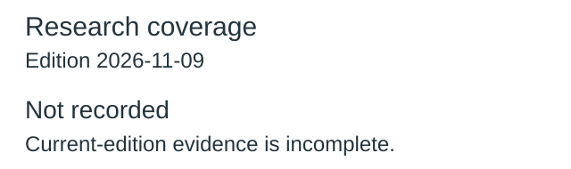
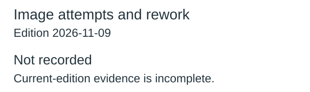
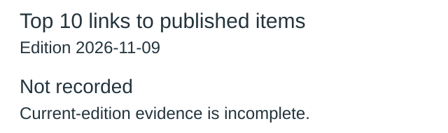
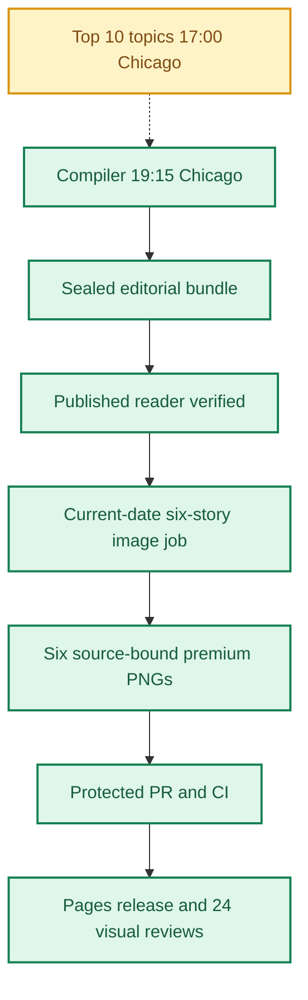
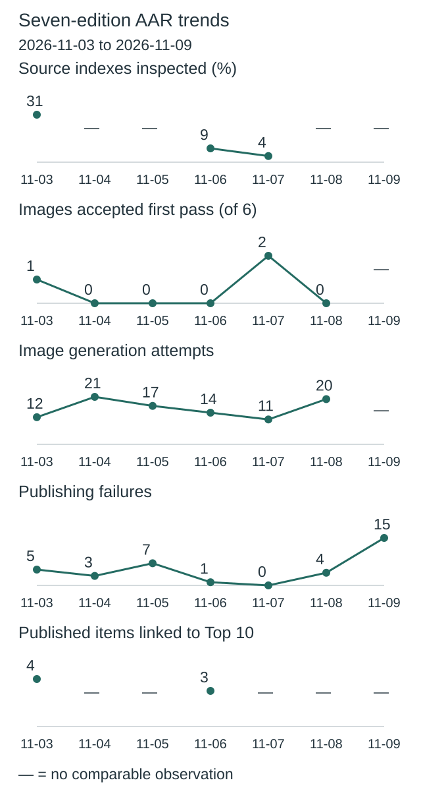
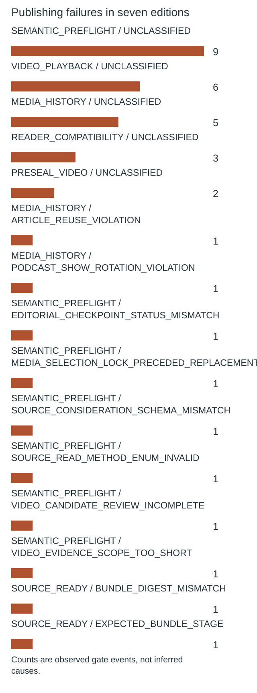
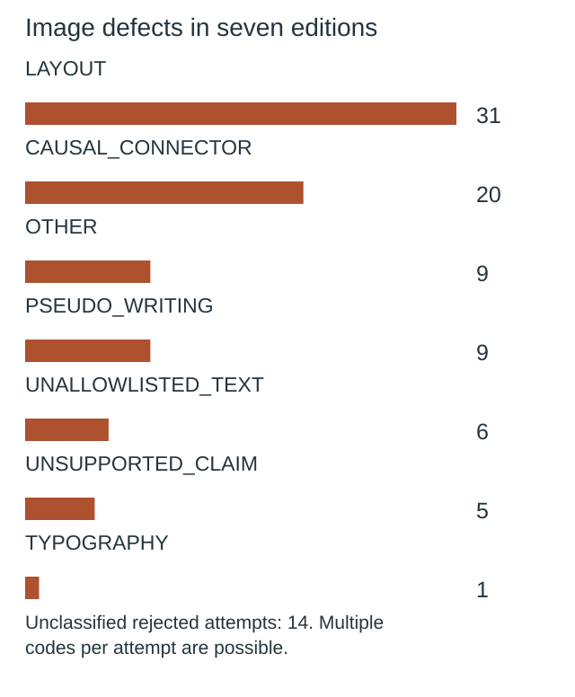

**🟩 RELEASE COMPLETE**
**TOP 10 PARTIAL** · **🟩 COMPILER VERIFIED** · **🟦 IMAGES 6/6 RELEASED** · **🟪 VISUAL QA 24/24 PASS**

# Daily AI Brief — Unified Production After-Action Report
**Edition:** November 9, 2026 · **Production evening:** 2026-11-08 · **Timezone:** America/Chicago
**Primary public reader:** [Open 2026-11-09 Brief](https://gttome.github.io/Daily-AI-Brief-Compiler/briefs/2026-11-09/) · **Repository:** [Daily-AI-Brief-Compiler](https://github.com/gttome/Daily-AI-Brief-Compiler)

> **IMPORTANT — VERIFIED PRODUCTION RESULT**
> **Executive release result: COMPLETE.** This is the single management-facing report covering Top 10 topic discovery, the editorial Compiler, published Brief and premium-image run. **Entire-system evidence: PARTIAL.** Top 10 report: **partial**; Compiler handoff: **RECEIVED_SNAPSHOT_BOUND**; guided searches: **INVALID**. Compiler public status: **VERIFIED**. Image release: **RELEASED_VERIFIED**. Direct 24-context visual quality: **24/24 PASS**. Autonomous completion: **UNPROVEN**. Missing evidence must not be promoted to a success claim.

**🕒 Production stage durations:** **Top 10 5m 05s** · **Compiler final seal window 4m 07s** · **Premium Images 27m 56s** (evidence-bounded elapsed times; the start/end events differ).

## Evidence reconciliation

Compiler final seal window: 4m 07s. Compiler state start to public verification: 117m 14s. Observed execution and final seal windows are distinct.
Image capability route preflight: RECORDED; scheduler origin remains UNPROVEN.
Image efficiency: 1/6 first-pass accepts; 11 total attempts. Current efficiency target: at least 3/6 first-pass and at most 2 attempts per image, with unchanged quality floor.
Image review completed: 2026-11-09T03:42:38Z; review-record commit: 2026-11-09T03:51:41.000Z; protected review merge: 2026-11-09T03:51:41.000Z.
Eligible source indexes: 109; editorial inspections reported: 3 (2.8%); inaccessible in editorial audit: 1; explicitly unreviewed IDs: 105; unclassified editorial IDs: 0. Automated index parsing is separate from editorial inspection and cannot substantiate exhaustive freshness claims.

Registered video sources: 29; attempted this edition: 29; unattempted: 0; enabled: 28; qualification-only: 1; sources yielding candidate URLs: 0. Status: REPORTED_ALL_ATTEMPTED. Attempt evidence is not automatic proof of source-content review or playback.

## Daily AAR charts

These charts use this edition’s receipts. Missing data is not zero.

### Research coverage



**3 of 109 indexes inspected (3%).**

| Editorial inspection | Indexes |
|---|---:|
| Inspected | 3 |
| Not inspected | 106 |

Not inspected includes every index without a recorded editorial inspection; this is not proof of missed stories.

### Image attempts and rework



**11 attempts; 1 of 6 images accepted on their first attempt.**

Recorded ongoing from November 8 target: at least 3/6 first-pass accepts; no more than 2 attempts per image. This is an efficiency target, not a quality cutoff.

| Image | Accepted | Rejected | Total attempts |
|---|---:|---:|---:|
| A saved coding-agent approval exposed real secrets | 1 | 1 | 2 |
| Nous publishes a 27B model and its political-framing evals | 1 | 0 | 1 |
| Google Workspace can encrypt sensitive files by policy | 1 | 1 | 2 |
| Australia’s central bank maps an uncertain AI productivity curve | 1 | 1 | 2 |
| Clocktower tests whether agents can coordinate, deceive and recover | 1 | 1 | 2 |
| A file-safe editing Skill puts recovery before replacement | 1 | 1 | 2 |

Generation attempts measure rework, not runtime or cost. Quality and publication checks remain separate.

### Top 10 links to published items



**Not recorded:** current-edition evidence is missing or inconsistent.

No selection quota. Topic linkage does not establish better quality, popularity or causal improvement.

[Chart data](charts.json)

One edition at a time. Missing evidence is not zero. Trend claims require comparable recorded cycles.

## Performance dashboard

| Measure | Recorded result | Source / caveat |
|:--|:--:|:--|
| Entire-system evidence | **PARTIAL** | Full Top 10 list, bound Compiler input, all-format search receipts and existing release checks; separate from publication and autonomy |
| Top 10 report | **partial · 10 topics** | Same Chicago cycle report; provisional/partial coverage remains disclosed |
| Top 10 received by Compiler | **RECEIVED_SNAPSHOT_BOUND** | Exact report snapshot bytes; consumed commit separately corroborated: YES |
| Top 10 guided article/video/podcast searches | **INVALID** | Actual source-search receipts and selected/rejected topic outcomes |
| Top 10 stage duration | **5m 05s** | Same-cycle run receipt only; no runtime or usage estimate |
| Editorial publication | **PASS** | State and public reader integrity receipt |
| **Unattended autonomy (separate from publication)** | **UNPROVEN** | Owner incident receipt takes precedence over unverified producer self-attestation |
| Recorded protected publishing gate failures | **15** | Actual same-edition GitHub failure sidecar only; earlier unrecorded failures remain unknown |
| Articles | **6** | Exactly 2 technical / 2 knowledge-worker / 2 agents required |
| Original scientific-paper-led articles | **Not recorded** | Rolling target: one qualified original paper in seven editions; NOT_RECORDED. Preprints are not peer-reviewed by default |
| Verified original sources within preceding 24 hours | **1 / 6** | Original publisher dates only; other sources require a documented fallback rationale |
| Distinct selected article publishers | **6** | Six different primary organizations preferred |
| Videos over seven days old | **0** | Must be labeled evergreen, not a new development |
| Distinct selected video publishers | **2** | One channel is one publisher even across multiple videos |
| Video discovery source attempts | **29 / 29** | Attempt evidence across enabled and qualification-only leads; REPORTED_ALL_ATTEMPTED. Not a claim of full content review or player verification | 
| Duplicate active Watchlist display titles | **Not recorded** | Published canonical Watchlist only; historical evidence retained |
| Original-release video playback (historical) | **TWO_PUBLISHED_VIDEOS_PLAYBACK_PASS** | Later reader corrections may replace these originally verified videos; see incident register | 
| Postpublication reader incidents | **NOT_RECORDED** | Edition-specific owner reports and corrective PRs, not inferred absence | 
| Verified postpublication video corrections | **NOT_RECORDED** | Incident register tracks correction PR, actual playback evidence and reader preservation |
| Editorial index second-pass attempts | **0** | Bounded public GET retries only; never proof of original article reading |
| Editorial index reads recovered | **0** | Successful page fetch can still yield zero eligible dated items |
| Recorded scheduler capability route | **UNPROVEN** | Same-invocation route receipt only; GitHub is not scheduler authentication |
| Avoidable incomplete-staging CI failures | **Not independently audited** | Existing image-package push CI is disabled; exact-head protected PR CI remains required. A failure count requires actual workflow evidence |
| Media | **2 videos + 2 podcasts** | Sealed bundle |
| **Compiler final seal window** | **4m 07s (4.1 min)** | Final sealed-state timestamp → verified public reader; initial execution is separate |
| **Image processing stage duration** | **27m 56s** | First accepted PNG Git checkpoint → final 24/24 review; auditable stage elapsed time |
| Image scheduled-to-final-review window | **Not independently recorded** | Only with a saved one-cycle schedule anchor; does not attest exact generation start |
| Executor-observed generation-to-final-review | **30m 30s** | Only if the worker recorded a same-execution clock before its first native call; not independently verified provider runtime |
| Accepted premium PNGs | **6 / 6** | Exact package and public release hashes |
| Native image generation attempts | **11** | Image worker AAR; no estimation |
| Rejected candidates | **5** | Image worker AAR |
| Final worker checkpoint reconciliation | **PASS** | Oct25+ verifies exact generation count, per-story attempts, six accepted story/image/hash bindings and final release |
| Saved visual contexts | **24 / 24 PASS** | Dated/permanent desktop/mobile review |
| Public SHA-256 checks | **44** | Image release receipt |
| October 8 immutable history | **17 / 17** | Independent content-preservation checks |
| **Owner-reported weekly Work usage for this run** | **Not reported** | No per-cycle usage supplied |

> **EFFICIENCY NOTE**
> **Resource reporting policy:** No usage figure was supplied for this cycle, so none is assumed. Future runs show **Not reported** unless the owner supplies new cycle-specific usage metadata. No approval or extra step is required to generate the AAR.

## Production architecture and checkpoints



## Daily AI Topic Top 10 and Compiler handoff

**Research cycle:** 2026-11-08 · **Target Brief:** 2026-11-09 · **Scheduled start:** 17:00 America/Chicago

| Dimension | Recorded evidence |
|---|---|
| Run/report result | PARTIAL |
| Report status / topics | partial / 10 |
| Freshness | FRESH\_AT\_CONSUMPTION |
| Compiler handoff | RECEIVED\_SNAPSHOT\_BOUND |
| Search coverage | INVALID |
| Selection mapping verification | INVALID |
| Observed start / finish | 2026-11-08T23:04:58Z / 2026-11-08T23:10:03Z |
| Elapsed minutes | 5.08 |
| Usage percent | Not reported |
| Cost USD | Not reported |
| Independent scheduler autonomy | UNPROVEN |
| Compiler-recorded consumed commit | 0f61fc274bf35c12afed857e78e3a2a3ee0d34d4 |
| Report SHA-256 | 55b57b5085e0a4bb79e28f22f20da8d8298a4106ea4275766423e37b971115aa |

| Discovery order | AI topic | Summary | Confidence | Evidence |
|---:|---|---|---|---|
| 1 | Claude Code’s saved approvals can carry credentials | Apiiro found public settings files in which coding-agent command approvals preserved credentials typed into the commands. | medium | [Source](https://www.youtube.com/watch?v=_BCQ7qbFXGA) · [Source](https://news.ycombinator.com/item?id=50407882) · [Source](https://apiiro.com/blog/coding-agents-leaking-secrets-github-dont-ask-again) |
| 2 | Google’s 15-second video update gets more creator coverage | Gemini Omni 1.2 Flash supports clips up to 15 seconds and multiple edits to the same clip. | medium | [Source](https://www.youtube.com/watch?v=IrAHINf0M6E) · [Source](https://www.youtube.com/watch?v=9RIK3A24ZxA) · [Source](https://blog.google/innovation-and-ai/technology/developers-tools/introducing-gemini-omni-1-2-flash/) |
| 3 | Anthropic’s agent-memory study draws a second audience | Anthropic describes consolidating stored agent notes between sessions so later work can retrieve relevant lessons. | medium | [Source](https://news.ycombinator.com/item?id=50402212) · [Source](https://x.com/AnthropicAI/status/2118814753154064501) · [Source](https://www.anthropic.com/research/components-of-agent-memory) |
| 4 | MaxxBench asks whether coding agents follow changed requirements | The authors altered 89 DeepSWE tasks to test how coding agents respond when familiar instructions or starting code change. | medium | [Source](https://news.ycombinator.com/item?id=50406222) · [Source](https://maxxbench.unlap.ai/research/why-maxxbench/) · [Source](https://github.com/unlap-labs/maxxbench) |
| 5 | Social-deduction game tests how AI agents handle deception | Dwarkesh Patel ran AI teams through a hidden-role game to study bluffing and how models weigh uncertain clues. | medium | [Source](https://www.youtube.com/watch?v=1NQwfImTseU) · [Source](https://www.dwarkesh.com/p/clocktower) · [Source](https://github.com/dwarkeshsp/clocktower) |
| 6 | Replit’s founder describes the infrastructure behind coding agents | Amjad Masad and Paul Graham discuss the sandbox and deployment systems that sit underneath a plain-language coding interface. | medium | [Source](https://www.youtube.com/watch?v=Q78dJ0vkWe8) · [Source](https://www.ycombinator.com/library/ks-how-to-build-the-future-paul-graham-amjad-masad) · [Source](https://realalpha.app/v/Q78dJ0vkWe8/) |
| 7 | Kimi K3.1 Pro’s downloadable weights remain in view | Moonshot’s model card documents weights and a model-specific license that teams can examine before self-hosting. | medium | [Source](https://www.youtube.com/watch?v=-M62vWrZh54) · [Source](https://huggingface.co/moonshotai/Kimi-K3.1-Pro) |
| 8 | Nous publishes Arete-27B and its political-framing evaluation | Nous fine-tuned a Qwen model and released a benchmark for how its answers frame politically sensitive questions. | medium | [Source](https://x.com/NousResearch/status/2118822925445050435) · [Source](https://nousresearch.com/arete) · [Source](https://huggingface.co/NousResearch/Arete-27B) |
| 9 | Post-midterm AI selloff stays in the news | BBC’s report follows the tech stock selloff as it spread overseas and investors questioned future AI spending. | medium | [Source](https://www.youtube.com/watch?v=DHWc0uonVbA) · [Source](https://apnews.com/article/stock-market-winners-losers-defense-ai-musk-4ac9a6a3c35aeec37374fc8083bf9395) |
| 10 | A professor reports file loss during a routine Claude edit | Law professor William Baude said Claude deleted lecture notes and a syllabus during an editing task, and that the files were later recovered. | low | [Source](https://x.com/Dexerto/status/2119163038557446352) · [Source](https://www.dexerto.com/entertainment/professor-returns-from-lunch-to-find-ai-deleted-years-worth-of-lecture-notes-3425652/) · [Source](https://www.tomshardware.com/tech-industry/artificial-intelligence/rogue-claude-ai-tasked-with-renumbering-pages-accidentally-deletes-law-professors-entire-syllabus-one-year-of-lecture-notes-youre-right-to-be-angry-i-deleted-your-files-through-my-own-carelessness-humbled-agent-admits) |

**Sample scope:** {"metadata\_screened\_videos":12,"distinct\_retained\_channels":12,"total\_video\_observations":12,"unique\_videos":12,"new\_metadata\_screened\_records":12,"new\_metadata\_distinct\_channels":12,"combined\_observation\_records":12,"combined\_unique\_video\_ids":12,"full\_video\_reviews":0,"videos\_watched":0,"transcript\_reviews":1,"complete\_original\_publisher\_script\_reviews":1,"complete\_original\_publisher\_transcript\_reviews":0,"indexed\_transcript\_excerpt\_reviews":1,"partial\_transcript\_reviews":0,"direct\_youtube\_counter\_verifications":0,"direct\_counter\_verifications":0,"original\_watch\_attempts":12,"tracker\_counter\_records":12,"comparable\_video\_observations":7,"within\_24h\_reported\_publications":1,"additional\_within\_72h\_reported\_publications":6,"additional\_within\_7d\_reported\_publications":5,"freshness\_reference\_at":"2026-11-08T23:06:29Z","target\_40\_to\_80\_full\_reviews\_met":false,"validation\_resources\_registered":14,"scope":"Ten selected long-form tracker rows plus two retained rows from a second tracker; original publications, research repositories and bounded HN/X observations."}. **Ranking basis:** Broader evidence means two named media or community families discuss the event within this sample. Limited means one identifiable audience source. When programs are roundups, all counters stay program-level. Attention, research confidence and usefulness for the Brief remain separate..

| Search format | Receipt rows | Attempts recorded | Explicitly not attempted |
|---|---:|---:|---:|
| article | 0 | 0 | 0 |
| video | 0 | 0 | 0 |
| podcast | 0 | 0 | 0 |

**Selected Brief items linked to trends:**

No validated selection-to-topic mapping was recorded.

**Raw, unverified Top 10 receipt observations:** 30 search rows across 30 topic/format pairs; 6 claimed mapping rows (0 with noncanonical fields). Noncanonical outcomes: none. These counts are NOT validated search attempts or verified selections.

**Gaps and limitations:**

- Claimed trend-to-selection mappings are not verified against the same-edition selected bundle.
- Per-topic article/video/podcast search coverage is incomplete, invalid or bound to a different input.
- The report labels its research partial.
- Twelve watch pages throttled. No playback or direct YouTube counters were obtained; the 40–80 full-video target was not met. Subscriber counts, comments and sponsorship disclosures are unknown.
- The primary tracker’s ten counters are a November 8 morning snapshot, selected from tracked channels and search. Two additional third-party counters have no distinct measurement clock or exposed duration. No cross-source subtraction or count aggregation.
- Six programs match November 7 on source, ID, format and duration. One matches November 6. Deltas reflect rounded counters, not current velocity or global popularity.
- Original X posts returned 403. Hacker News index refresh times and account usage or billing are unknown. Prior and current Compiler selection effectiveness require separate evidence.

**Recorded run issues:**

- {"issue":"Twelve YouTube watch pages throttled.","effect":"No original counters, playback or verified sponsorship data.","correction":"Used original Dwarkesh publisher script, retried the YC original episode page and BBC related article, and separated alternate tracker metadata and indexed extracts."}
- {"issue":"X original posts returned 403 and some secondary timestamps were not exposed.","effect":"Three post counts are third-party; two secondary video counter times are unknown.","correction":"Kept exact post IDs, counter-source timestamps where exposed and null measurement times otherwise."}
- {"issue":"Arete primary material failed during the previous cycle.","effect":"The item was previously held.","correction":"Retrieved the actual Nous release and model card. Bound claims to the author’s rubric, prompt set and decoding settings."}
- {"issue":"The first local check required a measurement timestamp even for the two explicitly unclocked tracker counters.","effect":"Local check failed before any write.","correction":"Allowed null measurement times while checking publication and observation chronology and verifying all known measurements. Exact readback passed."}

**Recorded improvements:**

- {"status":"implemented","change":"Use a bounded original-publisher fallback when the original watch page throttles.","reason":"The November 8 corrective contract requires auditable provenance after throttling; previous text depth relied on a mirror.","expected\_effect":"Separate first-party content depth from metadata and counters."}
- {"status":"implemented","change":"Retry the Arete original card and corroborate new video coverage with a second tracker without merging counters.","reason":"Prior original Arete documentation was unavailable, and some new events were missing in the primary tracker.","expected\_effect":"Use event-specific source details and record additional channels without treating them as measurable growth."}
- {"status":"proposed","change":"Continue one bounded original publisher fallback for event-matched videos and keep the first-party counter gap visible."}

### Daily improvement and effect on the Brief

**Fixed baseline:** nov03-2026-v1 / INPUT\_FROZEN. **Outcome baseline:** FROZEN\_AFTER\_VERIFIED\_PUBLICATION. **Prior cycle:** 2026-11-07.

| Input measure | Current | November 3 baseline | Change from baseline | Change from prior cycle |
|---|---:|---:|---:|---:|
| topic count | 10 | 10 | 0 | 0 |
| validation resource count | 3 | 14 | -11 | -1 |
| additional video metadata records | 12 | 63 | -51 | 2 |
| additional video channels | 12 | 21 | -9 | 2 |
| total video observations | 12 | 79 | -67 | 2 |
| unique videos | 12 | 71 | -59 | 2 |
| full video reviews | 0 | 0 | 0 | 0 |
| direct youtube counter verifications | 0 | 0 | 0 | 0 |
| broader evidence band topics | 3 | 3 | 0 | 0 |
| limited evidence band topics | 7 | 7 | 0 | 0 |

**Observed downstream measurements:** PENDING\_OR\_INCOMPLETE.

| Outcome measure | Current | Change from frozen outcome | Change from prior cycle |
|---|---:|---:|---:|
| expected topic format pairs | 30 | 0 | Not reported |
| attempted topic format pairs | Not reported | Not reported | Not reported |
| explicitly unattempted pairs | Not reported | Not reported | Not reported |
| discovered candidate count | Not reported | Not reported | Not reported |
| searched source host count | Not reported | Not reported | Not reported |
| selected article count | Not reported | Not reported | Not reported |
| selected video count | Not reported | Not reported | Not reported |
| selected podcast count | Not reported | Not reported | Not reported |

**Source changes:** {"added":\[\],"removed":\["reuters"\]}.

**Candidate review depth:** NOT\_RECORDED.

| Review measure | Current | Change from prior comparable cycle |
|---|---:|---:|
| reviewed candidate count | Not reported | Not reported |
| qualified candidate count | Not reported | Not reported |
| rejected candidate count | Not reported | Not reported |
| metadata only count | Not reported | Not reported |
| full video reviews | Not reported | Not reported |
| transcript reviews | Not reported | Not reported |

The frozen November 3 baseline has no candidate-level review ledger; no retrospective value is invented. Recorded reviews do not independently establish content quality, audience interest or causal benefit.

**Method/resource review:** {"baseline\_id":"nov03-2026-v1","previous\_report\_date":"2026-11-07","previous\_method\_version":"2026-11-03.2-event-review","method\_version":"2026-11-03.2-event-review","feedback":{"aar\_url":"https://github.com/gttome/Daily-AI-Brief-Compiler/blob/df398047378b26af78552f4348243c56c22e9bd6/daily/2026-11-07/combined.md","charts\_url":"https://github.com/gttome/Daily-AI-Brief-Compiler/blob/df398047378b26af78552f4348243c56c22e9bd6/daily/2026-11-07/charts.json","metrics\_url":"https://github.com/gttome/Daily-AI-Brief-Compiler/blob/df398047378b26af78552f4348243c56c22e9bd6/daily/2026-11-07/improvement-metrics.json","previous\_report\_url":"https://github.com/gttome/Daily-AI-Brief-Compiler/blob/df398047378b26af78552f4348243c56c22e9bd6/signals/ai-topic-top10/2026-11-07.json","previous\_run\_aar\_url":"https://github.com/gttome/Daily-AI-Brief-Compiler/blob/df398047378b26af78552f4348243c56c22e9bd6/signals/ai-topic-top10/2026-11-07.aar.json","observation":"November 8 combined AAR shows a bound handoff, invalid Compiler search coverage, unrecorded Top 10 selection chart, and a completed release. Compiler owns search receipt correction. Ten publisher-family reviews were recorded. Earlier Top 10 relied on one complete caption mirror and an indexed episode excerpt with no original transcript."},"changes":\[{"change":"Use a bounded original-publisher fallback when the original watch page throttles.","reason":"The November 8 corrective contract requires auditable provenance after throttling; previous text depth relied on a mirror.","expected\_effect":"Separate first-party content depth from metadata and counters."},{"change":"Retry the Arete original card and corroborate new video coverage with a second tracker without merging counters.","reason":"Prior original Arete documentation was unavailable, and some new events were missing in the primary tracker.","expected\_effect":"Use event-specific source details and record additional channels without treating them as measurable growth."}\],"resource\_candidates":\[{"url":"https://www.dwarkesh.com/p/clocktower","role":"publisher video script","access":"direct","review\_scope":"Full displayed script ending before the supplemental appendix; game setup, comparisons, harness and limits.","independence":"Same publisher as the original YouTube video.","decision":"accepted","reason":"Adds original methodology and caveats beyond the video title.","contribution":"One complete published-script review, no playback/counters."},{"url":"https://www.ai-roundup.dev/","role":"additional video metadata tracker","access":"direct","review\_scope":"Scanned nine rows and retained two previously unseen channels/video IDs.","independence":"Tracker is an aggregator, neither the origin of videos nor an extra attention family.","decision":"accepted","reason":"Supplies two fresh event-matched channels while keeping measurement clock unknown.","contribution":"Two distinct video snapshots; no growth comparison."}\],"observed\_effects":\[{"observation":"One complete original publisher script was readable. YC’s alternative publisher page supplied no readable transcript.","effect":"Clocktower scope is stronger than a metadata-only read; playback and direct counters remain unavailable."},{"observation":"Arete’s original model card and research page are now accessible.","effect":"Promoted this previously held lead with explicit rubric, sample and cross-model comparison caveats."},{"observation":"12 retained videos versus 10 in the prior snapshot and seven comparable observations.","effect":"Sample composition and tracker mix changed. Counts do not measure audience improvement."}\],"next\_improvement":"Continue one bounded original publisher fallback for event-matched videos and keep the first-party counter gap visible.","limitations":\["The search-coverage correction belongs to the Compiler. November 11 cumulative evaluation remains pending."\],"change\_evaluations":\[\],"pending\_change\_evaluations":\["NOV03-04","AAR-10"\],"review\_due\_edition":"2026-11-11"}.

**Current reconciled conclusion:** PENDING\_OR\_INCOMPLETE; outcome baseline FROZEN\_AFTER\_VERIFIED\_PUBLICATION; candidate review ledger NOT\_RECORDED.

**Historical producer observations (not current status):** The following snapshot preserves what the producer reported at the time. Its pending statuses and candidate-quality claims are not independently reconciled conclusions. Use the current tables above for publication-bound measurements; an absent candidate review ledger remains unknown.

<details><summary>Original producer effects and gaps — historical snapshot</summary>

```json
null
```

</details>

**Next improvement:** Continue one bounded original publisher fallback for event-matched videos and keep the first-party counter gap visible.

Counts show coverage and observed association, not audience popularity, source independence, candidate quality or causal uplift. Compare source/method changes before interpreting deltas. Unknown values are not zero. Publication, reader corrections, runtime and image outcomes retain their separate AAR evidence.

Report, source-readback and search receipts are separate observations. Snapshot binding verifies the collected report bytes; the consumed commit is independently corroborated only when the separately fetched source bytes match. These records do not independently attest scheduler identity or source truth. Top 10 reporting does not change Brief/image release status.


## Track 1 — Compiler

**State:** `SHADOW_VERIFIED` · **Bundle:** `BUNDLE_READY` · **Compiler final seal window:** 4m 07s (4.1 min).

| Publication gate | Result |
|---|:---:|
| Canonical reader build | ✅ |
| Reader parity | ✅ |
| Public verification of dated edition | ✅ |
| Previous editions preserved | ✅ |
| Permanent story routes and feeds | ✅ |

**Selected coverage:**

| Lane | Story |
|---|---|
| Technical AI Engineering | A saved coding-agent approval exposed real secrets |
| Technical AI Engineering | Nous publishes a 27B model and its political-framing evals |
| Applied Generative AI for Knowledge Workers | Google Workspace can encrypt sensitive files by policy |
| Applied Generative AI for Knowledge Workers | Australia’s central bank maps an uncertain AI productivity curve |
| Agents for Everyone | Clocktower tests whether agents can coordinate, deceive and recover |
| Agents for Everyone | A file-safe editing Skill puts recovery before replacement |

### Scientific paper opportunity and publication evidence

**Current edition:** NOT_RECORDED; **paper-led stories:** Not recorded. Editorial target: at least one genuinely qualified original-paper-based story in seven editions, with methods, limitations, and an explicit preprint/peer-review distinction. No stale or weak paper is selected solely to fill a quota.


## Track 2 — Premium images

**Public status:** `RELEASED_VERIFIED` · **Saved images:** 6/6 · **Actual generation attempts:** 11 · **Rejected candidates:** 5.

### Image production duration — Git-verified milestones

**Auditable image stage duration:** **27m 56s** (first accepted binary saved in Git → first persisted 24-context quality-review record). **First asset to public image release:** **11m 38s**.
**Scheduled-to-final-review window:** **Not independently recorded**. This is a scheduled-clock comparison only when a separately recorded exact-date schedule exists; it is **not** measured native image-generation runtime.

| Production milestone | Chicago local time | Evidence |
|---|---|---|
| Scheduled image start (if exact-date record exists) | Not independently recorded | Time planned, not actual execution start |
| First executor-observed start | 9:15:17 PM | Worker self-attestation, not a first-party scheduler event |
| First native generation observation | 9:21:11 PM | Worker clock recorded immediately before first native call, not model-provider telemetry |
| First accepted PNG bytes saved to Git | 9:23:45 PM | Immutable binary-stage commit |
| Six-image package / reviews committed | 9:32:28 PM | Exact-head PR source commit |
| Protected package merged | 9:34:19 PM | Merge SHA and required CI |
| Public images verified | 9:35:23 PM | Image-release receipt |
| 24/24 review record committed | 9:51:41 PM | Immutable first review-approval commit |

> **Duration interpretation:** The audited stage excludes unobservable pre-checkpoint creative work. The scheduled-start window includes it but must not be interpreted as precise active processing time. Missing timestamps appear as **Not independently recorded**, never an estimate.


| Source-bound image | Attempts | File size | Public page |
|---|---:|---:|---|
| A saved coding-agent approval exposed real secrets | 2 | 0.53 MiB | [View original](https://gttome.github.io/Daily-AI-Brief-Compiler/briefs/images/2026-11-09/dab-edition-2026-11-09-m01.png) |
| Nous publishes a 27B model and its political-framing evals | 1 | 0.55 MiB | [View original](https://gttome.github.io/Daily-AI-Brief-Compiler/briefs/images/2026-11-09/dab-edition-2026-11-09-m02.png) |
| Google Workspace can encrypt sensitive files by policy | 2 | 0.58 MiB | [View original](https://gttome.github.io/Daily-AI-Brief-Compiler/briefs/images/2026-11-09/dab-edition-2026-11-09-m10.png) |
| Australia’s central bank maps an uncertain AI productivity curve | 2 | 0.59 MiB | [View original](https://gttome.github.io/Daily-AI-Brief-Compiler/briefs/images/2026-11-09/dab-edition-2026-11-09-m11.png) |
| Clocktower tests whether agents can coordinate, deceive and recover | 2 | 0.68 MiB | [View original](https://gttome.github.io/Daily-AI-Brief-Compiler/briefs/images/2026-11-09/dab-edition-2026-11-09-m12.png) |
| A file-safe editing Skill puts recovery before replacement | 2 | 0.61 MiB | [View original](https://gttome.github.io/Daily-AI-Brief-Compiler/briefs/images/2026-11-09/dab-edition-2026-11-09-m14.png) |

**Immutable-release and visual gates:**

| Release gate | Result |
|---|:---:|
| Protected public image receipt | ✅ |
| Accepted-image Git hash bindings | ✅ |
| Six live PNGs | 6/6 |
| Dated/permanent story placements | 12/12 recorded in release evidence |
| Desktop/mobile visual inspection | 24/24 PASS |
| Historical Oct 8 integrity | 17/17 |

### Published premium illustrations

<table>
<tr><td width="50%"><a href="https://gttome.github.io/Daily-AI-Brief-Compiler/briefs/images/2026-11-09/dab-edition-2026-11-09-m01.png"></a><br/><b>A saved coding-agent approval exposed real secrets</b></td><td width="50%"><a href="https://gttome.github.io/Daily-AI-Brief-Compiler/briefs/images/2026-11-09/dab-edition-2026-11-09-m02.png"></a><br/><b>Nous publishes a 27B model and its political-framing evals</b></td></tr>
<tr><td width="50%"><a href="https://gttome.github.io/Daily-AI-Brief-Compiler/briefs/images/2026-11-09/dab-edition-2026-11-09-m10.png"></a><br/><b>Google Workspace can encrypt sensitive files by policy</b></td><td width="50%"><a href="https://gttome.github.io/Daily-AI-Brief-Compiler/briefs/images/2026-11-09/dab-edition-2026-11-09-m11.png"></a><br/><b>Australia’s central bank maps an uncertain AI productivity curve</b></td></tr>
<tr><td width="50%"><a href="https://gttome.github.io/Daily-AI-Brief-Compiler/briefs/images/2026-11-09/dab-edition-2026-11-09-m12.png"></a><br/><b>Clocktower tests whether agents can coordinate, deceive and recover</b></td><td width="50%"><a href="https://gttome.github.io/Daily-AI-Brief-Compiler/briefs/images/2026-11-09/dab-edition-2026-11-09-m14.png"></a><br/><b>A file-safe editing Skill puts recovery before replacement</b></td></tr>
</table>

## Incidents, corrections and learning

### Postpublication reader incidents (updated when new evidence is merged)

No current-edition postpublication incident register was available; this is **NOT_RECORDED**, not a certification of zero incidents.


**Editor recovery classification:** UNPROVEN. **Owner intervention:** Unproven either way. **Protected same-edition failures recorded:** 15. 
**Latest failed protected stage:** MEDIA_HISTORY; [Action evidence](https://github.com/gttome/Daily-AI-Brief-Compiler/actions/runs/42552885031). Exact stage durations are available only where real source timestamps exist.

| Stage | Verified issue | Corrective action |
|---|---|---|
| Native saved-pixel inspection | The left terminal contains a > glyph, an underscore and three window-control dots that are absent from the frozen allowlist. The right and left outer housings also crowd the edges; all required text is legible. | Make the terminal face a plain dark plate without any controls or writing, preserving the saved approval, local settings and tracked-file-to-archive connections and text. Keep all cabinet housings inside the frame. |
| Native saved-pixel inspection | The arrow reaches a separate bare middle file, not the orange encrypted outer layer. The audit receipt has three simulated writing strokes and the server has invented front-panel indicators. | Move the orange encryption wrapping onto the middle target so the connector visibly reaches it. Make the lower display an address-only registration post. Use opaque geometric audit tokens and blank key-service blocks. |
| Native saved-pixel inspection | The task bench contains pseudo-writing and a rising bar chart. The middle bench has two unapproved arrows. The upper teal route starts on a bench border instead of an object, and the last glyph of the caveat reaches beyond x1160. | Use nonquantitative unmarked shapes, remove the middle black arrows, connect the upper teal route to the timer base, and bring the caveat and housings inward. |
| Native saved-pixel inspection | A third arrow appears between the private envelope and the role token, outside the approved connector set. The board’s exterior rim also approaches the top edge. | Delete only the unplanned arrow, use proximity to associate the envelope and role token, and tuck the top rim inward without moving or shrinking labels. |
| Native saved-pixel inspection | The editing cradle contains simulated document writing. The right-hand branch feeds the replacement fixture directly, bypassing diff review. | Replace the mock writing with two distinct geometric tokens. Remove the continuation to the replacement gate so the copy-to-diff connector ends only at the diff tray and the red closed gate remains separate. |
| Protected postdeployment capture | Initial release run stopped after 44 successful live byte checks because the saved T1 permanent-story mobile RGB match was 0.339. | Retained exact release artifact and failed screenshot. Captured stable full viewports against the same six live PNGs; all 24 comparisons and manual semantic inspections passed. |
| Public metadata synchronization | The first metadata sync stopped on a different T1 mobile capture with an RGB match of 0.353, before deploying the receipt. | Protected the existing capture and metadata path, reused the complete protected semantic evidence, and verified the exact public release receipt and index. |

> **OPERATIONAL NOTE**
> This report distinguishes a published and verified production outcome from scheduler metadata exposed to another conversation. Lack of a live host heartbeat in a separate normal chat is not a Compiler production failure.

## Usage and cost stewardship

| Item | Per-cycle value |
|---|---|
| **Weekly Work usage reported by owner** | **Not reported** |
| Internal weekly usage reference | Target under 5% |
| Genuine image-generation attempts | 11 |
| Accepted diagrams | 6 |
| Regeneration after acceptance | 0 |
| Top 10 reported usage | Not reported |
| Top 10 reported cost | Not reported |
| Account-level billing telemetry | Not independently accessible to deterministic GitHub reporting |

**Future reporting rule:** For cycles without an optional owner-usage record, publish the complete AAR with `Not reported`; do not reuse prior percentages, guess remaining weekly credits or delay tomorrow's production.

## Next-edition operating handoff

| Control | Recurring contract |
|---|---|
| AI Topic Top 10 | Sole report task · 17:00 America/Chicago · saved dated list guides same-evening research |
| Primary Compiler | Sole existing task · 19:15 America/Chicago |
| Premium image production | Sole existing task · standard 21:15 America/Chicago |
| Exact image job selection | Newly published next-date `PUBLISHED_PENDING` only |
| AAR | Combined report generated automatically from new GitHub receipts |
| Optional Work usage | Owner-supplied per cycle, otherwise `Not reported` |

> **SCHEDULE RESTORATION NOTE**
> A temporary scheduling exception must be explicitly restored before claiming standard-time readiness. This deterministic document generator reads existing state only; it does not modify production schedules.

## Evidence register

| Evidence | Link |
|---|---|
| Compiler state | [Open receipt](https://github.com/gttome/Daily-AI-Brief-Compiler/blob/shadow/2026-11-09/shadow-runs/2026-11-09/compiler-state.json) |
| Compiler compile receipt | [Open receipt](https://github.com/gttome/Daily-AI-Brief-Compiler/blob/shadow/2026-11-09/shadow-runs/2026-11-09/compiler/compile-receipt.json) |
| Compiler public integrity | [Open receipt](https://github.com/gttome/Daily-AI-Brief-Compiler/blob/shadow/2026-11-09/shadow-runs/2026-11-09/compiler/postpublish-integrity.json) |
| Image release receipt | [Open receipt](https://github.com/gttome/Daily-AI-Brief-Compiler/blob/shadow-pages-history/site/image-jobs/2026-11-09/release.json) |
| Image review | [Open receipt](https://github.com/gttome/Daily-AI-Brief-Compiler/blob/main/external-image-packages/2026-11-09/reviews/live/semantic-pixel-review.json) |
| Original image AAR | [Open receipt](https://github.com/gttome/Daily-AI-Brief-Compiler/blob/main/external-image-packages/2026-11-09/reviews/after-action.md) |
| Observed editorial index retries | [Open receipt](https://github.com/gttome/Daily-AI-Brief-Compiler/blob/shadow/2026-11-09/shadow-runs/2026-11-09/editorial/source-item-retries.json) |
| Published player playback receipt | [Open receipt](https://github.com/gttome/Daily-AI-Brief-Compiler/blob/shadow/2026-11-09/shadow-runs/2026-11-09/compiler/postpublish-video-playback.json) |
| Top 10 ranked topic report | [Open receipt](https://github.com/gttome/Daily-AI-Brief-Compiler/blob/6e6911d0a393a3117160841950ecf3b2c3665777/signals/ai-topic-top10/2026-11-08.json) |
| Top 10 run after-action receipt | [Open receipt](https://github.com/gttome/Daily-AI-Brief-Compiler/blob/6e6911d0a393a3117160841950ecf3b2c3665777/signals/ai-topic-top10/2026-11-08.aar.json) |
| Compiler Top 10 input snapshot | [Open receipt](https://github.com/gttome/Daily-AI-Brief-Compiler/blob/shadow/2026-11-09/shadow-runs/2026-11-09/editorial/trend-input.json) |
| Top 10 article/video/podcast search coverage | [Open receipt](https://github.com/gttome/Daily-AI-Brief-Compiler/blob/shadow/2026-11-09/shadow-runs/2026-11-09/editorial/trend-search-coverage.json) |

**Image workflow:** [Workflow evidence](https://github.com/gttome/Daily-AI-Brief-Compiler/actions/runs/42557131670).

---

*Generated deterministically from cycle- and edition-specific GitHub records. The report combines the Top 10 discovery priorities, its Compiler handoff and searches, the published Brief, and the image run; original research, Compiler, image, hash, and review receipts remain immutable. This reporting action creates no stories, images, releases, extra AI tasks, or schedule changes.*

<!-- continuous-improvement:start -->
## Continuous improvement review

Edition **2026-11-09**. Measurements use 7/7 recorded editions in this window. Missing data stays **Not recorded**.

### Daily corrective-action review

**4 evidence-based findings**; open production blockers: 0. Cumulative evaluation checkpoint: **2026-11-11**. The daily review never waits for that date to act on a safe live problem.

| Priority | Observed issue | Existing owner / next correction | When |
|---|---|---|---|
| P1 | This edition has invalid Top 10 search-coverage receipts. | Compiler: Verify event-to-format searches and actual selected mappings in the next unlocked edition; do not rewrite a sealed historical bundle. | Next genuine run |
| P1 | 15 failed protected publication gates were recorded (5 unclassified causes). | Compiler / Recovery: Read original failed job logs, record real causes and move the relevant existing validation before the next readiness signal; do not replay the released edition. | Next genuine run |
| P1 | 5 rejected image candidates preceded the verified six-image release. | Images: Inspect saved rejection evidence and apply source-specific geometry, causal-arrow and label corrections before the next native generation. | Next genuine run |
| P2 | Publication success does not independently attest the originating scheduler. | Compiler / Recovery: Capture real first-party scheduler and execution evidence if available; do not convert unknown provenance into a failure or a success. | Next genuine run |

Findings are observational and do not claim a repair was executed by the reporter.

### Approved change evaluations

| Change | Evaluate by | Outcome status | Latest decision |
|---|---|---|---|
| NOV03-01 — Earlier publication checks and precise recovery | 2026-11-11 | PENDING | Not recorded |
| NOV03-02 — Broader genuine source review | 2026-11-11 | PENDING | Not recorded |
| NOV03-03 — Source-bound image rejection lessons | 2026-11-11 | PENDING | Not recorded |
| NOV03-04 — Substantive Top 10 review evidence | 2026-11-11 | PENDING | Not recorded |
| AAR-01 — Current conclusions separated from historical claims | 2026-11-11 | PENDING | Not recorded |
| AAR-02 — Consolidated current task contracts | 2026-11-11 | PENDING | Not recorded |
| AAR-03 — Dated improvement evaluations | 2026-11-11 | PENDING | Not recorded |
| AAR-04 — Seven-edition trend charts | 2026-11-11 | PENDING | Not recorded |
| AAR-05 — Recurring publication failure causes | 2026-11-11 | PENDING | Not recorded |
| AAR-06 — Recovery interval reporting | 2026-11-11 | PENDING | Not recorded |
| AAR-07 — Source inspection history | 2026-11-11 | PENDING | Not recorded |
| AAR-08 — Rolling source contribution | 2026-11-11 | PENDING | Not recorded |
| AAR-09 — Recurring image defect categories | 2026-11-11 | PENDING | Not recorded |
| AAR-10 — Top 10 publisher-family sensitivity | 2026-11-11 | PENDING | Not recorded |

Pending: 14; overdue: 0; reviewed: 0. Implemented controls await measured results; review decisions do not disable controls.

### Seven-edition trends



| Edition | Coverage | First pass / 6 | Image attempts | Publishing failures | Top 10 links |
|---|---|---:|---:|---:|---:|
| 2026-11-03 | 27/87 (31%) | 1 | 12 | 5 | 4 |
| 2026-11-04 | Not recorded | 0 | 21 | 3 | Not recorded |
| 2026-11-05 | Not recorded | 0 | 17 | 7 | Not recorded |
| 2026-11-06 | 8/87 (9%) | 0 | 14 | 1 | 3 |
| 2026-11-07 | 4/109 (4%) | 2 | 11 | 0 | Not recorded |
| 2026-11-08 | Not recorded | 0 | 20 | 4 | Not recorded |
| 2026-11-09 | 3/109 (3%) | 1 | 11 | 15 | Not recorded |

| Measure | Recorded editions | Window median |
|---|---:|---:|
| coverage percent | 4 | 6.5 |
| first pass accepted | 7 | 0 |
| image attempts | 7 | 14 |
| top10 linked items | 2 | 3.5 |
| publication failures | 7 | 4 |

**Registry changed in this window; coverage percentages use different source sets.**

### Publishing failures by stage and recorded cause



| Stage | Recorded cause | Failures | Editions | Recurred | Delay median (seconds; documented samples only) |
|---|---|---:|---|---|---:|
| SEMANTIC_PREFLIGHT | UNCLASSIFIED | 9 | 2026-11-04, 2026-11-05, 2026-11-09 | Yes | Not recorded (0 samples) |
| VIDEO_PLAYBACK | UNCLASSIFIED | 6 | 2026-11-06, 2026-11-08, 2026-11-09 | Yes | Not recorded (0 samples) |
| MEDIA_HISTORY | UNCLASSIFIED | 5 | 2026-11-03, 2026-11-05, 2026-11-09 | Yes | Not recorded (0 samples) |
| READER_COMPATIBILITY | UNCLASSIFIED | 3 | 2026-11-03 | No within observed window | Not recorded (0 samples) |
| PRESEAL_VIDEO | UNCLASSIFIED | 2 | 2026-11-09 | No within observed window | Not recorded (0 samples) |
| MEDIA_HISTORY | ARTICLE_REUSE_VIOLATION | 1 | 2026-11-09 | No within observed window | Not recorded (0 samples) |
| MEDIA_HISTORY | PODCAST_SHOW_ROTATION_VIOLATION | 1 | 2026-11-09 | No within observed window | Not recorded (0 samples) |
| SEMANTIC_PREFLIGHT | EDITORIAL_CHECKPOINT_STATUS_MISMATCH | 1 | 2026-11-09 | No within observed window | Not recorded (0 samples) |
| SEMANTIC_PREFLIGHT | MEDIA_SELECTION_LOCK_PRECEDED_REPLACEMENT | 1 | 2026-11-09 | No within observed window | Not recorded (0 samples) |
| SEMANTIC_PREFLIGHT | SOURCE_CONSIDERATION_SCHEMA_MISMATCH | 1 | 2026-11-09 | No within observed window | Not recorded (0 samples) |
| SEMANTIC_PREFLIGHT | SOURCE_READ_METHOD_ENUM_INVALID | 1 | 2026-11-09 | No within observed window | Not recorded (0 samples) |
| SEMANTIC_PREFLIGHT | VIDEO_CANDIDATE_REVIEW_INCOMPLETE | 1 | 2026-11-09 | No within observed window | Not recorded (0 samples) |
| SEMANTIC_PREFLIGHT | VIDEO_EVIDENCE_SCOPE_TOO_SHORT | 1 | 2026-11-09 | No within observed window | Not recorded (0 samples) |
| SOURCE_READY | BUNDLE_DIGEST_MISMATCH | 1 | 2026-11-09 | No within observed window | Not recorded (0 samples) |
| SOURCE_READY | EXPECTED_BUNDLE_STAGE | 1 | 2026-11-09 | No within observed window | Not recorded (0 samples) |

Unclassified means the original gate is known but no structured cause review is recorded. Stage names do not establish root causes. No rows establish no failures only when the recorded receipt explicitly has none.

### Recovery intervals

| Recorded mode | Incidents | Detection seconds | Queue seconds | Repair seconds | Verification seconds | Total seconds |
|---|---:|---:|---:|---:|---:|---:|

**Not recorded:** no valid incident has all required timing and evidence references.

### Source inspection history

| Source | Last inspected edition | Editions since inspection |
|---|---|---:|
| acl-anthology | Not recorded | Not recorded |
| anthropic | Not recorded | Not recorded |
| anthropic-news | 2026-11-09 | 0 |
| article-databricks-ai-research | 2026-11-06 | 3 |
| article-ibm-research-ai | Not recorded | Not recorded |
| article-nvidia-technical-ai | Not recorded | Not recorded |
| arxiv-cs-ai | Not recorded | Not recorded |
| arxiv-cs-cl | Not recorded | Not recorded |
| arxiv-cs-lg | Not recorded | Not recorded |
| berkeley-bair | Not recorded | Not recorded |
| deep-20261026-a01-google-research | Not recorded | Not recorded |
| deep-20261026-a02-microsoft-ai | Not recorded | Not recorded |
| deep-20261026-a03-nvidia-news | Not recorded | Not recorded |
| deep-20261026-p02-data-skeptic | Not recorded | Not recorded |
| deep-20261026-v01-two-minute-papers | Not recorded | Not recorded |
| deepseek-news | Not recorded | Not recorded |
| directory-0dffb60aadd4ba31b5c090dc | Not recorded | Not recorded |
| directory-1c6f5db2559c3c226a112873 | Not recorded | Not recorded |
| directory-242c2a2fc81a43d41f199129 | 2026-11-06 | 3 |
| directory-3834a0112c0e3a754320b557 | Not recorded | Not recorded |
| directory-3ccc18a956cae0b1e24b5968 | Not recorded | Not recorded |
| directory-411bf5f837e28f35220736eb | 2026-11-09 | 0 |
| directory-4852e367f74118ff2dc1eec9 | Not recorded | Not recorded |
| directory-48665d874f6008894d0d9385 | Not recorded | Not recorded |
| directory-4c16d138c4a736e78a68127e | Not recorded | Not recorded |
| directory-54d90ff964a74ff98851ae11 | Not recorded | Not recorded |
| directory-5c5d3d02a420135949164552 | Not recorded | Not recorded |
| directory-64f0886a6793aa8858a4b62d | Not recorded | Not recorded |
| directory-6ea6e283349c7b62ac1ced9d | Not recorded | Not recorded |
| directory-79e16cd5beb5c662c4022a9f | Not recorded | Not recorded |
| directory-8263ca4c9f560c8d9c4df0de | Not recorded | Not recorded |
| directory-8df3614a9972a25fc59475ed | 2026-11-07 | 2 |
| directory-8ec4fd458a38bc0447f4cded | Not recorded | Not recorded |
| directory-935fbe5ba89ff5f91fc8c69b | Not recorded | Not recorded |
| directory-970506fbc577e6091a33c64d | Not recorded | Not recorded |
| directory-9ad7c274f2d56274bcd5ddcc | Not recorded | Not recorded |
| directory-9c0885bdb370f69c9262b88c | 2026-11-07 | 2 |
| directory-9f7087ce2c030a4b9da58499 | Not recorded | Not recorded |
| directory-a74f303f4b0c39344c1314cf | 2026-11-06 | 3 |
| directory-b93e2368e85f0f95c066463e | Not recorded | Not recorded |
| directory-c6b8a33e7fa162cc41136fa5 | Not recorded | Not recorded |
| directory-d1527db7c06b4e83370b7546 | Not recorded | Not recorded |
| directory-d5428d030dfff7d4639258e3 | Not recorded | Not recorded |
| directory-d6cf3f9fa167b8173a35228b | Not recorded | Not recorded |
| directory-db682c52794328eb69ebc377 | Not recorded | Not recorded |
| directory-e2f33b502b264e51983a338a | Not recorded | Not recorded |
| directory-e7b100b6b999ac748e052327 | Not recorded | Not recorded |
| directory-ecf69ec2f036e803388f40ca | Not recorded | Not recorded |
| directory-f8085f0f6e72cfbdfde3a0f8 | Not recorded | Not recorded |
| directory-fd36049347d409f38c9f9a67 | Not recorded | Not recorded |
| github-ai-agents | Not recorded | Not recorded |
| github-generative-ai | Not recorded | Not recorded |
| github-llm | Not recorded | Not recorded |
| github-trending | Not recorded | Not recorded |
| google-deepmind-blog | Not recorded | Not recorded |
| hacker-news-newest | Not recorded | Not recorded |
| hacker-news-show | Not recorded | Not recorded |
| hugging-face-daily-papers | Not recorded | Not recorded |
| hugging-face-datasets | Not recorded | Not recorded |
| hugging-face-models | Not recorded | Not recorded |
| hugging-face-spaces | Not recorded | Not recorded |
| iclr | Not recorded | Not recorded |
| icml | Not recorded | Not recorded |
| meta-ai-blog | Not recorded | Not recorded |
| mistral-news | Not recorded | Not recorded |
| mit-csail | Not recorded | Not recorded |
| neurips | Not recorded | Not recorded |
| openai-news | 2026-11-09 | 0 |
| openreview | Not recorded | Not recorded |
| podcast-a16z-show | Not recorded | Not recorded |
| podcast-agora-briefing | Not recorded | Not recorded |
| podcast-ai-daily-brief | 2026-11-06 | 3 |
| podcast-ai-for-humans | Not recorded | Not recorded |
| podcast-ai-future-work | Not recorded | Not recorded |
| podcast-ai-inside | Not recorded | Not recorded |
| podcast-artificial-intelligence-show | Not recorded | Not recorded |
| podcast-cognitive-revolution | 2026-11-06 | 3 |
| podcast-data-exchange | Not recorded | Not recorded |
| podcast-everyday-ai | Not recorded | Not recorded |
| podcast-eye-on-ai | Not recorded | Not recorded |
| podcast-gradient-dissent | Not recorded | Not recorded |
| podcast-latent-space | Not recorded | Not recorded |
| podcast-no-priors | Not recorded | Not recorded |
| podcast-nvidia-ai | Not recorded | Not recorded |
| podcast-practical-ai | Not recorded | Not recorded |
| podcast-twiml | Not recorded | Not recorded |
| qwen-blog | Not recorded | Not recorded |
| reddit-localllama | Not recorded | Not recorded |
| reddit-machinelearning | Not recorded | Not recorded |
| research-20261026-a01 | Not recorded | Not recorded |
| research-20261026-a04 | Not recorded | Not recorded |
| research-20261026-a05 | Not recorded | Not recorded |
| research-20261026-a12 | Not recorded | Not recorded |
| research-20261026-p03 | Not recorded | Not recorded |
| research-20261026-v01 | Not recorded | Not recorded |
| research-20261026-v02 | Not recorded | Not recorded |
| research-20261026-v04 | Not recorded | Not recorded |
| research-20261026-v05 | Not recorded | Not recorded |
| research-20261026-v06 | Not recorded | Not recorded |
| research-20261026-v07 | Not recorded | Not recorded |
| specialized-discords | Not recorded | Not recorded |
| stanford-hai | Not recorded | Not recorded |
| the-batch | Not recorded | Not recorded |
| universe-20261026-every-ai-editorial | Not recorded | Not recorded |
| x-research-feeds | Not recorded | Not recorded |
| xai-news | Not recorded | Not recorded |
| youtube-anthropic | Not recorded | Not recorded |
| youtube-google-deepmind | 2026-11-06 | 3 |
| youtube-openai | Not recorded | Not recorded |

Only exact inspected source IDs and pre-selection review timestamps count. No observation means history is unavailable.

### Source contribution in this window

| Source | Substantively reviewed | Qualified | Selected | Editions with attributed reviews |
|---|---:|---:|---:|---:|

**Not recorded:** no validated substantive reviews have registry source IDs.

### Image rejection causes



| Recorded defect | Rejected attempts with defect | Recurred across editions |
|---|---:|---|
| LAYOUT | 33 | Yes |
| CAUSAL_CONNECTOR | 24 | Yes |
| PSEUDO_WRITING | 12 | Yes |
| OTHER | 11 | Yes |
| UNALLOWLISTED_TEXT | 7 | Yes |
| UNSUPPORTED_CLAIM | 6 | Yes |
| TYPOGRAPHY | 1 | No within observed window |

Total rejected: 64; unclassified: 14. A rejected attempt can have several defect codes.

### Top 10 publisher-family sensitivity

| Topic | Review status | Families | Evidence weakened after removal |
|---|---|---:|---|
| apiiro-claude-code-permissions-nov05 | RECORDED_EDITORIAL_ASSESSMENT | 2 | Yes |
| gemini-omni-12-flash-nov05 | RECORDED_EDITORIAL_ASSESSMENT | 2 | Yes |
| claude-agent-memory-dreaming-nov06 | RECORDED_EDITORIAL_ASSESSMENT | 2 | Yes |
| maxxbench-deepswe-mutations-oct20 | RECORDED_EDITORIAL_ASSESSMENT | 1 | Yes |
| clocktower-model-deception-discussion-nov05 | RECORDED_EDITORIAL_ASSESSMENT | 1 | Yes |
| yc-replit-masad-interview-nov07 | RECORDED_EDITORIAL_ASSESSMENT | 1 | Yes |
| kimi-k31-pro-weights-nov04 | RECORDED_EDITORIAL_ASSESSMENT | 1 | Yes |
| arete-27b-nous-nov06 | RECORDED_EDITORIAL_ASSESSMENT | 1 | Yes |
| ai-infrastructure-selloff-nov05 | RECORDED_EDITORIAL_ASSESSMENT | 1 | Yes |
| baude-claude-lecture-file-loss-nov05 | RECORDED_EDITORIAL_ASSESSMENT | 1 | Yes |

Overall status: **RECORDED**. Band changes are documented editorial assessments; source counts do not establish popularity.

[Full measurement data](improvement-metrics.json) · [Exact observation inputs](improvement-observations.json)

- Seven calendar edition dates; missing observations are gaps, never zero.
- Source counts and registry/method changes limit comparison; no causal improvement claim.
- Source contribution covers only resource-attributed substantive review records; it is not an exhaustive source ranking.
- No last inspection record means not recorded, not proof the source was never read.
- Image defects may have multiple codes per rejected attempt; category totals are not attempt totals.
- Recorded recovery mode is not first-party scheduler attestation.
- Keep/revise/retire reviews do not automatically change production controls.
<!-- continuous-improvement:end -->
