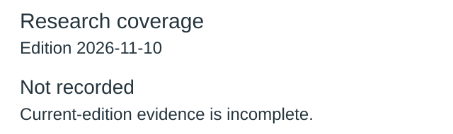
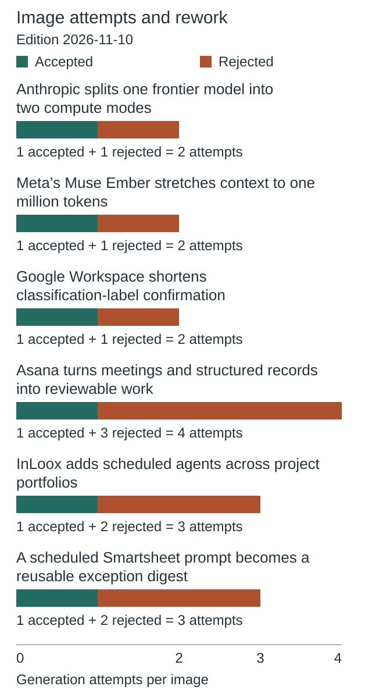
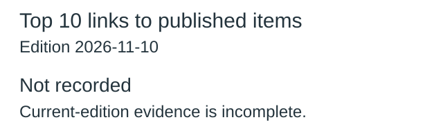
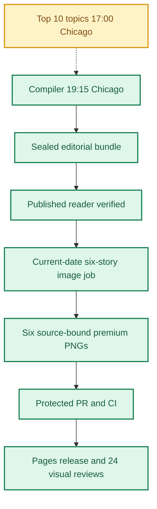
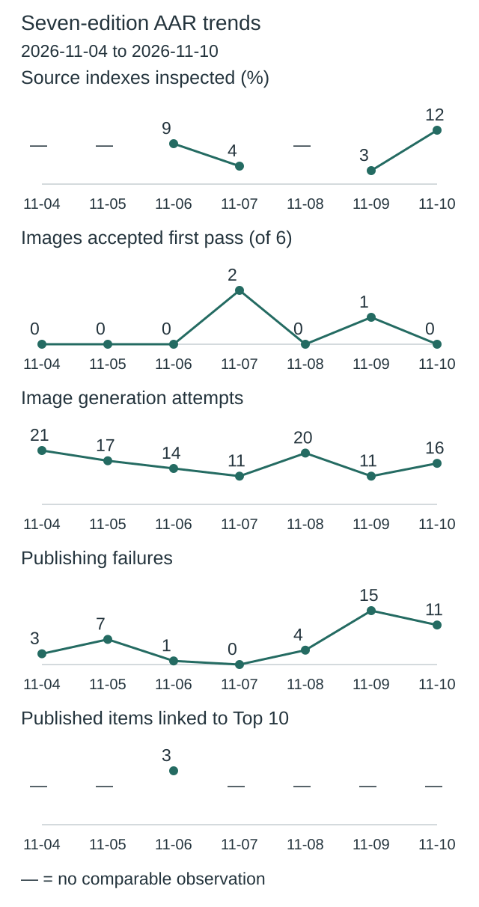
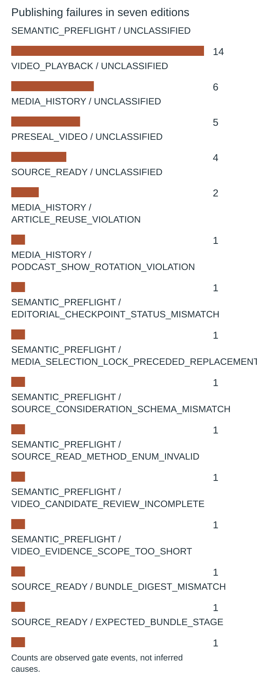
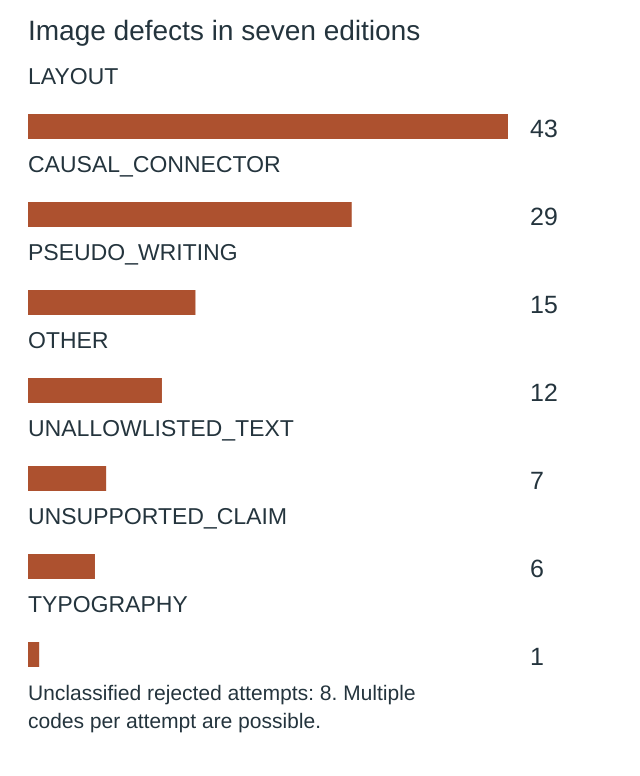

**🟩 RELEASE COMPLETE**
**TOP 10 PARTIAL** · **🟩 COMPILER VERIFIED** · **🟦 IMAGES 6/6 RELEASED** · **🟪 VISUAL QA 24/24 PASS**

# Daily AI Brief — Unified Production After-Action Report
**Edition:** November 10, 2026 · **Production evening:** 2026-11-09 · **Timezone:** America/Chicago
**Primary public reader:** [Open 2026-11-10 Brief](https://gttome.github.io/Daily-AI-Brief-Compiler/briefs/2026-11-10/) · **Repository:** [Daily-AI-Brief-Compiler](https://github.com/gttome/Daily-AI-Brief-Compiler)

> **IMPORTANT — VERIFIED PRODUCTION RESULT**
> **Executive release result: COMPLETE.** This is the single management-facing report covering Top 10 topic discovery, the editorial Compiler, published Brief and premium-image run. **Entire-system evidence: PARTIAL.** Top 10 report: **partial**; Compiler handoff: **RECEIVED_SNAPSHOT_BOUND**; guided searches: **INVALID**. Compiler public status: **VERIFIED**. Image release: **RELEASED_VERIFIED**. Direct 24-context visual quality: **24/24 PASS**. Autonomous completion: **UNPROVEN**. Missing evidence must not be promoted to a success claim.

**🕒 Production stage durations:** **Top 10 7m 00s** · **Compiler final seal window 6m 50s** · **Premium Images 102m 58s** (evidence-bounded elapsed times; the start/end events differ).

## Evidence reconciliation

Compiler final seal window: 6m 50s. Compiler state start to public verification: 84m 33s. Observed execution and final seal windows are distinct.
Image capability route preflight: NOT OBSERVED; scheduler origin remains UNPROVEN.
Image efficiency: 0/6 first-pass accepts; 16 total attempts. Current efficiency target: at least 3/6 first-pass and at most 2 attempts per image, with unchanged quality floor.
Image review completed: 2026-11-10T05:05:37Z; review-record commit: 2026-11-10T05:09:09.000Z; protected review merge: 2026-11-10T05:11:25.000Z.
Eligible source indexes: 109; editorial inspections reported: 13 (11.9%); inaccessible in editorial audit: 0; explicitly unreviewed IDs: 96; unclassified editorial IDs: 0. Automated index parsing is separate from editorial inspection and cannot substantiate exhaustive freshness claims.

Registered video sources: 29; attempted this edition: 29; unattempted: 0; enabled: 28; qualification-only: 1; sources yielding candidate URLs: 16. Status: REPORTED_ALL_ATTEMPTED. Attempt evidence is not automatic proof of source-content review or playback.

## Daily AAR charts

These charts use this edition’s receipts. Missing data is not zero.

### Research coverage



**13 of 109 indexes inspected (12%).**

| Editorial inspection | Indexes |
|---|---:|
| Inspected | 13 |
| Not inspected | 96 |

Not inspected includes every index without a recorded editorial inspection; this is not proof of missed stories.

### Image attempts and rework



**16 attempts; 0 of 6 images accepted on their first attempt.**

Recorded ongoing from November 8 target: at least 3/6 first-pass accepts; no more than 2 attempts per image. This is an efficiency target, not a quality cutoff.

| Image | Accepted | Rejected | Total attempts |
|---|---:|---:|---:|
| Anthropic splits one frontier model into two compute modes | 1 | 1 | 2 |
| Meta’s Muse Ember stretches context to one million tokens | 1 | 1 | 2 |
| Google Workspace shortens classification-label confirmation | 1 | 1 | 2 |
| Asana turns meetings and structured records into reviewable work | 1 | 3 | 4 |
| InLoox adds scheduled agents across project portfolios | 1 | 2 | 3 |
| A scheduled Smartsheet prompt becomes a reusable exception digest | 1 | 2 | 3 |

Generation attempts measure rework, not runtime or cost. Quality and publication checks remain separate.

### Top 10 links to published items



**Not recorded:** current-edition evidence is missing or inconsistent.

No selection quota. Topic linkage does not establish better quality, popularity or causal improvement.

[Chart data](charts.json)

One edition at a time. Missing evidence is not zero. Trend claims require comparable recorded cycles.

## Performance dashboard

| Measure | Recorded result | Source / caveat |
|:--|:--:|:--|
| Entire-system evidence | **PARTIAL** | Full Top 10 list, bound Compiler input, all-format search receipts and existing release checks; separate from publication and autonomy |
| Top 10 report | **partial · 10 topics** | Same Chicago cycle report; provisional/partial coverage remains disclosed |
| Top 10 received by Compiler | **RECEIVED_SNAPSHOT_BOUND** | Exact report snapshot bytes; consumed commit separately corroborated: YES |
| Top 10 guided article/video/podcast searches | **INVALID** | Actual source-search receipts and selected/rejected topic outcomes |
| Top 10 stage duration | **7m 00s** | Same-cycle run receipt only; no runtime or usage estimate |
| Editorial publication | **PASS** | State and public reader integrity receipt |
| **Unattended autonomy (separate from publication)** | **UNPROVEN** | Owner incident receipt takes precedence over unverified producer self-attestation |
| Recorded protected publishing gate failures | **11** | Actual same-edition GitHub failure sidecar only; earlier unrecorded failures remain unknown |
| Articles | **6** | Exactly 2 technical / 2 knowledge-worker / 2 agents required |
| Original scientific-paper-led articles | **Not recorded** | Rolling target: one qualified original paper in seven editions; NOT_RECORDED. Preprints are not peer-reviewed by default |
| Verified original sources within preceding 24 hours | **0 / 6** | Original publisher dates only; other sources require a documented fallback rationale |
| Distinct selected article publishers | **6** | Six different primary organizations preferred |
| Videos over seven days old | **2** | Must be labeled evergreen, not a new development |
| Distinct selected video publishers | **2** | One channel is one publisher even across multiple videos |
| Video discovery source attempts | **29 / 29** | Attempt evidence across enabled and qualification-only leads; REPORTED_ALL_ATTEMPTED. Not a claim of full content review or player verification | 
| Duplicate active Watchlist display titles | **Not recorded** | Published canonical Watchlist only; historical evidence retained |
| Original-release video playback (historical) | **TWO_PUBLISHED_VIDEOS_PLAYBACK_PASS** | Later reader corrections may replace these originally verified videos; see incident register | 
| Postpublication reader incidents | **NOT_RECORDED** | Edition-specific owner reports and corrective PRs, not inferred absence | 
| Verified postpublication video corrections | **NOT_RECORDED** | Incident register tracks correction PR, actual playback evidence and reader preservation |
| Editorial index second-pass attempts | **0** | Bounded public GET retries only; never proof of original article reading |
| Editorial index reads recovered | **0** | Successful page fetch can still yield zero eligible dated items |
| Recorded scheduler capability route | **UNPROVEN** | Same-invocation route receipt only; GitHub is not scheduler authentication |
| Avoidable incomplete-staging CI failures | **Not independently audited** | Existing image-package push CI is disabled; exact-head protected PR CI remains required. A failure count requires actual workflow evidence |
| Media | **2 videos + 2 podcasts** | Sealed bundle |
| **Compiler final seal window** | **6m 50s (6.8 min)** | Final sealed-state timestamp → verified public reader; initial execution is separate |
| **Image processing stage duration** | **102m 58s** | First accepted PNG Git checkpoint → final 24/24 review; auditable stage elapsed time |
| Image scheduled-to-final-review window | **Not independently recorded** | Only with a saved one-cycle schedule anchor; does not attest exact generation start |
| Executor-observed generation-to-final-review | **106m 17s** | Only if the worker recorded a same-execution clock before its first native call; not independently verified provider runtime |
| Accepted premium PNGs | **6 / 6** | Exact package and public release hashes |
| Native image generation attempts | **16** | Image worker AAR; no estimation |
| Rejected candidates | **10** | Image worker AAR |
| Final worker checkpoint reconciliation | **PASS** | Oct25+ verifies exact generation count, per-story attempts, six accepted story/image/hash bindings and final release |
| Saved visual contexts | **24 / 24 PASS** | Dated/permanent desktop/mobile review |
| Public SHA-256 checks | **44** | Image release receipt |
| October 8 immutable history | **17 / 17** | Independent content-preservation checks |
| **Owner-reported weekly Work usage for this run** | **Not reported** | No per-cycle usage supplied |

> **EFFICIENCY NOTE**
> **Resource reporting policy:** No usage figure was supplied for this cycle, so none is assumed. Future runs show **Not reported** unless the owner supplies new cycle-specific usage metadata. No approval or extra step is required to generate the AAR.

## Production architecture and checkpoints



## Daily AI Topic Top 10 and Compiler handoff

**Research cycle:** 2026-11-09 · **Target Brief:** 2026-11-10 · **Scheduled start:** 17:00 America/Chicago

| Dimension | Recorded evidence |
|---|---|
| Run/report result | PARTIAL |
| Report status / topics | partial / 10 |
| Freshness | FRESH\_AT\_CONSUMPTION |
| Compiler handoff | RECEIVED\_SNAPSHOT\_BOUND |
| Search coverage | INVALID |
| Selection mapping verification | INVALID |
| Observed start / finish | 2026-11-09T23:03:54Z / 2026-11-09T23:10:54Z |
| Elapsed minutes | 7 |
| Usage percent | Not reported |
| Cost USD | Not reported |
| Independent scheduler autonomy | UNPROVEN |
| Compiler-recorded consumed commit | 5e08dbb93bb9560aae1283b5955199c1caeacd87 |
| Report SHA-256 | ed5ffc92830010487dabf31713530c69947b58a2e68103756a4928583fa8b17d |

| Discovery order | AI topic | Summary | Confidence | Evidence |
|---:|---|---|---|---|
| 1 | Anthropic releases Claude Fable 5.2 and Mythos 5.2 | Anthropic introduced two related models with different access rules, with Mythos aimed at verified organizations. | medium | [Source](https://news.ycombinator.com/item?id=50429906) · [Source](https://www.reddit.com/r/singularity/comments/1xs1mam/fable_52_intelligence_benchmark/) · [Source](https://www.anthropic.com/claude-fable-and-mythos-5-2) · [Source](https://platform.claude.com/docs/en/models/fable-5-2/overview) · [Source](https://artificialanalysis.ai/models/claude-fable-5-2) · [Source](https://www.reuters.com/technology/anthropic-unveils-new-fable-mythos-models-competition-heats-up-ahead-ipo-2026-11-09/) |
| 2 | Meta launches Muse Ember for repeated agent tasks | Meta’s smaller multimodal model targets work such as tool calls, document summaries, and coding subtasks. | medium | [Source](https://news.ycombinator.com/item?id=50429024) · [Source](https://research.meta.ai/blog/muse-ember) · [Source](https://research.meta.ai/static/muse-ember-evaluation-report) · [Source](https://artificialanalysis.ai/articles/meta-s-muse-ember-is-the-cheapest-model-scoring-36-on-the-intelligence-index) · [Source](https://techcrunch.com/2026/11/09/meta-releases-muse-ember-a-new-lightweight-model-for-agent-execution/) |
| 3 | Microsoft’s TokenEconomizer gets a practical walkthrough | The tool uses prior runs to reduce how much tool and task context coding agents receive. | medium | [Source](https://www.youtube.com/watch?v=P5QCrpdr9gU) · [Source](https://github.com/microsoft/TokenEconomizer) |
| 4 | A developer explains why they switched from Claude Code to Pi | Caleb describes adopting a smaller, configurable coding-agent harness and choosing which features to add. | medium | [Source](https://news.ycombinator.com/item?id=50410107) · [Source](https://caleb.software/posts/claude-to-pi.html) |
| 5 | Google adds TPU systems for confidential and long-context inference | The 8tx targets protected processing, while the 8i Max targets workloads needing more memory. | low | [Source](https://news.ycombinator.com/item?id=50432831) · [Source](https://cloud.google.com/blog/topics/ai-infrastructure/tpu-8tx-and-tpu-8i-max) · [Source](https://www.reuters.com/business/google-to-introduce-two-variants-its-in-house-chips-bloomberg-news-reports-2026-11-09/) · [Source](https://www.datacenterdynamics.com/en/news/google-expands-eighth-generation-tpu-portfolio-with-two-new-tpu-systems/) |
| 6 | Stanford’s AI engineering course revisits what assignments should test | Mihail Eric explains why agent-assisted coding changes what students should demonstrate in CS146S. | medium | [Source](https://www.youtube.com/watch?v=dpY7YzZo4kE) · [Source](https://latent.space/p/cs146s/) · [Source](https://bulletin.stanford.edu/courses/2274401) |
| 7 | Warp’s Ben Holmes shows how to spot hidden agent mistakes | The talk proposes reviewing conversations, tool calls, and outputs together to find errors a final answer can hide. | medium | [Source](https://www.youtube.com/watch?v=pz74r-4dGfQ) · [Source](https://ai.engineer/talks/pz74r-4dGfQ-your-ai-agent-is-hiding-its-mistakes) |
| 8 | LoreKit proposes a shared format for agent memory | LoreKit’s founder argues that agents should be able to exchange stored context across tools. | medium | [Source](https://news.ycombinator.com/item?id=50411467) · [Source](https://www.lorekit.io/blog/open-agent-memory-format) |
| 9 | E-means prompts a fresh look at faster clustering | The authors describe a k-means alternative and report lower loss at shorter runtimes on their benchmarks. | medium | [Source](https://news.ycombinator.com/item?id=50429734) · [Source](https://e-means.github.io/) |
| 10 | BBC revisits the October PHP vulnerability disclosure | The BBC video revisits how researchers found critical PHP flaws and coordinated a response. | medium | [Source](https://www.youtube.com/watch?v=EWpZC-wOA_I) · [Source](https://openai.com/index/coordinated-disclosure-of-critical-vulnerabilities/?from=bd_signal) · [Source](https://www.reuters.com/world/asia-pacific/eu-agency-warns-websites-may-need-be-taken-offline-php-prepares-patches-2026-10-21/) |

**Sample scope:** {"metadata\_screened\_videos":52,"distinct\_retained\_channels":26,"new\_metadata\_screened\_records":52,"new\_metadata\_distinct\_channels":26,"combined\_observation\_records":52,"combined\_unique\_video\_ids":52,"unique\_videos":52,"videos\_watched":0,"full\_video\_reviews":0,"direct\_counter\_verifications":0,"direct\_youtube\_counter\_verifications":0,"transcript\_reviews":0,"partial\_original\_publisher\_transcript\_reviews":2,"original\_watch\_attempts":46,"comparable\_video\_observations":3,"within\_24h\_reported\_publications":0,"additional\_within\_72h\_reported\_publications":14,"additional\_within\_7d\_reported\_publications":3,"date\_only\_video\_publications":33,"unknown\_video\_publication\_dates":2,"validation\_resources\_registered":14,"target\_40\_to\_80\_full\_reviews\_met":false,"freshness\_reference\_at":"2026-11-09T23:06:40Z"}. **Ranking basis:** Retain named events with measured, event-specific attention. Give broader confidence to distinct observed audience families. Claim-verifying reports and research are separate from popularity. Order within the limited band reflects discovery usefulness and freshness after evidence checks..

| Search format | Receipt rows | Attempts recorded | Explicitly not attempted |
|---|---:|---:|---:|
| article | 0 | 0 | 0 |
| video | 3 | 3 | 0 |
| podcast | 7 | 7 | 0 |

**Selected Brief items linked to trends:**

No validated selection-to-topic mapping was recorded.

**Raw, unverified Top 10 receipt observations:** 30 search rows across 30 topic/format pairs; 3 claimed mapping rows (3 with noncanonical fields). Noncanonical outcomes: candidate_discovered. These counts are NOT validated search attempts or verified selections.

**Gaps and limitations:**

- Claimed trend-to-selection mappings are not verified against the same-edition selected bundle.
- Per-topic article/video/podcast search coverage is incomplete, invalid or bound to a different input.
- The report labels its research partial.
- Video counts and likes are third-party where present. Watch-page routes throttled or returned cached title-only extracts, so playback and direct counter checks are zero. Untimed counter values are ineligible for growth comparisons.
- Date-only listings were not forced into exact 24/72-hour buckets. Older source text was used as targeted background when a newer discussion or video reopened the event.
- The breadth target was reached overall but the video target fell short. Screening depth differs by item. Only two original publisher transcripts were reviewed in part. There is no exact popularity order or proof that the larger sample improved Compiler outcomes.
- Usage and cost are unknown. Wider discovery is advisory; receipt of this cycle by the Compiler requires separate evidence.

**Recorded run issues:**

- {"issue":"Original watch pages throttled or exposed cached title-only extracts.","effect":"No full playback or direct counter verification.","correction":"Kept original watch status, tracker time and indexed scope distinct. Read selected original transcript ranges for the Stanford and Warp programs."}
- {"issue":"The 55-video screen target was three short.","effect":"52 distinct video IDs, with 26 identifiable channels. Overall count reached 108 because additional news and discussion items met the screening bar.","correction":"Used multiple discovery indexes and original publisher listings, deduplicated two overlapping video IDs, and retained all actually observed shortfalls."}
- {"issue":"Initial local report materialization exceeded the host command-argument limit.","effect":"Local verification had not run; no GitHub write had been attempted.","correction":"Materialized independent ordered chunks, assembled them locally, and reran schema, scope, metric and exact committed-byte checks."}

**Recorded improvements:**

- {"status":"implemented","change":"Screen four categories using deduplicated item URLs, then deepen selected claims.","reason":"Test the one-edition coverage expansion and improve topic discovery without allowing quotas to determine retention.","expected\_effect":"More distinct leads and a reproducible screening denominator."}
- {"status":"implemented","change":"Use original publisher text after throttling.","reason":"Prior run found only one complete published script and zero direct counters.","expected\_effect":"Record content depth and distinguish it from video playback."}
- {"status":"proposed","change":"Use more freely accessible original publisher feeds with actual measurement times and preserve event-matched provenance."}

### Daily improvement and effect on the Brief

**Fixed baseline:** nov03-2026-v1 / INPUT\_FROZEN. **Outcome baseline:** FROZEN\_AFTER\_VERIFIED\_PUBLICATION. **Prior cycle:** 2026-11-08.

| Input measure | Current | November 3 baseline | Change from baseline | Change from prior cycle |
|---|---:|---:|---:|---:|
| topic count | 10 | 10 | 0 | 0 |
| validation resource count | 4 | 14 | -10 | 1 |
| additional video metadata records | 52 | 63 | -11 | 40 |
| additional video channels | 26 | 21 | 5 | 14 |
| total video observations | 52 | 79 | -27 | 40 |
| unique videos | 52 | 71 | -19 | 40 |
| full video reviews | 0 | 0 | 0 | 0 |
| direct youtube counter verifications | 0 | 0 | 0 | 0 |
| broader evidence band topics | 1 | 3 | -2 | -2 |
| limited evidence band topics | 9 | 7 | 2 | 2 |

**Observed downstream measurements:** PENDING\_OR\_INCOMPLETE.

| Outcome measure | Current | Change from frozen outcome | Change from prior cycle |
|---|---:|---:|---:|
| expected topic format pairs | 30 | 0 | Not reported |
| attempted topic format pairs | Not reported | Not reported | Not reported |
| explicitly unattempted pairs | Not reported | Not reported | Not reported |
| discovered candidate count | Not reported | Not reported | Not reported |
| searched source host count | Not reported | Not reported | Not reported |
| selected article count | Not reported | Not reported | Not reported |
| selected video count | Not reported | Not reported | Not reported |
| selected podcast count | Not reported | Not reported | Not reported |

**Source changes:** {"added":\["artificial-analysis","reuters"\],"removed":\["hugging-face"\]}.

**Candidate review depth:** NOT\_RECORDED.

| Review measure | Current | Change from prior comparable cycle |
|---|---:|---:|
| reviewed candidate count | Not reported | Not reported |
| qualified candidate count | Not reported | Not reported |
| rejected candidate count | Not reported | Not reported |
| metadata only count | Not reported | Not reported |
| full video reviews | Not reported | Not reported |
| transcript reviews | Not reported | Not reported |

The frozen November 3 baseline has no candidate-level review ledger; no retrospective value is invented. Recorded reviews do not independently establish content quality, audience interest or causal benefit.

**Method/resource review:** {"baseline\_id":"nov03-2026-v1","previous\_report\_date":"2026-11-08","previous\_method\_version":"2026-11-03.2-event-review","method\_version":"2026-11-03.2-event-review","feedback":{"aar\_url":"https://github.com/gttome/Daily-AI-Brief-Compiler/blob/c3ab4d1b391c8395cff1e6238f5a2d7b247c76fa/daily/2026-11-08/combined.md","charts\_url":"https://github.com/gttome/Daily-AI-Brief-Compiler/blob/c3ab4d1b391c8395cff1e6238f5a2d7b247c76fa/daily/2026-11-08/charts.json","metrics\_url":"https://github.com/gttome/Daily-AI-Brief-Compiler/blob/c3ab4d1b391c8395cff1e6238f5a2d7b247c76fa/daily/2026-11-08/improvement-metrics.json","observation":"Prior handoff was received and bound; Compiler search evidence remained invalid and the selection chart was unrecorded. Prior publisher sensitivity was recorded for ten topics. Compiler owns its search receipt correction."},"changes":\[{"change":"Screen four categories using deduplicated item URLs, then deepen selected claims.","reason":"Test the one-edition coverage expansion and improve topic discovery without allowing quotas to determine retention.","expected\_effect":"More distinct leads and a reproducible screening denominator."},{"change":"Use original publisher text after throttling.","reason":"Prior run found only one complete published script and zero direct counters.","expected\_effect":"Record content depth and distinguish it from video playback."}\],"resource\_candidates":\[{"url":"https://aua.aicrossing.org/news/videos/","role":"metadata discovery","access":"public index","review\_scope":"Read 18 dated publisher/title summaries; did not use as a view-count source.","independence":"Aggregator of original video items.","decision":"accepted","reason":"Added a diverse set of distinct recent candidate URLs, including Two Minute Papers and Bijan Bowen.","contribution":"Adds metadata-only coverage without extra audience families."},{"url":"https://ai.engineer/talks/pz74r-4dGfQ-your-ai-agent-is-hiding-its-mistakes","role":"original conference transcript","access":"direct original publisher","review\_scope":"Chapter and transcript excerpts","independence":"Same family as the linked AI Engineer video.","decision":"accepted","reason":"Explains what trace evidence to review and limitations.","contribution":"Substantive original-text review for one selected program."}\],"observed\_effects":\[{"observation":"108 unique research items screened with category ledger. One topic has two observed independent discussion families.","effect":"Broader screened coverage and one defensible cross-community signal; prior methodology differed and efficacy is unknown."},{"observation":"3 comparable video observations plus two partial original publisher transcript reviews.","effect":"Verified bounded program-level comparison and deeper context without claiming playback."}\],"next\_improvement":"Use more freely accessible original publisher feeds with actual measurement times and preserve event-matched provenance.","limitations":\["Review due November 11. No outcome or population-level efficacy evaluation inferred."\],"change\_evaluations":\[\],"pending\_change\_evaluations":\["NOV03-04","AAR-10"\],"review\_due\_edition":"2026-11-11"}.

**Current reconciled conclusion:** PENDING\_OR\_INCOMPLETE; outcome baseline FROZEN\_AFTER\_VERIFIED\_PUBLICATION; candidate review ledger NOT\_RECORDED.

**Historical producer observations (not current status):** The following snapshot preserves what the producer reported at the time. Its pending statuses and candidate-quality claims are not independently reconciled conclusions. Use the current tables above for publication-bound measurements; an absent candidate review ledger remains unknown.

<details><summary>Original producer effects and gaps — historical snapshot</summary>

```json
null
```

</details>

**Next improvement:** Use more freely accessible original publisher feeds with actual measurement times and preserve event-matched provenance.

Counts show coverage and observed association, not audience popularity, source independence, candidate quality or causal uplift. Compare source/method changes before interpreting deltas. Unknown values are not zero. Publication, reader corrections, runtime and image outcomes retain their separate AAR evidence.

Report, source-readback and search receipts are separate observations. Snapshot binding verifies the collected report bytes; the consumed commit is independently corroborated only when the separately fetched source bytes match. These records do not independently attest scheduler identity or source truth. Top 10 reporting does not change Brief/image release status.


## Track 1 — Compiler

**State:** `SHADOW_VERIFIED` · **Bundle:** `BUNDLE_READY` · **Compiler final seal window:** 6m 50s (6.8 min).

| Publication gate | Result |
|---|:---:|
| Canonical reader build | ✅ |
| Reader parity | ✅ |
| Public verification of dated edition | ✅ |
| Previous editions preserved | ✅ |
| Permanent story routes and feeds | ✅ |

**Selected coverage:**

| Lane | Story |
|---|---|
| Technical AI Engineering | Anthropic splits one frontier model into two compute modes |
| Technical AI Engineering | Meta’s Muse Ember stretches context to one million tokens |
| Applied Generative AI for Knowledge Workers | Google Workspace shortens classification-label confirmation |
| Applied Generative AI for Knowledge Workers | Asana turns meetings and structured records into reviewable work |
| Agents for Everyone | InLoox adds scheduled agents across project portfolios |
| Agents for Everyone | A scheduled Smartsheet prompt becomes a reusable exception digest |

### Scientific paper opportunity and publication evidence

**Current edition:** NOT_RECORDED; **paper-led stories:** Not recorded. Editorial target: at least one genuinely qualified original-paper-based story in seven editions, with methods, limitations, and an explicit preprint/peer-review distinction. No stale or weak paper is selected solely to fill a quota.


## Track 2 — Premium images

**Public status:** `RELEASED_VERIFIED` · **Saved images:** 6/6 · **Actual generation attempts:** 16 · **Rejected candidates:** 10.

### Image production duration — Git-verified milestones

**Auditable image stage duration:** **102m 58s** (first accepted binary saved in Git → first persisted 24-context quality-review record). **First asset to public image release:** **93m 00s**.
**Scheduled-to-final-review window:** **Not independently recorded**. This is a scheduled-clock comparison only when a separately recorded exact-date schedule exists; it is **not** measured native image-generation runtime.

| Production milestone | Chicago local time | Evidence |
|---|---|---|
| Scheduled image start (if exact-date record exists) | Not independently recorded | Time planned, not actual execution start |
| First executor-observed start | 9:15:37 PM | Worker self-attestation, not a first-party scheduler event |
| First native generation observation | 9:22:52 PM | Worker clock recorded immediately before first native call, not model-provider telemetry |
| First accepted PNG bytes saved to Git | 9:26:11 PM | Immutable binary-stage commit |
| Six-image package / reviews committed | 9:43:34 PM | Exact-head PR source commit |
| Protected package merged | 9:46:00 PM | Merge SHA and required CI |
| Public images verified | 10:59:10 PM | Image-release receipt |
| 24/24 review record committed | 11:09:09 PM | Immutable first review-approval commit |

> **Duration interpretation:** The audited stage excludes unobservable pre-checkpoint creative work. The scheduled-start window includes it but must not be interpreted as precise active processing time. Missing timestamps appear as **Not independently recorded**, never an estimate.


| Source-bound image | Attempts | File size | Public page |
|---|---:|---:|---|
| Anthropic splits one frontier model into two compute modes | 2 | 0.72 MiB | [View original](https://gttome.github.io/Daily-AI-Brief-Compiler/briefs/images/2026-11-10/dab-edition-2026-11-10-m01.png) |
| Meta’s Muse Ember stretches context to one million tokens | 2 | 0.74 MiB | [View original](https://gttome.github.io/Daily-AI-Brief-Compiler/briefs/images/2026-11-10/dab-edition-2026-11-10-m02.png) |
| Google Workspace shortens classification-label confirmation | 2 | 0.62 MiB | [View original](https://gttome.github.io/Daily-AI-Brief-Compiler/briefs/images/2026-11-10/dab-edition-2026-11-10-m10.png) |
| Asana turns meetings and structured records into reviewable work | 4 | 0.68 MiB | [View original](https://gttome.github.io/Daily-AI-Brief-Compiler/briefs/images/2026-11-10/dab-edition-2026-11-10-m11.png) |
| InLoox adds scheduled agents across project portfolios | 3 | 0.71 MiB | [View original](https://gttome.github.io/Daily-AI-Brief-Compiler/briefs/images/2026-11-10/dab-edition-2026-11-10-m12.png) |
| A scheduled Smartsheet prompt becomes a reusable exception digest | 3 | 0.72 MiB | [View original](https://gttome.github.io/Daily-AI-Brief-Compiler/briefs/images/2026-11-10/dab-edition-2026-11-10-m14.png) |

**Immutable-release and visual gates:**

| Release gate | Result |
|---|:---:|
| Protected public image receipt | ✅ |
| Accepted-image Git hash bindings | ✅ |
| Six live PNGs | 6/6 |
| Dated/permanent story placements | 12/12 recorded in release evidence |
| Desktop/mobile visual inspection | 24/24 PASS |
| Historical Oct 8 integrity | 17/17 |

### Published premium illustrations

<table>
<tr><td width="50%"><a href="https://gttome.github.io/Daily-AI-Brief-Compiler/briefs/images/2026-11-10/dab-edition-2026-11-10-m01.png"></a><br/><b>Anthropic splits one frontier model into two compute modes</b></td><td width="50%"><a href="https://gttome.github.io/Daily-AI-Brief-Compiler/briefs/images/2026-11-10/dab-edition-2026-11-10-m02.png"></a><br/><b>Meta’s Muse Ember stretches context to one million tokens</b></td></tr>
<tr><td width="50%"><a href="https://gttome.github.io/Daily-AI-Brief-Compiler/briefs/images/2026-11-10/dab-edition-2026-11-10-m10.png"></a><br/><b>Google Workspace shortens classification-label confirmation</b></td><td width="50%"><a href="https://gttome.github.io/Daily-AI-Brief-Compiler/briefs/images/2026-11-10/dab-edition-2026-11-10-m11.png"></a><br/><b>Asana turns meetings and structured records into reviewable work</b></td></tr>
<tr><td width="50%"><a href="https://gttome.github.io/Daily-AI-Brief-Compiler/briefs/images/2026-11-10/dab-edition-2026-11-10-m12.png"></a><br/><b>InLoox adds scheduled agents across project portfolios</b></td><td width="50%"><a href="https://gttome.github.io/Daily-AI-Brief-Compiler/briefs/images/2026-11-10/dab-edition-2026-11-10-m14.png"></a><br/><b>A scheduled Smartsheet prompt becomes a reusable exception digest</b></td></tr>
</table>

## Incidents, corrections and learning

### Postpublication reader incidents (updated when new evidence is merged)

No current-edition postpublication incident register was available; this is **NOT_RECORDED**, not a certification of zero incidents.


**Editor recovery classification:** UNPROVEN. **Owner intervention:** Unproven either way. **Protected same-edition failures recorded:** 11. 
**Latest failed protected stage:** MEDIA_HISTORY; [Action evidence](https://github.com/gttome/Daily-AI-Brief-Compiler/actions/runs/42742963466). Exact stage durations are available only where real source timestamps exist.

| Stage | Verified issue | Corrective action |
|---|---|---|
| Native saved-pixel inspection | Three additional arrowheads appear between lane components, beyond the two source-bound connectors. The left assembly starts near x24 and the right housing comes within approximately 17 px of the right edge. | Remove the three unplanned arrows, convey within-lane association with proximity, and bring outer housings in without shrinking labels. |
| Native saved-pixel inspection | Regular wavy strokes on otherwise blank material leaves resemble simulated text. Bottom caveat glyphs reach approximately y598 and the rightmost priority glyph reaches x1163. | Keep both existing object-to-object arrows and the three chambers. Replace the wavy marks on every paper sheet with solid blank, matte surfaces; retain differentiated leaf colors. Move the entire bottom caveat up by 22 px and the right output label left by 18 px without making either smaller. Leave 52 px of white space to text edges. |
| Native saved-pixel inspection | Both arrowheads stop in whitespace just before the illustrated acceptance dock and review pocket. The caveat descender reaches about y598. | Extend just the two existing arrowheads until each touches the left intake rim of its own object. Do not touch lettering. Raise the detached caveat by 26 px without shrinking it and keep the folded branches unchanged. |
| Native saved-pixel inspection | An avatar appears under Attendee review. Transcript, suggestion and record surfaces contain simulated writing. The upper arrow begins on the label placard rather than the proposal object. Caveat descender crosses y590. | Remove the avatar tile and replace it with an empty physical sorting shelf. Use solid cards with at most one large solid color chip on each, no writing bars. Put the upper arrow tail on the exposed rust proposal card's side port, away from the Suggested tasks placard, and terminate on the review shelf port. Keep lower data connector and raise the caveat 28 px. Maintain two independently connected rails. |
| Native saved-pixel inspection | The avatar and faux text were removed and the proposal connector now originates on its actual object. The final caveat descender still reaches about y606. | Keep the two rails, objects, arrows and labels. Only shorten the bottom blue rail base downward extent: move its lower edge up 42 px without moving its objects. Then move the entire detached caveat up by 35 px, preserving its exact wording and font. Leave at least 52 px of blank white from the bottom edge to the lowest letter descender. On a 1731 by 909 native raster that means no glyph below y834. |
| Native saved-pixel inspection | The caveat's final y descender reaches row 596, measured in the saved export. All required glyphs must end at or above y590. | Only fix the bottom caveat. Replace the entire caveat placard at its current position with plain white, and draw the same placard and text exactly 22 pixels higher, centered horizontally, with dark letters no lower than y575 on the final 1200 by 630 canvas. Its bottommost 52 pixels must be blank white. Shorten the bottom rail base if needed to maintain white separation. Preserve both connector routes, objects and every other label. |
| Native saved-pixel inspection | The recurring schedule heading starts near y29. Both arrow tails attach to panel edges rather than the calendar and permitted project folders. | Make only three targeted changes. Move the Recurring schedule heading down to y58 without reducing its font. Start the top arrow on a visible right-side port of the white calendar sheet; start the bottom arrow on a visible right-side port of the rear blue permitted folder. Run both arrows to the exact existing draft tray sockets. The paths must traverse the panel edge without starting there. Keep the draft, beta note, and other wording unchanged. |
| Native saved-pixel inspection | Object ports and connectors are now correct. The first dark heading pixels are at y38 and the bottom beta text extends past y590. | Only repair safe margins: move the top heading and calendar group down by 26 pixels, leaving the topmost 52 final pixels blank white. Move the detached beta note up by 20 pixels, with all glyphs above y578. Preserve arrow starts on calendar and folder ports and endpoints on the draft tray. |
| Native saved-pixel inspection | Digest has simulated lines of writing. The email arrow starts on the review housing before the approval checkpoint. The caveat descender reaches below y590 and the delivery label approaches x1168. | Replace all digest text bars with plain blank solid paper. Replace the second arrow's source with the tip of a clearly separate physical approval bridge beside an unmistakable red blocked blind slot; the arrow from that bridge alone touches the envelope tray. Leave the unapproved slot with no arrow. Move email wording left 24 final pixels and the detached caveat up 28 final pixels without changing font sizes. Keep the first arrow and named source rows. |
| Native saved-pixel inspection | The blank digest pages and separate approval bridge are corrected. The detached note's descender still reaches about y607. | Keep every component and both connector endpoints. Move the existing detached Log recurring corrections text and placard up by 42 final pixels AND right by 68 final pixels so it sits immediately below the two right modules. Place the placard center at x760 y555 on the final canvas, and leave all text above y575. Erase the previous lower placard entirely to white. Do not make any text smaller. |
| GitHub Pages deployment | Two fresh deployments timed out after Pages accepted the upload. A rerun of the original job also encountered duplicate artifact names. | Protected PR #350 gave Pages more time and isolated artifacts by run and attempt. Run 42759129617 published the approved bytes without regenerating art. |
| Public release receipt | The public index was stale and the release receipt returned HTTP 404 after image publication. Early metadata sync attempts encountered a transient 503 and then a missing protected review. | Protected PR #351 saved the actual 24 reviewed screenshots and hashes. The existing metadata-only workflow then verified the receipt, index, images, and all 17 protected October 8 objects. |

> **OPERATIONAL NOTE**
> This report distinguishes a published and verified production outcome from scheduler metadata exposed to another conversation. Lack of a live host heartbeat in a separate normal chat is not a Compiler production failure.

## Usage and cost stewardship

| Item | Per-cycle value |
|---|---|
| **Weekly Work usage reported by owner** | **Not reported** |
| Internal weekly usage reference | Target under 5% |
| Genuine image-generation attempts | 16 |
| Accepted diagrams | 6 |
| Regeneration after acceptance | 0 |
| Top 10 reported usage | Not reported |
| Top 10 reported cost | Not reported |
| Account-level billing telemetry | Not independently accessible to deterministic GitHub reporting |

**Future reporting rule:** For cycles without an optional owner-usage record, publish the complete AAR with `Not reported`; do not reuse prior percentages, guess remaining weekly credits or delay tomorrow's production.

## Next-edition operating handoff

| Control | Recurring contract |
|---|---|
| AI Topic Top 10 | Sole report task · 17:00 America/Chicago · saved dated list guides same-evening research |
| Primary Compiler | Sole existing task · 19:15 America/Chicago |
| Premium image production | Sole existing task · standard 21:15 America/Chicago |
| Exact image job selection | Newly published next-date `PUBLISHED_PENDING` only |
| AAR | Combined report generated automatically from new GitHub receipts |
| Optional Work usage | Owner-supplied per cycle, otherwise `Not reported` |

> **SCHEDULE RESTORATION NOTE**
> A temporary scheduling exception must be explicitly restored before claiming standard-time readiness. This deterministic document generator reads existing state only; it does not modify production schedules.

## Evidence register

| Evidence | Link |
|---|---|
| Compiler state | [Open receipt](https://github.com/gttome/Daily-AI-Brief-Compiler/blob/shadow/2026-11-10/shadow-runs/2026-11-10/compiler-state.json) |
| Compiler compile receipt | [Open receipt](https://github.com/gttome/Daily-AI-Brief-Compiler/blob/shadow/2026-11-10/shadow-runs/2026-11-10/compiler/compile-receipt.json) |
| Compiler public integrity | [Open receipt](https://github.com/gttome/Daily-AI-Brief-Compiler/blob/shadow/2026-11-10/shadow-runs/2026-11-10/compiler/postpublish-integrity.json) |
| Image release receipt | [Open receipt](https://github.com/gttome/Daily-AI-Brief-Compiler/blob/shadow-pages-history/site/image-jobs/2026-11-10/release.json) |
| Image review | [Open receipt](https://github.com/gttome/Daily-AI-Brief-Compiler/blob/main/external-image-packages/2026-11-10/reviews/live/semantic-pixel-review.json) |
| Original image AAR | [Open receipt](https://github.com/gttome/Daily-AI-Brief-Compiler/blob/main/external-image-packages/2026-11-10/reviews/after-action.md) |
| Observed editorial index retries | [Open receipt](https://github.com/gttome/Daily-AI-Brief-Compiler/blob/shadow/2026-11-10/shadow-runs/2026-11-10/editorial/source-item-retries.json) |
| Published player playback receipt | [Open receipt](https://github.com/gttome/Daily-AI-Brief-Compiler/blob/shadow/2026-11-10/shadow-runs/2026-11-10/compiler/postpublish-video-playback.json) |
| Top 10 ranked topic report | [Open receipt](https://github.com/gttome/Daily-AI-Brief-Compiler/blob/2582246e6d57d92f40acbc9ce79e7aaf64ddbce5/signals/ai-topic-top10/2026-11-09.json) |
| Top 10 run after-action receipt | [Open receipt](https://github.com/gttome/Daily-AI-Brief-Compiler/blob/2582246e6d57d92f40acbc9ce79e7aaf64ddbce5/signals/ai-topic-top10/2026-11-09.aar.json) |
| Compiler Top 10 input snapshot | [Open receipt](https://github.com/gttome/Daily-AI-Brief-Compiler/blob/shadow/2026-11-10/shadow-runs/2026-11-10/editorial/trend-input.json) |
| Top 10 article/video/podcast search coverage | [Open receipt](https://github.com/gttome/Daily-AI-Brief-Compiler/blob/shadow/2026-11-10/shadow-runs/2026-11-10/editorial/trend-search-coverage.json) |

**Image workflow:** [Workflow evidence](https://github.com/gttome/Daily-AI-Brief-Compiler/actions/runs/42759129617).

---

*Generated deterministically from cycle- and edition-specific GitHub records. The report combines the Top 10 discovery priorities, its Compiler handoff and searches, the published Brief, and the image run; original research, Compiler, image, hash, and review receipts remain immutable. This reporting action creates no stories, images, releases, extra AI tasks, or schedule changes.*

<!-- continuous-improvement:start -->
## Continuous improvement review

Edition **2026-11-10**. Measurements use 7/7 recorded editions in this window. Missing data stays **Not recorded**.

### Daily corrective-action review

**4 evidence-based findings**; open production blockers: 0. Cumulative evaluation checkpoint: **2026-11-11**. The daily review never waits for that date to act on a safe live problem.

| Priority | Observed issue | Existing owner / next correction | When |
|---|---|---|---|
| P1 | This edition has invalid Top 10 search-coverage receipts. | Compiler: Verify event-to-format searches and actual selected mappings in the next unlocked edition; do not rewrite a sealed historical bundle. | Next genuine run |
| P1 | 11 failed protected publication gates were recorded (11 unclassified causes). | Compiler / Recovery: Read original failed job logs, record real causes and move the relevant existing validation before the next readiness signal; do not replay the released edition. | Next genuine run |
| P1 | 10 rejected image candidates preceded the verified six-image release. | Images: Inspect saved rejection evidence and apply source-specific geometry, causal-arrow and label corrections before the next native generation. | Next genuine run |
| P2 | Publication success does not independently attest the originating scheduler. | Compiler / Recovery: Capture real first-party scheduler and execution evidence if available; do not convert unknown provenance into a failure or a success. | Next genuine run |

Findings are observational and do not claim a repair was executed by the reporter.

### Approved change evaluations

| Change | Evaluate by | Outcome status | Latest decision |
|---|---|---|---|
| NOV03-01 — Earlier publication checks and precise recovery | 2026-11-11 | PENDING | Not recorded |
| NOV03-02 — Broader genuine source review | 2026-11-11 | PENDING | Not recorded |
| NOV03-03 — Source-bound image rejection lessons | 2026-11-11 | PENDING | Not recorded |
| NOV03-04 — Substantive Top 10 review evidence | 2026-11-11 | PENDING | Not recorded |
| AAR-01 — Current conclusions separated from historical claims | 2026-11-11 | PENDING | Not recorded |
| AAR-02 — Consolidated current task contracts | 2026-11-11 | PENDING | Not recorded |
| AAR-03 — Dated improvement evaluations | 2026-11-11 | PENDING | Not recorded |
| AAR-04 — Seven-edition trend charts | 2026-11-11 | PENDING | Not recorded |
| AAR-05 — Recurring publication failure causes | 2026-11-11 | PENDING | Not recorded |
| AAR-06 — Recovery interval reporting | 2026-11-11 | PENDING | Not recorded |
| AAR-07 — Source inspection history | 2026-11-11 | PENDING | Not recorded |
| AAR-08 — Rolling source contribution | 2026-11-11 | PENDING | Not recorded |
| AAR-09 — Recurring image defect categories | 2026-11-11 | PENDING | Not recorded |
| AAR-10 — Top 10 publisher-family sensitivity | 2026-11-11 | PENDING | Not recorded |

Pending: 14; overdue: 0; reviewed: 0. Implemented controls await measured results; review decisions do not disable controls.

### Seven-edition trends



| Edition | Coverage | First pass / 6 | Image attempts | Publishing failures | Top 10 links |
|---|---|---:|---:|---:|---:|
| 2026-11-04 | Not recorded | 0 | 21 | 3 | Not recorded |
| 2026-11-05 | Not recorded | 0 | 17 | 7 | Not recorded |
| 2026-11-06 | 8/87 (9%) | 0 | 14 | 1 | 3 |
| 2026-11-07 | 4/109 (4%) | 2 | 11 | 0 | Not recorded |
| 2026-11-08 | Not recorded | 0 | 20 | 4 | Not recorded |
| 2026-11-09 | 3/109 (3%) | 1 | 11 | 15 | Not recorded |
| 2026-11-10 | 13/109 (12%) | 0 | 16 | 11 | Not recorded |

| Measure | Recorded editions | Window median |
|---|---:|---:|
| coverage percent | 4 | 6.5 |
| first pass accepted | 7 | 0 |
| image attempts | 7 | 16 |
| top10 linked items | 1 | 3 |
| publication failures | 7 | 4 |

**Registry changed in this window; coverage percentages use different source sets.**

### Publishing failures by stage and recorded cause



| Stage | Recorded cause | Failures | Editions | Recurred | Delay median (seconds; documented samples only) |
|---|---|---:|---|---|---:|
| SEMANTIC_PREFLIGHT | UNCLASSIFIED | 14 | 2026-11-04, 2026-11-05, 2026-11-09, 2026-11-10 | Yes | Not recorded (0 samples) |
| VIDEO_PLAYBACK | UNCLASSIFIED | 6 | 2026-11-06, 2026-11-08, 2026-11-09 | Yes | Not recorded (0 samples) |
| MEDIA_HISTORY | UNCLASSIFIED | 5 | 2026-11-05, 2026-11-09, 2026-11-10 | Yes | Not recorded (0 samples) |
| PRESEAL_VIDEO | UNCLASSIFIED | 4 | 2026-11-09, 2026-11-10 | Yes | Not recorded (0 samples) |
| SOURCE_READY | UNCLASSIFIED | 2 | 2026-11-10 | No within observed window | Not recorded (0 samples) |
| MEDIA_HISTORY | ARTICLE_REUSE_VIOLATION | 1 | 2026-11-09 | No within observed window | Not recorded (0 samples) |
| MEDIA_HISTORY | PODCAST_SHOW_ROTATION_VIOLATION | 1 | 2026-11-09 | No within observed window | Not recorded (0 samples) |
| SEMANTIC_PREFLIGHT | EDITORIAL_CHECKPOINT_STATUS_MISMATCH | 1 | 2026-11-09 | No within observed window | Not recorded (0 samples) |
| SEMANTIC_PREFLIGHT | MEDIA_SELECTION_LOCK_PRECEDED_REPLACEMENT | 1 | 2026-11-09 | No within observed window | Not recorded (0 samples) |
| SEMANTIC_PREFLIGHT | SOURCE_CONSIDERATION_SCHEMA_MISMATCH | 1 | 2026-11-09 | No within observed window | Not recorded (0 samples) |
| SEMANTIC_PREFLIGHT | SOURCE_READ_METHOD_ENUM_INVALID | 1 | 2026-11-09 | No within observed window | Not recorded (0 samples) |
| SEMANTIC_PREFLIGHT | VIDEO_CANDIDATE_REVIEW_INCOMPLETE | 1 | 2026-11-09 | No within observed window | Not recorded (0 samples) |
| SEMANTIC_PREFLIGHT | VIDEO_EVIDENCE_SCOPE_TOO_SHORT | 1 | 2026-11-09 | No within observed window | Not recorded (0 samples) |
| SOURCE_READY | BUNDLE_DIGEST_MISMATCH | 1 | 2026-11-09 | No within observed window | Not recorded (0 samples) |
| SOURCE_READY | EXPECTED_BUNDLE_STAGE | 1 | 2026-11-09 | No within observed window | Not recorded (0 samples) |

Unclassified means the original gate is known but no structured cause review is recorded. Stage names do not establish root causes. No rows establish no failures only when the recorded receipt explicitly has none.

### Recovery intervals

| Recorded mode | Incidents | Detection seconds | Queue seconds | Repair seconds | Verification seconds | Total seconds |
|---|---:|---:|---:|---:|---:|---:|

**Not recorded:** no valid incident has all required timing and evidence references.

### Source inspection history

| Source | Last inspected edition | Editions since inspection |
|---|---|---:|
| acl-anthology | 2026-11-10 | 0 |
| anthropic | Not recorded | Not recorded |
| anthropic-news | 2026-11-10 | 0 |
| article-databricks-ai-research | 2026-11-06 | 4 |
| article-ibm-research-ai | Not recorded | Not recorded |
| article-nvidia-technical-ai | Not recorded | Not recorded |
| arxiv-cs-ai | Not recorded | Not recorded |
| arxiv-cs-cl | Not recorded | Not recorded |
| arxiv-cs-lg | Not recorded | Not recorded |
| berkeley-bair | Not recorded | Not recorded |
| deep-20261026-a01-google-research | Not recorded | Not recorded |
| deep-20261026-a02-microsoft-ai | Not recorded | Not recorded |
| deep-20261026-a03-nvidia-news | Not recorded | Not recorded |
| deep-20261026-p02-data-skeptic | Not recorded | Not recorded |
| deep-20261026-v01-two-minute-papers | Not recorded | Not recorded |
| deepseek-news | Not recorded | Not recorded |
| directory-0dffb60aadd4ba31b5c090dc | Not recorded | Not recorded |
| directory-1c6f5db2559c3c226a112873 | 2026-11-10 | 0 |
| directory-242c2a2fc81a43d41f199129 | 2026-11-10 | 0 |
| directory-3834a0112c0e3a754320b557 | Not recorded | Not recorded |
| directory-3ccc18a956cae0b1e24b5968 | Not recorded | Not recorded |
| directory-411bf5f837e28f35220736eb | 2026-11-09 | 1 |
| directory-4852e367f74118ff2dc1eec9 | Not recorded | Not recorded |
| directory-48665d874f6008894d0d9385 | Not recorded | Not recorded |
| directory-4c16d138c4a736e78a68127e | Not recorded | Not recorded |
| directory-54d90ff964a74ff98851ae11 | Not recorded | Not recorded |
| directory-5c5d3d02a420135949164552 | 2026-11-10 | 0 |
| directory-64f0886a6793aa8858a4b62d | Not recorded | Not recorded |
| directory-6ea6e283349c7b62ac1ced9d | Not recorded | Not recorded |
| directory-79e16cd5beb5c662c4022a9f | Not recorded | Not recorded |
| directory-8263ca4c9f560c8d9c4df0de | Not recorded | Not recorded |
| directory-8df3614a9972a25fc59475ed | 2026-11-07 | 3 |
| directory-8ec4fd458a38bc0447f4cded | Not recorded | Not recorded |
| directory-935fbe5ba89ff5f91fc8c69b | Not recorded | Not recorded |
| directory-970506fbc577e6091a33c64d | Not recorded | Not recorded |
| directory-9ad7c274f2d56274bcd5ddcc | Not recorded | Not recorded |
| directory-9c0885bdb370f69c9262b88c | 2026-11-07 | 3 |
| directory-9f7087ce2c030a4b9da58499 | Not recorded | Not recorded |
| directory-a74f303f4b0c39344c1314cf | 2026-11-06 | 4 |
| directory-b93e2368e85f0f95c066463e | 2026-11-10 | 0 |
| directory-c6b8a33e7fa162cc41136fa5 | Not recorded | Not recorded |
| directory-d1527db7c06b4e83370b7546 | Not recorded | Not recorded |
| directory-d5428d030dfff7d4639258e3 | Not recorded | Not recorded |
| directory-d6cf3f9fa167b8173a35228b | Not recorded | Not recorded |
| directory-db682c52794328eb69ebc377 | Not recorded | Not recorded |
| directory-e2f33b502b264e51983a338a | Not recorded | Not recorded |
| directory-e7b100b6b999ac748e052327 | Not recorded | Not recorded |
| directory-ecf69ec2f036e803388f40ca | Not recorded | Not recorded |
| directory-f8085f0f6e72cfbdfde3a0f8 | Not recorded | Not recorded |
| directory-fd36049347d409f38c9f9a67 | Not recorded | Not recorded |
| github-ai-agents | Not recorded | Not recorded |
| github-generative-ai | Not recorded | Not recorded |
| github-llm | Not recorded | Not recorded |
| github-trending | Not recorded | Not recorded |
| google-deepmind-blog | Not recorded | Not recorded |
| hacker-news-newest | Not recorded | Not recorded |
| hacker-news-show | Not recorded | Not recorded |
| hugging-face-daily-papers | Not recorded | Not recorded |
| hugging-face-datasets | Not recorded | Not recorded |
| hugging-face-models | Not recorded | Not recorded |
| hugging-face-spaces | Not recorded | Not recorded |
| iclr | Not recorded | Not recorded |
| icml | Not recorded | Not recorded |
| meta-ai-blog | 2026-11-10 | 0 |
| mistral-news | Not recorded | Not recorded |
| mit-csail | Not recorded | Not recorded |
| neurips | Not recorded | Not recorded |
| openai-news | 2026-11-09 | 1 |
| openreview | Not recorded | Not recorded |
| podcast-a16z-show | 2026-11-10 | 0 |
| podcast-agora-briefing | Not recorded | Not recorded |
| podcast-ai-daily-brief | 2026-11-06 | 4 |
| podcast-ai-for-humans | Not recorded | Not recorded |
| podcast-ai-future-work | Not recorded | Not recorded |
| podcast-ai-inside | Not recorded | Not recorded |
| podcast-artificial-intelligence-show | Not recorded | Not recorded |
| podcast-cognitive-revolution | 2026-11-06 | 4 |
| podcast-data-exchange | Not recorded | Not recorded |
| podcast-everyday-ai | Not recorded | Not recorded |
| podcast-eye-on-ai | 2026-11-10 | 0 |
| podcast-gradient-dissent | Not recorded | Not recorded |
| podcast-latent-space | 2026-11-10 | 0 |
| podcast-no-priors | Not recorded | Not recorded |
| podcast-nvidia-ai | Not recorded | Not recorded |
| podcast-practical-ai | Not recorded | Not recorded |
| podcast-twiml | Not recorded | Not recorded |
| qwen-blog | Not recorded | Not recorded |
| reddit-localllama | Not recorded | Not recorded |
| reddit-machinelearning | Not recorded | Not recorded |
| research-20261026-a01 | Not recorded | Not recorded |
| research-20261026-a04 | Not recorded | Not recorded |
| research-20261026-a05 | Not recorded | Not recorded |
| research-20261026-a12 | Not recorded | Not recorded |
| research-20261026-p03 | Not recorded | Not recorded |
| research-20261026-v01 | Not recorded | Not recorded |
| research-20261026-v02 | Not recorded | Not recorded |
| research-20261026-v04 | 2026-11-10 | 0 |
| research-20261026-v05 | 2026-11-10 | 0 |
| research-20261026-v06 | 2026-11-10 | 0 |
| research-20261026-v07 | Not recorded | Not recorded |
| specialized-discords | Not recorded | Not recorded |
| stanford-hai | Not recorded | Not recorded |
| the-batch | Not recorded | Not recorded |
| universe-20261026-every-ai-editorial | Not recorded | Not recorded |
| x-research-feeds | Not recorded | Not recorded |
| xai-news | Not recorded | Not recorded |
| youtube-anthropic | Not recorded | Not recorded |
| youtube-google-deepmind | 2026-11-06 | 4 |
| youtube-openai | Not recorded | Not recorded |

Only exact inspected source IDs and pre-selection review timestamps count. No observation means history is unavailable.

### Source contribution in this window

| Source | Substantively reviewed | Qualified | Selected | Editions with attributed reviews |
|---|---:|---:|---:|---:|

**Not recorded:** no validated substantive reviews have registry source IDs.

### Image rejection causes



| Recorded defect | Rejected attempts with defect | Recurred across editions |
|---|---:|---|
| LAYOUT | 43 | Yes |
| CAUSAL_CONNECTOR | 29 | Yes |
| PSEUDO_WRITING | 15 | Yes |
| OTHER | 12 | Yes |
| UNALLOWLISTED_TEXT | 7 | Yes |
| UNSUPPORTED_CLAIM | 6 | Yes |
| TYPOGRAPHY | 1 | No within observed window |

Total rejected: 68; unclassified: 8. A rejected attempt can have several defect codes.

### Top 10 publisher-family sensitivity

| Topic | Review status | Families | Evidence weakened after removal |
|---|---|---:|---|
| claude-fable-mythos-52-nov09 | RECORDED_EDITORIAL_ASSESSMENT | 2 | Yes |
| meta-muse-ember-nov09 | RECORDED_EDITORIAL_ASSESSMENT | 1 | Yes |
| microsoft-token-economizer-video-nov08 | RECORDED_EDITORIAL_ASSESSMENT | 1 | Yes |
| caleb-pi-coding-agent-switch-nov08 | RECORDED_EDITORIAL_ASSESSMENT | 1 | Yes |
| google-tpu-8tx-8i-max-nov09 | RECORDED_EDITORIAL_ASSESSMENT | 1 | Yes |
| stanford-cs146s-latent-space-nov08 | RECORDED_EDITORIAL_ASSESSMENT | 1 | Yes |
| warp-ben-holmes-agent-traces-nov06 | RECORDED_EDITORIAL_ASSESSMENT | 1 | Yes |
| lorekit-agent-memory-format-nov07 | RECORDED_EDITORIAL_ASSESSMENT | 1 | Yes |
| e-means-clustering-discussion-nov09 | RECORDED_EDITORIAL_ASSESSMENT | 1 | Yes |
| php-coordinated-disclosure-bbc-nov07 | RECORDED_EDITORIAL_ASSESSMENT | 1 | Yes |

Overall status: **RECORDED**. Band changes are documented editorial assessments; source counts do not establish popularity.

[Full measurement data](improvement-metrics.json) · [Exact observation inputs](improvement-observations.json)

- Seven calendar edition dates; missing observations are gaps, never zero.
- Source counts and registry/method changes limit comparison; no causal improvement claim.
- Source contribution covers only resource-attributed substantive review records; it is not an exhaustive source ranking.
- No last inspection record means not recorded, not proof the source was never read.
- Image defects may have multiple codes per rejected attempt; category totals are not attempt totals.
- Recorded recovery mode is not first-party scheduler attestation.
- Keep/revise/retire reviews do not automatically change production controls.
<!-- continuous-improvement:end -->
