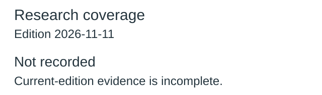
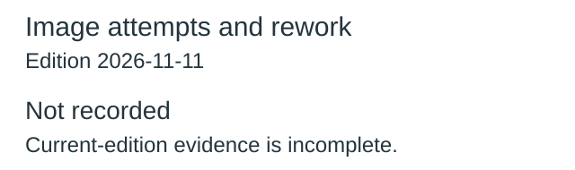
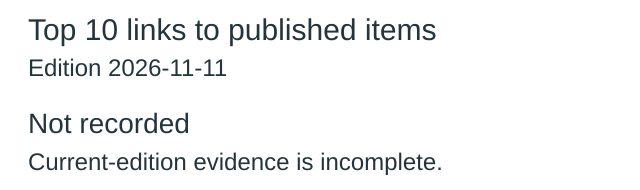
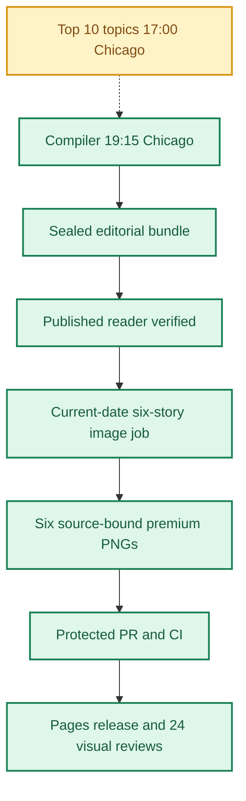
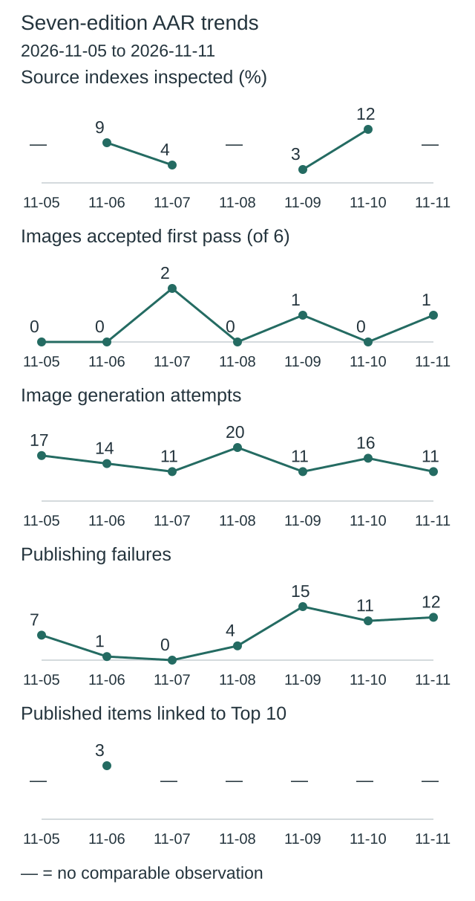
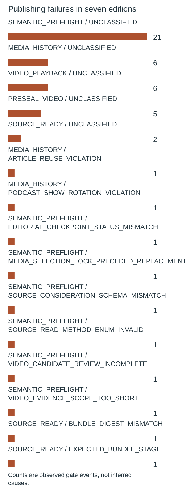
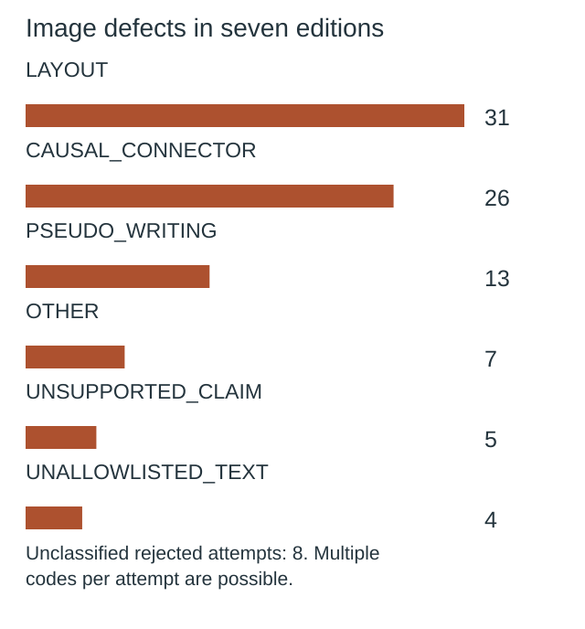

**🟩 RELEASE COMPLETE**
**TOP 10 PARTIAL** · **🟩 COMPILER VERIFIED** · **🟦 IMAGES 6/6 RELEASED** · **🟪 VISUAL QA 24/24 PASS**

# Daily AI Brief — Unified Production After-Action Report
**Edition:** November 11, 2026 · **Production evening:** 2026-11-10 · **Timezone:** America/Chicago
**Primary public reader:** [Open 2026-11-11 Brief](https://gttome.github.io/Daily-AI-Brief-Compiler/briefs/2026-11-11/) · **Repository:** [Daily-AI-Brief-Compiler](https://github.com/gttome/Daily-AI-Brief-Compiler)

> **IMPORTANT — VERIFIED PRODUCTION RESULT**
> **Executive release result: COMPLETE.** This is the single management-facing report covering Top 10 topic discovery, the editorial Compiler, published Brief and premium-image run. **Entire-system evidence: PARTIAL.** Top 10 report: **partial**; Compiler handoff: **RECEIVED_SNAPSHOT_BOUND**; guided searches: **INVALID**. Compiler public status: **VERIFIED**. Image release: **RELEASED_VERIFIED**. Direct 24-context visual quality: **24/24 PASS**. Autonomous completion: **UNPROVEN**. Missing evidence must not be promoted to a success claim.

**🕒 Production stage durations:** **Top 10 12m 28s** · **Compiler final seal window 3m 56s** · **Premium Images 23m 37s** (evidence-bounded elapsed times; the start/end events differ).

## Evidence reconciliation

Compiler final seal window: 3m 56s. Compiler state start to public verification: 67m 26s. Observed execution and final seal windows are distinct.
Image capability route preflight: NOT OBSERVED; scheduler origin remains UNPROVEN.
Image efficiency: 1/6 first-pass accepts; 11 total attempts. Current efficiency target: at least 3/6 first-pass and at most 2 attempts per image, with unchanged quality floor.
Image review completed: 2026-11-11T03:51:01Z; review-record commit: 2026-11-11T03:52:49.000Z; protected review merge: 2026-11-11T03:55:41.000Z.
Eligible source indexes: 109; editorial inspections reported: Unknown (Unknown%); inaccessible in editorial audit: 5; explicitly unreviewed IDs: 77; unclassified editorial IDs: Unknown. Automated index parsing is separate from editorial inspection and cannot substantiate exhaustive freshness claims.

Registered video sources: 29; attempted this edition: 29; unattempted: 0; enabled: 28; qualification-only: 1; sources yielding candidate URLs: 1. Status: REPORTED_ALL_ATTEMPTED. Attempt evidence is not automatic proof of source-content review or playback.

## Daily AAR charts

These charts use this edition’s receipts. Missing data is not zero.

### Research coverage



**Not recorded:** current-edition evidence is missing or inconsistent.

Not inspected includes every index without a recorded editorial inspection; this is not proof of missed stories.

### Image attempts and rework



**11 attempts; 1 of 6 images accepted on their first attempt.**

Recorded ongoing from November 8 target: at least 3/6 first-pass accepts; no more than 2 attempts per image. This is an efficiency target, not a quality cutoff.

| Image | Accepted | Rejected | Total attempts |
|---|---:|---:|---:|
| IBM keeps AI coding specs alive through validation loops | 1 | 1 | 2 |
| OpenAI moves emergency model shutdown into inference | 1 | 1 | 2 |
| Claude adds shared sheets, canvases and governed data work | 1 | 1 | 2 |
| Gemini summaries and drafting expand across Workspace Gmail | 1 | 0 | 1 |
| Google Workspace turns team standards into reusable skills | 1 | 1 | 2 |
| A marketing-agent demo keeps humans over data, claims and spend | 1 | 1 | 2 |

Generation attempts measure rework, not runtime or cost. Quality and publication checks remain separate.

### Top 10 links to published items



**Not recorded:** current-edition evidence is missing or inconsistent.

No selection quota. Topic linkage does not establish better quality, popularity or causal improvement.

[Chart data](charts.json)

One edition at a time. Missing evidence is not zero. Trend claims require comparable recorded cycles.

## Performance dashboard

| Measure | Recorded result | Source / caveat |
|:--|:--:|:--|
| Entire-system evidence | **PARTIAL** | Full Top 10 list, bound Compiler input, all-format search receipts and existing release checks; separate from publication and autonomy |
| Top 10 report | **partial · 10 topics** | Same Chicago cycle report; provisional/partial coverage remains disclosed |
| Top 10 received by Compiler | **RECEIVED_SNAPSHOT_BOUND** | Exact report snapshot bytes; consumed commit separately corroborated: YES |
| Top 10 guided article/video/podcast searches | **INVALID** | Actual source-search receipts and selected/rejected topic outcomes |
| Top 10 stage duration | **12m 28s** | Same-cycle run receipt only; no runtime or usage estimate |
| Editorial publication | **PASS** | State and public reader integrity receipt |
| **Unattended autonomy (separate from publication)** | **UNPROVEN** | Owner incident receipt takes precedence over unverified producer self-attestation |
| Recorded protected publishing gate failures | **12** | Actual same-edition GitHub failure sidecar only; earlier unrecorded failures remain unknown |
| Articles | **6** | Exactly 2 technical / 2 knowledge-worker / 2 agents required |
| Original scientific-paper-led articles | **Not recorded** | Rolling target: one qualified original paper in seven editions; NOT_RECORDED. Preprints are not peer-reviewed by default |
| Verified original sources within preceding 24 hours | **0 / 6** | Original publisher dates only; other sources require a documented fallback rationale |
| Distinct selected article publishers | **5** | Six different primary organizations preferred |
| Videos over seven days old | **2** | Must be labeled evergreen, not a new development |
| Distinct selected video publishers | **2** | One channel is one publisher even across multiple videos |
| Video discovery source attempts | **29 / 29** | Attempt evidence across enabled and qualification-only leads; REPORTED_ALL_ATTEMPTED. Not a claim of full content review or player verification | 
| Duplicate active Watchlist display titles | **Not recorded** | Published canonical Watchlist only; historical evidence retained |
| Original-release video playback (historical) | **TWO_PUBLISHED_VIDEOS_PLAYBACK_PASS** | Later reader corrections may replace these originally verified videos; see incident register | 
| Postpublication reader incidents | **NOT_RECORDED** | Edition-specific owner reports and corrective PRs, not inferred absence | 
| Verified postpublication video corrections | **NOT_RECORDED** | Incident register tracks correction PR, actual playback evidence and reader preservation |
| Editorial index second-pass attempts | **0** | Bounded public GET retries only; never proof of original article reading |
| Editorial index reads recovered | **0** | Successful page fetch can still yield zero eligible dated items |
| Recorded scheduler capability route | **UNPROVEN** | Same-invocation route receipt only; GitHub is not scheduler authentication |
| Avoidable incomplete-staging CI failures | **Not independently audited** | Existing image-package push CI is disabled; exact-head protected PR CI remains required. A failure count requires actual workflow evidence |
| Media | **2 videos + 2 podcasts** | Sealed bundle |
| **Compiler final seal window** | **3m 56s (3.9 min)** | Final sealed-state timestamp → verified public reader; initial execution is separate |
| **Image processing stage duration** | **23m 37s** | First accepted PNG Git checkpoint → final 24/24 review; auditable stage elapsed time |
| Image scheduled-to-final-review window | **Not independently recorded** | Only with a saved one-cycle schedule anchor; does not attest exact generation start |
| Executor-observed generation-to-final-review | **27m 57s** | Only if the worker recorded a same-execution clock before its first native call; not independently verified provider runtime |
| Accepted premium PNGs | **6 / 6** | Exact package and public release hashes |
| Native image generation attempts | **11** | Image worker AAR; no estimation |
| Rejected candidates | **5** | Image worker AAR |
| Final worker checkpoint reconciliation | **PASS** | Oct25+ verifies exact generation count, per-story attempts, six accepted story/image/hash bindings and final release |
| Saved visual contexts | **24 / 24 PASS** | Dated/permanent desktop/mobile review |
| Public SHA-256 checks | **44** | Image release receipt |
| October 8 immutable history | **17 / 17** | Independent content-preservation checks |
| **Owner-reported weekly Work usage for this run** | **Not reported** | No per-cycle usage supplied |

> **EFFICIENCY NOTE**
> **Resource reporting policy:** No usage figure was supplied for this cycle, so none is assumed. Future runs show **Not reported** unless the owner supplies new cycle-specific usage metadata. No approval or extra step is required to generate the AAR.

## Production architecture and checkpoints



## Daily AI Topic Top 10 and Compiler handoff

**Research cycle:** 2026-11-10 · **Target Brief:** 2026-11-11 · **Scheduled start:** 17:00 America/Chicago

| Dimension | Recorded evidence |
|---|---|
| Run/report result | PARTIAL |
| Report status / topics | partial / 10 |
| Freshness | FRESH\_AT\_CONSUMPTION |
| Compiler handoff | RECEIVED\_SNAPSHOT\_BOUND |
| Search coverage | INVALID |
| Selection mapping verification | INVALID |
| Observed start / finish | 2026-11-10T22:58:09Z / 2026-11-10T23:10:37Z |
| Elapsed minutes | 12.47 |
| Usage percent | Not reported |
| Cost USD | Not reported |
| Independent scheduler autonomy | UNPROVEN |
| Compiler-recorded consumed commit | 88fb5867c7101bbc6d53295e0200ddcb76adb972 |
| Report SHA-256 | caefe744d1e87f47846ca8d629d69d63106d54b7dd7636ed4afe57ad5e4a6bef |

**Order:** discovery sequence only; entries are unranked within qualitative evidence bands.

| Discovery order | AI topic | Summary | Confidence | Evidence |
|---:|---|---|---|---|
| 1 | Claude Fable 5.2 and Mythos 5.2 launch | Anthropic released related models with different safeguards and access rules for demanding technical work. | medium | [Source](https://www.youtube.com/watch?v=2TM8W66NI_8) · [Source](https://www.youtube.com/watch?v=vdYynH177h0) · [Source](https://www.youtube.com/watch?v=cH88SXCQZEQ) · [Source](https://www.youtube.com/watch?v=1gYQc4CL_oo) · [Source](https://www.reddit.com/r/ClaudeAI/comments/1xs2wdl/fable_52_review_here_is_whats_actually_different/) · [Source](https://www.anthropic.com/claude-fable-and-mythos-5-2) |
| 2 | New video revives OpenAI’s Linux vulnerability study | A November 9 explainer renewed attention to OpenAI’s November 4 automated vulnerability and patching study. | medium | [Source](https://www.youtube.com/watch?v=pf5tXJZM1Rw) · [Source](https://openai.com/index/a-thousand-fewer-paths-to-root/) |
| 3 | OpenAI describes Control Room’s inference stop control | OpenAI says its central authorization system can stop model output for a research job within 35 seconds after a stop instruction. | medium | [Source](https://x.com/OpenAI/status/2119913172039868579) · [Source](https://openai.com/index/control-room/) |
| 4 | TokenEconomizer’s token-cost controls draw growing video interest | Microsoft’s open-source controller tries to reduce repeated setup work, unused tools and failure loops in coding agents. | medium | [Source](https://www.youtube.com/watch?v=P5QCrpdr9gU) · [Source](https://github.com/microsoft/TokenEconomizer) |
| 5 | AlphaProof Code verifies specified Signal security properties | DeepMind describes AI agents and human-reviewed specifications used to prove properties of Signal’s compiled implementation. | medium | [Source](https://news.ycombinator.com/item?id=50439193) · [Source](https://deepmind.google/blog/introducing-alphaproof-code/) · [Source](https://google-deepmind.github.io/code-verification/) |
| 6 | Gemini 4 Carbon moves into broader public access | Google announced new availability for Carbon across consumer and developer channels, with access depending on the channel and plan. | medium | [Source](https://news.ycombinator.com/item?id=50442303) · [Source](https://www.youtube.com/watch?v=l32KKNKdpIk) · [Source](https://blog.google/innovation-and-ai/models-and-research/gemini-models/gemini-4-carbon-now-available/) · [Source](https://deepmind.google/models/model-cards/gemini-4-carbon/) |
| 7 | IBM compares iterative AI coding specs with waterfall | IBM’s new explainer asks how specifications can evolve with AI-generated code instead of becoming stale planning documents. | medium | [Source](https://www.youtube.com/watch?v=GpZ5T51jE4U) · [Source](https://www.ibm.com/think/topics/spec-driven-development) · [Source](https://www.qabash.com/bash-tv/73753) |
| 8 | A marketing-agent demo combines data, tools and creative review | Greg Isenberg and Cody Schneider demonstrate a marketing setup using data access, creative APIs and an agent that reviews ads. | medium | [Source](https://www.youtube.com/watch?v=uJuxenfe-NU) · [Source](https://plinkhq.com/i/1593424985/e/1000800824847) · [Source](https://spoken.md/episode/ai-agents-are-too-good-at-marketing-now-1000800824847) |
| 9 | Modern Web Guidance packages browser expertise for coding agents | A browser-team-backed skills project gives coding agents modern web guidance and tools for finding legacy patterns. | medium | [Source](https://news.ycombinator.com/item?id=50443812) · [Source](https://github.com/GoogleChrome/modern-web-guidance) · [Source](https://developer.chrome.com/docs/modern-web-guidance) |
| 10 | Claude adds Sheets, Whiteboards and connected data work | Anthropic announced collaborative artifact types and interactive app connectors for work inside Claude. | medium | [Source](https://news.ycombinator.com/item?id=50443716) · [Source](https://claude.com/resources/articles/more-ways-to-work-with-claude-sheets-whiteboards-and-interactive-connectors) |

**Sample scope:** {"metadata\_screened\_videos":60,"distinct\_retained\_channels":33,"new\_metadata\_screened\_records":64,"new\_metadata\_distinct\_channels":33,"combined\_observation\_records":64,"combined\_unique\_video\_ids":60,"unique\_videos":60,"videos\_watched":0,"full\_video\_reviews":0,"direct\_counter\_verifications":0,"direct\_youtube\_counter\_verifications":0,"transcript\_reviews":0,"partial\_original\_publisher\_transcript\_reviews":1,"partial\_third\_party\_transcript\_reviews":0,"original\_watch\_attempts":60,"comparable\_video\_observations":3,"validation\_resources\_registered":14,"target\_40\_to\_80\_full\_reviews\_met":false,"target\_55\_metadata\_screens\_met":true,"freshness\_reference\_at":"2026-11-10T23:02:51Z","within\_24h\_reported\_publications":1,"additional\_within\_72h\_reported\_publications":15,"additional\_within\_7d\_reported\_publications":0,"date\_only\_video\_publications":44,"unknown\_video\_publication\_dates":0,"original\_event\_document\_reviews":10,"notes":\["Publication clocks are index reports. Date-only items are not forced into 24/72-hour buckets. One November 3 date-only program is at the seven-day boundary; exact age is unknown.","AUA entries contain machine-generated summary titles; aliases are preserved and IDs deduplicated. Secondary trackers do not create extra publishers or reach.","60 distinct original watch attempts: 52 throttled, 8 cached title/index shells. No video content played."\]}. **Ranking basis:** {"attention":"Event-matched channel coverage and reported reach, community discussion and third-party post counters. The strongest comparable signal is interval view accumulation in three same-tracker videos; only one supports a ranked topic.","limitations":"No global census, exact composite score, channel-relative baseline or instantaneous velocity. Vendor marketing, syndicated notes and overlapping tracker entries do not count as independent breadth.","independence":"Claude launch has several named publishers plus a separate community; Carbon has HN and a metadata-only reviewer listing. All other topics rely on one observed attention family.","usefulness":"Brief fit and claim confidence are separate editorial judgments; popularity does not qualify an item."}.

| Search format | Receipt rows | Attempts recorded | Explicitly not attempted |
|---|---:|---:|---:|
| article | 0 | 0 | 0 |
| video | 0 | 0 | 0 |
| podcast | 0 | 0 | 0 |

**Selected Brief items linked to trends:**

No validated selection-to-topic mapping was recorded.

**Raw, unverified Top 10 receipt observations:** 30 search rows across 30 topic/format pairs; 4 claimed mapping rows (4 with noncanonical fields). Noncanonical outcomes: candidate_discovered. These counts are NOT validated search attempts or verified selections.

**Gaps and limitations:**

- Claimed trend-to-selection mappings are not verified against the same-edition selected bundle.
- Per-topic article/video/podcast search coverage is incomplete, invalid or bound to a different input.
- The report labels its research partial.
- PARTIAL: 60 videos were metadata-screened, zero fully played and zero direct counter checks. Ten supported topics do not complete the 40–80 full-video review target.
- Views and engagement are third-party where reported. Unknown likes, comments, subscribers, disclosures, measurement clocks and formats remain null or explicitly unknown; transcripts, full playback and metadata are distinct.
- Publication dates are reported by indexes unless original dated text is cited. Broader initial search used 24 hours, widened to 72 hours and seven days for thin areas; older underlying studies and the May IBM background are labeled.
- Most audience growth and all exact topic rank changes are unknown. Three comparable rounded tracker observations are interval accumulation only.
- Source breadth is sampled across models, technical research, agents, practical work, creative tools, business and societal topics. Some screened domains remain unranked when event attention or original verification is thin.
- No current Compiler consumption, actual searches, selected mappings, publication, image release, scheduler autonomy, exact usage or cost is established by this producer report.

**Recorded run issues:**

- {"issue":"52 distinct original watch pages throttled and 8 returned title/index shells.","effect":"No full video playback or direct counters; metadata screening does not finish the 40–80 full-review target.","correction":"Kept separate observation and tracker measurement times; marked report partial despite 60 metadata screens and ten supported leads."}
- {"issue":"Original episode fallback routes for IBM, Better Stack and Greg Isenberg did not expose readable episode content; third-party transcript body returned DisabledError.","effect":"IBM relies on an indexed program description plus explicitly older original background. Marketing relies on syndicated episode notes and a search excerpt.","correction":"No transcript review or playback is claimed for these programs. One partial original Latent Space transcript is recorded separately and not retained as a ranked topic."}
- {"issue":"Paciva video page loaded no resolvable video items.","effect":"Its preview titles were not counted as inspected distinct source items.","correction":"Added 15 deduplicated items through another public index; 60 distinct IDs are backed by exposed original links."}
- {"issue":"Latest earlier Compiler trend-search receipt is invalid and selection chart is NOT\_RECORDED.","effect":"Unable to evaluate Top 10's effect on chosen articles, videos or podcasts.","correction":"Preserved the gap in cumulative decisions. Existing Compiler owns canonical current-cycle search and selection receipts."}

**Recorded improvements:**

- {"status":"implemented","change":"Reached 60 distinct metadata screens using additional publisher-linked discovery.","reason":"Approved next-cycle research action targeted &gt;=55 when access allowed.","observed\_effect":"More candidate visibility; no causal quality improvement established."}
- {"status":"implemented","change":"Recorded ten event-original document reviews and ten per-family removal assessments.","reason":"Check named claims and sensitivity without treating marketing or extra URLs as independence.","observed\_effect":"Claim limits and family dependencies are explicit."}
- {"status":"implemented","change":"Recorded first cumulative NOV03-04, AAR-10, AAR-02 and AAR-03 evaluations within Top 10 ownership.","reason":"Due for edition November 11; charts include missing and noncomparable metrics.","observed\_effect":"AAR-10's documentation criterion is met in the previous reconciled cycle; other efficacy results are inconclusive."}
- {"status":"proposed","change":"Prioritize freely readable original episode text and event-matched independent attention; have Compiler bind genuine searches to the consumed bytes and selected bundle using its canonical validator."}

### Daily improvement and effect on the Brief

**Fixed baseline:** nov03-2026-v1 / INPUT\_FROZEN. **Outcome baseline:** FROZEN\_AFTER\_VERIFIED\_PUBLICATION. **Prior cycle:** 2026-11-09.

| Input measure | Current | November 3 baseline | Change from baseline | Change from prior cycle |
|---|---:|---:|---:|---:|
| topic count | 10 | 10 | 0 | 0 |
| validation resource count | Not reported | 14 | Not reported | Not reported |
| additional video metadata records | 64 | 63 | 1 | 12 |
| additional video channels | 33 | 21 | 12 | 7 |
| total video observations | 64 | 79 | -15 | 12 |
| unique videos | 60 | 71 | -11 | 8 |
| full video reviews | 0 | 0 | 0 | 0 |
| direct youtube counter verifications | 0 | 0 | 0 | 0 |
| broader evidence band topics | 1 | 3 | -2 | 0 |
| limited evidence band topics | 9 | 7 | 2 | 0 |

**Observed downstream measurements:** PENDING\_OR\_INCOMPLETE.

| Outcome measure | Current | Change from frozen outcome | Change from prior cycle |
|---|---:|---:|---:|
| expected topic format pairs | 30 | 0 | Not reported |
| attempted topic format pairs | Not reported | Not reported | Not reported |
| explicitly unattempted pairs | Not reported | Not reported | Not reported |
| discovered candidate count | Not reported | Not reported | Not reported |
| searched source host count | Not reported | Not reported | Not reported |
| selected article count | Not reported | Not reported | Not reported |
| selected video count | Not reported | Not reported | Not reported |
| selected podcast count | Not reported | Not reported | Not reported |

**Source changes:** {"added":\[\],"removed":\["hacker-news","artificial-analysis","github-originals","reuters"\]}.

**Candidate review depth:** NOT\_RECORDED.

| Review measure | Current | Change from prior comparable cycle |
|---|---:|---:|
| reviewed candidate count | Not reported | Not reported |
| qualified candidate count | Not reported | Not reported |
| rejected candidate count | Not reported | Not reported |
| metadata only count | Not reported | Not reported |
| full video reviews | Not reported | Not reported |
| transcript reviews | Not reported | Not reported |

The frozen November 3 baseline has no candidate-level review ledger; no retrospective value is invented. Recorded reviews do not independently establish content quality, audience interest or causal benefit.

**Method/resource review:** {"baseline\_id":"nov03-2026-v1","previous\_report\_date":"2026-11-09","previous\_method\_version":"2026-11-03.2-event-review","method\_version":"2026-11-03.2-event-review","feedback":{"aar\_url":"https://github.com/gttome/Daily-AI-Brief-Compiler/blob/22f6d471f10a96943c88c63ff464d7af72a7ed6b/daily/2026-11-09/combined.json","charts\_url":"https://github.com/gttome/Daily-AI-Brief-Compiler/blob/22f6d471f10a96943c88c63ff464d7af72a7ed6b/daily/2026-11-09/charts.json","metrics\_url":"https://github.com/gttome/Daily-AI-Brief-Compiler/blob/22f6d471f10a96943c88c63ff464d7af72a7ed6b/daily/2026-11-09/improvement-metrics.json","observation":"Earlier November 10 edition reader/images completed, report snapshot bound, Compiler search receipt invalid, selection links NOT\_RECORDED. Source chart reports 13/109; images 16 attempts and 0 first-pass acceptances. These measures do not prove Top 10 selection impact.","series":\[{"edition\_date":"2026-11-04","coverage\_percent":null,"coverage\_numerator":null,"coverage\_denominator":null,"first\_pass\_accepted":0,"image\_attempts":21,"top10\_linked\_items":null,"publication\_failures":3},{"edition\_date":"2026-11-05","coverage\_percent":null,"coverage\_numerator":null,"coverage\_denominator":null,"first\_pass\_accepted":0,"image\_attempts":17,"top10\_linked\_items":null,"publication\_failures":7},{"edition\_date":"2026-11-06","coverage\_percent":9,"coverage\_numerator":8,"coverage\_denominator":87,"first\_pass\_accepted":0,"image\_attempts":14,"top10\_linked\_items":3,"publication\_failures":1},{"edition\_date":"2026-11-07","coverage\_percent":4,"coverage\_numerator":4,"coverage\_denominator":109,"first\_pass\_accepted":2,"image\_attempts":11,"top10\_linked\_items":null,"publication\_failures":0},{"edition\_date":"2026-11-08","coverage\_percent":null,"coverage\_numerator":null,"coverage\_denominator":null,"first\_pass\_accepted":0,"image\_attempts":20,"top10\_linked\_items":null,"publication\_failures":4},{"edition\_date":"2026-11-09","coverage\_percent":3,"coverage\_numerator":3,"coverage\_denominator":109,"first\_pass\_accepted":1,"image\_attempts":11,"top10\_linked\_items":null,"publication\_failures":15},{"edition\_date":"2026-11-10","coverage\_percent":12,"coverage\_numerator":13,"coverage\_denominator":109,"first\_pass\_accepted":0,"image\_attempts":16,"top10\_linked\_items":null,"publication\_failures":11}\],"limits":"Seven eligible edition rows are not seven full days of exposure for changes activated November 5; unknown linkage values remain null. This producer evaluates its own role and shared documentation only."},"changes":\[{"change":"Add a new public publisher-linked discovery index and screen 60 distinct dated video items across 33 channels.","reason":"Close the prior three-item shortfall against the approved next-cycle &gt;=55 metadata target when accessible.","expected\_effect":"Broader candidate visibility, with full-review depth measured separately."},{"change":"Deepen ten event-original documents and retain one partial original program transcript separately from playback.","reason":"Check concrete event claims and permission, trust or availability limits before forwarding queries.","expected\_effect":"More useful bounded leads, not proof of improved Compiler selection."},{"change":"Record first cumulative due-date decisions and per-family removal assessments.","reason":"Use earlier charts and actual missing consumer evidence to evaluate documentation and limits.","expected\_effect":"Honest keep/revise recommendations without retrospective fixes or new gates."}\],"resource\_candidates":\[{"url":"https://www.vibe-coding.academy/pulse/","role":"dated video discovery","decision":"accepted","access":"public index","review\_scope":"16 current linked video entries inspected; one duplicates the existing Latent Space program.","reason":"Added 15 distinct IDs, including practical, model and skills channels; no reach inferred from listing.","contribution":"Metadata only; Shorts explicitly separated."},{"url":"https://monitor.paciva.ai/videos","role":"broader news-channel discovery","decision":"deferred","access":"Search exposes titles but original page loads an empty video panel.","review\_scope":"Public page and indexed preview only.","reason":"No resolved original video IDs for the preview set, so none of those titles counts toward screened items.","contribution":"No counted candidates."},{"url":"https://developer.chrome.com/docs/modern-web-guidance","role":"original skills documentation","decision":"accepted","review\_scope":"Documentation route resolved; main substantive review is the original repository quickstart.","reason":"Useful original project context, with meaningful procedure validation left to Compiler.","contribution":"One original route; not independent audience confirmation."}\],"observed\_effects":\[{"observation":"60 distinct metadata-screened video IDs versus 52 in the prior dated report; named channels 33 versus 26.","effect":"Eight additional screened IDs and seven additional named channels in a differently composed sample. This is coverage, not audience growth or demonstrated quality."},{"observation":"Three same-tracker comparable video observations retained; 10/10 topics have family partitions and explicit removals.","effect":"Bounded attention comparison and sensitivity documentation; precise popularity ranks and most growth remain unknown."},{"observation":"The 40–80 full-video review target remains unfinished: zero full playback or direct counters.","effect":"Report stays partial despite ten supported leads and &gt;=55 metadata screens."}\],"next\_improvement":"Prioritize freely readable original episode text and event-matched independent attention; have Compiler bind genuine searches to the consumed bytes and selected bundle using its canonical validator.","change\_evaluations":\[{"change\_id":"NOV03-04","reviewed\_edition":"2026-11-11","decision":"revise","result":"inconclusive","reason":"The first cumulative series contains no reliable selection uplift: six of seven linkage values are unknown and the latest Compiler search receipt is invalid. Today has 60 video metadata screens but zero full playback and only one partially reviewed original program transcript, outside the final ten. Keep deeper publisher work and correct consumer receipts in the owning Compiler lane; implementation and expanded volume do not establish better selections.","evidence\_refs":\["https://github.com/gttome/Daily-AI-Brief-Compiler/blob/22f6d471f10a96943c88c63ff464d7af72a7ed6b/daily/2026-11-09/combined.json","https://github.com/gttome/Daily-AI-Brief-Compiler/blob/22f6d471f10a96943c88c63ff464d7af72a7ed6b/daily/2026-11-09/improvement-metrics.json","https://github.com/gttome/Daily-AI-Brief-Compiler/blob/22f6d471f10a96943c88c63ff464d7af72a7ed6b/signals/ai-topic-top10/2026-11-09.json"\]},{"change\_id":"AAR-10","reviewed\_edition":"2026-11-11","decision":"keep","result":"met","reason":"The latest reconciled earlier AAR records ten valid family removal assessments, one broader band and nine limited bands. This is evidence that the bounded documentation criterion is met for that cycle; it is not proof of independent audiences, global popularity, stronger Brief selection, or causal improvement. Today's ten topics retain explicit family partitions and removal reasons.","evidence\_refs":\["https://github.com/gttome/Daily-AI-Brief-Compiler/blob/22f6d471f10a96943c88c63ff464d7af72a7ed6b/daily/2026-11-09/improvement-metrics.json","https://github.com/gttome/Daily-AI-Brief-Compiler/blob/22f6d471f10a96943c88c63ff464d7af72a7ed6b/signals/ai-topic-top10/2026-11-09.json"\]},{"change\_id":"AAR-02","reviewed\_edition":"2026-11-11","decision":"keep","result":"inconclusive","reason":"This run read COMMON and TOP10 at one protected-main commit and preserved the existing task and repository write boundaries. Runtime prompt-size, requirements-audit execution and all-four-role conflicting-instruction counts were not independently observed, so zero conflicts or complete migration efficacy is not claimed.","evidence\_refs":\["https://github.com/gttome/Daily-AI-Brief-Compiler/blob/942b1baf37858c03449ab09572e177ab97eeeded/docs/automation/current/COMMON.md","https://github.com/gttome/Daily-AI-Brief-Compiler/blob/942b1baf37858c03449ab09572e177ab97eeeded/docs/automation/current/TOP10.md"\]},{"change\_id":"AAR-03","reviewed\_edition":"2026-11-11","decision":"keep","result":"inconclusive","reason":"The Top 10 role records its first cumulative due-date decisions using the eligible seven-edition chart and available original receipts. Several metrics are missing and some increments activated November 5, so this is not seven full days of exposure for every change. Other roles retain their own evaluations; no system-wide review completion or safeguard retirement is asserted.","evidence\_refs":\["https://github.com/gttome/Daily-AI-Brief-Compiler/blob/22f6d471f10a96943c88c63ff464d7af72a7ed6b/daily/2026-11-09/charts.json","https://github.com/gttome/Daily-AI-Brief-Compiler/blob/22f6d471f10a96943c88c63ff464d7af72a7ed6b/daily/2026-11-09/improvement-metrics.json","https://github.com/gttome/Daily-AI-Brief-Compiler/blob/942b1baf37858c03449ab09572e177ab97eeeded/config/aar-improvement-register.json"\]}\],"pending\_change\_evaluations":\[\],"review\_due\_edition":"2026-11-11","limitations":\["Other role evaluations and current Compiler/image/publication outcomes remain owned and unobserved here.","Larger samples and implementation commits do not demonstrate better production outcomes."\]}.

**Current reconciled conclusion:** PENDING\_OR\_INCOMPLETE; outcome baseline FROZEN\_AFTER\_VERIFIED\_PUBLICATION; candidate review ledger NOT\_RECORDED.

**Historical producer observations (not current status):** The following snapshot preserves what the producer reported at the time. Its pending statuses and candidate-quality claims are not independently reconciled conclusions. Use the current tables above for publication-bound measurements; an absent candidate review ledger remains unknown.

<details><summary>Original producer effects and gaps — historical snapshot</summary>

```json
null
```

</details>

**Next improvement:** Prioritize freely readable original episode text and event-matched independent attention; have Compiler bind genuine searches to the consumed bytes and selected bundle using its canonical validator.

Counts show coverage and observed association, not audience popularity, source independence, candidate quality or causal uplift. Compare source/method changes before interpreting deltas. Unknown values are not zero. Publication, reader corrections, runtime and image outcomes retain their separate AAR evidence.

Report, source-readback and search receipts are separate observations. Snapshot binding verifies the collected report bytes; the consumed commit is independently corroborated only when the separately fetched source bytes match. These records do not independently attest scheduler identity or source truth. Top 10 reporting does not change Brief/image release status.


## Track 1 — Compiler

**State:** `SHADOW_VERIFIED` · **Bundle:** `BUNDLE_READY` · **Compiler final seal window:** 3m 56s (3.9 min).

| Publication gate | Result |
|---|:---:|
| Canonical reader build | ✅ |
| Reader parity | ✅ |
| Public verification of dated edition | ✅ |
| Previous editions preserved | ✅ |
| Permanent story routes and feeds | ✅ |

**Selected coverage:**

| Lane | Story |
|---|---|
| Technical AI Engineering | IBM keeps AI coding specs alive through validation loops |
| Technical AI Engineering | OpenAI moves emergency model shutdown into inference |
| Applied Generative AI for Knowledge Workers | Claude adds shared sheets, canvases and governed data work |
| Applied Generative AI for Knowledge Workers | Gemini summaries and drafting expand across Workspace Gmail |
| Agents for Everyone | Google Workspace turns team standards into reusable skills |
| Agents for Everyone | A marketing-agent demo keeps humans over data, claims and spend |

### Scientific paper opportunity and publication evidence

**Current edition:** NOT_RECORDED; **paper-led stories:** Not recorded. Editorial target: at least one genuinely qualified original-paper-based story in seven editions, with methods, limitations, and an explicit preprint/peer-review distinction. No stale or weak paper is selected solely to fill a quota.


## Track 2 — Premium images

**Public status:** `RELEASED_VERIFIED` · **Saved images:** 6/6 · **Actual generation attempts:** 11 · **Rejected candidates:** 5.

### Image production duration — Git-verified milestones

**Auditable image stage duration:** **23m 37s** (first accepted binary saved in Git → first persisted 24-context quality-review record). **First asset to public image release:** **18m 49s**.
**Scheduled-to-final-review window:** **Not independently recorded**. This is a scheduled-clock comparison only when a separately recorded exact-date schedule exists; it is **not** measured native image-generation runtime.

| Production milestone | Chicago local time | Evidence |
|---|---|---|
| Scheduled image start (if exact-date record exists) | Not independently recorded | Time planned, not actual execution start |
| First executor-observed start | 9:14:30 PM | Worker self-attestation, not a first-party scheduler event |
| First native generation observation | 9:24:52 PM | Worker clock recorded immediately before first native call, not model-provider telemetry |
| First accepted PNG bytes saved to Git | 9:29:12 PM | Immutable binary-stage commit |
| Six-image package / reviews committed | 9:44:25 PM | Exact-head PR source commit |
| Protected package merged | 9:47:03 PM | Merge SHA and required CI |
| Public images verified | 9:48:00 PM | Image-release receipt |
| 24/24 review record committed | 9:52:49 PM | Immutable first review-approval commit |

> **Duration interpretation:** The audited stage excludes unobservable pre-checkpoint creative work. The scheduled-start window includes it but must not be interpreted as precise active processing time. Missing timestamps appear as **Not independently recorded**, never an estimate.


| Source-bound image | Attempts | File size | Public page |
|---|---:|---:|---|
| IBM keeps AI coding specs alive through validation loops | 2 | 0.77 MiB | [View original](https://gttome.github.io/Daily-AI-Brief-Compiler/briefs/images/2026-11-11/dab-edition-2026-11-11-m01.png) |
| OpenAI moves emergency model shutdown into inference | 2 | 0.70 MiB | [View original](https://gttome.github.io/Daily-AI-Brief-Compiler/briefs/images/2026-11-11/dab-edition-2026-11-11-m02.png) |
| Claude adds shared sheets, canvases and governed data work | 2 | 0.63 MiB | [View original](https://gttome.github.io/Daily-AI-Brief-Compiler/briefs/images/2026-11-11/dab-edition-2026-11-11-m10.png) |
| Gemini summaries and drafting expand across Workspace Gmail | 1 | 0.62 MiB | [View original](https://gttome.github.io/Daily-AI-Brief-Compiler/briefs/images/2026-11-11/dab-edition-2026-11-11-m11.png) |
| Google Workspace turns team standards into reusable skills | 2 | 0.75 MiB | [View original](https://gttome.github.io/Daily-AI-Brief-Compiler/briefs/images/2026-11-11/dab-edition-2026-11-11-m12.png) |
| A marketing-agent demo keeps humans over data, claims and spend | 2 | 0.70 MiB | [View original](https://gttome.github.io/Daily-AI-Brief-Compiler/briefs/images/2026-11-11/dab-edition-2026-11-11-m14.png) |

**Immutable-release and visual gates:**

| Release gate | Result |
|---|:---:|
| Protected public image receipt | ✅ |
| Accepted-image Git hash bindings | ✅ |
| Six live PNGs | 6/6 |
| Dated/permanent story placements | 12/12 recorded in release evidence |
| Desktop/mobile visual inspection | 24/24 PASS |
| Historical Oct 8 integrity | 17/17 |

### Published premium illustrations

<table>
<tr><td width="50%"><a href="https://gttome.github.io/Daily-AI-Brief-Compiler/briefs/images/2026-11-11/dab-edition-2026-11-11-m01.png"></a><br/><b>IBM keeps AI coding specs alive through validation loops</b></td><td width="50%"><a href="https://gttome.github.io/Daily-AI-Brief-Compiler/briefs/images/2026-11-11/dab-edition-2026-11-11-m02.png"></a><br/><b>OpenAI moves emergency model shutdown into inference</b></td></tr>
<tr><td width="50%"><a href="https://gttome.github.io/Daily-AI-Brief-Compiler/briefs/images/2026-11-11/dab-edition-2026-11-11-m10.png"></a><br/><b>Claude adds shared sheets, canvases and governed data work</b></td><td width="50%"><a href="https://gttome.github.io/Daily-AI-Brief-Compiler/briefs/images/2026-11-11/dab-edition-2026-11-11-m11.png"></a><br/><b>Gemini summaries and drafting expand across Workspace Gmail</b></td></tr>
<tr><td width="50%"><a href="https://gttome.github.io/Daily-AI-Brief-Compiler/briefs/images/2026-11-11/dab-edition-2026-11-11-m12.png"></a><br/><b>Google Workspace turns team standards into reusable skills</b></td><td width="50%"><a href="https://gttome.github.io/Daily-AI-Brief-Compiler/briefs/images/2026-11-11/dab-edition-2026-11-11-m14.png"></a><br/><b>A marketing-agent demo keeps humans over data, claims and spend</b></td></tr>
</table>

## Incidents, corrections and learning

### Postpublication reader incidents (updated when new evidence is merged)

No current-edition postpublication incident register was available; this is **NOT_RECORDED**, not a certification of zero incidents.


**Editor recovery classification:** UNPROVEN. **Owner intervention:** Unproven either way. **Protected same-edition failures recorded:** 12. 
**Latest failed protected stage:** MEDIA_HISTORY; [Action evidence](https://github.com/gttome/Daily-AI-Brief-Compiler/actions/runs/42944824686). Exact stage durations are available only where real source timestamps exist.

| Stage | Verified issue | Corrective action |
|---|---|---|
| Native saved-pixel inspection | Detached caveat descender reaches approximately y596 in actual 1200x630 export, below y590 safe floor. Four causal connections and six exact labels otherwise correct; 320px priority labels readable. | Move only detached qualification up 22 final pixels. Keep all other regions and label sizes. |
| Native saved-pixel inspection | Detached scope caveat dark glyphs descend near y599, past y590. Two actual object-port arrows and closed inference boundary otherwise intact. | Move only detached scope placard upward 24 pixels. Prospective remaining first-call plans now reserve a higher caveat band. |
| Native saved-pixel inspection | The administrator arrow tail starts on the Admin control label placard instead of an illustrated availability object. Other arrow endpoints, six exact labels and 40px margins pass on saved export and 320px rendition. | Preserve all upper artifacts, the permission aperture, both existing arrow directions, exact text and safe caveat. Add a small separate solid availability bar immediately ABOVE the Admin control placard, separated from the placard by white space. Make the vertical arrow tail touch the TOP of that availability bar, and its head touch the BOTTOM of the governed-data slab. It must never start on the label placard or its border. This bar is an abstract availability constraint, not a product toggle or UI control. Do not add any text or arrows. |
| Native saved-pixel inspection | The lower-left template pane contains three ruled writing lines beside checkbox-like squares. They simulate a checklist despite the exact-label allowlist. Six exact labels and the two object-port connectors otherwise pass. | Keep every word, both arrows, the test comparison pieces, independent binder and detached file-access caveat unchanged. Erase the THREE horizontal writing lines AND their three empty checkbox squares from the lower-left template pane. Replace that entire small pane with one smooth BLANK cream template sheet and a single large unmarked ochre corner tab. No short strokes, lines, checkboxes or new glyphs anywhere on that sheet. Preserve the paper sleeve above it. |
| Native saved-pixel inspection | The saved creative-tools assembly adds an invented ribbed control knob, the ad proof plates contain mountain/sun scenery, and a narrow bar reads as simulated writing. The two anchored arrows, closed release tray and six exact labels otherwise pass. | Keep all labels, all placements, two arrows, blank objects, review shelf and the closed publication tray unchanged. Remove the lone small ribbed knob protruding from the top of the center Creative tools assembly, leaving its roof flat. Replace the mountain-and-sun pictures in both proof plates with a simple abstract offset square and circle on solid cream, without scenery. Remove the lone thin horizontal stripe on the third proof and leave three large color blocks only. No new controls, no small writing strokes, no new symbols or text. |
| Connected GitHub readback | One comparison incorrectly treated the API's base64 line breaks as byte differences after staging the inference image. | Normalized transport whitespace and repeated readback at the same immutable commit. Accepted bytes and hashes were preserved. |

> **OPERATIONAL NOTE**
> This report distinguishes a published and verified production outcome from scheduler metadata exposed to another conversation. Lack of a live host heartbeat in a separate normal chat is not a Compiler production failure.

## Usage and cost stewardship

| Item | Per-cycle value |
|---|---|
| **Weekly Work usage reported by owner** | **Not reported** |
| Internal weekly usage reference | Target under 5% |
| Genuine image-generation attempts | 11 |
| Accepted diagrams | 6 |
| Regeneration after acceptance | 0 |
| Top 10 reported usage | Not reported |
| Top 10 reported cost | Not reported |
| Account-level billing telemetry | Not independently accessible to deterministic GitHub reporting |

**Future reporting rule:** For cycles without an optional owner-usage record, publish the complete AAR with `Not reported`; do not reuse prior percentages, guess remaining weekly credits or delay tomorrow's production.

## Next-edition operating handoff

| Control | Recurring contract |
|---|---|
| AI Topic Top 10 | Sole report task · 17:00 America/Chicago · saved dated list guides same-evening research |
| Primary Compiler | Sole existing task · 19:15 America/Chicago |
| Premium image production | Sole existing task · standard 21:15 America/Chicago |
| Exact image job selection | Newly published next-date `PUBLISHED_PENDING` only |
| AAR | Combined report generated automatically from new GitHub receipts |
| Optional Work usage | Owner-supplied per cycle, otherwise `Not reported` |

> **SCHEDULE RESTORATION NOTE**
> A temporary scheduling exception must be explicitly restored before claiming standard-time readiness. This deterministic document generator reads existing state only; it does not modify production schedules.

## Evidence register

| Evidence | Link |
|---|---|
| Compiler state | [Open receipt](https://github.com/gttome/Daily-AI-Brief-Compiler/blob/shadow/2026-11-11/shadow-runs/2026-11-11/compiler-state.json) |
| Compiler compile receipt | [Open receipt](https://github.com/gttome/Daily-AI-Brief-Compiler/blob/shadow/2026-11-11/shadow-runs/2026-11-11/compiler/compile-receipt.json) |
| Compiler public integrity | [Open receipt](https://github.com/gttome/Daily-AI-Brief-Compiler/blob/shadow/2026-11-11/shadow-runs/2026-11-11/compiler/postpublish-integrity.json) |
| Image release receipt | [Open receipt](https://github.com/gttome/Daily-AI-Brief-Compiler/blob/shadow-pages-history/site/image-jobs/2026-11-11/release.json) |
| Image review | [Open receipt](https://github.com/gttome/Daily-AI-Brief-Compiler/blob/main/external-image-packages/2026-11-11/reviews/live/semantic-pixel-review.json) |
| Original image AAR | [Open receipt](https://github.com/gttome/Daily-AI-Brief-Compiler/blob/main/external-image-packages/2026-11-11/reviews/after-action.md) |
| Observed editorial index retries | [Open receipt](https://github.com/gttome/Daily-AI-Brief-Compiler/blob/shadow/2026-11-11/shadow-runs/2026-11-11/editorial/source-item-retries.json) |
| Published player playback receipt | [Open receipt](https://github.com/gttome/Daily-AI-Brief-Compiler/blob/shadow/2026-11-11/shadow-runs/2026-11-11/compiler/postpublish-video-playback.json) |
| Top 10 ranked topic report | [Open receipt](https://github.com/gttome/Daily-AI-Brief-Compiler/blob/6e6911d0a393a3117160841950ecf3b2c3665777/signals/ai-topic-top10/2026-11-10.json) |
| Top 10 run after-action receipt | [Open receipt](https://github.com/gttome/Daily-AI-Brief-Compiler/blob/6e6911d0a393a3117160841950ecf3b2c3665777/signals/ai-topic-top10/2026-11-10.aar.json) |
| Compiler Top 10 input snapshot | [Open receipt](https://github.com/gttome/Daily-AI-Brief-Compiler/blob/shadow/2026-11-11/shadow-runs/2026-11-11/editorial/trend-input.json) |
| Top 10 article/video/podcast search coverage | [Open receipt](https://github.com/gttome/Daily-AI-Brief-Compiler/blob/shadow/2026-11-11/shadow-runs/2026-11-11/editorial/trend-search-coverage.json) |

**Image workflow:** [Workflow evidence](https://github.com/gttome/Daily-AI-Brief-Compiler/actions/runs/42955000482).

---

*Generated deterministically from cycle- and edition-specific GitHub records. The report combines the Top 10 discovery priorities, its Compiler handoff and searches, the published Brief, and the image run; original research, Compiler, image, hash, and review receipts remain immutable. This reporting action creates no stories, images, releases, extra AI tasks, or schedule changes.*

<!-- continuous-improvement:start -->
## Continuous improvement review

Edition **2026-11-11**. Measurements use 7/7 recorded editions in this window. Missing data stays **Not recorded**.

### Daily corrective-action review

**5 evidence-based findings**; open production blockers: 0. Cumulative evaluation checkpoint: **2026-11-11**. The daily review never waits for that date to act on a safe live problem.

| Priority | Observed issue | Existing owner / next correction | When |
|---|---|---|---|
| P1 | This edition has invalid Top 10 search-coverage receipts. | Compiler: Verify event-to-format searches and actual selected mappings in the next unlocked edition; do not rewrite a sealed historical bundle. | Next genuine run |
| P1 | 12 failed protected publication gates were recorded (12 unclassified causes). | Compiler / Recovery: Read original failed job logs, record real causes and move the relevant existing validation before the next readiness signal; do not replay the released edition. | Next genuine run |
| P1 | Source inspection coverage is not verifiable from the current bundled receipts. | Compiler: Bind genuine exact source IDs and original preselection review times into the next draft bundle; do not infer inspection from HTTP access. | Next genuine run |
| P1 | 5 rejected image candidates preceded the verified six-image release. | Images: Inspect saved rejection evidence and apply source-specific geometry, causal-arrow and label corrections before the next native generation. | Next genuine run |
| P2 | Publication success does not independently attest the originating scheduler. | Compiler / Recovery: Capture real first-party scheduler and execution evidence if available; do not convert unknown provenance into a failure or a success. | Next genuine run |

Findings are observational and do not claim a repair was executed by the reporter.

### Approved change evaluations

| Change | Evaluate by | Outcome status | Latest decision |
|---|---|---|---|
| NOV03-01 — Earlier publication checks and precise recovery | 2026-11-11 | PENDING | Not recorded |
| NOV03-02 — Broader genuine source review | 2026-11-11 | PENDING | Not recorded |
| NOV03-03 — Source-bound image rejection lessons | 2026-11-11 | REVIEWED | revise |
| NOV03-04 — Substantive Top 10 review evidence | 2026-11-11 | REVIEWED | revise |
| AAR-01 — Current conclusions separated from historical claims | 2026-11-11 | PENDING | Not recorded |
| AAR-02 — Consolidated current task contracts | 2026-11-11 | REVIEWED | keep |
| AAR-03 — Dated improvement evaluations | 2026-11-11 | REVIEWED | keep |
| AAR-04 — Seven-edition trend charts | 2026-11-11 | PENDING | Not recorded |
| AAR-05 — Recurring publication failure causes | 2026-11-11 | PENDING | Not recorded |
| AAR-06 — Recovery interval reporting | 2026-11-11 | PENDING | Not recorded |
| AAR-07 — Source inspection history | 2026-11-11 | PENDING | Not recorded |
| AAR-08 — Rolling source contribution | 2026-11-11 | PENDING | Not recorded |
| AAR-09 — Recurring image defect categories | 2026-11-11 | REVIEWED | keep |
| AAR-10 — Top 10 publisher-family sensitivity | 2026-11-11 | REVIEWED | keep |

Pending: 8; overdue: 0; reviewed: 6. Implemented controls await measured results; review decisions do not disable controls.

### Seven-edition trends



| Edition | Coverage | First pass / 6 | Image attempts | Publishing failures | Top 10 links |
|---|---|---:|---:|---:|---:|
| 2026-11-05 | Not recorded | 0 | 17 | 7 | Not recorded |
| 2026-11-06 | 8/87 (9%) | 0 | 14 | 1 | 3 |
| 2026-11-07 | 4/109 (4%) | 2 | 11 | 0 | Not recorded |
| 2026-11-08 | Not recorded | 0 | 20 | 4 | Not recorded |
| 2026-11-09 | 3/109 (3%) | 1 | 11 | 15 | Not recorded |
| 2026-11-10 | 13/109 (12%) | 0 | 16 | 11 | Not recorded |
| 2026-11-11 | Not recorded | 1 | 11 | 12 | Not recorded |

| Measure | Recorded editions | Window median |
|---|---:|---:|
| coverage percent | 4 | 6.5 |
| first pass accepted | 7 | 0 |
| image attempts | 7 | 14 |
| top10 linked items | 1 | 3 |
| publication failures | 7 | 7 |

**Registry changed in this window; coverage percentages use different source sets.**

### Publishing failures by stage and recorded cause



| Stage | Recorded cause | Failures | Editions | Recurred | Delay median (seconds; documented samples only) |
|---|---|---:|---|---|---:|
| SEMANTIC_PREFLIGHT | UNCLASSIFIED | 21 | 2026-11-05, 2026-11-09, 2026-11-10, 2026-11-11 | Yes | Not recorded (0 samples) |
| MEDIA_HISTORY | UNCLASSIFIED | 6 | 2026-11-05, 2026-11-09, 2026-11-10, 2026-11-11 | Yes | Not recorded (0 samples) |
| VIDEO_PLAYBACK | UNCLASSIFIED | 6 | 2026-11-06, 2026-11-08, 2026-11-09 | Yes | Not recorded (0 samples) |
| PRESEAL_VIDEO | UNCLASSIFIED | 5 | 2026-11-09, 2026-11-10, 2026-11-11 | Yes | Not recorded (0 samples) |
| SOURCE_READY | UNCLASSIFIED | 2 | 2026-11-10 | No within observed window | Not recorded (0 samples) |
| MEDIA_HISTORY | ARTICLE_REUSE_VIOLATION | 1 | 2026-11-09 | No within observed window | Not recorded (0 samples) |
| MEDIA_HISTORY | PODCAST_SHOW_ROTATION_VIOLATION | 1 | 2026-11-09 | No within observed window | Not recorded (0 samples) |
| SEMANTIC_PREFLIGHT | EDITORIAL_CHECKPOINT_STATUS_MISMATCH | 1 | 2026-11-09 | No within observed window | Not recorded (0 samples) |
| SEMANTIC_PREFLIGHT | MEDIA_SELECTION_LOCK_PRECEDED_REPLACEMENT | 1 | 2026-11-09 | No within observed window | Not recorded (0 samples) |
| SEMANTIC_PREFLIGHT | SOURCE_CONSIDERATION_SCHEMA_MISMATCH | 1 | 2026-11-09 | No within observed window | Not recorded (0 samples) |
| SEMANTIC_PREFLIGHT | SOURCE_READ_METHOD_ENUM_INVALID | 1 | 2026-11-09 | No within observed window | Not recorded (0 samples) |
| SEMANTIC_PREFLIGHT | VIDEO_CANDIDATE_REVIEW_INCOMPLETE | 1 | 2026-11-09 | No within observed window | Not recorded (0 samples) |
| SEMANTIC_PREFLIGHT | VIDEO_EVIDENCE_SCOPE_TOO_SHORT | 1 | 2026-11-09 | No within observed window | Not recorded (0 samples) |
| SOURCE_READY | BUNDLE_DIGEST_MISMATCH | 1 | 2026-11-09 | No within observed window | Not recorded (0 samples) |
| SOURCE_READY | EXPECTED_BUNDLE_STAGE | 1 | 2026-11-09 | No within observed window | Not recorded (0 samples) |

Unclassified means the original gate is known but no structured cause review is recorded. Stage names do not establish root causes. No rows establish no failures only when the recorded receipt explicitly has none.

### Recovery intervals

| Recorded mode | Incidents | Detection seconds | Queue seconds | Repair seconds | Verification seconds | Total seconds |
|---|---:|---:|---:|---:|---:|---:|

**Not recorded:** no valid incident has all required timing and evidence references.

### Source inspection history

| Source | Last inspected edition | Editions since inspection |
|---|---|---:|
| acl-anthology | 2026-11-10 | 1 |
| anthropic | Not recorded | Not recorded |
| anthropic-news | 2026-11-10 | 1 |
| article-databricks-ai-research | 2026-11-06 | 5 |
| article-ibm-research-ai | Not recorded | Not recorded |
| article-nvidia-technical-ai | Not recorded | Not recorded |
| arxiv-cs-ai | Not recorded | Not recorded |
| arxiv-cs-cl | Not recorded | Not recorded |
| arxiv-cs-lg | Not recorded | Not recorded |
| berkeley-bair | Not recorded | Not recorded |
| deep-20261026-a01-google-research | Not recorded | Not recorded |
| deep-20261026-a02-microsoft-ai | Not recorded | Not recorded |
| deep-20261026-a03-nvidia-news | Not recorded | Not recorded |
| deep-20261026-p02-data-skeptic | Not recorded | Not recorded |
| deep-20261026-v01-two-minute-papers | Not recorded | Not recorded |
| deepseek-news | Not recorded | Not recorded |
| directory-0dffb60aadd4ba31b5c090dc | Not recorded | Not recorded |
| directory-1c6f5db2559c3c226a112873 | 2026-11-10 | 1 |
| directory-242c2a2fc81a43d41f199129 | 2026-11-10 | 1 |
| directory-3834a0112c0e3a754320b557 | Not recorded | Not recorded |
| directory-3ccc18a956cae0b1e24b5968 | Not recorded | Not recorded |
| directory-411bf5f837e28f35220736eb | 2026-11-09 | 2 |
| directory-4852e367f74118ff2dc1eec9 | Not recorded | Not recorded |
| directory-48665d874f6008894d0d9385 | Not recorded | Not recorded |
| directory-4c16d138c4a736e78a68127e | Not recorded | Not recorded |
| directory-54d90ff964a74ff98851ae11 | Not recorded | Not recorded |
| directory-5c5d3d02a420135949164552 | 2026-11-10 | 1 |
| directory-64f0886a6793aa8858a4b62d | Not recorded | Not recorded |
| directory-6ea6e283349c7b62ac1ced9d | Not recorded | Not recorded |
| directory-79e16cd5beb5c662c4022a9f | Not recorded | Not recorded |
| directory-8263ca4c9f560c8d9c4df0de | Not recorded | Not recorded |
| directory-8df3614a9972a25fc59475ed | 2026-11-07 | 4 |
| directory-8ec4fd458a38bc0447f4cded | Not recorded | Not recorded |
| directory-935fbe5ba89ff5f91fc8c69b | Not recorded | Not recorded |
| directory-970506fbc577e6091a33c64d | Not recorded | Not recorded |
| directory-9ad7c274f2d56274bcd5ddcc | Not recorded | Not recorded |
| directory-9c0885bdb370f69c9262b88c | 2026-11-07 | 4 |
| directory-9f7087ce2c030a4b9da58499 | Not recorded | Not recorded |
| directory-a74f303f4b0c39344c1314cf | 2026-11-06 | 5 |
| directory-b93e2368e85f0f95c066463e | 2026-11-10 | 1 |
| directory-c6b8a33e7fa162cc41136fa5 | Not recorded | Not recorded |
| directory-d1527db7c06b4e83370b7546 | Not recorded | Not recorded |
| directory-d5428d030dfff7d4639258e3 | Not recorded | Not recorded |
| directory-d6cf3f9fa167b8173a35228b | Not recorded | Not recorded |
| directory-db682c52794328eb69ebc377 | Not recorded | Not recorded |
| directory-e2f33b502b264e51983a338a | Not recorded | Not recorded |
| directory-e7b100b6b999ac748e052327 | Not recorded | Not recorded |
| directory-ecf69ec2f036e803388f40ca | Not recorded | Not recorded |
| directory-f8085f0f6e72cfbdfde3a0f8 | Not recorded | Not recorded |
| directory-fd36049347d409f38c9f9a67 | Not recorded | Not recorded |
| github-ai-agents | Not recorded | Not recorded |
| github-generative-ai | Not recorded | Not recorded |
| github-llm | Not recorded | Not recorded |
| github-trending | Not recorded | Not recorded |
| google-deepmind-blog | Not recorded | Not recorded |
| hacker-news-newest | Not recorded | Not recorded |
| hacker-news-show | Not recorded | Not recorded |
| hugging-face-daily-papers | Not recorded | Not recorded |
| hugging-face-datasets | Not recorded | Not recorded |
| hugging-face-models | Not recorded | Not recorded |
| hugging-face-spaces | Not recorded | Not recorded |
| iclr | Not recorded | Not recorded |
| icml | Not recorded | Not recorded |
| meta-ai-blog | 2026-11-10 | 1 |
| mistral-news | Not recorded | Not recorded |
| mit-csail | Not recorded | Not recorded |
| neurips | Not recorded | Not recorded |
| openai-news | 2026-11-09 | 2 |
| openreview | Not recorded | Not recorded |
| podcast-a16z-show | 2026-11-10 | 1 |
| podcast-agora-briefing | Not recorded | Not recorded |
| podcast-ai-daily-brief | 2026-11-06 | 5 |
| podcast-ai-for-humans | Not recorded | Not recorded |
| podcast-ai-future-work | Not recorded | Not recorded |
| podcast-ai-inside | Not recorded | Not recorded |
| podcast-artificial-intelligence-show | Not recorded | Not recorded |
| podcast-cognitive-revolution | 2026-11-06 | 5 |
| podcast-data-exchange | Not recorded | Not recorded |
| podcast-everyday-ai | Not recorded | Not recorded |
| podcast-eye-on-ai | 2026-11-10 | 1 |
| podcast-gradient-dissent | Not recorded | Not recorded |
| podcast-latent-space | 2026-11-10 | 1 |
| podcast-no-priors | Not recorded | Not recorded |
| podcast-nvidia-ai | Not recorded | Not recorded |
| podcast-practical-ai | Not recorded | Not recorded |
| podcast-twiml | Not recorded | Not recorded |
| qwen-blog | Not recorded | Not recorded |
| reddit-localllama | Not recorded | Not recorded |
| reddit-machinelearning | Not recorded | Not recorded |
| research-20261026-a01 | Not recorded | Not recorded |
| research-20261026-a04 | Not recorded | Not recorded |
| research-20261026-a05 | Not recorded | Not recorded |
| research-20261026-a12 | Not recorded | Not recorded |
| research-20261026-p03 | Not recorded | Not recorded |
| research-20261026-v01 | Not recorded | Not recorded |
| research-20261026-v02 | Not recorded | Not recorded |
| research-20261026-v04 | 2026-11-10 | 1 |
| research-20261026-v05 | 2026-11-10 | 1 |
| research-20261026-v06 | 2026-11-10 | 1 |
| research-20261026-v07 | Not recorded | Not recorded |
| specialized-discords | Not recorded | Not recorded |
| stanford-hai | Not recorded | Not recorded |
| the-batch | Not recorded | Not recorded |
| universe-20261026-every-ai-editorial | Not recorded | Not recorded |
| x-research-feeds | Not recorded | Not recorded |
| xai-news | Not recorded | Not recorded |
| youtube-anthropic | Not recorded | Not recorded |
| youtube-google-deepmind | 2026-11-06 | 5 |
| youtube-openai | Not recorded | Not recorded |

Only exact inspected source IDs and pre-selection review timestamps count. No observation means history is unavailable.

### Source contribution in this window

| Source | Substantively reviewed | Qualified | Selected | Editions with attributed reviews |
|---|---:|---:|---:|---:|

**Not recorded:** no validated substantive reviews have registry source IDs.

### Image rejection causes



| Recorded defect | Rejected attempts with defect | Recurred across editions |
|---|---:|---|
| LAYOUT | 33 | Yes |
| CAUSAL_CONNECTOR | 27 | Yes |
| PSEUDO_WRITING | 15 | Yes |
| OTHER | 8 | Yes |
| UNSUPPORTED_CLAIM | 5 | Yes |
| UNALLOWLISTED_TEXT | 4 | Yes |

Total rejected: 58; unclassified: 8. A rejected attempt can have several defect codes.

### Top 10 publisher-family sensitivity

| Topic | Review status | Families | Evidence weakened after removal |
|---|---|---:|---|
| claude-fable-mythos-52-nov09 | RECORDED_EDITORIAL_ASSESSMENT | 5 | No in recorded assessment |
| openai-linux-vulnerability-pipeline-nov04 | INVALID | Not recorded | Not recorded |
| openai-control-room-nov09 | INVALID | Not recorded | Not recorded |
| microsoft-token-economizer-video-nov08 | INVALID | Not recorded | Not recorded |
| alphaproof-code-signal-nov10 | INVALID | Not recorded | Not recorded |
| gemini-carbon-public-rollout-nov10 | RECORDED_EDITORIAL_ASSESSMENT | 2 | No in recorded assessment |
| ibm-spec-driven-waterfall-nov09 | INVALID | Not recorded | Not recorded |
| greg-isenberg-marketing-agents-nov09 | INVALID | Not recorded | Not recorded |
| modern-web-guidance-community-nov10 | INVALID | Not recorded | Not recorded |
| claude-sheets-whiteboards-data-nov10 | INVALID | Not recorded | Not recorded |

Overall status: **PARTIAL**. Band changes are documented editorial assessments; source counts do not establish popularity.

[Full measurement data](improvement-metrics.json) · [Exact observation inputs](improvement-observations.json)

- Seven calendar edition dates; missing observations are gaps, never zero.
- Source counts and registry/method changes limit comparison; no causal improvement claim.
- Source contribution covers only resource-attributed substantive review records; it is not an exhaustive source ranking.
- No last inspection record means not recorded, not proof the source was never read.
- Image defects may have multiple codes per rejected attempt; category totals are not attempt totals.
- Recorded recovery mode is not first-party scheduler attestation.
- Keep/revise/retire reviews do not automatically change production controls.
<!-- continuous-improvement:end -->
