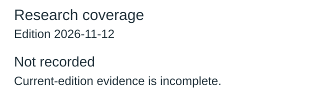
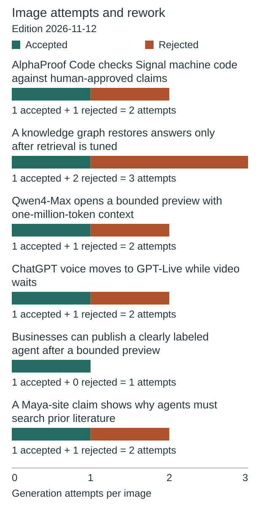
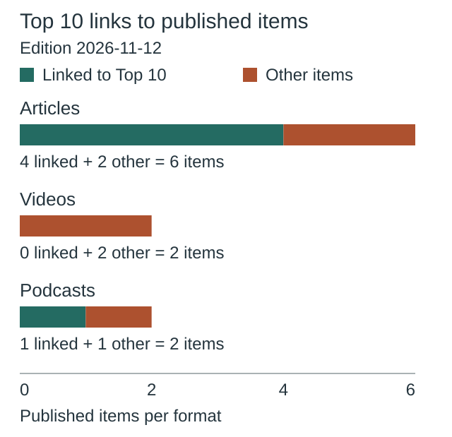
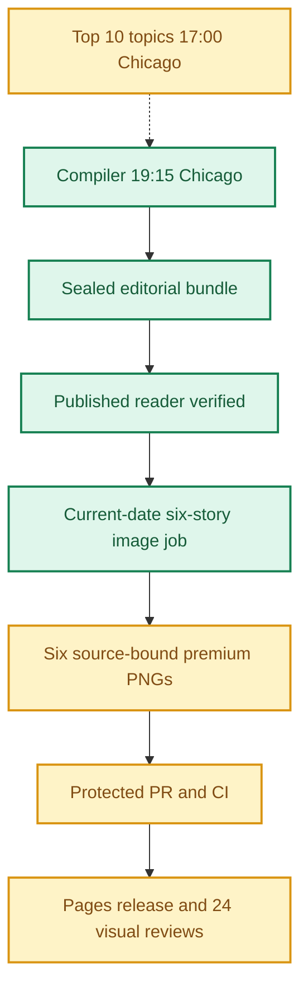
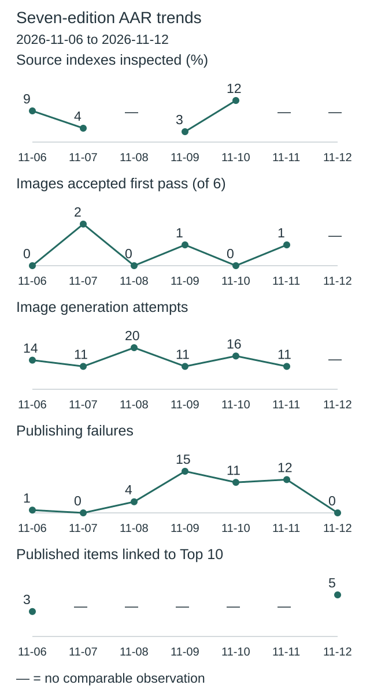
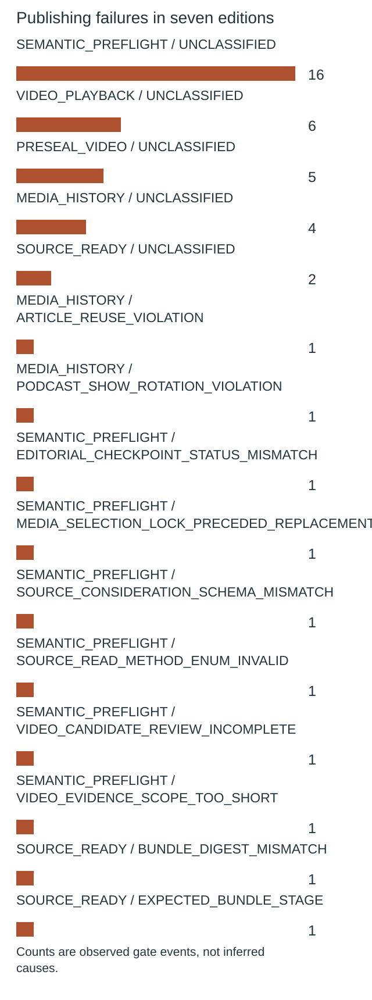
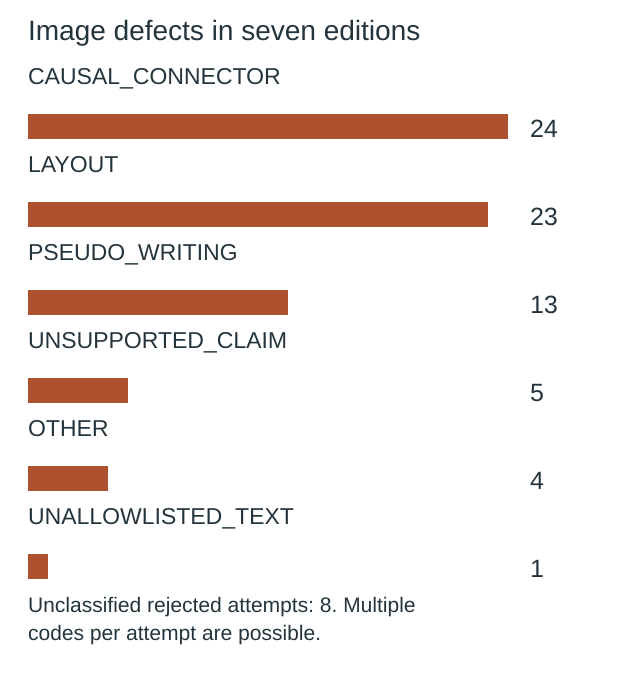

**🟨 RELEASE PARTIAL**
**TOP 10 PARTIAL** · **🟩 COMPILER VERIFIED** · **🟨 IMAGES NOT YET COMPLETE** · **🟨 VISUAL QA NOT YET VERIFIED**

# Daily AI Brief — Unified Production After-Action Report
**Edition:** November 12, 2026 · **Production evening:** 2026-11-11 · **Timezone:** America/Chicago
**Primary public reader:** [Open 2026-11-12 Brief](https://gttome.github.io/Daily-AI-Brief-Compiler/briefs/2026-11-12/) · **Repository:** [Daily-AI-Brief-Compiler](https://github.com/gttome/Daily-AI-Brief-Compiler)

> **IMPORTANT — VERIFIED PRODUCTION RESULT**
> **Executive release result: PARTIAL.** This is the single management-facing report covering Top 10 topic discovery, the editorial Compiler, published Brief and premium-image run. **Entire-system evidence: PARTIAL.** Top 10 report: **partial**; Compiler handoff: **RECEIVED_SNAPSHOT_BOUND**; guided searches: **RECEIPTS_OBSERVED**. Compiler public status: **VERIFIED**. Image release: **not complete**. Direct 24-context visual quality: **not yet evidenced**. Autonomous completion: **UNPROVEN**. Missing evidence must not be promoted to a success claim.

**🕒 Production stage durations:** **Top 10 9m 21s** · **Compiler final seal window 7m 34s** · **Premium Images Not independently recorded** (evidence-bounded elapsed times; the start/end events differ).

> **CLOSEOUT WARNING:** The exact image worker has not released its lease and recorded PUBLISHED_COMPLETE with the six accepted hashes.

## Evidence reconciliation

Compiler final seal window: 7m 34s. Compiler state start to public verification: 51m 50s. Observed execution and final seal windows are distinct.
Image capability route preflight: NOT OBSERVED; scheduler origin remains UNPROVEN.
Image efficiency: 1/6 first-pass accepts; 12 total attempts. Current efficiency target: at least 3/6 first-pass and at most 2 attempts per image, with unchanged quality floor.
Image review completed: Not recorded; review-record commit: Not recorded; protected review merge: Not recorded.
Eligible source indexes: 109; editorial inspections reported: Unknown (Unknown%); inaccessible in editorial audit: Unknown; explicitly unreviewed IDs: 76; unclassified editorial IDs: Unknown. Automated index parsing is separate from editorial inspection and cannot substantiate exhaustive freshness claims.

Registered video sources: 29; attempted this edition: 29; unattempted: 0; enabled: 28; qualification-only: 1; sources yielding candidate URLs: 5. Status: REPORTED_ALL_ATTEMPTED. Attempt evidence is not automatic proof of source-content review or playback.

## Daily AAR charts

These charts use this edition’s receipts. Missing data is not zero.

### Research coverage



**Not recorded:** current-edition evidence is missing or inconsistent.

Not inspected includes every index without a recorded editorial inspection; this is not proof of missed stories.

### Image attempts and rework



**Not recorded:** current-edition evidence is missing or inconsistent.

Generation attempts measure rework, not runtime or cost. Quality and publication checks remain separate.

### Top 10 links to published items



**5 of 10 unique published items link to Top 10 topics.**

| Format | Linked to Top 10 | Other items |
|---|---:|---:|
| Articles | 4 | 2 |
| Videos | 0 | 2 |
| Podcasts | 1 | 1 |

No selection quota. Topic linkage does not establish better quality, popularity or causal improvement.

[Chart data](charts.json)

One edition at a time. Missing evidence is not zero. Trend claims require comparable recorded cycles.

## Performance dashboard

| Measure | Recorded result | Source / caveat |
|:--|:--:|:--|
| Entire-system evidence | **PARTIAL** | Full Top 10 list, bound Compiler input, all-format search receipts and existing release checks; separate from publication and autonomy |
| Top 10 report | **partial · 10 topics** | Same Chicago cycle report; provisional/partial coverage remains disclosed |
| Top 10 received by Compiler | **RECEIVED_SNAPSHOT_BOUND** | Exact report snapshot bytes; consumed commit separately corroborated: YES |
| Top 10 guided article/video/podcast searches | **RECEIPTS_OBSERVED** | Actual source-search receipts and selected/rejected topic outcomes |
| Top 10 stage duration | **9m 21s** | Same-cycle run receipt only; no runtime or usage estimate |
| Editorial publication | **PASS** | State and public reader integrity receipt |
| **Unattended autonomy (separate from publication)** | **UNPROVEN** | Owner incident receipt takes precedence over unverified producer self-attestation |
| Recorded protected publishing gate failures | **0** | Actual same-edition GitHub failure sidecar only; earlier unrecorded failures remain unknown |
| Articles | **6** | Exactly 2 technical / 2 knowledge-worker / 2 agents required |
| Original scientific-paper-led articles | **1** | Rolling target: one qualified original paper in seven editions; PRODUCER_REPORTED_BUNDLE_MATCH. Preprints are not peer-reviewed by default |
| Verified original sources within preceding 24 hours | **0 / 6** | Original publisher dates only; other sources require a documented fallback rationale |
| Distinct selected article publishers | **5** | Six different primary organizations preferred |
| Videos over seven days old | **2** | Must be labeled evergreen, not a new development |
| Distinct selected video publishers | **2** | One channel is one publisher even across multiple videos |
| Video discovery source attempts | **29 / 29** | Attempt evidence across enabled and qualification-only leads; REPORTED_ALL_ATTEMPTED. Not a claim of full content review or player verification | 
| Duplicate active Watchlist display titles | **0** | Published canonical Watchlist only; historical evidence retained |
| Original-release video playback (historical) | **TWO_PUBLISHED_VIDEOS_PLAYBACK_PASS** | Later reader corrections may replace these originally verified videos; see incident register | 
| Postpublication reader incidents | **NOT_RECORDED** | Edition-specific owner reports and corrective PRs, not inferred absence | 
| Verified postpublication video corrections | **NOT_RECORDED** | Incident register tracks correction PR, actual playback evidence and reader preservation |
| Editorial index second-pass attempts | **0** | Bounded public GET retries only; never proof of original article reading |
| Editorial index reads recovered | **0** | Successful page fetch can still yield zero eligible dated items |
| Recorded scheduler capability route | **UNPROVEN** | Same-invocation route receipt only; GitHub is not scheduler authentication |
| Avoidable incomplete-staging CI failures | **Not independently audited** | Existing image-package push CI is disabled; exact-head protected PR CI remains required. A failure count requires actual workflow evidence |
| Media | **2 videos + 2 podcasts** | Sealed bundle |
| **Compiler final seal window** | **7m 34s (7.6 min)** | Final sealed-state timestamp → verified public reader; initial execution is separate |
| **Image processing stage duration** | **Not independently recorded** | First accepted PNG Git checkpoint → final 24/24 review; auditable stage elapsed time |
| Image scheduled-to-final-review window | **Not independently recorded** | Only with a saved one-cycle schedule anchor; does not attest exact generation start |
| Executor-observed generation-to-final-review | **Not independently recorded** | Only if the worker recorded a same-execution clock before its first native call; not independently verified provider runtime |
| Accepted premium PNGs | **Not complete / 6** | Exact package and public release hashes |
| Native image generation attempts | **12** | Image worker AAR; no estimation |
| Rejected candidates | **6** | Image worker AAR |
| Final worker checkpoint reconciliation | **MISMATCH** | Oct25+ verifies exact generation count, per-story attempts, six accepted story/image/hash bindings and final release |
| Saved visual contexts | **Unverified** | Dated/permanent desktop/mobile review |
| Public SHA-256 checks | **Not recorded** | Image release receipt |
| October 8 immutable history | **17 / 17** | Independent content-preservation checks |
| **Owner-reported weekly Work usage for this run** | **Not reported** | No per-cycle usage supplied |

> **EFFICIENCY NOTE**
> **Resource reporting policy:** No usage figure was supplied for this cycle, so none is assumed. Future runs show **Not reported** unless the owner supplies new cycle-specific usage metadata. No approval or extra step is required to generate the AAR.

## Production architecture and checkpoints



## Daily AI Topic Top 10 and Compiler handoff

**Research cycle:** 2026-11-11 · **Target Brief:** 2026-11-12 · **Scheduled start:** 17:00 America/Chicago

| Dimension | Recorded evidence |
|---|---|
| Run/report result | PARTIAL |
| Report status / topics | partial / 10 |
| Freshness | FRESH\_AT\_CONSUMPTION |
| Compiler handoff | RECEIVED\_SNAPSHOT\_BOUND |
| Search coverage | RECEIPTS\_OBSERVED |
| Selection mapping verification | MATCHES\_EDITION\_BUNDLE |
| Observed start / finish | 2026-11-11T22:57:42Z / 2026-11-11T23:07:03Z |
| Elapsed minutes | 9.35 |
| Usage percent | Not reported |
| Cost USD | Not reported |
| Independent scheduler autonomy | UNPROVEN |
| Compiler-recorded consumed commit | 6e6911d0a393a3117160841950ecf3b2c3665777 |
| Report SHA-256 | a2e6b159c848fffc809a58bde78ec1066092d3c3ef0a4f5cda66dc925c61d076 |

**Order:** discovery sequence only; entries are unranked within qualitative evidence bands.

| Discovery order | AI topic | Summary | Confidence | Evidence |
|---:|---|---|---|---|
| 1 | Claude Fable 5.2 and Mythos 5.2 draw new hands-on reviews | Anthropic’s technical models are drawing comparisons across coding, visual tasks and research after the November 9 launch. | medium | [Source](https://www.youtube.com/watch?v=583ThJIqQ7k) · [Source](https://www.youtube.com/watch?v=GipTWtfaiLs) · [Source](https://www.youtube.com/watch?v=eUmiy54xhqQ) · [Source](https://x.com/claudeai/status/2119867114450268322) · [Source](https://www.anthropic.com/claude-fable-and-mythos-5-2) |
| 2 | Gemini 4 Carbon rollout gets hands-on tests | Google expanded Carbon access, and independent videos try the model on coding and visual tasks. | medium | [Source](https://www.youtube.com/watch?v=l32KKNKdpIk) · [Source](https://www.youtube.com/watch?v=0GSvcg9wncc) · [Source](https://news.ycombinator.com/item?id=50442303) · [Source](https://x.com/GoogleAI/status/2120187753329791341) · [Source](https://blog.google/innovation-and-ai/models-and-research/gemini-models/gemini-4-carbon-now-available/) · [Source](https://www.theverge.com/ai-artificial-intelligence/1030787/google-gemini-4-carbon-public-rollout) |
| 3 | AlphaProof Code’s Signal verification attracts scrutiny | DeepMind reports machine-checked proofs of specific security properties for compiled Signal implementation code. | medium | [Source](https://news.ycombinator.com/item?id=50439193) · [Source](https://x.com/pushmeet/status/2120127611137634376) · [Source](https://google-deepmind.github.io/code-verification/) |
| 4 | Businesses in ChatGPT beta draws merchant questions | Companies can claim profiles, and eligible U.S. online businesses can publish a customer-facing agent. | medium | [Source](https://x.com/OpenAI/status/2120216592395174382) · [Source](https://www.reddit.com/r/WebsiteSEO/comments/1xt9wss/chatgpt_now_has_verified_business_profiles_has/) · [Source](https://openai.com/index/introducing-businesses-chatgpt/) |
| 5 | Gemini Robotics 2.5 tests broader manipulation | DeepMind describes an updated model for multi-step physical tasks and reports results from a Mercedes-Benz parts-sorting trial. | medium | [Source](https://x.com/GoogleDeepMind/status/2120169787896525104) · [Source](https://www.reddit.com/r/Bard/comments/1xsqio0/gemini_robotics_25_accelerates_realworld_general/) · [Source](https://deepmind.google/blog/gemini-robotics-2-5-accelerates-real-world-physical-intelligence/) · [Source](https://arstechnica.com/google/2026/11/deepmind-reveals-gemini-robotics-2-5-and-open-safety-benchmark-asimov-jailbreak/) |
| 6 | Alibaba previews Qwen4-Max for a limited period | Alibaba Cloud documents a time-limited Token Plan preview for a multimodal model with coding and tool-use capabilities. | medium | [Source](https://x.com/Alibaba_Qwen/status/2120335993643684315) · [Source](https://help.aliyun.com/en/model-studio/qwen4-max-preview) · [Source](https://technode.com/2026/11/11/alibaba-opens-qwen4-max-preview-with-a-million-token-context-window/) |
| 7 | AI archaeology case turns into a verification lesson | A developer used agents to flag a Maya site in lidar data and later corrected the account after learning it had already been mapped. | medium | [Source](https://news.ycombinator.com/item?id=50452455) · [Source](https://pietromiotti.com/latest/maya-site/) |
| 8 | ChatGPT sets December 11 voice migration | OpenAI says GPT-Live will become the default as Advanced and Standard voice retire, with exceptions for some live features. | medium | [Source](https://x.com/OpenAINewsroom/status/2120277245713654201) · [Source](https://www.youtube.com/watch?v=5YXlrzC_RYE) · [Source](https://help.openai.com/en/articles/20001638-retiring-advanced-and-standard-voice-in-chatgpt) |
| 9 | Gemini Decisions API scores fixed choices | Google’s new endpoint returns scores for pre-specified choices across text, image, audio, video and PDF inputs. | medium | [Source](https://news.ycombinator.com/item?id=50456791) · [Source](https://www.reddit.com/r/accelerate/comments/1xtq5fl/logan_kilpatrick_on_x_introducing_gemini_decision/) · [Source](https://blog.google/innovation-and-ai/technology/developers-tools/gemini-decisions-api/) · [Source](https://vercel.com/changelog/gemini-decision-1-now-available-on-ai-gateway) |
| 10 | Apple’s learned retrieval research gets renewed discussion | An Apple write-up revisits a July ICML study that trains small models to improve document-retrieval routing. | medium | [Source](https://news.ycombinator.com/item?id=50455633) · [Source](https://machinelearning.apple.com/research/faster-retrieval) · [Source](https://arxiv.org/pdf/2603.08001) · [Source](https://proceedings.mlr.press/v306/olausson26a.html) |

**Sample scope:** {"metadata\_screened\_videos":57,"distinct\_retained\_channels":30,"metadata\_screened\_distinct\_channels":30,"new\_metadata\_screened\_records":63,"combined\_observation\_records":63,"combined\_unique\_video\_ids":57,"unique\_videos":57,"videos\_watched":0,"full\_video\_reviews":0,"transcript\_reviews":0,"partial\_original\_publisher\_transcript\_reviews":0,"original\_publisher\_show\_notes\_reviews":1,"direct\_counter\_verifications":0,"direct\_youtube\_counter\_verifications":0,"original\_watch\_attempts":57,"comparable\_video\_observations":4,"within\_24h\_reported\_publications":2,"additional\_within\_72h\_reported\_publications":13,"additional\_within\_7d\_reported\_publications":2,"date\_only\_video\_publications":40,"unknown\_video\_publication\_dates":0,"validation\_resources\_registered":14,"full\_video\_review\_target\_met":false,"metadata\_screening\_target\_55\_met":true,"original\_watch\_outcomes":{"throttled":51,"title/index shell":6},"freshness\_reference\_at":"2026-11-11T23:05:09Z","notes":"Date-only publication records do not enter exact hourly buckets. Original watch attempts count distinct videos. Duplicate source routes do not add programs."}. **Ranking basis:** {"attention":"Event-matched videos first when available, then distinct public discussions and tracked announcements. Stronger placement reflects corroboration and freshness. Same-program rounded interval deltas are retained separately.","limitation":"Mixed formats and unknown clock or audience overlap preclude precise popularity ranking. No newness claim is inferred from a new screening result."}.

| Search format | Receipt rows | Attempts recorded | Explicitly not attempted |
|---|---:|---:|---:|
| article | 10 | 10 | 0 |
| video | 10 | 10 | 0 |
| podcast | 10 | 10 | 0 |

**Selected Brief items linked to trends:**

| Topic | Format | Selected item | Reason |
|---|---|---|---|
| alphaproof-code-signal-nov10 | article | nov12-t1-alphaproof-code · [Source](https://google-deepmind.github.io/code-verification/) | The exact original AlphaProof Code event became the selected Technical story after complete source review. |
| alphaproof-code-signal-nov10 | podcast | https://ai-in-15.com/episodes/2026/11/ai-in-15-2026-11-11 · [Source](https://ai-in-15.com/episodes/2026/11/ai-in-15-2026-11-11) | The exact transcript-backed episode covers AlphaProof Code and was selected after complete episode review. |
| openai-businesses-chatgpt-beta-nov10 | article | nov12-a1-business-agent · [Source](https://openai.com/index/introducing-businesses-chatgpt/) | The exact original business-agent announcement supports the selected Agent Skills procedure. |
| qwen4-max-preview-nov10 | article | nov12-k1-qwen-preview · [Source](https://docs.modelstudio.console.alibabacloud.com/en/model-studio/qwen4-max-preview) | The exact official preview notice became the selected Applied long-context evaluation story. |
| chatgpt-gpt-live-voice-retirement-nov10 | article | nov12-k2-voice-migration · [Source](https://help.openai.com/en/articles/20001638-retiring-advanced-and-standard-voice-in-chatgpt) | The exact official retirement notice became the selected Applied voice-migration story. |

**Gaps and limitations:**

- The report labels its research partial.
- Full playback and direct YouTube counters remained unavailable. Metadata, show notes, transcripts and playback are counted separately.
- Public search scoped to 24 hours, then 72 hours and seven days, with historical research specifically labeled. Original transcripts were unavailable; one publisher's notes were reviewed.
- The four same-tracker video deltas represent rounded interval accumulation across 23h56m. Other growth and rank change remain unknown.
- The current handoff is advisory. Compiler receipt, actual format searches and final selections require separate evidence.

**Recorded run issues:**

- {"issue":"Original video access returned 51 throttle errors and six title/index shells across 57 distinct videos.","effect":"Zero full playback, direct YouTube counters, or transcript reviews. Coverage remains partial.","correction":"Used time-stamped third-party measurements when present. Retained a genuine original publisher show-notes review and separate failed transcript route."}
- {"issue":"Prior reconciled publisher sensitivity accepted only two of ten topics. Eight zero-remaining removals used an unsupported band.","effect":"Previous outcome was PARTIAL.","correction":"Corrected the current report to insufficient for no remaining attention and validated the exact committed file with protected publisherResilience. It accepted ten of ten and recorded eight weakened topics."}
- {"issue":"A preliminary metadata parse truncated an index title when the channel name occurred inside it.","effect":"Local validation rejected the draft before any write.","correction":"Used the channel-plus-date delimiter and reran validation successfully before writing."}
- {"issue":"Original Apple proceedings PDF route was unsupported and the arXiv HTML route failed.","effect":"The initial routes did not expose manuscript sections.","correction":"The original arXiv PDF route worked. Read methods and limitations excerpts and used the ICML proceedings to verify venue."}
- {"issue":"Prior Compiler search ledger contains 30 raw rows and four claimed mappings, but the protected reporter classified the receipt INVALID.","effect":"The earlier edition's selection impact is unverified.","correction":"Today's report provides 30 format-specific query strings. Compiler owns genuine per-search dispositions and exact selected mappings."}

**Recorded improvements:**

- {"change":"Validate publisher-family assessments against protected reporter before persistence.","reason":"Prior combined metric accepted two of ten assessments. Eight removed-all outcomes used an unsupported enum.","expected\_effect":"All current correctly attributed records should be readable by the reporter.","status":"implemented"}
- {"change":"Read the original study, proceedings, and retrieval highlight separately, and document inaccessible original transcript routes.","reason":"Distinguish new attention from new scientific publication and source substance from metadata.","expected\_effect":"The Compiler receives bounded research leads with original evidence and traceable limits.","status":"implemented"}
- {"status":"proposed","change":"Prefer event-matched original program text where a free supported route exists and inspect verified Compiler use when the next earlier AAR is available."}

### Daily improvement and effect on the Brief

**Fixed baseline:** nov03-2026-v1 / INPUT\_FROZEN. **Outcome baseline:** FROZEN\_AFTER\_VERIFIED\_PUBLICATION. **Prior cycle:** 2026-11-10.

| Input measure | Current | November 3 baseline | Change from baseline | Change from prior cycle |
|---|---:|---:|---:|---:|
| topic count | 10 | 10 | 0 | 0 |
| validation resource count | Not reported | 14 | Not reported | Not reported |
| additional video metadata records | 63 | 63 | 0 | -1 |
| additional video channels | Not reported | 21 | Not reported | Not reported |
| total video observations | 63 | 79 | -16 | -1 |
| unique videos | 57 | 71 | -14 | -3 |
| full video reviews | 0 | 0 | 0 | 0 |
| direct youtube counter verifications | 0 | 0 | 0 | 0 |
| broader evidence band topics | 3 | 3 | 0 | 2 |
| limited evidence band topics | 7 | 7 | 0 | -2 |

**Observed downstream measurements:** OBSERVED.

| Outcome measure | Current | Change from frozen outcome | Change from prior cycle |
|---|---:|---:|---:|
| expected topic format pairs | 30 | 0 | Not reported |
| attempted topic format pairs | 30 | 0 | Not reported |
| explicitly unattempted pairs | 0 | 0 | Not reported |
| discovered candidate count | 15 | -25 | Not reported |
| searched source host count | 26 | 10 | Not reported |
| selected article count | 4 | 1 | Not reported |
| selected video count | 0 | 0 | Not reported |
| selected podcast count | 1 | 0 | Not reported |

**Source changes:** {"added":\[\],"removed":\[\]}.

**Candidate review depth:** INVALID.

| Review measure | Current | Change from prior comparable cycle |
|---|---:|---:|
| reviewed candidate count | Not reported | Not reported |
| qualified candidate count | Not reported | Not reported |
| rejected candidate count | Not reported | Not reported |
| metadata only count | Not reported | Not reported |
| full video reviews | Not reported | Not reported |
| transcript reviews | Not reported | Not reported |

The frozen November 3 baseline has no candidate-level review ledger; no retrospective value is invented. Recorded reviews do not independently establish content quality, audience interest or causal benefit.

**Method/resource review:** {"baseline\_id":"nov03-2026-v1","previous\_report\_date":"2026-11-10","previous\_method\_version":"2026-11-03.2-event-review","method\_version":"2026-11-03.2-event-review","feedback":{"aar\_url":"https://github.com/gttome/Daily-AI-Brief-Compiler/blob/6297ca4a448b969218b30cd9244aa7cc194c5ec6/daily/2026-11-10/combined.md","charts\_url":"https://github.com/gttome/Daily-AI-Brief-Compiler/blob/6297ca4a448b969218b30cd9244aa7cc194c5ec6/daily/2026-11-10/charts.json","metrics\_url":"https://github.com/gttome/Daily-AI-Brief-Compiler/blob/6297ca4a448b969218b30cd9244aa7cc194c5ec6/daily/2026-11-10/improvement-metrics.json","observation":"November 11 edition snapshot was received and bound. The original search ledger has 30 raw rows and four claimed mappings. candidate\_discovered is not an allowed outcome, and the reporter withheld verified search and selection counts. The chart shows 11 image attempts and one first-pass acceptance; the index-inspection and linkage charts are not recorded. Family sensitivity reported PARTIAL, with two valid topics, because eight prior no-evidence removals used unobserved instead of insufficient."},"changes":\[{"change":"Validate publisher-family assessments against protected reporter before persistence.","reason":"Prior combined metric accepted two of ten assessments. Eight removed-all outcomes used an unsupported enum.","expected\_effect":"All current correctly attributed records should be readable by the reporter."},{"change":"Read the original study, proceedings, and retrieval highlight separately, and document inaccessible original transcript routes.","reason":"Distinguish new attention from new scientific publication and source substance from metadata.","expected\_effect":"The Compiler receives bounded research leads with original evidence and traceable limits."}\],"resource\_candidates":\[{"url":"https://proceedings.mlr.press/v306/olausson26a.html","role":"Original scientific publication venue","access":"public proceedings and abstract","review\_scope":"Venue, author list, abstract, and linked publication identity; manuscript sections separately read through arXiv","independence":"Same paper and researchers across versions. Proceedings verify venue, not a second attention family.","decision":"accepted","reason":"Confirms ICML publication and prevents conflating a fresh discussion with a new paper.","contribution":"Adds verifiable publication status and links for the learned retrieval topic."},{"url":"https://rss.beehiiv.com/podcasts/transcriptions/01a1c6ff-5771-7df7-ba35-b6306c6494aa.vtt","role":"Original publisher transcript","access":"Unsupported text/vtt in search surface","review\_scope":"Original link attempted; no transcript body retrieved","independence":"Same publisher as the video and notes.","decision":"deferred","reason":"The accessible public search did not deliver the text.","contribution":"Publisher show notes reviewed separately; no transcript credit."}\],"observed\_effects":\[{"observation":"57 distinct metadata-screened videos versus 60 previously, and four same-source timed comparisons versus three.","effect":"Coverage and overlap changed. Full playback and direct counter evidence remain at zero."},{"observation":"Current technical reading included the original Signal proof report and selected sections of the Apple retrieval manuscript.","effect":"Scope, method and study limitations are supported; no production impact is yet measured."}\],"next\_improvement":"Prefer event-matched original program text where a free supported route exists and inspect verified Compiler use when the next earlier AAR is available.","limitations":\["The November 10 source pilot expired; today's counts use the standing method.","No causal evidence of better editorial selections."\],"change\_evaluations":\[{"change\_id":"AAR-10","reviewed\_edition":"2026-11-12","decision":"keep","result":"inconclusive","reason":"The November 11 combined AAR accepted only two of ten assessments. Today uses the documented insufficient enum and validates family partitions. The next combined AAR must independently confirm that the producer correction was collected.","evidence\_refs":\["https://github.com/gttome/Daily-AI-Brief-Compiler/blob/6297ca4a448b969218b30cd9244aa7cc194c5ec6/daily/2026-11-10/improvement-metrics.json","https://github.com/gttome/Daily-AI-Brief-Compiler/blob/6297ca4a448b969218b30cd9244aa7cc194c5ec6/signals/ai-topic-top10/2026-11-10.json"\]},{"change\_id":"NOV03-04","reviewed\_edition":"2026-11-12","decision":"revise","result":"inconclusive","reason":"Prior input was bound but actual selection mappings remained invalid. Today's original documents deepen topic review while video playback is still unavailable. Validated downstream candidate selection remains unknown.","evidence\_refs":\["https://github.com/gttome/Daily-AI-Brief-Compiler/blob/6297ca4a448b969218b30cd9244aa7cc194c5ec6/daily/2026-11-10/combined.md","https://github.com/gttome/Daily-AI-Brief-Compiler/blob/6297ca4a448b969218b30cd9244aa7cc194c5ec6/daily/2026-11-10/improvement-metrics.json"\]}\]}.

**Current reconciled conclusion:** OBSERVED; outcome baseline FROZEN\_AFTER\_VERIFIED\_PUBLICATION; candidate review ledger INVALID.

**Historical producer observations (not current status):** The following snapshot preserves what the producer reported at the time. Its pending statuses and candidate-quality claims are not independently reconciled conclusions. Use the current tables above for publication-bound measurements; an absent candidate review ledger remains unknown.

<details><summary>Original producer effects and gaps — historical snapshot</summary>

```json
{
  "status": "PARTIAL",
  "actual_source_additions": 12,
  "useful_qualified_candidate_ids": [
    "ART-DEEPMIND-ALPHAPROOF-CODE",
    "ART-QWEN4-MAX-PREVIEW",
    "ART-OPENAI-BUSINESS-AGENTS",
    "ART-OPENAI-VOICE-RETIREMENT",
    "VID-DAILYDIFF-ALPHAPROOF",
    "POD-AI15-2026-11-11",
    "POD-HOW-I-AI-FABLE-52",
    "VID-SAM-WITTEVEEN-CARBON",
    "ART-ROBOTTESTERS-GEMINI-ROBOTICS",
    "ART-ZENITEQ-MAYA-CORRECTION",
    "ART-APPLE-MIPS-HIGHLIGHT"
  ],
  "rejection_reasons": {
    "freshness": 1,
    "duplicate": 2,
    "promotion": 0,
    "quality_or_fit": 3
  },
  "gaps": "Many video and podcast queries produced no distinct current original item; causal uplift remains unknown.",
  "observed_timing_minutes": 43,
  "observed_cost_usd": 0,
  "source_links": [
    "https://google-deepmind.github.io/code-verification/",
    "https://docs.modelstudio.console.alibabacloud.com/en/model-studio/qwen4-max-preview",
    "https://openai.com/index/introducing-businesses-chatgpt/",
    "https://podcastrex.com/shows/how-i-ai/claude-fable-52-review-fast-creative-and-finally-not-annoying/transcript",
    "https://chooseto.ai/watch/l32KKNKdpIk",
    "https://robottesters.com/article-gemini-robotics-2-5-apptronik-mercedes",
    "https://www.zeniteq.com/ai-agents-maya-discovery-claim-corrected-already-mapped-jlfy1a",
    "https://machinelearning.apple.com/research/faster-retrieval"
  ],
  "incremental_benefit": null,
  "causal_uplift": null
}
```

</details>

**Next improvement:** Prefer event-matched original program text where a free supported route exists and inspect verified Compiler use when the next earlier AAR is available.

Counts show coverage and observed association, not audience popularity, source independence, candidate quality or causal uplift. Compare source/method changes before interpreting deltas. Unknown values are not zero. Publication, reader corrections, runtime and image outcomes retain their separate AAR evidence.

Report, source-readback and search receipts are separate observations. Snapshot binding verifies the collected report bytes; the consumed commit is independently corroborated only when the separately fetched source bytes match. These records do not independently attest scheduler identity or source truth. Top 10 reporting does not change Brief/image release status.


## Track 1 — Compiler

**State:** `SHADOW_VERIFIED` · **Bundle:** `BUNDLE_READY` · **Compiler final seal window:** 7m 34s (7.6 min).

| Publication gate | Result |
|---|:---:|
| Canonical reader build | ✅ |
| Reader parity | ✅ |
| Public verification of dated edition | ✅ |
| Previous editions preserved | ✅ |
| Permanent story routes and feeds | ✅ |

**Selected coverage:**

| Lane | Story |
|---|---|
| Technical AI Engineering | AlphaProof Code checks Signal machine code against human-approved claims |
| Technical AI Engineering | A knowledge graph restores answers only after retrieval is tuned |
| Applied Generative AI for Knowledge Workers | Qwen4-Max opens a bounded preview with one-million-token context |
| Applied Generative AI for Knowledge Workers | ChatGPT voice moves to GPT-Live while video waits |
| Agents for Everyone | Businesses can publish a clearly labeled agent after a bounded preview |
| Agents for Everyone | A Maya-site claim shows why agents must search prior literature |

### Scientific paper opportunity and publication evidence

**Current edition:** PRODUCER_REPORTED_BUNDLE_MATCH; **paper-led stories:** 1. Editorial target: at least one genuinely qualified original-paper-based story in seven editions, with methods, limitations, and an explicit preprint/peer-review distinction. No stale or weak paper is selected solely to fill a quota.
- EcoStatKG: A Knowledge Graph for Ecological Statistics and Numerical Hallucination Evaluation (PEER_REVIEWED): https://aclanthology.org/2026.aacl-long.119/ — linked article: nov12-t2-ecostatkg.


## Track 2 — Premium images

**Public status:** `NOT_OBSERVED` · **Saved images:** 0/6 · **Actual generation attempts:** 12 · **Rejected candidates:** 6.

### Image production duration — Git-verified milestones

**Auditable image stage duration:** **Not independently recorded** (first accepted binary saved in Git → first persisted 24-context quality-review record). **First asset to public image release:** **Not independently recorded**.
**Scheduled-to-final-review window:** **Not independently recorded**. This is a scheduled-clock comparison only when a separately recorded exact-date schedule exists; it is **not** measured native image-generation runtime.

| Production milestone | Chicago local time | Evidence |
|---|---|---|
| Scheduled image start (if exact-date record exists) | Not independently recorded | Time planned, not actual execution start |
| First executor-observed start | Not independently recorded | Worker self-attestation, not a first-party scheduler event |
| First native generation observation | Not independently recorded | Worker clock recorded immediately before first native call, not model-provider telemetry |
| First accepted PNG bytes saved to Git | Not independently recorded | Immutable binary-stage commit |
| Six-image package / reviews committed | Not independently recorded | Exact-head PR source commit |
| Protected package merged | Not independently recorded | Merge SHA and required CI |
| Public images verified | Not independently recorded | Image-release receipt |
| 24/24 review record committed | Not independently recorded | Immutable first review-approval commit |

> **Duration interpretation:** The audited stage excludes unobservable pre-checkpoint creative work. The scheduled-start window includes it but must not be interpreted as precise active processing time. Missing timestamps appear as **Not independently recorded**, never an estimate.


| Source-bound image | Attempts | File size | Public page |
|---|---:|---:|---|

**Immutable-release and visual gates:**

| Release gate | Result |
|---|:---:|
| Protected public image receipt | Not yet evidenced |
| Accepted-image Git hash bindings | Not yet evidenced |
| Six live PNGs | Not verified |
| Dated/permanent story placements | Not verified |
| Desktop/mobile visual inspection | Not verified |
| Historical Oct 8 integrity | Not verified |

### Published premium illustrations

No six-image public release gallery available yet.

## Incidents, corrections and learning

### Postpublication reader incidents (updated when new evidence is merged)

No current-edition postpublication incident register was available; this is **NOT_RECORDED**, not a certification of zero incidents.


**Editor recovery classification:** UNPROVEN. **Owner intervention:** Unproven either way. **Protected same-edition failures recorded:** 0. 
**Latest failed protected stage:** Not in same-edition receipts; [Action evidence](https://github.com/gttome/Daily-AI-Brief-Compiler/actions). Exact stage durations are available only where real source timestamps exist.

| Stage | Verified issue | Corrective action |
|---|---|---|
| Native saved-pixel inspection | Saved full-size and 320px pixels show a blue line from the specification sheet through the checker inlet with no directional arrowhead, plus a detached blank plaque with no source meaning. Four exact labels read at full size and priority labels remain visible inline. | Preserve the three slate/brass cutaway mechanisms and the exact four text labels. Give the blue connector one clearly triangular blue arrowhead pointing right, with its tip physically touching the circular proof checker inlet and its tail still attached to the approved specification sheet. Remove the empty decorative plaque at lower right. Add generous white breathing room left and right by narrowing the housing only; preserve large labels. Keep the caveat detached, and move it up slightly so it is securely clear of the bottom edge. Do not add any text, symbols or connectors. Exact requested framing is 1200 by 630, pure white background. |
| Native saved-pixel inspection | The near-zero-shot label is over the upper full-coverage lane and incorrectly appears to qualify its outcome. Two question-mark glyphs are outside the text allowlist. The lower filter arrow physically touches both illustrated objects. | Preserve the two tracks, the three exact headings Answer present, Answer withheld, Filter distractors, and the single physical arrow into the mesh filter. Remove both question mark glyphs entirely, leaving smooth blank input discs. Move the entire exact phrase Near zero-shot baseline from the upper green lane into a detached neutral note associated only with the lower orange filtered result. The upper green result shows answer-bearing coverage and has no zero-shot label. Reserve clear white space above the lower note and at least 55 final pixels below and beside its glyphs. No additional symbols, words, arrows or title. The physical filter retains the illustrated branches to the discarded tray and fallback path. Keep the same wide framing and pure-white background. |
| Native saved-pixel inspection | The exact source caveat now belongs to the orange held-out path and both extra glyphs were removed. The lowest dark caveat pixels sit near y610 on the 630px saved canvas, beyond y590. | Only adjust the lower-right output and note. Move the orange output box, the orange path immediately before it, and the complete Near zero-shot baseline note UP by about one large label height, so the lowest text pixel is above y565 on a 630px final canvas. The note belongs below and beside that orange result and remains separate. Retain the rest of the figure, the exact four phrases, blank discs, color coding, the physically anchored filter arrow and white canvas. No additional words, icons, lines or arrows. |
| Native saved-pixel inspection | The saved image shows two text-like bracket glyphs, a scenic mountain icon and three horizontal marks suggesting writing on an otherwise blank media tile. All four labels and the physical Token Plan arrow are clear. | Preserve the exact four headings, white field, three positions, large text, Token Plan token arrow and main cut-paper objects. Change only three details. Replace the two thin printed bracket glyphs in the preview ribbon with two solid thick terracotta vertical end stops physically attached to the upper and lower ribbon borders. Replace the mountain picture with an abstract overlapping circle and square. Replace all three blue text-like lines with one large unmarked dark-blue cut-paper rectangle. Keep the middle video triangle and all text placements. Add no other text, writing, arrows, icons, controls or scenery. |
| Native saved-pixel inspection | The video route correctly stays separate and the migration arrow attaches to real junction and socket shapes. The screen contains three faux writing lines, and the video pictogram includes an unnecessary invented scrubber and progress bar. | Keep the exact four headings, waveform timeline, arrow from the purple junction into the green Live voice socket, separate upper video-and-sharing route and lower conversation history. Make only these edits in the two upper objects. Delete the media player's thin progress bar and white scrubber, leaving only the large play triangle on a blank frame. Replace the three text-like lines inside the monitor with one large solid pale-lavender square, its surround blank. No interface controls, buttons, extra marks, text or arrows. |
| Native saved-pixel inspection | The two upper exact labels start near y23 on the 630px export, inside the forbidden 40px margin. The prior-map arrow and registry gap remain distinct. The lower labels and 320px wording are readable. | Keep the exact four labels and the source-grounded cartographic composition. Increase white space above the two top headings by moving the whole grouped artwork inward so the first visible text starts no closer than 65 pixels to the top in the 1200×630 export. Keep the labels at least as large and comfortably within the left and right margins. Preserve the two terrain overlays, blank registry, prior map, and only one arrow from the mapped footprint into the illustrated corrected sheet. Simplify the blank registry and claim sheet faces to flat unmarked cream, removing fine paper grain from those faces alone. Keep contour and stipple on the terrain layers. No other text, connectors, symbols, coordinates or decoration. |

> **OPERATIONAL NOTE**
> This report distinguishes a published and verified production outcome from scheduler metadata exposed to another conversation. Lack of a live host heartbeat in a separate normal chat is not a Compiler production failure.

## Usage and cost stewardship

| Item | Per-cycle value |
|---|---|
| **Weekly Work usage reported by owner** | **Not reported** |
| Internal weekly usage reference | Target under 5% |
| Genuine image-generation attempts | 12 |
| Accepted diagrams | 6 |
| Regeneration after acceptance | 0 |
| Top 10 reported usage | Not reported |
| Top 10 reported cost | Not reported |
| Account-level billing telemetry | Not independently accessible to deterministic GitHub reporting |

**Future reporting rule:** For cycles without an optional owner-usage record, publish the complete AAR with `Not reported`; do not reuse prior percentages, guess remaining weekly credits or delay tomorrow's production.

## Next-edition operating handoff

| Control | Recurring contract |
|---|---|
| AI Topic Top 10 | Sole report task · 17:00 America/Chicago · saved dated list guides same-evening research |
| Primary Compiler | Sole existing task · 19:15 America/Chicago |
| Premium image production | Sole existing task · standard 21:15 America/Chicago |
| Exact image job selection | Newly published next-date `PUBLISHED_PENDING` only |
| AAR | Combined report generated automatically from new GitHub receipts |
| Optional Work usage | Owner-supplied per cycle, otherwise `Not reported` |

> **SCHEDULE RESTORATION NOTE**
> A temporary scheduling exception must be explicitly restored before claiming standard-time readiness. This deterministic document generator reads existing state only; it does not modify production schedules.

## Evidence register

| Evidence | Link |
|---|---|
| Compiler state | [Open receipt](https://github.com/gttome/Daily-AI-Brief-Compiler/blob/shadow/2026-11-12/shadow-runs/2026-11-12/compiler-state.json) |
| Compiler compile receipt | [Open receipt](https://github.com/gttome/Daily-AI-Brief-Compiler/blob/shadow/2026-11-12/shadow-runs/2026-11-12/compiler/compile-receipt.json) |
| Compiler public integrity | [Open receipt](https://github.com/gttome/Daily-AI-Brief-Compiler/blob/shadow/2026-11-12/shadow-runs/2026-11-12/compiler/postpublish-integrity.json) |
| Image release receipt | [Open receipt](https://github.com/gttome/Daily-AI-Brief-Compiler/blob/shadow-pages-history/site/image-jobs/2026-11-12/release.json) |
| Image review | [Open receipt](https://github.com/gttome/Daily-AI-Brief-Compiler/blob/main/external-image-packages/2026-11-12/reviews/live/image-element24/semantic-reviews.json) |
| Original image AAR | [Open receipt](https://github.com/gttome/Daily-AI-Brief-Compiler/blob/main/external-image-packages/2026-11-12/reviews/after-action.md) |
| Observed editorial index retries | [Open receipt](https://github.com/gttome/Daily-AI-Brief-Compiler/blob/shadow/2026-11-12/shadow-runs/2026-11-12/editorial/source-item-retries.json) |
| Scientific paper selection review | [Open receipt](https://github.com/gttome/Daily-AI-Brief-Compiler/blob/shadow/2026-11-12/shadow-runs/2026-11-12/editorial/scientific-paper-coverage.json) |
| Published player playback receipt | [Open receipt](https://github.com/gttome/Daily-AI-Brief-Compiler/blob/shadow/2026-11-12/shadow-runs/2026-11-12/compiler/postpublish-video-playback.json) |
| Top 10 ranked topic report | [Open receipt](https://github.com/gttome/Daily-AI-Brief-Compiler/blob/6e6911d0a393a3117160841950ecf3b2c3665777/signals/ai-topic-top10/2026-11-11.json) |
| Top 10 run after-action receipt | [Open receipt](https://github.com/gttome/Daily-AI-Brief-Compiler/blob/6e6911d0a393a3117160841950ecf3b2c3665777/signals/ai-topic-top10/2026-11-11.aar.json) |
| Compiler Top 10 input snapshot | [Open receipt](https://github.com/gttome/Daily-AI-Brief-Compiler/blob/shadow/2026-11-12/shadow-runs/2026-11-12/editorial/trend-input.json) |
| Top 10 article/video/podcast search coverage | [Open receipt](https://github.com/gttome/Daily-AI-Brief-Compiler/blob/shadow/2026-11-12/shadow-runs/2026-11-12/editorial/trend-search-coverage.json) |

**Image workflow:** Not yet available.

---

*Generated deterministically from cycle- and edition-specific GitHub records. The report combines the Top 10 discovery priorities, its Compiler handoff and searches, the published Brief, and the image run; original research, Compiler, image, hash, and review receipts remain immutable. This reporting action creates no stories, images, releases, extra AI tasks, or schedule changes.*

<!-- continuous-improvement:start -->
## Continuous improvement review

Edition **2026-11-12**. Measurements use 7/7 recorded editions in this window. Missing data stays **Not recorded**.

### Daily corrective-action review

**3 evidence-based findings**; open production blockers: 1. Cumulative evaluation checkpoint: **2026-11-11**. The daily review never waits for that date to act on a safe live problem.

| Priority | Observed issue | Existing owner / next correction | When |
|---|---|---|---|
| P0 | Editorial publication is verified but the image release is not verified. | Images: Use the existing canonical image owner and protected release; do not regenerate accepted assets or create a competing worker. | Immediate, if ownership and gates allow |
| P1 | Source inspection coverage is not verifiable from the current bundled receipts. | Compiler: Bind genuine exact source IDs and original preselection review times into the next draft bundle; do not infer inspection from HTTP access. | Next genuine run |
| P2 | Publication success does not independently attest the originating scheduler. | Compiler / Recovery: Capture real first-party scheduler and execution evidence if available; do not convert unknown provenance into a failure or a success. | Next genuine run |

Findings are observational and do not claim a repair was executed by the reporter.

### Approved change evaluations

| Change | Evaluate by | Outcome status | Latest decision |
|---|---|---|---|
| NOV03-01 — Earlier publication checks and precise recovery | 2026-11-11 | OVERDUE | Not recorded |
| NOV03-02 — Broader genuine source review | 2026-11-11 | OVERDUE | Not recorded |
| NOV03-03 — Source-bound image rejection lessons | 2026-11-11 | REVIEWED | revise |
| NOV03-04 — Substantive Top 10 review evidence | 2026-11-11 | REVIEWED | revise |
| AAR-01 — Current conclusions separated from historical claims | 2026-11-11 | OVERDUE | Not recorded |
| AAR-02 — Consolidated current task contracts | 2026-11-11 | REVIEWED | keep |
| AAR-03 — Dated improvement evaluations | 2026-11-11 | REVIEWED | keep |
| AAR-04 — Seven-edition trend charts | 2026-11-11 | OVERDUE | Not recorded |
| AAR-05 — Recurring publication failure causes | 2026-11-11 | OVERDUE | Not recorded |
| AAR-06 — Recovery interval reporting | 2026-11-11 | OVERDUE | Not recorded |
| AAR-07 — Source inspection history | 2026-11-11 | OVERDUE | Not recorded |
| AAR-08 — Rolling source contribution | 2026-11-11 | OVERDUE | Not recorded |
| AAR-09 — Recurring image defect categories | 2026-11-11 | REVIEWED | keep |
| AAR-10 — Top 10 publisher-family sensitivity | 2026-11-11 | REVIEWED | keep |

Pending: 0; overdue: 8; reviewed: 6. Implemented controls await measured results; review decisions do not disable controls.

### Seven-edition trends



| Edition | Coverage | First pass / 6 | Image attempts | Publishing failures | Top 10 links |
|---|---|---:|---:|---:|---:|
| 2026-11-06 | 8/87 (9%) | 0 | 14 | 1 | 3 |
| 2026-11-07 | 4/109 (4%) | 2 | 11 | 0 | Not recorded |
| 2026-11-08 | Not recorded | 0 | 20 | 4 | Not recorded |
| 2026-11-09 | 3/109 (3%) | 1 | 11 | 15 | Not recorded |
| 2026-11-10 | 13/109 (12%) | 0 | 16 | 11 | Not recorded |
| 2026-11-11 | Not recorded | 1 | 11 | 12 | Not recorded |
| 2026-11-12 | Not recorded | Not recorded | Not recorded | 0 | 5 |

| Measure | Recorded editions | Window median |
|---|---:|---:|
| coverage percent | 4 | 6.5 |
| first pass accepted | 6 | 0.5 |
| image attempts | 6 | 12.5 |
| top10 linked items | 2 | 4 |
| publication failures | 7 | 4 |

**Registry changed in this window; coverage percentages use different source sets.**

### Publishing failures by stage and recorded cause



| Stage | Recorded cause | Failures | Editions | Recurred | Delay median (seconds; documented samples only) |
|---|---|---:|---|---|---:|
| SEMANTIC_PREFLIGHT | UNCLASSIFIED | 16 | 2026-11-09, 2026-11-10, 2026-11-11 | Yes | Not recorded (0 samples) |
| VIDEO_PLAYBACK | UNCLASSIFIED | 6 | 2026-11-06, 2026-11-08, 2026-11-09 | Yes | Not recorded (0 samples) |
| PRESEAL_VIDEO | UNCLASSIFIED | 5 | 2026-11-09, 2026-11-10, 2026-11-11 | Yes | Not recorded (0 samples) |
| MEDIA_HISTORY | UNCLASSIFIED | 4 | 2026-11-09, 2026-11-10, 2026-11-11 | Yes | Not recorded (0 samples) |
| SOURCE_READY | UNCLASSIFIED | 2 | 2026-11-10 | No within observed window | Not recorded (0 samples) |
| MEDIA_HISTORY | ARTICLE_REUSE_VIOLATION | 1 | 2026-11-09 | No within observed window | Not recorded (0 samples) |
| MEDIA_HISTORY | PODCAST_SHOW_ROTATION_VIOLATION | 1 | 2026-11-09 | No within observed window | Not recorded (0 samples) |
| SEMANTIC_PREFLIGHT | EDITORIAL_CHECKPOINT_STATUS_MISMATCH | 1 | 2026-11-09 | No within observed window | Not recorded (0 samples) |
| SEMANTIC_PREFLIGHT | MEDIA_SELECTION_LOCK_PRECEDED_REPLACEMENT | 1 | 2026-11-09 | No within observed window | Not recorded (0 samples) |
| SEMANTIC_PREFLIGHT | SOURCE_CONSIDERATION_SCHEMA_MISMATCH | 1 | 2026-11-09 | No within observed window | Not recorded (0 samples) |
| SEMANTIC_PREFLIGHT | SOURCE_READ_METHOD_ENUM_INVALID | 1 | 2026-11-09 | No within observed window | Not recorded (0 samples) |
| SEMANTIC_PREFLIGHT | VIDEO_CANDIDATE_REVIEW_INCOMPLETE | 1 | 2026-11-09 | No within observed window | Not recorded (0 samples) |
| SEMANTIC_PREFLIGHT | VIDEO_EVIDENCE_SCOPE_TOO_SHORT | 1 | 2026-11-09 | No within observed window | Not recorded (0 samples) |
| SOURCE_READY | BUNDLE_DIGEST_MISMATCH | 1 | 2026-11-09 | No within observed window | Not recorded (0 samples) |
| SOURCE_READY | EXPECTED_BUNDLE_STAGE | 1 | 2026-11-09 | No within observed window | Not recorded (0 samples) |

Unclassified means the original gate is known but no structured cause review is recorded. Stage names do not establish root causes. No rows establish no failures only when the recorded receipt explicitly has none.

### Recovery intervals

| Recorded mode | Incidents | Detection seconds | Queue seconds | Repair seconds | Verification seconds | Total seconds |
|---|---:|---:|---:|---:|---:|---:|

**Not recorded:** no valid incident has all required timing and evidence references.

### Source inspection history

| Source | Last inspected edition | Editions since inspection |
|---|---|---:|
| acl-anthology | 2026-11-10 | 2 |
| anthropic | Not recorded | Not recorded |
| anthropic-news | 2026-11-10 | 2 |
| article-databricks-ai-research | 2026-11-06 | 6 |
| article-ibm-research-ai | Not recorded | Not recorded |
| article-nvidia-technical-ai | Not recorded | Not recorded |
| arxiv-cs-ai | Not recorded | Not recorded |
| arxiv-cs-cl | Not recorded | Not recorded |
| arxiv-cs-lg | Not recorded | Not recorded |
| berkeley-bair | Not recorded | Not recorded |
| deep-20261026-a01-google-research | Not recorded | Not recorded |
| deep-20261026-a02-microsoft-ai | Not recorded | Not recorded |
| deep-20261026-a03-nvidia-news | Not recorded | Not recorded |
| deep-20261026-p02-data-skeptic | Not recorded | Not recorded |
| deep-20261026-v01-two-minute-papers | Not recorded | Not recorded |
| deepseek-news | Not recorded | Not recorded |
| directory-0dffb60aadd4ba31b5c090dc | Not recorded | Not recorded |
| directory-1c6f5db2559c3c226a112873 | 2026-11-10 | 2 |
| directory-242c2a2fc81a43d41f199129 | 2026-11-10 | 2 |
| directory-3834a0112c0e3a754320b557 | Not recorded | Not recorded |
| directory-3ccc18a956cae0b1e24b5968 | Not recorded | Not recorded |
| directory-411bf5f837e28f35220736eb | 2026-11-09 | 3 |
| directory-4852e367f74118ff2dc1eec9 | Not recorded | Not recorded |
| directory-48665d874f6008894d0d9385 | Not recorded | Not recorded |
| directory-4c16d138c4a736e78a68127e | Not recorded | Not recorded |
| directory-54d90ff964a74ff98851ae11 | Not recorded | Not recorded |
| directory-5c5d3d02a420135949164552 | 2026-11-10 | 2 |
| directory-64f0886a6793aa8858a4b62d | Not recorded | Not recorded |
| directory-6ea6e283349c7b62ac1ced9d | Not recorded | Not recorded |
| directory-79e16cd5beb5c662c4022a9f | Not recorded | Not recorded |
| directory-8263ca4c9f560c8d9c4df0de | Not recorded | Not recorded |
| directory-8df3614a9972a25fc59475ed | 2026-11-07 | 5 |
| directory-8ec4fd458a38bc0447f4cded | Not recorded | Not recorded |
| directory-935fbe5ba89ff5f91fc8c69b | Not recorded | Not recorded |
| directory-970506fbc577e6091a33c64d | Not recorded | Not recorded |
| directory-9ad7c274f2d56274bcd5ddcc | Not recorded | Not recorded |
| directory-9c0885bdb370f69c9262b88c | 2026-11-07 | 5 |
| directory-9f7087ce2c030a4b9da58499 | Not recorded | Not recorded |
| directory-a74f303f4b0c39344c1314cf | 2026-11-06 | 6 |
| directory-b93e2368e85f0f95c066463e | 2026-11-10 | 2 |
| directory-c6b8a33e7fa162cc41136fa5 | Not recorded | Not recorded |
| directory-d1527db7c06b4e83370b7546 | Not recorded | Not recorded |
| directory-d5428d030dfff7d4639258e3 | Not recorded | Not recorded |
| directory-d6cf3f9fa167b8173a35228b | Not recorded | Not recorded |
| directory-db682c52794328eb69ebc377 | Not recorded | Not recorded |
| directory-e2f33b502b264e51983a338a | Not recorded | Not recorded |
| directory-e7b100b6b999ac748e052327 | Not recorded | Not recorded |
| directory-ecf69ec2f036e803388f40ca | Not recorded | Not recorded |
| directory-f8085f0f6e72cfbdfde3a0f8 | Not recorded | Not recorded |
| directory-fd36049347d409f38c9f9a67 | Not recorded | Not recorded |
| github-ai-agents | Not recorded | Not recorded |
| github-generative-ai | Not recorded | Not recorded |
| github-llm | Not recorded | Not recorded |
| github-trending | Not recorded | Not recorded |
| google-deepmind-blog | Not recorded | Not recorded |
| hacker-news-newest | Not recorded | Not recorded |
| hacker-news-show | Not recorded | Not recorded |
| hugging-face-daily-papers | Not recorded | Not recorded |
| hugging-face-datasets | Not recorded | Not recorded |
| hugging-face-models | Not recorded | Not recorded |
| hugging-face-spaces | Not recorded | Not recorded |
| iclr | Not recorded | Not recorded |
| icml | Not recorded | Not recorded |
| meta-ai-blog | 2026-11-10 | 2 |
| mistral-news | Not recorded | Not recorded |
| mit-csail | Not recorded | Not recorded |
| neurips | Not recorded | Not recorded |
| openai-news | 2026-11-09 | 3 |
| openreview | Not recorded | Not recorded |
| podcast-a16z-show | 2026-11-10 | 2 |
| podcast-agora-briefing | Not recorded | Not recorded |
| podcast-ai-daily-brief | 2026-11-06 | 6 |
| podcast-ai-for-humans | Not recorded | Not recorded |
| podcast-ai-future-work | Not recorded | Not recorded |
| podcast-ai-inside | Not recorded | Not recorded |
| podcast-artificial-intelligence-show | Not recorded | Not recorded |
| podcast-cognitive-revolution | 2026-11-06 | 6 |
| podcast-data-exchange | Not recorded | Not recorded |
| podcast-everyday-ai | Not recorded | Not recorded |
| podcast-eye-on-ai | 2026-11-10 | 2 |
| podcast-gradient-dissent | Not recorded | Not recorded |
| podcast-latent-space | 2026-11-10 | 2 |
| podcast-no-priors | Not recorded | Not recorded |
| podcast-nvidia-ai | Not recorded | Not recorded |
| podcast-practical-ai | Not recorded | Not recorded |
| podcast-twiml | Not recorded | Not recorded |
| qwen-blog | Not recorded | Not recorded |
| reddit-localllama | Not recorded | Not recorded |
| reddit-machinelearning | Not recorded | Not recorded |
| research-20261026-a01 | Not recorded | Not recorded |
| research-20261026-a04 | Not recorded | Not recorded |
| research-20261026-a05 | Not recorded | Not recorded |
| research-20261026-a12 | Not recorded | Not recorded |
| research-20261026-p03 | Not recorded | Not recorded |
| research-20261026-v01 | Not recorded | Not recorded |
| research-20261026-v02 | Not recorded | Not recorded |
| research-20261026-v04 | 2026-11-10 | 2 |
| research-20261026-v05 | 2026-11-10 | 2 |
| research-20261026-v06 | 2026-11-10 | 2 |
| research-20261026-v07 | Not recorded | Not recorded |
| specialized-discords | Not recorded | Not recorded |
| stanford-hai | Not recorded | Not recorded |
| the-batch | Not recorded | Not recorded |
| universe-20261026-every-ai-editorial | Not recorded | Not recorded |
| x-research-feeds | Not recorded | Not recorded |
| xai-news | Not recorded | Not recorded |
| youtube-anthropic | Not recorded | Not recorded |
| youtube-google-deepmind | 2026-11-06 | 6 |
| youtube-openai | Not recorded | Not recorded |

Only exact inspected source IDs and pre-selection review timestamps count. No observation means history is unavailable.

### Source contribution in this window

| Source | Substantively reviewed | Qualified | Selected | Editions with attributed reviews |
|---|---:|---:|---:|---:|

**Not recorded:** no validated substantive reviews have registry source IDs.

### Image rejection causes



| Recorded defect | Rejected attempts with defect | Recurred across editions |
|---|---:|---|
| CAUSAL_CONNECTOR | 24 | Yes |
| LAYOUT | 23 | Yes |
| PSEUDO_WRITING | 13 | Yes |
| UNSUPPORTED_CLAIM | 5 | Yes |
| OTHER | 4 | Yes |
| UNALLOWLISTED_TEXT | 1 | No within observed window |

Total rejected: 47; unclassified: 8. A rejected attempt can have several defect codes.

### Top 10 publisher-family sensitivity

| Topic | Review status | Families | Evidence weakened after removal |
|---|---|---:|---|
| claude-fable-mythos-52-nov09 | RECORDED_EDITORIAL_ASSESSMENT | 4 | No in recorded assessment |
| gemini-carbon-public-rollout-nov10 | RECORDED_EDITORIAL_ASSESSMENT | 4 | No in recorded assessment |
| alphaproof-code-signal-nov10 | RECORDED_EDITORIAL_ASSESSMENT | 2 | Yes |
| openai-businesses-chatgpt-beta-nov10 | RECORDED_EDITORIAL_ASSESSMENT | 2 | Yes |
| gemini-robotics-25-nov10 | RECORDED_EDITORIAL_ASSESSMENT | 2 | Yes |
| qwen4-max-preview-nov10 | RECORDED_EDITORIAL_ASSESSMENT | 1 | Yes |
| maya-lidar-rediscovery-correction-nov11 | RECORDED_EDITORIAL_ASSESSMENT | 1 | Yes |
| chatgpt-gpt-live-voice-retirement-nov10 | RECORDED_EDITORIAL_ASSESSMENT | 1 | Yes |
| gemini-decisions-api-nov11 | RECORDED_EDITORIAL_ASSESSMENT | 2 | Yes |
| apple-amortized-mips-highlight-nov05 | RECORDED_EDITORIAL_ASSESSMENT | 1 | Yes |

Overall status: **RECORDED**. Band changes are documented editorial assessments; source counts do not establish popularity.

[Full measurement data](improvement-metrics.json) · [Exact observation inputs](improvement-observations.json)

- Seven calendar edition dates; missing observations are gaps, never zero.
- Source counts and registry/method changes limit comparison; no causal improvement claim.
- Source contribution covers only resource-attributed substantive review records; it is not an exhaustive source ranking.
- No last inspection record means not recorded, not proof the source was never read.
- Image defects may have multiple codes per rejected attempt; category totals are not attempt totals.
- Recorded recovery mode is not first-party scheduler attestation.
- Keep/revise/retire reviews do not automatically change production controls.
<!-- continuous-improvement:end -->
