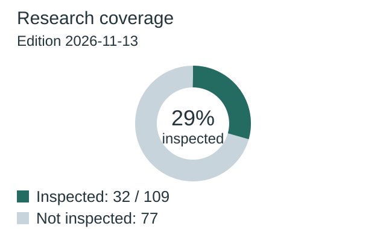
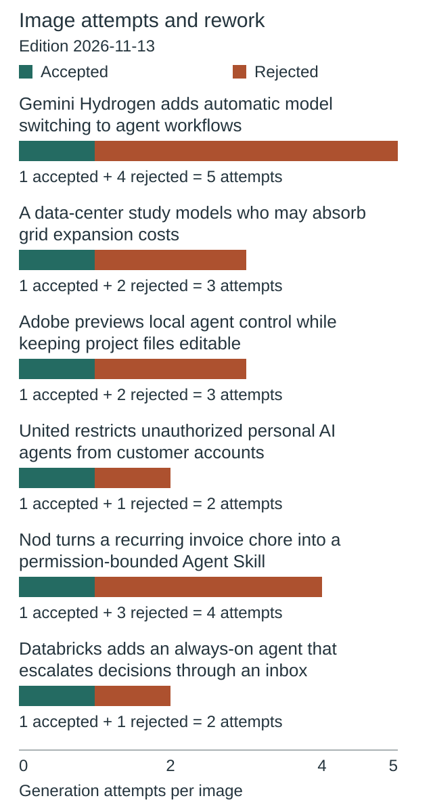
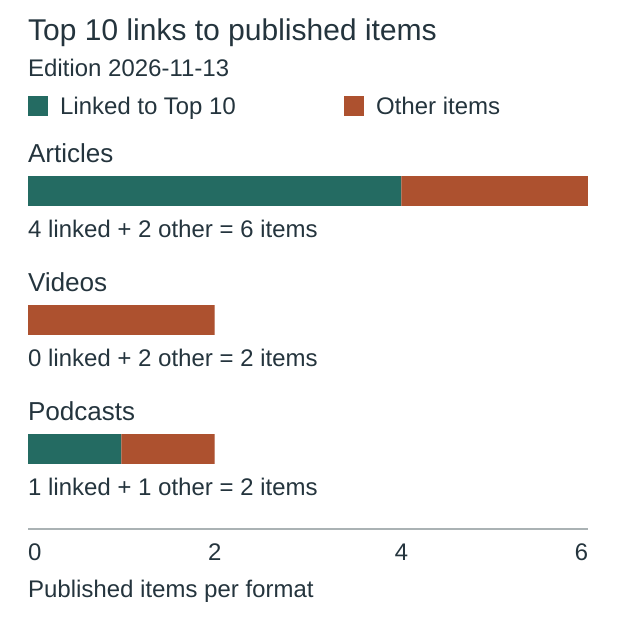
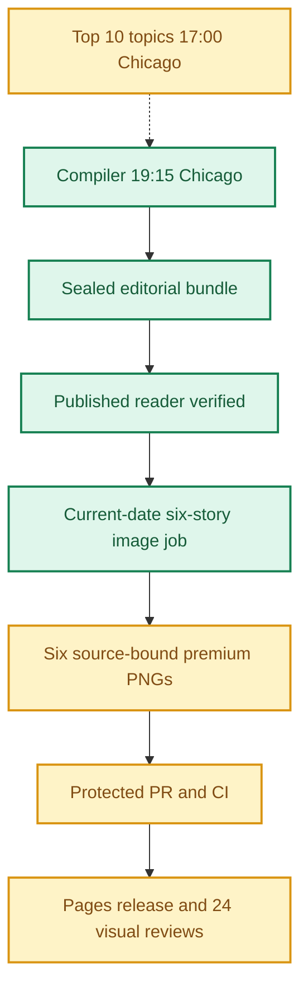
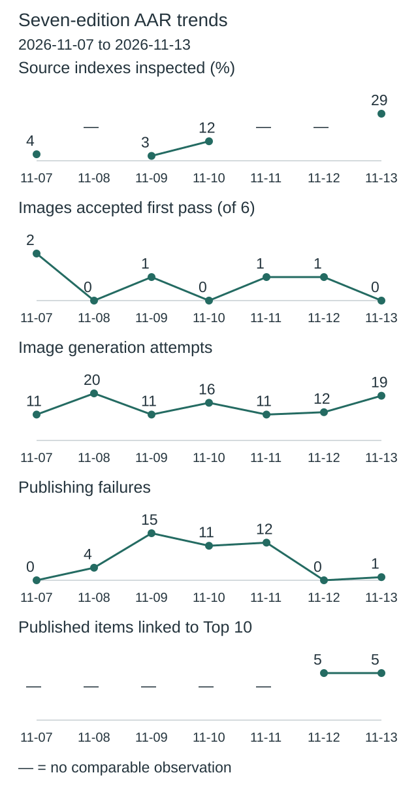
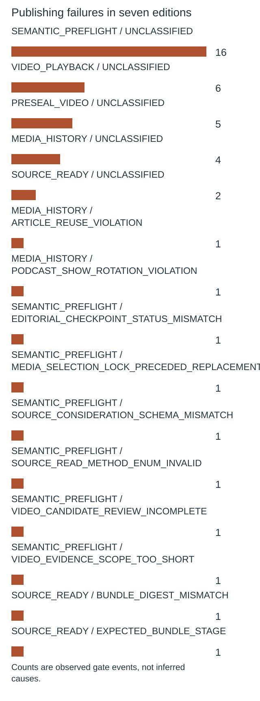
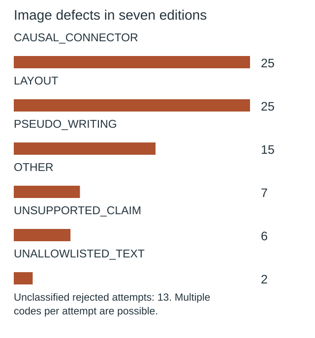

**🟨 RELEASE PARTIAL**
**TOP 10 PARTIAL** · **🟩 COMPILER VERIFIED** · **🟦 IMAGES 6/6 RELEASED** · **🟨 VISUAL QA NOT YET VERIFIED**

# Daily AI Brief — Unified Production After-Action Report
**Edition:** November 13, 2026 · **Production evening:** 2026-11-12 · **Timezone:** America/Chicago
**Primary public reader:** [Open 2026-11-13 Brief](https://gttome.github.io/Daily-AI-Brief-Compiler/briefs/2026-11-13/) · **Repository:** [Daily-AI-Brief-Compiler](https://github.com/gttome/Daily-AI-Brief-Compiler)

> **IMPORTANT — VERIFIED PRODUCTION RESULT**
> **Executive release result: PARTIAL.** This is the single management-facing report covering Top 10 topic discovery, the editorial Compiler, published Brief and premium-image run. **Entire-system evidence: PARTIAL.** Top 10 report: **partial**; Compiler handoff: **RECEIVED_SNAPSHOT_BOUND**; guided searches: **RECEIPTS_OBSERVED**. Compiler public status: **VERIFIED**. Image release: **RELEASED_VERIFIED**. Direct 24-context visual quality: **not yet evidenced**. Autonomous completion: **UNPROVEN**. Missing evidence must not be promoted to a success claim.

**🕒 Production stage durations:** **Top 10 7m 23s** · **Compiler final seal window 10m 00s** · **Premium Images Not independently recorded** (evidence-bounded elapsed times; the start/end events differ).

> **CLOSEOUT WARNING:** The exact image worker has not released its lease and recorded PUBLISHED_COMPLETE with the six accepted hashes.

## Evidence reconciliation

Compiler final seal window: 10m 00s. Compiler state start to public verification: 73m 55s. Observed execution and final seal windows are distinct.
Image capability route preflight: NOT OBSERVED; scheduler origin remains UNPROVEN.
Image efficiency: 0/6 first-pass accepts; 19 total attempts. Current efficiency target: at least 3/6 first-pass and at most 2 attempts per image, with unchanged quality floor.
Image review completed: Not recorded; review-record commit: Not recorded; protected review merge: Not recorded.
Eligible source indexes: 109; editorial inspections reported: 32 (29.4%); inaccessible in editorial audit: 0; explicitly unreviewed IDs: 77; unclassified editorial IDs: 0. Automated index parsing is separate from editorial inspection and cannot substantiate exhaustive freshness claims.

Registered video sources: 29; attempted this edition: 29; unattempted: 0; enabled: 28; qualification-only: 1; sources yielding candidate URLs: 5. Status: REPORTED_ALL_ATTEMPTED. Attempt evidence is not automatic proof of source-content review or playback.

Eligible source partition **VALID**. Full original-item reads **4**. Bounded index searches **28**. Qualification-only sources recorded separately **1**.

### Video candidate discovery

| Discovery source | Eligibility | Candidate URLs |
|---|---|---:|
| AI Engineer | Enabled | 1 |
| Weights & Biases / CoreWeave Videos | Enabled | 1 |
| IBM Think Videos | Enabled | 1 |
| OpenAI Academy On-Demand Workshops | Enabled | 1 |
| Microsoft Copilot Tutorial Videos | Enabled | 1 |

### Protected preseal video outcomes

| Original publisher | Distinct programs submitted | Archive rejects | Playback passes | Playback unverified | Probes skipped |
|---|---:|---:|---:|---:|---:|
| abcnews.com | 1 | 0 | 0 | 1 | 0 |
| cbsnews.com | 1 | 0 | 4 | 0 | 0 |
| fortune.com | 1 | 0 | 1 | 0 | 0 |
| ibm.com | 1 | 0 | 0 | 1 | 0 |
| pbs.org | 1 | 0 | 4 | 0 | 0 |
| weforum.org | 1 | 0 | 0 | 1 | 0 |
| youtube-channel:UCLKPca3kwwd-B59HNr-_lvA | 1 | 0 | 0 | 1 | 0 |
| youtube-channel:UCOmcA3f_RrH6b9NmcNa4tdg | 1 | 0 | 0 | 1 | 0 |
| youtube-channel:UCz80JEs56coMRDd5OzYe_lw | 1 | 0 | 0 | 1 | 0 |

Outcomes count observed checks across all saved requests. Programs can be submitted again after a different slot changes.

- Adobe Max 2026: Everything Announced in 18 Minutes received PUBLIC_VIDEO_PLAYBACK_UNVERIFIED. [Original run](https://github.com/gttome/Daily-AI-Brief-Compiler/actions/runs/43346238601)
- Rethinking Claude Code Best Practices — Lydia Hallie, Anthropic received PUBLIC_VIDEO_PLAYBACK_UNVERIFIED. [Original run](https://github.com/gttome/Daily-AI-Brief-Compiler/actions/runs/43346238601)
- Gemini Decision 1 and the new Decisions API explained received PUBLIC_VIDEO_PLAYBACK_UNVERIFIED. [Original run](https://github.com/gttome/Daily-AI-Brief-Compiler/actions/runs/43346238601)
- Should we trust AI agents? 3 experts discuss received PUBLIC_VIDEO_PLAYBACK_UNVERIFIED. [Original run](https://github.com/gttome/Daily-AI-Brief-Compiler/actions/runs/43347406117)
- How data centers became key 2026 midterm issue received PUBLIC_VIDEO_PLAYBACK_UNVERIFIED. [Original run](https://github.com/gttome/Daily-AI-Brief-Compiler/actions/runs/43348356152)
- Putting AI to work for integration received PUBLIC_VIDEO_PLAYBACK_UNVERIFIED. [Original run](https://github.com/gttome/Daily-AI-Brief-Compiler/actions/runs/43348863058)

## Daily AAR charts

These charts use this edition’s receipts. Missing data is not zero.

### Research coverage



**32 of 109 indexes inspected (29%).**

| Editorial inspection | Indexes |
|---|---:|
| Inspected | 32 |
| Not inspected | 77 |

Not inspected includes every index without a recorded editorial inspection; this is not proof of missed stories.

### Image attempts and rework



**19 attempts; 0 of 6 images accepted on their first attempt.**

Recorded ongoing from November 8 target: at least 3/6 first-pass accepts; no more than 2 attempts per image. This is an efficiency target, not a quality cutoff.

| Image | Accepted | Rejected | Total attempts |
|---|---:|---:|---:|
| Gemini Hydrogen adds automatic model switching to agent workflows | 1 | 4 | 5 |
| A data-center study models who may absorb grid expansion costs | 1 | 2 | 3 |
| Adobe previews local agent control while keeping project files editable | 1 | 2 | 3 |
| United restricts unauthorized personal AI agents from customer accounts | 1 | 1 | 2 |
| Nod turns a recurring invoice chore into a permission-bounded Agent Skill | 1 | 3 | 4 |
| Databricks adds an always-on agent that escalates decisions through an inbox | 1 | 1 | 2 |

Generation attempts measure rework, not runtime or cost. Quality and publication checks remain separate.

### Top 10 links to published items



**5 of 10 unique published items link to Top 10 topics.**

| Format | Linked to Top 10 | Other items |
|---|---:|---:|
| Articles | 4 | 2 |
| Videos | 0 | 2 |
| Podcasts | 1 | 1 |

No selection quota. Topic linkage does not establish better quality, popularity or causal improvement.

[Chart data](charts.json)

One edition at a time. Missing evidence is not zero. Trend claims require comparable recorded cycles.

## Performance dashboard

| Measure | Recorded result | Source / caveat |
|:--|:--:|:--|
| Entire-system evidence | **PARTIAL** | Full Top 10 list, bound Compiler input, all-format search receipts and existing release checks; separate from publication and autonomy |
| Top 10 report | **partial · 10 topics** | Same Chicago cycle report; provisional/partial coverage remains disclosed |
| Top 10 received by Compiler | **RECEIVED_SNAPSHOT_BOUND** | Exact report snapshot bytes; consumed commit separately corroborated: YES |
| Top 10 guided article/video/podcast searches | **RECEIPTS_OBSERVED** | Actual source-search receipts and selected/rejected topic outcomes |
| Top 10 stage duration | **7m 23s** | Same-cycle run receipt only; no runtime or usage estimate |
| Editorial publication | **PASS** | State and public reader integrity receipt |
| **Unattended autonomy (separate from publication)** | **UNPROVEN** | Owner incident receipt takes precedence over unverified producer self-attestation |
| Recorded protected publishing gate failures | **1** | Actual same-edition GitHub failure sidecar only; earlier unrecorded failures remain unknown |
| Articles | **6** | Exactly 2 technical / 2 knowledge-worker / 2 agents required |
| Original scientific-paper-led articles | **1** | Rolling target: one qualified original paper in seven editions; PRODUCER_REPORTED_BUNDLE_MATCH. Preprints are not peer-reviewed by default |
| Verified original sources within preceding 24 hours | **0 / 6** | Original publisher dates only; other sources require a documented fallback rationale |
| Distinct selected article publishers | **6** | Six different primary organizations preferred |
| Videos over seven days old | **2** | Must be labeled evergreen, not a new development |
| Distinct selected video publishers | **2** | One channel is one publisher even across multiple videos |
| Video discovery source attempts | **29 / 29** | Attempt evidence across enabled and qualification-only leads; REPORTED_ALL_ATTEMPTED. Not a claim of full content review or player verification | 
| Duplicate active Watchlist display titles | **0** | Published canonical Watchlist only; historical evidence retained |
| Original-release video playback (historical) | **TWO_PUBLISHED_VIDEOS_PLAYBACK_PASS** | Later reader corrections may replace these originally verified videos; see incident register | 
| Postpublication reader incidents | **NOT_RECORDED** | Edition-specific owner reports and corrective PRs, not inferred absence | 
| Verified postpublication video corrections | **NOT_RECORDED** | Incident register tracks correction PR, actual playback evidence and reader preservation |
| Editorial index second-pass attempts | **0** | Bounded public GET retries only; never proof of original article reading |
| Editorial index reads recovered | **0** | Successful page fetch can still yield zero eligible dated items |
| Recorded scheduler capability route | **UNPROVEN** | Same-invocation route receipt only; GitHub is not scheduler authentication |
| Avoidable incomplete-staging CI failures | **Not independently audited** | Existing image-package push CI is disabled; exact-head protected PR CI remains required. A failure count requires actual workflow evidence |
| Media | **2 videos + 2 podcasts** | Sealed bundle |
| **Compiler final seal window** | **10m 00s (10.0 min)** | Final sealed-state timestamp → verified public reader; initial execution is separate |
| **Image processing stage duration** | **Not independently recorded** | First accepted PNG Git checkpoint → final 24/24 review; auditable stage elapsed time |
| Image scheduled-to-final-review window | **Not independently recorded** | Only with a saved one-cycle schedule anchor; does not attest exact generation start |
| Executor-observed generation-to-final-review | **Not independently recorded** | Only if the worker recorded a same-execution clock before its first native call; not independently verified provider runtime |
| Accepted premium PNGs | **6 / 6** | Exact package and public release hashes |
| Native image generation attempts | **19** | Image worker AAR; no estimation |
| Rejected candidates | **13** | Image worker AAR |
| Final worker checkpoint reconciliation | **MISMATCH** | Oct25+ verifies exact generation count, per-story attempts, six accepted story/image/hash bindings and final release |
| Saved visual contexts | **Unverified** | Dated/permanent desktop/mobile review |
| Public SHA-256 checks | **44** | Image release receipt |
| October 8 immutable history | **17 / 17** | Independent content-preservation checks |
| **Owner-reported weekly Work usage for this run** | **Not reported** | No per-cycle usage supplied |

> **EFFICIENCY NOTE**
> **Resource reporting policy:** No usage figure was supplied for this cycle, so none is assumed. Future runs show **Not reported** unless the owner supplies new cycle-specific usage metadata. No approval or extra step is required to generate the AAR.

## Production architecture and checkpoints



## Daily AI Topic Top 10 and Compiler handoff

**Research cycle:** 2026-11-12 · **Target Brief:** 2026-11-13 · **Scheduled start:** 17:00 America/Chicago

| Dimension | Recorded evidence |
|---|---|
| Run/report result | PARTIAL |
| Report status / topics | partial / 10 |
| Freshness | FRESH\_AT\_CONSUMPTION |
| Compiler handoff | RECEIVED\_SNAPSHOT\_BOUND |
| Search coverage | RECEIPTS\_OBSERVED |
| Selection mapping verification | MATCHES\_EDITION\_BUNDLE |
| Observed start / finish | 2026-11-12T22:58:19Z / 2026-11-12T23:05:42Z |
| Elapsed minutes | 7.38 |
| Usage percent | Not reported |
| Cost USD | Not reported |
| Independent scheduler autonomy | UNPROVEN |
| Compiler-recorded consumed commit | 18f55f3a805258bc72e782250ab3eda55c7bfa55 |
| Report SHA-256 | c0ce08748a88b4c50e672c4d650e608c8a0c42986a4af0767854afb6b03859dd |

**Order:** discovery sequence only; entries are unranked within qualitative evidence bands.

| Discovery order | AI topic | Summary | Confidence | Evidence |
|---:|---|---|---|---|
| 1 | Gemini 4 Hydrogen and Antigravity Orchestrator | Google rolled out a speed-focused Gemini 4 model and introduced routing between Hydrogen and Carbon in Antigravity. | medium | [Source](https://news.ycombinator.com/item?id=50471431) · [Source](https://www.reddit.com/r/GeminiAI/comments/1xuii88/gemini_4_hydrogen_just_released/) · [Source](https://blog.google/innovation-and-ai/models-and-research/gemini-models/introducing-gemini-4-hydrogen/) · [Source](https://storage.googleapis.com/deepmind-media/Model-Cards/Gemini-4-Hydrogen-Model-Card.pdf) · [Source](https://antigravity.google/blog/gemini-4-hydrogen-in-google-antigravity/) · [Source](https://searchengineland.com/google-search-gets-major-upgrade-with-gemini-4-hydrogen-501867) |
| 2 | Claude Fable 5.2 reviews continue to gain views | Independent coverage and Anthropic’s own model-selection video continued after the November 9 launch. | medium | [Source](https://www.youtube.com/watch?v=583ThJIqQ7k) · [Source](https://www.youtube.com/watch?v=C33hJGt-ySg) · [Source](https://www.youtube.com/watch?v=C45VVcCV9OY) · [Source](https://www.anthropic.com/claude-fable-and-mythos-5-2) |
| 3 | Gemini 4 Carbon walkthrough continues drawing viewers | Carbon’s broader release remains a comparison point for long and difficult tasks. | medium | [Source](https://www.youtube.com/watch?v=l32KKNKdpIk) · [Source](https://blog.google/innovation-and-ai/models-and-research/gemini-models/gemini-4-carbon-now-available/) |
| 4 | n8n Labs previews the Nod personal agent | Nod runs on a user’s machine and uses its own browser environment for tasks such as collecting invoices. | medium | [Source](https://x.com/n8n_io/status/2120431328458076315) · [Source](https://www.reddit.com/r/n8n/comments/1xtcovu/nod_an_open_source_personal_agent_with_its_own/) · [Source](https://blog.n8n.io/meet-nod/) · [Source](https://github.com/n8n-io/nod) |
| 5 | Businesses in ChatGPT beta gets merchant follow-through | Merchants are discussing how to claim and verify profiles and what analytics the dashboard provides. | medium | [Source](https://x.com/OpenAI/status/2120216592395174382) · [Source](https://www.reddit.com/r/GoogleMyBusiness/comments/1xtat8c/chatgpt_now_lets_you_claim_your_business_profile/) · [Source](https://openai.com/index/introducing-businesses-chatgpt/) |
| 6 | Gemini Decisions API gets an independent walkthrough | Google’s new endpoint scores fixed choices over multimodal inputs for routing and classification. | medium | [Source](https://www.youtube.com/watch?v=N0v0sY43o7I) · [Source](https://x.com/OfficialLoganK/status/2120581433639198885) · [Source](https://blog.google/innovation-and-ai/technology/developers-tools/gemini-decisions-api/) |
| 7 | Lydia Hallie revisits Claude Code practices | An Anthropic engineer’s conference session revisits how teams configure and verify coding agents. | medium | [Source](https://www.youtube.com/watch?v=vlfCjWuv4es) · [Source](https://ai.engineer/code/2026/schedule) · [Source](https://www.llms.blog/posts/claude-code-best-practices-auto-mode-deny-rules) |
| 8 | Adobe MAX previews agent access to creative tools | Adobe announced agent features across creative products, with local MCP integrations planned for a later private beta. | medium | [Source](https://www.youtube.com/watch?v=sBckm1sBUh4) · [Source](https://news.adobe.com/news/2026/11/adobe-transforms-creative-cloud-tools) · [Source](https://www.theverge.com/tech/1030593/adobe-max-ai-agents-mcp-firefly-assistant-updates) |
| 9 | AlphaGenome 2 models DNA effects by cell type | DeepMind’s updated research model predicts how variants can affect gene regulation in particular cells. | medium | [Source](https://x.com/GoogleDeepMind/status/2120532824465805749) · [Source](https://deepmind.google/blog/alphagenome-2-deciphering-how-cells-read-dna-to-better-understand-disease/) · [Source](https://storage.googleapis.com/deepmind-media/DeepMind.com/Blog/alphagenome-2-deciphering-how-cells-read-dna-to-better-understand-disease/alphagenome-2.pdf) · [Source](https://www.nature.com/articles/d41586-026-03673-0) |
| 10 | Cornell study on who pays for data center power | The November 9 Nature Energy study estimates how wholesale price changes and grid cost allocation affect households. | medium | [Source](https://news.ycombinator.com/item?id=50473231) · [Source](https://news.cornell.edu/stories/2026/11/data-centers-need-power-lower-income-rural-residents-pay-price) · [Source](https://www.nature.com/articles/s41560-026-02163-x) · [Source](https://zenodo.org/records/23019736) · [Source](https://www.cbsnews.com/news/rising-energy-costs-ai-data-centers-lower-income-rural-households-study/) |

**Sample scope:** {"metadata\_screened\_videos":56,"distinct\_retained\_channels":33,"new\_metadata\_screened\_records":62,"combined\_observation\_records":62,"combined\_unique\_video\_ids":56,"unique\_videos":56,"videos\_watched":0,"full\_video\_reviews":0,"direct\_counter\_verifications":0,"direct\_youtube\_counter\_verifications":0,"transcript\_reviews":0,"partial\_original\_publisher\_transcript\_reviews":0,"original\_publisher\_show\_notes\_reviews":0,"original\_watch\_attempts":56,"comparable\_video\_observations":2,"within\_24h\_reported\_publications":2,"additional\_within\_72h\_reported\_publications":14,"additional\_within\_7d\_reported\_publications":0,"date\_only\_video\_publications":40,"unknown\_video\_publication\_dates":0,"validation\_resources\_registered":14,"full\_video\_review\_target\_met":false,"original\_watch\_outcomes":{"throttled":52,"title\_index\_shell":4},"freshness\_reference\_at":"2026-11-12T23:04:32Z","notes":"Date-only records do not enter exact hour buckets. Tracker and original index duplicates do not add programs.","substantive\_original\_event\_document\_reviews":13}. **Ranking basis:** {"attention":"Same-program timed comparisons where available, event-matched video and announcement reach, and dated public discussion. Multiple signals are considered without summing views, votes and points.","limitations":"Mixed attention measures, rounding, missing clocks and audience overlap preclude an exact popularity order. Brief fit is a separate judgment."}.

| Search format | Receipt rows | Attempts recorded | Explicitly not attempted |
|---|---:|---:|---:|
| article | 10 | 10 | 0 |
| video | 10 | 10 | 0 |
| podcast | 10 | 10 | 0 |

**Selected Brief items linked to trends:**

| Topic | Format | Selected item | Reason |
|---|---|---|---|
| gemini-4-hydrogen-launch-nov12 | article | nov13-t1-hydrogen · [Source](https://blog.google/innovation-and-ai/models-and-research/gemini-models/introducing-gemini-4-hydrogen/) | The exact original Hydrogen announcement became the selected Technical orchestration story after complete source review. |
| n8n-nod-preview-nov10 | article | nov13-a1-nod-skill · [Source](https://blog.n8n.io/meet-nod/) | The exact original Nod preview became the edition's one selected permission-bounded Agent Skills procedure. |
| adobe-max-creative-agents-nov10 | article | nov13-k1-adobe-agents · [Source](https://news.adobe.com/news/2026/11/adobe-transforms-creative-cloud-tools) | The exact original Adobe MAX announcement became the selected Applied creative-agent workflow story. |
| alphagenome-2-single-cell-nov11 | podcast | https://podcasts.apple.com/sg/podcast/alphagenome-2-teaching-ai-to-read-the-entire-human-genome/id1476316441?i=1000801283717 · [Source](https://podcasts.apple.com/sg/podcast/alphagenome-2-teaching-ai-to-read-the-entire-human-genome/id1476316441?i=1000801283717) | The exact named-researcher AlphaGenome 2 episode was selected after complete publisher identity and episode review. |
| cornell-datacenter-energy-costs-nov09 | article | nov13-t2-datacenter-costs · [Source](https://www.nature.com/articles/s41560-026-02163-x) | The exact peer-reviewed Nature Energy paper became the selected Technical infrastructure-cost story with methods and limits retained. |

**Gaps and limitations:**

- The report labels its research partial.
- Original video routes throttled or exposed title/index shells. Zero full playbacks, full transcripts or direct YouTube counters verified.
- The AlphaGenome 2 paper exceeded the public search PDF size limit. The Nature Energy journal page redirected to an unsupported authorization route. Original summaries and indexed excerpts were reviewed and bounded.
- Screened the latest 24 hours, widened to 72 hours and then seven days. Date-only observations have limited time precision. Earlier source material is explicitly labeled.
- No exact popularity ordering, audience velocity or causal editorial improvement was established.

**Recorded run issues:**

- {"issue":"52 original video checks throttled and four yielded title/index shells.","effect":"No full playback or direct counters. Research is partial.","correction":"Retained attributed snapshots and exact original source fallbacks with separate review scope."}
- {"issue":"AlphaGenome manuscript exceeded the search size limit and Nature Energy direct article hit an authorization redirect.","effect":"Full manuscript review is unavailable.","correction":"Recorded direct paper identities, limited indexed excerpts, original research summaries and Cornell author replication package."}

**Recorded improvements:**

- {"change":"Applied exact event-document fallback and verified original availability by surface.","reason":"The November 12 approved correction prioritizes source substance and separates video access from evidence about the event.","expected\_effect":"More traceable claim limits for each retained topic.","status":"implemented"}
- {"change":"Retained only matched timed program comparisons and revalidated all family removals.","reason":"Earlier combined AAR confirmed valid sensitivity records, while playback and direct counter gaps persisted.","expected\_effect":"Consistent daily comparisons and reporter-readable evidence bands.","status":"implemented"}

### Daily improvement and effect on the Brief

**Fixed baseline:** nov03-2026-v1 / INPUT\_FROZEN. **Outcome baseline:** FROZEN\_AFTER\_VERIFIED\_PUBLICATION. **Prior cycle:** 2026-11-11.

| Input measure | Current | November 3 baseline | Change from baseline | Change from prior cycle |
|---|---:|---:|---:|---:|
| topic count | 10 | 10 | 0 | 0 |
| validation resource count | Not reported | 14 | Not reported | Not reported |
| additional video metadata records | 62 | 63 | -1 | -1 |
| additional video channels | Not reported | 21 | Not reported | Not reported |
| total video observations | 62 | 79 | -17 | -1 |
| unique videos | 56 | 71 | -15 | -1 |
| full video reviews | 0 | 0 | 0 | 0 |
| direct youtube counter verifications | 0 | 0 | 0 | 0 |
| broader evidence band topics | 2 | 3 | -1 | -1 |
| limited evidence band topics | 8 | 7 | 1 | 1 |

**Observed downstream measurements:** OBSERVED.

| Outcome measure | Current | Change from frozen outcome | Change from prior cycle |
|---|---:|---:|---:|
| expected topic format pairs | 30 | 0 | 0 |
| attempted topic format pairs | 30 | 0 | 0 |
| explicitly unattempted pairs | 0 | 0 | 0 |
| discovered candidate count | 21 | -19 | 6 |
| searched source host count | 23 | 7 | -3 |
| selected article count | 4 | 1 | 0 |
| selected video count | 0 | 0 | 0 |
| selected podcast count | 1 | 0 | 0 |

**Source changes:** {"added":\[\],"removed":\[\]}.

**Candidate review depth:** INVALID.

| Review measure | Current | Change from prior comparable cycle |
|---|---:|---:|
| reviewed candidate count | Not reported | Not reported |
| qualified candidate count | Not reported | Not reported |
| rejected candidate count | Not reported | Not reported |
| metadata only count | Not reported | Not reported |
| full video reviews | Not reported | Not reported |
| transcript reviews | Not reported | Not reported |

The frozen November 3 baseline has no candidate-level review ledger; no retrospective value is invented. Recorded reviews do not independently establish content quality, audience interest or causal benefit.

**Method/resource review:** {"baseline\_id":"nov03-2026-v1","previous\_report\_date":"2026-11-11","previous\_method\_version":"2026-11-03.2-event-review","method\_version":"2026-11-03.2-event-review","feedback":{"aar\_url":"https://github.com/gttome/Daily-AI-Brief-Compiler/blob/dc9e3dc6b3a768c371a4e22ea9371af519674e16/daily/2026-11-11/combined.md","charts\_url":"https://github.com/gttome/Daily-AI-Brief-Compiler/blob/dc9e3dc6b3a768c371a4e22ea9371af519674e16/daily/2026-11-11/charts.json","metrics\_url":"https://github.com/gttome/Daily-AI-Brief-Compiler/blob/dc9e3dc6b3a768c371a4e22ea9371af519674e16/daily/2026-11-11/improvement-metrics.json","observation":"November 12 reconciled AAR bound the previous input, observed 10 actual searches per format, and matched five published items. The family metric accepted ten assessments and eight weakened on removal. Source index inspections remain unrecorded. Image chart recorded 12 attempts and one first-pass acceptance. Prior series does not establish causal uplift."},"changes":\[{"change":"Applied exact event-document fallback and verified original availability by surface.","reason":"The November 12 approved correction prioritizes source substance and separates video access from evidence about the event.","expected\_effect":"More traceable claim limits for each retained topic."},{"change":"Retained only matched timed program comparisons and revalidated all family removals.","reason":"Earlier combined AAR confirmed valid sensitivity records, while playback and direct counter gaps persisted.","expected\_effect":"Consistent daily comparisons and reporter-readable evidence bands."}\],"resource\_candidates":\[{"url":"https://zenodo.org/records/23019736","role":"Original author replication package","access":"Public archive record","review\_scope":"Package description and provenance, no computational replication","independence":"Same study authors, so this supports methods and reproducibility rather than independent attention.","decision":"accepted","reason":"Identifies released data and replication materials for the exact Nature Energy paper.","contribution":"Clarifies which evidence can be independently inspected despite the journal access failure."}\],"observed\_effects":\[{"observation":"56 metadata-screened programs versus 57; 2 matched timed comparisons versus 4.","effect":"Sample composition changed. Review depth and editorial effect cannot be inferred from counts."},{"observation":"Earlier combined AAR reports five exact published item links.","effect":"One edition demonstrates observable association between the watchlist and selection. Causal benefit is unknown."}\],"next\_improvement":"Seek event-matched original episode text and inspect the next reconciled consumer receipts.","limitations":\["The November 10 pilot is not applicable to this edition.","Actual consumption of today's report and production effects are pending independent receipts."\],"change\_evaluations":\[{"change\_id":"AAR-10","reviewed\_edition":"2026-11-13","decision":"keep","result":"met","reason":"The latest reconciled November 12 report accepted all ten publisher-family assessments and recorded eight weakened topics. This meets the documentation criterion for that observed cycle.","evidence\_refs":\["https://github.com/gttome/Daily-AI-Brief-Compiler/blob/dc9e3dc6b3a768c371a4e22ea9371af519674e16/daily/2026-11-11/improvement-metrics.json"\]},{"change\_id":"NOV03-04","reviewed\_edition":"2026-11-13","decision":"keep","result":"inconclusive","reason":"The latest combined AAR validated 30 search dispositions and five matching selections. This provides an observed workflow outcome for one cycle, while substantive program playback and causal editorial improvement remain unverified.","evidence\_refs":\["https://github.com/gttome/Daily-AI-Brief-Compiler/blob/dc9e3dc6b3a768c371a4e22ea9371af519674e16/daily/2026-11-11/combined.md","https://github.com/gttome/Daily-AI-Brief-Compiler/blob/dc9e3dc6b3a768c371a4e22ea9371af519674e16/daily/2026-11-11/improvement-metrics.json"\]}\]}.

**Current reconciled conclusion:** OBSERVED; outcome baseline FROZEN\_AFTER\_VERIFIED\_PUBLICATION; candidate review ledger INVALID.

**Historical producer observations (not current status):** The following snapshot preserves what the producer reported at the time. Its pending statuses and candidate-quality claims are not independently reconciled conclusions. Use the current tables above for publication-bound measurements; an absent candidate review ledger remains unknown.

<details><summary>Original producer effects and gaps — historical snapshot</summary>

```json
{
  "status": "PARTIAL",
  "actual_source_additions": 30,
  "useful_qualified_candidate_ids": [
    "ART-GOOGLE-HYDROGEN",
    "ART-ANTHROPIC-FABLE-52",
    "VID-FABLE-52-REVIEW",
    "POD-HOW-I-AI-FABLE-52",
    "ART-GOOGLE-CARBON",
    "VID-SAM-WITTEVEEN-CARBON",
    "POD-AI-ENGINEERING-CARBON",
    "ART-N8N-NOD",
    "ART-OPENAI-BUSINESSES",
    "VID-OPENAI-BUSINESSES",
    "ART-GOOGLE-DECISIONS",
    "VID-AI-WITH-SURYA-DECISION-1",
    "ART-AIE-HALLIE-SESSION",
    "VID-AIE-HALLIE",
    "POD-NILECAST-AIE-HALLIE",
    "ART-ADOBE-CREATIVE-AGENTS",
    "VID-CNET-ADOBE-MAX",
    "ART-DEEPMIND-ALPHAGENOME2",
    "VID-DEEPMIND-ALPHAGENOME2",
    "POD-DEEPMIND-ALPHAGENOME2",
    "ART-NATURE-DATACENTER-ENERGY"
  ],
  "rejection_reasons": {
    "freshness": 0,
    "duplicate": 2,
    "promotion": 0,
    "quality_or_fit": 12
  },
  "gaps": "Several format-specific searches found only launch articles or relay pages; exact video playback and podcast whole-episode admission remain separate checks.",
  "observed_timing_minutes": 4,
  "observed_cost_usd": 0,
  "source_links": [
    "https://blog.google/innovation-and-ai/models-and-research/gemini-models/introducing-gemini-4-hydrogen/",
    "https://podcasts.apple.com/us/podcast/podcast/id1888042569/episodes",
    "https://www.anthropic.com/claude-fable-and-mythos-5-2",
    "https://assets.claude.com/27d60918d218125e7504bc7354c4b4626ec56b11.pdf",
    "https://www.youtube.com/watch?v=kwRxc8QPhrk",
    "https://www.podpage.com/example-how-i-ai/claude-fable-52-review-fast-creative-and-finally-not-annoying/",
    "https://blog.google/innovation-and-ai/models-and-research/gemini-models/gemini-4-carbon-now-available/",
    "https://deepmind.google/models/model-cards/gemini-4-carbon/",
    "https://www.youtube.com/watch?v=l32KKNKdpIk",
    "https://chooseto.ai/watch/l32KKNKdpIk",
    "https://podscan.fm/podcasts/ai-engineering-briefing-daily-ai-news-for-software-engineers",
    "https://blog.n8n.io/meet-nod/",
    "https://github.com/n8n-io/nod",
    "https://nod.n8n.io/docs/trust/principles/",
    "https://nod.n8n.io/",
    "https://community.n8n.io/t/nod-an-open-source-personal-agent-with-its-own-computer-research-preview-from-n8n-labs/328026",
    "https://openai.com/index/introducing-businesses-chatgpt/",
    "https://openai.com/policies/business-agents-policy/",
    "https://openai.com/index/introducing-businesses-chatgpt/?video=1245272094",
    "https://blog.google/innovation-and-ai/technology/developers-tools/gemini-decisions-api/",
    "https://www.youtube.com/watch?v=N0v0sY43o7I",
    "https://ai.engineer/code/2026/schedule",
    "https://www.usetranscribe.io/yt/vlfCjWuv4es/rethinking-code-practices",
    "https://www.youtube.com/watch?v=vlfCjWuv4es",
    "https://nilecast.anlamani.com/podcasts/ai-engineer/ai-engineer-2026-11-12-1008/",
    "https://news.adobe.com/news/2026/11/adobe-transforms-creative-cloud-tools",
    "https://news.adobe.com/news/2026/11/adobe-powers-new-era-of-creativity",
    "https://www.youtube.com/watch?v=sBckm1sBUh4",
    "https://cybertechtv.com/adobe-max-2026-supercut-everything-announced-in-18-minutes/",
    "https://max.adobe.com/virtual-max/",
    "https://deepmind.google/blog/alphagenome-2-deciphering-how-cells-read-dna-to-better-understand-disease/",
    "https://storage.googleapis.com/deepmind-media/DeepMind.com/Blog/alphagenome-2-deciphering-how-cells-read-dna-to-better-understand-disease/alphagenome-2.pdf",
    "https://deepmind.google/science/alphagenome/",
    "https://podcasts.apple.com/sg/podcast/alphagenome-2-teaching-ai-to-read-the-entire-human-genome/id1476316441?i=1000801283717",
    "https://www.nature.com/articles/s41560-026-02163-x",
    "https://news.cornell.edu/stories/2026/11/data-centers-need-power-lower-income-rural-residents-pay-price"
  ],
  "incremental_benefit": null,
  "causal_uplift": null
}
```

</details>

**Next improvement:** Seek event-matched original episode text and inspect the next reconciled consumer receipts.

Counts show coverage and observed association, not audience popularity, source independence, candidate quality or causal uplift. Compare source/method changes before interpreting deltas. Unknown values are not zero. Publication, reader corrections, runtime and image outcomes retain their separate AAR evidence.

Report, source-readback and search receipts are separate observations. Snapshot binding verifies the collected report bytes; the consumed commit is independently corroborated only when the separately fetched source bytes match. These records do not independently attest scheduler identity or source truth. Top 10 reporting does not change Brief/image release status.


## Track 1 — Compiler

**State:** `SHADOW_VERIFIED` · **Bundle:** `BUNDLE_READY` · **Compiler final seal window:** 10m 00s (10.0 min).

| Publication gate | Result |
|---|:---:|
| Canonical reader build | ✅ |
| Reader parity | ✅ |
| Public verification of dated edition | ✅ |
| Previous editions preserved | ✅ |
| Permanent story routes and feeds | ✅ |

**Selected coverage:**

| Lane | Story |
|---|---|
| Technical AI Engineering | Gemini Hydrogen adds automatic model switching to agent workflows |
| Technical AI Engineering | A data-center study models who may absorb grid expansion costs |
| Applied Generative AI for Knowledge Workers | Adobe previews local agent control while keeping project files editable |
| Applied Generative AI for Knowledge Workers | United restricts unauthorized personal AI agents from customer accounts |
| Agents for Everyone | Nod turns a recurring invoice chore into a permission-bounded Agent Skill |
| Agents for Everyone | Databricks adds an always-on agent that escalates decisions through an inbox |

### Scientific paper opportunity and publication evidence

**Current edition:** PRODUCER_REPORTED_BUNDLE_MATCH; **paper-led stories:** 1. Editorial target: at least one genuinely qualified original-paper-based story in seven editions, with methods, limitations, and an explicit preprint/peer-review distinction. No stale or weak paper is selected solely to fill a quota.
- Data centres need power, but lower-income, rural residents pay the price (PEER_REVIEWED): https://www.nature.com/articles/s41560-026-02163-x — linked article: nov13-t2-datacenter-costs.


## Track 2 — Premium images

**Public status:** `RELEASED_VERIFIED` · **Saved images:** 6/6 · **Actual generation attempts:** 19 · **Rejected candidates:** 13.

### Image production duration — Git-verified milestones

**Auditable image stage duration:** **Not independently recorded** (first accepted binary saved in Git → first persisted 24-context quality-review record). **First asset to public image release:** **Not independently recorded**.
**Scheduled-to-final-review window:** **Not independently recorded**. This is a scheduled-clock comparison only when a separately recorded exact-date schedule exists; it is **not** measured native image-generation runtime.

| Production milestone | Chicago local time | Evidence |
|---|---|---|
| Scheduled image start (if exact-date record exists) | Not independently recorded | Time planned, not actual execution start |
| First executor-observed start | Not independently recorded | Worker self-attestation, not a first-party scheduler event |
| First native generation observation | Not independently recorded | Worker clock recorded immediately before first native call, not model-provider telemetry |
| First accepted PNG bytes saved to Git | Not independently recorded | Immutable binary-stage commit |
| Six-image package / reviews committed | Not independently recorded | Exact-head PR source commit |
| Protected package merged | Not independently recorded | Merge SHA and required CI |
| Public images verified | Not independently recorded | Image-release receipt |
| 24/24 review record committed | Not independently recorded | Immutable first review-approval commit |

> **Duration interpretation:** The audited stage excludes unobservable pre-checkpoint creative work. The scheduled-start window includes it but must not be interpreted as precise active processing time. Missing timestamps appear as **Not independently recorded**, never an estimate.


| Source-bound image | Attempts | File size | Public page |
|---|---:|---:|---|
| Gemini Hydrogen adds automatic model switching to agent workflows | 5 | 0.97 MiB | [View original](https://gttome.github.io/Daily-AI-Brief-Compiler/briefs/images/2026-11-13/dab-edition-2026-11-13-m01.png) |
| A data-center study models who may absorb grid expansion costs | 3 | 0.82 MiB | [View original](https://gttome.github.io/Daily-AI-Brief-Compiler/briefs/images/2026-11-13/dab-edition-2026-11-13-m02.png) |
| Adobe previews local agent control while keeping project files editable | 3 | 0.92 MiB | [View original](https://gttome.github.io/Daily-AI-Brief-Compiler/briefs/images/2026-11-13/dab-edition-2026-11-13-m10.png) |
| United restricts unauthorized personal AI agents from customer accounts | 2 | 0.98 MiB | [View original](https://gttome.github.io/Daily-AI-Brief-Compiler/briefs/images/2026-11-13/dab-edition-2026-11-13-m11.png) |
| Nod turns a recurring invoice chore into a permission-bounded Agent Skill | 4 | 0.84 MiB | [View original](https://gttome.github.io/Daily-AI-Brief-Compiler/briefs/images/2026-11-13/dab-edition-2026-11-13-m12.png) |
| Databricks adds an always-on agent that escalates decisions through an inbox | 2 | 1.02 MiB | [View original](https://gttome.github.io/Daily-AI-Brief-Compiler/briefs/images/2026-11-13/dab-edition-2026-11-13-m14.png) |

**Immutable-release and visual gates:**

| Release gate | Result |
|---|:---:|
| Protected public image receipt | ✅ |
| Accepted-image Git hash bindings | ✅ |
| Six live PNGs | 6/6 |
| Dated/permanent story placements | 12/12 recorded in release evidence |
| Desktop/mobile visual inspection | Not verified |
| Historical Oct 8 integrity | 17/17 |

### Published premium illustrations

<table>
<tr><td width="50%"><a href="https://gttome.github.io/Daily-AI-Brief-Compiler/briefs/images/2026-11-13/dab-edition-2026-11-13-m01.png"></a><br/><b>Gemini Hydrogen adds automatic model switching to agent workflows</b></td><td width="50%"><a href="https://gttome.github.io/Daily-AI-Brief-Compiler/briefs/images/2026-11-13/dab-edition-2026-11-13-m02.png"></a><br/><b>A data-center study models who may absorb grid expansion costs</b></td></tr>
<tr><td width="50%"><a href="https://gttome.github.io/Daily-AI-Brief-Compiler/briefs/images/2026-11-13/dab-edition-2026-11-13-m10.png"></a><br/><b>Adobe previews local agent control while keeping project files editable</b></td><td width="50%"><a href="https://gttome.github.io/Daily-AI-Brief-Compiler/briefs/images/2026-11-13/dab-edition-2026-11-13-m11.png"></a><br/><b>United restricts unauthorized personal AI agents from customer accounts</b></td></tr>
<tr><td width="50%"><a href="https://gttome.github.io/Daily-AI-Brief-Compiler/briefs/images/2026-11-13/dab-edition-2026-11-13-m12.png"></a><br/><b>Nod turns a recurring invoice chore into a permission-bounded Agent Skill</b></td><td width="50%"><a href="https://gttome.github.io/Daily-AI-Brief-Compiler/briefs/images/2026-11-13/dab-edition-2026-11-13-m14.png"></a><br/><b>Databricks adds an always-on agent that escalates decisions through an inbox</b></td></tr>
</table>

## Incidents, corrections and learning

### Postpublication reader incidents (updated when new evidence is merged)

No current-edition postpublication incident register was available; this is **NOT_RECORDED**, not a certification of zero incidents.


**Editor recovery classification:** UNPROVEN. **Owner intervention:** Unproven either way. **Protected same-edition failures recorded:** 1. 
**Latest failed protected stage:** VIDEO_PLAYBACK; [Action evidence](https://github.com/gttome/Daily-AI-Brief-Compiler/actions/runs/43352330788). Exact stage durations are available only where real source timestamps exist.

| Stage | Verified issue | Corrective action |
|---|---|---|
| Protected package admission | Six corrected, source-bound native PNGs passed individual and set review and the exact canonical bytes were independently verified. This invocation observed its start clock but did not capture a separate observation immediately before its first native call. The protected AAR schema requires this actual observation. No independently retrievable same-invocation start evidence was available. | Recover genuine execution observation if it exists. Retain all six exact accepted assets. |

> **OPERATIONAL NOTE**
> This report distinguishes a published and verified production outcome from scheduler metadata exposed to another conversation. Lack of a live host heartbeat in a separate normal chat is not a Compiler production failure.

## Usage and cost stewardship

| Item | Per-cycle value |
|---|---|
| **Weekly Work usage reported by owner** | **Not reported** |
| Internal weekly usage reference | Target under 5% |
| Genuine image-generation attempts | 19 |
| Accepted diagrams | 6 |
| Regeneration after acceptance | 0 |
| Top 10 reported usage | Not reported |
| Top 10 reported cost | Not reported |
| Account-level billing telemetry | Not independently accessible to deterministic GitHub reporting |

**Future reporting rule:** For cycles without an optional owner-usage record, publish the complete AAR with `Not reported`; do not reuse prior percentages, guess remaining weekly credits or delay tomorrow's production.

## Next-edition operating handoff

| Control | Recurring contract |
|---|---|
| AI Topic Top 10 | Sole report task · 17:00 America/Chicago · saved dated list guides same-evening research |
| Primary Compiler | Sole existing task · 19:15 America/Chicago |
| Premium image production | Sole existing task · standard 21:15 America/Chicago |
| Exact image job selection | Newly published next-date `PUBLISHED_PENDING` only |
| AAR | Combined report generated automatically from new GitHub receipts |
| Optional Work usage | Owner-supplied per cycle, otherwise `Not reported` |

> **SCHEDULE RESTORATION NOTE**
> A temporary scheduling exception must be explicitly restored before claiming standard-time readiness. This deterministic document generator reads existing state only; it does not modify production schedules.

## Evidence register

| Evidence | Link |
|---|---|
| Compiler state | [Open receipt](https://github.com/gttome/Daily-AI-Brief-Compiler/blob/shadow/2026-11-13/shadow-runs/2026-11-13/compiler-state.json) |
| Compiler compile receipt | [Open receipt](https://github.com/gttome/Daily-AI-Brief-Compiler/blob/shadow/2026-11-13/shadow-runs/2026-11-13/compiler/compile-receipt.json) |
| Compiler public integrity | [Open receipt](https://github.com/gttome/Daily-AI-Brief-Compiler/blob/shadow/2026-11-13/shadow-runs/2026-11-13/compiler/postpublish-integrity.json) |
| Image release receipt | [Open receipt](https://github.com/gttome/Daily-AI-Brief-Compiler/blob/shadow-pages-history/site/image-jobs/2026-11-13/release.json) |
| Image review | [Open receipt](https://github.com/gttome/Daily-AI-Brief-Compiler/blob/main/external-image-packages/2026-11-13/reviews/live/image-element24/semantic-reviews.json) |
| Original image AAR | [Open receipt](https://github.com/gttome/Daily-AI-Brief-Compiler/blob/main/external-image-packages/2026-11-13/reviews/after-action.md) |
| Observed editorial index retries | [Open receipt](https://github.com/gttome/Daily-AI-Brief-Compiler/blob/shadow/2026-11-13/shadow-runs/2026-11-13/editorial/source-item-retries.json) |
| Scientific paper selection review | [Open receipt](https://github.com/gttome/Daily-AI-Brief-Compiler/blob/shadow/2026-11-13/shadow-runs/2026-11-13/editorial/scientific-paper-coverage.json) |
| Published player playback receipt | [Open receipt](https://github.com/gttome/Daily-AI-Brief-Compiler/blob/shadow/2026-11-13/shadow-runs/2026-11-13/compiler/postpublish-video-playback.json) |
| Top 10 ranked topic report | [Open receipt](https://github.com/gttome/Daily-AI-Brief-Compiler/blob/2582246e6d57d92f40acbc9ce79e7aaf64ddbce5/signals/ai-topic-top10/2026-11-12.json) |
| Top 10 run after-action receipt | [Open receipt](https://github.com/gttome/Daily-AI-Brief-Compiler/blob/2582246e6d57d92f40acbc9ce79e7aaf64ddbce5/signals/ai-topic-top10/2026-11-12.aar.json) |
| Compiler Top 10 input snapshot | [Open receipt](https://github.com/gttome/Daily-AI-Brief-Compiler/blob/shadow/2026-11-13/shadow-runs/2026-11-13/editorial/trend-input.json) |
| Top 10 article/video/podcast search coverage | [Open receipt](https://github.com/gttome/Daily-AI-Brief-Compiler/blob/shadow/2026-11-13/shadow-runs/2026-11-13/editorial/trend-search-coverage.json) |

**Image workflow:** [Workflow evidence](https://github.com/gttome/Daily-AI-Brief-Compiler/actions/runs/43476561230).

---

*Generated deterministically from cycle- and edition-specific GitHub records. The report combines the Top 10 discovery priorities, its Compiler handoff and searches, the published Brief, and the image run; original research, Compiler, image, hash, and review receipts remain immutable. This reporting action creates no stories, images, releases, extra AI tasks, or schedule changes.*

<!-- continuous-improvement:start -->
## Continuous improvement review

Edition **2026-11-13**. Measurements use 7/7 recorded editions in this window. Missing data stays **Not recorded**.

### Daily corrective-action review

**2 evidence-based findings**; open production blockers: 0. Cumulative evaluation checkpoint: **2026-11-11**. The daily review never waits for that date to act on a safe live problem.

| Priority | Observed issue | Existing owner / next correction | When |
|---|---|---|---|
| P1 | 1 failed protected publication gates were recorded (1 unclassified causes). | Compiler / Recovery: Read original failed job logs, record real causes and move the relevant existing validation before the next readiness signal; do not replay the released edition. | Immediate, if ownership and gates allow |
| P2 | Publication success does not independently attest the originating scheduler. | Compiler / Recovery: Capture real first-party scheduler and execution evidence if available; do not convert unknown provenance into a failure or a success. | Next genuine run |

Findings are observational and do not claim a repair was executed by the reporter.

### Approved change evaluations

| Change | Evaluate by | Outcome status | Latest decision |
|---|---|---|---|
| NOV03-01 — Earlier publication checks and precise recovery | 2026-11-11 | REVIEWED | revise |
| NOV03-02 — Broader genuine source review | 2026-11-11 | REVIEWED | revise |
| NOV03-03 — Source-bound image rejection lessons | 2026-11-11 | REVIEWED | revise |
| NOV03-04 — Substantive Top 10 review evidence | 2026-11-11 | REVIEWED | keep |
| AAR-01 — Current conclusions separated from historical claims | 2026-11-11 | REVIEWED | keep |
| AAR-02 — Consolidated current task contracts | 2026-11-11 | REVIEWED | keep |
| AAR-03 — Dated improvement evaluations | 2026-11-11 | REVIEWED | keep |
| AAR-04 — Seven-edition trend charts | 2026-11-11 | REVIEWED | keep |
| AAR-05 — Recurring publication failure causes | 2026-11-11 | REVIEWED | revise |
| AAR-06 — Recovery interval reporting | 2026-11-11 | REVIEWED | revise |
| AAR-07 — Source inspection history | 2026-11-11 | REVIEWED | revise |
| AAR-08 — Rolling source contribution | 2026-11-11 | REVIEWED | revise |
| AAR-09 — Recurring image defect categories | 2026-11-11 | REVIEWED | keep |
| AAR-10 — Top 10 publisher-family sensitivity | 2026-11-11 | REVIEWED | keep |

Pending: 0; overdue: 0; reviewed: 14. Implemented controls await measured results; review decisions do not disable controls.

#### Reviews of production evidence

- **NOV03-01 · 2026-11-12 · not met.** Two media requests still required correction. The first had two stalled embeds and a certificate-date error. The second reached protected playback before two archived programs were disqualified. The edition recovered and published. [Evidence 1](https://github.com/gttome/Daily-AI-Brief-Compiler/blob/1d8c6be/shadow-runs/2026-11-12/editorial/preseal-video-receipt.json) · [Evidence 2](https://github.com/gttome/Daily-AI-Brief-Compiler/blob/shadow/2026-11-12/shadow-runs/2026-11-12/execution-milestones.json)
- **NOV03-02 · 2026-11-12 · inconclusive.** The raw audit recorded 34 inspected entries and 76 unreviewed for 109 eligible sources. It included qualification-only Zapier in the inspection entries. The audited breadth is unknown. Five distinct article publishers were recorded and zero articles had verified 24-hour timestamps. [Evidence 1](https://github.com/gttome/Daily-AI-Brief-Compiler/blob/shadow/2026-11-12/shadow-runs/2026-11-12/editorial/index-review.json) · [Evidence 2](https://github.com/gttome/Daily-AI-Brief-Compiler/blob/dac33c1e16f891121a0571a0a5e25d09b691bee5/daily/2026-11-11/combined.md)
- **AAR-01 · 2026-11-12 · met.** The reviewed closeout identified the live release and 24 visual checks as complete. It separately displayed partial research evidence and unproven autonomy. The original Top 10 snapshot retains its production-stage claims. [Evidence 1](https://github.com/gttome/Daily-AI-Brief-Compiler/blob/dac33c1e16f891121a0571a0a5e25d09b691bee5/daily/2026-11-11/combined.md) · [Evidence 2](https://github.com/gttome/Daily-AI-Brief-Compiler/blob/6e6911d0a393a3117160841950ecf3b2c3665777/signals/ai-topic-top10/2026-11-11.aar.json)
- **AAR-04 · 2026-11-12 · met.** The November 6–12 series included seven image-attempt observations and a median of 12. The chart marked missing coverage and selection observations as gaps and disclosed the registry change. [Evidence 1](https://github.com/gttome/Daily-AI-Brief-Compiler/blob/dac33c1e16f891121a0571a0a5e25d09b691bee5/daily/2026-11-11/improvement-metrics.json) · [Evidence 2](https://github.com/gttome/Daily-AI-Brief-Compiler/blob/dac33c1e16f891121a0571a0a5e25d09b691bee5/daily/2026-11-11/charts/seven-edition-trends.svg)
- **AAR-05 · 2026-11-12 · not met.** The November 12 failure chart counted zero failed workflow jobs while the candidate evidence showed a blocked probe and an archive rejection. The recurring-failure table still contains unclassified events. Preserve the original outcomes so these types remain visible. [Evidence 1](https://github.com/gttome/Daily-AI-Brief-Compiler/blob/dac33c1e16f891121a0571a0a5e25d09b691bee5/daily/2026-11-11/improvement-metrics.json) · [Evidence 2](https://github.com/gttome/Daily-AI-Brief-Compiler/blob/shadow/2026-11-12/shadow-runs/2026-11-12/execution-milestones.json)
- **AAR-06 · 2026-11-12 · inconclusive.** Compiler milestones preserve detection and subsequent state changes. The reconciled report has zero recovery incidents with all required clocks and exact references. Separate repair and verification intervals and unattended origin remain unproven. [Evidence 1](https://github.com/gttome/Daily-AI-Brief-Compiler/blob/shadow/2026-11-12/shadow-runs/2026-11-12/execution-milestones.json) · [Evidence 2](https://github.com/gttome/Daily-AI-Brief-Compiler/blob/dac33c1e16f891121a0571a0a5e25d09b691bee5/daily/2026-11-11/improvement-metrics.json)
- **AAR-07 · 2026-11-12 · not met.** The November 12 index audit failed to reconcile by eligible ID. The current cycle could not update certified inspection coverage from that partition. Review the actual source scopes and clocks with the enabled roster before selection. [Evidence 1](https://github.com/gttome/Daily-AI-Brief-Compiler/blob/shadow/2026-11-12/shadow-runs/2026-11-12/editorial/index-review.json) · [Evidence 2](https://github.com/gttome/Daily-AI-Brief-Compiler/blob/dac33c1e16f891121a0571a0a5e25d09b691bee5/daily/2026-11-11/improvement-metrics.json)
- **AAR-08 · 2026-11-12 · inconclusive.** Five published items had validated topic mappings. The rolling contribution table had no validated substantive candidate review rows attributed to registry IDs. The relative contribution of individual sources remains unknown. [Evidence 1](https://github.com/gttome/Daily-AI-Brief-Compiler/blob/shadow/2026-11-12/shadow-runs/2026-11-12/editorial/trend-search-coverage.json) · [Evidence 2](https://github.com/gttome/Daily-AI-Brief-Compiler/blob/dac33c1e16f891121a0571a0a5e25d09b691bee5/daily/2026-11-11/improvement-metrics.json)

### Seven-edition trends



| Edition | Coverage | First pass / 6 | Image attempts | Publishing failures | Top 10 links |
|---|---|---:|---:|---:|---:|
| 2026-11-07 | 4/109 (4%) | 2 | 11 | 0 | Not recorded |
| 2026-11-08 | Not recorded | 0 | 20 | 4 | Not recorded |
| 2026-11-09 | 3/109 (3%) | 1 | 11 | 15 | Not recorded |
| 2026-11-10 | 13/109 (12%) | 0 | 16 | 11 | Not recorded |
| 2026-11-11 | Not recorded | 1 | 11 | 12 | Not recorded |
| 2026-11-12 | Not recorded | 1 | 12 | 0 | 5 |
| 2026-11-13 | 32/109 (29%) | 0 | 19 | 1 | 5 |

| Measure | Recorded editions | Window median |
|---|---:|---:|
| coverage percent | 4 | 8 |
| first pass accepted | 7 | 1 |
| image attempts | 7 | 12 |
| top10 linked items | 2 | 5 |
| publication failures | 7 | 4 |

Recorded source-set identities are comparable in this window.

### Publishing failures by stage and recorded cause



| Stage | Recorded cause | Failures | Editions | Recurred | Delay median (seconds; documented samples only) |
|---|---|---:|---|---|---:|
| SEMANTIC_PREFLIGHT | UNCLASSIFIED | 16 | 2026-11-09, 2026-11-10, 2026-11-11 | Yes | Not recorded (0 samples) |
| VIDEO_PLAYBACK | UNCLASSIFIED | 6 | 2026-11-08, 2026-11-09, 2026-11-13 | Yes | Not recorded (0 samples) |
| PRESEAL_VIDEO | UNCLASSIFIED | 5 | 2026-11-09, 2026-11-10, 2026-11-11 | Yes | Not recorded (0 samples) |
| MEDIA_HISTORY | UNCLASSIFIED | 4 | 2026-11-09, 2026-11-10, 2026-11-11 | Yes | Not recorded (0 samples) |
| SOURCE_READY | UNCLASSIFIED | 2 | 2026-11-10 | No within observed window | Not recorded (0 samples) |
| MEDIA_HISTORY | ARTICLE_REUSE_VIOLATION | 1 | 2026-11-09 | No within observed window | Not recorded (0 samples) |
| MEDIA_HISTORY | PODCAST_SHOW_ROTATION_VIOLATION | 1 | 2026-11-09 | No within observed window | Not recorded (0 samples) |
| SEMANTIC_PREFLIGHT | EDITORIAL_CHECKPOINT_STATUS_MISMATCH | 1 | 2026-11-09 | No within observed window | Not recorded (0 samples) |
| SEMANTIC_PREFLIGHT | MEDIA_SELECTION_LOCK_PRECEDED_REPLACEMENT | 1 | 2026-11-09 | No within observed window | Not recorded (0 samples) |
| SEMANTIC_PREFLIGHT | SOURCE_CONSIDERATION_SCHEMA_MISMATCH | 1 | 2026-11-09 | No within observed window | Not recorded (0 samples) |
| SEMANTIC_PREFLIGHT | SOURCE_READ_METHOD_ENUM_INVALID | 1 | 2026-11-09 | No within observed window | Not recorded (0 samples) |
| SEMANTIC_PREFLIGHT | VIDEO_CANDIDATE_REVIEW_INCOMPLETE | 1 | 2026-11-09 | No within observed window | Not recorded (0 samples) |
| SEMANTIC_PREFLIGHT | VIDEO_EVIDENCE_SCOPE_TOO_SHORT | 1 | 2026-11-09 | No within observed window | Not recorded (0 samples) |
| SOURCE_READY | BUNDLE_DIGEST_MISMATCH | 1 | 2026-11-09 | No within observed window | Not recorded (0 samples) |
| SOURCE_READY | EXPECTED_BUNDLE_STAGE | 1 | 2026-11-09 | No within observed window | Not recorded (0 samples) |

Unclassified means the original gate is known but no structured cause review is recorded. Stage names do not establish root causes. No rows establish no failures only when the recorded receipt explicitly has none.

### Recovery intervals

| Recorded mode | Incidents | Detection seconds | Queue seconds | Repair seconds | Verification seconds | Total seconds |
|---|---:|---:|---:|---:|---:|---:|

**Not recorded:** no valid incident has all required timing and evidence references.

### Source inspection history

| Source | Last inspected edition | Editions since inspection |
|---|---|---:|
| acl-anthology | 2026-11-10 | 3 |
| anthropic | Not recorded | Not recorded |
| anthropic-news | 2026-11-10 | 3 |
| article-databricks-ai-research | 2026-11-13 | 0 |
| article-ibm-research-ai | Not recorded | Not recorded |
| article-nvidia-technical-ai | Not recorded | Not recorded |
| arxiv-cs-ai | Not recorded | Not recorded |
| arxiv-cs-cl | Not recorded | Not recorded |
| arxiv-cs-lg | Not recorded | Not recorded |
| berkeley-bair | Not recorded | Not recorded |
| deep-20261026-a01-google-research | Not recorded | Not recorded |
| deep-20261026-a02-microsoft-ai | Not recorded | Not recorded |
| deep-20261026-a03-nvidia-news | Not recorded | Not recorded |
| deep-20261026-p02-data-skeptic | Not recorded | Not recorded |
| deep-20261026-v01-two-minute-papers | 2026-11-13 | 0 |
| deepseek-news | Not recorded | Not recorded |
| directory-0dffb60aadd4ba31b5c090dc | Not recorded | Not recorded |
| directory-1c6f5db2559c3c226a112873 | 2026-11-13 | 0 |
| directory-242c2a2fc81a43d41f199129 | 2026-11-10 | 3 |
| directory-3834a0112c0e3a754320b557 | 2026-11-13 | 0 |
| directory-3ccc18a956cae0b1e24b5968 | Not recorded | Not recorded |
| directory-411bf5f837e28f35220736eb | 2026-11-09 | 4 |
| directory-4852e367f74118ff2dc1eec9 | 2026-11-13 | 0 |
| directory-48665d874f6008894d0d9385 | 2026-11-13 | 0 |
| directory-4c16d138c4a736e78a68127e | 2026-11-13 | 0 |
| directory-54d90ff964a74ff98851ae11 | Not recorded | Not recorded |
| directory-5c5d3d02a420135949164552 | 2026-11-13 | 0 |
| directory-64f0886a6793aa8858a4b62d | Not recorded | Not recorded |
| directory-6ea6e283349c7b62ac1ced9d | Not recorded | Not recorded |
| directory-79e16cd5beb5c662c4022a9f | 2026-11-13 | 0 |
| directory-8263ca4c9f560c8d9c4df0de | 2026-11-13 | 0 |
| directory-8df3614a9972a25fc59475ed | 2026-11-07 | 6 |
| directory-8ec4fd458a38bc0447f4cded | Not recorded | Not recorded |
| directory-935fbe5ba89ff5f91fc8c69b | Not recorded | Not recorded |
| directory-970506fbc577e6091a33c64d | 2026-11-13 | 0 |
| directory-9ad7c274f2d56274bcd5ddcc | Not recorded | Not recorded |
| directory-9c0885bdb370f69c9262b88c | 2026-11-07 | 6 |
| directory-9f7087ce2c030a4b9da58499 | 2026-11-13 | 0 |
| directory-a74f303f4b0c39344c1314cf | 2026-11-06 | 7 |
| directory-b93e2368e85f0f95c066463e | 2026-11-13 | 0 |
| directory-c6b8a33e7fa162cc41136fa5 | Not recorded | Not recorded |
| directory-d1527db7c06b4e83370b7546 | 2026-11-13 | 0 |
| directory-d5428d030dfff7d4639258e3 | 2026-11-13 | 0 |
| directory-d6cf3f9fa167b8173a35228b | Not recorded | Not recorded |
| directory-db682c52794328eb69ebc377 | 2026-11-13 | 0 |
| directory-e2f33b502b264e51983a338a | 2026-11-13 | 0 |
| directory-e7b100b6b999ac748e052327 | 2026-11-13 | 0 |
| directory-ecf69ec2f036e803388f40ca | 2026-11-13 | 0 |
| directory-f8085f0f6e72cfbdfde3a0f8 | 2026-11-13 | 0 |
| directory-fd36049347d409f38c9f9a67 | Not recorded | Not recorded |
| github-ai-agents | Not recorded | Not recorded |
| github-generative-ai | Not recorded | Not recorded |
| github-llm | Not recorded | Not recorded |
| github-trending | Not recorded | Not recorded |
| google-deepmind-blog | 2026-11-13 | 0 |
| hacker-news-newest | Not recorded | Not recorded |
| hacker-news-show | Not recorded | Not recorded |
| hugging-face-daily-papers | Not recorded | Not recorded |
| hugging-face-datasets | Not recorded | Not recorded |
| hugging-face-models | Not recorded | Not recorded |
| hugging-face-spaces | Not recorded | Not recorded |
| iclr | Not recorded | Not recorded |
| icml | Not recorded | Not recorded |
| meta-ai-blog | 2026-11-10 | 3 |
| mistral-news | Not recorded | Not recorded |
| mit-csail | Not recorded | Not recorded |
| neurips | Not recorded | Not recorded |
| openai-news | 2026-11-09 | 4 |
| openreview | Not recorded | Not recorded |
| podcast-a16z-show | 2026-11-10 | 3 |
| podcast-agora-briefing | Not recorded | Not recorded |
| podcast-ai-daily-brief | 2026-11-06 | 7 |
| podcast-ai-for-humans | Not recorded | Not recorded |
| podcast-ai-future-work | Not recorded | Not recorded |
| podcast-ai-inside | Not recorded | Not recorded |
| podcast-artificial-intelligence-show | Not recorded | Not recorded |
| podcast-cognitive-revolution | 2026-11-06 | 7 |
| podcast-data-exchange | Not recorded | Not recorded |
| podcast-everyday-ai | Not recorded | Not recorded |
| podcast-eye-on-ai | 2026-11-10 | 3 |
| podcast-gradient-dissent | Not recorded | Not recorded |
| podcast-latent-space | 2026-11-10 | 3 |
| podcast-no-priors | 2026-11-13 | 0 |
| podcast-nvidia-ai | Not recorded | Not recorded |
| podcast-practical-ai | Not recorded | Not recorded |
| podcast-twiml | Not recorded | Not recorded |
| qwen-blog | Not recorded | Not recorded |
| reddit-localllama | Not recorded | Not recorded |
| reddit-machinelearning | Not recorded | Not recorded |
| research-20261026-a01 | Not recorded | Not recorded |
| research-20261026-a04 | Not recorded | Not recorded |
| research-20261026-a05 | Not recorded | Not recorded |
| research-20261026-a12 | 2026-11-13 | 0 |
| research-20261026-p03 | Not recorded | Not recorded |
| research-20261026-v01 | 2026-11-13 | 0 |
| research-20261026-v02 | 2026-11-13 | 0 |
| research-20261026-v04 | 2026-11-13 | 0 |
| research-20261026-v05 | 2026-11-13 | 0 |
| research-20261026-v06 | 2026-11-13 | 0 |
| research-20261026-v07 | 2026-11-13 | 0 |
| specialized-discords | Not recorded | Not recorded |
| stanford-hai | Not recorded | Not recorded |
| the-batch | Not recorded | Not recorded |
| universe-20261026-every-ai-editorial | Not recorded | Not recorded |
| x-research-feeds | Not recorded | Not recorded |
| xai-news | Not recorded | Not recorded |
| youtube-anthropic | 2026-11-13 | 0 |
| youtube-google-deepmind | 2026-11-13 | 0 |
| youtube-openai | 2026-11-13 | 0 |

Only exact inspected source IDs and pre-selection review timestamps count. No observation means history is unavailable.

### Source contribution in this window

| Source | Substantively reviewed | Qualified | Selected | Editions with attributed reviews |
|---|---:|---:|---:|---:|

**Not recorded:** no validated substantive reviews have registry source IDs.

### Image rejection causes



| Recorded defect | Rejected attempts with defect | Recurred across editions |
|---|---:|---|
| CAUSAL_CONNECTOR | 25 | Yes |
| LAYOUT | 25 | Yes |
| PSEUDO_WRITING | 15 | Yes |
| OTHER | 7 | Yes |
| UNSUPPORTED_CLAIM | 6 | Yes |
| UNALLOWLISTED_TEXT | 2 | Yes |

Total rejected: 58; unclassified: 13. A rejected attempt can have several defect codes.

### Top 10 publisher-family sensitivity

| Topic | Review status | Families | Evidence weakened after removal |
|---|---|---:|---|
| gemini-4-hydrogen-launch-nov12 | RECORDED_EDITORIAL_ASSESSMENT | 2 | Yes |
| claude-fable-mythos-52-nov09 | RECORDED_EDITORIAL_ASSESSMENT | 3 | No in recorded assessment |
| gemini-carbon-public-rollout-nov10 | RECORDED_EDITORIAL_ASSESSMENT | 1 | Yes |
| n8n-nod-preview-nov10 | RECORDED_EDITORIAL_ASSESSMENT | 2 | No in recorded assessment |
| openai-businesses-chatgpt-beta-nov10 | RECORDED_EDITORIAL_ASSESSMENT | 2 | No in recorded assessment |
| gemini-decisions-api-nov11 | RECORDED_EDITORIAL_ASSESSMENT | 2 | No in recorded assessment |
| claude-code-hallie-code-summit-nov11 | RECORDED_EDITORIAL_ASSESSMENT | 1 | Yes |
| adobe-max-creative-agents-nov10 | RECORDED_EDITORIAL_ASSESSMENT | 1 | Yes |
| alphagenome-2-single-cell-nov11 | RECORDED_EDITORIAL_ASSESSMENT | 1 | Yes |
| cornell-datacenter-energy-costs-nov09 | RECORDED_EDITORIAL_ASSESSMENT | 1 | Yes |

Overall status: **RECORDED**. Band changes are documented editorial assessments; source counts do not establish popularity.

[Full measurement data](improvement-metrics.json) · [Exact observation inputs](improvement-observations.json)

- Seven calendar edition dates; missing observations are gaps, never zero.
- Source counts and registry/method changes limit comparison; no causal improvement claim.
- Source contribution covers only resource-attributed substantive review records; it is not an exhaustive source ranking.
- No last inspection record means not recorded, not proof the source was never read.
- Image defects may have multiple codes per rejected attempt; category totals are not attempt totals.
- Recorded recovery mode is not first-party scheduler attestation.
- Keep/revise/retire reviews do not automatically change production controls.
<!-- continuous-improvement:end -->
