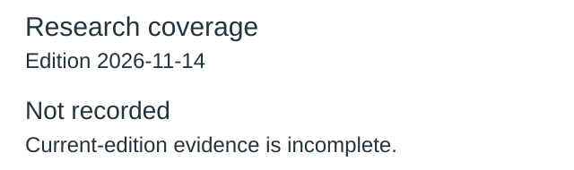
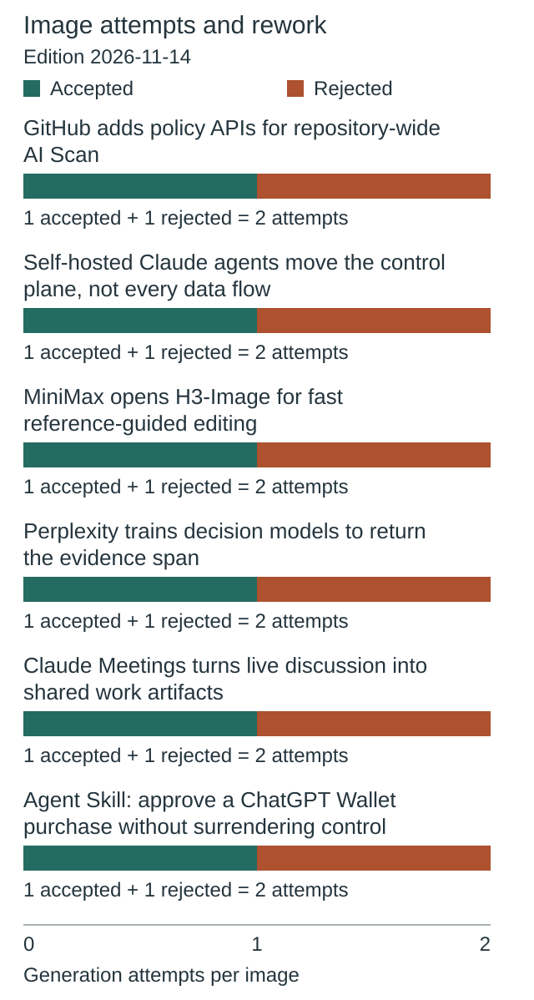
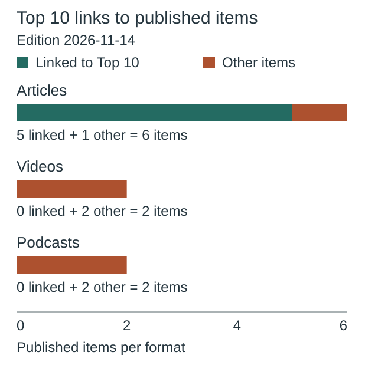
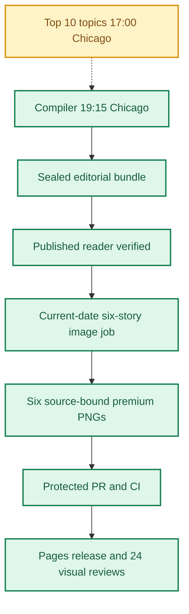
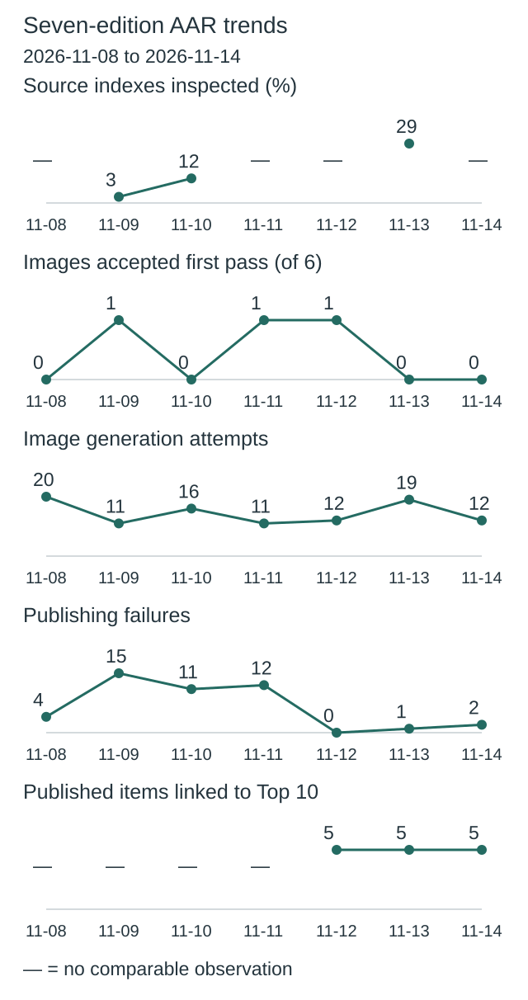
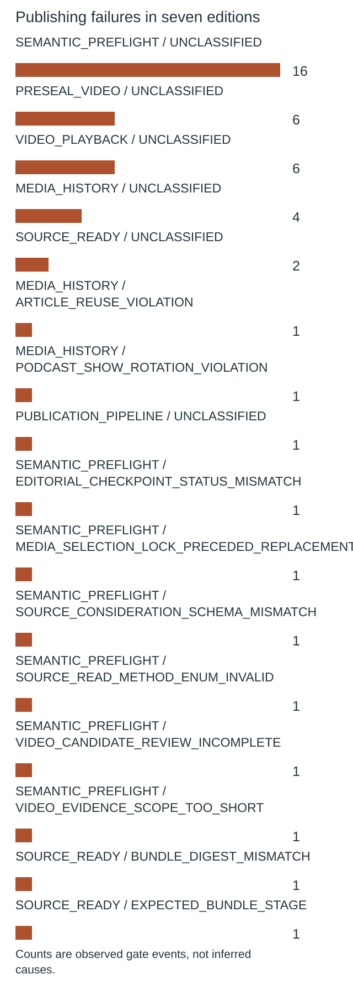
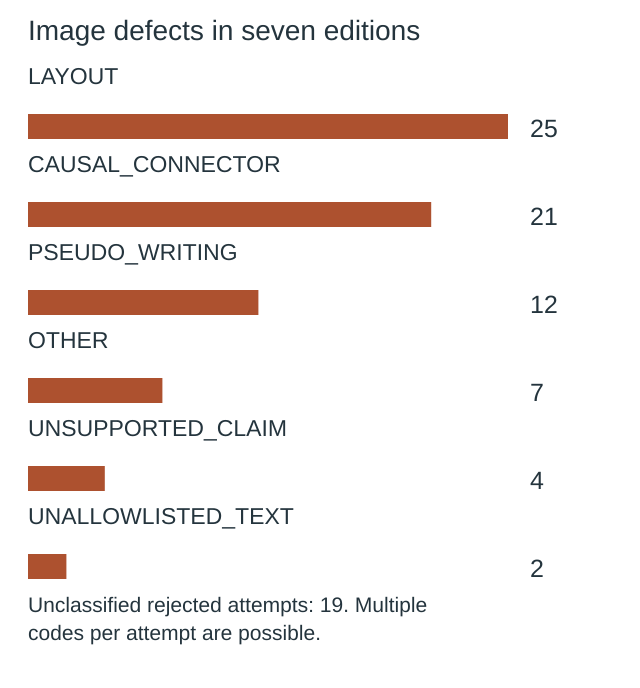

**🟩 RELEASE COMPLETE**
**TOP 10 PARTIAL** · **🟩 COMPILER VERIFIED** · **🟦 IMAGES 6/6 RELEASED** · **🟪 VISUAL QA 24/24 PASS**

# Daily AI Brief — Unified Production After-Action Report
**Edition:** November 14, 2026 · **Production evening:** 2026-11-13 · **Timezone:** America/Chicago
**Primary public reader:** [Open 2026-11-14 Brief](https://gttome.github.io/Daily-AI-Brief-Compiler/briefs/2026-11-14/) · **Repository:** [Daily-AI-Brief-Compiler](https://github.com/gttome/Daily-AI-Brief-Compiler)

> **IMPORTANT — VERIFIED PRODUCTION RESULT**
> **Executive release result: COMPLETE.** This is the single management-facing report covering Top 10 topic discovery, the editorial Compiler, published Brief and premium-image run. **Entire-system evidence: PARTIAL.** Top 10 report: **partial**; Compiler handoff: **RECEIVED_SNAPSHOT_BOUND**; guided searches: **RECEIPTS_OBSERVED**. Compiler public status: **VERIFIED**. Image release: **RELEASED_VERIFIED**. Direct 24-context visual quality: **24/24 PASS**. Autonomous completion: **UNPROVEN**. Missing evidence must not be promoted to a success claim.

**🕒 Production stage durations:** **Top 10 8m 53s** · **Compiler final seal window 13m 52s** · **Premium Images 16m 55s** (evidence-bounded elapsed times; the start/end events differ).

## Evidence reconciliation

Compiler final seal window: 13m 52s. Compiler state start to public verification: 61m 21s. Observed execution and final seal windows are distinct.
Image capability route preflight: RECORDED; scheduler origin remains UNPROVEN.
Image efficiency: 0/6 first-pass accepts; 12 total attempts. Current efficiency target: at least 3/6 first-pass and at most 2 attempts per image, with unchanged quality floor.
Image review completed: 2026-11-14T03:43:32Z; review-record commit: 2026-11-14T03:43:49.000Z; protected review merge: 2026-11-14T03:45:58.000Z.
Eligible source indexes: 109; editorial inspections reported: Unknown (Unknown%); inaccessible in editorial audit: 0; explicitly unreviewed IDs: 77; unclassified editorial IDs: Unknown. Automated index parsing is separate from editorial inspection and cannot substantiate exhaustive freshness claims.

Registered video sources: 29; attempted this edition: 29; unattempted: 0; enabled: 28; qualification-only: 1; sources yielding candidate URLs: 6. Status: REPORTED_ALL_ATTEMPTED. Attempt evidence is not automatic proof of source-content review or playback.

Eligible source partition **INVALID**. Full original-item reads **Not recorded**. Bounded index searches **Not recorded**. Qualification-only sources recorded separately **1**.

### Video candidate discovery

| Discovery source | Eligibility | Candidate URLs |
|---|---|---:|
| Two Minute Papers — AI Research Explainers | Enabled | 1 |
| AI Engineer | Enabled | 1 |
| Microsoft Developer YouTube | Enabled | 1 |
| IBM Think Videos | Enabled | 1 |
| Google DeepMind on YouTube | Enabled | 1 |
| OpenAI on YouTube | Enabled | 1 |

### Protected preseal video outcomes

| Original publisher | Distinct programs submitted | Archive rejects | Playback passes | Playback unverified | Probes skipped |
|---|---:|---:|---:|---:|---:|
| abcnews.com | 1 | 0 | 0 | 1 | 0 |
| euronews.com | 1 | 0 | 2 | 0 | 0 |
| fortune.com | 1 | 0 | 4 | 0 | 0 |
| foxbusiness.com | 1 | 0 | 1 | 0 | 0 |
| ibm.com | 1 | 0 | 0 | 1 | 0 |
| reuters.com | 1 | 0 | 0 | 1 | 0 |
| thedailydiff.dev | 1 | 0 | 0 | 1 | 0 |
| weforum.org | 1 | 0 | 0 | 1 | 0 |

Outcomes count observed checks across all saved requests. Programs can be submitted again after a different slot changes.

- AlphaProof Code and Signal: checked machine-code security proofs and trusted assumptions received PUBLIC_VIDEO_PLAYBACK_UNVERIFIED. [Original run](https://github.com/gttome/Daily-AI-Brief-Compiler/actions/runs/43542291302)
- Nvidia's pain is China's gain   Market Talk received PUBLIC_VIDEO_PLAYBACK_UNVERIFIED. [Original run](https://github.com/gttome/Daily-AI-Brief-Compiler/actions/runs/43542291302)
- Putting AI to work for integration received PUBLIC_VIDEO_PLAYBACK_UNVERIFIED. [Original run](https://github.com/gttome/Daily-AI-Brief-Compiler/actions/runs/43542605796)
- Should we trust AI agents? 3 experts discuss received PUBLIC_VIDEO_PLAYBACK_UNVERIFIED. [Original run](https://github.com/gttome/Daily-AI-Brief-Compiler/actions/runs/43542605796)
- How one woman helped halt a $5 billion AI data center project received PUBLIC_VIDEO_PLAYBACK_UNVERIFIED. [Original run](https://github.com/gttome/Daily-AI-Brief-Compiler/actions/runs/43543107427)

## Daily AAR charts

These charts use this edition’s receipts. Missing data is not zero.

### Research coverage



**Not recorded:** current-edition evidence is missing or inconsistent.

Not inspected includes every index without a recorded editorial inspection; this is not proof of missed stories.

### Image attempts and rework



**12 attempts; 0 of 6 images accepted on their first attempt.**

Recorded ongoing from November 8 target: at least 3/6 first-pass accepts; no more than 2 attempts per image. This is an efficiency target, not a quality cutoff.

| Image | Accepted | Rejected | Total attempts |
|---|---:|---:|---:|
| GitHub adds policy APIs for repository-wide AI Scan | 1 | 1 | 2 |
| Self-hosted Claude agents move the control plane, not every data flow | 1 | 1 | 2 |
| MiniMax opens H3-Image for fast reference-guided editing | 1 | 1 | 2 |
| Perplexity trains decision models to return the evidence span | 1 | 1 | 2 |
| Claude Meetings turns live discussion into shared work artifacts | 1 | 1 | 2 |
| Agent Skill: approve a ChatGPT Wallet purchase without surrendering control | 1 | 1 | 2 |

Generation attempts measure rework, not runtime or cost. Quality and publication checks remain separate.

### Top 10 links to published items



**5 of 10 unique published items link to Top 10 topics.**

| Format | Linked to Top 10 | Other items |
|---|---:|---:|
| Articles | 5 | 1 |
| Videos | 0 | 2 |
| Podcasts | 0 | 2 |

No selection quota. Topic linkage does not establish better quality, popularity or causal improvement.

[Chart data](charts.json)

One edition at a time. Missing evidence is not zero. Trend claims require comparable recorded cycles.

## Performance dashboard

| Measure | Recorded result | Source / caveat |
|:--|:--:|:--|
| Entire-system evidence | **PARTIAL** | Full Top 10 list, bound Compiler input, all-format search receipts and existing release checks; separate from publication and autonomy |
| Top 10 report | **partial · 10 topics** | Same Chicago cycle report; provisional/partial coverage remains disclosed |
| Top 10 received by Compiler | **RECEIVED_SNAPSHOT_BOUND** | Exact report snapshot bytes; consumed commit separately corroborated: YES |
| Top 10 guided article/video/podcast searches | **RECEIPTS_OBSERVED** | Actual source-search receipts and selected/rejected topic outcomes |
| Top 10 stage duration | **8m 53s** | Same-cycle run receipt only; no runtime or usage estimate |
| Editorial publication | **PASS** | State and public reader integrity receipt |
| **Unattended autonomy (separate from publication)** | **UNPROVEN** | Owner incident receipt takes precedence over unverified producer self-attestation |
| Recorded protected publishing gate failures | **2** | Actual same-edition GitHub failure sidecar only; earlier unrecorded failures remain unknown |
| Articles | **6** | Exactly 2 technical / 2 knowledge-worker / 2 agents required |
| Original scientific-paper-led articles | **0** | Rolling target: one qualified original paper in seven editions; PRODUCER_REPORTED_BUNDLE_MATCH. Preprints are not peer-reviewed by default |
| Verified original sources within preceding 24 hours | **0 / 6** | Original publisher dates only; other sources require a documented fallback rationale |
| Distinct selected article publishers | **5** | Six different primary organizations preferred |
| Videos over seven days old | **0** | Must be labeled evergreen, not a new development |
| Distinct selected video publishers | **2** | One channel is one publisher even across multiple videos |
| Cross-media topic diversity | **HISTORICAL_NOT_REQUIRED** | Four video/podcast events and six pairwise original-source comparisons; editorial claims remain producer-attested |
| Video discovery source attempts | **29 / 29** | Attempt evidence across enabled and qualification-only leads; REPORTED_ALL_ATTEMPTED. Not a claim of full content review or player verification | 
| Duplicate active Watchlist display titles | **0** | Published canonical Watchlist only; historical evidence retained |
| Original-release video playback (historical) | **TWO_PUBLISHED_VIDEOS_PLAYBACK_PASS** | Later reader corrections may replace these originally verified videos; see incident register | 
| Postpublication reader incidents | **NOT_RECORDED** | Edition-specific owner reports and corrective PRs, not inferred absence | 
| Verified postpublication video corrections | **NOT_RECORDED** | Incident register tracks correction PR, actual playback evidence and reader preservation |
| Editorial index second-pass attempts | **0** | Bounded public GET retries only; never proof of original article reading |
| Editorial index reads recovered | **0** | Successful page fetch can still yield zero eligible dated items |
| Recorded scheduler capability route | **UNPROVEN** | Same-invocation route receipt only; GitHub is not scheduler authentication |
| Avoidable incomplete-staging CI failures | **Not independently audited** | Existing image-package push CI is disabled; exact-head protected PR CI remains required. A failure count requires actual workflow evidence |
| Media | **2 videos + 2 podcasts** | Sealed bundle |
| **Compiler final seal window** | **13m 52s (13.9 min)** | Final sealed-state timestamp → verified public reader; initial execution is separate |
| **Image processing stage duration** | **16m 55s** | First accepted PNG Git checkpoint → final 24/24 review; auditable stage elapsed time |
| Image scheduled-to-final-review window | **Not independently recorded** | Only with a saved one-cycle schedule anchor; does not attest exact generation start |
| Executor-observed generation-to-final-review | **19m 22s** | Only if the worker recorded a same-execution clock before its first native call; not independently verified provider runtime |
| Accepted premium PNGs | **6 / 6** | Exact package and public release hashes |
| Native image generation attempts | **12** | Image worker AAR; no estimation |
| Rejected candidates | **6** | Image worker AAR |
| Final worker checkpoint reconciliation | **PASS** | Oct25+ verifies exact generation count, per-story attempts, six accepted story/image/hash bindings and final release |
| Saved visual contexts | **24 / 24 PASS** | Dated/permanent desktop/mobile review |
| Public SHA-256 checks | **44** | Image release receipt |
| October 8 immutable history | **17 / 17** | Independent content-preservation checks |
| **Owner-reported weekly Work usage for this run** | **Not reported** | No per-cycle usage supplied |

> **EFFICIENCY NOTE**
> **Resource reporting policy:** No usage figure was supplied for this cycle, so none is assumed. Future runs show **Not reported** unless the owner supplies new cycle-specific usage metadata. No approval or extra step is required to generate the AAR.

## Production architecture and checkpoints



## Daily AI Topic Top 10 and Compiler handoff

**Research cycle:** 2026-11-13 · **Target Brief:** 2026-11-14 · **Scheduled start:** 17:00 America/Chicago

| Dimension | Recorded evidence |
|---|---|
| Run/report result | PARTIAL |
| Report status / topics | partial / 10 |
| Freshness | FRESH\_AT\_CONSUMPTION |
| Compiler handoff | RECEIVED\_SNAPSHOT\_BOUND |
| Search coverage | RECEIPTS\_OBSERVED |
| Selection mapping verification | MATCHES\_EDITION\_BUNDLE |
| Observed start / finish | 2026-11-13T23:03:42Z / 2026-11-13T23:12:35Z |
| Elapsed minutes | 8.88 |
| Usage percent | Not reported |
| Cost USD | Not reported |
| Independent scheduler autonomy | UNPROVEN |
| Compiler-recorded consumed commit | 8674a4766ecba0eddfad7a961a4767a382d54924 |
| Report SHA-256 | d95a1e3be576cf9f6b5608e7c8a2f9ce329fccd88f7fa793baacffcc53ff8bf7 |

| Discovery order | AI topic | Summary | Confidence | Evidence |
|---:|---|---|---|---|
| 1 | Gemini 4 Hydrogen draws independent tests | Google’s speed-focused model is reaching consumer and developer surfaces, with different access conditions for Antigravity. | medium | [Source](https://www.youtube.com/watch?v=2imEgVWkeoA) · [Source](https://www.youtube.com/watch?v=prA0iTPDqfo) · [Source](https://x.com/OfficialLoganK/status/2120940951292268640) · [Source](https://blog.google/innovation-and-ai/models-and-research/gemini-models/introducing-gemini-4-hydrogen/) · [Source](https://deepmind.google/models/model-cards/gemini-4-hydrogen/) |
| 2 | Claude Meetings enters beta | Claude can join Google Meet calls and create notes or artifacts during the discussion for eligible teams. | medium | [Source](https://www.youtube.com/watch?v=4cW8qWJDaR0) · [Source](https://x.com/claudeai/status/2120973994191094179) · [Source](https://claude.com/resources/articles/claude-meetings) · [Source](https://www.reuters.com/technology/anthropic-brings-claude-google-meet-tackle-tasks-live-2026-11-10/) |
| 3 | AlphaProof Code’s Signal proof gets a new explainer | The study uses human-vetted specifications and machine-checked proofs for specified security properties of compiled Signal code. | medium | [Source](https://www.youtube.com/watch?v=gPNiuyYirfw) · [Source](https://news.ycombinator.com/item?id=50439193) · [Source](https://deepmind.google/documents/36/Formal_Verification_of_Signal_4.pdf) · [Source](https://deepmind.google/blog/introducing-alphaproof-code/) |
| 4 | Claude Fable 5.2 gets more workload-specific tests | New creator programs report coding and workflow tests after Anthropic’s November 9 model release. | medium | [Source](https://www.youtube.com/watch?v=owMtQh_3k4k) · [Source](https://www.youtube.com/watch?v=xKlUf-dw_Lw) · [Source](https://www.youtube.com/watch?v=QCSavlDtZOE) · [Source](https://www.anthropic.com/claude-fable-and-mythos-5-2) |
| 5 | Lydia Hallie’s Claude Code talk gains views | The AI Engineer talk distinguishes reversible routine changes from actions that need stronger controls, including secret access and destructive edits. | medium | [Source](https://www.youtube.com/watch?v=vlfCjWuv4es) · [Source](https://ai.engineer/talks/vlfCjWuv4es-rethinking-claude-code-best-practices) |
| 6 | MiniMax H3-Image gets a local editing walkthrough | The open-weight image model supports image generation and editing from visual references. | medium | [Source](https://www.youtube.com/watch?v=Er0740eVIEw) · [Source](https://huggingface.co/MiniMaxAI/MiniMax-H3-Image) · [Source](https://frontiermodels.cc/video/new-top-local-ai-image-editor-is-here/) |
| 7 | ChatGPT Wallet adds approval for agent purchases | OpenAI introduced a wallet that lets eligible Dots users approve purchases without giving the agent raw card details. | medium | [Source](https://www.reddit.com/r/OpenAI/comments/1xvd1ci/openai_introduces_chatgpt_wallet_so_agents_can/) · [Source](https://openai.com/index/introducing-chatgpt-wallet/) · [Source](https://www.reuters.com/technology/openai-launches-chatgpt-wallet-letting-ai-agents-pay-purchases-2026-11-13/) |
| 8 | Self-hosted Claude Managed Agents enters private beta | The private beta places the harness, workers and session history on customer infrastructure while inference still uses a chosen provider. | medium | [Source](https://x.com/ClaudeDevs/status/2120938988165091693) · [Source](https://platform.claude.com/docs/en/managed-agents/self-hosted) |
| 9 | AlphaGenome 2 adds an original research video | DeepMind’s newer model conditions DNA effect predictions on a specific cell type or state. | medium | [Source](https://www.youtube.com/watch?v=uND6iY2qp_c) · [Source](https://x.com/demishassabis/status/2120565316619284734) · [Source](https://deepmind.google/blog/alphagenome-2-deciphering-how-cells-read-dna-to-better-understand-disease/) · [Source](https://storage.googleapis.com/deepmind-media/DeepMind.com/Blog/alphagenome-2-deciphering-how-cells-read-dna-to-better-understand-disease/alphagenome-2.pdf) |
| 10 | Perplexity Decider v1.3 draws classification discussion | Perplexity’s open-weight decision models target classification, retrieval scoring and span extraction. | medium | [Source](https://news.ycombinator.com/item?id=50488464) · [Source](https://www.reddit.com/r/machinelearningnews/comments/1xvc311/perplexity_releases_decider_v13_and_flash_v13/) · [Source](https://www.perplexity.ai/en-GB/hub/blog/perplexity-decider) |

**Sample scope:** {"metadata\_screened\_videos":55,"distinct\_retained\_channels":31,"new\_metadata\_screened\_records":64,"combined\_observation\_records":64,"combined\_unique\_video\_ids":55,"unique\_videos":55,"videos\_watched":0,"full\_video\_reviews":0,"direct\_counter\_verifications":0,"direct\_youtube\_counter\_verifications":0,"transcript\_reviews":0,"partial\_original\_publisher\_transcript\_reviews":0,"original\_publisher\_show\_notes\_reviews":1,"original\_watch\_attempts":55,"comparable\_video\_observations":4,"within\_24h\_reported\_publications":1,"additional\_within\_72h\_reported\_publications":15,"additional\_within\_7d\_reported\_publications":1,"older\_timestamped\_publications":0,"date\_only\_video\_publications":38,"unknown\_video\_publication\_dates":0,"full\_video\_review\_target\_met":false,"original\_watch\_outcomes":{"throttled":51,"title/index shell":4},"freshness\_reference\_at":"2026-11-13T23:10:58Z","notes":"Date-only entries are outside hourly bins. Deduplicated tracker and original publisher listings by YouTube ID.","substantive\_original\_event\_document\_reviews":11}. **Ranking basis:** {"attention":"Comparable same-video observations where available, dated and event-matched video metadata, breadth of independently attributed sources, and corroborating public discussion. Measurements across platforms and formats are kept separate.","limitations":"Coverage, rounding, unknown clocks and overlapping audiences prevent a precise popularity order. Brief fit remains a separate judgment."}.

| Search format | Receipt rows | Attempts recorded | Explicitly not attempted |
|---|---:|---:|---:|
| article | 10 | 10 | 0 |
| video | 10 | 10 | 0 |
| podcast | 10 | 10 | 0 |

**Selected Brief items linked to trends:**

| Topic | Format | Selected item | Reason |
|---|---|---|---|
| claude-meetings-beta-nov12 | article | nov14-a1-claude-meetings · [Source](https://claude.com/resources/articles/claude-meetings) | The selected noncoding agent story directly matches the pinned Claude Meetings beta and its consent and retention boundaries. |
| minimax-h3-image-local-editing-nov10 | article | nov14-k1-h3-image · [Source](https://www.minimax.io/blog/minimax-h3-image) | The selected applied story directly matches the H3-Image event while keeping vendor benchmarks attributed. |
| chatgpt-wallet-launch-nov13 | article | nov14-a2-wallet-skill · [Source](https://openai.com/index/introducing-chatgpt-wallet/) | The selected Agent Skills procedure directly matches the Wallet launch and adds terms-grounded approval and receipt validation. |
| claude-managed-agents-self-hosted-nov12 | article | nov14-t2-managed-agents · [Source](https://claude.com/resources/articles/self-hosted-claude-managed-agents) | The selected infrastructure story directly matches the self-hosted Managed Agents private beta and remaining external data flows. |
| perplexity-decider-v13-nov12 | article | nov14-k2-decider · [Source](https://www.perplexity.ai/hub/blog/perplexity-decider) | The selected applied decision-model story directly matches Decider v1.3 and keeps vendor evaluations separate from reader testing. |

**Gaps and limitations:**

- The report labels its research partial.
- Watch routes were throttled or returned title/index shells. Zero full playbacks, transcript bodies or direct YouTube counters were verified. One original episode notes page supplied usable content.
- Tracker snapshots include rounded counts and sources with unavailable measurement clocks. No global trend claim, current velocity or exact popularity order is supported.
- The AlphaGenome 2 original article was reviewed, with the manuscript recorded as an identified reference. Its full methods and venue status remain unverified.
- The 24-hour search was widened to 72 hours and seven days. Older retained event context is labeled; date-only video records cannot enter exact hourly bins.

**Recorded run issues:**

- {"issue":"51 original video watch routes throttled and four returned title or index shells.","effect":"No full playback or direct YouTube counter verification. The report is partial.","correction":"Preserved tracker provenance and attempted bounded event-specific original alternatives. Recorded one original notes review."}
- {"issue":"AI Engineer episode transcript control exposed no transcript body, and the AlphaGenome manuscript was only identified.","effect":"No transcript review or full AlphaGenome methods review can be claimed.","correction":"Recorded timestamped publisher notes separately and limited AlphaGenome claim support to the original research article. Read the separate AlphaProof original paper."}
- {"issue":"The report create request timed out before returning its commit ID.","effect":"Initial write response left persistence ambiguous.","correction":"Resolved the actual operations-reports head, confirmed the new dated path and expected Git blob, read exact base64 bytes at the recovered commit, and verified byte equality, schema and SHA-256. No duplicate report was created."}

**Recorded improvements:**

- {"change":"Used event-specific original notes or event documents after watch-page throttling.","reason":"The earlier cycle had no original episode notes, full transcripts or playback.","expected\_effect":"Clarify what the source actually covers and how deeply it was reviewed.","status":"implemented"}
- {"change":"Carried forward only matched video snapshots and reassessed publisher-family removals.","reason":"The earlier AAR recorded that six of ten evidence bands weakened after a family was removed.","expected\_effect":"Show where current evidence depends on one publisher or where an apparent audience change is only a rounded counter difference.","status":"implemented"}
- {"change":"Offer event-matched video discovery leads from additional publisher families where the Compiler can qualify them independently.","reason":"The protected November 13 diversity approval calls for genuine broader discovery across the next three editions.","expected\_effect":"Broader search options; qualification and selection effect remain unverified.","status":"proposed","candidate\_families":\["AI Engineer","Two Minute Papers","AI Search","Prompt Engineering","Tech With Tim"\]}

### Daily improvement and effect on the Brief

**Fixed baseline:** nov03-2026-v1 / INPUT\_FROZEN. **Outcome baseline:** FROZEN\_AFTER\_VERIFIED\_PUBLICATION. **Prior cycle:** 2026-11-12.

| Input measure | Current | November 3 baseline | Change from baseline | Change from prior cycle |
|---|---:|---:|---:|---:|
| topic count | 10 | 10 | 0 | 0 |
| validation resource count | Not reported | 14 | Not reported | Not reported |
| additional video metadata records | 64 | 63 | 1 | 2 |
| additional video channels | Not reported | 21 | Not reported | Not reported |
| total video observations | 64 | 79 | -15 | 2 |
| unique videos | 55 | 71 | -16 | -1 |
| full video reviews | 0 | 0 | 0 | 0 |
| direct youtube counter verifications | 0 | 0 | 0 | 0 |
| broader evidence band topics | 4 | 3 | 1 | 2 |
| limited evidence band topics | 6 | 7 | -1 | -2 |

**Observed downstream measurements:** OBSERVED.

| Outcome measure | Current | Change from frozen outcome | Change from prior cycle |
|---|---:|---:|---:|
| expected topic format pairs | 30 | 0 | 0 |
| attempted topic format pairs | 30 | 0 | 0 |
| explicitly unattempted pairs | 0 | 0 | 0 |
| discovered candidate count | 22 | -18 | 1 |
| searched source host count | 20 | 4 | -3 |
| selected article count | 5 | 2 | 1 |
| selected video count | 0 | 0 | 0 |
| selected podcast count | 0 | -1 | -1 |

**Source changes:** {"added":\[\],"removed":\[\]}.

**Candidate review depth:** NOT\_RECORDED.

| Review measure | Current | Change from prior comparable cycle |
|---|---:|---:|
| reviewed candidate count | Not reported | Not reported |
| qualified candidate count | Not reported | Not reported |
| rejected candidate count | Not reported | Not reported |
| metadata only count | Not reported | Not reported |
| full video reviews | Not reported | Not reported |
| transcript reviews | Not reported | Not reported |

The frozen November 3 baseline has no candidate-level review ledger; no retrospective value is invented. Recorded reviews do not independently establish content quality, audience interest or causal benefit.

**Method/resource review:** {"baseline\_id":"nov03-2026-v1","previous\_report\_date":"2026-11-12","previous\_method\_version":"2026-11-03.2-event-review","method\_version":"2026-11-03.2-event-review","feedback":{"aar\_url":"https://github.com/gttome/Daily-AI-Brief-Compiler/blob/6dc60638659e147aea413fc4f7039007f32d760b/daily/2026-11-12/combined.md","charts\_url":"https://github.com/gttome/Daily-AI-Brief-Compiler/blob/6dc60638659e147aea413fc4f7039007f32d760b/daily/2026-11-12/charts.json","metrics\_url":"https://github.com/gttome/Daily-AI-Brief-Compiler/blob/6dc60638659e147aea413fc4f7039007f32d760b/daily/2026-11-12/improvement-metrics.json","observation":"The November 13 combined record shows 30 genuine searches, five matched published selections, 32 of 109 sources inspected, six weakened topics across ten family reviews, and 19 image attempts with zero first-pass acceptances. It records image release with full visual closeout incomplete. These are earlier-cycle observations and cannot establish causal quality improvement."},"changes":\[{"change":"Used event-specific original notes or event documents after watch-page throttling.","reason":"The earlier cycle had no original episode notes, full transcripts or playback.","expected\_effect":"Clarify what the source actually covers and how deeply it was reviewed."},{"change":"Carried forward only matched video snapshots and reassessed publisher-family removals.","reason":"The earlier AAR recorded that six of ten evidence bands weakened after a family was removed.","expected\_effect":"Show where current evidence depends on one publisher or where an apparent audience change is only a rounded counter difference."}\],"resource\_candidates":\[{"url":"https://ai.engineer/talks/vlfCjWuv4es-rethinking-claude-code-best-practices","role":"Original organizer episode notes","access":"Public original text page","review\_scope":"Selected timestamped notes; transcript text unavailable.","independence":"Same original publisher family as the video.","decision":"accepted","reason":"Matches exact video ID and named talk.","contribution":"Distinguishes reversibility, process sandboxing and behavioral assertions without inferring full talk review."}\],"observed\_effects":\[{"observation":"55 metadata-screened programs and 4 matched timed comparisons, versus 56 and two in the prior report.","effect":"Comparability improved for the matched sample. Overall review depth remains bounded."},{"observation":"One original episode notes review versus zero in the prior report.","effect":"Verified more detail for one program. Playback, transcript and causal editorial benefits remain unknown."}\],"next\_improvement":"Seek exact original program text or publicly dated first-party counters for weak event-matched leads. Check independent consumption and publication receipts when available.","limitations":\["The November 10 coverage pilot is outside this cycle.","Production and selection effects for this input require independent downstream receipts."\],"change\_evaluations":\[{"change\_id":"AAR-10","reviewed\_edition":"2026-11-13","decision":"keep","result":"met","reason":"The reconciled November 13 metrics accepted ten family reviews and found six weakened topics.","evidence\_refs":\["https://github.com/gttome/Daily-AI-Brief-Compiler/blob/6dc60638659e147aea413fc4f7039007f32d760b/daily/2026-11-12/improvement-metrics.json"\]},{"change\_id":"NOV03-04","reviewed\_edition":"2026-11-13","decision":"keep","result":"inconclusive","reason":"The combined AAR validates 30 searches and five matches. Substantive program playback and causal editorial improvement remain unverified.","evidence\_refs":\["https://github.com/gttome/Daily-AI-Brief-Compiler/blob/6dc60638659e147aea413fc4f7039007f32d760b/daily/2026-11-12/combined.md","https://github.com/gttome/Daily-AI-Brief-Compiler/blob/6dc60638659e147aea413fc4f7039007f32d760b/daily/2026-11-12/improvement-metrics.json"\]}\]}.

**Current reconciled conclusion:** OBSERVED; outcome baseline FROZEN\_AFTER\_VERIFIED\_PUBLICATION; candidate review ledger NOT\_RECORDED.

**Historical producer observations (not current status):** The following snapshot preserves what the producer reported at the time. Its pending statuses and candidate-quality claims are not independently reconciled conclusions. Use the current tables above for publication-bound measurements; an absent candidate review ledger remains unknown.

<details><summary>Original producer effects and gaps — historical snapshot</summary>

```json
null
```

</details>

**Next improvement:** Seek exact original program text or publicly dated first-party counters for weak event-matched leads. Check independent consumption and publication receipts when available.

Counts show coverage and observed association, not audience popularity, source independence, candidate quality or causal uplift. Compare source/method changes before interpreting deltas. Unknown values are not zero. Publication, reader corrections, runtime and image outcomes retain their separate AAR evidence.

Report, source-readback and search receipts are separate observations. Snapshot binding verifies the collected report bytes; the consumed commit is independently corroborated only when the separately fetched source bytes match. These records do not independently attest scheduler identity or source truth. Top 10 reporting does not change Brief/image release status.


## Track 1 — Compiler

**State:** `SHADOW_VERIFIED` · **Bundle:** `BUNDLE_READY` · **Compiler final seal window:** 13m 52s (13.9 min).

| Publication gate | Result |
|---|:---:|
| Canonical reader build | ✅ |
| Reader parity | ✅ |
| Public verification of dated edition | ✅ |
| Previous editions preserved | ✅ |
| Permanent story routes and feeds | ✅ |

**Selected coverage:**

| Lane | Story |
|---|---|
| Technical AI Engineering | GitHub adds policy APIs for repository-wide AI Scan |
| Technical AI Engineering | Self-hosted Claude agents move the control plane, not every data flow |
| Applied Generative AI for Knowledge Workers | MiniMax opens H3-Image for fast reference-guided editing |
| Applied Generative AI for Knowledge Workers | Perplexity trains decision models to return the evidence span |
| Agents for Everyone | Claude Meetings turns live discussion into shared work artifacts |
| Agents for Everyone | Agent Skill: approve a ChatGPT Wallet purchase without surrendering control |

### Scientific paper opportunity and publication evidence

**Current edition:** PRODUCER_REPORTED_BUNDLE_MATCH; **paper-led stories:** 0. Editorial target: at least one genuinely qualified original-paper-based story in seven editions, with methods, limitations, and an explicit preprint/peer-review distinction. No stale or weak paper is selected solely to fill a quota.


## Track 2 — Premium images

**Public status:** `RELEASED_VERIFIED` · **Saved images:** 6/6 · **Actual generation attempts:** 12 · **Rejected candidates:** 6.

### Image production duration — Git-verified milestones

**Auditable image stage duration:** **16m 55s** (first accepted binary saved in Git → first persisted 24-context quality-review record). **First asset to public image release:** **14m 15s**.
**Scheduled-to-final-review window:** **Not independently recorded**. This is a scheduled-clock comparison only when a separately recorded exact-date schedule exists; it is **not** measured native image-generation runtime.

| Production milestone | Chicago local time | Evidence |
|---|---|---|
| Scheduled image start (if exact-date record exists) | Not independently recorded | Time planned, not actual execution start |
| First executor-observed start | 9:21:35 PM | Worker self-attestation, not a first-party scheduler event |
| First native generation observation | 9:24:27 PM | Worker clock recorded immediately before first native call, not model-provider telemetry |
| First accepted PNG bytes saved to Git | 9:26:54 PM | Immutable binary-stage commit |
| Six-image package / reviews committed | 9:37:14 PM | Exact-head PR source commit |
| Protected package merged | 9:40:04 PM | Merge SHA and required CI |
| Public images verified | 9:41:09 PM | Image-release receipt |
| 24/24 review record committed | 9:43:49 PM | Immutable first review-approval commit |

> **Duration interpretation:** The audited stage excludes unobservable pre-checkpoint creative work. The scheduled-start window includes it but must not be interpreted as precise active processing time. Missing timestamps appear as **Not independently recorded**, never an estimate.


| Source-bound image | Attempts | File size | Public page |
|---|---:|---:|---|
| GitHub adds policy APIs for repository-wide AI Scan | 2 | 0.54 MiB | [View original](https://gttome.github.io/Daily-AI-Brief-Compiler/briefs/images/2026-11-14/dab-edition-2026-11-14-m01.png) |
| Self-hosted Claude agents move the control plane, not every data flow | 2 | 0.63 MiB | [View original](https://gttome.github.io/Daily-AI-Brief-Compiler/briefs/images/2026-11-14/dab-edition-2026-11-14-m02.png) |
| MiniMax opens H3-Image for fast reference-guided editing | 2 | 0.78 MiB | [View original](https://gttome.github.io/Daily-AI-Brief-Compiler/briefs/images/2026-11-14/dab-edition-2026-11-14-m10.png) |
| Perplexity trains decision models to return the evidence span | 2 | 0.52 MiB | [View original](https://gttome.github.io/Daily-AI-Brief-Compiler/briefs/images/2026-11-14/dab-edition-2026-11-14-m11.png) |
| Claude Meetings turns live discussion into shared work artifacts | 2 | 0.69 MiB | [View original](https://gttome.github.io/Daily-AI-Brief-Compiler/briefs/images/2026-11-14/dab-edition-2026-11-14-m12.png) |
| Agent Skill: approve a ChatGPT Wallet purchase without surrendering control | 2 | 0.82 MiB | [View original](https://gttome.github.io/Daily-AI-Brief-Compiler/briefs/images/2026-11-14/dab-edition-2026-11-14-m14.png) |

**Immutable-release and visual gates:**

| Release gate | Result |
|---|:---:|
| Protected public image receipt | ✅ |
| Accepted-image Git hash bindings | ✅ |
| Six live PNGs | 6/6 |
| Dated/permanent story placements | 12/12 recorded in release evidence |
| Desktop/mobile visual inspection | 24/24 PASS |
| Historical Oct 8 integrity | 17/17 |

### Published premium illustrations

<table>
<tr><td width="50%"><a href="https://gttome.github.io/Daily-AI-Brief-Compiler/briefs/images/2026-11-14/dab-edition-2026-11-14-m01.png"></a><br/><b>GitHub adds policy APIs for repository-wide AI Scan</b></td><td width="50%"><a href="https://gttome.github.io/Daily-AI-Brief-Compiler/briefs/images/2026-11-14/dab-edition-2026-11-14-m02.png"></a><br/><b>Self-hosted Claude agents move the control plane, not every data flow</b></td></tr>
<tr><td width="50%"><a href="https://gttome.github.io/Daily-AI-Brief-Compiler/briefs/images/2026-11-14/dab-edition-2026-11-14-m10.png"></a><br/><b>MiniMax opens H3-Image for fast reference-guided editing</b></td><td width="50%"><a href="https://gttome.github.io/Daily-AI-Brief-Compiler/briefs/images/2026-11-14/dab-edition-2026-11-14-m11.png"></a><br/><b>Perplexity trains decision models to return the evidence span</b></td></tr>
<tr><td width="50%"><a href="https://gttome.github.io/Daily-AI-Brief-Compiler/briefs/images/2026-11-14/dab-edition-2026-11-14-m12.png"></a><br/><b>Claude Meetings turns live discussion into shared work artifacts</b></td><td width="50%"><a href="https://gttome.github.io/Daily-AI-Brief-Compiler/briefs/images/2026-11-14/dab-edition-2026-11-14-m14.png"></a><br/><b>Agent Skill: approve a ChatGPT Wallet purchase without surrendering control</b></td></tr>
</table>

## Incidents, corrections and learning

### Postpublication reader incidents (updated when new evidence is merged)

No current-edition postpublication incident register was available; this is **NOT_RECORDED**, not a certification of zero incidents.


**Editor recovery classification:** UNPROVEN. **Owner intervention:** Unproven either way. **Protected same-edition failures recorded:** 2. 
**Latest failed protected stage:** PUBLICATION_PIPELINE; [Action evidence](https://github.com/gttome/Daily-AI-Brief-Compiler/actions/runs/43544999096). Exact stage durations are available only where real source timestamps exist.

| Stage | Verified issue | Corrective action |
|---|---|---|
| Native saved-pixel review | The initial policy illustration was too glossy and extended into the left margin. | Four exact labels read at 320 px. Flat letterpress-like policy plates route by a single arrow to the physical repository fork. The launch handle is visibly isolated, and all text is clear of the 40 px margin. |
| Native saved-pixel review | The right model provider platform reaches within about 20 px of the canvas edge; illuminated realistic materials and reflections detract from the explanatory axonometric ink style. Preserve the architecture and correctly grounded outbound connection. | All labels and the detached caveat read at 320px. Axonometric outline rendering distinguishes the inner server, sandbox workers, vault and database from the outer model gateway. The orange directional connector starts at the harness's physical socket and traverses the blue boundary to the model inlet, with no arrow from credentials or data store. |
| Native saved-pixel review | The detached readable caveat has descenders below the y590 safe floor, and reference sheets and results extend into side margins. The visible spelling and arrow contact are correct. | The exact labels and detached vendor caveat are clearly legible at 320 px. Inset botanical reference sheets feed a single object-anchored arrow to the risograph edit frame, alongside two unranked output specimens, with no implied measured speed or accuracy. |
| Native saved-pixel review | Three partial progress bars introduce unsupported scores. The glossy near-real magnifier also misses the print editorial treatment; preserve the source-span arrow and exact labels. | All four exact labels read at 320px. The selected source block is explicitly outlined, and the single arrow reaches the matte lens rim. The separate classification dock holds an unmarked tile with no scores or implied certainty. The benchmark caveat is detached. |
| Native saved-pixel review | The aperture and folio reach into side margins, and the bright rendered tiles read as an app dashboard. The illustration correctly keeps artifacts blank and holds the guests caveat apart. | At 320px, all four labels remain legible. The visible orange participant tab sends one arrow directly to the blue artifact sheet. The separate folded record holds blank sheets; the guest restriction is isolated below and the typography clears the safe area. |
| Native saved-pixel review | The ceramic mockup reads as a realistic product render. The right assembly and text lie close to or inside the 40px edge. Keep the blank five tabs, device-authentication gate and token receiving tray. | The engraving depicts five blank review tabs feeding the authenticated purchase gate by one direct connector. Only a substitute token moves toward the receipt tray; no card credentials or automatic approvals are depicted. All exact labels and the detached caveat read at 320 px. |

> **OPERATIONAL NOTE**
> This report distinguishes a published and verified production outcome from scheduler metadata exposed to another conversation. Lack of a live host heartbeat in a separate normal chat is not a Compiler production failure.

## Usage and cost stewardship

| Item | Per-cycle value |
|---|---|
| **Weekly Work usage reported by owner** | **Not reported** |
| Internal weekly usage reference | Target under 5% |
| Genuine image-generation attempts | 12 |
| Accepted diagrams | 6 |
| Regeneration after acceptance | 0 |
| Top 10 reported usage | Not reported |
| Top 10 reported cost | Not reported |
| Account-level billing telemetry | Not independently accessible to deterministic GitHub reporting |

**Future reporting rule:** For cycles without an optional owner-usage record, publish the complete AAR with `Not reported`; do not reuse prior percentages, guess remaining weekly credits or delay tomorrow's production.

## Next-edition operating handoff

| Control | Recurring contract |
|---|---|
| AI Topic Top 10 | Sole report task · 17:00 America/Chicago · saved dated list guides same-evening research |
| Primary Compiler | Sole existing task · 19:15 America/Chicago |
| Premium image production | Sole existing task · standard 21:15 America/Chicago |
| Exact image job selection | Newly published next-date `PUBLISHED_PENDING` only |
| AAR | Combined report generated automatically from new GitHub receipts |
| Optional Work usage | Owner-supplied per cycle, otherwise `Not reported` |

> **SCHEDULE RESTORATION NOTE**
> A temporary scheduling exception must be explicitly restored before claiming standard-time readiness. This deterministic document generator reads existing state only; it does not modify production schedules.

## Evidence register

| Evidence | Link |
|---|---|
| Compiler state | [Open receipt](https://github.com/gttome/Daily-AI-Brief-Compiler/blob/shadow/2026-11-14/shadow-runs/2026-11-14/compiler-state.json) |
| Compiler compile receipt | [Open receipt](https://github.com/gttome/Daily-AI-Brief-Compiler/blob/shadow/2026-11-14/shadow-runs/2026-11-14/compiler/compile-receipt.json) |
| Compiler public integrity | [Open receipt](https://github.com/gttome/Daily-AI-Brief-Compiler/blob/shadow/2026-11-14/shadow-runs/2026-11-14/compiler/postpublish-integrity.json) |
| Image release receipt | [Open receipt](https://github.com/gttome/Daily-AI-Brief-Compiler/blob/shadow-pages-history/site/image-jobs/2026-11-14/release.json) |
| Image review | [Open receipt](https://github.com/gttome/Daily-AI-Brief-Compiler/blob/main/external-image-packages/2026-11-14/reviews/live/semantic-pixel-review.json) |
| Original image AAR | [Open receipt](https://github.com/gttome/Daily-AI-Brief-Compiler/blob/main/external-image-packages/2026-11-14/reviews/after-action.md) |
| Observed editorial index retries | [Open receipt](https://github.com/gttome/Daily-AI-Brief-Compiler/blob/shadow/2026-11-14/shadow-runs/2026-11-14/editorial/source-item-retries.json) |
| Scientific paper selection review | [Open receipt](https://github.com/gttome/Daily-AI-Brief-Compiler/blob/shadow/2026-11-14/shadow-runs/2026-11-14/editorial/scientific-paper-coverage.json) |
| Published player playback receipt | [Open receipt](https://github.com/gttome/Daily-AI-Brief-Compiler/blob/shadow/2026-11-14/shadow-runs/2026-11-14/compiler/postpublish-video-playback.json) |
| Top 10 ranked topic report | [Open receipt](https://github.com/gttome/Daily-AI-Brief-Compiler/blob/aafcc2c853e19baa54d30638088f3720cc803c75/signals/ai-topic-top10/2026-11-13.json) |
| Top 10 run after-action receipt | [Open receipt](https://github.com/gttome/Daily-AI-Brief-Compiler/blob/aafcc2c853e19baa54d30638088f3720cc803c75/signals/ai-topic-top10/2026-11-13.aar.json) |
| Compiler Top 10 input snapshot | [Open receipt](https://github.com/gttome/Daily-AI-Brief-Compiler/blob/shadow/2026-11-14/shadow-runs/2026-11-14/editorial/trend-input.json) |
| Top 10 article/video/podcast search coverage | [Open receipt](https://github.com/gttome/Daily-AI-Brief-Compiler/blob/shadow/2026-11-14/shadow-runs/2026-11-14/editorial/trend-search-coverage.json) |

**Image workflow:** [Workflow evidence](https://github.com/gttome/Daily-AI-Brief-Compiler/actions/runs/43552807876).

---

*Generated deterministically from cycle- and edition-specific GitHub records. The report combines the Top 10 discovery priorities, its Compiler handoff and searches, the published Brief, and the image run; original research, Compiler, image, hash, and review receipts remain immutable. This reporting action creates no stories, images, releases, extra AI tasks, or schedule changes.*

<!-- continuous-improvement:start -->
## Continuous improvement review

Edition **2026-11-14**. Measurements use 7/7 recorded editions in this window. Missing data stays **Not recorded**.

### Daily corrective-action review

**5 evidence-based findings**; open production blockers: 0. Cumulative evaluation checkpoint: **2026-11-11**. The daily review never waits for that date to act on a safe live problem.

| Priority | Observed issue | Existing owner / next correction | When |
|---|---|---|---|
| P1 | 2 failed protected publication gates were recorded (2 unclassified causes). | Compiler / Recovery: Read original failed job logs, record real causes and move the relevant existing validation before the next readiness signal; do not replay the released edition. | Next genuine run |
| P1 | Source inspection coverage is not verifiable from the current bundled receipts. | Compiler: Bind genuine exact source IDs and original preselection review times into the next draft bundle; do not infer inspection from HTTP access. | Next genuine run |
| P1 | 6 rejected image candidates preceded the verified six-image release. | Images: Inspect saved rejection evidence and apply source-specific geometry, causal-arrow and label corrections before the next native generation. | Next genuine run |
| P2 | Publication success does not independently attest the originating scheduler. | Compiler / Recovery: Capture real first-party scheduler and execution evidence if available; do not convert unknown provenance into a failure or a success. | Next genuine run |
| P0 | 6 original video publisher families filled 14 slots; largest family used 5 times in the completed seven-edition window. | Compiler: Before the next seal, review underexposed original publishers and exact playable alternatives. Keep all media-quality and signed-out playback checks. | Next genuine run |

Findings are observational and do not claim a repair was executed by the reporter.

### Approved change evaluations

| Change | Evaluate by | Outcome status | Latest decision |
|---|---|---|---|
| NOV03-01 — Earlier publication checks and precise recovery | 2026-11-11 | REVIEWED | revise |
| NOV03-02 — Broader genuine source review | 2026-11-11 | REVIEWED | revise |
| NOV03-03 — Source-bound image rejection lessons | 2026-11-11 | REVIEWED | revise |
| NOV03-04 — Substantive Top 10 review evidence | 2026-11-11 | REVIEWED | keep |
| AAR-01 — Current conclusions separated from historical claims | 2026-11-11 | REVIEWED | keep |
| AAR-02 — Consolidated current task contracts | 2026-11-11 | REVIEWED | keep |
| AAR-03 — Dated improvement evaluations | 2026-11-11 | REVIEWED | keep |
| AAR-04 — Seven-edition trend charts | 2026-11-11 | REVIEWED | keep |
| AAR-05 — Recurring publication failure causes | 2026-11-11 | REVIEWED | revise |
| AAR-06 — Recovery interval reporting | 2026-11-11 | REVIEWED | revise |
| AAR-07 — Source inspection history | 2026-11-11 | REVIEWED | revise |
| AAR-08 — Rolling source contribution | 2026-11-11 | REVIEWED | revise |
| AAR-09 — Recurring image defect categories | 2026-11-11 | REVIEWED | keep |
| AAR-10 — Top 10 publisher-family sensitivity | 2026-11-11 | REVIEWED | keep |

Pending: 0; overdue: 0; reviewed: 14. Implemented controls await measured results; review decisions do not disable controls.

#### Reviews of production evidence

- **NOV03-01 · 2026-11-12 · not met.** Two media requests still required correction. The first had two stalled embeds and a certificate-date error. The second reached protected playback before two archived programs were disqualified. The edition recovered and published. [Evidence 1](https://github.com/gttome/Daily-AI-Brief-Compiler/blob/1d8c6be/shadow-runs/2026-11-12/editorial/preseal-video-receipt.json) · [Evidence 2](https://github.com/gttome/Daily-AI-Brief-Compiler/blob/shadow/2026-11-12/shadow-runs/2026-11-12/execution-milestones.json)
- **NOV03-02 · 2026-11-12 · inconclusive.** The raw audit recorded 34 inspected entries and 76 unreviewed for 109 eligible sources. It included qualification-only Zapier in the inspection entries. The audited breadth is unknown. Five distinct article publishers were recorded and zero articles had verified 24-hour timestamps. [Evidence 1](https://github.com/gttome/Daily-AI-Brief-Compiler/blob/shadow/2026-11-12/shadow-runs/2026-11-12/editorial/index-review.json) · [Evidence 2](https://github.com/gttome/Daily-AI-Brief-Compiler/blob/dac33c1e16f891121a0571a0a5e25d09b691bee5/daily/2026-11-11/combined.md)
- **AAR-01 · 2026-11-12 · met.** The reviewed closeout identified the live release and 24 visual checks as complete. It separately displayed partial research evidence and unproven autonomy. The original Top 10 snapshot retains its production-stage claims. [Evidence 1](https://github.com/gttome/Daily-AI-Brief-Compiler/blob/dac33c1e16f891121a0571a0a5e25d09b691bee5/daily/2026-11-11/combined.md) · [Evidence 2](https://github.com/gttome/Daily-AI-Brief-Compiler/blob/6e6911d0a393a3117160841950ecf3b2c3665777/signals/ai-topic-top10/2026-11-11.aar.json)
- **AAR-04 · 2026-11-12 · met.** The November 6–12 series included seven image-attempt observations and a median of 12. The chart marked missing coverage and selection observations as gaps and disclosed the registry change. [Evidence 1](https://github.com/gttome/Daily-AI-Brief-Compiler/blob/dac33c1e16f891121a0571a0a5e25d09b691bee5/daily/2026-11-11/improvement-metrics.json) · [Evidence 2](https://github.com/gttome/Daily-AI-Brief-Compiler/blob/dac33c1e16f891121a0571a0a5e25d09b691bee5/daily/2026-11-11/charts/seven-edition-trends.svg)
- **AAR-05 · 2026-11-12 · not met.** The November 12 failure chart counted zero failed workflow jobs while the candidate evidence showed a blocked probe and an archive rejection. The recurring-failure table still contains unclassified events. Preserve the original outcomes so these types remain visible. [Evidence 1](https://github.com/gttome/Daily-AI-Brief-Compiler/blob/dac33c1e16f891121a0571a0a5e25d09b691bee5/daily/2026-11-11/improvement-metrics.json) · [Evidence 2](https://github.com/gttome/Daily-AI-Brief-Compiler/blob/shadow/2026-11-12/shadow-runs/2026-11-12/execution-milestones.json)
- **AAR-06 · 2026-11-12 · inconclusive.** Compiler milestones preserve detection and subsequent state changes. The reconciled report has zero recovery incidents with all required clocks and exact references. Separate repair and verification intervals and unattended origin remain unproven. [Evidence 1](https://github.com/gttome/Daily-AI-Brief-Compiler/blob/shadow/2026-11-12/shadow-runs/2026-11-12/execution-milestones.json) · [Evidence 2](https://github.com/gttome/Daily-AI-Brief-Compiler/blob/dac33c1e16f891121a0571a0a5e25d09b691bee5/daily/2026-11-11/improvement-metrics.json)
- **AAR-07 · 2026-11-12 · not met.** The November 12 index audit failed to reconcile by eligible ID. The current cycle could not update certified inspection coverage from that partition. Review the actual source scopes and clocks with the enabled roster before selection. [Evidence 1](https://github.com/gttome/Daily-AI-Brief-Compiler/blob/shadow/2026-11-12/shadow-runs/2026-11-12/editorial/index-review.json) · [Evidence 2](https://github.com/gttome/Daily-AI-Brief-Compiler/blob/dac33c1e16f891121a0571a0a5e25d09b691bee5/daily/2026-11-11/improvement-metrics.json)
- **AAR-08 · 2026-11-12 · inconclusive.** Five published items had validated topic mappings. The rolling contribution table had no validated substantive candidate review rows attributed to registry IDs. The relative contribution of individual sources remains unknown. [Evidence 1](https://github.com/gttome/Daily-AI-Brief-Compiler/blob/shadow/2026-11-12/shadow-runs/2026-11-12/editorial/trend-search-coverage.json) · [Evidence 2](https://github.com/gttome/Daily-AI-Brief-Compiler/blob/dac33c1e16f891121a0571a0a5e25d09b691bee5/daily/2026-11-11/improvement-metrics.json)

### Seven-edition trends



| Edition | Coverage | First pass / 6 | Image attempts | Publishing failures | Top 10 links |
|---|---|---:|---:|---:|---:|
| 2026-11-08 | Not recorded | 0 | 20 | 4 | Not recorded |
| 2026-11-09 | 3/109 (3%) | 1 | 11 | 15 | Not recorded |
| 2026-11-10 | 13/109 (12%) | 0 | 16 | 11 | Not recorded |
| 2026-11-11 | Not recorded | 1 | 11 | 12 | Not recorded |
| 2026-11-12 | Not recorded | 1 | 12 | 0 | 5 |
| 2026-11-13 | 32/109 (29%) | 0 | 19 | 1 | 5 |
| 2026-11-14 | Not recorded | 0 | 12 | 2 | 5 |

| Measure | Recorded editions | Window median |
|---|---:|---:|
| coverage percent | 3 | 12 |
| first pass accepted | 7 | 0 |
| image attempts | 7 | 12 |
| top10 linked items | 3 | 5 |
| publication failures | 7 | 4 |

Recorded source-set identities are comparable in this window.

### Publishing failures by stage and recorded cause



| Stage | Recorded cause | Failures | Editions | Recurred | Delay median (seconds; documented samples only) |
|---|---|---:|---|---|---:|
| SEMANTIC_PREFLIGHT | UNCLASSIFIED | 16 | 2026-11-09, 2026-11-10, 2026-11-11 | Yes | Not recorded (0 samples) |
| PRESEAL_VIDEO | UNCLASSIFIED | 6 | 2026-11-09, 2026-11-10, 2026-11-11, 2026-11-14 | Yes | Not recorded (0 samples) |
| VIDEO_PLAYBACK | UNCLASSIFIED | 6 | 2026-11-08, 2026-11-09, 2026-11-13 | Yes | Not recorded (0 samples) |
| MEDIA_HISTORY | UNCLASSIFIED | 4 | 2026-11-09, 2026-11-10, 2026-11-11 | Yes | Not recorded (0 samples) |
| SOURCE_READY | UNCLASSIFIED | 2 | 2026-11-10 | No within observed window | Not recorded (0 samples) |
| MEDIA_HISTORY | ARTICLE_REUSE_VIOLATION | 1 | 2026-11-09 | No within observed window | Not recorded (0 samples) |
| MEDIA_HISTORY | PODCAST_SHOW_ROTATION_VIOLATION | 1 | 2026-11-09 | No within observed window | Not recorded (0 samples) |
| PUBLICATION_PIPELINE | UNCLASSIFIED | 1 | 2026-11-14 | No within observed window | Not recorded (0 samples) |
| SEMANTIC_PREFLIGHT | EDITORIAL_CHECKPOINT_STATUS_MISMATCH | 1 | 2026-11-09 | No within observed window | Not recorded (0 samples) |
| SEMANTIC_PREFLIGHT | MEDIA_SELECTION_LOCK_PRECEDED_REPLACEMENT | 1 | 2026-11-09 | No within observed window | Not recorded (0 samples) |
| SEMANTIC_PREFLIGHT | SOURCE_CONSIDERATION_SCHEMA_MISMATCH | 1 | 2026-11-09 | No within observed window | Not recorded (0 samples) |
| SEMANTIC_PREFLIGHT | SOURCE_READ_METHOD_ENUM_INVALID | 1 | 2026-11-09 | No within observed window | Not recorded (0 samples) |
| SEMANTIC_PREFLIGHT | VIDEO_CANDIDATE_REVIEW_INCOMPLETE | 1 | 2026-11-09 | No within observed window | Not recorded (0 samples) |
| SEMANTIC_PREFLIGHT | VIDEO_EVIDENCE_SCOPE_TOO_SHORT | 1 | 2026-11-09 | No within observed window | Not recorded (0 samples) |
| SOURCE_READY | BUNDLE_DIGEST_MISMATCH | 1 | 2026-11-09 | No within observed window | Not recorded (0 samples) |
| SOURCE_READY | EXPECTED_BUNDLE_STAGE | 1 | 2026-11-09 | No within observed window | Not recorded (0 samples) |

Unclassified means the original gate is known but no structured cause review is recorded. Stage names do not establish root causes. No rows establish no failures only when the recorded receipt explicitly has none.

### Recovery intervals

| Recorded mode | Incidents | Detection seconds | Queue seconds | Repair seconds | Verification seconds | Total seconds |
|---|---:|---:|---:|---:|---:|---:|

**Not recorded:** no valid incident has all required timing and evidence references.

### Source inspection history

| Source | Last inspected edition | Editions since inspection |
|---|---|---:|
| acl-anthology | 2026-11-10 | 4 |
| anthropic | Not recorded | Not recorded |
| anthropic-news | 2026-11-10 | 4 |
| article-databricks-ai-research | 2026-11-13 | 1 |
| article-ibm-research-ai | Not recorded | Not recorded |
| article-nvidia-technical-ai | Not recorded | Not recorded |
| arxiv-cs-ai | Not recorded | Not recorded |
| arxiv-cs-cl | Not recorded | Not recorded |
| arxiv-cs-lg | Not recorded | Not recorded |
| berkeley-bair | Not recorded | Not recorded |
| deep-20261026-a01-google-research | Not recorded | Not recorded |
| deep-20261026-a02-microsoft-ai | Not recorded | Not recorded |
| deep-20261026-a03-nvidia-news | Not recorded | Not recorded |
| deep-20261026-p02-data-skeptic | Not recorded | Not recorded |
| deep-20261026-v01-two-minute-papers | 2026-11-13 | 1 |
| deepseek-news | Not recorded | Not recorded |
| directory-0dffb60aadd4ba31b5c090dc | Not recorded | Not recorded |
| directory-1c6f5db2559c3c226a112873 | 2026-11-13 | 1 |
| directory-242c2a2fc81a43d41f199129 | 2026-11-10 | 4 |
| directory-3834a0112c0e3a754320b557 | 2026-11-13 | 1 |
| directory-3ccc18a956cae0b1e24b5968 | Not recorded | Not recorded |
| directory-411bf5f837e28f35220736eb | 2026-11-09 | 5 |
| directory-4852e367f74118ff2dc1eec9 | 2026-11-13 | 1 |
| directory-48665d874f6008894d0d9385 | 2026-11-13 | 1 |
| directory-4c16d138c4a736e78a68127e | 2026-11-13 | 1 |
| directory-54d90ff964a74ff98851ae11 | Not recorded | Not recorded |
| directory-5c5d3d02a420135949164552 | 2026-11-13 | 1 |
| directory-64f0886a6793aa8858a4b62d | Not recorded | Not recorded |
| directory-6ea6e283349c7b62ac1ced9d | Not recorded | Not recorded |
| directory-79e16cd5beb5c662c4022a9f | 2026-11-13 | 1 |
| directory-8263ca4c9f560c8d9c4df0de | 2026-11-13 | 1 |
| directory-8df3614a9972a25fc59475ed | 2026-11-07 | 7 |
| directory-8ec4fd458a38bc0447f4cded | Not recorded | Not recorded |
| directory-935fbe5ba89ff5f91fc8c69b | Not recorded | Not recorded |
| directory-970506fbc577e6091a33c64d | 2026-11-13 | 1 |
| directory-9ad7c274f2d56274bcd5ddcc | Not recorded | Not recorded |
| directory-9c0885bdb370f69c9262b88c | 2026-11-07 | 7 |
| directory-9f7087ce2c030a4b9da58499 | 2026-11-13 | 1 |
| directory-a74f303f4b0c39344c1314cf | 2026-11-06 | 8 |
| directory-b93e2368e85f0f95c066463e | 2026-11-13 | 1 |
| directory-c6b8a33e7fa162cc41136fa5 | Not recorded | Not recorded |
| directory-d1527db7c06b4e83370b7546 | 2026-11-13 | 1 |
| directory-d5428d030dfff7d4639258e3 | 2026-11-13 | 1 |
| directory-d6cf3f9fa167b8173a35228b | Not recorded | Not recorded |
| directory-db682c52794328eb69ebc377 | 2026-11-13 | 1 |
| directory-e2f33b502b264e51983a338a | 2026-11-13 | 1 |
| directory-e7b100b6b999ac748e052327 | 2026-11-13 | 1 |
| directory-ecf69ec2f036e803388f40ca | 2026-11-13 | 1 |
| directory-f8085f0f6e72cfbdfde3a0f8 | 2026-11-13 | 1 |
| directory-fd36049347d409f38c9f9a67 | Not recorded | Not recorded |
| github-ai-agents | Not recorded | Not recorded |
| github-generative-ai | Not recorded | Not recorded |
| github-llm | Not recorded | Not recorded |
| github-trending | Not recorded | Not recorded |
| google-deepmind-blog | 2026-11-13 | 1 |
| hacker-news-newest | Not recorded | Not recorded |
| hacker-news-show | Not recorded | Not recorded |
| hugging-face-daily-papers | Not recorded | Not recorded |
| hugging-face-datasets | Not recorded | Not recorded |
| hugging-face-models | Not recorded | Not recorded |
| hugging-face-spaces | Not recorded | Not recorded |
| iclr | Not recorded | Not recorded |
| icml | Not recorded | Not recorded |
| meta-ai-blog | 2026-11-10 | 4 |
| mistral-news | Not recorded | Not recorded |
| mit-csail | Not recorded | Not recorded |
| neurips | Not recorded | Not recorded |
| openai-news | 2026-11-09 | 5 |
| openreview | Not recorded | Not recorded |
| podcast-a16z-show | 2026-11-10 | 4 |
| podcast-agora-briefing | Not recorded | Not recorded |
| podcast-ai-daily-brief | 2026-11-06 | 8 |
| podcast-ai-for-humans | Not recorded | Not recorded |
| podcast-ai-future-work | Not recorded | Not recorded |
| podcast-ai-inside | Not recorded | Not recorded |
| podcast-artificial-intelligence-show | Not recorded | Not recorded |
| podcast-cognitive-revolution | 2026-11-06 | 8 |
| podcast-data-exchange | Not recorded | Not recorded |
| podcast-everyday-ai | Not recorded | Not recorded |
| podcast-eye-on-ai | 2026-11-10 | 4 |
| podcast-gradient-dissent | Not recorded | Not recorded |
| podcast-latent-space | 2026-11-10 | 4 |
| podcast-no-priors | 2026-11-13 | 1 |
| podcast-nvidia-ai | Not recorded | Not recorded |
| podcast-practical-ai | Not recorded | Not recorded |
| podcast-twiml | Not recorded | Not recorded |
| qwen-blog | Not recorded | Not recorded |
| reddit-localllama | Not recorded | Not recorded |
| reddit-machinelearning | Not recorded | Not recorded |
| research-20261026-a01 | Not recorded | Not recorded |
| research-20261026-a04 | Not recorded | Not recorded |
| research-20261026-a05 | Not recorded | Not recorded |
| research-20261026-a12 | 2026-11-13 | 1 |
| research-20261026-p03 | Not recorded | Not recorded |
| research-20261026-v01 | 2026-11-13 | 1 |
| research-20261026-v02 | 2026-11-13 | 1 |
| research-20261026-v04 | 2026-11-13 | 1 |
| research-20261026-v05 | 2026-11-13 | 1 |
| research-20261026-v06 | 2026-11-13 | 1 |
| research-20261026-v07 | 2026-11-13 | 1 |
| specialized-discords | Not recorded | Not recorded |
| stanford-hai | Not recorded | Not recorded |
| the-batch | Not recorded | Not recorded |
| universe-20261026-every-ai-editorial | Not recorded | Not recorded |
| x-research-feeds | Not recorded | Not recorded |
| xai-news | Not recorded | Not recorded |
| youtube-anthropic | 2026-11-13 | 1 |
| youtube-google-deepmind | 2026-11-13 | 1 |
| youtube-openai | 2026-11-13 | 1 |

Only exact inspected source IDs and pre-selection review timestamps count. No observation means history is unavailable.

### Source contribution in this window

| Source | Substantively reviewed | Qualified | Selected | Editions with attributed reviews |
|---|---:|---:|---:|---:|

**Not recorded:** no validated substantive reviews have registry source IDs.

### Image rejection causes



| Recorded defect | Rejected attempts with defect | Recurred across editions |
|---|---:|---|
| LAYOUT | 25 | Yes |
| CAUSAL_CONNECTOR | 21 | Yes |
| PSEUDO_WRITING | 12 | Yes |
| OTHER | 7 | Yes |
| UNSUPPORTED_CLAIM | 4 | Yes |
| UNALLOWLISTED_TEXT | 2 | Yes |

Total rejected: 59; unclassified: 19. A rejected attempt can have several defect codes.

### Video publisher diversity and candidate qualification

Seven-edition measurement: **COMPLETE**. Publisher families: **6**; largest family's slots: **5**; HHI: **0.2245**; prospective variety target: **NOT_MET**.

| Verified family | Actual selections in window |
|---|---:|
| cbs | 5 |
| fortune | 1 |
| fox-news | 2 |
| pbs | 3 |
| publisher-host:euronews.com | 1 |
| ted | 2 |

| Edition | Sources attempted | Candidate-bearing routes | Qualified/played from routes |
|---|---:|---:|---|
| 2026-11-08 | 29 | 0 | Not established by discovery sweep |
| 2026-11-09 | 29 | 0 | Not established by discovery sweep |
| 2026-11-10 | 29 | 16 | Not established by discovery sweep |
| 2026-11-11 | 29 | 1 | Not established by discovery sweep |
| 2026-11-12 | 29 | 5 | Not established by discovery sweep |
| 2026-11-13 | 29 | 5 | Not established by discovery sweep |
| 2026-11-14 | 29 | 6 | Not established by discovery sweep |

A discovered URL is not a fully reviewed, correctly dated and signed-out playable video. Unverified publisher identities or missing editions prohibit a numeric seven-edition target result.

### Owner-independent recovery evidence

| Edition | Owner request needed | Evidence |
|---|---|---|
| 2026-11-08 | Not recorded | NOT_RECORDED |
| 2026-11-09 | Not recorded | NOT_RECORDED |
| 2026-11-10 | Not recorded | NOT_RECORDED |
| 2026-11-11 | Not recorded | NOT_RECORDED |
| 2026-11-12 | Not recorded | NOT_RECORDED |
| 2026-11-13 | Not recorded | NOT_RECORDED |
| 2026-11-14 | Not recorded | NOT_RECORDED |

A pre-release AAR marking intervention false does not prove nobody later prompted a recovery. Missing incident evidence remains unknown.

### Top 10 publisher-family sensitivity

| Topic | Review status | Families | Evidence weakened after removal |
|---|---|---:|---|
| gemini-4-hydrogen-launch-nov12 | RECORDED_EDITORIAL_ASSESSMENT | 3 | No in recorded assessment |
| claude-meetings-beta-nov12 | RECORDED_EDITORIAL_ASSESSMENT | 2 | Yes |
| alphaproof-code-signal-nov10 | RECORDED_EDITORIAL_ASSESSMENT | 2 | Yes |
| claude-fable-mythos-52-nov09 | RECORDED_EDITORIAL_ASSESSMENT | 3 | No in recorded assessment |
| claude-code-hallie-code-summit-nov11 | RECORDED_EDITORIAL_ASSESSMENT | 1 | Yes |
| minimax-h3-image-local-editing-nov10 | RECORDED_EDITORIAL_ASSESSMENT | 1 | Yes |
| chatgpt-wallet-launch-nov13 | RECORDED_EDITORIAL_ASSESSMENT | 1 | Yes |
| claude-managed-agents-self-hosted-nov12 | RECORDED_EDITORIAL_ASSESSMENT | 1 | Yes |
| alphagenome-2-single-cell-nov11 | RECORDED_EDITORIAL_ASSESSMENT | 1 | Yes |
| perplexity-decider-v13-nov12 | RECORDED_EDITORIAL_ASSESSMENT | 2 | Yes |

Overall status: **RECORDED**. Band changes are documented editorial assessments; source counts do not establish popularity.

[Full measurement data](improvement-metrics.json) · [Exact observation inputs](improvement-observations.json)

- Seven calendar edition dates; missing observations are gaps, never zero.
- Source counts and registry/method changes limit comparison; no causal improvement claim.
- Source contribution covers only resource-attributed substantive review records; it is not an exhaustive source ranking.
- No last inspection record means not recorded, not proof the source was never read.
- Image defects may have multiple codes per rejected attempt; category totals are not attempt totals.
- Recorded recovery mode is not first-party scheduler attestation.
- Keep/revise/retire reviews do not automatically change production controls.
<!-- continuous-improvement:end -->
