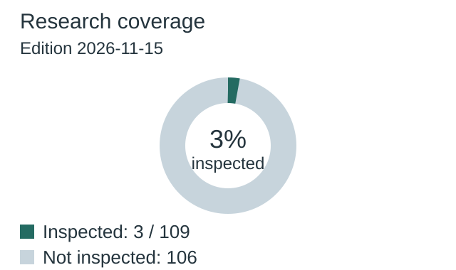
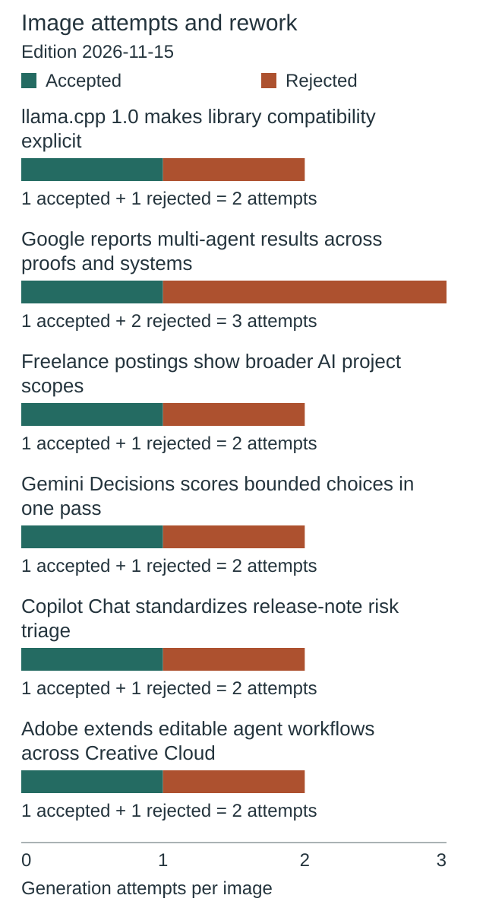
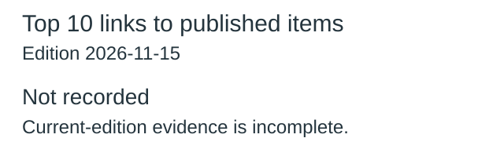
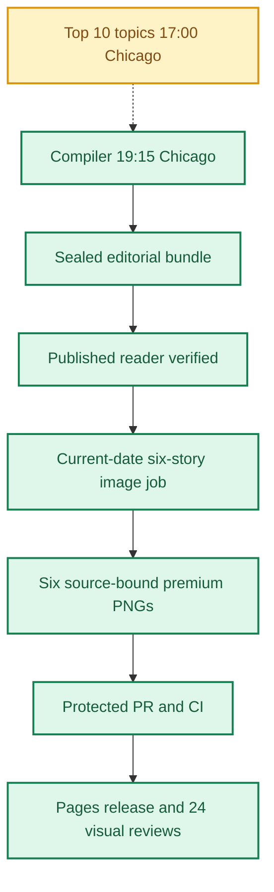
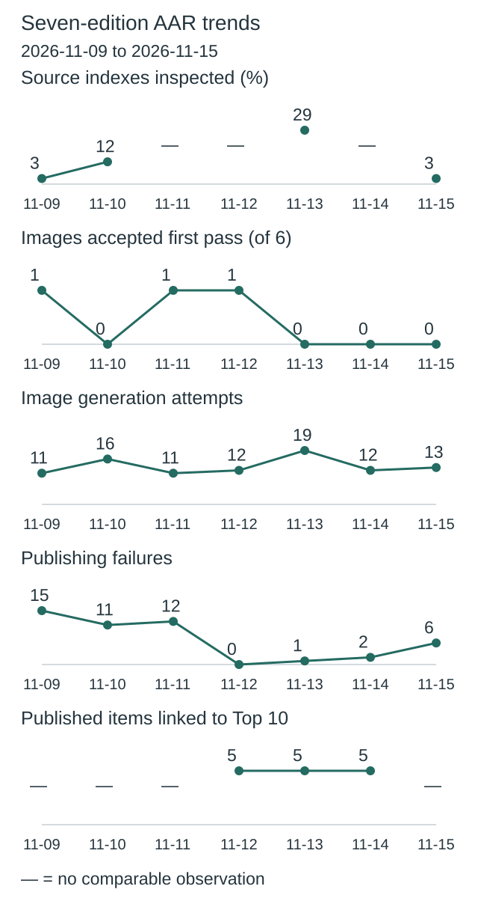
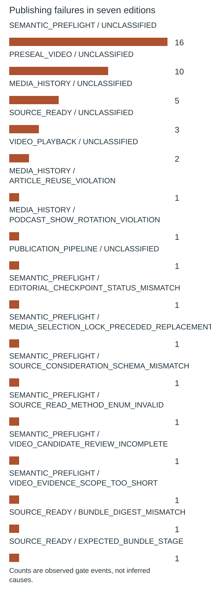
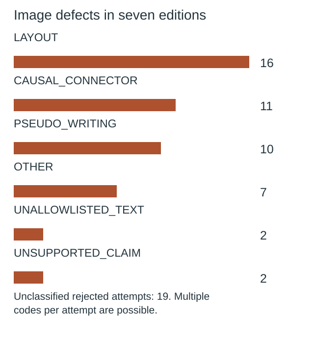

**🟩 RELEASE COMPLETE**
**TOP 10 PARTIAL** · **🟩 COMPILER VERIFIED** · **🟦 IMAGES 6/6 RELEASED** · **🟪 VISUAL QA 24/24 PASS**

# Daily AI Brief — Unified Production After-Action Report
**Edition:** November 15, 2026 · **Production evening:** 2026-11-14 · **Timezone:** America/Chicago
**Primary public reader:** [Open 2026-11-15 Brief](https://gttome.github.io/Daily-AI-Brief-Compiler/briefs/2026-11-15/) · **Repository:** [Daily-AI-Brief-Compiler](https://github.com/gttome/Daily-AI-Brief-Compiler)

> **IMPORTANT — VERIFIED PRODUCTION RESULT**
> **Executive release result: COMPLETE.** This is the single management-facing report covering Top 10 topic discovery, the editorial Compiler, published Brief and premium-image run. **Entire-system evidence: PARTIAL.** Top 10 report: **partial**; Compiler handoff: **RECEIVED_SNAPSHOT_BOUND**; guided searches: **INVALID**. Compiler public status: **VERIFIED**. Image release: **RELEASED_VERIFIED**. Direct 24-context visual quality: **24/24 PASS**. Autonomous completion: **UNPROVEN**. Missing evidence must not be promoted to a success claim.

**🕒 Production stage durations:** **Top 10 9m 56s** · **Compiler final seal window 5m 18s** · **Premium Images 16m 49s** (evidence-bounded elapsed times; the start/end events differ).

## Evidence reconciliation

Compiler final seal window: 5m 18s. Compiler state start to public verification: 67m 38s. Observed execution and final seal windows are distinct.
Image capability route preflight: RECORDED; scheduler origin remains UNPROVEN.
Image efficiency: 0/6 first-pass accepts; 13 total attempts. Current efficiency target: at least 3/6 first-pass and at most 2 attempts per image, with unchanged quality floor.
Image review completed: 2026-11-15T03:39:31Z; review-record commit: 2026-11-15T03:39:59.000Z; protected review merge: 2026-11-15T03:41:47.000Z.
Eligible source indexes: 109; editorial inspections reported: 3 (2.8%); inaccessible in editorial audit: 0; explicitly unreviewed IDs: 106; unclassified editorial IDs: 0. Automated index parsing is separate from editorial inspection and cannot substantiate exhaustive freshness claims.

Registered video sources: 29; attempted this edition: 29; unattempted: 0; enabled: 28; qualification-only: 1; sources yielding candidate URLs: 0. Status: REPORTED_ALL_ATTEMPTED. Attempt evidence is not automatic proof of source-content review or playback.

Eligible source partition **VALID**. Full original-item reads **3**. Bounded index searches **0**. Qualification-only sources recorded separately **1**.

### Protected preseal video outcomes

| Original publisher | Distinct programs submitted | Archive rejects | Playback passes | Playback unverified | Probes skipped |
|---|---:|---:|---:|---:|---:|
| abcnews.com | 2 | 0 | 0 | 2 | 0 |
| cbsnews.com | 2 | 1 | 1 | 0 | 0 |
| dw.com | 1 | 0 | 0 | 1 | 0 |
| foxbusiness.com | 1 | 0 | 2 | 0 | 3 |
| ibm.com | 1 | 0 | 0 | 1 | 0 |
| pbs.org | 1 | 0 | 2 | 0 | 3 |
| ted.com | 2 | 2 | 0 | 0 | 0 |

Outcomes count observed checks across all saved requests. Programs can be submitted again after a different slot changes.

- The human workforce behind AI received PUBLIC_VIDEO_PLAYBACK_UNVERIFIED. [Original run](https://github.com/gttome/Daily-AI-Brief-Compiler/actions/runs/43663116684)
- GTA VI expected to break records while Google and Anthropic release new AI models received PUBLIC_VIDEO_PLAYBACK_UNVERIFIED. [Original run](https://github.com/gttome/Daily-AI-Brief-Compiler/actions/runs/43663116684)
- Putting AI to work for integration received PUBLIC_VIDEO_PLAYBACK_UNVERIFIED. [Original run](https://github.com/gttome/Daily-AI-Brief-Compiler/actions/runs/43663116684)
- How people are using AI to grieve, love and connect received PRESEAL_ARCHIVE_REPEAT. Earlier editions 2026-11-04. [Original run](https://github.com/gttome/Daily-AI-Brief-Compiler/actions/runs/43663657683)
- Who’s keeping AI in check? received PRESEAL_ARCHIVE_REPEAT. Earlier editions 2026-11-03. [Original run](https://github.com/gttome/Daily-AI-Brief-Compiler/actions/runs/43663793805)
- What NVIDIA's CEO departure means for AI development received PUBLIC_VIDEO_PLAYBACK_UNVERIFIED. [Original run](https://github.com/gttome/Daily-AI-Brief-Compiler/actions/runs/43664463850)
- AI brain fry is real. Here's what leaders can do received PRESEAL_ARCHIVE_REPEAT. Earlier editions 2026-10-29. [Original run](https://github.com/gttome/Daily-AI-Brief-Compiler/actions/runs/43665910813)

## Daily AAR charts

These charts use this edition’s receipts. Missing data is not zero.

### Research coverage



**3 of 109 indexes inspected (3%).**

| Editorial inspection | Indexes |
|---|---:|
| Inspected | 3 |
| Not inspected | 106 |

Not inspected includes every index without a recorded editorial inspection; this is not proof of missed stories.

### Image attempts and rework



**13 attempts; 0 of 6 images accepted on their first attempt.**

Recorded ongoing from November 8 target: at least 3/6 first-pass accepts; no more than 2 attempts per image. This is an efficiency target, not a quality cutoff.

| Image | Accepted | Rejected | Total attempts |
|---|---:|---:|---:|
| llama.cpp 1.0 makes library compatibility explicit | 1 | 1 | 2 |
| Google reports multi-agent results across proofs and systems | 1 | 2 | 3 |
| Freelance postings show broader AI project scopes | 1 | 1 | 2 |
| Gemini Decisions scores bounded choices in one pass | 1 | 1 | 2 |
| Copilot Chat standardizes release-note risk triage | 1 | 1 | 2 |
| Adobe extends editable agent workflows across Creative Cloud | 1 | 1 | 2 |

Generation attempts measure rework, not runtime or cost. Quality and publication checks remain separate.

### Top 10 links to published items



**Not recorded:** current-edition evidence is missing or inconsistent.

No selection quota. Topic linkage does not establish better quality, popularity or causal improvement.

[Chart data](charts.json)

One edition at a time. Missing evidence is not zero. Trend claims require comparable recorded cycles.

## Performance dashboard

| Measure | Recorded result | Source / caveat |
|:--|:--:|:--|
| Entire-system evidence | **PARTIAL** | Full Top 10 list, bound Compiler input, all-format search receipts and existing release checks; separate from publication and autonomy |
| Top 10 report | **partial · 10 topics** | Same Chicago cycle report; provisional/partial coverage remains disclosed |
| Top 10 received by Compiler | **RECEIVED_SNAPSHOT_BOUND** | Exact report snapshot bytes; consumed commit separately corroborated: YES |
| Top 10 guided article/video/podcast searches | **INVALID** | Actual source-search receipts and selected/rejected topic outcomes |
| Top 10 stage duration | **9m 56s** | Same-cycle run receipt only; no runtime or usage estimate |
| Editorial publication | **PASS** | State and public reader integrity receipt |
| **Unattended autonomy (separate from publication)** | **UNPROVEN** | Owner incident receipt takes precedence over unverified producer self-attestation |
| Recorded protected publishing gate failures | **6** | Actual same-edition GitHub failure sidecar only; earlier unrecorded failures remain unknown |
| Articles | **6** | Exactly 2 technical / 2 knowledge-worker / 2 agents required |
| Original scientific-paper-led articles | **Not recorded** | Rolling target: one qualified original paper in 7 editions; NOT_RECORDED. Preprints are not peer-reviewed by default |
| Verified original sources within preceding 24 hours | **0 / 6** | Original publisher dates only; other sources require a documented fallback rationale |
| Distinct selected article publishers | **6** | Six different primary organizations preferred |
| Videos over seven days old | **0** | Must be labeled evergreen, not a new development |
| Distinct selected video publishers | **2** | One channel is one publisher even across multiple videos |
| Cross-media topic diversity | **FOUR_DISTINCT_EVENTS_REVIEW_RECORDED** | Four video/podcast events and six pairwise original-source comparisons; editorial claims remain producer-attested |
| Video discovery source attempts | **29 / 29** | Attempt evidence across enabled and qualification-only leads; REPORTED_ALL_ATTEMPTED. Not a claim of full content review or player verification | 
| Duplicate active Watchlist display titles | **Not recorded** | Published canonical Watchlist only; historical evidence retained |
| Original-release video playback (historical) | **TWO_PUBLISHED_VIDEOS_PLAYBACK_PASS** | Later reader corrections may replace these originally verified videos; see incident register | 
| Postpublication reader incidents | **NOT_RECORDED** | Edition-specific owner reports and corrective PRs, not inferred absence | 
| Verified postpublication video corrections | **NOT_RECORDED** | Incident register tracks correction PR, actual playback evidence and reader preservation |
| Editorial index second-pass attempts | **0** | Bounded public GET retries only; never proof of original article reading |
| Editorial index reads recovered | **0** | Successful page fetch can still yield zero eligible dated items |
| Recorded scheduler capability route | **UNPROVEN** | Same-invocation route receipt only; GitHub is not scheduler authentication |
| Avoidable incomplete-staging CI failures | **Not independently audited** | Existing image-package push CI is disabled; exact-head protected PR CI remains required. A failure count requires actual workflow evidence |
| Media | **2 videos + 2 podcasts** | Sealed bundle |
| **Compiler final seal window** | **5m 18s (5.3 min)** | Final sealed-state timestamp → verified public reader; initial execution is separate |
| **Image processing stage duration** | **16m 49s** | First accepted PNG Git checkpoint → final 24/24 review; auditable stage elapsed time |
| Image scheduled-to-final-review window | **Not independently recorded** | Only with a saved one-cycle schedule anchor; does not attest exact generation start |
| Executor-observed generation-to-final-review | **19m 01s** | Only if the worker recorded a same-execution clock before its first native call; not independently verified provider runtime |
| Accepted premium PNGs | **6 / 6** | Exact package and public release hashes |
| Native image generation attempts | **13** | Image worker AAR; no estimation |
| Rejected candidates | **7** | Image worker AAR |
| Final worker checkpoint reconciliation | **PASS** | Oct25+ verifies exact generation count, per-story attempts, six accepted story/image/hash bindings and final release |
| Saved visual contexts | **24 / 24 PASS** | Dated/permanent desktop/mobile review |
| Public SHA-256 checks | **44** | Image release receipt |
| October 8 immutable history | **17 / 17** | Independent content-preservation checks |
| **Owner-reported weekly Work usage for this run** | **Not reported** | No per-cycle usage supplied |

> **EFFICIENCY NOTE**
> **Resource reporting policy:** No usage figure was supplied for this cycle, so none is assumed. Future runs show **Not reported** unless the owner supplies new cycle-specific usage metadata. No approval or extra step is required to generate the AAR.

## Production architecture and checkpoints



## Daily AI Topic Top 10 and Compiler handoff

**Research cycle:** 2026-11-14 · **Target Brief:** 2026-11-15 · **Scheduled start:** 17:00 America/Chicago

| Dimension | Recorded evidence |
|---|---|
| Run/report result | PARTIAL |
| Report status / topics | partial / 10 |
| Freshness | FRESH\_AT\_CONSUMPTION |
| Compiler handoff | RECEIVED\_SNAPSHOT\_BOUND |
| Search coverage | INVALID |
| Selection mapping verification | INVALID |
| Observed start / finish | 2026-11-14T23:01:44Z / 2026-11-14T23:11:40Z |
| Elapsed minutes | 9.93 |
| Usage percent | Not reported |
| Cost USD | Not reported |
| Independent scheduler autonomy | UNPROVEN |
| Compiler-recorded consumed commit | 7f74dca0d851ac12a7ed7f62edb25d2541e9c74b |
| Report SHA-256 | d98a22fe3ed2717accccea48ff980a7a5f7c3a6251eb68516df7bbda356721e9 |

| Discovery order | AI topic | Summary | Confidence | Evidence |
|---:|---|---|---|---|
| 1 | Nvidia’s CEO transition draws scrutiny of its AI chip business | Nvidia appointed CFO Colette Kress interim CEO after Jensen Huang resigned. | medium | [Source](https://www.youtube.com/watch?v=W79ML7zFyZg) · [Source](https://news.ycombinator.com/item?id=50477231) · [Source](https://nvidianews.nvidia.com/news/nvidia-announces-ceo-transition) · [Source](https://shows.acast.com/ftnewsbriefing/episodes/nvidia-after-jensen-huang) · [Source](https://shows.acast.com/ai-news-strategy-daily-with-nate-b-jones/episodes/jensen-is-out-heres-what-changes-for-nvidia-and-ai) · [Source](https://www.wired.com/story/nvidia-employees-petition-for-jensen-huangs-return/) |
| 2 | Claude Fable 5.2 faces a head-to-head coding test | A creator tried Fable 5.2 and Gemini 4 Carbon on the same game-building task after both models shipped. | medium | [Source](https://www.youtube.com/watch?v=_BjMCeHFle0) · [Source](https://www.youtube.com/watch?v=xKlUf-dw_Lw) · [Source](https://www.anthropic.com/claude-fable-and-mythos-5-2) · [Source](https://blog.google/innovation-and-ai/models-and-research/gemini-models/gemini-4-carbon-now-available/) · [Source](https://shows.acast.com/ai-news-strategy-daily-with-nate-b-jones/episodes/is-claude-fable-52-worth-the-cost-what-to-use-it-for) |
| 3 | llama.cpp 1.0 gives local-AI developers versioned libraries | The maintainers introduced version 1.0.0 for the underlying libraries to give downstream projects a clearer compatibility contract. | medium | [Source](https://www.reddit.com/r/LocalLLaMA/comments/1xv8t2e/llamacpp_v10_is_here/) · [Source](https://huggingface.co/blog/ggml-org/llama-cpp-v1) · [Source](https://github.com/ggml-org/llama.cpp/releases/tag/v1.0.0) |
| 4 | Gemini Decisions API gets an independent walkthrough | Google offers a dedicated multimodal model for batches of bounded choices, yes/no judgments and rubric questions. | medium | [Source](https://www.youtube.com/watch?v=-On9ZKGiMfA) · [Source](https://blog.google/innovation-and-ai/technology/developers-tools/gemini-decisions-api/) |
| 5 | ChatGPT Wallet puts purchase approval in front of agent checkout | The limited Dots rollout requires users to review and approve each purchase before an agent checks out. | low | [Source](https://www.reddit.com/r/OpenAI/comments/1xvd1ci/openai_introduces_chatgpt_wallet_so_agents_can/) · [Source](https://openai.com/index/introducing-chatgpt-wallet/) · [Source](https://www.reuters.com/technology/openai-launches-chatgpt-wallet-letting-ai-agents-pay-purchases-2026-11-13/) |
| 6 | GitHub adds Gemini 4 Hydrogen to Copilot | GitHub made Google’s speed-focused model generally available in Copilot across several coding surfaces. | low | [Source](https://x.com/github/status/2121319695626518823) · [Source](https://github.blog/changelog/2026-11-13-gemini-4-hydrogen-in-github-copilot/) |
| 7 | Edge0-145B draws questions about laptop inference | Edge0 released the weights and tooling for a 145-billion-parameter model and reported results on specific laptop hardware. | medium | [Source](https://news.ycombinator.com/item?id=50475713) · [Source](https://edge0.ai/blog/introducing-edge0-145b-frontier-ai-capabilities-on-your-own-computer) |
| 8 | Brave Search adds pay-per-request access for agents | Brave’s x402 endpoint lets an agent pay for individual search calls with USDC on Base. | medium | [Source](https://news.ycombinator.com/item?id=50477649) · [Source](https://brave.com/blog/search-api-agentic-payments/) |
| 9 | Claude’s authentication incident exposes workflow dependencies | Anthropic reported an authentication incident affecting Claude surfaces and later marked it resolved. | medium | [Source](https://news.ycombinator.com/item?id=50481187) · [Source](https://status.claude.com/incidents/nn11wk485zfn) |
| 10 | Perplexity Decider v1.3 draws more classification debate | The open-weight model family handles classification, retrieval scoring and evidence-span extraction. | medium | [Source](https://news.ycombinator.com/item?id=50488464) · [Source](https://www.perplexity.ai/en-GB/hub/blog/perplexity-decider) |

**Sample scope:** {"metadata\_screened\_videos":50,"distinct\_retained\_channels":33,"new\_metadata\_screened\_records":59,"combined\_observation\_records":59,"combined\_unique\_video\_ids":50,"unique\_videos":50,"videos\_watched":0,"full\_video\_reviews":0,"direct\_counter\_verifications":0,"direct\_youtube\_counter\_verifications":0,"transcript\_reviews":0,"partial\_original\_publisher\_transcript\_reviews":0,"original\_publisher\_show\_notes\_reviews":1,"original\_podcast\_show\_notes\_reviews":3,"original\_watch\_attempts":50,"comparable\_video\_observations":0,"repeated\_same\_clock\_video\_observations":10,"within\_24h\_reported\_publications":0,"additional\_within\_72h\_reported\_publications":18,"additional\_within\_7d\_reported\_publications":4,"date\_only\_video\_publications":27,"unknown\_video\_publication\_dates":1,"full\_video\_review\_target\_met":false,"original\_watch\_outcomes":{"throttled":44,"title\_index\_shell":6},"freshness\_reference\_at":"2026-11-14T23:10:44Z","notes":"Exact-hour bins exclude dates without clock times. Search widened from 24 to 72 hours and then seven days.","substantive\_original\_event\_document\_reviews":17}. **Ranking basis:** {"attention":"Event-matched video where available, independently attributed publisher breadth and public discussion. No pooling of platform metrics.","limitations":"Mixed provenance and clocks leave confidence in precise order low."}.

| Search format | Receipt rows | Attempts recorded | Explicitly not attempted |
|---|---:|---:|---:|
| article | 4 | 4 | 0 |
| video | 1 | 1 | 0 |
| podcast | 1 | 1 | 0 |

**Selected Brief items linked to trends:**

No validated selection-to-topic mapping was recorded.

**Raw, unverified Top 10 receipt observations:** 30 search rows across 30 topic/format pairs; 2 claimed mapping rows (0 with noncanonical fields). Noncanonical outcomes: not_found_in_bounded_search. These counts are NOT validated search attempts or verified selections.

**Gaps and limitations:**

- Claimed trend-to-selection mappings are not verified against the same-edition selected bundle.
- Per-topic article/video/podcast search coverage is incomplete, invalid or bound to a different input.
- The report labels its research partial.
- Video watch routes throttled or returned metadata shells. Zero verified playbacks, transcript bodies or direct YouTube measurements.
- An old YouTube measurement clock remained unchanged. No audience growth, velocity or rank movement inferred.
- Several topics depend on one identifiable signal. The sample is too limited for exact popularity ranking.

**Recorded run issues:**

- {"issue":"44 original video watch routes throttled. Six returned lightweight title shells.","effect":"Zero full playbacks and direct counters. Research remains partial.","correction":"Retained explicitly attributed snapshots and used bounded original event documents and publisher-hosted notes on matched topics."}
- {"issue":"The What Is The Latest YouTube section retained the same November 13 measurement clock, and AI Round-up did not expose individual measurement times.","effect":"No new comparable timed video measurements.","correction":"Recorded reused timestamps and null clocks separately; no growth calculation was made."}
- {"issue":"FT transcript required subscription, original NYT domain search was blocked, and IBM’s original episode page was inaccessible.","effect":"No full original transcript and no playback qualification.","correction":"Reviewed FT and creator-hosted original program notes. Recorded exact same-event overlap so the Nvidia programs are alternatives."}

**Recorded improvements:**

- {"change":"Prioritized dated publisher-hosted episode notes for exact events.","reason":"The previous edition matched five articles and zero selected videos or podcasts.","expected\_effect":"Provide clearer event identity and substantive media leads for independent qualification.","status":"implemented"}
- {"change":"Excluded repeated tracker measurement clocks from growth comparisons.","reason":"The refreshed site shell still exposed the prior day’s YouTube snapshot.","expected\_effect":"Maintain a valid daily time series without inventing momentum.","status":"implemented"}

### Daily improvement and effect on the Brief

**Fixed baseline:** nov03-2026-v1 / INPUT\_FROZEN. **Outcome baseline:** FROZEN\_AFTER\_VERIFIED\_PUBLICATION. **Prior cycle:** 2026-11-13.

| Input measure | Current | November 3 baseline | Change from baseline | Change from prior cycle |
|---|---:|---:|---:|---:|
| topic count | 10 | 10 | 0 | 0 |
| validation resource count | Not reported | 14 | Not reported | Not reported |
| additional video metadata records | 59 | 63 | -4 | -5 |
| additional video channels | Not reported | 21 | Not reported | Not reported |
| total video observations | 59 | 79 | -20 | -5 |
| unique videos | 50 | 71 | -21 | -5 |
| full video reviews | 0 | 0 | 0 | 0 |
| direct youtube counter verifications | 0 | 0 | 0 | 0 |
| broader evidence band topics | 2 | 3 | -1 | -2 |
| limited evidence band topics | 8 | 7 | 1 | 2 |

**Observed downstream measurements:** PENDING\_OR\_INCOMPLETE.

| Outcome measure | Current | Change from frozen outcome | Change from prior cycle |
|---|---:|---:|---:|
| expected topic format pairs | 30 | 0 | 0 |
| attempted topic format pairs | Not reported | Not reported | Not reported |
| explicitly unattempted pairs | Not reported | Not reported | Not reported |
| discovered candidate count | Not reported | Not reported | Not reported |
| searched source host count | Not reported | Not reported | Not reported |
| selected article count | Not reported | Not reported | Not reported |
| selected video count | Not reported | Not reported | Not reported |
| selected podcast count | Not reported | Not reported | Not reported |

**Source changes:** {"added":\[\],"removed":\[\]}.

**Candidate review depth:** NOT\_RECORDED.

| Review measure | Current | Change from prior comparable cycle |
|---|---:|---:|
| reviewed candidate count | Not reported | Not reported |
| qualified candidate count | Not reported | Not reported |
| rejected candidate count | Not reported | Not reported |
| metadata only count | Not reported | Not reported |
| full video reviews | Not reported | Not reported |
| transcript reviews | Not reported | Not reported |

The frozen November 3 baseline has no candidate-level review ledger; no retrospective value is invented. Recorded reviews do not independently establish content quality, audience interest or causal benefit.

**Method/resource review:** {"baseline\_id":"nov03-2026-v1","previous\_report\_date":"2026-11-13","previous\_method\_version":"2026-11-03.2-event-review","method\_version":"2026-11-03.2-event-review","feedback":{"aar\_url":"https://github.com/gttome/Daily-AI-Brief-Compiler/blob/c094dc622947a373ff90ad99547fcafac0cee5f8/daily/2026-11-13/combined.md","charts\_url":"https://github.com/gttome/Daily-AI-Brief-Compiler/blob/c094dc622947a373ff90ad99547fcafac0cee5f8/daily/2026-11-13/charts.json","metrics\_url":"https://github.com/gttome/Daily-AI-Brief-Compiler/blob/c094dc622947a373ff90ad99547fcafac0cee5f8/daily/2026-11-13/improvement-metrics.json","observation":"Prior edition verified five article mappings and zero video or podcast mappings. Source inspection chart is NOT\_RECORDED. Image chart records 12 attempts and zero first-pass acceptances. Autonomy remained UNPROVEN."},"changes":\[{"change":"Prioritized dated publisher-hosted episode notes for exact events.","reason":"The previous edition matched five articles and zero selected videos or podcasts.","expected\_effect":"Provide clearer event identity and substantive media leads for independent qualification."},{"change":"Excluded repeated tracker measurement clocks from growth comparisons.","reason":"The refreshed site shell still exposed the prior day’s YouTube snapshot.","expected\_effect":"Maintain a valid daily time series without inventing momentum."}\],"resource\_candidates":\[{"url":"https://shows.acast.com/ftnewsbriefing/episodes/nvidia-after-jensen-huang","role":"Original FT podcast episode","access":"Public publisher-hosted notes","review\_scope":"Original date and editor’s synopsis. Direct transcript paywalled. Playback unverified.","independence":"FT is independent of Nvidia, Hard Fork and the creator sources.","decision":"accepted","reason":"Exact event with an infrastructure and supply angle.","contribution":"Adds one dated episode candidate."},{"url":"https://shows.acast.com/ai-news-strategy-daily-with-nate-b-jones/episodes/jensen-is-out-heres-what-changes-for-nvidia-and-ai","role":"Creator’s original podcast","access":"Public publisher-hosted notes","review\_scope":"Dated episode description and topical outline.","independence":"Same publisher as matching YouTube. Same underlying Nvidia event as the FT episode.","decision":"accepted","reason":"Separate approach to the same event.","contribution":"Procurement, CUDA portability and financing context. Marked as an alternative, not a separate event."}\],"observed\_effects":\[{"observation":"50 metadata screens and no new comparable video observations, versus 55 and four previously.","effect":"Unchanged and untimed tracker clocks prevented inference about video growth."},{"observation":"Original notes for three podcast episodes across two events and one separate video talk were reviewed.","effect":"Adds content detail for media discovery. No playback, selection, or causal production effect was observed."}\],"next\_improvement":"Check exact media mappings in the next reconciled AAR and seek additional original episode content across distinct events.","limitations":\["The November 10 pilot falls outside this cycle.","Mapping and media eligibility require independent receipts."\],"change\_evaluations":\[{"change\_id":"AAR-10","reviewed\_edition":"2026-11-14","decision":"keep","result":"met","reason":"The latest reconciled metrics accepted ten family assessments and recorded eight weaker bands.","evidence\_refs":\["https://github.com/gttome/Daily-AI-Brief-Compiler/blob/c094dc622947a373ff90ad99547fcafac0cee5f8/daily/2026-11-13/improvement-metrics.json"\]},{"change\_id":"NOV03-04","reviewed\_edition":"2026-11-14","decision":"keep","result":"inconclusive","reason":"Five of six articles and zero of four selected media mapped. Future media relevance and causal benefit remain unproven.","evidence\_refs":\["https://github.com/gttome/Daily-AI-Brief-Compiler/blob/c094dc622947a373ff90ad99547fcafac0cee5f8/daily/2026-11-13/combined.md","https://github.com/gttome/Daily-AI-Brief-Compiler/blob/c094dc622947a373ff90ad99547fcafac0cee5f8/daily/2026-11-13/charts.json"\]}\]}.

**Current reconciled conclusion:** PENDING\_OR\_INCOMPLETE; outcome baseline FROZEN\_AFTER\_VERIFIED\_PUBLICATION; candidate review ledger NOT\_RECORDED.

**Historical producer observations (not current status):** The following snapshot preserves what the producer reported at the time. Its pending statuses and candidate-quality claims are not independently reconciled conclusions. Use the current tables above for publication-bound measurements; an absent candidate review ledger remains unknown.

<details><summary>Original producer effects and gaps — historical snapshot</summary>

```json
null
```

</details>

**Next improvement:** Check exact media mappings in the next reconciled AAR and seek additional original episode content across distinct events.

Counts show coverage and observed association, not audience popularity, source independence, candidate quality or causal uplift. Compare source/method changes before interpreting deltas. Unknown values are not zero. Publication, reader corrections, runtime and image outcomes retain their separate AAR evidence.

Report, source-readback and search receipts are separate observations. Snapshot binding verifies the collected report bytes; the consumed commit is independently corroborated only when the separately fetched source bytes match. These records do not independently attest scheduler identity or source truth. Top 10 reporting does not change Brief/image release status.


## Track 1 — Compiler

**State:** `SHADOW_VERIFIED` · **Bundle:** `BUNDLE_READY` · **Compiler final seal window:** 5m 18s (5.3 min).

| Publication gate | Result |
|---|:---:|
| Canonical reader build | ✅ |
| Reader parity | ✅ |
| Public verification of dated edition | ✅ |
| Previous editions preserved | ✅ |
| Permanent story routes and feeds | ✅ |

**Selected coverage:**

| Lane | Story |
|---|---|
| Technical AI Engineering | llama.cpp 1.0 makes library compatibility explicit |
| Technical AI Engineering | Google reports multi-agent results across proofs and systems |
| Applied Generative AI for Knowledge Workers | Freelance postings show broader AI project scopes |
| Applied Generative AI for Knowledge Workers | Gemini Decisions scores bounded choices in one pass |
| Agents for Everyone | Copilot Chat standardizes release-note risk triage |
| Agents for Everyone | Adobe extends editable agent workflows across Creative Cloud |

### Scientific paper opportunity and publication evidence

**Current edition:** NOT_RECORDED; **paper-led stories:** Not recorded. Editorial target: at least one genuinely qualified original-paper-based story in seven editions, with methods, limitations, and an explicit preprint/peer-review distinction. No stale or weak paper is selected solely to fill a quota.


## Track 2 — Premium images

**Public status:** `RELEASED_VERIFIED` · **Saved images:** 6/6 · **Actual generation attempts:** 13 · **Rejected candidates:** 7.

### Image production duration — Git-verified milestones

**Auditable image stage duration:** **16m 49s** (first accepted binary saved in Git → first persisted 24-context quality-review record). **First asset to public image release:** **13m 08s**.
**Scheduled-to-final-review window:** **Not independently recorded**. This is a scheduled-clock comparison only when a separately recorded exact-date schedule exists; it is **not** measured native image-generation runtime.

| Production milestone | Chicago local time | Evidence |
|---|---|---|
| Scheduled image start (if exact-date record exists) | Not independently recorded | Time planned, not actual execution start |
| First executor-observed start | 9:15:58 PM | Worker self-attestation, not a first-party scheduler event |
| First native generation observation | 9:20:58 PM | Worker clock recorded immediately before first native call, not model-provider telemetry |
| First accepted PNG bytes saved to Git | 9:23:10 PM | Immutable binary-stage commit |
| Six-image package / reviews committed | 9:32:49 PM | Exact-head PR source commit |
| Protected package merged | 9:35:18 PM | Merge SHA and required CI |
| Public images verified | 9:36:18 PM | Image-release receipt |
| 24/24 review record committed | 9:39:59 PM | Immutable first review-approval commit |

> **Duration interpretation:** The audited stage excludes unobservable pre-checkpoint creative work. The scheduled-start window includes it but must not be interpreted as precise active processing time. Missing timestamps appear as **Not independently recorded**, never an estimate.


| Source-bound image | Attempts | File size | Public page |
|---|---:|---:|---|
| llama.cpp 1.0 makes library compatibility explicit | 2 | 0.93 MiB | [View original](https://gttome.github.io/Daily-AI-Brief-Compiler/briefs/images/2026-11-15/dab-edition-2026-11-15-m01.png) |
| Google reports multi-agent results across proofs and systems | 3 | 0.81 MiB | [View original](https://gttome.github.io/Daily-AI-Brief-Compiler/briefs/images/2026-11-15/dab-edition-2026-11-15-m02.png) |
| Freelance postings show broader AI project scopes | 2 | 0.82 MiB | [View original](https://gttome.github.io/Daily-AI-Brief-Compiler/briefs/images/2026-11-15/dab-edition-2026-11-15-m10.png) |
| Gemini Decisions scores bounded choices in one pass | 2 | 0.78 MiB | [View original](https://gttome.github.io/Daily-AI-Brief-Compiler/briefs/images/2026-11-15/dab-edition-2026-11-15-m11.png) |
| Copilot Chat standardizes release-note risk triage | 2 | 0.95 MiB | [View original](https://gttome.github.io/Daily-AI-Brief-Compiler/briefs/images/2026-11-15/dab-edition-2026-11-15-m12.png) |
| Adobe extends editable agent workflows across Creative Cloud | 2 | 0.76 MiB | [View original](https://gttome.github.io/Daily-AI-Brief-Compiler/briefs/images/2026-11-15/dab-edition-2026-11-15-m14.png) |

**Immutable-release and visual gates:**

| Release gate | Result |
|---|:---:|
| Protected public image receipt | ✅ |
| Accepted-image Git hash bindings | ✅ |
| Six live PNGs | 6/6 |
| Dated/permanent story placements | 12/12 recorded in release evidence |
| Desktop/mobile visual inspection | 24/24 PASS |
| Historical Oct 8 integrity | 17/17 |

### Published premium illustrations

<table>
<tr><td width="50%"><a href="https://gttome.github.io/Daily-AI-Brief-Compiler/briefs/images/2026-11-15/dab-edition-2026-11-15-m01.png"></a><br/><b>llama.cpp 1.0 makes library compatibility explicit</b></td><td width="50%"><a href="https://gttome.github.io/Daily-AI-Brief-Compiler/briefs/images/2026-11-15/dab-edition-2026-11-15-m02.png"></a><br/><b>Google reports multi-agent results across proofs and systems</b></td></tr>
<tr><td width="50%"><a href="https://gttome.github.io/Daily-AI-Brief-Compiler/briefs/images/2026-11-15/dab-edition-2026-11-15-m10.png"></a><br/><b>Freelance postings show broader AI project scopes</b></td><td width="50%"><a href="https://gttome.github.io/Daily-AI-Brief-Compiler/briefs/images/2026-11-15/dab-edition-2026-11-15-m11.png"></a><br/><b>Gemini Decisions scores bounded choices in one pass</b></td></tr>
<tr><td width="50%"><a href="https://gttome.github.io/Daily-AI-Brief-Compiler/briefs/images/2026-11-15/dab-edition-2026-11-15-m12.png"></a><br/><b>Copilot Chat standardizes release-note risk triage</b></td><td width="50%"><a href="https://gttome.github.io/Daily-AI-Brief-Compiler/briefs/images/2026-11-15/dab-edition-2026-11-15-m14.png"></a><br/><b>Adobe extends editable agent workflows across Creative Cloud</b></td></tr>
</table>

## Incidents, corrections and learning

### Postpublication reader incidents (updated when new evidence is merged)

No current-edition postpublication incident register was available; this is **NOT_RECORDED**, not a certification of zero incidents.


**Editor recovery classification:** UNPROVEN. **Owner intervention:** Unproven either way. **Protected same-edition failures recorded:** 6. 
**Latest failed protected stage:** MEDIA_HISTORY; [Action evidence](https://github.com/gttome/Daily-AI-Brief-Compiler/actions/runs/43667358993). Exact stage durations are available only where real source timestamps exist.

| Stage | Verified issue | Corrective action |
|---|---|---|
| Native saved-pixel review | The two header plates show {C}, which is not in the exact allowlist. The bottom label enclosure crosses y590. All four required labels read at 320 px and the arrow connects the intended physical interface and version tab. | Clean ink cutaway of two blank public header plates, keyed major-version boundary and downstream app plugs. The arrow visibly joins the source interface to the version tab; all four labels are exact and legible at 320 px. Measured content is inside the 40 px floor. |
| Native saved-pixel review | The three outlined compartments read as separate panels. The lower frame reaches y609, and the purple arrow starts inside the evaluator, not on an illustrated candidate object. | The purple candidate fan sends a single arrow from the middle test block into a tangible evaluator port. The blank checked artifact types stay separated on the right, and the human-led caveat is detached below. All four exact labels read at 320 px and the measured art clears the 40 px floor. |
| Native saved-pixel review | The revised physical arrow reaches the evaluator and panels are gone, but the caveat moved to the top where its first glyphs start at y26, crossing the 40 px glyph floor and departing from the detached lower band. | The purple candidate fan sends a single arrow from the middle test block into a tangible evaluator port. The blank checked artifact types stay separated on the right, and the human-led caveat is detached below. All four exact labels read at 320 px and the measured art clears the 40 px floor. |
| Native saved-pixel review | The bound folio and left sheets enter the 40px side buffer and the caveat backing reaches y609. The task strips use a gear motif, and a white gap remains between arrowhead and notch. | Matte collage connects a selected blank marketplace posting tab to a physical jigsaw strip. A bound folio repeats the four unnumbered task symbols to convey combination without a numeric claim. All four labels read at 320 px, the caveat sits apart, and content clears the safe edge. |
| Native saved-pixel review | The input folio reaches x31, the enclosure reaches y592, and the question strips include a check mark beside simulated checklist strokes. The labels and single connector are correct. | The shared-media folio shows four input modes. Its one red arrow touches the receiving comb, and three interwoven question types terminate in blank confidence tiles above a separate review envelope. All exact letters read at 320 px with clear margins and no unsupported scores or simulated writing. |
| Native saved-pixel review | The bottom label border descends to y599 and the procedure sleeve carries a decorative laurel insignia and outline. The note-to-sleeve arrow and four blank fields are correct. | Letterpress folios show a physical note feeding the reusable sleeve and a separate four-field record with a review tab. The orange path joins the source sheet and sleeve, all panels are blank, and the detached escalation caption and three exact headings remain readable at 320 px within the safe margins. |
| Native saved-pixel review | The lower backing field extends visibly past the 40px safe edge and the caveat glyphs are at its floor. The separated editable layers, four exact labels and object-bound arrow are correct. | The plum and saffron transparent media leaves show picture, timeline and layout still separately editable. The campaign sheet physically feeds the first leaf, the preview caveat is detached, and all four exact labels are readable at 320 px within the export margins. |

> **OPERATIONAL NOTE**
> This report distinguishes a published and verified production outcome from scheduler metadata exposed to another conversation. Lack of a live host heartbeat in a separate normal chat is not a Compiler production failure.

## Usage and cost stewardship

| Item | Per-cycle value |
|---|---|
| **Weekly Work usage reported by owner** | **Not reported** |
| Internal weekly usage reference | Target under 5% |
| Genuine image-generation attempts | 13 |
| Accepted diagrams | 6 |
| Regeneration after acceptance | 0 |
| Top 10 reported usage | Not reported |
| Top 10 reported cost | Not reported |
| Account-level billing telemetry | Not independently accessible to deterministic GitHub reporting |

**Future reporting rule:** For cycles without an optional owner-usage record, publish the complete AAR with `Not reported`; do not reuse prior percentages, guess remaining weekly credits or delay tomorrow's production.

## Next-edition operating handoff

| Control | Recurring contract |
|---|---|
| AI Topic Top 10 | Sole report task · 17:00 America/Chicago · saved dated list guides same-evening research |
| Primary Compiler | Sole existing task · 19:15 America/Chicago |
| Premium image production | Sole existing task · standard 21:15 America/Chicago |
| Exact image job selection | Newly published next-date `PUBLISHED_PENDING` only |
| AAR | Combined report generated automatically from new GitHub receipts |
| Optional Work usage | Owner-supplied per cycle, otherwise `Not reported` |

> **SCHEDULE RESTORATION NOTE**
> A temporary scheduling exception must be explicitly restored before claiming standard-time readiness. This deterministic document generator reads existing state only; it does not modify production schedules.

## Evidence register

| Evidence | Link |
|---|---|
| Compiler state | [Open receipt](https://github.com/gttome/Daily-AI-Brief-Compiler/blob/shadow/2026-11-15/shadow-runs/2026-11-15/compiler-state.json) |
| Compiler compile receipt | [Open receipt](https://github.com/gttome/Daily-AI-Brief-Compiler/blob/shadow/2026-11-15/shadow-runs/2026-11-15/compiler/compile-receipt.json) |
| Compiler public integrity | [Open receipt](https://github.com/gttome/Daily-AI-Brief-Compiler/blob/shadow/2026-11-15/shadow-runs/2026-11-15/compiler/postpublish-integrity.json) |
| Image release receipt | [Open receipt](https://github.com/gttome/Daily-AI-Brief-Compiler/blob/shadow-pages-history/site/image-jobs/2026-11-15/release.json) |
| Image review | [Open receipt](https://github.com/gttome/Daily-AI-Brief-Compiler/blob/main/external-image-packages/2026-11-15/reviews/live/semantic-pixel-review.json) |
| Original image AAR | [Open receipt](https://github.com/gttome/Daily-AI-Brief-Compiler/blob/main/external-image-packages/2026-11-15/reviews/after-action.md) |
| Observed editorial index retries | [Open receipt](https://github.com/gttome/Daily-AI-Brief-Compiler/blob/shadow/2026-11-15/shadow-runs/2026-11-15/editorial/source-item-retries.json) |
| Published player playback receipt | [Open receipt](https://github.com/gttome/Daily-AI-Brief-Compiler/blob/shadow/2026-11-15/shadow-runs/2026-11-15/compiler/postpublish-video-playback.json) |
| Top 10 ranked topic report | [Open receipt](https://github.com/gttome/Daily-AI-Brief-Compiler/blob/073fd2124a996f873ad535ca2efd8c36b1154ddc/signals/ai-topic-top10/2026-11-14.json) |
| Top 10 run after-action receipt | [Open receipt](https://github.com/gttome/Daily-AI-Brief-Compiler/blob/073fd2124a996f873ad535ca2efd8c36b1154ddc/signals/ai-topic-top10/2026-11-14.aar.json) |
| Compiler Top 10 input snapshot | [Open receipt](https://github.com/gttome/Daily-AI-Brief-Compiler/blob/shadow/2026-11-15/shadow-runs/2026-11-15/editorial/trend-input.json) |
| Top 10 article/video/podcast search coverage | [Open receipt](https://github.com/gttome/Daily-AI-Brief-Compiler/blob/shadow/2026-11-15/shadow-runs/2026-11-15/editorial/trend-search-coverage.json) |

**Image workflow:** [Workflow evidence](https://github.com/gttome/Daily-AI-Brief-Compiler/actions/runs/43673044218).

---

*Generated deterministically from cycle- and edition-specific GitHub records. The report combines the Top 10 discovery priorities, its Compiler handoff and searches, the published Brief, and the image run; original research, Compiler, image, hash, and review receipts remain immutable. This reporting action creates no stories, images, releases, extra AI tasks, or schedule changes.*

<!-- continuous-improvement:start -->
## Continuous improvement review

Edition **2026-11-15**. Measurements use 7/7 recorded editions in this window. Missing data stays **Not recorded**.

### Daily corrective-action review

**4 evidence-based findings**; open production blockers: 0. Cumulative evaluation checkpoint: **2026-11-17**. The daily review never waits for that date to act on a safe live problem.

| Priority | Observed issue | Existing owner / next correction | When |
|---|---|---|---|
| P1 | This edition has invalid Top 10 search-coverage receipts. | Compiler: Verify event-to-format searches and actual selected mappings in the next unlocked edition; do not rewrite a sealed historical bundle. | Next genuine run |
| P1 | 6 failed protected publication gates were recorded (6 unclassified causes). | Compiler / Recovery: Read original failed job logs, record real causes and move the relevant existing validation before the next readiness signal; do not replay the released edition. | Next genuine run |
| P1 | 7 rejected image candidates preceded the verified six-image release. | Images: Inspect saved rejection evidence and apply source-specific geometry, causal-arrow and label corrections before the next native generation. | Next genuine run |
| P2 | Publication success does not independently attest the originating scheduler. | Compiler / Recovery: Capture real first-party scheduler and execution evidence if available; do not convert unknown provenance into a failure or a success. | Next genuine run |

Findings are observational and do not claim a repair was executed by the reporter.

### Approved change evaluations

| Change | Evaluate by | Outcome status | Latest decision |
|---|---|---|---|
| NOV03-01 — Earlier publication checks and precise recovery | 2026-11-11 | REVIEWED | revise |
| NOV03-02 — Broader genuine source review | 2026-11-11 | REVIEWED | revise |
| NOV03-03 — Source-bound image rejection lessons | 2026-11-11 | REVIEWED | revise |
| NOV03-04 — Substantive Top 10 review evidence | 2026-11-11 | REVIEWED | keep |
| AAR-01 — Current conclusions separated from historical claims | 2026-11-11 | REVIEWED | keep |
| AAR-02 — Consolidated current task contracts | 2026-11-11 | REVIEWED | keep |
| AAR-03 — Dated improvement evaluations | 2026-11-11 | REVIEWED | keep |
| AAR-04 — Seven-edition trend charts | 2026-11-11 | REVIEWED | keep |
| AAR-05 — Recurring publication failure causes | 2026-11-11 | REVIEWED | revise |
| AAR-06 — Recovery interval reporting | 2026-11-11 | REVIEWED | revise |
| AAR-07 — Source inspection history | 2026-11-11 | REVIEWED | revise |
| AAR-08 — Rolling source contribution | 2026-11-11 | REVIEWED | revise |
| AAR-09 — Recurring image defect categories | 2026-11-11 | REVIEWED | keep |
| AAR-10 — Top 10 publisher-family sensitivity | 2026-11-11 | REVIEWED | keep |
| NOV15-01 — Six premium images must not share an editorial template | 2026-11-17 | NOT_YET_EFFECTIVE | Not recorded |
| NOV15-02 — Exact Top 10 handoff and three-format search use | 2026-11-17 | NOT_YET_EFFECTIVE | Not recorded |
| NOV15-03 — Original failed protected gate causes and early prevention | 2026-11-17 | NOT_YET_EFFECTIVE | Not recorded |
| NOV15-04 — Improve image first-pass acceptance without weakening quality | 2026-11-17 | NOT_YET_EFFECTIVE | Not recorded |
| NOV15-05 — Independently attest unattended scheduler-to-release autonomy | 2026-11-17 | NOT_YET_EFFECTIVE | Not recorded |
| NOV16-P0-01 — Exact Top 10 event-format search receipts | 2026-11-18 | NOT_YET_EFFECTIVE | Not recorded |
| NOV16-P0-02 — Substantive source inspections before selection lock | 2026-11-19 | NOT_YET_EFFECTIVE | Not recorded |
| NOV16-P0-03 — Outside-family playable video sourcing | 2026-11-19 | NOT_YET_EFFECTIVE | Not recorded |
| NOV16-P0-04 — Unified AAR packaging regression coverage | 2026-11-22 | NOT_YET_EFFECTIVE | Not recorded |
| NOV16-P1-05 — Fresh-first original article discovery | 2026-11-20 | NOT_YET_EFFECTIVE | Not recorded |
| NOV16-P1-06 — Classify and reduce failing source indexes | 2026-11-20 | NOT_YET_EFFECTIVE | Not recorded |
| NOV16-P1-07 — Image first-pass yield and visual differentiation | 2026-11-20 | NOT_YET_EFFECTIVE | Not recorded |
| NOV16-P1-08 — Exact video identity with punctuation-only normalization | 2026-11-18 | NOT_YET_EFFECTIVE | Not recorded |
| NOV16-P1-09 — Attributable Top 10 incremental research yield | 2026-11-20 | NOT_YET_EFFECTIVE | Not recorded |
| NOV16-P1-10 — Three-edition original paper priority and vendor attribution | 2026-11-20 | NOT_YET_EFFECTIVE | Not recorded |
| NOV16-P1-11 — Verify unattended scheduler provenance without self-attestation | 2026-11-20 | NOT_YET_EFFECTIVE | Not recorded |
| NOV16-P2-12 — Seven-edition improvement decision dashboard | 2026-11-23 | NOT_YET_EFFECTIVE | Not recorded |
| IMG19-01 — Useful internal detail | 2026-11-22 | NOT_YET_EFFECTIVE | Not recorded |
| IMG19-02 — Distinct visual identity | 2026-11-22 | NOT_YET_EFFECTIVE | Not recorded |
| IMG19-03 — Novelty across days | 2026-11-22 | NOT_YET_EFFECTIVE | Not recorded |
| IMG19-04 — Better first-attempt yield | 2026-11-22 | NOT_YET_EFFECTIVE | Not recorded |
| IMG19-05 — Margins and legibility | 2026-11-22 | NOT_YET_EFFECTIVE | Not recorded |
| IMG19-06 — Reliable reporting | 2026-11-22 | NOT_YET_EFFECTIVE | Not recorded |
| IMG19-07 — Evidence of artistic improvement | 2026-11-22 | NOT_YET_EFFECTIVE | Not recorded |
| IMG19-08 — Reusable learning without repeated shells | 2026-11-22 | NOT_YET_EFFECTIVE | Not recorded |
| NOV20-01 — Canonical Top 10 search and selected-candidate association | 2026-11-24 | NOT_YET_EFFECTIVE | Not recorded |
| NOV20-02 — Original source date and citation metadata | 2026-11-24 | NOT_YET_EFFECTIVE | Not recorded |
| NOV20-03 — Truthful runtime policy reconciliation | 2026-11-24 | NOT_YET_EFFECTIVE | Not recorded |
| NOV20-04 — More substantive preselection source reads | 2026-11-24 | NOT_YET_EFFECTIVE | Not recorded |
| NOV20-05 — Broader non-news video discovery | 2026-11-24 | NOT_YET_EFFECTIVE | Not recorded |
| NOV20-06 — First-pass image geometry and connector planning | 2026-11-24 | NOT_YET_EFFECTIVE | Not recorded |
| NOV20-07 — Watchlist score and corroboration retention | 2026-11-24 | NOT_YET_EFFECTIVE | Not recorded |
| NOV20-08 — Specific newer lane alternatives | 2026-11-24 | NOT_YET_EFFECTIVE | Not recorded |
| NOV20-09 — Original-paper review and three-edition cadence | 2026-11-24 | NOT_YET_EFFECTIVE | Not recorded |
| NOV20-10 — Separate completion and evidence statuses | 2026-11-24 | NOT_YET_EFFECTIVE | Not recorded |
| NOV20-11 — Neutral AI video coverage badges | 2026-11-24 | NOT_YET_EFFECTIVE | Not recorded |
| NOV20-12 — Continue existing IMG19 evaluation | 2026-11-22 | NOT_YET_EFFECTIVE | Not recorded |

Pending: 0; overdue: 0; reviewed: 14. Implemented controls await measured results; review decisions do not disable controls.

#### Reviews of production evidence

- **NOV03-01 · 2026-11-12 · not met.** Two media requests still required correction. The first had two stalled embeds and a certificate-date error. The second reached protected playback before two archived programs were disqualified. The edition recovered and published. [Evidence 1](https://github.com/gttome/Daily-AI-Brief-Compiler/blob/1d8c6be/shadow-runs/2026-11-12/editorial/preseal-video-receipt.json) · [Evidence 2](https://github.com/gttome/Daily-AI-Brief-Compiler/blob/shadow/2026-11-12/shadow-runs/2026-11-12/execution-milestones.json)
- **NOV03-02 · 2026-11-12 · inconclusive.** The raw audit recorded 34 inspected entries and 76 unreviewed for 109 eligible sources. It included qualification-only Zapier in the inspection entries. The audited breadth is unknown. Five distinct article publishers were recorded and zero articles had verified 24-hour timestamps. [Evidence 1](https://github.com/gttome/Daily-AI-Brief-Compiler/blob/shadow/2026-11-12/shadow-runs/2026-11-12/editorial/index-review.json) · [Evidence 2](https://github.com/gttome/Daily-AI-Brief-Compiler/blob/dac33c1e16f891121a0571a0a5e25d09b691bee5/daily/2026-11-11/combined.md)
- **AAR-01 · 2026-11-12 · met.** The reviewed closeout identified the live release and 24 visual checks as complete. It separately displayed partial research evidence and unproven autonomy. The original Top 10 snapshot retains its production-stage claims. [Evidence 1](https://github.com/gttome/Daily-AI-Brief-Compiler/blob/dac33c1e16f891121a0571a0a5e25d09b691bee5/daily/2026-11-11/combined.md) · [Evidence 2](https://github.com/gttome/Daily-AI-Brief-Compiler/blob/6e6911d0a393a3117160841950ecf3b2c3665777/signals/ai-topic-top10/2026-11-11.aar.json)
- **AAR-04 · 2026-11-12 · met.** The November 6–12 series included seven image-attempt observations and a median of 12. The chart marked missing coverage and selection observations as gaps and disclosed the registry change. [Evidence 1](https://github.com/gttome/Daily-AI-Brief-Compiler/blob/dac33c1e16f891121a0571a0a5e25d09b691bee5/daily/2026-11-11/improvement-metrics.json) · [Evidence 2](https://github.com/gttome/Daily-AI-Brief-Compiler/blob/dac33c1e16f891121a0571a0a5e25d09b691bee5/daily/2026-11-11/charts/seven-edition-trends.svg)
- **AAR-05 · 2026-11-12 · not met.** The November 12 failure chart counted zero failed workflow jobs while the candidate evidence showed a blocked probe and an archive rejection. The recurring-failure table still contains unclassified events. Preserve the original outcomes so these types remain visible. [Evidence 1](https://github.com/gttome/Daily-AI-Brief-Compiler/blob/dac33c1e16f891121a0571a0a5e25d09b691bee5/daily/2026-11-11/improvement-metrics.json) · [Evidence 2](https://github.com/gttome/Daily-AI-Brief-Compiler/blob/shadow/2026-11-12/shadow-runs/2026-11-12/execution-milestones.json)
- **AAR-06 · 2026-11-12 · inconclusive.** Compiler milestones preserve detection and subsequent state changes. The reconciled report has zero recovery incidents with all required clocks and exact references. Separate repair and verification intervals and unattended origin remain unproven. [Evidence 1](https://github.com/gttome/Daily-AI-Brief-Compiler/blob/shadow/2026-11-12/shadow-runs/2026-11-12/execution-milestones.json) · [Evidence 2](https://github.com/gttome/Daily-AI-Brief-Compiler/blob/dac33c1e16f891121a0571a0a5e25d09b691bee5/daily/2026-11-11/improvement-metrics.json)
- **AAR-07 · 2026-11-12 · not met.** The November 12 index audit failed to reconcile by eligible ID. The current cycle could not update certified inspection coverage from that partition. Review the actual source scopes and clocks with the enabled roster before selection. [Evidence 1](https://github.com/gttome/Daily-AI-Brief-Compiler/blob/shadow/2026-11-12/shadow-runs/2026-11-12/editorial/index-review.json) · [Evidence 2](https://github.com/gttome/Daily-AI-Brief-Compiler/blob/dac33c1e16f891121a0571a0a5e25d09b691bee5/daily/2026-11-11/improvement-metrics.json)
- **AAR-08 · 2026-11-12 · inconclusive.** Five published items had validated topic mappings. The rolling contribution table had no validated substantive candidate review rows attributed to registry IDs. The relative contribution of individual sources remains unknown. [Evidence 1](https://github.com/gttome/Daily-AI-Brief-Compiler/blob/shadow/2026-11-12/shadow-runs/2026-11-12/editorial/trend-search-coverage.json) · [Evidence 2](https://github.com/gttome/Daily-AI-Brief-Compiler/blob/dac33c1e16f891121a0571a0a5e25d09b691bee5/daily/2026-11-11/improvement-metrics.json)

### Seven-edition trends



| Edition | Coverage | First pass / 6 | Image attempts | Publishing failures | Top 10 links |
|---|---|---:|---:|---:|---:|
| 2026-11-09 | 3/109 (3%) | 1 | 11 | 15 | Not recorded |
| 2026-11-10 | 13/109 (12%) | 0 | 16 | 11 | Not recorded |
| 2026-11-11 | Not recorded | 1 | 11 | 12 | Not recorded |
| 2026-11-12 | Not recorded | 1 | 12 | 0 | 5 |
| 2026-11-13 | 32/109 (29%) | 0 | 19 | 1 | 5 |
| 2026-11-14 | Not recorded | 0 | 12 | 2 | 5 |
| 2026-11-15 | 3/109 (3%) | 0 | 13 | 6 | Not recorded |

| Measure | Recorded editions | Window median |
|---|---:|---:|
| coverage percent | 4 | 7.5 |
| first pass accepted | 7 | 0 |
| image attempts | 7 | 12 |
| top10 linked items | 3 | 5 |
| publication failures | 7 | 6 |

Recorded source-set identities are comparable in this window.

### Publishing failures by stage and recorded cause



| Stage | Recorded cause | Failures | Editions | Recurred | Delay median (seconds; documented samples only) |
|---|---|---:|---|---|---:|
| SEMANTIC_PREFLIGHT | UNCLASSIFIED | 16 | 2026-11-09, 2026-11-10, 2026-11-11 | Yes | Not recorded (0 samples) |
| PRESEAL_VIDEO | UNCLASSIFIED | 10 | 2026-11-09, 2026-11-10, 2026-11-11, 2026-11-14, 2026-11-15 | Yes | Not recorded (0 samples) |
| MEDIA_HISTORY | UNCLASSIFIED | 5 | 2026-11-09, 2026-11-10, 2026-11-11, 2026-11-15 | Yes | Not recorded (0 samples) |
| SOURCE_READY | UNCLASSIFIED | 3 | 2026-11-10, 2026-11-15 | Yes | Not recorded (0 samples) |
| VIDEO_PLAYBACK | UNCLASSIFIED | 2 | 2026-11-09, 2026-11-13 | Yes | Not recorded (0 samples) |
| MEDIA_HISTORY | ARTICLE_REUSE_VIOLATION | 1 | 2026-11-09 | No within observed window | Not recorded (0 samples) |
| MEDIA_HISTORY | PODCAST_SHOW_ROTATION_VIOLATION | 1 | 2026-11-09 | No within observed window | Not recorded (0 samples) |
| PUBLICATION_PIPELINE | UNCLASSIFIED | 1 | 2026-11-14 | No within observed window | Not recorded (0 samples) |
| SEMANTIC_PREFLIGHT | EDITORIAL_CHECKPOINT_STATUS_MISMATCH | 1 | 2026-11-09 | No within observed window | Not recorded (0 samples) |
| SEMANTIC_PREFLIGHT | MEDIA_SELECTION_LOCK_PRECEDED_REPLACEMENT | 1 | 2026-11-09 | No within observed window | Not recorded (0 samples) |
| SEMANTIC_PREFLIGHT | SOURCE_CONSIDERATION_SCHEMA_MISMATCH | 1 | 2026-11-09 | No within observed window | Not recorded (0 samples) |
| SEMANTIC_PREFLIGHT | SOURCE_READ_METHOD_ENUM_INVALID | 1 | 2026-11-09 | No within observed window | Not recorded (0 samples) |
| SEMANTIC_PREFLIGHT | VIDEO_CANDIDATE_REVIEW_INCOMPLETE | 1 | 2026-11-09 | No within observed window | Not recorded (0 samples) |
| SEMANTIC_PREFLIGHT | VIDEO_EVIDENCE_SCOPE_TOO_SHORT | 1 | 2026-11-09 | No within observed window | Not recorded (0 samples) |
| SOURCE_READY | BUNDLE_DIGEST_MISMATCH | 1 | 2026-11-09 | No within observed window | Not recorded (0 samples) |
| SOURCE_READY | EXPECTED_BUNDLE_STAGE | 1 | 2026-11-09 | No within observed window | Not recorded (0 samples) |

Unclassified means the original gate is known but no structured cause review is recorded. Stage names do not establish root causes. No rows establish no failures only when the recorded receipt explicitly has none.

### Recovery intervals

| Recorded mode | Incidents | Detection seconds | Queue seconds | Repair seconds | Verification seconds | Total seconds |
|---|---:|---:|---:|---:|---:|---:|

**Not recorded:** no valid incident has all required timing and evidence references.

### Source inspection history

| Source | Last inspected edition | Editions since inspection |
|---|---|---:|
| acl-anthology | 2026-11-10 | 5 |
| anthropic | Not recorded | Not recorded |
| anthropic-news | 2026-11-10 | 5 |
| article-databricks-ai-research | 2026-11-13 | 2 |
| article-ibm-research-ai | Not recorded | Not recorded |
| article-nvidia-technical-ai | Not recorded | Not recorded |
| arxiv-cs-ai | Not recorded | Not recorded |
| arxiv-cs-cl | Not recorded | Not recorded |
| arxiv-cs-lg | Not recorded | Not recorded |
| berkeley-bair | Not recorded | Not recorded |
| deep-20261026-a01-google-research | 2026-11-15 | 0 |
| deep-20261026-a02-microsoft-ai | Not recorded | Not recorded |
| deep-20261026-a03-nvidia-news | Not recorded | Not recorded |
| deep-20261026-p02-data-skeptic | Not recorded | Not recorded |
| deep-20261026-v01-two-minute-papers | 2026-11-13 | 2 |
| deepseek-news | Not recorded | Not recorded |
| directory-0dffb60aadd4ba31b5c090dc | Not recorded | Not recorded |
| directory-1c6f5db2559c3c226a112873 | 2026-11-13 | 2 |
| directory-242c2a2fc81a43d41f199129 | 2026-11-10 | 5 |
| directory-3834a0112c0e3a754320b557 | 2026-11-13 | 2 |
| directory-3ccc18a956cae0b1e24b5968 | Not recorded | Not recorded |
| directory-411bf5f837e28f35220736eb | 2026-11-09 | 6 |
| directory-4852e367f74118ff2dc1eec9 | 2026-11-13 | 2 |
| directory-48665d874f6008894d0d9385 | 2026-11-13 | 2 |
| directory-4c16d138c4a736e78a68127e | 2026-11-13 | 2 |
| directory-54d90ff964a74ff98851ae11 | Not recorded | Not recorded |
| directory-5c5d3d02a420135949164552 | 2026-11-13 | 2 |
| directory-64f0886a6793aa8858a4b62d | Not recorded | Not recorded |
| directory-6ea6e283349c7b62ac1ced9d | Not recorded | Not recorded |
| directory-79e16cd5beb5c662c4022a9f | 2026-11-13 | 2 |
| directory-8263ca4c9f560c8d9c4df0de | 2026-11-13 | 2 |
| directory-8df3614a9972a25fc59475ed | 2026-11-07 | 8 |
| directory-8ec4fd458a38bc0447f4cded | Not recorded | Not recorded |
| directory-935fbe5ba89ff5f91fc8c69b | 2026-11-15 | 0 |
| directory-970506fbc577e6091a33c64d | 2026-11-13 | 2 |
| directory-9ad7c274f2d56274bcd5ddcc | Not recorded | Not recorded |
| directory-9c0885bdb370f69c9262b88c | 2026-11-07 | 8 |
| directory-9f7087ce2c030a4b9da58499 | 2026-11-13 | 2 |
| directory-a74f303f4b0c39344c1314cf | 2026-11-06 | 9 |
| directory-b93e2368e85f0f95c066463e | 2026-11-13 | 2 |
| directory-c6b8a33e7fa162cc41136fa5 | Not recorded | Not recorded |
| directory-d1527db7c06b4e83370b7546 | 2026-11-13 | 2 |
| directory-d5428d030dfff7d4639258e3 | 2026-11-13 | 2 |
| directory-d6cf3f9fa167b8173a35228b | Not recorded | Not recorded |
| directory-db682c52794328eb69ebc377 | 2026-11-13 | 2 |
| directory-e2f33b502b264e51983a338a | 2026-11-13 | 2 |
| directory-e7b100b6b999ac748e052327 | 2026-11-13 | 2 |
| directory-ecf69ec2f036e803388f40ca | 2026-11-13 | 2 |
| directory-f8085f0f6e72cfbdfde3a0f8 | 2026-11-13 | 2 |
| directory-fd36049347d409f38c9f9a67 | Not recorded | Not recorded |
| github-ai-agents | Not recorded | Not recorded |
| github-generative-ai | Not recorded | Not recorded |
| github-llm | Not recorded | Not recorded |
| github-trending | Not recorded | Not recorded |
| google-deepmind-blog | 2026-11-13 | 2 |
| hacker-news-newest | Not recorded | Not recorded |
| hacker-news-show | Not recorded | Not recorded |
| hugging-face-daily-papers | Not recorded | Not recorded |
| hugging-face-datasets | Not recorded | Not recorded |
| hugging-face-models | Not recorded | Not recorded |
| hugging-face-spaces | Not recorded | Not recorded |
| iclr | Not recorded | Not recorded |
| icml | Not recorded | Not recorded |
| meta-ai-blog | 2026-11-10 | 5 |
| mistral-news | Not recorded | Not recorded |
| mit-csail | Not recorded | Not recorded |
| neurips | Not recorded | Not recorded |
| openai-news | 2026-11-15 | 0 |
| openreview | Not recorded | Not recorded |
| podcast-a16z-show | 2026-11-10 | 5 |
| podcast-agora-briefing | Not recorded | Not recorded |
| podcast-ai-daily-brief | 2026-11-06 | 9 |
| podcast-ai-for-humans | Not recorded | Not recorded |
| podcast-ai-future-work | Not recorded | Not recorded |
| podcast-ai-inside | Not recorded | Not recorded |
| podcast-artificial-intelligence-show | Not recorded | Not recorded |
| podcast-cognitive-revolution | 2026-11-06 | 9 |
| podcast-data-exchange | Not recorded | Not recorded |
| podcast-everyday-ai | Not recorded | Not recorded |
| podcast-eye-on-ai | 2026-11-10 | 5 |
| podcast-gradient-dissent | Not recorded | Not recorded |
| podcast-latent-space | 2026-11-10 | 5 |
| podcast-no-priors | 2026-11-13 | 2 |
| podcast-nvidia-ai | Not recorded | Not recorded |
| podcast-practical-ai | Not recorded | Not recorded |
| podcast-twiml | Not recorded | Not recorded |
| qwen-blog | Not recorded | Not recorded |
| reddit-localllama | Not recorded | Not recorded |
| reddit-machinelearning | Not recorded | Not recorded |
| research-20261026-a01 | Not recorded | Not recorded |
| research-20261026-a04 | Not recorded | Not recorded |
| research-20261026-a05 | Not recorded | Not recorded |
| research-20261026-a12 | 2026-11-13 | 2 |
| research-20261026-p03 | Not recorded | Not recorded |
| research-20261026-v01 | 2026-11-13 | 2 |
| research-20261026-v02 | 2026-11-13 | 2 |
| research-20261026-v04 | 2026-11-13 | 2 |
| research-20261026-v05 | 2026-11-13 | 2 |
| research-20261026-v06 | 2026-11-13 | 2 |
| research-20261026-v07 | 2026-11-13 | 2 |
| specialized-discords | Not recorded | Not recorded |
| stanford-hai | Not recorded | Not recorded |
| the-batch | Not recorded | Not recorded |
| universe-20261026-every-ai-editorial | Not recorded | Not recorded |
| video-20261120-3blue1brown | Not recorded | Not recorded |
| video-20261120-ai-coffee-break | Not recorded | Not recorded |
| video-20261120-computerphile | Not recorded | Not recorded |
| video-20261120-full-stack-deep-learning | Not recorded | Not recorded |
| video-20261120-mit-csail-video | Not recorded | Not recorded |
| video-20261120-mit-embodied-intelligence | Not recorded | Not recorded |
| video-20261120-pytorch-foundation | Not recorded | Not recorded |
| video-20261120-statquest | Not recorded | Not recorded |
| x-research-feeds | Not recorded | Not recorded |
| xai-news | Not recorded | Not recorded |
| youtube-anthropic | 2026-11-13 | 2 |
| youtube-google-deepmind | 2026-11-13 | 2 |
| youtube-openai | 2026-11-13 | 2 |

Only exact inspected source IDs and pre-selection review timestamps count. No observation means history is unavailable.

### Source contribution in this window

| Source | Substantively reviewed | Qualified | Selected | Editions with attributed reviews |
|---|---:|---:|---:|---:|

**Not recorded:** no validated substantive reviews have registry source IDs.

### Image rejection causes



| Recorded defect | Rejected attempts with defect | Recurred across editions |
|---|---:|---|
| LAYOUT | 16 | Yes |
| CAUSAL_CONNECTOR | 11 | Yes |
| PSEUDO_WRITING | 10 | Yes |
| OTHER | 7 | Yes |
| UNALLOWLISTED_TEXT | 2 | Yes |
| UNSUPPORTED_CLAIM | 2 | Yes |

Total rejected: 52; unclassified: 26. A rejected attempt can have several defect codes.

### Video publisher diversity and candidate qualification

Seven-edition measurement: **COMPLETE**. Publisher families: **7**; largest family's slots: **4**; HHI: **0.1837**; prospective variety target: **MET**.

| Verified family | Actual selections in window |
|---|---:|
| cbs | 4 |
| fortune | 1 |
| fox-news | 2 |
| pbs | 3 |
| publisher-host:euronews.com | 1 |
| publisher-host:foxbusiness.com | 1 |
| ted | 2 |

| Edition | Sources attempted | Candidate-bearing routes | Qualified/played from routes |
|---|---:|---:|---|
| 2026-11-09 | 29 | 0 | Not established by discovery sweep |
| 2026-11-10 | 29 | 16 | Not established by discovery sweep |
| 2026-11-11 | 29 | 1 | Not established by discovery sweep |
| 2026-11-12 | 29 | 5 | Not established by discovery sweep |
| 2026-11-13 | 29 | 5 | Not established by discovery sweep |
| 2026-11-14 | 29 | 6 | Not established by discovery sweep |
| 2026-11-15 | 29 | 0 | Not established by discovery sweep |

A discovered URL is not a fully reviewed, correctly dated and signed-out playable video. Unverified publisher identities or missing editions prohibit a numeric seven-edition target result.

### Owner-independent recovery evidence

| Edition | Owner request needed | Evidence |
|---|---|---|
| 2026-11-09 | Not recorded | NOT_RECORDED |
| 2026-11-10 | Not recorded | NOT_RECORDED |
| 2026-11-11 | Not recorded | NOT_RECORDED |
| 2026-11-12 | Not recorded | NOT_RECORDED |
| 2026-11-13 | Not recorded | NOT_RECORDED |
| 2026-11-14 | Not recorded | NOT_RECORDED |
| 2026-11-15 | Not recorded | NOT_RECORDED |

A pre-release AAR marking intervention false does not prove nobody later prompted a recovery. Missing incident evidence remains unknown.

### Top 10 publisher-family sensitivity

| Topic | Review status | Families | Evidence weakened after removal |
|---|---|---:|---|
| nvidia-ceo-transition-nov12 | RECORDED_EDITORIAL_ASSESSMENT | 2 | Yes |
| claude-fable-mythos-52-nov09 | RECORDED_EDITORIAL_ASSESSMENT | 2 | Yes |
| llama-cpp-v1-libraries-nov13 | RECORDED_EDITORIAL_ASSESSMENT | 1 | Yes |
| gemini-decisions-api-nov11 | RECORDED_EDITORIAL_ASSESSMENT | 1 | Yes |
| chatgpt-wallet-launch-nov13 | RECORDED_EDITORIAL_ASSESSMENT | 1 | Yes |
| gemini-4-hydrogen-copilot-ga-nov13 | RECORDED_EDITORIAL_ASSESSMENT | 1 | Yes |
| edge0-145b-release-nov12 | RECORDED_EDITORIAL_ASSESSMENT | 1 | Yes |
| brave-search-x402-nov12 | RECORDED_EDITORIAL_ASSESSMENT | 1 | Yes |
| claude-auth-incident-nov13 | RECORDED_EDITORIAL_ASSESSMENT | 1 | Yes |
| perplexity-decider-v13-nov12 | RECORDED_EDITORIAL_ASSESSMENT | 1 | Yes |

Overall status: **RECORDED**. Band changes are documented editorial assessments; source counts do not establish popularity.

[Full measurement data](improvement-metrics.json) · [Exact observation inputs](improvement-observations.json)

- Seven calendar edition dates; missing observations are gaps, never zero.
- Source counts and registry/method changes limit comparison; no causal improvement claim.
- Source contribution covers only resource-attributed substantive review records; it is not an exhaustive source ranking.
- No last inspection record means not recorded, not proof the source was never read.
- Image defects may have multiple codes per rejected attempt; category totals are not attempt totals.
- Recorded recovery mode is not first-party scheduler attestation.
- Keep/revise/retire reviews do not automatically change production controls.
<!-- continuous-improvement:end -->
