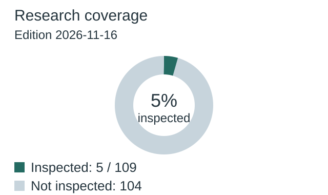
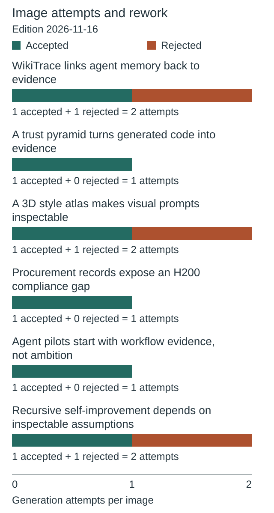
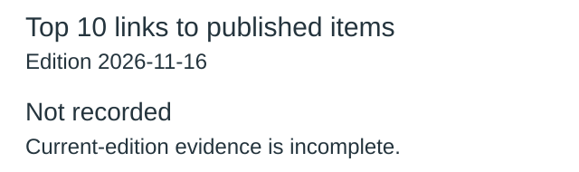
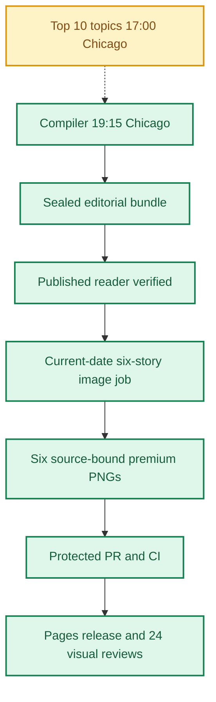
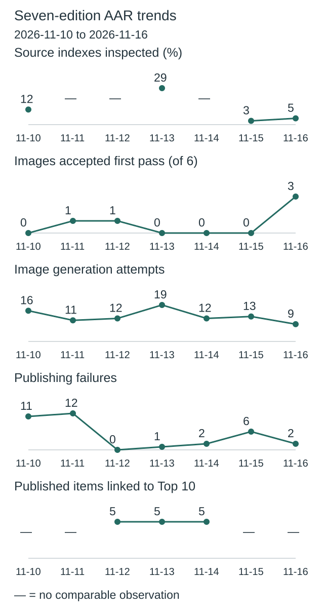
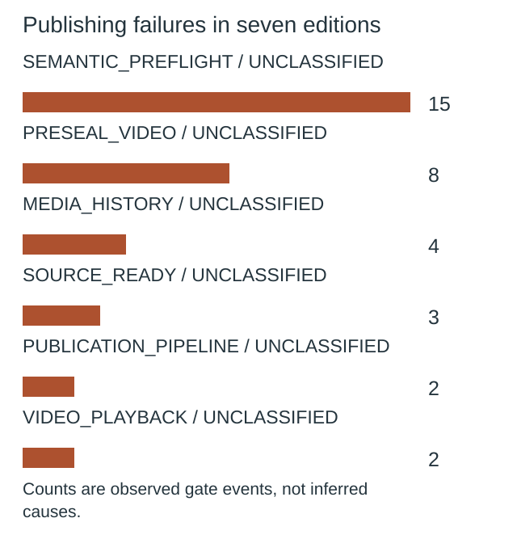
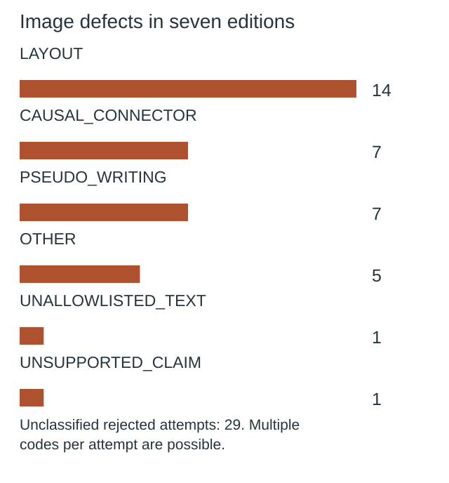

**🟩 RELEASE COMPLETE**
**TOP 10 PARTIAL** · **🟩 COMPILER VERIFIED** · **🟦 IMAGES 6/6 RELEASED** · **🟪 VISUAL QA 24/24 PASS**

# Daily AI Brief — Unified Production After-Action Report
**Edition:** November 16, 2026 · **Production evening:** 2026-11-15 · **Timezone:** America/Chicago
**Primary public reader:** [Open 2026-11-16 Brief](https://gttome.github.io/Daily-AI-Brief-Compiler/briefs/2026-11-16/) · **Repository:** [Daily-AI-Brief-Compiler](https://github.com/gttome/Daily-AI-Brief-Compiler)

> **IMPORTANT — VERIFIED PRODUCTION RESULT**
> **Executive release result: COMPLETE.** This is the single management-facing report covering Top 10 topic discovery, the editorial Compiler, published Brief and premium-image run. **Entire-system evidence: PARTIAL.** Top 10 report: **partial**; Compiler handoff: **RECEIVED_SNAPSHOT_BOUND**; guided searches: **INVALID**. Compiler public status: **VERIFIED**. Image release: **RELEASED_VERIFIED**. Direct 24-context visual quality: **24/24 PASS**. Autonomous completion: **UNPROVEN**. Missing evidence must not be promoted to a success claim.

**🕒 Production stage durations:** **Top 10 7m 42s** · **Compiler final seal window 7m 56s** · **Premium Images 19m 24s** (evidence-bounded elapsed times; the start/end events differ).

## Evidence reconciliation

Compiler final seal window: 7m 56s. Compiler state start to public verification: 54m 59s. Observed execution and final seal windows are distinct.
Image capability route preflight: RECORDED; scheduler origin remains UNPROVEN.
Image efficiency: 3/6 first-pass accepts; 9 total attempts. Current efficiency target: at least 3/6 first-pass and at most 2 attempts per image, with unchanged quality floor.
Image review completed: 2026-11-16T03:39:36Z; review-record commit: 2026-11-16T03:39:38.000Z; protected review merge: 2026-11-16T03:43:17.000Z.
Eligible source indexes: 109; editorial inspections reported: 5 (4.6%); inaccessible in editorial audit: 21; explicitly unreviewed IDs: 83; unclassified editorial IDs: 0. Automated index parsing is separate from editorial inspection and cannot substantiate exhaustive freshness claims.

Registered video sources: 29; attempted this edition: 29; unattempted: 0; enabled: 28; qualification-only: 1; sources yielding candidate URLs: 1. Status: REPORTED_ALL_ATTEMPTED. Attempt evidence is not automatic proof of source-content review or playback.

Eligible source partition **VALID**. Full original-item reads **4**. Bounded index searches **1**. Qualification-only sources recorded separately **1**.

### Video candidate discovery

| Discovery source | Eligibility | Candidate URLs |
|---|---|---:|
| AI Engineer | Enabled | 1 |

### Protected preseal video outcomes

| Original publisher | Distinct programs submitted | Archive rejects | Playback passes | Playback unverified | Probes skipped |
|---|---:|---:|---:|---:|---:|
| abcnews.com | 1 | 0 | 0 | 1 | 0 |
| cbsnews.com | 1 | 0 | 1 | 0 | 0 |
| foxbusiness.com | 1 | 0 | 2 | 0 | 0 |
| pbs.org | 1 | 0 | 2 | 0 | 0 |
| youtube-channel:UC_RovKmk0OCbuZjA8f08opw | 1 | 0 | 0 | 1 | 0 |
| youtube-channel:UCkVfrGwV-iG9bSsgCbrNPxQ | 1 | 0 | 0 | 1 | 0 |
| youtube-channel:UCLKPca3kwwd-B59HNr-_lvA | 1 | 0 | 0 | 1 | 0 |

Outcomes count observed checks across all saved requests. Programs can be submitted again after a different slot changes.

- All Code Is Slop (Except Mine) received PUBLIC_VIDEO_PLAYBACK_UNVERIFIED. [Original run](https://github.com/gttome/Daily-AI-Brief-Compiler/actions/runs/43787303229)
- Your Coding Agent Needs safeagents! received PUBLIC_VIDEO_PLAYBACK_UNVERIFIED. [Original run](https://github.com/gttome/Daily-AI-Brief-Compiler/actions/runs/43787303229)
- Claude Makes 3D Animations Easy Now received PUBLIC_VIDEO_PLAYBACK_UNVERIFIED. [Original run](https://github.com/gttome/Daily-AI-Brief-Compiler/actions/runs/43787303229)
- GTA VI expected to break records while Google and Anthropic release new AI models received PUBLIC_VIDEO_PLAYBACK_UNVERIFIED. [Original run](https://github.com/gttome/Daily-AI-Brief-Compiler/actions/runs/43788195003)

## Daily AAR charts

These charts use this edition’s receipts. Missing data is not zero.

### Research coverage



**5 of 109 indexes inspected (5%).**

| Editorial inspection | Indexes |
|---|---:|
| Inspected | 5 |
| Not inspected | 104 |

Not inspected includes every index without a recorded editorial inspection; this is not proof of missed stories.

### Image attempts and rework



**9 attempts; 3 of 6 images accepted on their first attempt.**

Recorded ongoing from November 8 target: at least 3/6 first-pass accepts; no more than 2 attempts per image. This is an efficiency target, not a quality cutoff.

| Image | Accepted | Rejected | Total attempts |
|---|---:|---:|---:|
| WikiTrace links agent memory back to evidence | 1 | 1 | 2 |
| A trust pyramid turns generated code into evidence | 1 | 0 | 1 |
| A 3D style atlas makes visual prompts inspectable | 1 | 1 | 2 |
| Procurement records expose an H200 compliance gap | 1 | 0 | 1 |
| Agent pilots start with workflow evidence, not ambition | 1 | 0 | 1 |
| Recursive self-improvement depends on inspectable assumptions | 1 | 1 | 2 |

Generation attempts measure rework, not runtime or cost. Quality and publication checks remain separate.

### Top 10 links to published items



**Not recorded:** current-edition evidence is missing or inconsistent.

No selection quota. Topic linkage does not establish better quality, popularity or causal improvement.

[Chart data](charts.json)

One edition at a time. Missing evidence is not zero. Trend claims require comparable recorded cycles.

## Performance dashboard

| Measure | Recorded result | Source / caveat |
|:--|:--:|:--|
| Entire-system evidence | **PARTIAL** | Full Top 10 list, bound Compiler input, all-format search receipts and existing release checks; separate from publication and autonomy |
| Top 10 report | **partial · 10 topics** | Same Chicago cycle report; provisional/partial coverage remains disclosed |
| Top 10 received by Compiler | **RECEIVED_SNAPSHOT_BOUND** | Exact report snapshot bytes; consumed commit separately corroborated: YES |
| Top 10 guided article/video/podcast searches | **INVALID** | Actual source-search receipts and selected/rejected topic outcomes |
| Top 10 stage duration | **7m 42s** | Same-cycle run receipt only; no runtime or usage estimate |
| Editorial publication | **PASS** | State and public reader integrity receipt |
| **Unattended autonomy (separate from publication)** | **UNPROVEN** | Owner incident receipt takes precedence over unverified producer self-attestation |
| Recorded protected publishing gate failures | **2** | Actual same-edition GitHub failure sidecar only; earlier unrecorded failures remain unknown |
| Articles | **6** | Exactly 2 technical / 2 knowledge-worker / 2 agents required |
| Original scientific-paper-led articles | **Not recorded** | Rolling target: one qualified original paper in seven editions; NOT_RECORDED. Preprints are not peer-reviewed by default |
| Verified original sources within preceding 24 hours | **0 / 6** | Original publisher dates only; other sources require a documented fallback rationale |
| Distinct selected article publishers | **6** | Six different primary organizations preferred |
| Videos over seven days old | **0** | Must be labeled evergreen, not a new development |
| Distinct selected video publishers | **2** | One channel is one publisher even across multiple videos |
| Cross-media topic diversity | **FOUR_DISTINCT_EVENTS_REVIEW_RECORDED** | Four video/podcast events and six pairwise original-source comparisons; editorial claims remain producer-attested |
| Video discovery source attempts | **29 / 29** | Attempt evidence across enabled and qualification-only leads; REPORTED_ALL_ATTEMPTED. Not a claim of full content review or player verification | 
| Duplicate active Watchlist display titles | **Not recorded** | Published canonical Watchlist only; historical evidence retained |
| Original-release video playback (historical) | **TWO_PUBLISHED_VIDEOS_PLAYBACK_PASS** | Later reader corrections may replace these originally verified videos; see incident register | 
| Postpublication reader incidents | **NOT_RECORDED** | Edition-specific owner reports and corrective PRs, not inferred absence | 
| Verified postpublication video corrections | **NOT_RECORDED** | Incident register tracks correction PR, actual playback evidence and reader preservation |
| Editorial index second-pass attempts | **0** | Bounded public GET retries only; never proof of original article reading |
| Editorial index reads recovered | **0** | Successful page fetch can still yield zero eligible dated items |
| Recorded scheduler capability route | **UNPROVEN** | Same-invocation route receipt only; GitHub is not scheduler authentication |
| Avoidable incomplete-staging CI failures | **Not independently audited** | Existing image-package push CI is disabled; exact-head protected PR CI remains required. A failure count requires actual workflow evidence |
| Media | **2 videos + 2 podcasts** | Sealed bundle |
| **Compiler final seal window** | **7m 56s (7.9 min)** | Final sealed-state timestamp → verified public reader; initial execution is separate |
| **Image processing stage duration** | **19m 24s** | First accepted PNG Git checkpoint → final 24/24 review; auditable stage elapsed time |
| Image scheduled-to-final-review window | **Not independently recorded** | Only with a saved one-cycle schedule anchor; does not attest exact generation start |
| Executor-observed generation-to-final-review | **22m 23s** | Only if the worker recorded a same-execution clock before its first native call; not independently verified provider runtime |
| Accepted premium PNGs | **6 / 6** | Exact package and public release hashes |
| Native image generation attempts | **9** | Image worker AAR; no estimation |
| Rejected candidates | **3** | Image worker AAR |
| Final worker checkpoint reconciliation | **PASS** | Oct25+ verifies exact generation count, per-story attempts, six accepted story/image/hash bindings and final release |
| Saved visual contexts | **24 / 24 PASS** | Dated/permanent desktop/mobile review |
| Public SHA-256 checks | **44** | Image release receipt |
| October 8 immutable history | **17 / 17** | Independent content-preservation checks |
| **Owner-reported weekly Work usage for this run** | **Not reported** | No per-cycle usage supplied |

> **EFFICIENCY NOTE**
> **Resource reporting policy:** No usage figure was supplied for this cycle, so none is assumed. Future runs show **Not reported** unless the owner supplies new cycle-specific usage metadata. No approval or extra step is required to generate the AAR.

## Production architecture and checkpoints



## Daily AI Topic Top 10 and Compiler handoff

**Research cycle:** 2026-11-15 · **Target Brief:** 2026-11-16 · **Scheduled start:** 17:00 America/Chicago

| Dimension | Recorded evidence |
|---|---|
| Run/report result | PARTIAL |
| Report status / topics | partial / 10 |
| Freshness | FRESH\_AT\_CONSUMPTION |
| Compiler handoff | RECEIVED\_SNAPSHOT\_BOUND |
| Search coverage | INVALID |
| Selection mapping verification | INVALID |
| Observed start / finish | 2026-11-15T22:58:33Z / 2026-11-15T23:06:15Z |
| Elapsed minutes | 7.7 |
| Usage percent | Not reported |
| Cost USD | Not reported |
| Independent scheduler autonomy | UNPROVEN |
| Compiler-recorded consumed commit | 22c8635fa41d8bb4e4c136abee32bc9ac8e62196 |
| Report SHA-256 | f4ad8ac0c2adee96badfc4a8a866d628ac8af98cb580d61c67cafe006da9c53b |

| Discovery order | AI topic | Summary | Confidence | Evidence |
|---:|---|---|---|---|
| 1 | Reporting traces H200 chips to a blacklisted university | CNN’s November 13 video revived reporting on records linking Nvidia H200 chips to a military-linked Chinese university. | medium | [Source](https://www.youtube.com/watch?v=RX05VvDYqqI) · [Source](https://www.reuters.com/world/pla-linked-chinese-university-bought-nvidia-h200-chips-despite-us-blacklist-2026-11-11/) · [Source](https://ctrlai.com/base/cnn-2026-11-13-nvidia-chips-blacklisted-chinese-buyer) |
| 2 | Dwarkesh Patel argues AI is beginning to accelerate AI research | Patel links reported examples of AI-assisted research to a forecast of faster AI development. | medium | [Source](https://www.youtube.com/watch?v=1NHPDzpfR6Y) · [Source](https://www.dwarkesh.com/p/rsi) · [Source](https://www.rdworldonline.com/as-ai-bubble-talk-grows-dwarkesh-patel-predicts-recursive-self-improvement-will-set-off-an-ai-research-explosion/) |
| 3 | Lauren Tan explains how her team checks agent-written code | The conference talk describes checking agent-produced code through lint rules, tests and stricter verification where warranted. | medium | [Source](https://www.youtube.com/watch?v=O_zcc6Xl12g) · [Source](https://ai.engineer/code/2026/talks/lauren-tan) |
| 4 | Gemini 4 Hydrogen rollout gets fresh hands-on discussion | The speed-focused Gemini release is reaching consumer and developer surfaces with different access conditions. | medium | [Source](https://www.youtube.com/watch?v=ua8OVSw2wYU) · [Source](https://www.reddit.com/r/GeminiAI/comments/1xv94ps/hydrogen_is_twice_as_fast_as_38_flash_were/) · [Source](https://blog.google/innovation-and-ai/models-and-research/gemini-models/introducing-gemini-4-hydrogen/) |
| 5 | A Claude animation tutorial more than doubles its reported views | The Futurepedia demo describes using reusable styles and audio cues to draft animated explainers. | medium | [Source](https://www.youtube.com/watch?v=ZxaMmG71g8c) · [Source](https://zolotube.com/watch?v=ZxaMmG71g8c) |
| 6 | Researchers find exposed data in public Lovable apps | Crissy Field reported that some public Lovable-built apps exposed private data through misconfigured access controls. | medium | [Source](https://news.ycombinator.com/item?id=50499017) · [Source](https://www.crissyfield.de/research/lovable-en/) · [Source](https://appfor.ai/news/lovable-apps-expose-sensitive-data) |
| 7 | Claude Code Projects adds more proactive coordination | Anthropic says the coordinator now answers questions and posts status updates while parallel threads work. | medium | [Source](https://x.com/ClaudeDevs/status/2121375309287301360) · [Source](https://news.sulat.com/2026/11/14/claude-code-projects-proactive-coordinator/) · [Source](https://github.com/anthropics/claude-code/issues/109832) · [Source](https://code.claude.com/docs/en/claude-projects) |
| 8 | Google describes /teamwork experiments in research and engineering | Google detailed multi-agent experiments that use tests or external verification to check research and code outputs. | medium | [Source](https://news.ycombinator.com/item?id=50496811) · [Source](https://research.google/blog/advancing-science-engineering-with-antigravitys-teamwork-feature/) |
| 9 | ggml and llama.cpp versioning draws more local-AI discussion | The new 1.0 library tags give downstream inference tooling a clearer versioning reference. | medium | [Source](https://news.ycombinator.com/item?id=50493062) · [Source](https://www.reddit.com/r/LocalLLaMA/comments/1xv8t2e/llamacpp_v10_is_here/) · [Source](https://github.com/ggml-org/ggml/releases/tag/v1.0.0) · [Source](https://huggingface.co/blog/ggml-org/llama-cpp-v1) |
| 10 | A new demo shows where safeagents can inspect coding-agent requests | Better Stack’s demo revisits Hugging Face’s existing open-source agent proxy and its use in checking risky actions. | medium | [Source](https://www.youtube.com/watch?v=GoG2-SSSU5k) · [Source](https://github.com/huggingface/safeagents) |

**Sample scope:** {"metadata\_screened\_videos":52,"unique\_videos":52,"distinct\_retained\_channels":39,"combined\_observation\_records":55,"new\_metadata\_screened\_records":55,"combined\_unique\_video\_ids":52,"videos\_watched":0,"full\_video\_reviews":0,"direct\_counter\_verifications":0,"direct\_youtube\_counter\_verifications":0,"transcript\_reviews":0,"partial\_original\_publisher\_transcript\_reviews":1,"original\_publisher\_show\_notes\_reviews":1,"original\_podcast\_essay\_reviews":1,"original\_watch\_attempts":52,"comparable\_video\_observations":1,"within\_24h\_reported\_publications":2,"additional\_within\_72h\_reported\_publications":18,"additional\_within\_7d\_reported\_publications":1,"date\_only\_video\_publications":31,"unknown\_video\_publication\_dates":0,"full\_video\_review\_target\_met":false,"original\_watch\_outcomes":{"title\_index\_shell":3,"throttled":49},"freshness\_reference\_at":"2026-11-15T23:05:05Z","notes":"Widened from 24h to 72h and seven days. Dates without clocks are counted separately. Selected organizer caption excerpts and author essay do not establish playback.","substantive\_original\_event\_document\_reviews":8}. **Ranking basis:** {"attention":"Event-matched attention led by video metadata, bounded same-source timed comparison, independent discussion breadth, and original claims where accessible. Cross-source engagement is not summed.","limitations":"Mixed provenance, rounding, single-family leads and missing counters prevent a precise popularity order."}.

| Search format | Receipt rows | Attempts recorded | Explicitly not attempted |
|---|---:|---:|---:|
| article | 0 | 0 | 0 |
| video | 0 | 0 | 0 |
| podcast | 0 | 0 | 0 |

**Selected Brief items linked to trends:**

No validated selection-to-topic mapping was recorded.

**Raw, unverified Top 10 receipt observations:** 30 search rows across 30 topic/format pairs; 3 claimed mapping rows (0 with noncanonical fields). Noncanonical outcomes: none. These counts are NOT validated search attempts or verified selections.

**Gaps and limitations:**

- Claimed trend-to-selection mappings are not verified against the same-edition selected bundle.
- Per-topic article/video/podcast search coverage is incomplete, invalid or bound to a different input.
- The report labels its research partial.
- Public video watch routes did not expose full playback or direct counters. One video received partial original transcript review plus original notes; one narrated podcast had accessible substantive author text.
- Some counters were rounded or lacked a measurement time. The matched two-day interval is not current velocity.
- No Compiler receipt for this cycle was observed. Dates without a known clock remain date-only.

**Recorded run issues:**

- {"issue":"49 distinct original video routes throttled and three returned title shells.","effect":"Verified full playback and direct YouTube counter counts remain zero.","correction":"Recorded exact watches and fallback scopes. Reviewed bounded organizer transcript passages and creator essay portions."}
- {"issue":"The original ClaudeDevs X page returned 403 and ggml HN thread returned 429.","effect":"Displayed counts were available only from the attributed tracker and front-page index.","correction":"Kept distinct evidence routes and null for unknown measurement clocks."}
- {"issue":"The November 15 unified AAR marked prior consumption and searches invalid.","effect":"Previous run outcome cannot measure selection improvement.","correction":"Verified exact current report at its commit and preserved digest, blob and validation outcome. Left downstream acceptance pending."}

**Recorded improvements:**

- {"change":"Verified exact report bytes and staged a producer receipt with commit, blob and SHA-256.","reason":"Previous edition AAR marked handoff, search and selection mappings invalid despite a valid producer report.","expected\_effect":"Make source provenance independently verifiable; Compiler binding and mappings remain independently observed.","status":"implemented"}
- {"change":"Read an event-specific organizer transcript sample and a publisher’s original narrated essay before using the media as candidates.","reason":"Prior program review found notes but no exact first-party transcript bodies or verified playback.","expected\_effect":"Give the Compiler deeper accurately scoped leads across distinct events without weakening qualification.","status":"implemented"}

### Daily improvement and effect on the Brief

**Fixed baseline:** nov03-2026-v1 / INPUT\_FROZEN. **Outcome baseline:** FROZEN\_AFTER\_VERIFIED\_PUBLICATION. **Prior cycle:** 2026-11-14.

| Input measure | Current | November 3 baseline | Change from baseline | Change from prior cycle |
|---|---:|---:|---:|---:|
| topic count | 10 | 10 | 0 | 0 |
| validation resource count | Not reported | 14 | Not reported | Not reported |
| additional video metadata records | 55 | 63 | -8 | -4 |
| additional video channels | Not reported | 21 | Not reported | Not reported |
| total video observations | 55 | 79 | -24 | -4 |
| unique videos | 52 | 71 | -19 | 2 |
| full video reviews | 0 | 0 | 0 | 0 |
| direct youtube counter verifications | 0 | 0 | 0 | 0 |
| broader evidence band topics | 2 | 3 | -1 | 0 |
| limited evidence band topics | 8 | 7 | 1 | 0 |

**Observed downstream measurements:** PENDING\_OR\_INCOMPLETE.

| Outcome measure | Current | Change from frozen outcome | Change from prior cycle |
|---|---:|---:|---:|
| expected topic format pairs | 30 | 0 | Not reported |
| attempted topic format pairs | Not reported | Not reported | Not reported |
| explicitly unattempted pairs | Not reported | Not reported | Not reported |
| discovered candidate count | Not reported | Not reported | Not reported |
| searched source host count | Not reported | Not reported | Not reported |
| selected article count | Not reported | Not reported | Not reported |
| selected video count | Not reported | Not reported | Not reported |
| selected podcast count | Not reported | Not reported | Not reported |

**Source changes:** {"added":\[\],"removed":\[\]}.

**Candidate review depth:** NOT\_RECORDED.

| Review measure | Current | Change from prior comparable cycle |
|---|---:|---:|
| reviewed candidate count | Not reported | Not reported |
| qualified candidate count | Not reported | Not reported |
| rejected candidate count | Not reported | Not reported |
| metadata only count | Not reported | Not reported |
| full video reviews | Not reported | Not reported |
| transcript reviews | Not reported | Not reported |

The frozen November 3 baseline has no candidate-level review ledger; no retrospective value is invented. Recorded reviews do not independently establish content quality, audience interest or causal benefit.

**Method/resource review:** {"baseline\_id":"nov03-2026-v1","previous\_report\_date":"2026-11-14","previous\_method\_version":"2026-11-03.2-event-review","method\_version":"2026-11-03.2-event-review","feedback":{"aar\_url":"https://github.com/gttome/Daily-AI-Brief-Compiler/blob/a9aa87408116d586a61f1509f1e8f3febb816776/daily/2026-11-14/combined.md","charts\_url":"https://github.com/gttome/Daily-AI-Brief-Compiler/blob/a9aa87408116d586a61f1509f1e8f3febb816776/daily/2026-11-14/charts.json","metrics\_url":"https://github.com/gttome/Daily-AI-Brief-Compiler/blob/a9aa87408116d586a61f1509f1e8f3febb816776/daily/2026-11-14/improvement-metrics.json","observation":"November 15 unified AAR marked handoff/search/mapping INVALID and the selected-format chart NOT\_RECORDED. The AAR reports 13 image attempts and zero first-pass accepts. Publication and visual release were observed separately. Reported search or mapping rows do not establish valid consumption."},"changes":\[{"change":"Verified exact report bytes and staged a producer receipt with commit, blob and SHA-256.","reason":"Previous edition AAR marked handoff, search and selection mappings invalid despite a valid producer report.","expected\_effect":"Make source provenance independently verifiable; Compiler binding and mappings remain independently observed."},{"change":"Read an event-specific organizer transcript sample and a publisher’s original narrated essay before using the media as candidates.","reason":"Prior program review found notes but no exact first-party transcript bodies or verified playback.","expected\_effect":"Give the Compiler deeper accurately scoped leads across distinct events without weakening qualification."}\],"resource\_candidates":\[{"url":"https://ai.engineer/code/2026/talks/lauren-tan","role":"Original organizer reading edition and captions","access":"Public original page","review\_scope":"Organizer notes and selected timestamped passages; machine transcription has errors.","independence":"Same originating publisher as the YouTube video.","decision":"accepted","reason":"Exact dated talk and useful worked example of software verification.","contribution":"Adds genuine partial transcript review, plus a separate original event and video upload date."},{"url":"https://www.dwarkesh.com/p/rsi","role":"Original author essay accompanying narrated program","access":"Public creator page","review\_scope":"Essay sections and first-party links to narration.","independence":"Same author as the video. Independent discussion is corroboration only.","decision":"accepted","reason":"Exact event and explicit original outlet links.","contribution":"Distinguishes author’s argument from evidence that would establish an autonomous loop."}\],"observed\_effects":\[{"observation":"Screened 52 unique video items compared with 50 and found one matched timed snapshot pair versus zero.","effect":"The sole pair supports a bounded interval change."},{"observation":"First-party video transcript excerpts reviewed for one program. Original creator essay read for one different event.","effect":"Improves review depth for those leads. No downstream selection or playback effect can be inferred."}\],"next\_improvement":"Compare the independently verified Compiler snapshot and search mappings when new edition receipts exist, and seek another event-specific fully available original transcript.","limitations":\["November 10 coverage pilot is outside this cycle.","NOV15-02 and NOV15-05 downstream acceptance and due-edition evaluations await genuinely observed receipts."\],"change\_evaluations":\[{"change\_id":"AAR-10","reviewed\_edition":"2026-11-15","decision":"keep","result":"met","reason":"Prior metrics recorded ten accepted publisher-family assessments and ten topics with weaker evidence after removal.","evidence\_refs":\["https://github.com/gttome/Daily-AI-Brief-Compiler/blob/a9aa87408116d586a61f1509f1e8f3febb816776/daily/2026-11-14/improvement-metrics.json"\]},{"change\_id":"NOV03-04","reviewed\_edition":"2026-11-15","decision":"keep","result":"inconclusive","reason":"Prior searches and selections were marked INVALID, so no verified improvement in selection quality can be inferred.","evidence\_refs":\["https://github.com/gttome/Daily-AI-Brief-Compiler/blob/a9aa87408116d586a61f1509f1e8f3febb816776/daily/2026-11-14/combined.md","https://github.com/gttome/Daily-AI-Brief-Compiler/blob/a9aa87408116d586a61f1509f1e8f3febb816776/daily/2026-11-14/charts.json"\]}\]}.

**Current reconciled conclusion:** PENDING\_OR\_INCOMPLETE; outcome baseline FROZEN\_AFTER\_VERIFIED\_PUBLICATION; candidate review ledger NOT\_RECORDED.

**Historical producer observations (not current status):** The following snapshot preserves what the producer reported at the time. Its pending statuses and candidate-quality claims are not independently reconciled conclusions. Use the current tables above for publication-bound measurements; an absent candidate review ledger remains unknown.

<details><summary>Original producer effects and gaps — historical snapshot</summary>

```json
null
```

</details>

**Next improvement:** Compare the independently verified Compiler snapshot and search mappings when new edition receipts exist, and seek another event-specific fully available original transcript.

Counts show coverage and observed association, not audience popularity, source independence, candidate quality or causal uplift. Compare source/method changes before interpreting deltas. Unknown values are not zero. Publication, reader corrections, runtime and image outcomes retain their separate AAR evidence.

Report, source-readback and search receipts are separate observations. Snapshot binding verifies the collected report bytes; the consumed commit is independently corroborated only when the separately fetched source bytes match. These records do not independently attest scheduler identity or source truth. Top 10 reporting does not change Brief/image release status.


## Track 1 — Compiler

**State:** `SHADOW_VERIFIED` · **Bundle:** `BUNDLE_READY` · **Compiler final seal window:** 7m 56s (7.9 min).

| Publication gate | Result |
|---|:---:|
| Canonical reader build | ✅ |
| Reader parity | ✅ |
| Public verification of dated edition | ✅ |
| Previous editions preserved | ✅ |
| Permanent story routes and feeds | ✅ |

**Selected coverage:**

| Lane | Story |
|---|---|
| Technical AI Engineering | WikiTrace links agent memory back to evidence |
| Technical AI Engineering | A trust pyramid turns generated code into evidence |
| Applied Generative AI for Knowledge Workers | A 3D style atlas makes visual prompts inspectable |
| Applied Generative AI for Knowledge Workers | Procurement records expose an H200 compliance gap |
| Agents for Everyone | Agent pilots start with workflow evidence, not ambition |
| Agents for Everyone | Recursive self-improvement depends on inspectable assumptions |

### Scientific paper opportunity and publication evidence

**Current edition:** NOT_RECORDED; **paper-led stories:** Not recorded. Editorial target: at least one genuinely qualified original-paper-based story in seven editions, with methods, limitations, and an explicit preprint/peer-review distinction. No stale or weak paper is selected solely to fill a quota.


## Track 2 — Premium images

**Public status:** `RELEASED_VERIFIED` · **Saved images:** 6/6 · **Actual generation attempts:** 9 · **Rejected candidates:** 3.

### Image production duration — Git-verified milestones

**Auditable image stage duration:** **19m 24s** (first accepted binary saved in Git → first persisted 24-context quality-review record). **First asset to public image release:** **16m 05s**.
**Scheduled-to-final-review window:** **Not independently recorded**. This is a scheduled-clock comparison only when a separately recorded exact-date schedule exists; it is **not** measured native image-generation runtime.

| Production milestone | Chicago local time | Evidence |
|---|---|---|
| Scheduled image start (if exact-date record exists) | Not independently recorded | Time planned, not actual execution start |
| First executor-observed start | 9:10:43 PM | Worker self-attestation, not a first-party scheduler event |
| First native generation observation | 9:17:15 PM | Worker clock recorded immediately before first native call, not model-provider telemetry |
| First accepted PNG bytes saved to Git | 9:20:14 PM | Immutable binary-stage commit |
| Six-image package / reviews committed | 9:31:51 PM | Exact-head PR source commit |
| Protected package merged | 9:35:12 PM | Merge SHA and required CI |
| Public images verified | 9:36:19 PM | Image-release receipt |
| 24/24 review record committed | 9:39:38 PM | Immutable first review-approval commit |

> **Duration interpretation:** The audited stage excludes unobservable pre-checkpoint creative work. The scheduled-start window includes it but must not be interpreted as precise active processing time. Missing timestamps appear as **Not independently recorded**, never an estimate.


| Source-bound image | Attempts | File size | Public page |
|---|---:|---:|---|
| WikiTrace links agent memory back to evidence | 2 | 0.92 MiB | [View original](https://gttome.github.io/Daily-AI-Brief-Compiler/briefs/images/2026-11-16/dab-edition-2026-11-16-m01.png) |
| A trust pyramid turns generated code into evidence | 1 | 1.01 MiB | [View original](https://gttome.github.io/Daily-AI-Brief-Compiler/briefs/images/2026-11-16/dab-edition-2026-11-16-m02.png) |
| A 3D style atlas makes visual prompts inspectable | 2 | 0.76 MiB | [View original](https://gttome.github.io/Daily-AI-Brief-Compiler/briefs/images/2026-11-16/dab-edition-2026-11-16-m10.png) |
| Procurement records expose an H200 compliance gap | 1 | 1.08 MiB | [View original](https://gttome.github.io/Daily-AI-Brief-Compiler/briefs/images/2026-11-16/dab-edition-2026-11-16-m11.png) |
| Agent pilots start with workflow evidence, not ambition | 1 | 0.70 MiB | [View original](https://gttome.github.io/Daily-AI-Brief-Compiler/briefs/images/2026-11-16/dab-edition-2026-11-16-m12.png) |
| Recursive self-improvement depends on inspectable assumptions | 2 | 0.74 MiB | [View original](https://gttome.github.io/Daily-AI-Brief-Compiler/briefs/images/2026-11-16/dab-edition-2026-11-16-m14.png) |

**Immutable-release and visual gates:**

| Release gate | Result |
|---|:---:|
| Protected public image receipt | ✅ |
| Accepted-image Git hash bindings | ✅ |
| Six live PNGs | 6/6 |
| Dated/permanent story placements | 12/12 recorded in release evidence |
| Desktop/mobile visual inspection | 24/24 PASS |
| Historical Oct 8 integrity | 17/17 |

### Published premium illustrations

<table>
<tr><td width="50%"><a href="https://gttome.github.io/Daily-AI-Brief-Compiler/briefs/images/2026-11-16/dab-edition-2026-11-16-m01.png"></a><br/><b>WikiTrace links agent memory back to evidence</b></td><td width="50%"><a href="https://gttome.github.io/Daily-AI-Brief-Compiler/briefs/images/2026-11-16/dab-edition-2026-11-16-m02.png"></a><br/><b>A trust pyramid turns generated code into evidence</b></td></tr>
<tr><td width="50%"><a href="https://gttome.github.io/Daily-AI-Brief-Compiler/briefs/images/2026-11-16/dab-edition-2026-11-16-m10.png"></a><br/><b>A 3D style atlas makes visual prompts inspectable</b></td><td width="50%"><a href="https://gttome.github.io/Daily-AI-Brief-Compiler/briefs/images/2026-11-16/dab-edition-2026-11-16-m11.png"></a><br/><b>Procurement records expose an H200 compliance gap</b></td></tr>
<tr><td width="50%"><a href="https://gttome.github.io/Daily-AI-Brief-Compiler/briefs/images/2026-11-16/dab-edition-2026-11-16-m12.png"></a><br/><b>Agent pilots start with workflow evidence, not ambition</b></td><td width="50%"><a href="https://gttome.github.io/Daily-AI-Brief-Compiler/briefs/images/2026-11-16/dab-edition-2026-11-16-m14.png"></a><br/><b>Recursive self-improvement depends on inspectable assumptions</b></td></tr>
</table>

## Incidents, corrections and learning

### Postpublication reader incidents (updated when new evidence is merged)

No current-edition postpublication incident register was available; this is **NOT_RECORDED**, not a certification of zero incidents.


**Editor recovery classification:** UNPROVEN. **Owner intervention:** Unproven either way. **Protected same-edition failures recorded:** 2. 
**Latest failed protected stage:** PUBLICATION_PIPELINE; [Action evidence](https://github.com/gttome/Daily-AI-Brief-Compiler/actions/runs/43790794583). Exact stage durations are available only where real source timestamps exist.

| Stage | Verified issue | Corrective action |
|---|---|---|
| Native saved-pixel review | The first WikiTrace candidate crowded the caveat below y590 and terminated the arrow on the edge of the label frame. | The indigo drypoint section exposes one eyelet-to-rationale socket path above a distinct raw trajectory spool. Four labels are exact and readable at 320 px. Both the unmarked white margins and detached caveat clear the 40 px floor. |
| Native saved-pixel review | The style-stage upright added an unsupported decorative gold slider in a track. | The paper, clay and film examples feed a single matte studio stage. The arrow touches the staging object, the gold slider is removed, and the physical storyboard and voiceover ribbon sit in a separate foreground zone. All four labels read at 320 px with the caveat outside the flow. |
| Native saved-pixel review | The flywheel candidate crowded the canvas, showed a gear and rotary knob, and implied writing on blank sheets. | The plum-and-mustard linocut shows a broken research loop around a smooth flywheel, with the research ribbon landing on the experiment aperture. The control knob and pseudo-writing are gone. The uniformly fitted final export has exact readable labels at 320 px and an isolated uncertainty caveat. |

> **OPERATIONAL NOTE**
> This report distinguishes a published and verified production outcome from scheduler metadata exposed to another conversation. Lack of a live host heartbeat in a separate normal chat is not a Compiler production failure.

## Usage and cost stewardship

| Item | Per-cycle value |
|---|---|
| **Weekly Work usage reported by owner** | **Not reported** |
| Internal weekly usage reference | Target under 5% |
| Genuine image-generation attempts | 9 |
| Accepted diagrams | 6 |
| Regeneration after acceptance | 0 |
| Top 10 reported usage | Not reported |
| Top 10 reported cost | Not reported |
| Account-level billing telemetry | Not independently accessible to deterministic GitHub reporting |

**Future reporting rule:** For cycles without an optional owner-usage record, publish the complete AAR with `Not reported`; do not reuse prior percentages, guess remaining weekly credits or delay tomorrow's production.

## Next-edition operating handoff

| Control | Recurring contract |
|---|---|
| AI Topic Top 10 | Sole report task · 17:00 America/Chicago · saved dated list guides same-evening research |
| Primary Compiler | Sole existing task · 19:15 America/Chicago |
| Premium image production | Sole existing task · standard 21:15 America/Chicago |
| Exact image job selection | Newly published next-date `PUBLISHED_PENDING` only |
| AAR | Combined report generated automatically from new GitHub receipts |
| Optional Work usage | Owner-supplied per cycle, otherwise `Not reported` |

> **SCHEDULE RESTORATION NOTE**
> A temporary scheduling exception must be explicitly restored before claiming standard-time readiness. This deterministic document generator reads existing state only; it does not modify production schedules.

## Evidence register

| Evidence | Link |
|---|---|
| Compiler state | [Open receipt](https://github.com/gttome/Daily-AI-Brief-Compiler/blob/shadow/2026-11-16/shadow-runs/2026-11-16/compiler-state.json) |
| Compiler compile receipt | [Open receipt](https://github.com/gttome/Daily-AI-Brief-Compiler/blob/shadow/2026-11-16/shadow-runs/2026-11-16/compiler/compile-receipt.json) |
| Compiler public integrity | [Open receipt](https://github.com/gttome/Daily-AI-Brief-Compiler/blob/shadow/2026-11-16/shadow-runs/2026-11-16/compiler/postpublish-integrity.json) |
| Image release receipt | [Open receipt](https://github.com/gttome/Daily-AI-Brief-Compiler/blob/shadow-pages-history/site/image-jobs/2026-11-16/release.json) |
| Image review | [Open receipt](https://github.com/gttome/Daily-AI-Brief-Compiler/blob/main/external-image-packages/2026-11-16/reviews/live/semantic-pixel-review.json) |
| Original image AAR | [Open receipt](https://github.com/gttome/Daily-AI-Brief-Compiler/blob/main/external-image-packages/2026-11-16/reviews/after-action.md) |
| Observed editorial index retries | [Open receipt](https://github.com/gttome/Daily-AI-Brief-Compiler/blob/shadow/2026-11-16/shadow-runs/2026-11-16/editorial/source-item-retries.json) |
| Published player playback receipt | [Open receipt](https://github.com/gttome/Daily-AI-Brief-Compiler/blob/shadow/2026-11-16/shadow-runs/2026-11-16/compiler/postpublish-video-playback.json) |
| Top 10 ranked topic report | [Open receipt](https://github.com/gttome/Daily-AI-Brief-Compiler/blob/5ea18524ca57edfdae0cebe5fe8ca293c8948a77/signals/ai-topic-top10/2026-11-15.json) |
| Top 10 run after-action receipt | [Open receipt](https://github.com/gttome/Daily-AI-Brief-Compiler/blob/5ea18524ca57edfdae0cebe5fe8ca293c8948a77/signals/ai-topic-top10/2026-11-15.aar.json) |
| Compiler Top 10 input snapshot | [Open receipt](https://github.com/gttome/Daily-AI-Brief-Compiler/blob/shadow/2026-11-16/shadow-runs/2026-11-16/editorial/trend-input.json) |
| Top 10 article/video/podcast search coverage | [Open receipt](https://github.com/gttome/Daily-AI-Brief-Compiler/blob/shadow/2026-11-16/shadow-runs/2026-11-16/editorial/trend-search-coverage.json) |

**Image workflow:** [Workflow evidence](https://github.com/gttome/Daily-AI-Brief-Compiler/actions/runs/43799070543).

---

*Generated deterministically from cycle- and edition-specific GitHub records. The report combines the Top 10 discovery priorities, its Compiler handoff and searches, the published Brief, and the image run; original research, Compiler, image, hash, and review receipts remain immutable. This reporting action creates no stories, images, releases, extra AI tasks, or schedule changes.*

<!-- continuous-improvement:start -->
## Continuous improvement review

Edition **2026-11-16**. Measurements use 7/7 recorded editions in this window. Missing data stays **Not recorded**.

### Daily corrective-action review

**4 evidence-based findings**; open production blockers: 0. Cumulative evaluation checkpoint: **2026-11-17**. The daily review never waits for that date to act on a safe live problem.

| Priority | Observed issue | Existing owner / next correction | When |
|---|---|---|---|
| P1 | This edition has invalid Top 10 search-coverage receipts. | Compiler: Verify event-to-format searches and actual selected mappings in the next unlocked edition; do not rewrite a sealed historical bundle. | Next genuine run |
| P1 | 2 failed protected publication gates were recorded (2 unclassified causes). | Compiler / Recovery: Read original failed job logs, record real causes and move the relevant existing validation before the next readiness signal; do not replay the released edition. | Next genuine run |
| P1 | 3 rejected image candidates preceded the verified six-image release. | Images: Inspect saved rejection evidence and apply source-specific geometry, causal-arrow and label corrections before the next native generation. | Next genuine run |
| P2 | Publication success does not independently attest the originating scheduler. | Compiler / Recovery: Capture real first-party scheduler and execution evidence if available; do not convert unknown provenance into a failure or a success. | Next genuine run |

Findings are observational and do not claim a repair was executed by the reporter.

### Approved change evaluations

| Change | Evaluate by | Outcome status | Latest decision |
|---|---|---|---|
| NOV03-01 — Earlier publication checks and precise recovery | 2026-11-11 | REVIEWED | revise |
| NOV03-02 — Broader genuine source review | 2026-11-11 | REVIEWED | revise |
| NOV03-03 — Source-bound image rejection lessons | 2026-11-11 | REVIEWED | revise |
| NOV03-04 — Substantive Top 10 review evidence | 2026-11-11 | REVIEWED | keep |
| AAR-01 — Current conclusions separated from historical claims | 2026-11-11 | REVIEWED | keep |
| AAR-02 — Consolidated current task contracts | 2026-11-11 | REVIEWED | keep |
| AAR-03 — Dated improvement evaluations | 2026-11-11 | REVIEWED | keep |
| AAR-04 — Seven-edition trend charts | 2026-11-11 | REVIEWED | keep |
| AAR-05 — Recurring publication failure causes | 2026-11-11 | REVIEWED | revise |
| AAR-06 — Recovery interval reporting | 2026-11-11 | REVIEWED | revise |
| AAR-07 — Source inspection history | 2026-11-11 | REVIEWED | revise |
| AAR-08 — Rolling source contribution | 2026-11-11 | REVIEWED | revise |
| AAR-09 — Recurring image defect categories | 2026-11-11 | REVIEWED | keep |
| AAR-10 — Top 10 publisher-family sensitivity | 2026-11-11 | REVIEWED | keep |
| NOV15-01 — Six premium images must not share an editorial template | 2026-11-17 | REVIEWED | keep |
| NOV15-02 — Exact Top 10 handoff and three-format search use | 2026-11-17 | PENDING | Not recorded |
| NOV15-03 — Original failed protected gate causes and early prevention | 2026-11-17 | PENDING | Not recorded |
| NOV15-04 — Improve image first-pass acceptance without weakening quality | 2026-11-17 | REVIEWED | keep |
| NOV15-05 — Independently attest unattended scheduler-to-release autonomy | 2026-11-17 | PENDING | Not recorded |
| NOV16-P0-01 — Exact Top 10 event-format search receipts | 2026-11-18 | NOT_YET_EFFECTIVE | Not recorded |
| NOV16-P0-02 — Substantive source inspections before selection lock | 2026-11-19 | NOT_YET_EFFECTIVE | Not recorded |
| NOV16-P0-03 — Outside-family playable video sourcing | 2026-11-19 | NOT_YET_EFFECTIVE | Not recorded |
| NOV16-P0-04 — Unified AAR packaging regression coverage | 2026-11-22 | NOT_YET_EFFECTIVE | Not recorded |
| NOV16-P1-05 — Fresh-first original article discovery | 2026-11-20 | NOT_YET_EFFECTIVE | Not recorded |
| NOV16-P1-06 — Classify and reduce failing source indexes | 2026-11-20 | NOT_YET_EFFECTIVE | Not recorded |
| NOV16-P1-07 — Image first-pass yield and visual differentiation | 2026-11-20 | NOT_YET_EFFECTIVE | Not recorded |
| NOV16-P1-08 — Exact video identity with punctuation-only normalization | 2026-11-18 | NOT_YET_EFFECTIVE | Not recorded |
| NOV16-P1-09 — Attributable Top 10 incremental research yield | 2026-11-20 | NOT_YET_EFFECTIVE | Not recorded |
| NOV16-P1-10 — Three-edition original paper priority and vendor attribution | 2026-11-20 | NOT_YET_EFFECTIVE | Not recorded |
| NOV16-P1-11 — Verify unattended scheduler provenance without self-attestation | 2026-11-20 | NOT_YET_EFFECTIVE | Not recorded |
| NOV16-P2-12 — Seven-edition improvement decision dashboard | 2026-11-23 | NOT_YET_EFFECTIVE | Not recorded |
| IMG19-01 — Useful internal detail | 2026-11-22 | NOT_YET_EFFECTIVE | Not recorded |
| IMG19-02 — Distinct visual identity | 2026-11-22 | NOT_YET_EFFECTIVE | Not recorded |
| IMG19-03 — Novelty across days | 2026-11-22 | NOT_YET_EFFECTIVE | Not recorded |
| IMG19-04 — Better first-attempt yield | 2026-11-22 | NOT_YET_EFFECTIVE | Not recorded |
| IMG19-05 — Margins and legibility | 2026-11-22 | NOT_YET_EFFECTIVE | Not recorded |
| IMG19-06 — Reliable reporting | 2026-11-22 | NOT_YET_EFFECTIVE | Not recorded |
| IMG19-07 — Evidence of artistic improvement | 2026-11-22 | NOT_YET_EFFECTIVE | Not recorded |
| IMG19-08 — Reusable learning without repeated shells | 2026-11-22 | NOT_YET_EFFECTIVE | Not recorded |

Pending: 3; overdue: 0; reviewed: 16. Implemented controls await measured results; review decisions do not disable controls.

#### Reviews of production evidence

- **NOV03-01 · 2026-11-12 · not met.** Two media requests still required correction. The first had two stalled embeds and a certificate-date error. The second reached protected playback before two archived programs were disqualified. The edition recovered and published. [Evidence 1](https://github.com/gttome/Daily-AI-Brief-Compiler/blob/1d8c6be/shadow-runs/2026-11-12/editorial/preseal-video-receipt.json) · [Evidence 2](https://github.com/gttome/Daily-AI-Brief-Compiler/blob/shadow/2026-11-12/shadow-runs/2026-11-12/execution-milestones.json)
- **NOV03-02 · 2026-11-12 · inconclusive.** The raw audit recorded 34 inspected entries and 76 unreviewed for 109 eligible sources. It included qualification-only Zapier in the inspection entries. The audited breadth is unknown. Five distinct article publishers were recorded and zero articles had verified 24-hour timestamps. [Evidence 1](https://github.com/gttome/Daily-AI-Brief-Compiler/blob/shadow/2026-11-12/shadow-runs/2026-11-12/editorial/index-review.json) · [Evidence 2](https://github.com/gttome/Daily-AI-Brief-Compiler/blob/dac33c1e16f891121a0571a0a5e25d09b691bee5/daily/2026-11-11/combined.md)
- **AAR-01 · 2026-11-12 · met.** The reviewed closeout identified the live release and 24 visual checks as complete. It separately displayed partial research evidence and unproven autonomy. The original Top 10 snapshot retains its production-stage claims. [Evidence 1](https://github.com/gttome/Daily-AI-Brief-Compiler/blob/dac33c1e16f891121a0571a0a5e25d09b691bee5/daily/2026-11-11/combined.md) · [Evidence 2](https://github.com/gttome/Daily-AI-Brief-Compiler/blob/6e6911d0a393a3117160841950ecf3b2c3665777/signals/ai-topic-top10/2026-11-11.aar.json)
- **AAR-04 · 2026-11-12 · met.** The November 6–12 series included seven image-attempt observations and a median of 12. The chart marked missing coverage and selection observations as gaps and disclosed the registry change. [Evidence 1](https://github.com/gttome/Daily-AI-Brief-Compiler/blob/dac33c1e16f891121a0571a0a5e25d09b691bee5/daily/2026-11-11/improvement-metrics.json) · [Evidence 2](https://github.com/gttome/Daily-AI-Brief-Compiler/blob/dac33c1e16f891121a0571a0a5e25d09b691bee5/daily/2026-11-11/charts/seven-edition-trends.svg)
- **AAR-05 · 2026-11-12 · not met.** The November 12 failure chart counted zero failed workflow jobs while the candidate evidence showed a blocked probe and an archive rejection. The recurring-failure table still contains unclassified events. Preserve the original outcomes so these types remain visible. [Evidence 1](https://github.com/gttome/Daily-AI-Brief-Compiler/blob/dac33c1e16f891121a0571a0a5e25d09b691bee5/daily/2026-11-11/improvement-metrics.json) · [Evidence 2](https://github.com/gttome/Daily-AI-Brief-Compiler/blob/shadow/2026-11-12/shadow-runs/2026-11-12/execution-milestones.json)
- **AAR-06 · 2026-11-12 · inconclusive.** Compiler milestones preserve detection and subsequent state changes. The reconciled report has zero recovery incidents with all required clocks and exact references. Separate repair and verification intervals and unattended origin remain unproven. [Evidence 1](https://github.com/gttome/Daily-AI-Brief-Compiler/blob/shadow/2026-11-12/shadow-runs/2026-11-12/execution-milestones.json) · [Evidence 2](https://github.com/gttome/Daily-AI-Brief-Compiler/blob/dac33c1e16f891121a0571a0a5e25d09b691bee5/daily/2026-11-11/improvement-metrics.json)
- **AAR-07 · 2026-11-12 · not met.** The November 12 index audit failed to reconcile by eligible ID. The current cycle could not update certified inspection coverage from that partition. Review the actual source scopes and clocks with the enabled roster before selection. [Evidence 1](https://github.com/gttome/Daily-AI-Brief-Compiler/blob/shadow/2026-11-12/shadow-runs/2026-11-12/editorial/index-review.json) · [Evidence 2](https://github.com/gttome/Daily-AI-Brief-Compiler/blob/dac33c1e16f891121a0571a0a5e25d09b691bee5/daily/2026-11-11/improvement-metrics.json)
- **AAR-08 · 2026-11-12 · inconclusive.** Five published items had validated topic mappings. The rolling contribution table had no validated substantive candidate review rows attributed to registry IDs. The relative contribution of individual sources remains unknown. [Evidence 1](https://github.com/gttome/Daily-AI-Brief-Compiler/blob/shadow/2026-11-12/shadow-runs/2026-11-12/editorial/trend-search-coverage.json) · [Evidence 2](https://github.com/gttome/Daily-AI-Brief-Compiler/blob/dac33c1e16f891121a0571a0a5e25d09b691bee5/daily/2026-11-11/improvement-metrics.json)

### Seven-edition trends



| Edition | Coverage | First pass / 6 | Image attempts | Publishing failures | Top 10 links |
|---|---|---:|---:|---:|---:|
| 2026-11-10 | 13/109 (12%) | 0 | 16 | 11 | Not recorded |
| 2026-11-11 | Not recorded | 1 | 11 | 12 | Not recorded |
| 2026-11-12 | Not recorded | 1 | 12 | 0 | 5 |
| 2026-11-13 | 32/109 (29%) | 0 | 19 | 1 | 5 |
| 2026-11-14 | Not recorded | 0 | 12 | 2 | 5 |
| 2026-11-15 | 3/109 (3%) | 0 | 13 | 6 | Not recorded |
| 2026-11-16 | 5/109 (5%) | 3 | 9 | 2 | Not recorded |

| Measure | Recorded editions | Window median |
|---|---:|---:|
| coverage percent | 4 | 8.5 |
| first pass accepted | 7 | 0 |
| image attempts | 7 | 12 |
| top10 linked items | 3 | 5 |
| publication failures | 7 | 2 |

Recorded source-set identities are comparable in this window.

### Publishing failures by stage and recorded cause



| Stage | Recorded cause | Failures | Editions | Recurred | Delay median (seconds; documented samples only) |
|---|---|---:|---|---|---:|
| SEMANTIC_PREFLIGHT | UNCLASSIFIED | 15 | 2026-11-10, 2026-11-11 | Yes | Not recorded (0 samples) |
| PRESEAL_VIDEO | UNCLASSIFIED | 8 | 2026-11-10, 2026-11-11, 2026-11-14, 2026-11-15 | Yes | Not recorded (0 samples) |
| MEDIA_HISTORY | UNCLASSIFIED | 4 | 2026-11-10, 2026-11-11, 2026-11-15 | Yes | Not recorded (0 samples) |
| SOURCE_READY | UNCLASSIFIED | 3 | 2026-11-10, 2026-11-15 | Yes | Not recorded (0 samples) |
| PUBLICATION_PIPELINE | UNCLASSIFIED | 2 | 2026-11-14, 2026-11-16 | Yes | Not recorded (0 samples) |
| VIDEO_PLAYBACK | UNCLASSIFIED | 2 | 2026-11-13, 2026-11-16 | Yes | Not recorded (0 samples) |

Unclassified means the original gate is known but no structured cause review is recorded. Stage names do not establish root causes. No rows establish no failures only when the recorded receipt explicitly has none.

### Recovery intervals

| Recorded mode | Incidents | Detection seconds | Queue seconds | Repair seconds | Verification seconds | Total seconds |
|---|---:|---:|---:|---:|---:|---:|

**Not recorded:** no valid incident has all required timing and evidence references.

### Source inspection history

| Source | Last inspected edition | Editions since inspection |
|---|---|---:|
| acl-anthology | 2026-11-10 | 6 |
| anthropic | Not recorded | Not recorded |
| anthropic-news | 2026-11-10 | 6 |
| article-databricks-ai-research | 2026-11-13 | 3 |
| article-ibm-research-ai | Not recorded | Not recorded |
| article-nvidia-technical-ai | Not recorded | Not recorded |
| arxiv-cs-ai | 2026-11-16 | 0 |
| arxiv-cs-cl | Not recorded | Not recorded |
| arxiv-cs-lg | Not recorded | Not recorded |
| berkeley-bair | Not recorded | Not recorded |
| deep-20261026-a01-google-research | 2026-11-15 | 1 |
| deep-20261026-a02-microsoft-ai | Not recorded | Not recorded |
| deep-20261026-a03-nvidia-news | Not recorded | Not recorded |
| deep-20261026-p02-data-skeptic | Not recorded | Not recorded |
| deep-20261026-v01-two-minute-papers | 2026-11-13 | 3 |
| deepseek-news | Not recorded | Not recorded |
| directory-0dffb60aadd4ba31b5c090dc | Not recorded | Not recorded |
| directory-1c6f5db2559c3c226a112873 | 2026-11-16 | 0 |
| directory-242c2a2fc81a43d41f199129 | 2026-11-10 | 6 |
| directory-3834a0112c0e3a754320b557 | 2026-11-13 | 3 |
| directory-3ccc18a956cae0b1e24b5968 | Not recorded | Not recorded |
| directory-411bf5f837e28f35220736eb | 2026-11-16 | 0 |
| directory-4852e367f74118ff2dc1eec9 | 2026-11-13 | 3 |
| directory-48665d874f6008894d0d9385 | 2026-11-13 | 3 |
| directory-4c16d138c4a736e78a68127e | 2026-11-13 | 3 |
| directory-54d90ff964a74ff98851ae11 | Not recorded | Not recorded |
| directory-5c5d3d02a420135949164552 | 2026-11-13 | 3 |
| directory-64f0886a6793aa8858a4b62d | Not recorded | Not recorded |
| directory-6ea6e283349c7b62ac1ced9d | Not recorded | Not recorded |
| directory-79e16cd5beb5c662c4022a9f | 2026-11-13 | 3 |
| directory-8263ca4c9f560c8d9c4df0de | 2026-11-13 | 3 |
| directory-8df3614a9972a25fc59475ed | 2026-11-07 | 9 |
| directory-8ec4fd458a38bc0447f4cded | Not recorded | Not recorded |
| directory-935fbe5ba89ff5f91fc8c69b | 2026-11-15 | 1 |
| directory-970506fbc577e6091a33c64d | 2026-11-13 | 3 |
| directory-9ad7c274f2d56274bcd5ddcc | Not recorded | Not recorded |
| directory-9c0885bdb370f69c9262b88c | 2026-11-07 | 9 |
| directory-9f7087ce2c030a4b9da58499 | 2026-11-13 | 3 |
| directory-a74f303f4b0c39344c1314cf | 2026-11-06 | 10 |
| directory-b93e2368e85f0f95c066463e | 2026-11-13 | 3 |
| directory-c6b8a33e7fa162cc41136fa5 | Not recorded | Not recorded |
| directory-d1527db7c06b4e83370b7546 | 2026-11-13 | 3 |
| directory-d5428d030dfff7d4639258e3 | 2026-11-13 | 3 |
| directory-d6cf3f9fa167b8173a35228b | Not recorded | Not recorded |
| directory-db682c52794328eb69ebc377 | 2026-11-13 | 3 |
| directory-e2f33b502b264e51983a338a | 2026-11-13 | 3 |
| directory-e7b100b6b999ac748e052327 | 2026-11-13 | 3 |
| directory-ecf69ec2f036e803388f40ca | 2026-11-13 | 3 |
| directory-f8085f0f6e72cfbdfde3a0f8 | 2026-11-13 | 3 |
| directory-fd36049347d409f38c9f9a67 | Not recorded | Not recorded |
| github-ai-agents | Not recorded | Not recorded |
| github-generative-ai | Not recorded | Not recorded |
| github-llm | Not recorded | Not recorded |
| github-trending | Not recorded | Not recorded |
| google-deepmind-blog | 2026-11-13 | 3 |
| hacker-news-newest | Not recorded | Not recorded |
| hacker-news-show | Not recorded | Not recorded |
| hugging-face-daily-papers | Not recorded | Not recorded |
| hugging-face-datasets | Not recorded | Not recorded |
| hugging-face-models | Not recorded | Not recorded |
| hugging-face-spaces | Not recorded | Not recorded |
| iclr | Not recorded | Not recorded |
| icml | Not recorded | Not recorded |
| meta-ai-blog | 2026-11-10 | 6 |
| mistral-news | Not recorded | Not recorded |
| mit-csail | Not recorded | Not recorded |
| neurips | Not recorded | Not recorded |
| openai-news | 2026-11-15 | 1 |
| openreview | Not recorded | Not recorded |
| podcast-a16z-show | 2026-11-10 | 6 |
| podcast-agora-briefing | Not recorded | Not recorded |
| podcast-ai-daily-brief | 2026-11-06 | 10 |
| podcast-ai-for-humans | Not recorded | Not recorded |
| podcast-ai-future-work | Not recorded | Not recorded |
| podcast-ai-inside | Not recorded | Not recorded |
| podcast-artificial-intelligence-show | Not recorded | Not recorded |
| podcast-cognitive-revolution | 2026-11-16 | 0 |
| podcast-data-exchange | Not recorded | Not recorded |
| podcast-everyday-ai | Not recorded | Not recorded |
| podcast-eye-on-ai | 2026-11-10 | 6 |
| podcast-gradient-dissent | Not recorded | Not recorded |
| podcast-latent-space | 2026-11-10 | 6 |
| podcast-no-priors | 2026-11-13 | 3 |
| podcast-nvidia-ai | Not recorded | Not recorded |
| podcast-practical-ai | 2026-11-16 | 0 |
| podcast-twiml | Not recorded | Not recorded |
| qwen-blog | Not recorded | Not recorded |
| reddit-localllama | Not recorded | Not recorded |
| reddit-machinelearning | Not recorded | Not recorded |
| research-20261026-a01 | Not recorded | Not recorded |
| research-20261026-a04 | Not recorded | Not recorded |
| research-20261026-a05 | Not recorded | Not recorded |
| research-20261026-a12 | 2026-11-13 | 3 |
| research-20261026-p03 | Not recorded | Not recorded |
| research-20261026-v01 | 2026-11-13 | 3 |
| research-20261026-v02 | 2026-11-13 | 3 |
| research-20261026-v04 | 2026-11-13 | 3 |
| research-20261026-v05 | 2026-11-13 | 3 |
| research-20261026-v06 | 2026-11-13 | 3 |
| research-20261026-v07 | 2026-11-13 | 3 |
| specialized-discords | Not recorded | Not recorded |
| stanford-hai | Not recorded | Not recorded |
| the-batch | Not recorded | Not recorded |
| universe-20261026-every-ai-editorial | Not recorded | Not recorded |
| x-research-feeds | Not recorded | Not recorded |
| xai-news | Not recorded | Not recorded |
| youtube-anthropic | 2026-11-13 | 3 |
| youtube-google-deepmind | 2026-11-13 | 3 |
| youtube-openai | 2026-11-13 | 3 |

Only exact inspected source IDs and pre-selection review timestamps count. No observation means history is unavailable.

### Source contribution in this window

| Source | Substantively reviewed | Qualified | Selected | Editions with attributed reviews |
|---|---:|---:|---:|---:|

**Not recorded:** no validated substantive reviews have registry source IDs.

### Image rejection causes



| Recorded defect | Rejected attempts with defect | Recurred across editions |
|---|---:|---|
| LAYOUT | 14 | Yes |
| CAUSAL_CONNECTOR | 7 | Yes |
| PSEUDO_WRITING | 7 | Yes |
| OTHER | 5 | Yes |
| UNALLOWLISTED_TEXT | 1 | No within observed window |
| UNSUPPORTED_CLAIM | 1 | No within observed window |

Total rejected: 50; unclassified: 29. A rejected attempt can have several defect codes.

### Video publisher diversity and candidate qualification

Seven-edition measurement: **COMPLETE**. Publisher families: **7**; largest family's slots: **4**; HHI: **0.1837**; prospective variety target: **MET**.

| Verified family | Actual selections in window |
|---|---:|
| cbs | 3 |
| fortune | 1 |
| fox-news | 1 |
| pbs | 4 |
| publisher-host:euronews.com | 1 |
| publisher-host:foxbusiness.com | 2 |
| ted | 2 |

| Edition | Sources attempted | Candidate-bearing routes | Qualified/played from routes |
|---|---:|---:|---|
| 2026-11-10 | 29 | 16 | Not established by discovery sweep |
| 2026-11-11 | 29 | 1 | Not established by discovery sweep |
| 2026-11-12 | 29 | 5 | Not established by discovery sweep |
| 2026-11-13 | 29 | 5 | Not established by discovery sweep |
| 2026-11-14 | 29 | 6 | Not established by discovery sweep |
| 2026-11-15 | 29 | 0 | Not established by discovery sweep |
| 2026-11-16 | 29 | 1 | Not established by discovery sweep |

A discovered URL is not a fully reviewed, correctly dated and signed-out playable video. Unverified publisher identities or missing editions prohibit a numeric seven-edition target result.

### Owner-independent recovery evidence

| Edition | Owner request needed | Evidence |
|---|---|---|
| 2026-11-10 | Not recorded | NOT_RECORDED |
| 2026-11-11 | Not recorded | NOT_RECORDED |
| 2026-11-12 | Not recorded | NOT_RECORDED |
| 2026-11-13 | Not recorded | NOT_RECORDED |
| 2026-11-14 | Not recorded | NOT_RECORDED |
| 2026-11-15 | Not recorded | NOT_RECORDED |
| 2026-11-16 | Not recorded | NOT_RECORDED |

A pre-release AAR marking intervention false does not prove nobody later prompted a recovery. Missing incident evidence remains unknown.

### Top 10 publisher-family sensitivity

| Topic | Review status | Families | Evidence weakened after removal |
|---|---|---:|---|
| nvidia-h200-blacklisted-university-report-nov11 | RECORDED_EDITORIAL_ASSESSMENT | 1 | Yes |
| dwarkesh-recursive-self-improvement-essay-nov13 | RECORDED_EDITORIAL_ASSESSMENT | 1 | Yes |
| ai-engineer-lauren-tan-code-verification-nov11 | RECORDED_EDITORIAL_ASSESSMENT | 1 | Yes |
| gemini-4-hydrogen-launch-nov12 | RECORDED_EDITORIAL_ASSESSMENT | 2 | Yes |
| futurepedia-claude-3d-animation-demo-nov12 | RECORDED_EDITORIAL_ASSESSMENT | 1 | Yes |
| lovable-data-exposure-study-nov14 | RECORDED_EDITORIAL_ASSESSMENT | 1 | Yes |
| claude-code-projects-proactive-coordinator-nov13 | RECORDED_EDITORIAL_ASSESSMENT | 1 | Yes |
| google-antigravity-teamwork-research-nov13 | RECORDED_EDITORIAL_ASSESSMENT | 1 | Yes |
| llama-cpp-v1-libraries-nov13 | RECORDED_EDITORIAL_ASSESSMENT | 2 | Yes |
| huggingface-safeagents-better-stack-demo-nov14 | RECORDED_EDITORIAL_ASSESSMENT | 1 | Yes |

Overall status: **RECORDED**. Band changes are documented editorial assessments; source counts do not establish popularity.

[Full measurement data](improvement-metrics.json) · [Exact observation inputs](improvement-observations.json)

- Seven calendar edition dates; missing observations are gaps, never zero.
- Source counts and registry/method changes limit comparison; no causal improvement claim.
- Source contribution covers only resource-attributed substantive review records; it is not an exhaustive source ranking.
- No last inspection record means not recorded, not proof the source was never read.
- Image defects may have multiple codes per rejected attempt; category totals are not attempt totals.
- Recorded recovery mode is not first-party scheduler attestation.
- Keep/revise/retire reviews do not automatically change production controls.
<!-- continuous-improvement:end -->
