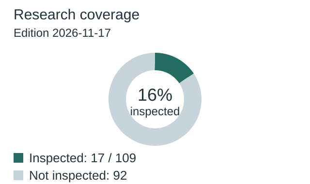
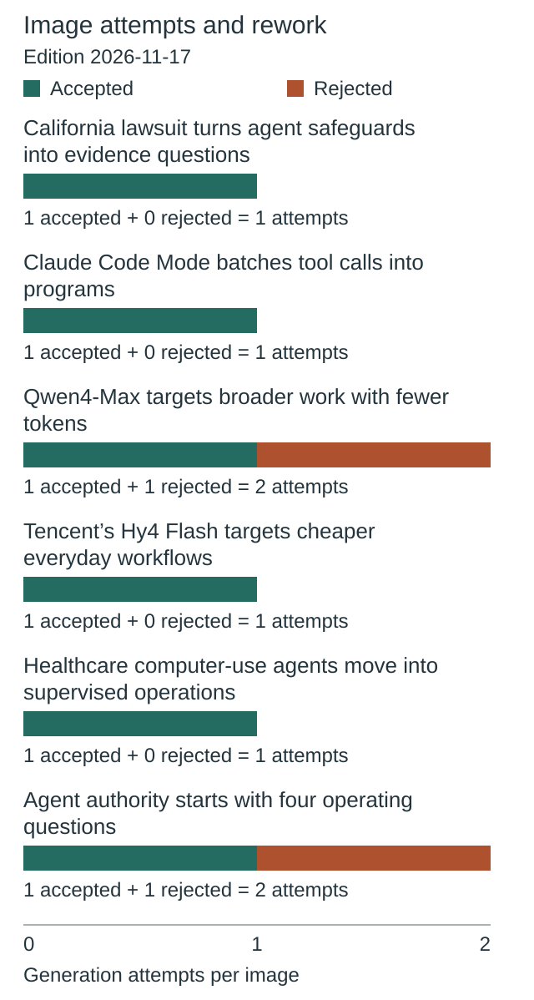
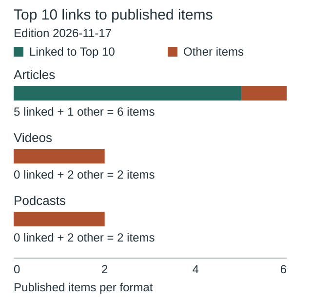
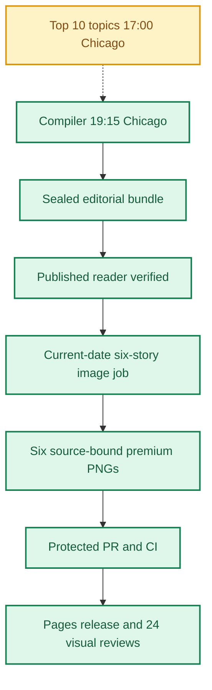
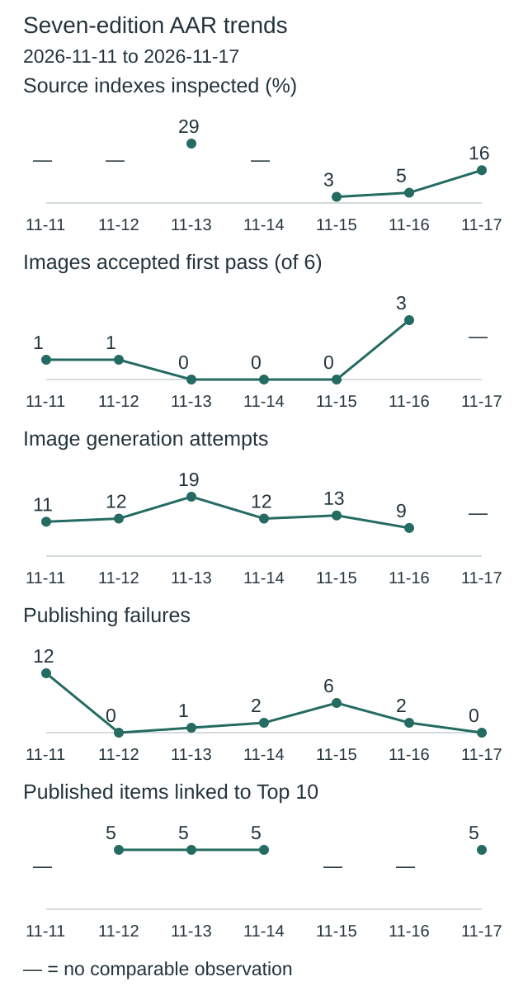
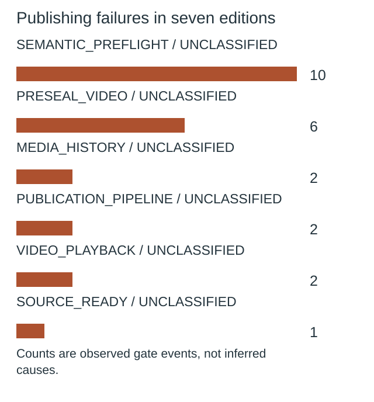
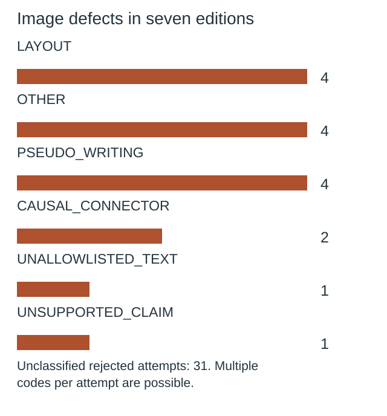

**🟩 RELEASE COMPLETE**
**TOP 10 PARTIAL** · **🟩 COMPILER VERIFIED** · **🟦 IMAGES 6/6 RELEASED** · **🟪 VISUAL QA 24/24 PASS**

# Daily AI Brief — Unified Production After-Action Report
**Edition:** November 17, 2026 · **Production evening:** 2026-11-16 · **Timezone:** America/Chicago
**Primary public reader:** [Open 2026-11-17 Brief](https://gttome.github.io/Daily-AI-Brief-Compiler/briefs/2026-11-17/) · **Repository:** [Daily-AI-Brief-Compiler](https://github.com/gttome/Daily-AI-Brief-Compiler)

> **IMPORTANT — VERIFIED PRODUCTION RESULT**
> **Executive release result: COMPLETE.** This is the single management-facing report covering Top 10 topic discovery, the editorial Compiler, published Brief and premium-image run. **Entire-system evidence: PARTIAL.** Top 10 report: **partial**; Compiler handoff: **RECEIVED_SNAPSHOT_BOUND**; guided searches: **RECEIPTS_OBSERVED**. Compiler public status: **VERIFIED**. Image release: **RELEASED_VERIFIED**. Direct 24-context visual quality: **24/24 PASS**. Autonomous completion: **UNPROVEN**. Missing evidence must not be promoted to a success claim.

**🕒 Production stage durations:** **Top 10 7m 05s** · **Compiler final seal window 10m 44s** · **Premium Images 24m 08s** (evidence-bounded elapsed times; the start/end events differ).

## Evidence reconciliation

Compiler final seal window: 10m 44s. Compiler state start to public verification: 45m 44s. Observed execution and final seal windows are distinct.
Image capability route preflight: RECORDED; scheduler origin remains UNPROVEN.
Image efficiency: 4/6 first-pass accepts; 8 total attempts. Approved prospective efficiency target: at least 4/6 first-pass and no more than 8 total attempts, strictly advisory, with unchanged quality floor.
Image review completed: 2026-11-17T03:42:31Z; review-record commit: 2026-11-17T03:43:02.000Z; protected review merge: 2026-11-17T03:45:17.000Z.
Eligible source indexes: 109; editorial inspections reported: 17 (15.6%); inaccessible in editorial audit: 2; explicitly unreviewed IDs: 90; unclassified editorial IDs: 0. Automated index parsing is separate from editorial inspection and cannot substantiate exhaustive freshness claims.

Registered video sources: 29; attempted this edition: 29; unattempted: 0; enabled: 28; qualification-only: 1; sources yielding candidate URLs: 0. Status: REPORTED_ALL_ATTEMPTED. Attempt evidence is not automatic proof of source-content review or playback.

Eligible source partition **VALID**. Full original-item reads **1**. Bounded index searches **16**. Qualification-only sources recorded separately **1**.

### Protected preseal video outcomes

| Original publisher | Distinct programs submitted | Archive rejects | Playback passes | Playback unverified | Probes skipped |
|---|---:|---:|---:|---:|---:|
| abcnews.com | 1 | 0 | 0 | 1 | 0 |
| bloomberg.com | 1 | 0 | 0 | 1 | 0 |
| breakingviews.com | 1 | 0 | 0 | 1 | 0 |
| cbsnews.com | 1 | 0 | 2 | 0 | 0 |
| fortune.com | 1 | 0 | 2 | 0 | 0 |
| foxbusiness.com | 1 | 0 | 1 | 0 | 0 |
| youtube-channel:UC16niRr50-MSBwiO3YDb3RA | 1 | 0 | 0 | 1 | 0 |

Outcomes count observed checks across all saved requests. Programs can be submitted again after a different slot changes.

- Help wanted: AI firms court ex-spies as Nvidia drama shows security risks received PUBLIC_VIDEO_PLAYBACK_UNVERIFIED. [Original run](https://github.com/gttome/Daily-AI-Brief-Compiler/actions/runs/43996032327)
- AI Investors Brace for Data Center Restrictions received PUBLIC_VIDEO_PLAYBACK_UNVERIFIED. [Original run](https://github.com/gttome/Daily-AI-Brief-Compiler/actions/runs/43996032327)
- China's ‘AI wonderland’ has a hidden problem   BBC News received PUBLIC_VIDEO_PLAYBACK_UNVERIFIED. [Original run](https://github.com/gttome/Daily-AI-Brief-Compiler/actions/runs/43996032327)
- How one woman helped halt a $5 billion AI data center project received PUBLIC_VIDEO_PLAYBACK_UNVERIFIED. [Original run](https://github.com/gttome/Daily-AI-Brief-Compiler/actions/runs/43998135326)

## Daily AAR charts

These charts use this edition’s receipts. Missing data is not zero.

### Research coverage



**17 of 109 indexes inspected (16%).**

| Editorial inspection | Indexes |
|---|---:|
| Inspected | 17 |
| Not inspected | 92 |

Not inspected includes every index without a recorded editorial inspection; this is not proof of missed stories.

### Image attempts and rework



**8 attempts; 4 of 6 images accepted on their first attempt.**

Recorded ongoing from November 8 target: at least 3/6 first-pass accepts; no more than 2 attempts per image. This is an efficiency target, not a quality cutoff.

| Image | Accepted | Rejected | Total attempts |
|---|---:|---:|---:|
| California lawsuit turns agent safeguards into evidence questions | 1 | 0 | 1 |
| Claude Code Mode batches tool calls into programs | 1 | 0 | 1 |
| Qwen4-Max targets broader work with fewer tokens | 1 | 1 | 2 |
| Tencent’s Hy4 Flash targets cheaper everyday workflows | 1 | 0 | 1 |
| Healthcare computer-use agents move into supervised operations | 1 | 0 | 1 |
| Agent authority starts with four operating questions | 1 | 1 | 2 |

Generation attempts measure rework, not runtime or cost. Quality and publication checks remain separate.

### Top 10 links to published items



**5 of 10 unique published items link to Top 10 topics.**

| Format | Linked to Top 10 | Other items |
|---|---:|---:|
| Articles | 5 | 1 |
| Videos | 0 | 2 |
| Podcasts | 0 | 2 |

No selection quota. Topic linkage does not establish better quality, popularity or causal improvement.

[Chart data](charts.json)

One edition at a time. Missing evidence is not zero. Trend claims require comparable recorded cycles.

## Performance dashboard

| Measure | Recorded result | Source / caveat |
|:--|:--:|:--|
| Entire-system evidence | **PARTIAL** | Full Top 10 list, bound Compiler input, all-format search receipts and existing release checks; separate from publication and autonomy |
| Top 10 report | **partial · 10 topics** | Same Chicago cycle report; provisional/partial coverage remains disclosed |
| Top 10 received by Compiler | **RECEIVED_SNAPSHOT_BOUND** | Exact report snapshot bytes; consumed commit separately corroborated: YES |
| Top 10 guided article/video/podcast searches | **RECEIPTS_OBSERVED** | Actual source-search receipts and selected/rejected topic outcomes |
| Top 10 stage duration | **7m 05s** | Same-cycle run receipt only; no runtime or usage estimate |
| Editorial publication | **PASS** | State and public reader integrity receipt |
| **Unattended autonomy (separate from publication)** | **UNPROVEN** | Owner incident receipt takes precedence over unverified producer self-attestation |
| Recorded protected publishing gate failures | **0** | Actual same-edition GitHub failure sidecar only; earlier unrecorded failures remain unknown |
| Articles | **6** | Exactly 2 technical / 2 knowledge-worker / 2 agents required |
| Original scientific-paper-led articles | **0** | Rolling target: one qualified original paper in 3 editions; PRODUCER_REPORTED_BUNDLE_MATCH. Preprints are not peer-reviewed by default |
| Verified original sources within preceding 24 hours | **0 / 6** | Original publisher dates only; other sources require a documented fallback rationale |
| Distinct selected article publishers | **6** | Six different primary organizations preferred |
| Videos over seven days old | **1** | Must be labeled evergreen, not a new development |
| Distinct selected video publishers | **2** | One channel is one publisher even across multiple videos |
| Cross-media topic diversity | **FOUR_DISTINCT_EVENTS_REVIEW_RECORDED** | Four video/podcast events and six pairwise original-source comparisons; editorial claims remain producer-attested |
| Video discovery source attempts | **29 / 29** | Attempt evidence across enabled and qualification-only leads; REPORTED_ALL_ATTEMPTED. Not a claim of full content review or player verification | 
| Duplicate active Watchlist display titles | **Not recorded** | Published canonical Watchlist only; historical evidence retained |
| Original-release video playback (historical) | **TWO_PUBLISHED_VIDEOS_PLAYBACK_PASS** | Later reader corrections may replace these originally verified videos; see incident register | 
| Postpublication reader incidents | **NOT_RECORDED** | Edition-specific owner reports and corrective PRs, not inferred absence | 
| Verified postpublication video corrections | **NOT_RECORDED** | Incident register tracks correction PR, actual playback evidence and reader preservation |
| Editorial index second-pass attempts | **0** | Bounded public GET retries only; never proof of original article reading |
| Editorial index reads recovered | **0** | Successful page fetch can still yield zero eligible dated items |
| Recorded scheduler capability route | **UNPROVEN** | Same-invocation route receipt only; GitHub is not scheduler authentication |
| Avoidable incomplete-staging CI failures | **Not independently audited** | Existing image-package push CI is disabled; exact-head protected PR CI remains required. A failure count requires actual workflow evidence |
| Media | **2 videos + 2 podcasts** | Sealed bundle |
| **Compiler final seal window** | **10m 44s (10.7 min)** | Final sealed-state timestamp → verified public reader; initial execution is separate |
| **Image processing stage duration** | **24m 08s** | First accepted PNG Git checkpoint → final 24/24 review; auditable stage elapsed time |
| Image scheduled-to-final-review window | **Not independently recorded** | Only with a saved one-cycle schedule anchor; does not attest exact generation start |
| Executor-observed generation-to-final-review | **25m 53s** | Only if the worker recorded a same-execution clock before its first native call; not independently verified provider runtime |
| Accepted premium PNGs | **6 / 6** | Exact package and public release hashes |
| Native image generation attempts | **8** | Image worker AAR; no estimation |
| Rejected candidates | **2** | Image worker AAR |
| Final worker checkpoint reconciliation | **PASS** | Oct25+ verifies exact generation count, per-story attempts, six accepted story/image/hash bindings and final release |
| Saved visual contexts | **24 / 24 PASS** | Dated/permanent desktop/mobile review |
| Public SHA-256 checks | **44** | Image release receipt |
| October 8 immutable history | **17 / 17** | Independent content-preservation checks |
| **Owner-reported weekly Work usage for this run** | **Not reported** | No per-cycle usage supplied |

> **EFFICIENCY NOTE**
> **Resource reporting policy:** No usage figure was supplied for this cycle, so none is assumed. Future runs show **Not reported** unless the owner supplies new cycle-specific usage metadata. No approval or extra step is required to generate the AAR.

## Production architecture and checkpoints



## Daily AI Topic Top 10 and Compiler handoff

**Research cycle:** 2026-11-16 · **Target Brief:** 2026-11-17 · **Scheduled start:** 17:00 America/Chicago

| Dimension | Recorded evidence |
|---|---|
| Run/report result | PARTIAL |
| Report status / topics | partial / 10 |
| Freshness | FRESH\_AT\_CONSUMPTION |
| Compiler handoff | RECEIVED\_SNAPSHOT\_BOUND |
| Search coverage | RECEIPTS\_OBSERVED |
| Selection mapping verification | MATCHES\_EDITION\_BUNDLE |
| Observed start / finish | 2026-11-16T23:00:26Z / 2026-11-16T23:07:31Z |
| Elapsed minutes | 7.08 |
| Usage percent | Not reported |
| Cost USD | Not reported |
| Independent scheduler autonomy | UNPROVEN |
| Compiler-recorded consumed commit | 04c0b557e2cd8f5afa8b77b6b6d68c9280dac742 |
| Report SHA-256 | 7e88ea5c8d43a2ffcb761c19c820c5049d3e6c5cfd154bd7f4305faaf92d7c47 |

| Discovery order | AI topic | Summary | Confidence | Evidence |
|---:|---|---|---|---|
| 1 | Alibaba releases Qwen4-Max | Alibaba introduced a flagship multimodal model with a one-million-token context window. | medium | [Source](https://www.youtube.com/watch?v=5vPXJiy83Sg) · [Source](https://x.com/Alibaba_Qwen/status/2122148127520289151) · [Source](https://www.alibabacloud.com/en/press-room/alibaba-unveils-qwen4-max?_p_lc=1) |
| 2 | California sues OpenAI over alleged failures in cyber testing | California alleges inadequate safeguards for experimental cyber agents and is asking a court to order changes. | medium | [Source](https://www.reddit.com/r/news/comments/1xxyl2o/california_sues_chatgpt_maker_openai_over_rogue/) · [Source](https://www.reddit.com/r/wallstreetbets/comments/1xxxqc8/california_is_suing_openai_over_automated_hacking/) · [Source](https://oag.ca.gov/system/files/attachments/press-docs/complaint-oai-cyber.pdf) · [Source](https://apnews.com/article/1dd7be56134b4f09fb2fb974803edc69) · [Source](https://www.reuters.com/business/california-sues-openai-over-ai-models-cyberattacks-hugging-face-other-companies-2026-11-16/) |
| 3 | Lauren Tan’s code-verification talk gains another 218K reported views | The talk describes using lint rules, tests and stronger verification to handle agent-generated changes. | medium | [Source](https://www.youtube.com/watch?v=O_zcc6Xl12g) · [Source](https://ai.engineer/code/2026/talks/lauren-tan) |
| 4 | Physicist describes AI assistance on a lattice Standard Model preprint | Nathaniel Craig described AI assistance on a mathematical construction related to simulating chiral fermions on a lattice. | medium | [Source](https://x.com/OpenAI/status/2122123437141553630) · [Source](https://openai.com/index/step-toward-defining-the-standard-model/) · [Source](https://arxiv.org/html/2610.09093v1) |
| 5 | Tencent launches Hy4 flash for routine work | Tencent positioned Hy4 flash as a lower-cost option for jobs such as document and spreadsheet work. | medium | [Source](https://x.com/TencentHunyuan/status/2122217770314301469) · [Source](https://www.tencent.com/tencent-launches-hy4-flash-to-power-high-speed-cost-efficient-ai-deployment-for-everyday-workflows/) |
| 6 | Claude Code experiments with grouping tool calls in JavaScript | Code Mode lets Claude write JavaScript to sequence tool calls and filter their results within an opt-in mode. | medium | [Source](https://x.com/dani_avila7/status/2121789088499933223) · [Source](https://code.claude.com/docs/en/code-mode) |
| 7 | Anthropic’s proposed IPO draws fresh financial coverage | New interviews discuss what the proposed offering might reveal about enterprise demand and AI infrastructure costs. | medium | [Source](https://www.youtube.com/watch?v=3RqNnfgf8Lg) · [Source](https://www.youtube.com/watch?v=Rj-Yu4DhqZQ) · [Source](https://www.sec.gov/Archives/edgar/data/2130357/000162828026072484/0001628280-26-072484-index.htm) · [Source](https://www.wsj.com/livecoverage/stock-market-today-dow-sp-500-nasdaq-11-16-2026/card/watch-how-anthropic-s-ipo-reshapes-the-ai-investent-landscape-8Pt9ZbhC6pt8ZsBXBTa0) |
| 8 | A safeagents demo reaches 28K reported views | The demo shows how Hugging Face’s existing proxy can sit between coding agents and model requests. | medium | [Source](https://www.youtube.com/watch?v=GoG2-SSSU5k) · [Source](https://github.com/huggingface/safeagents) |
| 9 | CNN’s H200 procurement investigation sustains attention | CNN’s report on the alleged transfer of H200 chips is still drawing views after publication. | medium | [Source](https://www.youtube.com/watch?v=RX05VvDYqqI) · [Source](https://ctrlai.com/base/cnn-2026-11-13-nvidia-chips-blacklisted-chinese-buyer) |
| 10 | OpenAI expands computer-use agents for healthcare administration | OpenAI demonstrated a computer-use workflow for an MRI authorization using synthetic patient data and described partner deployments. | low | [Source](https://www.reddit.com/r/epyhia/comments/1xxry6u/openai_launches_computeruse_agents_for_healthcare/) · [Source](https://openai.com/index/advancing-computer-use-for-healthcare-teams/) · [Source](https://aims.stanford.edu/measurement-db/healthadminbench) · [Source](https://tsnmedia.org/openai-computer-use-healthcare-agents/) |

**Sample scope:** {"metadata\_screened\_videos":48,"unique\_videos":48,"distinct\_retained\_channels":33,"combined\_observation\_records":49,"combined\_unique\_video\_ids":48,"full\_video\_reviews":0,"videos\_watched":0,"direct\_counter\_verifications":0,"direct\_youtube\_counter\_verifications":0,"transcript\_reviews":0,"partial\_original\_publisher\_transcript\_reviews":1,"original\_publisher\_show\_notes\_reviews":1,"original\_podcast\_episode\_synopses\_reviewed":1,"original\_watch\_attempts":48,"comparable\_video\_observations":6,"within\_24h\_reported\_publications":2,"additional\_within\_72h\_reported\_publications":12,"additional\_within\_7d\_reported\_publications":1,"date\_only\_video\_publications":33,"unknown\_video\_publication\_dates":0,"full\_video\_review\_target\_met":false,"original\_watch\_outcomes":{"throttled":45,"title\_index\_shell":3},"freshness\_reference\_at":"2026-11-16T23:06:15Z","notes":"Screened 24h then widened to 72h and seven days. Date-only records excluded from hourly bins.","substantive\_original\_event\_document\_reviews":15}. **Ranking basis:** {"attention":"Event-matched video metadata, matched rounded time series, independently attributable corroboration and bounded public discussion.","limitations":"Program counts cover entire videos; platform measures and unknown clocks cannot be combined."}.

| Search format | Receipt rows | Attempts recorded | Explicitly not attempted |
|---|---:|---:|---:|
| article | 10 | 10 | 0 |
| video | 10 | 10 | 0 |
| podcast | 10 | 10 | 0 |

**Selected Brief items linked to trends:**

| Topic | Format | Selected item | Reason |
|---|---|---|---|
| qwen4-max-release-nov16 | article | nov17-k1-qwen4-max · [Source](https://www.alibabacloud.com/en/press-room/alibaba-unveils-qwen4-max?_p_lc=1) | Exact event match with complete original announcement review. |
| california-openai-cyber-complaint-nov16 | article | nov17-t1-ca-agent-controls · [Source](https://oag.ca.gov/news/press-releases/it%E2%80%99s-golden-state-not-wild-west-attorney-general-bonta-sues-openai-over) | Exact event match with complete primary government release review. |
| tencent-hy4-flash-launch-nov16 | article | nov17-k2-hy4-flash · [Source](https://www.tencent.com/tencent-launches-hy4-flash-to-power-high-speed-cost-efficient-ai-deployment-for-everyday-workflows/) | Exact event match with complete original release and benchmark-scope review. |
| claude-code-code-mode-21325-nov13 | article | nov17-t2-code-mode · [Source](https://github.com/anthropics/claude-code/releases/tag/v2.1.323) | Exact release match with official release note and complete documentation review. |
| openai-computer-use-healthcare-nov16 | article | nov17-a1-healthcare-computer-use · [Source](https://openai.com/index/advancing-computer-use-for-healthcare-teams/) | Exact event match with complete original healthcare workflow article review. |

**Gaps and limitations:**

- The report labels its research partial.
- No full video playback, full transcript review or direct YouTube counters were verified.
- Some metrics came from untimed or rounded trackers and indexed community displays. The sample does not support an exact popularity order.
- The current episode leads have bounded source material; signed-out playback and originality need independent verification.
- Compiler actual attempts, missing slots, candidate yield and selected impact remain independently unobserved.

**Recorded run issues:**

- {"issue":"45 distinct YouTube routes throttled. Three returned title-only shells.","effect":"Zero full playbacks and direct counters verified.","correction":"Kept program access distinct from original organizer transcript excerpts, publisher synopsis and related event documents."}
- {"issue":"X direct routes were unavailable, and some Reddit and tracker metrics had no clock.","effect":"Limited direct counter and cross-platform comparison scope.","correction":"Used attributed counters and null clocks only; six matched same-tracker observations were compared."}
- {"issue":"The most recent eligible edition had invalid search and selected mapping receipts despite a verified source snapshot.","effect":"No downstream incremental yield or allocation effect can be established from the prior receipt.","correction":"Validated ten stable event identities, 30 unique topic-format query strings, exact bytes and independent digest readback. Current downstream evidence is pending."}

**Recorded improvements:**

- {"change":"Prepared ten stable event IDs and 30 unique topic-format queries, then checked source bytes and binding fields.","reason":"Prior AAR recorded an exact bound snapshot, with invalid search and mapping receipts.","expected\_effect":"Allow canonical slot reconstruction and distinguish producer input from downstream attempts.","status":"implemented"}
- {"change":"Sought first-party event and program materials across research, business and software stories.","reason":"Prior AAR had a limited sample of original media content and full playback remained unverified.","expected\_effect":"Improve verifiable story depth and identify separately qualified candidate programs.","status":"implemented"}

### Daily improvement and effect on the Brief

**Fixed baseline:** nov03-2026-v1 / INPUT\_FROZEN. **Outcome baseline:** FROZEN\_AFTER\_VERIFIED\_PUBLICATION. **Prior cycle:** 2026-11-15.

| Input measure | Current | November 3 baseline | Change from baseline | Change from prior cycle |
|---|---:|---:|---:|---:|
| topic count | 10 | 10 | 0 | 0 |
| validation resource count | Not reported | 14 | Not reported | Not reported |
| additional video metadata records | Not reported | 63 | Not reported | Not reported |
| additional video channels | Not reported | 21 | Not reported | Not reported |
| total video observations | 49 | 79 | -30 | -6 |
| unique videos | 48 | 71 | -23 | -4 |
| full video reviews | 0 | 0 | 0 | 0 |
| direct youtube counter verifications | 0 | 0 | 0 | 0 |
| broader evidence band topics | 2 | 3 | -1 | 0 |
| limited evidence band topics | 8 | 7 | 1 | 0 |

**Observed downstream measurements:** OBSERVED.

| Outcome measure | Current | Change from frozen outcome | Change from prior cycle |
|---|---:|---:|---:|
| expected topic format pairs | 30 | 0 | Not reported |
| attempted topic format pairs | 30 | 0 | Not reported |
| explicitly unattempted pairs | 0 | 0 | Not reported |
| discovered candidate count | 15 | -25 | Not reported |
| searched source host count | 17 | 1 | Not reported |
| selected article count | 5 | 2 | Not reported |
| selected video count | 0 | 0 | Not reported |
| selected podcast count | 0 | -1 | Not reported |

**Source changes:** {"added":\[\],"removed":\[\]}.

**Candidate review depth:** NOT\_RECORDED.

| Review measure | Current | Change from prior comparable cycle |
|---|---:|---:|
| reviewed candidate count | Not reported | Not reported |
| qualified candidate count | Not reported | Not reported |
| rejected candidate count | Not reported | Not reported |
| metadata only count | Not reported | Not reported |
| full video reviews | Not reported | Not reported |
| transcript reviews | Not reported | Not reported |

The frozen November 3 baseline has no candidate-level review ledger; no retrospective value is invented. Recorded reviews do not independently establish content quality, audience interest or causal benefit.

**Method/resource review:** {"baseline\_id":"nov03-2026-v1","previous\_report\_date":"2026-11-15","previous\_method\_version":"2026-11-03.2-event-review","method\_version":"2026-11-03.2-event-review","feedback":{"aar\_url":"https://github.com/gttome/Daily-AI-Brief-Compiler/blob/82843842d72343124b01fec1fd0f6003fa7474de/daily/2026-11-15/combined.md","charts\_url":"https://github.com/gttome/Daily-AI-Brief-Compiler/blob/82843842d72343124b01fec1fd0f6003fa7474de/daily/2026-11-15/charts.json","metrics\_url":"https://github.com/gttome/Daily-AI-Brief-Compiler/blob/82843842d72343124b01fec1fd0f6003fa7474de/daily/2026-11-15/improvement-metrics.json","observation":"November 16 unified AAR verified the source snapshot binding. Search and selection mappings were invalid; the selection chart is NOT\_RECORDED. Nine image attempts and three first-pass accepts were observed separately. Successful publication does not establish scheduled autonomy."},"changes":\[{"change":"Prepared ten stable event IDs and 30 unique topic-format queries, then checked source bytes and binding fields.","reason":"Prior AAR recorded an exact bound snapshot, with invalid search and mapping receipts.","expected\_effect":"Allow canonical slot reconstruction and distinguish producer input from downstream attempts."},{"change":"Sought first-party event and program materials across research, business and software stories.","reason":"Prior AAR had a limited sample of original media content and full playback remained unverified.","expected\_effect":"Improve verifiable story depth and identify separately qualified candidate programs."}\],"resource\_candidates":\[{"url":"https://aims.stanford.edu/measurement-db/healthadminbench","role":"Original independent benchmark reference for healthcare computer-use release","access":"Public original Stanford database and research group page","review\_scope":"Task scope and benchmark documentation, no independent rerun","independence":"Original benchmark group, distinct from OpenAI deployment announcement","decision":"accepted","reason":"Clarifies exactly which administrative tasks the tests cover.","contribution":"Separates benchmarked administrative performance from clinical outcomes."},{"url":"https://arxiv.org/html/2610.09093v1","role":"Original lattice chiral fermions manuscript","access":"Public arXiv HTML","review\_scope":"Abstract and selected scope/method language, no mathematical replication","independence":"Same research author discussed in vendor blog; strengthens claim scope without adding attention breadth.","decision":"accepted","reason":"Exact identity of the preprint discussed by Craig.","contribution":"Separates candidate construction from claims that the complete Standard Model is finished."}\],"observed\_effects":\[{"observation":"48 video metadata screens and 6 comparable tracker pairs, versus 52 and 1 previously.","effect":"Comparable item-level accumulations, with rounding and no inferred current velocity."},{"observation":"Four original evidence scopes represented complaint, manuscript, benchmark and organizer transcript excerpts.","effect":"Greater claim specificity for those topics. Incremental downstream yield remains unknown."}\],"next\_improvement":"Reconcile honest attempted/missing canonical slots and bundle matches once independent receipts are available.","limitations":\["November 10 pilot does not apply.","NOV16-P0-01 and NOV16-P1-09 are prospective; no downstream proof for this edition is yet observed."\],"change\_evaluations":\[{"change\_id":"AAR-10","reviewed\_edition":"2026-11-16","decision":"keep","result":"met","reason":"Latest reconciled metrics accepted all ten publisher-family reviews and recorded ten weaker topics.","evidence\_refs":\["https://github.com/gttome/Daily-AI-Brief-Compiler/blob/82843842d72343124b01fec1fd0f6003fa7474de/daily/2026-11-15/improvement-metrics.json"\]},{"change\_id":"NOV15-02","reviewed\_edition":"2026-11-16","decision":"keep","result":"not\_met","reason":"Latest eligible edition verified the snapshot but reported invalid searches and mappings. Current-cycle follow-up remains pending.","evidence\_refs":\["https://github.com/gttome/Daily-AI-Brief-Compiler/blob/82843842d72343124b01fec1fd0f6003fa7474de/daily/2026-11-15/combined.md","https://github.com/gttome/Daily-AI-Brief-Compiler/blob/82843842d72343124b01fec1fd0f6003fa7474de/daily/2026-11-15/charts.json"\]},{"change\_id":"NOV15-05","reviewed\_edition":"2026-11-16","decision":"keep","result":"inconclusive","reason":"Scheduler origin remained unproven in the earlier eligible edition. Producer receipt does not establish unattended release.","evidence\_refs":\["https://github.com/gttome/Daily-AI-Brief-Compiler/blob/82843842d72343124b01fec1fd0f6003fa7474de/daily/2026-11-15/combined.md"\]}\]}.

**Current reconciled conclusion:** OBSERVED; outcome baseline FROZEN\_AFTER\_VERIFIED\_PUBLICATION; candidate review ledger NOT\_RECORDED.

**Historical producer observations (not current status):** The following snapshot preserves what the producer reported at the time. Its pending statuses and candidate-quality claims are not independently reconciled conclusions. Use the current tables above for publication-bound measurements; an absent candidate review ledger remains unknown.

<details><summary>Original producer effects and gaps — historical snapshot</summary>

```json
{
  "observed_at": "2026-11-17T01:31:29.437Z",
  "source_additions": null,
  "useful_qualified_candidate_ids": [
    "CAND-ART-QWEN4-MAX",
    "VID-WORLDOFAI-QWEN4-MAX",
    "CAND-ART-CA-OAI-LAWSUIT",
    "CAND-ART-LAUREN-TAN",
    "VID-AIENGINEER-LAUREN-TAN",
    "CAND-ART-LATTICE-STANDARD-MODEL",
    "CAND-ART-HY4-FLASH",
    "CAND-ART-CLAUDE-CODE-MODE",
    "CAND-ART-ANTHROPIC-IPO",
    "VID-BLOOMBERG-ANTHROPIC-IPO",
    "POD-REUTERS-ANTHROPIC-TEST",
    "CAND-ART-SAFEAGENTS",
    "VID-BETTERSTACK-SAFEAGENTS",
    "CAND-ART-H200-PROCUREMENT",
    "CAND-ART-HEALTHCARE-COMPUTER-USE"
  ],
  "freshness_rejections": [
    "CAND-ART-LATTICE-STANDARD-MODEL"
  ],
  "duplicate_rejections": [
    "CAND-ART-LAUREN-TAN",
    "CAND-ART-H200-PROCUREMENT",
    "CAND-ART-SAFEAGENTS"
  ],
  "promotion_rejections": [],
  "gaps": [
    "Most exact podcast searches did not yield a current individually identified episode."
  ],
  "observed_timing_minutes": 12,
  "observed_cost_usd": 0,
  "source_links": [
    "https://www.youtube.com/watch?v=5vPXJiy83Sg",
    "https://x.com/Alibaba_Qwen/status/2122148127520289151",
    "https://www.alibabacloud.com/en/press-room/alibaba-unveils-qwen4-max?_p_lc=1",
    "https://www.reddit.com/r/news/comments/1xxyl2o/california_sues_chatgpt_maker_openai_over_rogue/",
    "https://www.reddit.com/r/wallstreetbets/comments/1xxxqc8/california_is_suing_openai_over_automated_hacking/",
    "https://oag.ca.gov/system/files/attachments/press-docs/complaint-oai-cyber.pdf",
    "https://apnews.com/article/1dd7be56134b4f09fb2fb974803edc69",
    "https://www.reuters.com/business/california-sues-openai-over-ai-models-cyberattacks-hugging-face-other-companies-2026-11-16/",
    "https://www.youtube.com/watch?v=O_zcc6Xl12g",
    "https://ai.engineer/code/2026/talks/lauren-tan",
    "https://x.com/OpenAI/status/2122123437141553630",
    "https://openai.com/index/step-toward-defining-the-standard-model/",
    "https://arxiv.org/html/2610.09093v1",
    "https://x.com/TencentHunyuan/status/2122217770314301469",
    "https://www.tencent.com/tencent-launches-hy4-flash-to-power-high-speed-cost-efficient-ai-deployment-for-everyday-workflows/",
    "https://x.com/dani_avila7/status/2121789088499933223",
    "https://code.claude.com/docs/en/code-mode",
    "https://www.youtube.com/watch?v=3RqNnfgf8Lg",
    "https://www.youtube.com/watch?v=Rj-Yu4DhqZQ",
    "https://www.sec.gov/Archives/edgar/data/2130357/000162828026072484/0001628280-26-072484-index.htm",
    "https://www.wsj.com/livecoverage/stock-market-today-dow-sp-500-nasdaq-11-16-2026/card/watch-how-anthropic-s-ipo-reshapes-the-ai-investent-landscape-8Pt9ZbhC6pt8ZsBXBTa0",
    "https://www.youtube.com/watch?v=GoG2-SSSU5k",
    "https://github.com/huggingface/safeagents",
    "https://www.youtube.com/watch?v=RX05VvDYqqI",
    "https://ctrlai.com/base/cnn-2026-11-13-nvidia-chips-blacklisted-chinese-buyer"
  ]
}
```

</details>

**Next improvement:** Reconcile honest attempted/missing canonical slots and bundle matches once independent receipts are available.

Counts show coverage and observed association, not audience popularity, source independence, candidate quality or causal uplift. Compare source/method changes before interpreting deltas. Unknown values are not zero. Publication, reader corrections, runtime and image outcomes retain their separate AAR evidence.

Report, source-readback and search receipts are separate observations. Snapshot binding verifies the collected report bytes; the consumed commit is independently corroborated only when the separately fetched source bytes match. These records do not independently attest scheduler identity or source truth. Top 10 reporting does not change Brief/image release status.


## Track 1 — Compiler

**State:** `SHADOW_VERIFIED` · **Bundle:** `BUNDLE_READY` · **Compiler final seal window:** 10m 44s (10.7 min).

| Publication gate | Result |
|---|:---:|
| Canonical reader build | ✅ |
| Reader parity | ✅ |
| Public verification of dated edition | ✅ |
| Previous editions preserved | ✅ |
| Permanent story routes and feeds | ✅ |

**Selected coverage:**

| Lane | Story |
|---|---|
| Technical AI Engineering | California lawsuit turns agent safeguards into evidence questions |
| Technical AI Engineering | Claude Code Mode batches tool calls into programs |
| Applied Generative AI for Knowledge Workers | Qwen4-Max targets broader work with fewer tokens |
| Applied Generative AI for Knowledge Workers | Tencent’s Hy4 Flash targets cheaper everyday workflows |
| Agents for Everyone | Healthcare computer-use agents move into supervised operations |
| Agents for Everyone | Agent authority starts with four operating questions |

### Scientific paper opportunity and publication evidence

**Current edition:** PRODUCER_REPORTED_BUNDLE_MATCH; **paper-led stories:** 0. Editorial target: at least one genuinely qualified original-paper-based story in seven editions, with methods, limitations, and an explicit preprint/peer-review distinction. No stale or weak paper is selected solely to fill a quota.


## Track 2 — Premium images

**Public status:** `RELEASED_VERIFIED` · **Saved images:** 6/6 · **Actual generation attempts:** 8 · **Rejected candidates:** 2.

### Image production duration — Git-verified milestones

**Auditable image stage duration:** **24m 08s** (first accepted binary saved in Git → first persisted 24-context quality-review record). **First asset to public image release:** **20m 26s**.
**Scheduled-to-final-review window:** **Not independently recorded**. This is a scheduled-clock comparison only when a separately recorded exact-date schedule exists; it is **not** measured native image-generation runtime.

| Production milestone | Chicago local time | Evidence |
|---|---|---|
| Scheduled image start (if exact-date record exists) | Not independently recorded | Time planned, not actual execution start |
| First executor-observed start | 9:11:36 PM | Worker self-attestation, not a first-party scheduler event |
| First native generation observation | 9:17:09 PM | Worker clock recorded immediately before first native call, not model-provider telemetry |
| First accepted PNG bytes saved to Git | 9:18:54 PM | Immutable binary-stage commit |
| Six-image package / reviews committed | 9:27:38 PM | Exact-head PR source commit |
| Protected package merged | 9:30:26 PM | Merge SHA and required CI |
| Public images verified | 9:39:20 PM | Image-release receipt |
| 24/24 review record committed | 9:43:02 PM | Immutable first review-approval commit |

> **Duration interpretation:** The audited stage excludes unobservable pre-checkpoint creative work. The scheduled-start window includes it but must not be interpreted as precise active processing time. Missing timestamps appear as **Not independently recorded**, never an estimate.


| Source-bound image | Attempts | File size | Public page |
|---|---:|---:|---|
| California lawsuit turns agent safeguards into evidence questions | 1 | 0.81 MiB | [View original](https://gttome.github.io/Daily-AI-Brief-Compiler/briefs/images/2026-11-17/dab-edition-2026-11-17-m01.png) |
| Claude Code Mode batches tool calls into programs | 1 | 0.43 MiB | [View original](https://gttome.github.io/Daily-AI-Brief-Compiler/briefs/images/2026-11-17/dab-edition-2026-11-17-m02.png) |
| Qwen4-Max targets broader work with fewer tokens | 2 | 0.61 MiB | [View original](https://gttome.github.io/Daily-AI-Brief-Compiler/briefs/images/2026-11-17/dab-edition-2026-11-17-m10.png) |
| Tencent’s Hy4 Flash targets cheaper everyday workflows | 1 | 0.96 MiB | [View original](https://gttome.github.io/Daily-AI-Brief-Compiler/briefs/images/2026-11-17/dab-edition-2026-11-17-m11.png) |
| Healthcare computer-use agents move into supervised operations | 1 | 0.80 MiB | [View original](https://gttome.github.io/Daily-AI-Brief-Compiler/briefs/images/2026-11-17/dab-edition-2026-11-17-m12.png) |
| Agent authority starts with four operating questions | 2 | 0.78 MiB | [View original](https://gttome.github.io/Daily-AI-Brief-Compiler/briefs/images/2026-11-17/dab-edition-2026-11-17-m14.png) |

**Immutable-release and visual gates:**

| Release gate | Result |
|---|:---:|
| Protected public image receipt | ✅ |
| Accepted-image Git hash bindings | ✅ |
| Six live PNGs | 6/6 |
| Dated/permanent story placements | 12/12 recorded in release evidence |
| Desktop/mobile visual inspection | 24/24 PASS |
| Historical Oct 8 integrity | 17/17 |

### Published premium illustrations

<table>
<tr><td width="50%"><a href="https://gttome.github.io/Daily-AI-Brief-Compiler/briefs/images/2026-11-17/dab-edition-2026-11-17-m01.png"></a><br/><b>California lawsuit turns agent safeguards into evidence questions</b></td><td width="50%"><a href="https://gttome.github.io/Daily-AI-Brief-Compiler/briefs/images/2026-11-17/dab-edition-2026-11-17-m02.png"></a><br/><b>Claude Code Mode batches tool calls into programs</b></td></tr>
<tr><td width="50%"><a href="https://gttome.github.io/Daily-AI-Brief-Compiler/briefs/images/2026-11-17/dab-edition-2026-11-17-m10.png"></a><br/><b>Qwen4-Max targets broader work with fewer tokens</b></td><td width="50%"><a href="https://gttome.github.io/Daily-AI-Brief-Compiler/briefs/images/2026-11-17/dab-edition-2026-11-17-m11.png"></a><br/><b>Tencent’s Hy4 Flash targets cheaper everyday workflows</b></td></tr>
<tr><td width="50%"><a href="https://gttome.github.io/Daily-AI-Brief-Compiler/briefs/images/2026-11-17/dab-edition-2026-11-17-m12.png"></a><br/><b>Healthcare computer-use agents move into supervised operations</b></td><td width="50%"><a href="https://gttome.github.io/Daily-AI-Brief-Compiler/briefs/images/2026-11-17/dab-edition-2026-11-17-m14.png"></a><br/><b>Agent authority starts with four operating questions</b></td></tr>
</table>

## Incidents, corrections and learning

### Postpublication reader incidents (updated when new evidence is merged)

No current-edition postpublication incident register was available; this is **NOT_RECORDED**, not a certification of zero incidents.


**Editor recovery classification:** UNPROVEN. **Owner intervention:** Unproven either way. **Protected same-edition failures recorded:** 0. 
**Latest failed protected stage:** Not in same-edition receipts; [Action evidence](https://github.com/gttome/Daily-AI-Brief-Compiler/actions). Exact stage durations are available only where real source timestamps exist.

| Stage | Verified issue | Corrective action |
|---|---|---|
| Native saved-pixel review | The lower left sample-to-workload arrow crosses the central vendor-test specimen and suggests buyer samples pass through a vendor test rather than a separate workload trial. | Keep the amber cobalt cut-paper composition and all four exact labels. Route the one arrow below the central vendor tray through clear white space, with the origin and target still on the sample holder and receiving slot. Keep the detached caveat below that path. Do not let the line touch the vendor evidence specimen, tray, or label. |
| Native saved-pixel review | The four function groups sit on four isolated pedestals and read as a two-by-two panel collage. The frozen visual direction calls for one radial inspection assembly. | Replace the four isolated pedestals with one continuous open diamond-shaped inspection frame supporting all four lenses around a single empty center. Use one connected assembly, no individual frames or panels. Place the exact four labels on the outside of the shared arrangement, and retain the blank green monitor-to-audit strip with exactly one leftward connector. Preserve the mulberry-green woodcut, exact fifth caveat, and generous edge whitespace. No wheel or radial arrows, and no invented controls or gears. |
| Independent Pages readback | GitHub returned HTTP 503 during the October 8 archive audit after Pages had deployed the six accepted images. The existing job retry then correctly rejected the already replaced placeholders. | Independently matched all 44 protected live byte checks to the original release artifact. Protected PR 378 resumed verification from that exact live deployment and synchronized the release metadata without replacing the illustrations. |

> **OPERATIONAL NOTE**
> This report distinguishes a published and verified production outcome from scheduler metadata exposed to another conversation. Lack of a live host heartbeat in a separate normal chat is not a Compiler production failure.

## Usage and cost stewardship

| Item | Per-cycle value |
|---|---|
| **Weekly Work usage reported by owner** | **Not reported** |
| Internal weekly usage reference | Target under 5% |
| Genuine image-generation attempts | 8 |
| Accepted diagrams | 6 |
| Regeneration after acceptance | 0 |
| Top 10 reported usage | Not reported |
| Top 10 reported cost | Not reported |
| Account-level billing telemetry | Not independently accessible to deterministic GitHub reporting |

**Future reporting rule:** For cycles without an optional owner-usage record, publish the complete AAR with `Not reported`; do not reuse prior percentages, guess remaining weekly credits or delay tomorrow's production.

## Next-edition operating handoff

| Control | Recurring contract |
|---|---|
| AI Topic Top 10 | Sole report task · 17:00 America/Chicago · saved dated list guides same-evening research |
| Primary Compiler | Sole existing task · 19:15 America/Chicago |
| Premium image production | Sole existing task · standard 21:15 America/Chicago |
| Exact image job selection | Newly published next-date `PUBLISHED_PENDING` only |
| AAR | Combined report generated automatically from new GitHub receipts |
| Optional Work usage | Owner-supplied per cycle, otherwise `Not reported` |

> **SCHEDULE RESTORATION NOTE**
> A temporary scheduling exception must be explicitly restored before claiming standard-time readiness. This deterministic document generator reads existing state only; it does not modify production schedules.

## Evidence register

| Evidence | Link |
|---|---|
| Compiler state | [Open receipt](https://github.com/gttome/Daily-AI-Brief-Compiler/blob/shadow/2026-11-17/shadow-runs/2026-11-17/compiler-state.json) |
| Compiler compile receipt | [Open receipt](https://github.com/gttome/Daily-AI-Brief-Compiler/blob/shadow/2026-11-17/shadow-runs/2026-11-17/compiler/compile-receipt.json) |
| Compiler public integrity | [Open receipt](https://github.com/gttome/Daily-AI-Brief-Compiler/blob/shadow/2026-11-17/shadow-runs/2026-11-17/compiler/postpublish-integrity.json) |
| Image release receipt | [Open receipt](https://github.com/gttome/Daily-AI-Brief-Compiler/blob/shadow-pages-history/site/image-jobs/2026-11-17/release.json) |
| Image review | [Open receipt](https://github.com/gttome/Daily-AI-Brief-Compiler/blob/main/external-image-packages/2026-11-17/reviews/live/semantic-pixel-review.json) |
| Original image AAR | [Open receipt](https://github.com/gttome/Daily-AI-Brief-Compiler/blob/main/external-image-packages/2026-11-17/reviews/after-action.md) |
| Observed editorial index retries | [Open receipt](https://github.com/gttome/Daily-AI-Brief-Compiler/blob/shadow/2026-11-17/shadow-runs/2026-11-17/editorial/source-item-retries.json) |
| Scientific paper selection review | [Open receipt](https://github.com/gttome/Daily-AI-Brief-Compiler/blob/shadow/2026-11-17/shadow-runs/2026-11-17/editorial/scientific-paper-coverage.json) |
| Published player playback receipt | [Open receipt](https://github.com/gttome/Daily-AI-Brief-Compiler/blob/shadow/2026-11-17/shadow-runs/2026-11-17/compiler/postpublish-video-playback.json) |
| Top 10 ranked topic report | [Open receipt](https://github.com/gttome/Daily-AI-Brief-Compiler/blob/f38e954a3ebf96191140ab98f570ab0c5bc88e97/signals/ai-topic-top10/2026-11-16.json) |
| Top 10 run after-action receipt | [Open receipt](https://github.com/gttome/Daily-AI-Brief-Compiler/blob/f38e954a3ebf96191140ab98f570ab0c5bc88e97/signals/ai-topic-top10/2026-11-16.aar.json) |
| Compiler Top 10 input snapshot | [Open receipt](https://github.com/gttome/Daily-AI-Brief-Compiler/blob/shadow/2026-11-17/shadow-runs/2026-11-17/editorial/trend-input.json) |
| Top 10 article/video/podcast search coverage | [Open receipt](https://github.com/gttome/Daily-AI-Brief-Compiler/blob/shadow/2026-11-17/shadow-runs/2026-11-17/editorial/trend-search-coverage.json) |

**Image workflow:** [Workflow evidence](https://github.com/gttome/Daily-AI-Brief-Compiler/actions/runs/44011648664).

---

*Generated deterministically from cycle- and edition-specific GitHub records. The report combines the Top 10 discovery priorities, its Compiler handoff and searches, the published Brief, and the image run; original research, Compiler, image, hash, and review receipts remain immutable. This reporting action creates no stories, images, releases, extra AI tasks, or schedule changes.*

<!-- continuous-improvement:start -->
## Continuous improvement review

Edition **2026-11-17**. Measurements use 7/7 recorded editions in this window. Missing data stays **Not recorded**.

### Daily corrective-action review

**2 evidence-based findings**; open production blockers: 0. Cumulative evaluation checkpoint: **2026-11-17**. The daily review never waits for that date to act on a safe live problem.

| Priority | Observed issue | Existing owner / next correction | When |
|---|---|---|---|
| P1 | 2 rejected image candidates preceded the verified six-image release. | Images: Inspect saved rejection evidence and apply source-specific geometry, causal-arrow and label corrections before the next native generation. | Next genuine run |
| P2 | Publication success does not independently attest the originating scheduler. | Compiler / Recovery: Capture real first-party scheduler and execution evidence if available; do not convert unknown provenance into a failure or a success. | Next genuine run |

Findings are observational and do not claim a repair was executed by the reporter.

### Approved change evaluations

| Change | Evaluate by | Outcome status | Latest decision |
|---|---|---|---|
| NOV03-01 — Earlier publication checks and precise recovery | 2026-11-11 | REVIEWED | revise |
| NOV03-02 — Broader genuine source review | 2026-11-11 | REVIEWED | revise |
| NOV03-03 — Source-bound image rejection lessons | 2026-11-11 | REVIEWED | revise |
| NOV03-04 — Substantive Top 10 review evidence | 2026-11-11 | REVIEWED | keep |
| AAR-01 — Current conclusions separated from historical claims | 2026-11-11 | REVIEWED | keep |
| AAR-02 — Consolidated current task contracts | 2026-11-11 | REVIEWED | keep |
| AAR-03 — Dated improvement evaluations | 2026-11-11 | REVIEWED | keep |
| AAR-04 — Seven-edition trend charts | 2026-11-11 | REVIEWED | keep |
| AAR-05 — Recurring publication failure causes | 2026-11-11 | REVIEWED | revise |
| AAR-06 — Recovery interval reporting | 2026-11-11 | REVIEWED | revise |
| AAR-07 — Source inspection history | 2026-11-11 | REVIEWED | revise |
| AAR-08 — Rolling source contribution | 2026-11-11 | REVIEWED | revise |
| AAR-09 — Recurring image defect categories | 2026-11-11 | REVIEWED | keep |
| AAR-10 — Top 10 publisher-family sensitivity | 2026-11-11 | REVIEWED | keep |
| NOV15-01 — Six premium images must not share an editorial template | 2026-11-17 | REVIEWED | keep |
| NOV15-02 — Exact Top 10 handoff and three-format search use | 2026-11-17 | REVIEWED | keep |
| NOV15-03 — Original failed protected gate causes and early prevention | 2026-11-17 | REVIEWED | keep |
| NOV15-04 — Improve image first-pass acceptance without weakening quality | 2026-11-17 | REVIEWED | keep |
| NOV15-05 — Independently attest unattended scheduler-to-release autonomy | 2026-11-17 | REVIEWED | keep |
| NOV16-P0-01 — Exact Top 10 event-format search receipts | 2026-11-18 | PENDING | Not recorded |
| NOV16-P0-02 — Substantive source inspections before selection lock | 2026-11-19 | PENDING | Not recorded |
| NOV16-P0-03 — Outside-family playable video sourcing | 2026-11-19 | PENDING | Not recorded |
| NOV16-P0-04 — Unified AAR packaging regression coverage | 2026-11-22 | PENDING | Not recorded |
| NOV16-P1-05 — Fresh-first original article discovery | 2026-11-20 | PENDING | Not recorded |
| NOV16-P1-06 — Classify and reduce failing source indexes | 2026-11-20 | PENDING | Not recorded |
| NOV16-P1-07 — Image first-pass yield and visual differentiation | 2026-11-20 | PENDING | Not recorded |
| NOV16-P1-08 — Exact video identity with punctuation-only normalization | 2026-11-18 | PENDING | Not recorded |
| NOV16-P1-09 — Attributable Top 10 incremental research yield | 2026-11-20 | PENDING | Not recorded |
| NOV16-P1-10 — Three-edition original paper priority and vendor attribution | 2026-11-20 | PENDING | Not recorded |
| NOV16-P1-11 — Verify unattended scheduler provenance without self-attestation | 2026-11-20 | PENDING | Not recorded |
| NOV16-P2-12 — Seven-edition improvement decision dashboard | 2026-11-23 | PENDING | Not recorded |
| IMG19-01 — Useful internal detail | 2026-11-22 | NOT_YET_EFFECTIVE | Not recorded |
| IMG19-02 — Distinct visual identity | 2026-11-22 | NOT_YET_EFFECTIVE | Not recorded |
| IMG19-03 — Novelty across days | 2026-11-22 | NOT_YET_EFFECTIVE | Not recorded |
| IMG19-04 — Better first-attempt yield | 2026-11-22 | NOT_YET_EFFECTIVE | Not recorded |
| IMG19-05 — Margins and legibility | 2026-11-22 | NOT_YET_EFFECTIVE | Not recorded |
| IMG19-06 — Reliable reporting | 2026-11-22 | NOT_YET_EFFECTIVE | Not recorded |
| IMG19-07 — Evidence of artistic improvement | 2026-11-22 | NOT_YET_EFFECTIVE | Not recorded |
| IMG19-08 — Reusable learning without repeated shells | 2026-11-22 | NOT_YET_EFFECTIVE | Not recorded |
| NOV20-01 — Canonical Top 10 search and selected-candidate association | 2026-11-24 | NOT_YET_EFFECTIVE | Not recorded |
| NOV20-02 — Original source date and citation metadata | 2026-11-24 | NOT_YET_EFFECTIVE | Not recorded |
| NOV20-03 — Truthful runtime policy reconciliation | 2026-11-24 | NOT_YET_EFFECTIVE | Not recorded |
| NOV20-04 — More substantive preselection source reads | 2026-11-24 | NOT_YET_EFFECTIVE | Not recorded |
| NOV20-05 — Broader non-news video discovery | 2026-11-24 | NOT_YET_EFFECTIVE | Not recorded |
| NOV20-06 — First-pass image geometry and connector planning | 2026-11-24 | NOT_YET_EFFECTIVE | Not recorded |
| NOV20-07 — Watchlist score and corroboration retention | 2026-11-24 | NOT_YET_EFFECTIVE | Not recorded |
| NOV20-08 — Specific newer lane alternatives | 2026-11-24 | NOT_YET_EFFECTIVE | Not recorded |
| NOV20-09 — Original-paper review and three-edition cadence | 2026-11-24 | NOT_YET_EFFECTIVE | Not recorded |
| NOV20-10 — Separate completion and evidence statuses | 2026-11-24 | NOT_YET_EFFECTIVE | Not recorded |
| NOV20-11 — Neutral AI video coverage badges | 2026-11-24 | NOT_YET_EFFECTIVE | Not recorded |
| NOV20-12 — Continue existing IMG19 evaluation | 2026-11-22 | NOT_YET_EFFECTIVE | Not recorded |
| NOV25-P0-01 — Count visible layout families at planning and thumbnail review | 2026-12-02 | NOT_YET_EFFECTIVE | Not recorded |
| NOV25-P0-02 — Compare actual layouts across recent verified editions | 2026-12-02 | NOT_YET_EFFECTIVE | Not recorded |
| NOV25-P0-03 — Report layout decisions and independent live QA separately | 2026-12-02 | NOT_YET_EFFECTIVE | Not recorded |
| NOV25-P1-01 — Bind observed silhouettes and prior comparisons to exact pixels | 2026-12-02 | NOT_YET_EFFECTIVE | Not recorded |
| NOV25-P1-02 — Record attempt-scoped Pages artifact visibility and missing-artifact failures | 2026-12-02 | NOT_YET_EFFECTIVE | Not recorded |
| NOV25-P2-01 — Evaluate the first seven eligible image editions | 2026-12-02 | NOT_YET_EFFECTIVE | Not recorded |

Pending: 12; overdue: 0; reviewed: 19. Implemented controls await measured results; review decisions do not disable controls.

#### Reviews of production evidence

- **NOV03-01 · 2026-11-12 · not met.** Two media requests still required correction. The first had two stalled embeds and a certificate-date error. The second reached protected playback before two archived programs were disqualified. The edition recovered and published. [Evidence 1](https://github.com/gttome/Daily-AI-Brief-Compiler/blob/1d8c6be/shadow-runs/2026-11-12/editorial/preseal-video-receipt.json) · [Evidence 2](https://github.com/gttome/Daily-AI-Brief-Compiler/blob/shadow/2026-11-12/shadow-runs/2026-11-12/execution-milestones.json)
- **NOV03-02 · 2026-11-12 · inconclusive.** The raw audit recorded 34 inspected entries and 76 unreviewed for 109 eligible sources. It included qualification-only Zapier in the inspection entries. The audited breadth is unknown. Five distinct article publishers were recorded and zero articles had verified 24-hour timestamps. [Evidence 1](https://github.com/gttome/Daily-AI-Brief-Compiler/blob/shadow/2026-11-12/shadow-runs/2026-11-12/editorial/index-review.json) · [Evidence 2](https://github.com/gttome/Daily-AI-Brief-Compiler/blob/dac33c1e16f891121a0571a0a5e25d09b691bee5/daily/2026-11-11/combined.md)
- **AAR-01 · 2026-11-12 · met.** The reviewed closeout identified the live release and 24 visual checks as complete. It separately displayed partial research evidence and unproven autonomy. The original Top 10 snapshot retains its production-stage claims. [Evidence 1](https://github.com/gttome/Daily-AI-Brief-Compiler/blob/dac33c1e16f891121a0571a0a5e25d09b691bee5/daily/2026-11-11/combined.md) · [Evidence 2](https://github.com/gttome/Daily-AI-Brief-Compiler/blob/6e6911d0a393a3117160841950ecf3b2c3665777/signals/ai-topic-top10/2026-11-11.aar.json)
- **AAR-04 · 2026-11-12 · met.** The November 6–12 series included seven image-attempt observations and a median of 12. The chart marked missing coverage and selection observations as gaps and disclosed the registry change. [Evidence 1](https://github.com/gttome/Daily-AI-Brief-Compiler/blob/dac33c1e16f891121a0571a0a5e25d09b691bee5/daily/2026-11-11/improvement-metrics.json) · [Evidence 2](https://github.com/gttome/Daily-AI-Brief-Compiler/blob/dac33c1e16f891121a0571a0a5e25d09b691bee5/daily/2026-11-11/charts/seven-edition-trends.svg)
- **AAR-05 · 2026-11-12 · not met.** The November 12 failure chart counted zero failed workflow jobs while the candidate evidence showed a blocked probe and an archive rejection. The recurring-failure table still contains unclassified events. Preserve the original outcomes so these types remain visible. [Evidence 1](https://github.com/gttome/Daily-AI-Brief-Compiler/blob/dac33c1e16f891121a0571a0a5e25d09b691bee5/daily/2026-11-11/improvement-metrics.json) · [Evidence 2](https://github.com/gttome/Daily-AI-Brief-Compiler/blob/shadow/2026-11-12/shadow-runs/2026-11-12/execution-milestones.json)
- **AAR-06 · 2026-11-12 · inconclusive.** Compiler milestones preserve detection and subsequent state changes. The reconciled report has zero recovery incidents with all required clocks and exact references. Separate repair and verification intervals and unattended origin remain unproven. [Evidence 1](https://github.com/gttome/Daily-AI-Brief-Compiler/blob/shadow/2026-11-12/shadow-runs/2026-11-12/execution-milestones.json) · [Evidence 2](https://github.com/gttome/Daily-AI-Brief-Compiler/blob/dac33c1e16f891121a0571a0a5e25d09b691bee5/daily/2026-11-11/improvement-metrics.json)
- **AAR-07 · 2026-11-12 · not met.** The November 12 index audit failed to reconcile by eligible ID. The current cycle could not update certified inspection coverage from that partition. Review the actual source scopes and clocks with the enabled roster before selection. [Evidence 1](https://github.com/gttome/Daily-AI-Brief-Compiler/blob/shadow/2026-11-12/shadow-runs/2026-11-12/editorial/index-review.json) · [Evidence 2](https://github.com/gttome/Daily-AI-Brief-Compiler/blob/dac33c1e16f891121a0571a0a5e25d09b691bee5/daily/2026-11-11/improvement-metrics.json)
- **AAR-08 · 2026-11-12 · inconclusive.** Five published items had validated topic mappings. The rolling contribution table had no validated substantive candidate review rows attributed to registry IDs. The relative contribution of individual sources remains unknown. [Evidence 1](https://github.com/gttome/Daily-AI-Brief-Compiler/blob/shadow/2026-11-12/shadow-runs/2026-11-12/editorial/trend-search-coverage.json) · [Evidence 2](https://github.com/gttome/Daily-AI-Brief-Compiler/blob/dac33c1e16f891121a0571a0a5e25d09b691bee5/daily/2026-11-11/improvement-metrics.json)

### Seven-edition trends



| Edition | Coverage | First pass / 6 | Image attempts | Publishing failures | Top 10 links |
|---|---|---:|---:|---:|---:|
| 2026-11-11 | Not recorded | 1 | 11 | 12 | Not recorded |
| 2026-11-12 | Not recorded | 1 | 12 | 0 | 5 |
| 2026-11-13 | 32/109 (29%) | 0 | 19 | 1 | 5 |
| 2026-11-14 | Not recorded | 0 | 12 | 2 | 5 |
| 2026-11-15 | 3/109 (3%) | 0 | 13 | 6 | Not recorded |
| 2026-11-16 | 5/109 (5%) | 3 | 9 | 2 | Not recorded |
| 2026-11-17 | 17/109 (16%) | 4 | 8 | 0 | 5 |

| Measure | Recorded editions | Window median |
|---|---:|---:|
| coverage percent | 4 | 10.5 |
| first pass accepted | 7 | 1 |
| image attempts | 7 | 12 |
| top10 linked items | 4 | 5 |
| publication failures | 7 | 2 |

Recorded source-set identities are comparable in this window.

### Publishing failures by stage and recorded cause



| Stage | Recorded cause | Failures | Editions | Recurred | Delay median (seconds; documented samples only) |
|---|---|---:|---|---|---:|
| SEMANTIC_PREFLIGHT | UNCLASSIFIED | 10 | 2026-11-11 | No within observed window | Not recorded (0 samples) |
| PRESEAL_VIDEO | UNCLASSIFIED | 6 | 2026-11-11, 2026-11-14, 2026-11-15 | Yes | Not recorded (0 samples) |
| MEDIA_HISTORY | UNCLASSIFIED | 2 | 2026-11-11, 2026-11-15 | Yes | Not recorded (0 samples) |
| PUBLICATION_PIPELINE | UNCLASSIFIED | 2 | 2026-11-14, 2026-11-16 | Yes | Not recorded (0 samples) |
| VIDEO_PLAYBACK | UNCLASSIFIED | 2 | 2026-11-13, 2026-11-16 | Yes | Not recorded (0 samples) |
| SOURCE_READY | UNCLASSIFIED | 1 | 2026-11-15 | No within observed window | Not recorded (0 samples) |

Unclassified means the original gate is known but no structured cause review is recorded. Stage names do not establish root causes. No rows establish no failures only when the recorded receipt explicitly has none.

### Recovery intervals

| Recorded mode | Incidents | Detection seconds | Queue seconds | Repair seconds | Verification seconds | Total seconds |
|---|---:|---:|---:|---:|---:|---:|

**Not recorded:** no valid incident has all required timing and evidence references.

### Source inspection history

| Source | Last inspected edition | Editions since inspection |
|---|---|---:|
| acl-anthology | 2026-11-10 | 7 |
| anthropic | Not recorded | Not recorded |
| anthropic-news | 2026-11-17 | 0 |
| article-databricks-ai-research | 2026-11-17 | 0 |
| article-ibm-research-ai | 2026-11-17 | 0 |
| article-nvidia-technical-ai | Not recorded | Not recorded |
| arxiv-cs-ai | 2026-11-17 | 0 |
| arxiv-cs-cl | Not recorded | Not recorded |
| arxiv-cs-lg | Not recorded | Not recorded |
| berkeley-bair | Not recorded | Not recorded |
| deep-20261026-a01-google-research | 2026-11-17 | 0 |
| deep-20261026-a02-microsoft-ai | 2026-11-17 | 0 |
| deep-20261026-a03-nvidia-news | 2026-11-17 | 0 |
| deep-20261026-p01-lex | Not recorded | Not recorded |
| deep-20261026-p02-data-skeptic | Not recorded | Not recorded |
| deep-20261026-v01-two-minute-papers | 2026-11-13 | 4 |
| deepseek-news | Not recorded | Not recorded |
| directory-055badde01b32d19771532e7 | Not recorded | Not recorded |
| directory-06aa5423549ae7ab03534d6d | Not recorded | Not recorded |
| directory-0be5c22bd2fbf2c24835cdf8 | Not recorded | Not recorded |
| directory-0dffb60aadd4ba31b5c090dc | Not recorded | Not recorded |
| directory-1c6f5db2559c3c226a112873 | 2026-11-16 | 1 |
| directory-207b781e953be997d6f84c93 | Not recorded | Not recorded |
| directory-22bfce3172fd5a67ebfcdde4 | Not recorded | Not recorded |
| directory-242c2a2fc81a43d41f199129 | 2026-11-10 | 7 |
| directory-2f92b46f1e169255a4c25763 | Not recorded | Not recorded |
| directory-30c771704ce20d310317aee8 | Not recorded | Not recorded |
| directory-3834a0112c0e3a754320b557 | 2026-11-13 | 4 |
| directory-3c29ebc2d9cbcc9f11312e28 | Not recorded | Not recorded |
| directory-3c8435418a50bbe5096c415b | Not recorded | Not recorded |
| directory-3ccc18a956cae0b1e24b5968 | Not recorded | Not recorded |
| directory-3d9b47e80ca1f30e4b17fff2 | Not recorded | Not recorded |
| directory-411bf5f837e28f35220736eb | 2026-11-16 | 1 |
| directory-4852e367f74118ff2dc1eec9 | 2026-11-13 | 4 |
| directory-48665d874f6008894d0d9385 | 2026-11-13 | 4 |
| directory-4c16d138c4a736e78a68127e | 2026-11-13 | 4 |
| directory-54d90ff964a74ff98851ae11 | Not recorded | Not recorded |
| directory-581aeefb9198185f59bfc7df | Not recorded | Not recorded |
| directory-5c5d3d02a420135949164552 | 2026-11-13 | 4 |
| directory-5e90c3904ae9e6147f058897 | Not recorded | Not recorded |
| directory-64b811560a52e317d4a76b1f | Not recorded | Not recorded |
| directory-64f0886a6793aa8858a4b62d | Not recorded | Not recorded |
| directory-6bb864602986d830dee61c52 | Not recorded | Not recorded |
| directory-6e0e32e58ba2e488ad8c4c61 | Not recorded | Not recorded |
| directory-6ea6e283349c7b62ac1ced9d | Not recorded | Not recorded |
| directory-6fc2c16051b6c5876b5c143e | Not recorded | Not recorded |
| directory-76ddf221aa9a485fd35e51d6 | Not recorded | Not recorded |
| directory-79e16cd5beb5c662c4022a9f | 2026-11-13 | 4 |
| directory-7f3807ea3e16f9a7ad5c1e52 | Not recorded | Not recorded |
| directory-8263ca4c9f560c8d9c4df0de | 2026-11-13 | 4 |
| directory-85ee8e554a07476bacde4af4 | Not recorded | Not recorded |
| directory-86ca1c8904dd91903440c2a9 | Not recorded | Not recorded |
| directory-88944f584a55367d3844df62 | Not recorded | Not recorded |
| directory-89818f9d7e6b4cd85a2537d5 | Not recorded | Not recorded |
| directory-8b0eaafedc559312fb655fc6 | Not recorded | Not recorded |
| directory-8df3614a9972a25fc59475ed | 2026-11-07 | 10 |
| directory-8ec4fd458a38bc0447f4cded | Not recorded | Not recorded |
| directory-8f73fa03dd8761b82ed67771 | Not recorded | Not recorded |
| directory-8ff038a44faf8336fd28b74b | Not recorded | Not recorded |
| directory-935fbe5ba89ff5f91fc8c69b | 2026-11-15 | 2 |
| directory-970506fbc577e6091a33c64d | 2026-11-13 | 4 |
| directory-985e561bc559a1cd2b93119f | Not recorded | Not recorded |
| directory-9ad7c274f2d56274bcd5ddcc | Not recorded | Not recorded |
| directory-9c0885bdb370f69c9262b88c | 2026-11-07 | 10 |
| directory-9d99ff8f4466a1f65bfc4917 | Not recorded | Not recorded |
| directory-9daf9da90f479955fe3e7700 | Not recorded | Not recorded |
| directory-9f7087ce2c030a4b9da58499 | 2026-11-13 | 4 |
| directory-a639b4426b7c8da8a060bd66 | Not recorded | Not recorded |
| directory-a65ed82afa514bd8b255231d | Not recorded | Not recorded |
| directory-a74f303f4b0c39344c1314cf | 2026-11-06 | 11 |
| directory-b51c54b09007109b0ed9dd27 | Not recorded | Not recorded |
| directory-b73c74c7240ac52cda5485c4 | Not recorded | Not recorded |
| directory-b93e2368e85f0f95c066463e | 2026-11-13 | 4 |
| directory-bb4f514f62ba0e0a08d6af6b | Not recorded | Not recorded |
| directory-c15ce5b4a9c1e9e23b12e5c5 | Not recorded | Not recorded |
| directory-c511698feee38a8793924c12 | Not recorded | Not recorded |
| directory-c6b8a33e7fa162cc41136fa5 | Not recorded | Not recorded |
| directory-c831ea242dd43dc46401a87a | Not recorded | Not recorded |
| directory-cc8c40e66ad241091baabb53 | Not recorded | Not recorded |
| directory-d1527db7c06b4e83370b7546 | 2026-11-13 | 4 |
| directory-d2316acd033bdfbce6d25fa2 | Not recorded | Not recorded |
| directory-d4bdf42a0b23db56b0e5a7b1 | Not recorded | Not recorded |
| directory-d5428d030dfff7d4639258e3 | 2026-11-13 | 4 |
| directory-d6cf3f9fa167b8173a35228b | Not recorded | Not recorded |
| directory-d7d6951e0913cca8d43e64dc | Not recorded | Not recorded |
| directory-d8bbfa9efb621702f6eb9672 | Not recorded | Not recorded |
| directory-db682c52794328eb69ebc377 | 2026-11-13 | 4 |
| directory-dbb55a0c7c63ce90174a69ac | Not recorded | Not recorded |
| directory-dbdbb37cd61bd05d3daa5975 | Not recorded | Not recorded |
| directory-e09ae3dc4358cf271491a3ac | Not recorded | Not recorded |
| directory-e2f33b502b264e51983a338a | 2026-11-13 | 4 |
| directory-e645db24d69ee7a0f21d8767 | Not recorded | Not recorded |
| directory-e7b100b6b999ac748e052327 | 2026-11-13 | 4 |
| directory-ecf69ec2f036e803388f40ca | 2026-11-13 | 4 |
| directory-f333686bf009f24fa95a8068 | Not recorded | Not recorded |
| directory-f771d4f56ad4dbaab6f21e0e | Not recorded | Not recorded |
| directory-f8085f0f6e72cfbdfde3a0f8 | 2026-11-13 | 4 |
| directory-fd36049347d409f38c9f9a67 | Not recorded | Not recorded |
| directory-ffef3b45859d4601fbc60c69 | Not recorded | Not recorded |
| github-ai-agents | 2026-11-17 | 0 |
| github-generative-ai | Not recorded | Not recorded |
| github-llm | Not recorded | Not recorded |
| github-trending | Not recorded | Not recorded |
| google-deepmind-blog | 2026-11-17 | 0 |
| hacker-news-newest | Not recorded | Not recorded |
| hacker-news-show | Not recorded | Not recorded |
| hugging-face-daily-papers | 2026-11-17 | 0 |
| hugging-face-datasets | Not recorded | Not recorded |
| hugging-face-models | Not recorded | Not recorded |
| hugging-face-spaces | Not recorded | Not recorded |
| iclr | Not recorded | Not recorded |
| icml | Not recorded | Not recorded |
| meta-ai-blog | 2026-11-17 | 0 |
| mistral-news | 2026-11-17 | 0 |
| mit-csail | Not recorded | Not recorded |
| neurips | Not recorded | Not recorded |
| openai-news | 2026-11-17 | 0 |
| openreview | Not recorded | Not recorded |
| podcast-a16z-show | 2026-11-10 | 7 |
| podcast-agora-briefing | Not recorded | Not recorded |
| podcast-ai-daily-brief | 2026-11-06 | 11 |
| podcast-ai-for-humans | Not recorded | Not recorded |
| podcast-ai-future-work | Not recorded | Not recorded |
| podcast-ai-inside | Not recorded | Not recorded |
| podcast-artificial-intelligence-show | Not recorded | Not recorded |
| podcast-cognitive-revolution | 2026-11-17 | 0 |
| podcast-data-exchange | Not recorded | Not recorded |
| podcast-everyday-ai | Not recorded | Not recorded |
| podcast-eye-on-ai | 2026-11-10 | 7 |
| podcast-gradient-dissent | Not recorded | Not recorded |
| podcast-latent-space | 2026-11-10 | 7 |
| podcast-no-priors | 2026-11-17 | 0 |
| podcast-nvidia-ai | Not recorded | Not recorded |
| podcast-practical-ai | 2026-11-17 | 0 |
| podcast-twiml | Not recorded | Not recorded |
| qwen-blog | Not recorded | Not recorded |
| reddit-localllama | Not recorded | Not recorded |
| reddit-machinelearning | Not recorded | Not recorded |
| research-20261026-a01 | Not recorded | Not recorded |
| research-20261026-a03 | Not recorded | Not recorded |
| research-20261026-a04 | Not recorded | Not recorded |
| research-20261026-a05 | Not recorded | Not recorded |
| research-20261026-a06 | Not recorded | Not recorded |
| research-20261026-a07 | Not recorded | Not recorded |
| research-20261026-a08 | Not recorded | Not recorded |
| research-20261026-a09 | Not recorded | Not recorded |
| research-20261026-a10 | Not recorded | Not recorded |
| research-20261026-a11 | Not recorded | Not recorded |
| research-20261026-a12 | 2026-11-13 | 4 |
| research-20261026-a13 | Not recorded | Not recorded |
| research-20261026-a14 | Not recorded | Not recorded |
| research-20261026-p01 | Not recorded | Not recorded |
| research-20261026-p02 | Not recorded | Not recorded |
| research-20261026-p03 | Not recorded | Not recorded |
| research-20261026-p04 | Not recorded | Not recorded |
| research-20261026-p05 | Not recorded | Not recorded |
| research-20261026-p06 | Not recorded | Not recorded |
| research-20261026-p07 | Not recorded | Not recorded |
| research-20261026-v01 | 2026-11-13 | 4 |
| research-20261026-v02 | 2026-11-13 | 4 |
| research-20261026-v03 | Not recorded | Not recorded |
| research-20261026-v04 | 2026-11-13 | 4 |
| research-20261026-v05 | 2026-11-13 | 4 |
| research-20261026-v06 | 2026-11-13 | 4 |
| research-20261026-v07 | 2026-11-13 | 4 |
| specialized-discords | Not recorded | Not recorded |
| stanford-hai | 2026-11-17 | 0 |
| the-batch | Not recorded | Not recorded |
| universe-20261026-every-ai-editorial | Not recorded | Not recorded |
| video-20261120-3blue1brown | Not recorded | Not recorded |
| video-20261120-ai-coffee-break | Not recorded | Not recorded |
| video-20261120-computerphile | Not recorded | Not recorded |
| video-20261120-full-stack-deep-learning | Not recorded | Not recorded |
| video-20261120-mit-csail-video | Not recorded | Not recorded |
| video-20261120-mit-embodied-intelligence | Not recorded | Not recorded |
| video-20261120-pytorch-foundation | Not recorded | Not recorded |
| video-20261120-statquest | Not recorded | Not recorded |
| x-research-feeds | Not recorded | Not recorded |
| xai-news | Not recorded | Not recorded |
| youtube-anthropic | 2026-11-13 | 4 |
| youtube-google-deepmind | 2026-11-13 | 4 |
| youtube-openai | 2026-11-13 | 4 |

Only exact inspected source IDs and pre-selection review timestamps count. No observation means history is unavailable.

### Source contribution in this window

| Source | Substantively reviewed | Qualified | Selected | Editions with attributed reviews |
|---|---:|---:|---:|---:|

**Not recorded:** no validated substantive reviews have registry source IDs.

### Image rejection causes



| Recorded defect | Rejected attempts with defect | Recurred across editions |
|---|---:|---|
| LAYOUT | 4 | Yes |
| OTHER | 4 | Yes |
| PSEUDO_WRITING | 4 | Yes |
| CAUSAL_CONNECTOR | 2 | Yes |
| UNALLOWLISTED_TEXT | 1 | No within observed window |
| UNSUPPORTED_CLAIM | 1 | No within observed window |

Total rejected: 42; unclassified: 31. A rejected attempt can have several defect codes.

### Video publisher diversity and candidate qualification

Seven-edition measurement: **COMPLETE**. Publisher families: **6**; largest family's slots: **4**; HHI: **0.1939**; prospective variety target: **MET**.

| Verified family | Actual selections in window |
|---|---:|
| cbs | 3 |
| fortune | 2 |
| pbs | 4 |
| publisher-host:euronews.com | 1 |
| publisher-host:foxbusiness.com | 2 |
| ted | 2 |

| Edition | Sources attempted | Candidate-bearing routes | Qualified/played from routes |
|---|---:|---:|---|
| 2026-11-11 | 29 | 1 | Not established by discovery sweep |
| 2026-11-12 | 29 | 5 | Not established by discovery sweep |
| 2026-11-13 | 29 | 5 | Not established by discovery sweep |
| 2026-11-14 | 29 | 6 | Not established by discovery sweep |
| 2026-11-15 | 29 | 0 | Not established by discovery sweep |
| 2026-11-16 | 29 | 1 | Not established by discovery sweep |
| 2026-11-17 | 29 | 0 | Not established by discovery sweep |

A discovered URL is not a fully reviewed, correctly dated and signed-out playable video. Unverified publisher identities or missing editions prohibit a numeric seven-edition target result.

### Owner-independent recovery evidence

| Edition | Owner request needed | Evidence |
|---|---|---|
| 2026-11-11 | Not recorded | NOT_RECORDED |
| 2026-11-12 | Not recorded | NOT_RECORDED |
| 2026-11-13 | Not recorded | NOT_RECORDED |
| 2026-11-14 | Not recorded | NOT_RECORDED |
| 2026-11-15 | Not recorded | NOT_RECORDED |
| 2026-11-16 | Not recorded | NOT_RECORDED |
| 2026-11-17 | Not recorded | NOT_RECORDED |

A pre-release AAR marking intervention false does not prove nobody later prompted a recovery. Missing incident evidence remains unknown.

### Top 10 publisher-family sensitivity

| Topic | Review status | Families | Evidence weakened after removal |
|---|---|---:|---|
| qwen4-max-release-nov16 | RECORDED_EDITORIAL_ASSESSMENT | 2 | Yes |
| california-openai-cyber-complaint-nov16 | RECORDED_EDITORIAL_ASSESSMENT | 1 | Yes |
| ai-engineer-lauren-tan-code-verification-nov11 | RECORDED_EDITORIAL_ASSESSMENT | 1 | Yes |
| nathaniel-craig-standard-model-lattice-openai-post-nov15 | RECORDED_EDITORIAL_ASSESSMENT | 1 | Yes |
| tencent-hy4-flash-launch-nov16 | RECORDED_EDITORIAL_ASSESSMENT | 1 | Yes |
| claude-code-code-mode-21325-nov13 | RECORDED_EDITORIAL_ASSESSMENT | 1 | Yes |
| anthropic-ipo-amended-registration-nov10 | RECORDED_EDITORIAL_ASSESSMENT | 2 | Yes |
| huggingface-safeagents-better-stack-demo-nov14 | RECORDED_EDITORIAL_ASSESSMENT | 1 | Yes |
| nvidia-h200-blacklisted-university-report-nov11 | RECORDED_EDITORIAL_ASSESSMENT | 1 | Yes |
| openai-computer-use-healthcare-nov16 | RECORDED_EDITORIAL_ASSESSMENT | 1 | Yes |

Overall status: **RECORDED**. Band changes are documented editorial assessments; source counts do not establish popularity.

[Full measurement data](improvement-metrics.json) · [Exact observation inputs](improvement-observations.json)

- Seven calendar edition dates; missing observations are gaps, never zero.
- Source counts and registry/method changes limit comparison; no causal improvement claim.
- Source contribution covers only resource-attributed substantive review records; it is not an exhaustive source ranking.
- No last inspection record means not recorded, not proof the source was never read.
- Image defects may have multiple codes per rejected attempt; category totals are not attempt totals.
- Recorded recovery mode is not first-party scheduler attestation.
- Keep/revise/retire reviews do not automatically change production controls.
<!-- continuous-improvement:end -->
