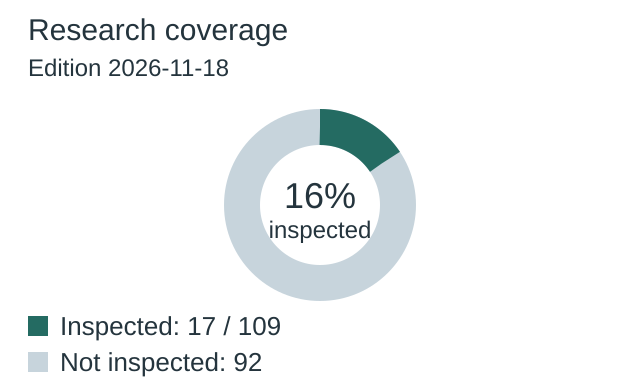
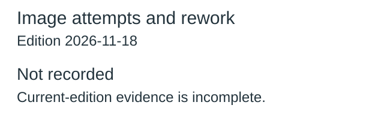
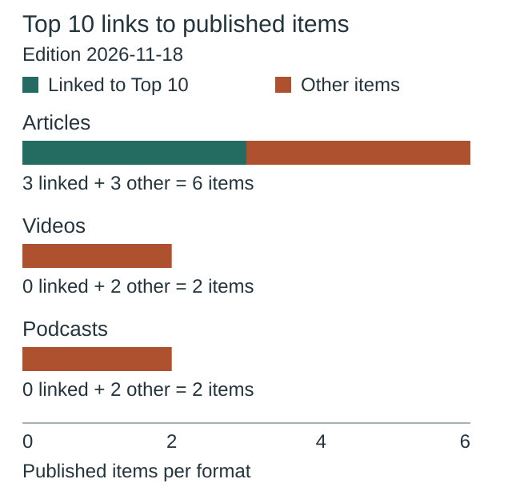
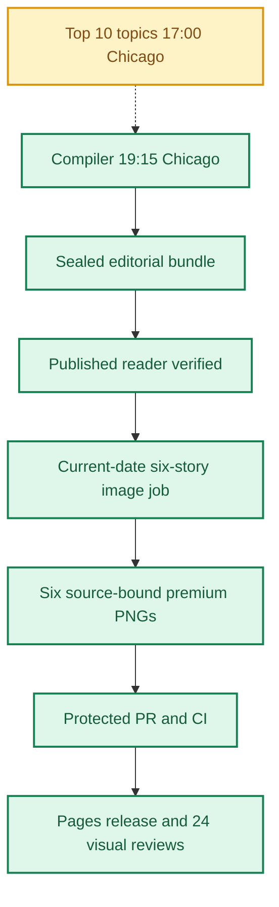
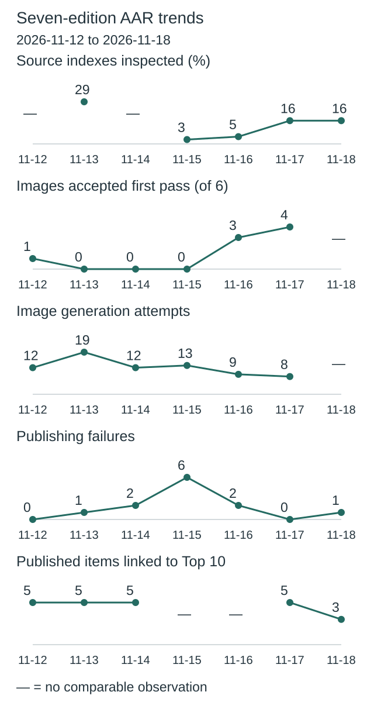
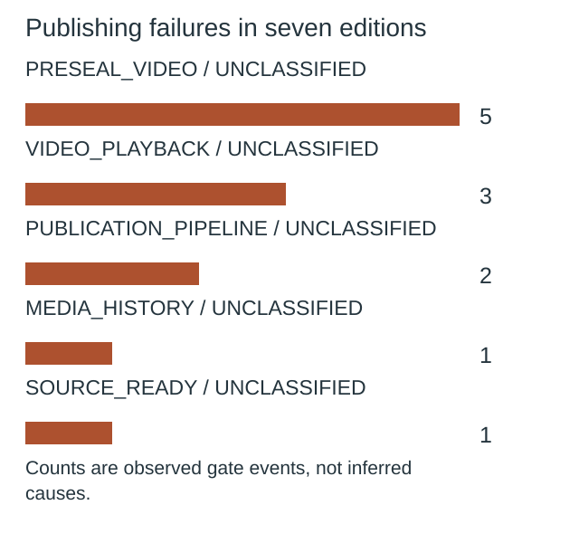
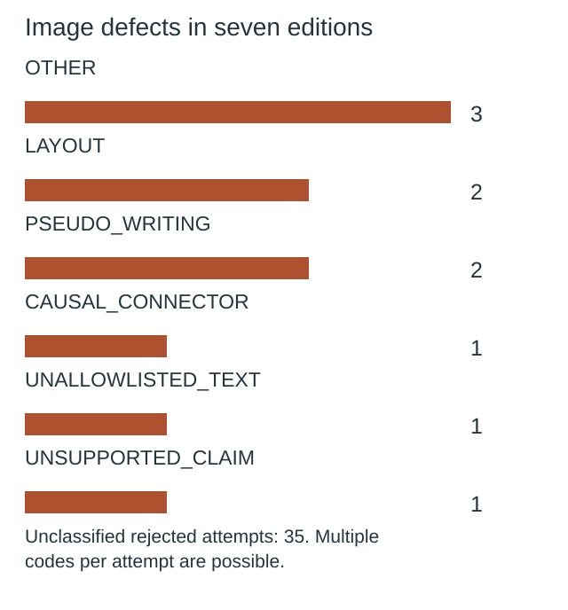

**🟩 RELEASE COMPLETE**
**TOP 10 PARTIAL** · **🟩 COMPILER VERIFIED** · **🟦 IMAGES 6/6 RELEASED** · **🟪 VISUAL QA 24/24 PASS**

# Daily AI Brief — Unified Production After-Action Report
**Edition:** November 18, 2026 · **Production evening:** 2026-11-17 · **Timezone:** America/Chicago
**Primary public reader:** [Open 2026-11-18 Brief](https://gttome.github.io/Daily-AI-Brief-Compiler/briefs/2026-11-18/) · **Repository:** [Daily-AI-Brief-Compiler](https://github.com/gttome/Daily-AI-Brief-Compiler)

> **IMPORTANT — VERIFIED PRODUCTION RESULT**
> **Executive release result: COMPLETE.** This is the single management-facing report covering Top 10 topic discovery, the editorial Compiler, published Brief and premium-image run. **Entire-system evidence: PARTIAL.** Top 10 report: **partial**; Compiler handoff: **RECEIVED_SNAPSHOT_BOUND**; guided searches: **RECEIPTS_OBSERVED**. Compiler public status: **VERIFIED**. Image release: **RELEASED_VERIFIED**. Direct 24-context visual quality: **24/24 PASS**. Autonomous completion: **UNPROVEN**. Missing evidence must not be promoted to a success claim.

**🕒 Production stage durations:** **Top 10 8m 02s** · **Compiler final seal window 14m 39s** · **Premium Images 21m 00s** (evidence-bounded elapsed times; the start/end events differ).

## Evidence reconciliation

Compiler final seal window: 14m 39s. Compiler state start to public verification: 64m 53s. Observed execution and final seal windows are distinct.
Image capability route preflight: RECORDED; scheduler origin remains UNPROVEN.
Image efficiency: 2/6 first-pass accepts; 10 total attempts. Approved prospective efficiency target: at least 4/6 first-pass and no more than 8 total attempts, strictly advisory, with unchanged quality floor.
Image review completed: 2026-11-18T03:44:54Z; review-record commit: 2026-11-18T03:46:56.000Z; protected review merge: 2026-11-18T03:46:56.000Z.
Eligible source indexes: 109; editorial inspections reported: 17 (15.6%); inaccessible in editorial audit: 3; explicitly unreviewed IDs: 89; unclassified editorial IDs: 0. Automated index parsing is separate from editorial inspection and cannot substantiate exhaustive freshness claims.

Registered video sources: 29; attempted this edition: 29; unattempted: 0; enabled: 28; qualification-only: 1; sources yielding candidate URLs: 0. Status: REPORTED_ALL_ATTEMPTED. Attempt evidence is not automatic proof of source-content review or playback.

Eligible source partition **VALID**. Full original-item reads **3**. Bounded index searches **14**. Qualification-only sources recorded separately **1**.

### Protected preseal video outcomes

| Original publisher | Distinct programs submitted | Archive rejects | Playback passes | Playback unverified | Probes skipped |
|---|---:|---:|---:|---:|---:|
| abcnews.com | 1 | 0 | 0 | 1 | 1 |
| cbsnews.com | 2 | 1 | 1 | 0 | 0 |
| fortune.com | 1 | 1 | 0 | 0 | 0 |
| foxbusiness.com | 1 | 0 | 3 | 0 | 1 |
| pbs.org | 1 | 0 | 3 | 0 | 1 |
| sky.com | 1 | 0 | 0 | 1 | 0 |
| theguardian.com | 1 | 0 | 0 | 1 | 1 |
| weforum.org | 1 | 0 | 0 | 1 | 0 |
| youtube-channel:UCKWaEZ-_VweaEx1j62do_vQ | 1 | 0 | 0 | 1 | 0 |

Outcomes count observed checks across all saved requests. Programs can be submitted again after a different slot changes.

- How AI Is Quietly Changing the Economics of Hollywood received PRESEAL_ARCHIVE_REPEAT. Earlier editions 2026-11-17. [Original run](https://github.com/gttome/Daily-AI-Brief-Compiler/actions/runs/44217164318)
- Power shift puts AI boom in question received PUBLIC_VIDEO_PLAYBACK_UNVERIFIED. [Original run](https://github.com/gttome/Daily-AI-Brief-Compiler/actions/runs/44217375578)
- Why the Nvidia scandal is far from over - The Latest received PUBLIC_VIDEO_PLAYBACK_UNVERIFIED. [Original run](https://github.com/gttome/Daily-AI-Brief-Compiler/actions/runs/44217375578)
- Should we trust AI agents? 3 experts discuss received PUBLIC_VIDEO_PLAYBACK_UNVERIFIED. [Original run](https://github.com/gttome/Daily-AI-Brief-Compiler/actions/runs/44217375578)
- Who's keeping AI in check? received PRESEAL_ARCHIVE_REPEAT. Earlier editions 2026-11-03. [Original run](https://github.com/gttome/Daily-AI-Brief-Compiler/actions/runs/44218240467)
- Is AI Really Superintelligence? ANI, AGI & ASI Explained received PUBLIC_VIDEO_PLAYBACK_UNVERIFIED. [Original run](https://github.com/gttome/Daily-AI-Brief-Compiler/actions/runs/44218717738)
- Nvidia's new boss undermined before she's started as Jensen Huang suggests return received PUBLIC_VIDEO_PLAYBACK_UNVERIFIED. [Original run](https://github.com/gttome/Daily-AI-Brief-Compiler/actions/runs/44219541513)

## Daily AAR charts

These charts use this edition’s receipts. Missing data is not zero.

### Research coverage



**17 of 109 indexes inspected (16%).**

| Editorial inspection | Indexes |
|---|---:|
| Inspected | 17 |
| Not inspected | 92 |

Not inspected includes every index without a recorded editorial inspection; this is not proof of missed stories.

### Image attempts and rework



**10 attempts; 2 of 6 images accepted on their first attempt.**

Recorded ongoing from November 8 target: at least 3/6 first-pass accepts; no more than 2 attempts per image. This is an efficiency target, not a quality cutoff.

| Image | Accepted | Rejected | Total attempts |
|---|---:|---:|---:|
| Flawed simulators expose overconfident research agents | 1 | 0 | 1 |
| Microsoft tunes two coding models for cost and task scope | 1 | 1 | 2 |
| GPT-6.2 targets cleaner professional outputs at lower task cost | 1 | 1 | 2 |
| Anthropic turns safety claims into reproducible evaluation questions | 1 | 1 | 2 |
| Gemini Tasks brings calls, purchases and handoffs to personal workflows | 1 | 1 | 2 |
| A sales briefing skill keeps source records and approvals visible | 1 | 0 | 1 |

Generation attempts measure rework, not runtime or cost. Quality and publication checks remain separate.

### Top 10 links to published items



**3 of 10 unique published items link to Top 10 topics.**

| Format | Linked to Top 10 | Other items |
|---|---:|---:|
| Articles | 3 | 3 |
| Videos | 0 | 2 |
| Podcasts | 0 | 2 |

No selection quota. Topic linkage does not establish better quality, popularity or causal improvement.

[Chart data](charts.json)

One edition at a time. Missing evidence is not zero. Trend claims require comparable recorded cycles.

## Performance dashboard

| Measure | Recorded result | Source / caveat |
|:--|:--:|:--|
| Entire-system evidence | **PARTIAL** | Full Top 10 list, bound Compiler input, all-format search receipts and existing release checks; separate from publication and autonomy |
| Top 10 report | **partial · 10 topics** | Same Chicago cycle report; provisional/partial coverage remains disclosed |
| Top 10 received by Compiler | **RECEIVED_SNAPSHOT_BOUND** | Exact report snapshot bytes; consumed commit separately corroborated: YES |
| Top 10 guided article/video/podcast searches | **RECEIPTS_OBSERVED** | Actual source-search receipts and selected/rejected topic outcomes |
| Top 10 stage duration | **8m 02s** | Same-cycle run receipt only; no runtime or usage estimate |
| Editorial publication | **PASS** | State and public reader integrity receipt |
| **Unattended autonomy (separate from publication)** | **UNPROVEN** | Owner incident receipt takes precedence over unverified producer self-attestation |
| Recorded protected publishing gate failures | **1** | Actual same-edition GitHub failure sidecar only; earlier unrecorded failures remain unknown |
| Articles | **6** | Exactly 2 technical / 2 knowledge-worker / 2 agents required |
| Original scientific-paper-led articles | **Not recorded** | Rolling target: one qualified original paper in seven editions; UNVERIFIED_RECEIPT. Preprints are not peer-reviewed by default |
| Verified original sources within preceding 24 hours | **0 / 6** | Original publisher dates only; other sources require a documented fallback rationale |
| Distinct selected article publishers | **5** | Six different primary organizations preferred |
| Videos over seven days old | **0** | Must be labeled evergreen, not a new development |
| Distinct selected video publishers | **2** | One channel is one publisher even across multiple videos |
| Cross-media topic diversity | **FOUR_DISTINCT_EVENTS_REVIEW_RECORDED** | Four video/podcast events and six pairwise original-source comparisons; editorial claims remain producer-attested |
| Video discovery source attempts | **29 / 29** | Attempt evidence across enabled and qualification-only leads; REPORTED_ALL_ATTEMPTED. Not a claim of full content review or player verification | 
| Duplicate active Watchlist display titles | **Not recorded** | Published canonical Watchlist only; historical evidence retained |
| Original-release video playback (historical) | **TWO_PUBLISHED_VIDEOS_PLAYBACK_PASS** | Later reader corrections may replace these originally verified videos; see incident register | 
| Postpublication reader incidents | **NOT_RECORDED** | Edition-specific owner reports and corrective PRs, not inferred absence | 
| Verified postpublication video corrections | **NOT_RECORDED** | Incident register tracks correction PR, actual playback evidence and reader preservation |
| Editorial index second-pass attempts | **0** | Bounded public GET retries only; never proof of original article reading |
| Editorial index reads recovered | **0** | Successful page fetch can still yield zero eligible dated items |
| Recorded scheduler capability route | **UNPROVEN** | Same-invocation route receipt only; GitHub is not scheduler authentication |
| Avoidable incomplete-staging CI failures | **Not independently audited** | Existing image-package push CI is disabled; exact-head protected PR CI remains required. A failure count requires actual workflow evidence |
| Media | **2 videos + 2 podcasts** | Sealed bundle |
| **Compiler final seal window** | **14m 39s (14.6 min)** | Final sealed-state timestamp → verified public reader; initial execution is separate |
| **Image processing stage duration** | **21m 00s** | First accepted PNG Git checkpoint → final 24/24 review; auditable stage elapsed time |
| Image scheduled-to-final-review window | **Not independently recorded** | Only with a saved one-cycle schedule anchor; does not attest exact generation start |
| Executor-observed generation-to-final-review | **23m 04s** | Only if the worker recorded a same-execution clock before its first native call; not independently verified provider runtime |
| Accepted premium PNGs | **6 / 6** | Exact package and public release hashes |
| Native image generation attempts | **10** | Image worker AAR; no estimation |
| Rejected candidates | **4** | Image worker AAR |
| Final worker checkpoint reconciliation | **PASS** | Oct25+ verifies exact generation count, per-story attempts, six accepted story/image/hash bindings and final release |
| Saved visual contexts | **24 / 24 PASS** | Dated/permanent desktop/mobile review |
| Public SHA-256 checks | **44** | Image release receipt |
| October 8 immutable history | **17 / 17** | Independent content-preservation checks |
| **Owner-reported weekly Work usage for this run** | **Not reported** | No per-cycle usage supplied |

> **EFFICIENCY NOTE**
> **Resource reporting policy:** No usage figure was supplied for this cycle, so none is assumed. Future runs show **Not reported** unless the owner supplies new cycle-specific usage metadata. No approval or extra step is required to generate the AAR.

## Production architecture and checkpoints



## Daily AI Topic Top 10 and Compiler handoff

**Research cycle:** 2026-11-17 · **Target Brief:** 2026-11-18 · **Scheduled start:** 17:00 America/Chicago

| Dimension | Recorded evidence |
|---|---|
| Run/report result | PARTIAL |
| Report status / topics | partial / 10 |
| Freshness | FRESH\_AT\_CONSUMPTION |
| Compiler handoff | RECEIVED\_SNAPSHOT\_BOUND |
| Search coverage | RECEIPTS\_OBSERVED |
| Selection mapping verification | MATCHES\_EDITION\_BUNDLE |
| Observed start / finish | 2026-11-17T22:55:58Z / 2026-11-17T23:04:00Z |
| Elapsed minutes | 8.03 |
| Usage percent | Not reported |
| Cost USD | Not reported |
| Independent scheduler autonomy | UNPROVEN |
| Compiler-recorded consumed commit | 7f63fd7eaae05940b5a6a38c462518ec45e3c87a |
| Report SHA-256 | 87787d447c8a7a213075317fbaa835f8a1252c4be2dd0004e174d4acd6aa2467 |

| Discovery order | AI topic | Summary | Confidence | Evidence |
|---:|---|---|---|---|
| 1 | OpenAI releases GPT-6.2 Astra and Sol | OpenAI released two GPT-6.2 models for professional work, coding and computer use. | medium | [Source](https://artificialanalysis.ai/changelog) · [Source](https://www.reddit.com/r/OpenAI/comments/1xyreq4/gpt_62_astra_and_gpt_62_sol_available_for_paid/) · [Source](https://openai.com/index/introducing-gpt-6-2-astra-sol/) · [Source](https://deploymentsafety.openai.com/gpt-6-2-astra-sol/internal-deployment-of-gpt-6.2-astra-and-gpt-6.2-sol) · [Source](https://www.youtube.com/watch?v=C1zYX5jwqq4) |
| 2 | Qwen4-Max draws another round of creator tests | Alibaba’s multimodal model is drawing comparisons with other coding and long-context models. | medium | [Source](https://www.youtube.com/watch?v=_kAf7rd2l8Q) · [Source](https://news.ycombinator.com/item?id=50513215) · [Source](https://x.com/Alibaba_Qwen/status/2122148127520289151) · [Source](https://www.alibabacloud.com/en/press-room/alibaba-unveils-qwen4-max?_p_lc=1) |
| 3 | Microsoft brings MAI Code 2 and Flash to GitHub Copilot | The Ignite launch adds two Microsoft coding models to Copilot. | medium | [Source](https://www.reuters.com/legal/litigation/microsoft-unveils-ai-models-coding-cybersecurity-it-takes-anthropic-openai-2026-11-17/) · [Source](https://www.reddit.com/r/GithubCopilot/comments/1xyslvt/mai_code_2_and_mai_code_2_flash_in_github_copilot/) · [Source](https://github.blog/changelog/2026-11-17-mai-code-2-and-mai-code-2-flash-in-github-copilot/) · [Source](https://microsoft.ai/pdf/MAI-Code-2-And-MAI-Code-2-Flash-Model-Card.pdf?v=2) · [Source](https://microsoft.ai/news/introducing-mai-code-2-and-mai-code-2-flash/) |
| 4 | Google makes Tasks in Gemini free in six countries | The rollout broadens access to multi-step personal tasks, with some actions limited by region. | medium | [Source](https://9to5google.com/2026/11/17/gemini-tasks-free/?extended-comments=1) · [Source](https://www.reddit.com/r/GeminiAI/comments/1xyqqll/gemini_sparktasks_available_to_all_users_now/) · [Source](https://blog.google/innovation-and-ai/products/gemini-app/tasks-in-gemini-free-new-features/) |
| 5 | OpenCode Browse gives coding agents a persistent browser session | The product gives OpenCode a browser it can use across coding tasks. | medium | [Source](https://news.ycombinator.com/item?id=50523459) · [Source](https://opencode.ai/product/browse) |
| 6 | OpenAI’s outside safety assessments draw renewed attention | OpenAI says four independent organizations will get access to evaluate specified systems and safeguards. | medium | [Source](https://x.com/OpenAI/status/2122359930628063248) · [Source](https://openai.com/index/our-first-phase-of-embedded-assessments/) |
| 7 | A hands-on Nod walkthrough renews interest in local personal agents | n8n Labs’ open-source personal agent runs on the user’s machine and can use a chosen model. | medium | [Source](https://www.youtube.com/watch?v=ynEEbqKQSaY) · [Source](https://chaseai.io/blog/n8n-nod-open-source-personal-ai-agent) · [Source](https://blog.n8n.io/meet-nod/?trk=article-ssr-frontend-pulse_little-text-block) · [Source](https://github.com/n8n-io/nod) |
| 8 | Claude Code’s team publishes its verification playbook | The team describes giving coding agents end-to-end tests and other checks they can execute themselves. | medium | [Source](https://x.com/ClaudeDevs/status/2122457608963395586) · [Source](https://claude.dev/blog/how-the-claude-code-team-thinks-about-verification/) |
| 9 | California’s OpenAI cyber complaint draws a new video report | California’s filing challenges safeguards for experimental AI cyber agents. | medium | [Source](https://www.youtube.com/watch?v=OL-nPrT8Hek) · [Source](https://oag.ca.gov/system/files/attachments/press-docs/complaint-oai-cyber.pdf) |
| 10 | A Claude and Blender course shows how to control AI video shots | The walkthrough uses simple 3D scenes as layout and camera references for video generation. | medium | [Source](https://www.youtube.com/watch?v=OO6J2w_FBnE) · [Source](https://moderncreator.app/2026-11-16-dan-kieft-claude-blender-is-the-best-way-to-make-ai-videos) |

**Sample scope:** {"metadata\_screened\_videos":50,"unique\_videos":50,"distinct\_retained\_channels":33,"combined\_observation\_records":53,"combined\_unique\_video\_ids":50,"full\_video\_reviews":0,"videos\_watched":0,"direct\_counter\_verifications":0,"direct\_youtube\_counter\_verifications":0,"transcript\_reviews":0,"partial\_original\_publisher\_transcript\_reviews":0,"partial\_third\_party\_transcript\_reviews":1,"original\_program\_companion\_article\_reviews":1,"original\_watch\_attempts":50,"comparable\_video\_observations":5,"within\_24h\_reported\_publications":2,"additional\_within\_72h\_reported\_publications":11,"additional\_within\_7d\_reported\_publications":5,"older\_timestamped\_publications":0,"date\_only\_video\_publications":32,"unknown\_video\_publication\_dates":0,"full\_video\_review\_target\_met":false,"original\_watch\_outcomes":{"title\_index\_shell":2,"throttled":48},"freshness\_reference\_at":"2026-11-17T23:02:38Z","notes":"Used 24h priority, then 72h and seven days. Date-only records excluded from exact hour bins.","substantive\_original\_event\_document\_reviews":18}. **Ranking basis:** {"attention":"Event-matched video and independent reporting and public discussion, with measured same-video changes shown separately.","limitations":"Unknown measurement clocks and platform differences preclude an exact popularity rank."}.

| Search format | Receipt rows | Attempts recorded | Explicitly not attempted |
|---|---:|---:|---:|
| article | 10 | 10 | 0 |
| video | 10 | 10 | 0 |
| podcast | 10 | 10 | 0 |

**Selected Brief items linked to trends:**

| Topic | Format | Selected item | Reason |
|---|---|---|---|
| gpt-62-astra-sol-launch-nov17 | article | nov18-k1-gpt62 · [Source](https://openai.com/index/introducing-gpt-6-2-astra-sol/) | Exact event match with complete original release, evaluation, pricing and disclosed-limitation review. |
| microsoft-mai-code-2-copilot-launch-nov17 | article | nov18-t2-mai-code2 · [Source](https://microsoft.ai/news/introducing-mai-code-2-and-mai-code-2-flash/) | Exact event match with complete original launch and model-card scope review. |
| gemini-tasks-free-six-countries-nov17 | article | nov18-a1-gemini-tasks · [Source](https://blog.google/innovation-and-ai/products/gemini-app/tasks-in-gemini-free-new-features/) | Exact event match with complete original rollout, safeguard and limitation review. |

**Gaps and limitations:**

- The report labels its research partial.
- No full playback, complete transcript or direct YouTube counters verified. Partial creative program transcript material came from a third-party index.
- Some attention comes from launch-day indexed communities or independently published coverage with unknown audience measurement.
- A successful report save does not establish actual Compiler searches, candidate contribution or selections.

**Recorded run issues:**

- {"issue":"48 distinct YouTube watch routes throttled; two returned title shells.","effect":"Verified full playback and direct counters remain zero, limiting program review depth.","correction":"Original release and model card, original creator companion text and a bounded third-party caption sample were reviewed without labeling these as playbacks."}
- {"issue":"Original X routes returned 403 and some video and Reddit observations had no counter clock.","effect":"Direct and cross-platform comparisons were unavailable.","correction":"Five same-video timed tracker comparisons only. Measurement source and known precision are recorded."}
- {"issue":"Latest AAR links five articles but no videos or podcasts to Top 10.","effect":"Mapped editorial coverage continues to be concentrated in articles; incremental media contribution is unproven.","correction":"Preserved exact 10-by-3 query handoff and attached scoped original creator material to a video discovery candidate. Current production results remain pending."}

**Recorded improvements:**

- {"change":"Preserved ten stable event identities and 30 unique topic-format search strings, with exact handoff readback.","reason":"Latest AAR verifies all 30 formats/research slots in aggregate, but no observed selected media mappings.","expected\_effect":"Enable auditable same-format discovery, future candidate-yield measurement and honest missing outcomes.","status":"implemented"}
- {"change":"Read selected original launch, legal and model-card evidence before retaining stories with video data or narrow indexed attention.","reason":"First-party video playback remained inaccessible; current original documents deepen verifiable scope.","expected\_effect":"More precise story boundaries and original publication dates without overstating format qualification.","status":"implemented"}

### Daily improvement and effect on the Brief

**Fixed baseline:** nov03-2026-v1 / INPUT\_FROZEN. **Outcome baseline:** FROZEN\_AFTER\_VERIFIED\_PUBLICATION. **Prior cycle:** 2026-11-16.

| Input measure | Current | November 3 baseline | Change from baseline | Change from prior cycle |
|---|---:|---:|---:|---:|
| topic count | 10 | 10 | 0 | 0 |
| validation resource count | Not reported | 14 | Not reported | Not reported |
| additional video metadata records | Not reported | 63 | Not reported | Not reported |
| additional video channels | Not reported | 21 | Not reported | Not reported |
| total video observations | 53 | 79 | -26 | 4 |
| unique videos | 50 | 71 | -21 | 2 |
| full video reviews | 0 | 0 | 0 | 0 |
| direct youtube counter verifications | 0 | 0 | 0 | 0 |
| broader evidence band topics | 4 | 3 | 1 | 2 |
| limited evidence band topics | 6 | 7 | -1 | -2 |

**Observed downstream measurements:** OBSERVED.

| Outcome measure | Current | Change from frozen outcome | Change from prior cycle |
|---|---:|---:|---:|
| expected topic format pairs | 30 | 0 | 0 |
| attempted topic format pairs | 30 | 0 | 0 |
| explicitly unattempted pairs | 0 | 0 | 0 |
| discovered candidate count | 13 | -27 | -2 |
| searched source host count | 29 | 13 | 12 |
| selected article count | 3 | 0 | -2 |
| selected video count | 0 | 0 | 0 |
| selected podcast count | 0 | -1 | 0 |

**Source changes:** {"added":\[\],"removed":\[\]}.

**Candidate review depth:** NOT\_RECORDED.

| Review measure | Current | Change from prior comparable cycle |
|---|---:|---:|
| reviewed candidate count | Not reported | Not reported |
| qualified candidate count | Not reported | Not reported |
| rejected candidate count | Not reported | Not reported |
| metadata only count | Not reported | Not reported |
| full video reviews | Not reported | Not reported |
| transcript reviews | Not reported | Not reported |

The frozen November 3 baseline has no candidate-level review ledger; no retrospective value is invented. Recorded reviews do not independently establish content quality, audience interest or causal benefit.

**Method/resource review:** {"baseline\_id":"nov03-2026-v1","previous\_report\_date":"2026-11-16","previous\_method\_version":"2026-11-03.2-event-review","method\_version":"2026-11-03.2-event-review","feedback":{"aar\_url":"https://github.com/gttome/Daily-AI-Brief-Compiler/blob/acfb7d031b92408e065425ff6dac656fbc51b6bb/daily/2026-11-16/combined.md","charts\_url":"https://github.com/gttome/Daily-AI-Brief-Compiler/blob/acfb7d031b92408e065425ff6dac656fbc51b6bb/daily/2026-11-16/charts.json","metrics\_url":"https://github.com/gttome/Daily-AI-Brief-Compiler/blob/acfb7d031b92408e065425ff6dac656fbc51b6bb/daily/2026-11-16/improvement-metrics.json","observation":"November 17 unified AAR records independently verified consumed snapshot, 10 attempted slots each for article/video/podcast, and five published article mappings with zero video/podcast matches. Separate image chart shows eight attempts and four first-pass acceptances. Scheduler origin and causal quality uplift remain unproven."},"changes":\[{"change":"Preserved ten stable event identities and 30 unique topic-format search strings, with exact handoff readback.","reason":"Latest AAR verifies all 30 formats/research slots in aggregate, but no observed selected media mappings.","expected\_effect":"Enable auditable same-format discovery, future candidate-yield measurement and honest missing outcomes."},{"change":"Read selected original launch, legal and model-card evidence before retaining stories with video data or narrow indexed attention.","reason":"First-party video playback remained inaccessible; current original documents deepen verifiable scope.","expected\_effect":"More precise story boundaries and original publication dates without overstating format qualification."}\],"resource\_candidates":\[{"url":"https://microsoft.ai/news/introducing-mai-code-2-and-mai-code-2-flash/","role":"Original model announcement","access":"Public publisher text and linked model card","review\_scope":"Read model variants, evaluation scope and practical caveats. No independent benchmark rerun.","independence":"Original Microsoft publication; same family as GitHub distribution.","decision":"accepted","reason":"Exact event with concrete names and evaluation scope.","contribution":"Separates product availability from internal benchmark claims."},{"url":"https://chaseai.io/blog/n8n-nod-open-source-personal-ai-agent","role":"Exact video creator companion article","access":"Public original text","review\_scope":"Local operation, approval and model choice sections only.","independence":"Shares original publisher with the measured video.","decision":"accepted","reason":"Matches exact recent Nod walkthrough.","contribution":"Adds substantive scoped video discovery evidence without claiming transcript or playback."}\],"observed\_effects":\[{"observation":"50 distinct programs screened, 5 matched timed comparisons versus 48 and 6 in the preceding report.","effect":"Same-source interval accumulation is measurable for the matched sample; no real-time velocity inferred."},{"observation":"Previous edition linked five article selections and no media through a valid search receipt.","effect":"Establishes a mapping outcome for that edition. Incremental candidate contribution or causal improvement remains unverified."}\],"next\_improvement":"Reconcile exact current Compiler slot dispositions and actual downstream contribution once independent evidence exists.","limitations":\["The one-edition November 10 pilot is outside this cycle.","NOV16-P1-09 actual incremental yield awaits sufficiently attributable candidate and selection decisions."\],"change\_evaluations":\[{"change\_id":"NOV15-02","reviewed\_edition":"2026-11-17","decision":"keep","result":"met","reason":"The reconciled AAR verified the consumed source, recorded 10 actual attempts per format and matched five selections with the published bundle.","evidence\_refs":\["https://github.com/gttome/Daily-AI-Brief-Compiler/blob/acfb7d031b92408e065425ff6dac656fbc51b6bb/daily/2026-11-16/combined.md","https://github.com/gttome/Daily-AI-Brief-Compiler/blob/acfb7d031b92408e065425ff6dac656fbc51b6bb/daily/2026-11-16/charts.json"\]},{"change\_id":"NOV16-P0-01","reviewed\_edition":"2026-11-17","decision":"keep","result":"met","reason":"The effective-edition collector records ten attempts per format against a bound snapshot and reports valid observed receipts; this does not prove improved selection.","evidence\_refs":\["https://github.com/gttome/Daily-AI-Brief-Compiler/blob/acfb7d031b92408e065425ff6dac656fbc51b6bb/daily/2026-11-16/combined.md"\]},{"change\_id":"NOV15-05","reviewed\_edition":"2026-11-17","decision":"keep","result":"inconclusive","reason":"The AAR explicitly found scheduled origin unproven. Customer-facing release alone cannot attest the scheduler.","evidence\_refs":\["https://github.com/gttome/Daily-AI-Brief-Compiler/blob/acfb7d031b92408e065425ff6dac656fbc51b6bb/daily/2026-11-16/improvement-metrics.json"\]}\]}.

**Current reconciled conclusion:** OBSERVED; outcome baseline FROZEN\_AFTER\_VERIFIED\_PUBLICATION; candidate review ledger NOT\_RECORDED.

**Historical producer observations (not current status):** The following snapshot preserves what the producer reported at the time. Its pending statuses and candidate-quality claims are not independently reconciled conclusions. Use the current tables above for publication-bound measurements; an absent candidate review ledger remains unknown.

<details><summary>Original producer effects and gaps — historical snapshot</summary>

```json
{
  "observed_at": "2026-11-18T01:25:54.493Z",
  "qualified_candidate_ids": [
    "CAND-ART-GPT62-LAUNCH",
    "CAND-ART-MAI-CODE2",
    "CAND-ART-GEMINI-TASKS-FREE"
  ],
  "source_additions": [
    "https://openai.com/index/introducing-gpt-6-2-astra-sol/",
    "https://microsoft.ai/news/introducing-mai-code-2-and-mai-code-2-flash/",
    "https://blog.google/innovation-and-ai/products/gemini-app/tasks-in-gemini-free-new-features/"
  ],
  "freshness_rejections": [
    {
      "candidate_id": "CAND-ART-N8N-NOD",
      "reason": "The November 10 original article was outside the 168-hour maximum at selection time."
    }
  ],
  "duplicate_rejections": [
    {
      "candidate_id": "CAND-VID-WORLDOFAI-QWEN4",
      "reason": "The same Qwen4 event was already represented in the November 17 edition and offered insufficient marginal reader value."
    }
  ],
  "promotion_rejections": [
    {
      "candidate_id": "CAND-ART-OPENCODE-BROWSE",
      "reason": "The launch pages were product-led and did not displace stronger original evidence for the fixed six-story allocation."
    }
  ],
  "gaps": [
    "Most exact podcast queries produced no same-event episode lead; searches remain recorded without implying selection value."
  ],
  "observed_search_duration_minutes": 4,
  "observed_cost_usd": 0,
  "causal_uplift": null,
  "notes": "All 30 exact query strings were executed before selection lock. Three exact-event article leads were admitted after full original-source review; no trend-linked video or podcast was forced into the bundle. Candidate IDs identify search leads, and mappings do not establish causal uplift."
}
```

</details>

**Next improvement:** Reconcile exact current Compiler slot dispositions and actual downstream contribution once independent evidence exists.

Counts show coverage and observed association, not audience popularity, source independence, candidate quality or causal uplift. Compare source/method changes before interpreting deltas. Unknown values are not zero. Publication, reader corrections, runtime and image outcomes retain their separate AAR evidence.

Report, source-readback and search receipts are separate observations. Snapshot binding verifies the collected report bytes; the consumed commit is independently corroborated only when the separately fetched source bytes match. These records do not independently attest scheduler identity or source truth. Top 10 reporting does not change Brief/image release status.


## Track 1 — Compiler

**State:** `SHADOW_VERIFIED` · **Bundle:** `BUNDLE_READY` · **Compiler final seal window:** 14m 39s (14.6 min).

| Publication gate | Result |
|---|:---:|
| Canonical reader build | ✅ |
| Reader parity | ✅ |
| Public verification of dated edition | ✅ |
| Previous editions preserved | ✅ |
| Permanent story routes and feeds | ✅ |

**Selected coverage:**

| Lane | Story |
|---|---|
| Technical AI Engineering | Flawed simulators expose overconfident research agents |
| Technical AI Engineering | Microsoft tunes two coding models for cost and task scope |
| Applied Generative AI for Knowledge Workers | GPT-6.2 targets cleaner professional outputs at lower task cost |
| Applied Generative AI for Knowledge Workers | Anthropic turns safety claims into reproducible evaluation questions |
| Agents for Everyone | Gemini Tasks brings calls, purchases and handoffs to personal workflows |
| Agents for Everyone | A sales briefing skill keeps source records and approvals visible |

### Scientific paper opportunity and publication evidence

**Current edition:** UNVERIFIED_RECEIPT; **paper-led stories:** Not recorded. Editorial target: at least one genuinely qualified original-paper-based story in seven editions, with methods, limitations, and an explicit preprint/peer-review distinction. No stale or weak paper is selected solely to fill a quota.


## Track 2 — Premium images

**Public status:** `RELEASED_VERIFIED` · **Saved images:** 6/6 · **Actual generation attempts:** 10 · **Rejected candidates:** 4.

### Image production duration — Git-verified milestones

**Auditable image stage duration:** **21m 00s** (first accepted binary saved in Git → first persisted 24-context quality-review record). **First asset to public image release:** **15m 40s**.
**Scheduled-to-final-review window:** **Not independently recorded**. This is a scheduled-clock comparison only when a separately recorded exact-date schedule exists; it is **not** measured native image-generation runtime.

| Production milestone | Chicago local time | Evidence |
|---|---|---|
| Scheduled image start (if exact-date record exists) | Not independently recorded | Time planned, not actual execution start |
| First executor-observed start | 9:16:25 PM | Worker self-attestation, not a first-party scheduler event |
| First native generation observation | 9:23:52 PM | Worker clock recorded immediately before first native call, not model-provider telemetry |
| First accepted PNG bytes saved to Git | 9:25:56 PM | Immutable binary-stage commit |
| Six-image package / reviews committed | 9:38:09 PM | Exact-head PR source commit |
| Protected package merged | 9:40:36 PM | Merge SHA and required CI |
| Public images verified | 9:41:35 PM | Image-release receipt |
| 24/24 review record committed | 9:46:56 PM | Immutable first review-approval commit |

> **Duration interpretation:** The audited stage excludes unobservable pre-checkpoint creative work. The scheduled-start window includes it but must not be interpreted as precise active processing time. Missing timestamps appear as **Not independently recorded**, never an estimate.


| Source-bound image | Attempts | File size | Public page |
|---|---:|---:|---|
| Flawed simulators expose overconfident research agents | 1 | 0.90 MiB | [View original](https://gttome.github.io/Daily-AI-Brief-Compiler/briefs/images/2026-11-18/dab-edition-2026-11-18-m01.png) |
| Microsoft tunes two coding models for cost and task scope | 2 | 0.85 MiB | [View original](https://gttome.github.io/Daily-AI-Brief-Compiler/briefs/images/2026-11-18/dab-edition-2026-11-18-m02.png) |
| GPT-6.2 targets cleaner professional outputs at lower task cost | 2 | 0.95 MiB | [View original](https://gttome.github.io/Daily-AI-Brief-Compiler/briefs/images/2026-11-18/dab-edition-2026-11-18-m10.png) |
| Anthropic turns safety claims into reproducible evaluation questions | 2 | 0.65 MiB | [View original](https://gttome.github.io/Daily-AI-Brief-Compiler/briefs/images/2026-11-18/dab-edition-2026-11-18-m11.png) |
| Gemini Tasks brings calls, purchases and handoffs to personal workflows | 2 | 0.79 MiB | [View original](https://gttome.github.io/Daily-AI-Brief-Compiler/briefs/images/2026-11-18/dab-edition-2026-11-18-m12.png) |
| A sales briefing skill keeps source records and approvals visible | 1 | 1.06 MiB | [View original](https://gttome.github.io/Daily-AI-Brief-Compiler/briefs/images/2026-11-18/dab-edition-2026-11-18-m14.png) |

**Immutable-release and visual gates:**

| Release gate | Result |
|---|:---:|
| Protected public image receipt | ✅ |
| Accepted-image Git hash bindings | ✅ |
| Six live PNGs | 6/6 |
| Dated/permanent story placements | 12/12 recorded in release evidence |
| Desktop/mobile visual inspection | 24/24 PASS |
| Historical Oct 8 integrity | 17/17 |

### Published premium illustrations

<table>
<tr><td width="50%"><a href="https://gttome.github.io/Daily-AI-Brief-Compiler/briefs/images/2026-11-18/dab-edition-2026-11-18-m01.png"></a><br/><b>Flawed simulators expose overconfident research agents</b></td><td width="50%"><a href="https://gttome.github.io/Daily-AI-Brief-Compiler/briefs/images/2026-11-18/dab-edition-2026-11-18-m02.png"></a><br/><b>Microsoft tunes two coding models for cost and task scope</b></td></tr>
<tr><td width="50%"><a href="https://gttome.github.io/Daily-AI-Brief-Compiler/briefs/images/2026-11-18/dab-edition-2026-11-18-m10.png"></a><br/><b>GPT-6.2 targets cleaner professional outputs at lower task cost</b></td><td width="50%"><a href="https://gttome.github.io/Daily-AI-Brief-Compiler/briefs/images/2026-11-18/dab-edition-2026-11-18-m11.png"></a><br/><b>Anthropic turns safety claims into reproducible evaluation questions</b></td></tr>
<tr><td width="50%"><a href="https://gttome.github.io/Daily-AI-Brief-Compiler/briefs/images/2026-11-18/dab-edition-2026-11-18-m12.png"></a><br/><b>Gemini Tasks brings calls, purchases and handoffs to personal workflows</b></td><td width="50%"><a href="https://gttome.github.io/Daily-AI-Brief-Compiler/briefs/images/2026-11-18/dab-edition-2026-11-18-m14.png"></a><br/><b>A sales briefing skill keeps source records and approvals visible</b></td></tr>
</table>

## Incidents, corrections and learning

### Postpublication reader incidents (updated when new evidence is merged)

No current-edition postpublication incident register was available; this is **NOT_RECORDED**, not a certification of zero incidents.


**Editor recovery classification:** UNPROVEN. **Owner intervention:** Unproven either way. **Protected same-edition failures recorded:** 1. 
**Latest failed protected stage:** VIDEO_PLAYBACK; [Action evidence](https://github.com/gttome/Daily-AI-Brief-Compiler/actions/runs/44222080011). Exact stage durations are available only where real source timestamps exist.

| Stage | Verified issue | Corrective action |
|---|---|---|
| Native saved-pixel review | The upper track contains a forbidden gear glyph. Lower edited pages and patch blocks contain parallel dark strokes simulating document writing. | Preserve the carved two-track relief, all four exact labels, the two workload lanes and the blue physical connection to the trial dock. Remove the gear, icon-like code glyphs and all parallel strokes from document and patch surfaces. Use perfectly blank matte surfaces. Replace the gear block with a plain branch joint seating two module rails. Show routine replacement through the silhouette and a blank inlaid patch seam alone. Leave the vendor benchmark caveat isolated. Keep the complete scene inside generous white margins. |
| Native saved-pixel review | The right side of the review press contains a forbidden toothed gear and round protruding control. Its upper pink bracket also crowds the top edge. | Keep the Raspberry risograph colors, proof overlay, negative-space input pocket, four exact text labels and one green connection into the guide rail. Replace the entire upper roller assembly and both right-side wheels with a simple stationary straight-sided solid registration frame, a smooth cylinder captive inside the frame or no roller. No exposed gears, teeth, wheels, buttons or knobs. Keep the overall composition slightly smaller and centered with at least 8% pure white clearance above any press parts and below the note surfaces. Detached Vendor results note and Missing input pocket stay uncoupled from the arrow. |
| Native saved-pixel review | The top priority label begins about 25 pixels from the image edge. The case trays and grader display have decorative control knobs, the grader displays checklist marks, and the arrowhead hangs in whitespace above its housing. | Retain one continuous horizontal graphite balance and exact four labels. Move One change down into clear white space so its glyphs start at least 75 pixels from the top in the output; scale all artwork slightly smaller within a clean white border. Remove every projecting knob or wheel from the trays and lower holder. Replace the open pages with two smooth blank rectangular inserts in the same blue holder, without check boxes, dashes, strokes, numbers, print, ribs or any simulated writing. Seat the sole blue arrowhead on the top edge of the physical blue holder; no gap. Keep the uncertainty sleeve unnumbered and caveat detached. |
| Native saved-pixel review | The isolated room contains an invented large toothed gear and a browser chrome row of controls. The separate handoff door floats on its own panel-like pedestal. | Keep the large teal watercolor cutaway room, coral approval stop, exact four labels and purple port-to-port arrow. Remove the toothed gear and all controls. Replace the interior browser mockup and tiles with one blank folded task sheet, one closed blank folder and one small outline shopping basket, all on the room floor, with no marks in them. Extend one pale teal architectural sill from the room’s upper right edge to the return door so that it reads as an attached architectural wing, with no directional connector. Remove the door knob. Leave the lower coral bar as the sole externally connected stop, and keep Errors are possible detached underneath. |

> **OPERATIONAL NOTE**
> This report distinguishes a published and verified production outcome from scheduler metadata exposed to another conversation. Lack of a live host heartbeat in a separate normal chat is not a Compiler production failure.

## Usage and cost stewardship

| Item | Per-cycle value |
|---|---|
| **Weekly Work usage reported by owner** | **Not reported** |
| Internal weekly usage reference | Target under 5% |
| Genuine image-generation attempts | 10 |
| Accepted diagrams | 6 |
| Regeneration after acceptance | 0 |
| Top 10 reported usage | Not reported |
| Top 10 reported cost | Not reported |
| Account-level billing telemetry | Not independently accessible to deterministic GitHub reporting |

**Future reporting rule:** For cycles without an optional owner-usage record, publish the complete AAR with `Not reported`; do not reuse prior percentages, guess remaining weekly credits or delay tomorrow's production.

## Next-edition operating handoff

| Control | Recurring contract |
|---|---|
| AI Topic Top 10 | Sole report task · 17:00 America/Chicago · saved dated list guides same-evening research |
| Primary Compiler | Sole existing task · 19:15 America/Chicago |
| Premium image production | Sole existing task · standard 21:15 America/Chicago |
| Exact image job selection | Newly published next-date `PUBLISHED_PENDING` only |
| AAR | Combined report generated automatically from new GitHub receipts |
| Optional Work usage | Owner-supplied per cycle, otherwise `Not reported` |

> **SCHEDULE RESTORATION NOTE**
> A temporary scheduling exception must be explicitly restored before claiming standard-time readiness. This deterministic document generator reads existing state only; it does not modify production schedules.

## Evidence register

| Evidence | Link |
|---|---|
| Compiler state | [Open receipt](https://github.com/gttome/Daily-AI-Brief-Compiler/blob/shadow/2026-11-18/shadow-runs/2026-11-18/compiler-state.json) |
| Compiler compile receipt | [Open receipt](https://github.com/gttome/Daily-AI-Brief-Compiler/blob/shadow/2026-11-18/shadow-runs/2026-11-18/compiler/compile-receipt.json) |
| Compiler public integrity | [Open receipt](https://github.com/gttome/Daily-AI-Brief-Compiler/blob/shadow/2026-11-18/shadow-runs/2026-11-18/compiler/postpublish-integrity.json) |
| Image release receipt | [Open receipt](https://github.com/gttome/Daily-AI-Brief-Compiler/blob/shadow-pages-history/site/image-jobs/2026-11-18/release.json) |
| Image review | [Open receipt](https://github.com/gttome/Daily-AI-Brief-Compiler/blob/main/external-image-packages/2026-11-18/reviews/live/semantic-pixel-review.json) |
| Original image AAR | [Open receipt](https://github.com/gttome/Daily-AI-Brief-Compiler/blob/main/external-image-packages/2026-11-18/reviews/after-action.md) |
| Observed editorial index retries | [Open receipt](https://github.com/gttome/Daily-AI-Brief-Compiler/blob/shadow/2026-11-18/shadow-runs/2026-11-18/editorial/source-item-retries.json) |
| Scientific paper selection review | [Open receipt](https://github.com/gttome/Daily-AI-Brief-Compiler/blob/shadow/2026-11-18/shadow-runs/2026-11-18/editorial/scientific-paper-coverage.json) |
| Published player playback receipt | [Open receipt](https://github.com/gttome/Daily-AI-Brief-Compiler/blob/shadow/2026-11-18/shadow-runs/2026-11-18/compiler/postpublish-video-playback.json) |
| Top 10 ranked topic report | [Open receipt](https://github.com/gttome/Daily-AI-Brief-Compiler/blob/f2601c9e3595f62f71c00cac7f620b958478fff8/signals/ai-topic-top10/2026-11-17.json) |
| Top 10 run after-action receipt | [Open receipt](https://github.com/gttome/Daily-AI-Brief-Compiler/blob/f2601c9e3595f62f71c00cac7f620b958478fff8/signals/ai-topic-top10/2026-11-17.aar.json) |
| Compiler Top 10 input snapshot | [Open receipt](https://github.com/gttome/Daily-AI-Brief-Compiler/blob/shadow/2026-11-18/shadow-runs/2026-11-18/editorial/trend-input.json) |
| Top 10 article/video/podcast search coverage | [Open receipt](https://github.com/gttome/Daily-AI-Brief-Compiler/blob/shadow/2026-11-18/shadow-runs/2026-11-18/editorial/trend-search-coverage.json) |

**Image workflow:** [Workflow evidence](https://github.com/gttome/Daily-AI-Brief-Compiler/actions/runs/44232084407).

---

*Generated deterministically from cycle- and edition-specific GitHub records. The report combines the Top 10 discovery priorities, its Compiler handoff and searches, the published Brief, and the image run; original research, Compiler, image, hash, and review receipts remain immutable. This reporting action creates no stories, images, releases, extra AI tasks, or schedule changes.*

<!-- continuous-improvement:start -->
## Continuous improvement review

Edition **2026-11-18**. Measurements use 7/7 recorded editions in this window. Missing data stays **Not recorded**.

### Daily corrective-action review

**3 evidence-based findings**; open production blockers: 0. Cumulative evaluation checkpoint: **2026-11-18**. The daily review never waits for that date to act on a safe live problem.

| Priority | Observed issue | Existing owner / next correction | When |
|---|---|---|---|
| P1 | 1 failed protected publication gates were recorded (1 unclassified causes). | Compiler / Recovery: Read original failed job logs, record real causes and move the relevant existing validation before the next readiness signal; do not replay the released edition. | Next genuine run |
| P1 | 4 rejected image candidates preceded the verified six-image release. | Images: Inspect saved rejection evidence and apply source-specific geometry, causal-arrow and label corrections before the next native generation. | Next genuine run |
| P2 | Publication success does not independently attest the originating scheduler. | Compiler / Recovery: Capture real first-party scheduler and execution evidence if available; do not convert unknown provenance into a failure or a success. | Next genuine run |

Findings are observational and do not claim a repair was executed by the reporter.

### Approved change evaluations

| Change | Evaluate by | Outcome status | Latest decision |
|---|---|---|---|
| NOV03-01 — Earlier publication checks and precise recovery | 2026-11-11 | REVIEWED | revise |
| NOV03-02 — Broader genuine source review | 2026-11-11 | REVIEWED | revise |
| NOV03-03 — Source-bound image rejection lessons | 2026-11-11 | REVIEWED | revise |
| NOV03-04 — Substantive Top 10 review evidence | 2026-11-11 | REVIEWED | keep |
| AAR-01 — Current conclusions separated from historical claims | 2026-11-11 | REVIEWED | keep |
| AAR-02 — Consolidated current task contracts | 2026-11-11 | REVIEWED | keep |
| AAR-03 — Dated improvement evaluations | 2026-11-11 | REVIEWED | keep |
| AAR-04 — Seven-edition trend charts | 2026-11-11 | REVIEWED | keep |
| AAR-05 — Recurring publication failure causes | 2026-11-11 | REVIEWED | revise |
| AAR-06 — Recovery interval reporting | 2026-11-11 | REVIEWED | revise |
| AAR-07 — Source inspection history | 2026-11-11 | REVIEWED | revise |
| AAR-08 — Rolling source contribution | 2026-11-11 | REVIEWED | revise |
| AAR-09 — Recurring image defect categories | 2026-11-11 | REVIEWED | keep |
| AAR-10 — Top 10 publisher-family sensitivity | 2026-11-11 | REVIEWED | keep |
| NOV15-01 — Six premium images must not share an editorial template | 2026-11-17 | REVIEWED | keep |
| NOV15-02 — Exact Top 10 handoff and three-format search use | 2026-11-17 | REVIEWED | keep |
| NOV15-03 — Original failed protected gate causes and early prevention | 2026-11-17 | REVIEWED | keep |
| NOV15-04 — Improve image first-pass acceptance without weakening quality | 2026-11-17 | REVIEWED | keep |
| NOV15-05 — Independently attest unattended scheduler-to-release autonomy | 2026-11-17 | REVIEWED | keep |
| NOV16-P0-01 — Exact Top 10 event-format search receipts | 2026-11-18 | PENDING | Not recorded |
| NOV16-P0-02 — Substantive source inspections before selection lock | 2026-11-19 | PENDING | Not recorded |
| NOV16-P0-03 — Outside-family playable video sourcing | 2026-11-19 | PENDING | Not recorded |
| NOV16-P0-04 — Unified AAR packaging regression coverage | 2026-11-22 | PENDING | Not recorded |
| NOV16-P1-05 — Fresh-first original article discovery | 2026-11-20 | PENDING | Not recorded |
| NOV16-P1-06 — Classify and reduce failing source indexes | 2026-11-20 | PENDING | Not recorded |
| NOV16-P1-07 — Image first-pass yield and visual differentiation | 2026-11-20 | PENDING | Not recorded |
| NOV16-P1-08 — Exact video identity with punctuation-only normalization | 2026-11-18 | PENDING | Not recorded |
| NOV16-P1-09 — Attributable Top 10 incremental research yield | 2026-11-20 | PENDING | Not recorded |
| NOV16-P1-10 — Three-edition original paper priority and vendor attribution | 2026-11-20 | PENDING | Not recorded |
| NOV16-P1-11 — Verify unattended scheduler provenance without self-attestation | 2026-11-20 | PENDING | Not recorded |
| NOV16-P2-12 — Seven-edition improvement decision dashboard | 2026-11-23 | PENDING | Not recorded |

Pending: 12; overdue: 0; reviewed: 19. Implemented controls await measured results; review decisions do not disable controls.

#### Reviews of production evidence

- **NOV03-01 · 2026-11-12 · not met.** Two media requests still required correction. The first had two stalled embeds and a certificate-date error. The second reached protected playback before two archived programs were disqualified. The edition recovered and published. [Evidence 1](https://github.com/gttome/Daily-AI-Brief-Compiler/blob/1d8c6be/shadow-runs/2026-11-12/editorial/preseal-video-receipt.json) · [Evidence 2](https://github.com/gttome/Daily-AI-Brief-Compiler/blob/shadow/2026-11-12/shadow-runs/2026-11-12/execution-milestones.json)
- **NOV03-02 · 2026-11-12 · inconclusive.** The raw audit recorded 34 inspected entries and 76 unreviewed for 109 eligible sources. It included qualification-only Zapier in the inspection entries. The audited breadth is unknown. Five distinct article publishers were recorded and zero articles had verified 24-hour timestamps. [Evidence 1](https://github.com/gttome/Daily-AI-Brief-Compiler/blob/shadow/2026-11-12/shadow-runs/2026-11-12/editorial/index-review.json) · [Evidence 2](https://github.com/gttome/Daily-AI-Brief-Compiler/blob/dac33c1e16f891121a0571a0a5e25d09b691bee5/daily/2026-11-11/combined.md)
- **AAR-01 · 2026-11-12 · met.** The reviewed closeout identified the live release and 24 visual checks as complete. It separately displayed partial research evidence and unproven autonomy. The original Top 10 snapshot retains its production-stage claims. [Evidence 1](https://github.com/gttome/Daily-AI-Brief-Compiler/blob/dac33c1e16f891121a0571a0a5e25d09b691bee5/daily/2026-11-11/combined.md) · [Evidence 2](https://github.com/gttome/Daily-AI-Brief-Compiler/blob/6e6911d0a393a3117160841950ecf3b2c3665777/signals/ai-topic-top10/2026-11-11.aar.json)
- **AAR-04 · 2026-11-12 · met.** The November 6–12 series included seven image-attempt observations and a median of 12. The chart marked missing coverage and selection observations as gaps and disclosed the registry change. [Evidence 1](https://github.com/gttome/Daily-AI-Brief-Compiler/blob/dac33c1e16f891121a0571a0a5e25d09b691bee5/daily/2026-11-11/improvement-metrics.json) · [Evidence 2](https://github.com/gttome/Daily-AI-Brief-Compiler/blob/dac33c1e16f891121a0571a0a5e25d09b691bee5/daily/2026-11-11/charts/seven-edition-trends.svg)
- **AAR-05 · 2026-11-12 · not met.** The November 12 failure chart counted zero failed workflow jobs while the candidate evidence showed a blocked probe and an archive rejection. The recurring-failure table still contains unclassified events. Preserve the original outcomes so these types remain visible. [Evidence 1](https://github.com/gttome/Daily-AI-Brief-Compiler/blob/dac33c1e16f891121a0571a0a5e25d09b691bee5/daily/2026-11-11/improvement-metrics.json) · [Evidence 2](https://github.com/gttome/Daily-AI-Brief-Compiler/blob/shadow/2026-11-12/shadow-runs/2026-11-12/execution-milestones.json)
- **AAR-06 · 2026-11-12 · inconclusive.** Compiler milestones preserve detection and subsequent state changes. The reconciled report has zero recovery incidents with all required clocks and exact references. Separate repair and verification intervals and unattended origin remain unproven. [Evidence 1](https://github.com/gttome/Daily-AI-Brief-Compiler/blob/shadow/2026-11-12/shadow-runs/2026-11-12/execution-milestones.json) · [Evidence 2](https://github.com/gttome/Daily-AI-Brief-Compiler/blob/dac33c1e16f891121a0571a0a5e25d09b691bee5/daily/2026-11-11/improvement-metrics.json)
- **AAR-07 · 2026-11-12 · not met.** The November 12 index audit failed to reconcile by eligible ID. The current cycle could not update certified inspection coverage from that partition. Review the actual source scopes and clocks with the enabled roster before selection. [Evidence 1](https://github.com/gttome/Daily-AI-Brief-Compiler/blob/shadow/2026-11-12/shadow-runs/2026-11-12/editorial/index-review.json) · [Evidence 2](https://github.com/gttome/Daily-AI-Brief-Compiler/blob/dac33c1e16f891121a0571a0a5e25d09b691bee5/daily/2026-11-11/improvement-metrics.json)
- **AAR-08 · 2026-11-12 · inconclusive.** Five published items had validated topic mappings. The rolling contribution table had no validated substantive candidate review rows attributed to registry IDs. The relative contribution of individual sources remains unknown. [Evidence 1](https://github.com/gttome/Daily-AI-Brief-Compiler/blob/shadow/2026-11-12/shadow-runs/2026-11-12/editorial/trend-search-coverage.json) · [Evidence 2](https://github.com/gttome/Daily-AI-Brief-Compiler/blob/dac33c1e16f891121a0571a0a5e25d09b691bee5/daily/2026-11-11/improvement-metrics.json)

### Seven-edition trends



| Edition | Coverage | First pass / 6 | Image attempts | Publishing failures | Top 10 links |
|---|---|---:|---:|---:|---:|
| 2026-11-12 | Not recorded | 1 | 12 | 0 | 5 |
| 2026-11-13 | 32/109 (29%) | 0 | 19 | 1 | 5 |
| 2026-11-14 | Not recorded | 0 | 12 | 2 | 5 |
| 2026-11-15 | 3/109 (3%) | 0 | 13 | 6 | Not recorded |
| 2026-11-16 | 5/109 (5%) | 3 | 9 | 2 | Not recorded |
| 2026-11-17 | 17/109 (16%) | 4 | 8 | 0 | 5 |
| 2026-11-18 | 17/109 (16%) | 2 | 10 | 1 | 3 |

| Measure | Recorded editions | Window median |
|---|---:|---:|
| coverage percent | 5 | 16 |
| first pass accepted | 7 | 1 |
| image attempts | 7 | 12 |
| top10 linked items | 5 | 5 |
| publication failures | 7 | 1 |

Recorded source-set identities are comparable in this window.

### Publishing failures by stage and recorded cause



| Stage | Recorded cause | Failures | Editions | Recurred | Delay median (seconds; documented samples only) |
|---|---|---:|---|---|---:|
| PRESEAL_VIDEO | UNCLASSIFIED | 5 | 2026-11-14, 2026-11-15 | Yes | Not recorded (0 samples) |
| VIDEO_PLAYBACK | UNCLASSIFIED | 3 | 2026-11-13, 2026-11-16, 2026-11-18 | Yes | Not recorded (0 samples) |
| PUBLICATION_PIPELINE | UNCLASSIFIED | 2 | 2026-11-14, 2026-11-16 | Yes | Not recorded (0 samples) |
| MEDIA_HISTORY | UNCLASSIFIED | 1 | 2026-11-15 | No within observed window | Not recorded (0 samples) |
| SOURCE_READY | UNCLASSIFIED | 1 | 2026-11-15 | No within observed window | Not recorded (0 samples) |

Unclassified means the original gate is known but no structured cause review is recorded. Stage names do not establish root causes. No rows establish no failures only when the recorded receipt explicitly has none.

### Recovery intervals

| Recorded mode | Incidents | Detection seconds | Queue seconds | Repair seconds | Verification seconds | Total seconds |
|---|---:|---:|---:|---:|---:|---:|

**Not recorded:** no valid incident has all required timing and evidence references.

### Source inspection history

| Source | Last inspected edition | Editions since inspection |
|---|---|---:|
| acl-anthology | 2026-11-18 | 0 |
| anthropic | 2026-11-18 | 0 |
| anthropic-news | 2026-11-17 | 1 |
| article-databricks-ai-research | 2026-11-17 | 1 |
| article-ibm-research-ai | 2026-11-17 | 1 |
| article-nvidia-technical-ai | Not recorded | Not recorded |
| arxiv-cs-ai | 2026-11-18 | 0 |
| arxiv-cs-cl | 2026-11-18 | 0 |
| arxiv-cs-lg | 2026-11-18 | 0 |
| berkeley-bair | Not recorded | Not recorded |
| deep-20261026-a01-google-research | 2026-11-18 | 0 |
| deep-20261026-a02-microsoft-ai | 2026-11-18 | 0 |
| deep-20261026-a03-nvidia-news | 2026-11-17 | 1 |
| deep-20261026-p02-data-skeptic | Not recorded | Not recorded |
| deep-20261026-v01-two-minute-papers | 2026-11-13 | 5 |
| deepseek-news | Not recorded | Not recorded |
| directory-0dffb60aadd4ba31b5c090dc | Not recorded | Not recorded |
| directory-1c6f5db2559c3c226a112873 | 2026-11-16 | 2 |
| directory-242c2a2fc81a43d41f199129 | 2026-11-10 | 8 |
| directory-3834a0112c0e3a754320b557 | 2026-11-13 | 5 |
| directory-3ccc18a956cae0b1e24b5968 | Not recorded | Not recorded |
| directory-411bf5f837e28f35220736eb | 2026-11-16 | 2 |
| directory-4852e367f74118ff2dc1eec9 | 2026-11-13 | 5 |
| directory-48665d874f6008894d0d9385 | 2026-11-13 | 5 |
| directory-4c16d138c4a736e78a68127e | 2026-11-13 | 5 |
| directory-54d90ff964a74ff98851ae11 | Not recorded | Not recorded |
| directory-5c5d3d02a420135949164552 | 2026-11-13 | 5 |
| directory-64f0886a6793aa8858a4b62d | Not recorded | Not recorded |
| directory-6ea6e283349c7b62ac1ced9d | Not recorded | Not recorded |
| directory-79e16cd5beb5c662c4022a9f | 2026-11-13 | 5 |
| directory-8263ca4c9f560c8d9c4df0de | 2026-11-13 | 5 |
| directory-8df3614a9972a25fc59475ed | 2026-11-07 | 11 |
| directory-8ec4fd458a38bc0447f4cded | Not recorded | Not recorded |
| directory-935fbe5ba89ff5f91fc8c69b | 2026-11-15 | 3 |
| directory-970506fbc577e6091a33c64d | 2026-11-13 | 5 |
| directory-9ad7c274f2d56274bcd5ddcc | 2026-11-18 | 0 |
| directory-9c0885bdb370f69c9262b88c | 2026-11-07 | 11 |
| directory-9f7087ce2c030a4b9da58499 | 2026-11-13 | 5 |
| directory-a74f303f4b0c39344c1314cf | 2026-11-06 | 12 |
| directory-b93e2368e85f0f95c066463e | 2026-11-13 | 5 |
| directory-c6b8a33e7fa162cc41136fa5 | Not recorded | Not recorded |
| directory-d1527db7c06b4e83370b7546 | 2026-11-13 | 5 |
| directory-d5428d030dfff7d4639258e3 | 2026-11-13 | 5 |
| directory-d6cf3f9fa167b8173a35228b | Not recorded | Not recorded |
| directory-db682c52794328eb69ebc377 | 2026-11-13 | 5 |
| directory-e2f33b502b264e51983a338a | 2026-11-13 | 5 |
| directory-e7b100b6b999ac748e052327 | 2026-11-13 | 5 |
| directory-ecf69ec2f036e803388f40ca | 2026-11-13 | 5 |
| directory-f8085f0f6e72cfbdfde3a0f8 | 2026-11-13 | 5 |
| directory-fd36049347d409f38c9f9a67 | Not recorded | Not recorded |
| github-ai-agents | 2026-11-17 | 1 |
| github-generative-ai | Not recorded | Not recorded |
| github-llm | Not recorded | Not recorded |
| github-trending | Not recorded | Not recorded |
| google-deepmind-blog | 2026-11-18 | 0 |
| hacker-news-newest | Not recorded | Not recorded |
| hacker-news-show | Not recorded | Not recorded |
| hugging-face-daily-papers | 2026-11-18 | 0 |
| hugging-face-datasets | Not recorded | Not recorded |
| hugging-face-models | Not recorded | Not recorded |
| hugging-face-spaces | Not recorded | Not recorded |
| iclr | Not recorded | Not recorded |
| icml | Not recorded | Not recorded |
| meta-ai-blog | 2026-11-17 | 1 |
| mistral-news | 2026-11-17 | 1 |
| mit-csail | Not recorded | Not recorded |
| neurips | Not recorded | Not recorded |
| openai-news | 2026-11-18 | 0 |
| openreview | 2026-11-18 | 0 |
| podcast-a16z-show | 2026-11-10 | 8 |
| podcast-agora-briefing | Not recorded | Not recorded |
| podcast-ai-daily-brief | 2026-11-06 | 12 |
| podcast-ai-for-humans | Not recorded | Not recorded |
| podcast-ai-future-work | Not recorded | Not recorded |
| podcast-ai-inside | Not recorded | Not recorded |
| podcast-artificial-intelligence-show | Not recorded | Not recorded |
| podcast-cognitive-revolution | 2026-11-18 | 0 |
| podcast-data-exchange | Not recorded | Not recorded |
| podcast-everyday-ai | Not recorded | Not recorded |
| podcast-eye-on-ai | 2026-11-18 | 0 |
| podcast-gradient-dissent | Not recorded | Not recorded |
| podcast-latent-space | 2026-11-10 | 8 |
| podcast-no-priors | 2026-11-17 | 1 |
| podcast-nvidia-ai | 2026-11-18 | 0 |
| podcast-practical-ai | 2026-11-18 | 0 |
| podcast-twiml | Not recorded | Not recorded |
| qwen-blog | Not recorded | Not recorded |
| reddit-localllama | Not recorded | Not recorded |
| reddit-machinelearning | Not recorded | Not recorded |
| research-20261026-a01 | Not recorded | Not recorded |
| research-20261026-a04 | Not recorded | Not recorded |
| research-20261026-a05 | Not recorded | Not recorded |
| research-20261026-a12 | 2026-11-18 | 0 |
| research-20261026-p03 | Not recorded | Not recorded |
| research-20261026-v01 | 2026-11-13 | 5 |
| research-20261026-v02 | 2026-11-13 | 5 |
| research-20261026-v04 | 2026-11-13 | 5 |
| research-20261026-v05 | 2026-11-13 | 5 |
| research-20261026-v06 | 2026-11-13 | 5 |
| research-20261026-v07 | 2026-11-13 | 5 |
| specialized-discords | Not recorded | Not recorded |
| stanford-hai | 2026-11-17 | 1 |
| the-batch | Not recorded | Not recorded |
| universe-20261026-every-ai-editorial | Not recorded | Not recorded |
| x-research-feeds | Not recorded | Not recorded |
| xai-news | Not recorded | Not recorded |
| youtube-anthropic | 2026-11-13 | 5 |
| youtube-google-deepmind | 2026-11-13 | 5 |
| youtube-openai | 2026-11-13 | 5 |

Only exact inspected source IDs and pre-selection review timestamps count. No observation means history is unavailable.

### Source contribution in this window

| Source | Substantively reviewed | Qualified | Selected | Editions with attributed reviews |
|---|---:|---:|---:|---:|

**Not recorded:** no validated substantive reviews have registry source IDs.

### Image rejection causes



| Recorded defect | Rejected attempts with defect | Recurred across editions |
|---|---:|---|
| OTHER | 3 | No within observed window |
| LAYOUT | 2 | No within observed window |
| PSEUDO_WRITING | 2 | No within observed window |
| CAUSAL_CONNECTOR | 1 | No within observed window |
| UNALLOWLISTED_TEXT | 1 | No within observed window |
| UNSUPPORTED_CLAIM | 1 | No within observed window |

Total rejected: 41; unclassified: 35. A rejected attempt can have several defect codes.

### Video publisher diversity and candidate qualification

Seven-edition measurement: **COMPLETE**. Publisher families: **6**; largest family's slots: **4**; HHI: **0.2041**; prospective variety target: **MET**.

| Verified family | Actual selections in window |
|---|---:|
| cbs | 4 |
| fortune | 2 |
| pbs | 3 |
| publisher-host:euronews.com | 1 |
| publisher-host:foxbusiness.com | 3 |
| ted | 1 |

| Edition | Sources attempted | Candidate-bearing routes | Qualified/played from routes |
|---|---:|---:|---|
| 2026-11-12 | 29 | 5 | Not established by discovery sweep |
| 2026-11-13 | 29 | 5 | Not established by discovery sweep |
| 2026-11-14 | 29 | 6 | Not established by discovery sweep |
| 2026-11-15 | 29 | 0 | Not established by discovery sweep |
| 2026-11-16 | 29 | 1 | Not established by discovery sweep |
| 2026-11-17 | 29 | 0 | Not established by discovery sweep |
| 2026-11-18 | 29 | 0 | Not established by discovery sweep |

A discovered URL is not a fully reviewed, correctly dated and signed-out playable video. Unverified publisher identities or missing editions prohibit a numeric seven-edition target result.

### Owner-independent recovery evidence

| Edition | Owner request needed | Evidence |
|---|---|---|
| 2026-11-12 | Not recorded | NOT_RECORDED |
| 2026-11-13 | Not recorded | NOT_RECORDED |
| 2026-11-14 | Not recorded | NOT_RECORDED |
| 2026-11-15 | Not recorded | NOT_RECORDED |
| 2026-11-16 | Not recorded | NOT_RECORDED |
| 2026-11-17 | Not recorded | NOT_RECORDED |
| 2026-11-18 | Not recorded | NOT_RECORDED |

A pre-release AAR marking intervention false does not prove nobody later prompted a recovery. Missing incident evidence remains unknown.

### Top 10 publisher-family sensitivity

| Topic | Review status | Families | Evidence weakened after removal |
|---|---|---:|---|
| gpt-62-astra-sol-launch-nov17 | RECORDED_EDITORIAL_ASSESSMENT | 2 | Yes |
| qwen4-max-release-nov16 | RECORDED_EDITORIAL_ASSESSMENT | 3 | No in recorded assessment |
| microsoft-mai-code-2-copilot-launch-nov17 | RECORDED_EDITORIAL_ASSESSMENT | 2 | Yes |
| gemini-tasks-free-six-countries-nov17 | RECORDED_EDITORIAL_ASSESSMENT | 2 | Yes |
| opencode-browse-public-launch-nov16 | RECORDED_EDITORIAL_ASSESSMENT | 1 | Yes |
| openai-embedded-assessments-nov13 | RECORDED_EDITORIAL_ASSESSMENT | 1 | Yes |
| n8n-nod-local-personal-agent-launch-nov10 | RECORDED_EDITORIAL_ASSESSMENT | 1 | Yes |
| anthropic-claude-code-verification-playbook-nov16 | RECORDED_EDITORIAL_ASSESSMENT | 1 | Yes |
| california-openai-cyber-complaint-nov16 | RECORDED_EDITORIAL_ASSESSMENT | 1 | Yes |
| dan-kieft-claude-blender-camera-reference-demo-nov16 | RECORDED_EDITORIAL_ASSESSMENT | 1 | Yes |

Overall status: **RECORDED**. Band changes are documented editorial assessments; source counts do not establish popularity.

[Full measurement data](improvement-metrics.json) · [Exact observation inputs](improvement-observations.json)

- Seven calendar edition dates; missing observations are gaps, never zero.
- Source counts and registry/method changes limit comparison; no causal improvement claim.
- Source contribution covers only resource-attributed substantive review records; it is not an exhaustive source ranking.
- No last inspection record means not recorded, not proof the source was never read.
- Image defects may have multiple codes per rejected attempt; category totals are not attempt totals.
- Recorded recovery mode is not first-party scheduler attestation.
- Keep/revise/retire reviews do not automatically change production controls.
<!-- continuous-improvement:end -->
