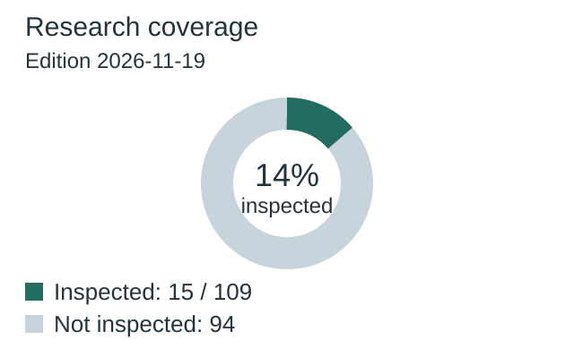
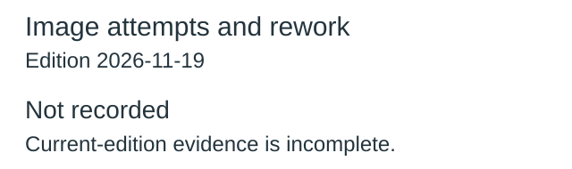
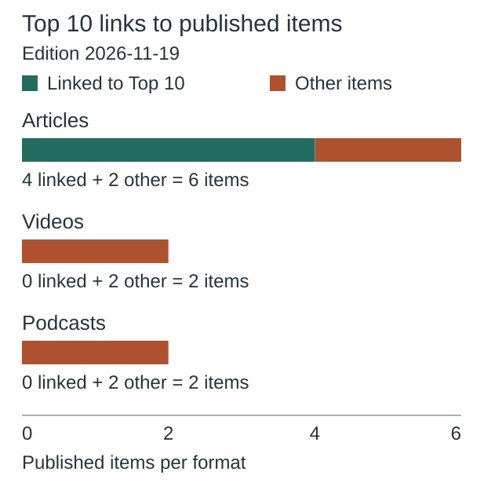
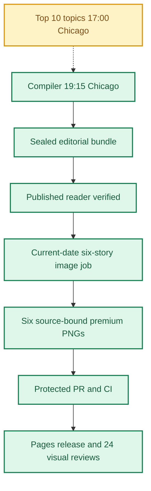
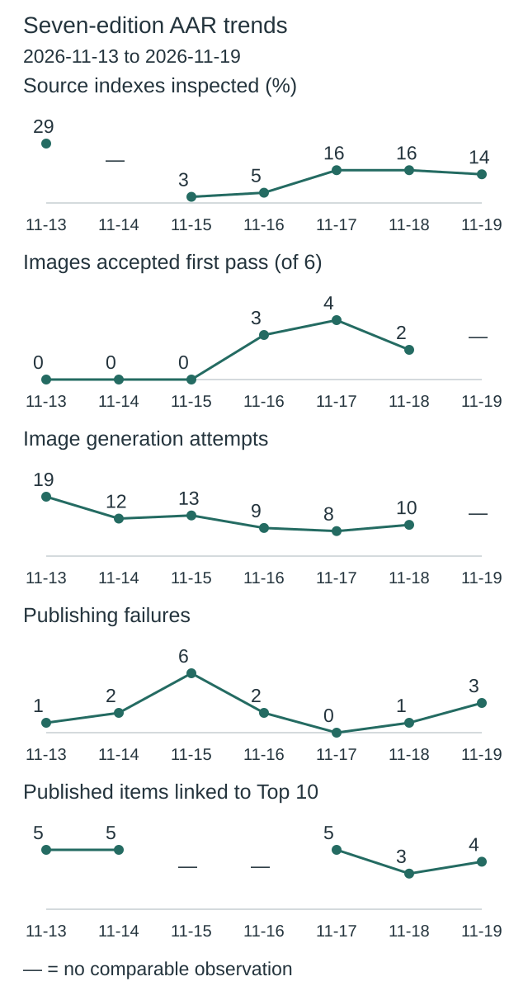
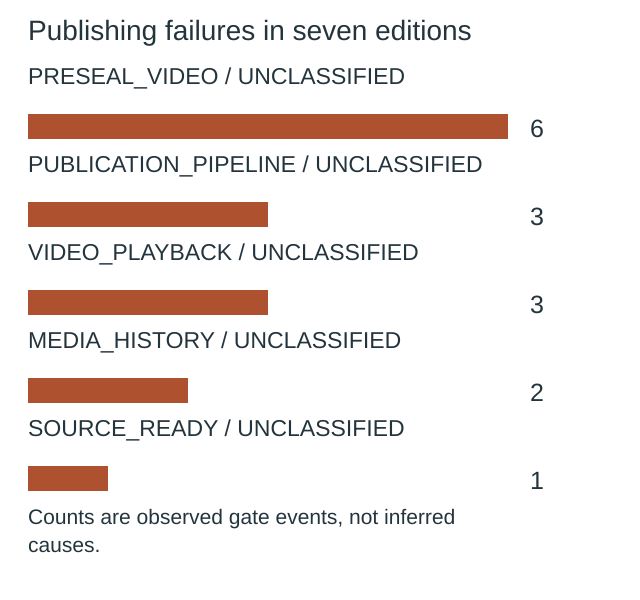
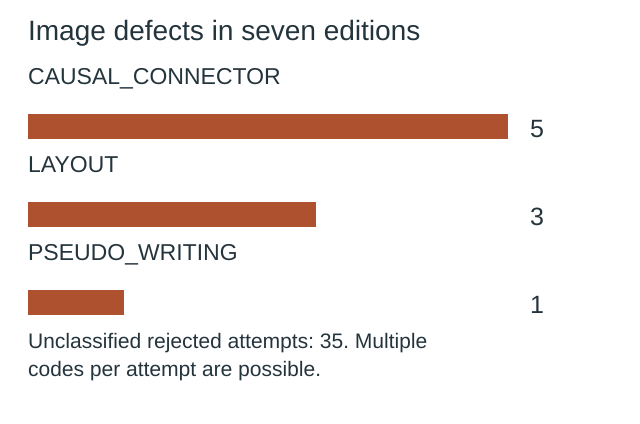

**🟩 RELEASE COMPLETE**
**TOP 10 PARTIAL** · **🟩 COMPILER VERIFIED** · **🟦 IMAGES 6/6 RELEASED** · **🟪 VISUAL QA 24/24 PASS**

# Daily AI Brief — Unified Production After-Action Report
**Edition:** November 19, 2026 · **Production evening:** 2026-11-18 · **Timezone:** America/Chicago
**Primary public reader:** [Open 2026-11-19 Brief](https://gttome.github.io/Daily-AI-Brief-Compiler/briefs/2026-11-19/) · **Repository:** [Daily-AI-Brief-Compiler](https://github.com/gttome/Daily-AI-Brief-Compiler)

> **IMPORTANT — VERIFIED PRODUCTION RESULT**
> **Executive release result: COMPLETE.** This is the single management-facing report covering Top 10 topic discovery, the editorial Compiler, published Brief and premium-image run. **Entire-system evidence: PARTIAL.** Top 10 report: **partial**; Compiler handoff: **RECEIVED_SNAPSHOT_BOUND**; guided searches: **RECEIPTS_OBSERVED**. Compiler public status: **VERIFIED**. Image release: **RELEASED_VERIFIED**. Direct 24-context visual quality: **24/24 PASS**. Autonomous completion: **UNPROVEN**. Missing evidence must not be promoted to a success claim.

**🕒 Production stage durations:** **Top 10 12m 20s** · **Compiler final seal window 19m 30s** · **Premium Images 31m 02s** (evidence-bounded elapsed times; the start/end events differ).

## Evidence reconciliation

Compiler final seal window: 19m 30s. Compiler state start to public verification: 63m 20s. Observed execution and final seal windows are distinct.
Image capability route preflight: NOT OBSERVED; scheduler origin remains UNPROVEN.
Image efficiency: 0/6 first-pass accepts; 12 total attempts. Approved prospective efficiency target: at least 4/6 first-pass and no more than 8 total attempts, strictly advisory, with unchanged quality floor.
Image review completed: 2026-11-19T03:55:34Z; review-record commit: 2026-11-19T03:58:24.000Z; protected review merge: 2026-11-19T03:58:24.000Z.
Eligible source indexes: 109; editorial inspections reported: 15 (13.8%); inaccessible in editorial audit: 0; explicitly unreviewed IDs: 94; unclassified editorial IDs: 0. Automated index parsing is separate from editorial inspection and cannot substantiate exhaustive freshness claims.

Registered video sources: 29; attempted this edition: 29; unattempted: 0; enabled: 28; qualification-only: 1; sources yielding candidate URLs: 0. Status: REPORTED_ALL_ATTEMPTED. Attempt evidence is not automatic proof of source-content review or playback.

Eligible source partition **VALID**. Full original-item reads **2**. Bounded index searches **13**. Qualification-only sources recorded separately **1**.

### Protected preseal video outcomes

| Original publisher | Distinct programs submitted | Archive rejects | Playback passes | Playback unverified | Probes skipped |
|---|---:|---:|---:|---:|---:|
| abcnews.com | 1 | 0 | 0 | 1 | 1 |
| cbsnews.com | 2 | 1 | 1 | 0 | 0 |
| foxbusiness.com | 1 | 0 | 2 | 0 | 0 |
| pbs.org | 1 | 0 | 2 | 0 | 1 |

Outcomes count observed checks across all saved requests. Programs can be submitted again after a different slot changes.

- The data risks of personal AI agents received PRESEAL_ARCHIVE_REPEAT. Earlier editions 2026-11-10. [Original run](https://github.com/gttome/Daily-AI-Brief-Compiler/actions/runs/44438828475)
- Inside Anthropic’s potentially record-breaking IPO received PUBLIC_VIDEO_PLAYBACK_UNVERIFIED. [Original run](https://github.com/gttome/Daily-AI-Brief-Compiler/actions/runs/44439099255)

## Daily AAR charts

These charts use this edition’s receipts. Missing data is not zero.

### Research coverage



**15 of 109 indexes inspected (14%).**

| Editorial inspection | Indexes |
|---|---:|
| Inspected | 15 |
| Not inspected | 94 |

Not inspected includes every index without a recorded editorial inspection; this is not proof of missed stories.

### Image attempts and rework



**12 attempts; 0 of 6 images accepted on their first attempt.**

Recorded ongoing from November 8 target: at least 3/6 first-pass accepts; no more than 2 attempts per image. This is an efficiency target, not a quality cutoff.

| Image | Accepted | Rejected | Total attempts |
|---|---:|---:|---:|
| Malicious PyPI releases turn an agent import into credential theft | 1 | 1 | 2 |
| Gemini 4 Neon trades maximum capability for fast, economical task volume | 1 | 1 | 2 |
| Hy4 Flash pairs open weights with a bounded productivity-workflow test | 1 | 1 | 2 |
| A compact multimodal embedding model broadens local knowledge retrieval | 1 | 1 | 2 |
| Build a reusable Cowork skill around sources, approvals and a visible deliverable | 1 | 1 | 2 |
| Next Gen Zaps adds agentic editing while keeping workflow steps inspectable | 1 | 1 | 2 |

Generation attempts measure rework, not runtime or cost. Quality and publication checks remain separate.

### Top 10 links to published items



**4 of 10 unique published items link to Top 10 topics.**

| Format | Linked to Top 10 | Other items |
|---|---:|---:|
| Articles | 4 | 2 |
| Videos | 0 | 2 |
| Podcasts | 0 | 2 |

No selection quota. Topic linkage does not establish better quality, popularity or causal improvement.

[Chart data](charts.json)

One edition at a time. Missing evidence is not zero. Trend claims require comparable recorded cycles.

## Performance dashboard

| Measure | Recorded result | Source / caveat |
|:--|:--:|:--|
| Entire-system evidence | **PARTIAL** | Full Top 10 list, bound Compiler input, all-format search receipts and existing release checks; separate from publication and autonomy |
| Top 10 report | **partial · 10 topics** | Same Chicago cycle report; provisional/partial coverage remains disclosed |
| Top 10 received by Compiler | **RECEIVED_SNAPSHOT_BOUND** | Exact report snapshot bytes; consumed commit separately corroborated: YES |
| Top 10 guided article/video/podcast searches | **RECEIPTS_OBSERVED** | Actual source-search receipts and selected/rejected topic outcomes |
| Top 10 stage duration | **12m 20s** | Same-cycle run receipt only; no runtime or usage estimate |
| Editorial publication | **PASS** | State and public reader integrity receipt |
| **Unattended autonomy (separate from publication)** | **UNPROVEN** | Owner incident receipt takes precedence over unverified producer self-attestation |
| Recorded protected publishing gate failures | **3** | Actual same-edition GitHub failure sidecar only; earlier unrecorded failures remain unknown |
| Articles | **6** | Exactly 2 technical / 2 knowledge-worker / 2 agents required |
| Original scientific-paper-led articles | **Not recorded** | Rolling target: one qualified original paper in 3 editions; NOT_RECORDED. Preprints are not peer-reviewed by default |
| Verified original sources within preceding 24 hours | **0 / 6** | Original publisher dates only; other sources require a documented fallback rationale |
| Distinct selected article publishers | **5** | Six different primary organizations preferred |
| Videos over seven days old | **0** | Must be labeled evergreen, not a new development |
| Distinct selected video publishers | **2** | One channel is one publisher even across multiple videos |
| Cross-media topic diversity | **FOUR_DISTINCT_EVENTS_REVIEW_RECORDED** | Four video/podcast events and six pairwise original-source comparisons; editorial claims remain producer-attested |
| Video discovery source attempts | **29 / 29** | Attempt evidence across enabled and qualification-only leads; REPORTED_ALL_ATTEMPTED. Not a claim of full content review or player verification | 
| Duplicate active Watchlist display titles | **Not recorded** | Published canonical Watchlist only; historical evidence retained |
| Original-release video playback (historical) | **TWO_PUBLISHED_VIDEOS_PLAYBACK_PASS** | Later reader corrections may replace these originally verified videos; see incident register | 
| Postpublication reader incidents | **NOT_RECORDED** | Edition-specific owner reports and corrective PRs, not inferred absence | 
| Verified postpublication video corrections | **NOT_RECORDED** | Incident register tracks correction PR, actual playback evidence and reader preservation |
| Editorial index second-pass attempts | **0** | Bounded public GET retries only; never proof of original article reading |
| Editorial index reads recovered | **0** | Successful page fetch can still yield zero eligible dated items |
| Recorded scheduler capability route | **UNPROVEN** | Same-invocation route receipt only; GitHub is not scheduler authentication |
| Avoidable incomplete-staging CI failures | **Not independently audited** | Existing image-package push CI is disabled; exact-head protected PR CI remains required. A failure count requires actual workflow evidence |
| Media | **2 videos + 2 podcasts** | Sealed bundle |
| **Compiler final seal window** | **19m 30s (19.5 min)** | Final sealed-state timestamp → verified public reader; initial execution is separate |
| **Image processing stage duration** | **31m 02s** | First accepted PNG Git checkpoint → final 24/24 review; auditable stage elapsed time |
| Image scheduled-to-final-review window | **Not independently recorded** | Only with a saved one-cycle schedule anchor; does not attest exact generation start |
| Executor-observed generation-to-final-review | **35m 21s** | Only if the worker recorded a same-execution clock before its first native call; not independently verified provider runtime |
| Accepted premium PNGs | **6 / 6** | Exact package and public release hashes |
| Native image generation attempts | **12** | Image worker AAR; no estimation |
| Rejected candidates | **6** | Image worker AAR |
| Final worker checkpoint reconciliation | **PASS** | Oct25+ verifies exact generation count, per-story attempts, six accepted story/image/hash bindings and final release |
| Saved visual contexts | **24 / 24 PASS** | Dated/permanent desktop/mobile review |
| Public SHA-256 checks | **44** | Image release receipt |
| October 8 immutable history | **17 / 17** | Independent content-preservation checks |
| **Owner-reported weekly Work usage for this run** | **Not reported** | No per-cycle usage supplied |

> **EFFICIENCY NOTE**
> **Resource reporting policy:** No usage figure was supplied for this cycle, so none is assumed. Future runs show **Not reported** unless the owner supplies new cycle-specific usage metadata. No approval or extra step is required to generate the AAR.

## Production architecture and checkpoints



## Daily AI Topic Top 10 and Compiler handoff

**Research cycle:** 2026-11-18 · **Target Brief:** 2026-11-19 · **Scheduled start:** 17:00 America/Chicago

| Dimension | Recorded evidence |
|---|---|
| Run/report result | PARTIAL |
| Report status / topics | partial / 10 |
| Freshness | FRESH\_AT\_CONSUMPTION |
| Compiler handoff | RECEIVED\_SNAPSHOT\_BOUND |
| Search coverage | RECEIPTS\_OBSERVED |
| Selection mapping verification | MATCHES\_EDITION\_BUNDLE |
| Observed start / finish | 2026-11-18T23:04:47Z / 2026-11-18T23:17:07Z |
| Elapsed minutes | 12.33 |
| Usage percent | Not reported |
| Cost USD | Not reported |
| Independent scheduler autonomy | UNPROVEN |
| Compiler-recorded consumed commit | f2601c9e3595f62f71c00cac7f620b958478fff8 |
| Report SHA-256 | b4d7702af7a0b5918c57c57b4d9b40f8d9e2996b27ce9523846c72d09b2157b1 |

| Discovery order | AI topic | Summary | Confidence | Evidence |
|---:|---|---|---|---|
| 1 | OpenAI’s GPT-6.2 Astra and Sol launch draws mixed reactions | OpenAI’s new models target professional work and coding, while early public reactions question how benchmark gains translate to everyday results. | medium | [Source](https://www.youtube.com/watch?v=JVHkb8PTMvc) · [Source](https://www.youtube.com/watch?v=jk7rTk1Bh8I) · [Source](https://www.youtube.com/watch?v=jm_h5nRZoCg) · [Source](https://news.ycombinator.com/item?id=50535230) · [Source](https://openai.com/index/introducing-gpt-6-2-astra-sol/) |
| 2 | ArtCraft’s talk on rebuilding creative tools with coding agents | Brandon Thomas describes using coding agents to build adaptable open-source creative applications, while distinguishing an early approximation from full product parity. | medium | [Source](https://www.youtube.com/watch?v=UCL4K36SHp0) · [Source](https://ai.engineer/code/2026/talks/brandon-thomas) · [Source](https://latent.space/p/artcraft/) |
| 3 | Qwen4-Max gains another day of creator attention | Alibaba’s large multimodal model is drawing workload comparisons that need to separate advertised capability and token prices from actual task cost. | medium | [Source](https://www.youtube.com/watch?v=_kAf7rd2l8Q) · [Source](https://www.youtube.com/watch?v=atz4gzB7ykY) · [Source](https://www.youtube.com/watch?v=5vPXJiy83Sg) · [Source](https://news.ycombinator.com/item?id=50513215) · [Source](https://www.alibabacloud.com/en/press-room/alibaba-unveils-qwen4-max?_p_lc=1) |
| 4 | Google launches Gemini 4 Neon | Google positions Neon between fast everyday models and its larger flagship for coding, analysis and knowledge work. | medium | [Source](https://www.reddit.com/r/GeminiAI/comments/1xzq3hn/google_just_released_gemini_4_neon_nearcarbon/) · [Source](https://9to5google.com/2026/11/18/gemini-4-neon-announcement/) · [Source](https://blog.google/innovation-and-ai/models-and-research/gemini-models/introducing-gemini-4-neon/) |
| 5 | Malicious Agent Framework releases expose developer credentials | Two unauthorized PyPI releases added credential-stealing code to Microsoft’s agent framework, prompting original security analyses and independent reporting. | medium | [Source](https://www.elastic.co/security-labs/threat-command/we-caught-the-agent-framework-pypi-compromise-six-minutes-after-it-published) · [Source](https://research.jfrog.com/post/agent-framework-hijack/) · [Source](https://www.securityweek.com/microsoft-agent-framework-releases-poisoned-with-credential-stealer/) · [Source](https://www.bleepingcomputer.com/news/security/microsofts-agent-framework-pypi-package-compromised-to-steal-credentials/) · [Source](https://github.com/advisories/GHSA-764m-3ppc-5m73) |
| 6 | Microsoft’s MAI Code 2 models target everyday enterprise coding | Microsoft’s Code 2 and Flash models target common coding workloads, with vendor claims about cost that depend on the task and evaluation. | medium | [Source](https://news.ycombinator.com/item?id=50535885) · [Source](https://microsoft.ai/news/introducing-mai-code-2-and-mai-code-2-flash/) · [Source](https://www.youtube.com/watch?v=A4fp61gQeec) |
| 7 | Tencent’s Hy4 flash opens a lower-cost multimodal option | Tencent released Hy4 flash for deployment and everyday agent work, with open weights and model-specific license terms. | medium | [Source](https://x.com/TencentHunyuan/status/2122912575302119554) · [Source](https://news.ycombinator.com/item?id=50538184) · [Source](https://huggingface.co/tencent/Hy4-flash) · [Source](https://thedefiant.io/frontier/ai/tencent-s-hy4-flash-undercuts-rivals-base-api-rates) |
| 8 | ChatGPT adds a sales workflow and partner plugins | OpenAI’s Sales plugin connects account research, call preparation and follow-ups with tools a sales team already uses. | low | [Source](https://x.com/ChatGPT/status/2122818162995634504) · [Source](https://openai.com/index/introducing-chatgpt-for-sales/) |
| 9 | Perplexity’s Orchestrator API adds model routing and failover | Perplexity offers one interface for multiple models, with routing, provider failover and unified billing that developers still need to test on their own workload. | low | [Source](https://x.com/perplexity_ai/status/2122785177135096053) · [Source](https://www.perplexity.ai/en-GB/hub/blog/orchestrator-one-api-for-reliable-inference) · [Source](https://community.perplexity.ai/t/introducing-the-perplexity-orchestrator-api/6688) |
| 10 | EmbeddingGemma 2 gets a technical explainer and report spotlight | A new Google explainer revisits how the already released model places text, images, audio and video in a shared search space. | medium | [Source](https://www.youtube.com/watch?v=aRIFzzr_Mi0) · [Source](https://blog.google/innovation-and-ai/technology/developers-tools/embeddinggemma-2-technical-report/) · [Source](https://arxiv.org/abs/2610.37364) |

**Sample scope:** {"metadata\_screened\_videos":51,"unique\_videos":51,"distinct\_retained\_channels":7,"full\_video\_reviews":0,"videos\_watched":0,"direct\_counter\_verifications":0,"direct\_youtube\_counter\_verifications":0,"transcript\_reviews":0,"partial\_original\_publisher\_transcript\_reviews":3,"partial\_third\_party\_transcript\_reviews":0,"original\_program\_companion\_article\_reviews":2,"original\_watch\_attempts":51,"original\_watch\_outcomes":{"throttled":46,"title\_index\_shell":5},"comparable\_video\_observations":1,"within\_24h\_reported\_publications":3,"additional\_within\_72h\_reported\_publications":13,"additional\_within\_7d\_reported\_publications":1,"older\_timestamped\_publications":0,"date\_only\_video\_publications":34,"unknown\_video\_publication\_dates":0,"full\_video\_review\_target\_met":false,"freshness\_reference\_at":"2026-11-18T23:15:20Z","substantive\_original\_event\_document\_reviews":12,"notes":"24h priority, then72h and7d. Date-only metadata excluded from exact hourly bins; three date-only older programs screened but not retained. 34 distinct screened channels; seven channels supply retained event-matched video attention. Metadata is not full program review.","distinct\_screened\_channels":34}. **Ranking basis:** {"attention":"Named-event video reach, one same-source interval growth observation, independent reporting and public discussions. One observation has one primary event.","ordering":"Qualitative discovery priorities, not an exact global popularity ranking. No composite score, view-age velocity or audience sum.","limitations":"Platform/format differences, unknown measurement clocks and inaccessible direct counters preclude precise popularity comparisons."}.

| Search format | Receipt rows | Attempts recorded | Explicitly not attempted |
|---|---:|---:|---:|
| article | 10 | 10 | 0 |
| video | 10 | 10 | 0 |
| podcast | 10 | 10 | 0 |

**Selected Brief items linked to trends:**

| Topic | Format | Selected item | Reason |
|---|---|---|---|
| agent-framework-pypi-compromise-nov17 | article | nov19-t1-pypi · [Source](https://research.jfrog.com/post/agent-framework-hijack/) | Exact event match with complete original incident, affected-artifact, execution-mechanism and remediation review. |
| gemini4-neon-launch-nov18 | article | nov19-t2-neon · [Source](https://blog.google/innovation-and-ai/models-and-research/gemini-models/introducing-gemini-4-neon/) | Exact event match with complete original release, pricing, context-window, benchmark and safety-claim review. |
| tencent-hy4-flash-nov17 | article | nov19-k1-hy4-flash · [Source](https://huggingface.co/tencent/Hy4-flash) | Exact event match with complete first-party model-card review covering open-weight variants, productivity tasks, deployment, cost claims and license limits. |
| embeddinggemma2-technical-explainer-nov17 | article | nov19-k2-embeddinggemma · [Source](https://blog.google/innovation-and-ai/technology/developers-tools/embeddinggemma-2-technical-report/) | Exact event match with complete original multimodal embedding overview and linked technical-method scope. |

**Gaps and limitations:**

- The report labels its research partial.
- Research is partial: zero fully watched videos, zero complete transcript reviews and zero direct YouTube counter verifications despite51 watch attempts.
- Four third-party discovery aggregators and two publisher indexes form a bounded sample; no global YouTube coverage claim.
- Likes, comments, subscriber counts and sponsorship are null when not actually visible. No transcript or sponsorship inferred.
- Some sources supply only indexed or cached text and unknown measurement clocks. Vendor claims are not independent reproduction.
- One VCA video ID resolved to conflicting titles across retrieved page references; excluded from the51 identified program records. Older clips and derivative Shorts were not padded into retained topics.
- No precision rank, universal topic growth, Google Trends volumes, CTR, retention or channel-relative baseline was inferred.
- Saved handoff is not proof of Compiler consumption, actual searches, selected mappings, publication, images or scheduled origin.

**Recorded run issues:**

- {"issue":"46 distinct original YouTube watch routes throttled and five returned title/page shells.","effect":"Zero full video reviews, complete video transcripts or direct YouTube counter checks.","correction":"Used bounded original organizer passages, original launch documents and original podcast notes without claiming playback."}
- {"issue":"Direct X retrieval returned403; some tracker and indexed counters lack measurement clocks.","effect":"Exact cross-platform ranking and most growth comparisons unavailable.","correction":"Persisted one same-video/source/format timed comparison; no mixed-tracker or view-age velocity estimates."}
- {"issue":"One VCA watch ID resolved to conflicting indexed titles, and an alleged Google card redirected to a rewritten summary.","effect":"Program identity and original-card provenance were not reliable.","correction":"Excluded the conflicting ID from the51 program denominator and rejected the rewritten card as original evidence; used Google blog and arXiv."}
- {"issue":"Hy4 tracker claims224B parameters while original card specifies220B; podcast index date18 conflicts with original player date17.","effect":"Unqualified reposting would misstate model identity or media freshness.","correction":"Used original220B specification; disclosed both podcast dates and left qualification with Compiler."}
- {"issue":"Initial local validation harness used the wrong freshness output property.","effect":"An assertion failed although report\_valid was true.","correction":"Corrected harness to report\_freshness and reran the pinned validator against exact committed bytes; passed."}

**Recorded improvements:**

- {"change":"Used original organizer transcript passages and a first-party podcast episode with chapters to deepen exact-event discovery.","reason":"Prior AAR still shows no selected media mappings and no verified full playback.","expected\_effect":"Give Compiler original program-specific leads while preserving date and playback uncertainty.","status":"implemented\_in\_current\_research"}
- {"change":"Preserved stable event IDs, 30 distinct canonical queries and separate same-source timed video comparisons.","reason":"Recent exact-input changes require meaningful identities and actual downstream evidence.","expected\_effect":"Auditable discovery priorities without inferred search or selection success.","status":"implemented\_in\_current\_research"}

### Daily improvement and effect on the Brief

**Fixed baseline:** nov03-2026-v1 / INPUT\_FROZEN. **Outcome baseline:** FROZEN\_AFTER\_VERIFIED\_PUBLICATION. **Prior cycle:** 2026-11-17.

| Input measure | Current | November 3 baseline | Change from baseline | Change from prior cycle |
|---|---:|---:|---:|---:|
| topic count | 10 | 10 | 0 | 0 |
| validation resource count | Not reported | 14 | Not reported | Not reported |
| additional video metadata records | Not reported | 63 | Not reported | Not reported |
| additional video channels | Not reported | 21 | Not reported | Not reported |
| total video observations | Not reported | 79 | Not reported | Not reported |
| unique videos | Not reported | 71 | Not reported | Not reported |
| full video reviews | 0 | 0 | 0 | 0 |
| direct youtube counter verifications | 0 | 0 | 0 | 0 |
| broader evidence band topics | 5 | 3 | 2 | 1 |
| limited evidence band topics | 5 | 7 | -2 | -1 |

**Observed downstream measurements:** OBSERVED.

| Outcome measure | Current | Change from frozen outcome | Change from prior cycle |
|---|---:|---:|---:|
| expected topic format pairs | 30 | 0 | 0 |
| attempted topic format pairs | 30 | 0 | 0 |
| explicitly unattempted pairs | 0 | 0 | 0 |
| discovered candidate count | 16 | -24 | 3 |
| searched source host count | 12 | -4 | -17 |
| selected article count | 4 | 1 | 1 |
| selected video count | 0 | 0 | 0 |
| selected podcast count | 0 | -1 | 0 |

**Source changes:** {"added":\[\],"removed":\[\]}.

**Candidate review depth:** NOT\_RECORDED.

| Review measure | Current | Change from prior comparable cycle |
|---|---:|---:|
| reviewed candidate count | Not reported | Not reported |
| qualified candidate count | Not reported | Not reported |
| rejected candidate count | Not reported | Not reported |
| metadata only count | Not reported | Not reported |
| full video reviews | Not reported | Not reported |
| transcript reviews | Not reported | Not reported |

The frozen November 3 baseline has no candidate-level review ledger; no retrospective value is invented. Recorded reviews do not independently establish content quality, audience interest or causal benefit.

**Method/resource review:** {"baseline\_id":"nov03-2026-v1","previous\_report\_date":"2026-11-17","previous\_method\_version":"2026-11-03.2-event-review","method\_version":"2026-11-03.2-event-review","feedback":{"aar\_url":"https://github.com/gttome/Daily-AI-Brief-Compiler/blob/448ecb88d3a9d6a129da2c00ad4ac43c2647be8e/daily/2026-11-17/combined.md","charts\_url":"https://github.com/gttome/Daily-AI-Brief-Compiler/blob/448ecb88d3a9d6a129da2c00ad4ac43c2647be8e/daily/2026-11-17/charts.json","metrics\_url":"https://github.com/gttome/Daily-AI-Brief-Compiler/blob/448ecb88d3a9d6a129da2c00ad4ac43c2647be8e/daily/2026-11-17/improvement-metrics.json","observation":"Latest earlier November 18 edition AAR verifies a bound consumed snapshot, ten actual searches per format and three selected article mappings, zero video and podcast mappings. Coverage chart: 17/109 inspected; image chart: ten attempts, two first-pass acceptances. Separate roles and causal outcomes remain distinct."},"changes":\[{"change":"Used original organizer transcript passages and a first-party podcast episode with chapters to deepen exact-event discovery.","reason":"Prior AAR still shows no selected media mappings and no verified full playback.","expected\_effect":"Give Compiler original program-specific leads while preserving date and playback uncertainty."},{"change":"Preserved stable event IDs, 30 distinct canonical queries and separate same-source timed video comparisons.","reason":"Recent exact-input changes require meaningful identities and actual downstream evidence.","expected\_effect":"Auditable discovery priorities without inferred search or selection success."}\],"resource\_candidates":\[{"url":"https://ai.engineer/code/2026/talks/brandon-thomas","role":"Original organizer program notes and partial timed transcript","access":"Public text","review\_scope":"Summary on approximation versus parity and selected timestamped passages around 1:28–1:29 of event recording; not complete transcript or playback.","independence":"Same organizer family as AI Engineer/Latent Space.","decision":"accepted","reason":"Exact talk supplies substantive scope missing from a throttled video.","contribution":"Prevents equating a fast prototype with full product parity."},{"url":"https://www.buzzsprout.com/2614078/episodes/20143399","role":"Original podcast notes, chapters and partial transcript","access":"Public text","review\_scope":"GPT launch chapter and metadata inspected; no advancing playback.","independence":"DoiT publisher, distinct from model vendors; show identity and dates require Compiler check.","decision":"accepted","reason":"Exact dated episode contains a GPT-6.2 chapter; original date differs from publisher index.","contribution":"Adds a concrete podcast discovery candidate with original-date discrepancy disclosed."},{"url":"https://gemma.ai/models/embeddinggemma/model-card-v2/","role":"Redirected model-card route","access":"Rewritten redirected summary","review\_scope":"Redirect identity recognized; not treated as an official Google model-card review.","independence":"Original publisher identity not established by redirect.","decision":"rejected","reason":"Use original Google technical post and arXiv instead.","contribution":"Avoids mislabeling rewritten third-party material as a directly retrieved original card."}\],"observed\_effects":\[{"observation":"51 distinct video metadata screens versus prior50; one comparable timed video pair versus prior5; zero full video reviews in both.","effect":"Scope differs; counts alone do not prove quality improvement."},{"observation":"Latest earlier AAR records three article mappings and zero media mappings.","effect":"Mapping outcome only; source contribution and incremental causal yield remain unproven."}\],"next\_improvement":"Review original program dates and exact downstream candidate/search dispositions in the next independently collected AAR; prioritize original playable program evidence before extra metadata.","limitations":\["November 10 one-day pilot is inactive; current category totals use distinct item URLs with trackers excluded.","Metadata depth and playback remain separate; no assumed quality uplift."\],"change\_evaluations":\[{"change\_id":"NOV15-02","reviewed\_edition":"2026-11-18","decision":"keep","result":"met","reason":"Latest earlier AAR binds the consumed snapshot, verifies thirty actual format searches and matches three article selections with the edition bundle. This is integration evidence, not proof of selection improvement.","evidence\_refs":\["https://github.com/gttome/Daily-AI-Brief-Compiler/blob/448ecb88d3a9d6a129da2c00ad4ac43c2647be8e/daily/2026-11-17/combined.md","https://github.com/gttome/Daily-AI-Brief-Compiler/blob/448ecb88d3a9d6a129da2c00ad4ac43c2647be8e/daily/2026-11-17/charts.json"\]},{"change\_id":"NOV16-P0-01","reviewed\_edition":"2026-11-18","decision":"keep","result":"met","reason":"The due-edition AAR verifies ten attempted slots per format against the exact source; downstream media yield and causal quality improvement remain separate unknowns.","evidence\_refs":\["https://github.com/gttome/Daily-AI-Brief-Compiler/blob/448ecb88d3a9d6a129da2c00ad4ac43c2647be8e/daily/2026-11-17/combined.md","https://github.com/gttome/Daily-AI-Brief-Compiler/blob/448ecb88d3a9d6a129da2c00ad4ac43c2647be8e/daily/2026-11-17/improvement-metrics.json"\]},{"change\_id":"NOV15-05","reviewed\_edition":"2026-11-18","decision":"keep","result":"inconclusive","reason":"No independently sourced scheduler attestation is available in this producer invocation. Published outcomes cannot establish unattended origin.","evidence\_refs":\["https://github.com/gttome/Daily-AI-Brief-Compiler/blob/448ecb88d3a9d6a129da2c00ad4ac43c2647be8e/daily/2026-11-17/improvement-metrics.json"\]},{"change\_id":"NOV16-P1-09","reviewed\_edition":"2026-11-18","decision":"keep","result":"inconclusive","reason":"Due November20; the latest mapping count does not alone establish incremental discovery yield or a causal change in selection.","evidence\_refs":\["https://github.com/gttome/Daily-AI-Brief-Compiler/blob/448ecb88d3a9d6a129da2c00ad4ac43c2647be8e/daily/2026-11-17/combined.md","https://github.com/gttome/Daily-AI-Brief-Compiler/blob/448ecb88d3a9d6a129da2c00ad4ac43c2647be8e/daily/2026-11-17/improvement-metrics.json"\]}\]}.

**Current reconciled conclusion:** OBSERVED; outcome baseline FROZEN\_AFTER\_VERIFIED\_PUBLICATION; candidate review ledger NOT\_RECORDED.

**Historical producer observations (not current status):** The following snapshot preserves what the producer reported at the time. Its pending statuses and candidate-quality claims are not independently reconciled conclusions. Use the current tables above for publication-bound measurements; an absent candidate review ledger remains unknown.

<details><summary>Original producer effects and gaps — historical snapshot</summary>

```json
{
  "actual_searches": 30,
  "qualified_candidate_ids": [
    "cand-gpt62-followup",
    "cand-gpt62-video",
    "cand-gpt62-podcast",
    "cand-artcraft-companion",
    "cand-artcraft-talk",
    "cand-hy4-release",
    "nov19-t2-neon",
    "cand-neon-launch-video",
    "nov19-t1-pypi",
    "cand-mai-code2",
    "nov19-k1-sales",
    "cand-perplexity-orchestrator",
    "cand-embeddinggemma2-report",
    "cand-embeddinggemma2-explainer"
  ],
  "unknown_causal_uplift": null,
  "limitations": [
    "Exact event searches prioritize discovery but do not prove selection quality or causal improvement.",
    "Media candidates remain subject to full-content, archive, duration and playback checks."
  ]
}
```

</details>

**Next improvement:** Review original program dates and exact downstream candidate/search dispositions in the next independently collected AAR; prioritize original playable program evidence before extra metadata.

Counts show coverage and observed association, not audience popularity, source independence, candidate quality or causal uplift. Compare source/method changes before interpreting deltas. Unknown values are not zero. Publication, reader corrections, runtime and image outcomes retain their separate AAR evidence.

Report, source-readback and search receipts are separate observations. Snapshot binding verifies the collected report bytes; the consumed commit is independently corroborated only when the separately fetched source bytes match. These records do not independently attest scheduler identity or source truth. Top 10 reporting does not change Brief/image release status.


## Track 1 — Compiler

**State:** `SHADOW_VERIFIED` · **Bundle:** `BUNDLE_READY` · **Compiler final seal window:** 19m 30s (19.5 min).

| Publication gate | Result |
|---|:---:|
| Canonical reader build | ✅ |
| Reader parity | ✅ |
| Public verification of dated edition | ✅ |
| Previous editions preserved | ✅ |
| Permanent story routes and feeds | ✅ |

**Selected coverage:**

| Lane | Story |
|---|---|
| Technical AI Engineering | Malicious PyPI releases turn an agent import into credential theft |
| Technical AI Engineering | Gemini 4 Neon trades maximum capability for fast, economical task volume |
| Applied Generative AI for Knowledge Workers | Hy4 Flash pairs open weights with a bounded productivity-workflow test |
| Applied Generative AI for Knowledge Workers | A compact multimodal embedding model broadens local knowledge retrieval |
| Agents for Everyone | Build a reusable Cowork skill around sources, approvals and a visible deliverable |
| Agents for Everyone | Next Gen Zaps adds agentic editing while keeping workflow steps inspectable |

### Scientific paper opportunity and publication evidence

**Current edition:** NOT_RECORDED; **paper-led stories:** Not recorded. Editorial target: at least one genuinely qualified original-paper-based story in seven editions, with methods, limitations, and an explicit preprint/peer-review distinction. No stale or weak paper is selected solely to fill a quota.


## Track 2 — Premium images

**Public status:** `RELEASED_VERIFIED` · **Saved images:** 6/6 · **Actual generation attempts:** 12 · **Rejected candidates:** 6.

### Image production duration — Git-verified milestones

**Auditable image stage duration:** **31m 02s** (first accepted binary saved in Git → first persisted 24-context quality-review record). **First asset to public image release:** **21m 43s**.
**Scheduled-to-final-review window:** **Not independently recorded**. This is a scheduled-clock comparison only when a separately recorded exact-date schedule exists; it is **not** measured native image-generation runtime.

| Production milestone | Chicago local time | Evidence |
|---|---|---|
| Scheduled image start (if exact-date record exists) | Not independently recorded | Time planned, not actual execution start |
| First executor-observed start | 9:14:17 PM | Worker self-attestation, not a first-party scheduler event |
| First native generation observation | 9:23:03 PM | Worker clock recorded immediately before first native call, not model-provider telemetry |
| First accepted PNG bytes saved to Git | 9:27:22 PM | Immutable binary-stage commit |
| Six-image package / reviews committed | 9:44:05 PM | Exact-head PR source commit |
| Protected package merged | 9:47:55 PM | Merge SHA and required CI |
| Public images verified | 9:49:04 PM | Image-release receipt |
| 24/24 review record committed | 9:58:24 PM | Immutable first review-approval commit |

> **Duration interpretation:** The audited stage excludes unobservable pre-checkpoint creative work. The scheduled-start window includes it but must not be interpreted as precise active processing time. Missing timestamps appear as **Not independently recorded**, never an estimate.


| Source-bound image | Attempts | File size | Public page |
|---|---:|---:|---|
| Malicious PyPI releases turn an agent import into credential theft | 2 | 1.22 MiB | [View original](https://gttome.github.io/Daily-AI-Brief-Compiler/briefs/images/2026-11-19/dab-edition-2026-11-19-m01.png) |
| Gemini 4 Neon trades maximum capability for fast, economical task volume | 2 | 1.14 MiB | [View original](https://gttome.github.io/Daily-AI-Brief-Compiler/briefs/images/2026-11-19/dab-edition-2026-11-19-m02.png) |
| Hy4 Flash pairs open weights with a bounded productivity-workflow test | 2 | 1.04 MiB | [View original](https://gttome.github.io/Daily-AI-Brief-Compiler/briefs/images/2026-11-19/dab-edition-2026-11-19-m10.png) |
| A compact multimodal embedding model broadens local knowledge retrieval | 2 | 1.40 MiB | [View original](https://gttome.github.io/Daily-AI-Brief-Compiler/briefs/images/2026-11-19/dab-edition-2026-11-19-m11.png) |
| Build a reusable Cowork skill around sources, approvals and a visible deliverable | 2 | 1.37 MiB | [View original](https://gttome.github.io/Daily-AI-Brief-Compiler/briefs/images/2026-11-19/dab-edition-2026-11-19-m12.png) |
| Next Gen Zaps adds agentic editing while keeping workflow steps inspectable | 2 | 0.90 MiB | [View original](https://gttome.github.io/Daily-AI-Brief-Compiler/briefs/images/2026-11-19/dab-edition-2026-11-19-m14.png) |

**Immutable-release and visual gates:**

| Release gate | Result |
|---|:---:|
| Protected public image receipt | ✅ |
| Accepted-image Git hash bindings | ✅ |
| Six live PNGs | 6/6 |
| Dated/permanent story placements | 12/12 recorded in release evidence |
| Desktop/mobile visual inspection | 24/24 PASS |
| Historical Oct 8 integrity | 17/17 |

### Published premium illustrations

<table>
<tr><td width="50%"><a href="https://gttome.github.io/Daily-AI-Brief-Compiler/briefs/images/2026-11-19/dab-edition-2026-11-19-m01.png"></a><br/><b>Malicious PyPI releases turn an agent import into credential theft</b></td><td width="50%"><a href="https://gttome.github.io/Daily-AI-Brief-Compiler/briefs/images/2026-11-19/dab-edition-2026-11-19-m02.png"></a><br/><b>Gemini 4 Neon trades maximum capability for fast, economical task volume</b></td></tr>
<tr><td width="50%"><a href="https://gttome.github.io/Daily-AI-Brief-Compiler/briefs/images/2026-11-19/dab-edition-2026-11-19-m10.png"></a><br/><b>Hy4 Flash pairs open weights with a bounded productivity-workflow test</b></td><td width="50%"><a href="https://gttome.github.io/Daily-AI-Brief-Compiler/briefs/images/2026-11-19/dab-edition-2026-11-19-m11.png"></a><br/><b>A compact multimodal embedding model broadens local knowledge retrieval</b></td></tr>
<tr><td width="50%"><a href="https://gttome.github.io/Daily-AI-Brief-Compiler/briefs/images/2026-11-19/dab-edition-2026-11-19-m12.png"></a><br/><b>Build a reusable Cowork skill around sources, approvals and a visible deliverable</b></td><td width="50%"><a href="https://gttome.github.io/Daily-AI-Brief-Compiler/briefs/images/2026-11-19/dab-edition-2026-11-19-m14.png"></a><br/><b>Next Gen Zaps adds agentic editing while keeping workflow steps inspectable</b></td></tr>
</table>

## Incidents, corrections and learning

### Postpublication reader incidents (updated when new evidence is merged)

No current-edition postpublication incident register was available; this is **NOT_RECORDED**, not a certification of zero incidents.


**Editor recovery classification:** UNPROVEN. **Owner intervention:** Unproven either way. **Protected same-edition failures recorded:** 3. 
**Latest failed protected stage:** PUBLICATION_PIPELINE; [Action evidence](https://github.com/gttome/Daily-AI-Brief-Compiler/actions/runs/44441789050). Exact stage durations are available only where real source timestamps exist.

| Stage | Verified issue | Corrective action |
|---|---|---|
| Native generation saved-pixel rejection | The connected review folio is source-faithful and has blank document faces. The lower action strip has an extra unfrozen arrowhead, though it correctly stops at the boundary. The Approval first caption crowds the right glyph floor; move that gate inward and remove only the extra head. | Freeze a localized source-bound correction, preserve passing regions and inspect the second saved export. |
| Native generation saved-pixel rejection | The source-specific screenprint has six exact readable labels and no simulated writing. It adds three unfrozen arrowheads between central step objects and after the test seam. Preserve the entire workflow/running-record explanation while removing those extra heads. | Freeze a localized source-bound correction, preserve passing regions and inspect the second saved export. |
| Native generation saved-pixel rejection | License/infrastructure caption crowds the bottom saved-pixel safe floor. Text-input and text-output arrowheads are source-plausible but were not in the exact frozen allowed-edge plan. Preserve inputs, encoder/projector connection and six labels; correct the specific extra arrowheads and lower cradle. | Freeze a localized source-bound correction, preserve passing regions and inspect the second saved export. |
| Native generation saved-pixel rejection | The saved watercolor surface has excellent six-label readability and a distinct continuous silhouette. It adds two source-plausible but unfrozen arrowheads from Text and Video. Correct only those heads; retain the full source-faithful mixed-modality mechanism and all passing art. | Freeze a localized source-bound correction, preserve passing regions and inspect the second saved export. |
| Native generation saved-pixel rejection | Saved 1200px export: Credential theft ends near x1167, leaving only 33px right margin. Art crowds top and bottom. Full text reads correctly; arrows attach to depicted components. Preserve engraved mechanism and move affected elements into the reserved safe regions. | Localized native edit preserving source mechanism; inset composition and reposition right label. |
| Native generation saved-pixel rejection | The saved PNG contains faux document writing across six sheet faces and unplanned circular retry arrows. Paired ribbons are visibly distinct; preserve them and exact readable text, removing only unsupported marks and connections. | Freeze a localized source-bound correction, preserve passing regions and inspect the second saved export. |
| Connected binary readback capability | Connected fetch_file base64 returned empty content for PNG over one MiB; generic fetch rejected binary UTF-8 handling. | Fetched the exact canonical commit with normal git and checked decoded PNG length, SHA256 and blob against saved accepted bytes. Preserved every PNG and performed fixed-offset reconstruction. |
| Reporting receipt transport | The initial semantic review JSON upload used a truncated command-output result, making the committed JSON invalid and causing daily-operations-report run 44455078618 to fail before reconciliation. | Reused the complete original saved 24-target review without changing findings; parsed before upload and compared the entire remote readback byte-for-byte. Protected reporting-only PR 390 repairs the receipt; accepted PNGs remain unchanged. |

> **OPERATIONAL NOTE**
> This report distinguishes a published and verified production outcome from scheduler metadata exposed to another conversation. Lack of a live host heartbeat in a separate normal chat is not a Compiler production failure.

## Usage and cost stewardship

| Item | Per-cycle value |
|---|---|
| **Weekly Work usage reported by owner** | **Not reported** |
| Internal weekly usage reference | Target under 5% |
| Genuine image-generation attempts | 12 |
| Accepted diagrams | 6 |
| Regeneration after acceptance | 0 |
| Top 10 reported usage | Not reported |
| Top 10 reported cost | Not reported |
| Account-level billing telemetry | Not independently accessible to deterministic GitHub reporting |

**Future reporting rule:** For cycles without an optional owner-usage record, publish the complete AAR with `Not reported`; do not reuse prior percentages, guess remaining weekly credits or delay tomorrow's production.

## Next-edition operating handoff

| Control | Recurring contract |
|---|---|
| AI Topic Top 10 | Sole report task · 17:00 America/Chicago · saved dated list guides same-evening research |
| Primary Compiler | Sole existing task · 19:15 America/Chicago |
| Premium image production | Sole existing task · standard 21:15 America/Chicago |
| Exact image job selection | Newly published next-date `PUBLISHED_PENDING` only |
| AAR | Combined report generated automatically from new GitHub receipts |
| Optional Work usage | Owner-supplied per cycle, otherwise `Not reported` |

> **SCHEDULE RESTORATION NOTE**
> A temporary scheduling exception must be explicitly restored before claiming standard-time readiness. This deterministic document generator reads existing state only; it does not modify production schedules.

## Evidence register

| Evidence | Link |
|---|---|
| Compiler state | [Open receipt](https://github.com/gttome/Daily-AI-Brief-Compiler/blob/shadow/2026-11-19/shadow-runs/2026-11-19/compiler-state.json) |
| Compiler compile receipt | [Open receipt](https://github.com/gttome/Daily-AI-Brief-Compiler/blob/shadow/2026-11-19/shadow-runs/2026-11-19/compiler/compile-receipt.json) |
| Compiler public integrity | [Open receipt](https://github.com/gttome/Daily-AI-Brief-Compiler/blob/shadow/2026-11-19/shadow-runs/2026-11-19/compiler/postpublish-integrity.json) |
| Image release receipt | [Open receipt](https://github.com/gttome/Daily-AI-Brief-Compiler/blob/shadow-pages-history/site/image-jobs/2026-11-19/release.json) |
| Image review | [Open receipt](https://github.com/gttome/Daily-AI-Brief-Compiler/blob/main/external-image-packages/2026-11-19/reviews/live/semantic-pixel-review.json) |
| Original image AAR | [Open receipt](https://github.com/gttome/Daily-AI-Brief-Compiler/blob/main/external-image-packages/2026-11-19/reviews/after-action.md) |
| Observed editorial index retries | [Open receipt](https://github.com/gttome/Daily-AI-Brief-Compiler/blob/shadow/2026-11-19/shadow-runs/2026-11-19/editorial/source-item-retries.json) |
| Published player playback receipt | [Open receipt](https://github.com/gttome/Daily-AI-Brief-Compiler/blob/shadow/2026-11-19/shadow-runs/2026-11-19/compiler/postpublish-video-playback.json) |
| Top 10 ranked topic report | [Open receipt](https://github.com/gttome/Daily-AI-Brief-Compiler/blob/073fd2124a996f873ad535ca2efd8c36b1154ddc/signals/ai-topic-top10/2026-11-18.json) |
| Top 10 run after-action receipt | [Open receipt](https://github.com/gttome/Daily-AI-Brief-Compiler/blob/073fd2124a996f873ad535ca2efd8c36b1154ddc/signals/ai-topic-top10/2026-11-18.aar.json) |
| Compiler Top 10 input snapshot | [Open receipt](https://github.com/gttome/Daily-AI-Brief-Compiler/blob/shadow/2026-11-19/shadow-runs/2026-11-19/editorial/trend-input.json) |
| Top 10 article/video/podcast search coverage | [Open receipt](https://github.com/gttome/Daily-AI-Brief-Compiler/blob/shadow/2026-11-19/shadow-runs/2026-11-19/editorial/trend-search-coverage.json) |

**Image workflow:** [Workflow evidence](https://github.com/gttome/Daily-AI-Brief-Compiler/actions/runs/44453934414).

---

*Generated deterministically from cycle- and edition-specific GitHub records. The report combines the Top 10 discovery priorities, its Compiler handoff and searches, the published Brief, and the image run; original research, Compiler, image, hash, and review receipts remain immutable. This reporting action creates no stories, images, releases, extra AI tasks, or schedule changes.*

<!-- continuous-improvement:start -->
## Continuous improvement review

Edition **2026-11-19**. Measurements use 7/7 recorded editions in this window. Missing data stays **Not recorded**.

### Daily corrective-action review

**3 evidence-based findings**; open production blockers: 0. Cumulative evaluation checkpoint: **2026-11-19**. The daily review never waits for that date to act on a safe live problem.

| Priority | Observed issue | Existing owner / next correction | When |
|---|---|---|---|
| P1 | 3 failed protected publication gates were recorded (3 unclassified causes). | Compiler / Recovery: Read original failed job logs, record real causes and move the relevant existing validation before the next readiness signal; do not replay the released edition. | Next genuine run |
| P1 | 6 rejected image candidates preceded the verified six-image release. | Images: Inspect saved rejection evidence and apply source-specific geometry, causal-arrow and label corrections before the next native generation. | Next genuine run |
| P2 | Publication success does not independently attest the originating scheduler. | Compiler / Recovery: Capture real first-party scheduler and execution evidence if available; do not convert unknown provenance into a failure or a success. | Next genuine run |

Findings are observational and do not claim a repair was executed by the reporter.

### Approved change evaluations

| Change | Evaluate by | Outcome status | Latest decision |
|---|---|---|---|
| NOV03-01 — Earlier publication checks and precise recovery | 2026-11-11 | REVIEWED | revise |
| NOV03-02 — Broader genuine source review | 2026-11-11 | REVIEWED | revise |
| NOV03-03 — Source-bound image rejection lessons | 2026-11-11 | REVIEWED | revise |
| NOV03-04 — Substantive Top 10 review evidence | 2026-11-11 | REVIEWED | keep |
| AAR-01 — Current conclusions separated from historical claims | 2026-11-11 | REVIEWED | keep |
| AAR-02 — Consolidated current task contracts | 2026-11-11 | REVIEWED | keep |
| AAR-03 — Dated improvement evaluations | 2026-11-11 | REVIEWED | keep |
| AAR-04 — Seven-edition trend charts | 2026-11-11 | REVIEWED | keep |
| AAR-05 — Recurring publication failure causes | 2026-11-11 | REVIEWED | revise |
| AAR-06 — Recovery interval reporting | 2026-11-11 | REVIEWED | revise |
| AAR-07 — Source inspection history | 2026-11-11 | REVIEWED | revise |
| AAR-08 — Rolling source contribution | 2026-11-11 | REVIEWED | revise |
| AAR-09 — Recurring image defect categories | 2026-11-11 | REVIEWED | keep |
| AAR-10 — Top 10 publisher-family sensitivity | 2026-11-11 | REVIEWED | keep |
| NOV15-01 — Six premium images must not share an editorial template | 2026-11-17 | REVIEWED | keep |
| NOV15-02 — Exact Top 10 handoff and three-format search use | 2026-11-17 | REVIEWED | keep |
| NOV15-03 — Original failed protected gate causes and early prevention | 2026-11-17 | REVIEWED | keep |
| NOV15-04 — Improve image first-pass acceptance without weakening quality | 2026-11-17 | REVIEWED | revise |
| NOV15-05 — Independently attest unattended scheduler-to-release autonomy | 2026-11-17 | REVIEWED | keep |
| NOV16-P0-01 — Exact Top 10 event-format search receipts | 2026-11-18 | OVERDUE | Not recorded |
| NOV16-P0-02 — Substantive source inspections before selection lock | 2026-11-19 | PENDING | Not recorded |
| NOV16-P0-03 — Outside-family playable video sourcing | 2026-11-19 | PENDING | Not recorded |
| NOV16-P0-04 — Unified AAR packaging regression coverage | 2026-11-22 | PENDING | Not recorded |
| NOV16-P1-05 — Fresh-first original article discovery | 2026-11-20 | PENDING | Not recorded |
| NOV16-P1-06 — Classify and reduce failing source indexes | 2026-11-20 | PENDING | Not recorded |
| NOV16-P1-07 — Image first-pass yield and visual differentiation | 2026-11-20 | PENDING | Not recorded |
| NOV16-P1-08 — Exact video identity with punctuation-only normalization | 2026-11-18 | OVERDUE | Not recorded |
| NOV16-P1-09 — Attributable Top 10 incremental research yield | 2026-11-20 | PENDING | Not recorded |
| NOV16-P1-10 — Three-edition original paper priority and vendor attribution | 2026-11-20 | PENDING | Not recorded |
| NOV16-P1-11 — Verify unattended scheduler provenance without self-attestation | 2026-11-20 | PENDING | Not recorded |
| NOV16-P2-12 — Seven-edition improvement decision dashboard | 2026-11-23 | PENDING | Not recorded |
| IMG19-01 — Useful internal detail | 2026-11-22 | NOT_YET_EFFECTIVE | Not recorded |
| IMG19-02 — Distinct visual identity | 2026-11-22 | NOT_YET_EFFECTIVE | Not recorded |
| IMG19-03 — Novelty across days | 2026-11-22 | NOT_YET_EFFECTIVE | Not recorded |
| IMG19-04 — Better first-attempt yield | 2026-11-22 | NOT_YET_EFFECTIVE | Not recorded |
| IMG19-05 — Margins and legibility | 2026-11-22 | NOT_YET_EFFECTIVE | Not recorded |
| IMG19-06 — Reliable reporting | 2026-11-22 | NOT_YET_EFFECTIVE | Not recorded |
| IMG19-07 — Evidence of artistic improvement | 2026-11-22 | NOT_YET_EFFECTIVE | Not recorded |
| IMG19-08 — Reusable learning without repeated shells | 2026-11-22 | NOT_YET_EFFECTIVE | Not recorded |
| NOV20-01 — Canonical Top 10 search and selected-candidate association | 2026-11-24 | NOT_YET_EFFECTIVE | Not recorded |
| NOV20-02 — Original source date and citation metadata | 2026-11-24 | NOT_YET_EFFECTIVE | Not recorded |
| NOV20-03 — Truthful runtime policy reconciliation | 2026-11-24 | NOT_YET_EFFECTIVE | Not recorded |
| NOV20-04 — More substantive preselection source reads | 2026-11-24 | NOT_YET_EFFECTIVE | Not recorded |
| NOV20-05 — Broader non-news video discovery | 2026-11-24 | NOT_YET_EFFECTIVE | Not recorded |
| NOV20-06 — First-pass image geometry and connector planning | 2026-11-24 | NOT_YET_EFFECTIVE | Not recorded |
| NOV20-07 — Watchlist score and corroboration retention | 2026-11-24 | NOT_YET_EFFECTIVE | Not recorded |
| NOV20-08 — Specific newer lane alternatives | 2026-11-24 | NOT_YET_EFFECTIVE | Not recorded |
| NOV20-09 — Original-paper review and three-edition cadence | 2026-11-24 | NOT_YET_EFFECTIVE | Not recorded |
| NOV20-10 — Separate completion and evidence statuses | 2026-11-24 | NOT_YET_EFFECTIVE | Not recorded |
| NOV20-11 — Neutral AI video coverage badges | 2026-11-24 | NOT_YET_EFFECTIVE | Not recorded |
| NOV20-12 — Continue existing IMG19 evaluation | 2026-11-22 | NOT_YET_EFFECTIVE | Not recorded |

Pending: 10; overdue: 2; reviewed: 19. Implemented controls await measured results; review decisions do not disable controls.

#### Reviews of production evidence

- **NOV03-01 · 2026-11-12 · not met.** Two media requests still required correction. The first had two stalled embeds and a certificate-date error. The second reached protected playback before two archived programs were disqualified. The edition recovered and published. [Evidence 1](https://github.com/gttome/Daily-AI-Brief-Compiler/blob/1d8c6be/shadow-runs/2026-11-12/editorial/preseal-video-receipt.json) · [Evidence 2](https://github.com/gttome/Daily-AI-Brief-Compiler/blob/shadow/2026-11-12/shadow-runs/2026-11-12/execution-milestones.json)
- **NOV03-02 · 2026-11-12 · inconclusive.** The raw audit recorded 34 inspected entries and 76 unreviewed for 109 eligible sources. It included qualification-only Zapier in the inspection entries. The audited breadth is unknown. Five distinct article publishers were recorded and zero articles had verified 24-hour timestamps. [Evidence 1](https://github.com/gttome/Daily-AI-Brief-Compiler/blob/shadow/2026-11-12/shadow-runs/2026-11-12/editorial/index-review.json) · [Evidence 2](https://github.com/gttome/Daily-AI-Brief-Compiler/blob/dac33c1e16f891121a0571a0a5e25d09b691bee5/daily/2026-11-11/combined.md)
- **AAR-01 · 2026-11-12 · met.** The reviewed closeout identified the live release and 24 visual checks as complete. It separately displayed partial research evidence and unproven autonomy. The original Top 10 snapshot retains its production-stage claims. [Evidence 1](https://github.com/gttome/Daily-AI-Brief-Compiler/blob/dac33c1e16f891121a0571a0a5e25d09b691bee5/daily/2026-11-11/combined.md) · [Evidence 2](https://github.com/gttome/Daily-AI-Brief-Compiler/blob/6e6911d0a393a3117160841950ecf3b2c3665777/signals/ai-topic-top10/2026-11-11.aar.json)
- **AAR-04 · 2026-11-12 · met.** The November 6–12 series included seven image-attempt observations and a median of 12. The chart marked missing coverage and selection observations as gaps and disclosed the registry change. [Evidence 1](https://github.com/gttome/Daily-AI-Brief-Compiler/blob/dac33c1e16f891121a0571a0a5e25d09b691bee5/daily/2026-11-11/improvement-metrics.json) · [Evidence 2](https://github.com/gttome/Daily-AI-Brief-Compiler/blob/dac33c1e16f891121a0571a0a5e25d09b691bee5/daily/2026-11-11/charts/seven-edition-trends.svg)
- **AAR-05 · 2026-11-12 · not met.** The November 12 failure chart counted zero failed workflow jobs while the candidate evidence showed a blocked probe and an archive rejection. The recurring-failure table still contains unclassified events. Preserve the original outcomes so these types remain visible. [Evidence 1](https://github.com/gttome/Daily-AI-Brief-Compiler/blob/dac33c1e16f891121a0571a0a5e25d09b691bee5/daily/2026-11-11/improvement-metrics.json) · [Evidence 2](https://github.com/gttome/Daily-AI-Brief-Compiler/blob/shadow/2026-11-12/shadow-runs/2026-11-12/execution-milestones.json)
- **AAR-06 · 2026-11-12 · inconclusive.** Compiler milestones preserve detection and subsequent state changes. The reconciled report has zero recovery incidents with all required clocks and exact references. Separate repair and verification intervals and unattended origin remain unproven. [Evidence 1](https://github.com/gttome/Daily-AI-Brief-Compiler/blob/shadow/2026-11-12/shadow-runs/2026-11-12/execution-milestones.json) · [Evidence 2](https://github.com/gttome/Daily-AI-Brief-Compiler/blob/dac33c1e16f891121a0571a0a5e25d09b691bee5/daily/2026-11-11/improvement-metrics.json)
- **AAR-07 · 2026-11-12 · not met.** The November 12 index audit failed to reconcile by eligible ID. The current cycle could not update certified inspection coverage from that partition. Review the actual source scopes and clocks with the enabled roster before selection. [Evidence 1](https://github.com/gttome/Daily-AI-Brief-Compiler/blob/shadow/2026-11-12/shadow-runs/2026-11-12/editorial/index-review.json) · [Evidence 2](https://github.com/gttome/Daily-AI-Brief-Compiler/blob/dac33c1e16f891121a0571a0a5e25d09b691bee5/daily/2026-11-11/improvement-metrics.json)
- **AAR-08 · 2026-11-12 · inconclusive.** Five published items had validated topic mappings. The rolling contribution table had no validated substantive candidate review rows attributed to registry IDs. The relative contribution of individual sources remains unknown. [Evidence 1](https://github.com/gttome/Daily-AI-Brief-Compiler/blob/shadow/2026-11-12/shadow-runs/2026-11-12/editorial/trend-search-coverage.json) · [Evidence 2](https://github.com/gttome/Daily-AI-Brief-Compiler/blob/dac33c1e16f891121a0571a0a5e25d09b691bee5/daily/2026-11-11/improvement-metrics.json)

### Seven-edition trends



| Edition | Coverage | First pass / 6 | Image attempts | Publishing failures | Top 10 links |
|---|---|---:|---:|---:|---:|
| 2026-11-13 | 32/109 (29%) | 0 | 19 | 1 | 5 |
| 2026-11-14 | Not recorded | 0 | 12 | 2 | 5 |
| 2026-11-15 | 3/109 (3%) | 0 | 13 | 6 | Not recorded |
| 2026-11-16 | 5/109 (5%) | 3 | 9 | 2 | Not recorded |
| 2026-11-17 | 17/109 (16%) | 4 | 8 | 0 | 5 |
| 2026-11-18 | 17/109 (16%) | 2 | 10 | 1 | 3 |
| 2026-11-19 | 15/109 (14%) | 0 | 12 | 3 | 4 |

| Measure | Recorded editions | Window median |
|---|---:|---:|
| coverage percent | 6 | 15 |
| first pass accepted | 7 | 0 |
| image attempts | 7 | 12 |
| top10 linked items | 5 | 5 |
| publication failures | 7 | 2 |

Recorded source-set identities are comparable in this window.

### Publishing failures by stage and recorded cause



| Stage | Recorded cause | Failures | Editions | Recurred | Delay median (seconds; documented samples only) |
|---|---|---:|---|---|---:|
| PRESEAL_VIDEO | UNCLASSIFIED | 6 | 2026-11-14, 2026-11-15, 2026-11-19 | Yes | Not recorded (0 samples) |
| PUBLICATION_PIPELINE | UNCLASSIFIED | 3 | 2026-11-14, 2026-11-16, 2026-11-19 | Yes | Not recorded (0 samples) |
| VIDEO_PLAYBACK | UNCLASSIFIED | 3 | 2026-11-13, 2026-11-16, 2026-11-18 | Yes | Not recorded (0 samples) |
| MEDIA_HISTORY | UNCLASSIFIED | 2 | 2026-11-15, 2026-11-19 | Yes | Not recorded (0 samples) |
| SOURCE_READY | UNCLASSIFIED | 1 | 2026-11-15 | No within observed window | Not recorded (0 samples) |

Unclassified means the original gate is known but no structured cause review is recorded. Stage names do not establish root causes. No rows establish no failures only when the recorded receipt explicitly has none.

### Recovery intervals

| Recorded mode | Incidents | Detection seconds | Queue seconds | Repair seconds | Verification seconds | Total seconds |
|---|---:|---:|---:|---:|---:|---:|

**Not recorded:** no valid incident has all required timing and evidence references.

### Source inspection history

| Source | Last inspected edition | Editions since inspection |
|---|---|---:|
| acl-anthology | 2026-11-19 | 0 |
| anthropic | 2026-11-18 | 1 |
| anthropic-news | 2026-11-19 | 0 |
| article-databricks-ai-research | 2026-11-17 | 2 |
| article-ibm-research-ai | 2026-11-17 | 2 |
| article-nvidia-technical-ai | Not recorded | Not recorded |
| arxiv-cs-ai | 2026-11-19 | 0 |
| arxiv-cs-cl | 2026-11-19 | 0 |
| arxiv-cs-lg | 2026-11-19 | 0 |
| berkeley-bair | Not recorded | Not recorded |
| deep-20261026-a01-google-research | 2026-11-19 | 0 |
| deep-20261026-a02-microsoft-ai | 2026-11-19 | 0 |
| deep-20261026-a03-nvidia-news | 2026-11-17 | 2 |
| deep-20261026-p02-data-skeptic | Not recorded | Not recorded |
| deep-20261026-v01-two-minute-papers | 2026-11-13 | 6 |
| deepseek-news | Not recorded | Not recorded |
| directory-0dffb60aadd4ba31b5c090dc | Not recorded | Not recorded |
| directory-1c6f5db2559c3c226a112873 | 2026-11-16 | 3 |
| directory-242c2a2fc81a43d41f199129 | 2026-11-10 | 9 |
| directory-3834a0112c0e3a754320b557 | 2026-11-13 | 6 |
| directory-3ccc18a956cae0b1e24b5968 | Not recorded | Not recorded |
| directory-411bf5f837e28f35220736eb | 2026-11-16 | 3 |
| directory-4852e367f74118ff2dc1eec9 | 2026-11-13 | 6 |
| directory-48665d874f6008894d0d9385 | 2026-11-13 | 6 |
| directory-4c16d138c4a736e78a68127e | 2026-11-13 | 6 |
| directory-54d90ff964a74ff98851ae11 | Not recorded | Not recorded |
| directory-5c5d3d02a420135949164552 | 2026-11-13 | 6 |
| directory-64f0886a6793aa8858a4b62d | Not recorded | Not recorded |
| directory-6ea6e283349c7b62ac1ced9d | Not recorded | Not recorded |
| directory-79e16cd5beb5c662c4022a9f | 2026-11-13 | 6 |
| directory-8263ca4c9f560c8d9c4df0de | 2026-11-13 | 6 |
| directory-8df3614a9972a25fc59475ed | 2026-11-07 | 12 |
| directory-8ec4fd458a38bc0447f4cded | Not recorded | Not recorded |
| directory-935fbe5ba89ff5f91fc8c69b | 2026-11-15 | 4 |
| directory-970506fbc577e6091a33c64d | 2026-11-13 | 6 |
| directory-9ad7c274f2d56274bcd5ddcc | 2026-11-18 | 1 |
| directory-9c0885bdb370f69c9262b88c | 2026-11-07 | 12 |
| directory-9f7087ce2c030a4b9da58499 | 2026-11-13 | 6 |
| directory-a74f303f4b0c39344c1314cf | 2026-11-06 | 13 |
| directory-b93e2368e85f0f95c066463e | 2026-11-13 | 6 |
| directory-c6b8a33e7fa162cc41136fa5 | Not recorded | Not recorded |
| directory-d1527db7c06b4e83370b7546 | 2026-11-13 | 6 |
| directory-d5428d030dfff7d4639258e3 | 2026-11-13 | 6 |
| directory-d6cf3f9fa167b8173a35228b | Not recorded | Not recorded |
| directory-db682c52794328eb69ebc377 | 2026-11-13 | 6 |
| directory-e2f33b502b264e51983a338a | 2026-11-13 | 6 |
| directory-e7b100b6b999ac748e052327 | 2026-11-13 | 6 |
| directory-ecf69ec2f036e803388f40ca | 2026-11-13 | 6 |
| directory-f8085f0f6e72cfbdfde3a0f8 | 2026-11-13 | 6 |
| directory-fd36049347d409f38c9f9a67 | Not recorded | Not recorded |
| github-ai-agents | 2026-11-17 | 2 |
| github-generative-ai | Not recorded | Not recorded |
| github-llm | Not recorded | Not recorded |
| github-trending | Not recorded | Not recorded |
| google-deepmind-blog | 2026-11-19 | 0 |
| hacker-news-newest | Not recorded | Not recorded |
| hacker-news-show | Not recorded | Not recorded |
| hugging-face-daily-papers | 2026-11-19 | 0 |
| hugging-face-datasets | Not recorded | Not recorded |
| hugging-face-models | Not recorded | Not recorded |
| hugging-face-spaces | Not recorded | Not recorded |
| iclr | 2026-11-19 | 0 |
| icml | 2026-11-19 | 0 |
| meta-ai-blog | 2026-11-17 | 2 |
| mistral-news | 2026-11-17 | 2 |
| mit-csail | Not recorded | Not recorded |
| neurips | 2026-11-19 | 0 |
| openai-news | 2026-11-19 | 0 |
| openreview | 2026-11-19 | 0 |
| podcast-a16z-show | 2026-11-10 | 9 |
| podcast-agora-briefing | Not recorded | Not recorded |
| podcast-ai-daily-brief | 2026-11-06 | 13 |
| podcast-ai-for-humans | Not recorded | Not recorded |
| podcast-ai-future-work | Not recorded | Not recorded |
| podcast-ai-inside | Not recorded | Not recorded |
| podcast-artificial-intelligence-show | Not recorded | Not recorded |
| podcast-cognitive-revolution | 2026-11-18 | 1 |
| podcast-data-exchange | Not recorded | Not recorded |
| podcast-everyday-ai | Not recorded | Not recorded |
| podcast-eye-on-ai | 2026-11-18 | 1 |
| podcast-gradient-dissent | Not recorded | Not recorded |
| podcast-latent-space | 2026-11-10 | 9 |
| podcast-no-priors | 2026-11-17 | 2 |
| podcast-nvidia-ai | 2026-11-18 | 1 |
| podcast-practical-ai | 2026-11-18 | 1 |
| podcast-twiml | Not recorded | Not recorded |
| qwen-blog | 2026-11-19 | 0 |
| reddit-localllama | Not recorded | Not recorded |
| reddit-machinelearning | Not recorded | Not recorded |
| research-20261026-a01 | Not recorded | Not recorded |
| research-20261026-a04 | Not recorded | Not recorded |
| research-20261026-a05 | Not recorded | Not recorded |
| research-20261026-a12 | 2026-11-18 | 1 |
| research-20261026-p03 | Not recorded | Not recorded |
| research-20261026-v01 | 2026-11-13 | 6 |
| research-20261026-v02 | 2026-11-13 | 6 |
| research-20261026-v04 | 2026-11-13 | 6 |
| research-20261026-v05 | 2026-11-13 | 6 |
| research-20261026-v06 | 2026-11-13 | 6 |
| research-20261026-v07 | 2026-11-13 | 6 |
| specialized-discords | Not recorded | Not recorded |
| stanford-hai | 2026-11-17 | 2 |
| the-batch | Not recorded | Not recorded |
| universe-20261026-every-ai-editorial | Not recorded | Not recorded |
| video-20261120-3blue1brown | Not recorded | Not recorded |
| video-20261120-ai-coffee-break | Not recorded | Not recorded |
| video-20261120-computerphile | Not recorded | Not recorded |
| video-20261120-full-stack-deep-learning | Not recorded | Not recorded |
| video-20261120-mit-csail-video | Not recorded | Not recorded |
| video-20261120-mit-embodied-intelligence | Not recorded | Not recorded |
| video-20261120-pytorch-foundation | Not recorded | Not recorded |
| video-20261120-statquest | Not recorded | Not recorded |
| x-research-feeds | Not recorded | Not recorded |
| xai-news | Not recorded | Not recorded |
| youtube-anthropic | 2026-11-13 | 6 |
| youtube-google-deepmind | 2026-11-13 | 6 |
| youtube-openai | 2026-11-13 | 6 |

Only exact inspected source IDs and pre-selection review timestamps count. No observation means history is unavailable.

### Source contribution in this window

| Source | Substantively reviewed | Qualified | Selected | Editions with attributed reviews |
|---|---:|---:|---:|---:|

**Not recorded:** no validated substantive reviews have registry source IDs.

### Image rejection causes



| Recorded defect | Rejected attempts with defect | Recurred across editions |
|---|---:|---|
| CAUSAL_CONNECTOR | 5 | No within observed window |
| LAYOUT | 3 | No within observed window |
| PSEUDO_WRITING | 1 | No within observed window |

Total rejected: 41; unclassified: 35. A rejected attempt can have several defect codes.

### Video publisher diversity and candidate qualification

Seven-edition measurement: **COMPLETE**. Publisher families: **5**; largest family's slots: **4**; HHI: **0.2347**; prospective variety target: **MET**.

| Verified family | Actual selections in window |
|---|---:|
| cbs | 3 |
| fortune | 2 |
| pbs | 4 |
| publisher-host:euronews.com | 1 |
| publisher-host:foxbusiness.com | 4 |

| Edition | Sources attempted | Candidate-bearing routes | Qualified/played from routes |
|---|---:|---:|---|
| 2026-11-13 | 29 | 5 | Not established by discovery sweep |
| 2026-11-14 | 29 | 6 | Not established by discovery sweep |
| 2026-11-15 | 29 | 0 | Not established by discovery sweep |
| 2026-11-16 | 29 | 1 | Not established by discovery sweep |
| 2026-11-17 | 29 | 0 | Not established by discovery sweep |
| 2026-11-18 | 29 | 0 | Not established by discovery sweep |
| 2026-11-19 | 29 | 0 | Not established by discovery sweep |

A discovered URL is not a fully reviewed, correctly dated and signed-out playable video. Unverified publisher identities or missing editions prohibit a numeric seven-edition target result.

### Owner-independent recovery evidence

| Edition | Owner request needed | Evidence |
|---|---|---|
| 2026-11-13 | Not recorded | NOT_RECORDED |
| 2026-11-14 | Not recorded | NOT_RECORDED |
| 2026-11-15 | Not recorded | NOT_RECORDED |
| 2026-11-16 | Not recorded | NOT_RECORDED |
| 2026-11-17 | Not recorded | NOT_RECORDED |
| 2026-11-18 | Not recorded | NOT_RECORDED |
| 2026-11-19 | Not recorded | NOT_RECORDED |

A pre-release AAR marking intervention false does not prove nobody later prompted a recovery. Missing incident evidence remains unknown.

### Top 10 publisher-family sensitivity

| Topic | Review status | Families | Evidence weakened after removal |
|---|---|---:|---|
| gpt-62-astra-sol-launch-nov17 | RECORDED_EDITORIAL_ASSESSMENT | 4 | No in recorded assessment |
| artcraft-open-source-world-talk-nov12 | RECORDED_EDITORIAL_ASSESSMENT | 1 | Yes |
| qwen4-max-release-nov16 | RECORDED_EDITORIAL_ASSESSMENT | 4 | No in recorded assessment |
| gemini4-neon-launch-nov18 | RECORDED_EDITORIAL_ASSESSMENT | 2 | Yes |
| agent-framework-pypi-compromise-nov17 | RECORDED_EDITORIAL_ASSESSMENT | 4 | No in recorded assessment |
| microsoft-mai-code-2-copilot-launch-nov17 | RECORDED_EDITORIAL_ASSESSMENT | 1 | Yes |
| tencent-hy4-flash-nov17 | RECORDED_EDITORIAL_ASSESSMENT | 2 | Yes |
| chatgpt-for-sales-launch-nov17 | RECORDED_EDITORIAL_ASSESSMENT | 1 | Yes |
| perplexity-orchestrator-api-launch-nov17 | RECORDED_EDITORIAL_ASSESSMENT | 1 | Yes |
| embeddinggemma2-technical-explainer-nov17 | RECORDED_EDITORIAL_ASSESSMENT | 1 | Yes |

Overall status: **RECORDED**. Band changes are documented editorial assessments; source counts do not establish popularity.

[Full measurement data](improvement-metrics.json) · [Exact observation inputs](improvement-observations.json)

- Seven calendar edition dates; missing observations are gaps, never zero.
- Source counts and registry/method changes limit comparison; no causal improvement claim.
- Source contribution covers only resource-attributed substantive review records; it is not an exhaustive source ranking.
- No last inspection record means not recorded, not proof the source was never read.
- Image defects may have multiple codes per rejected attempt; category totals are not attempt totals.
- Recorded recovery mode is not first-party scheduler attestation.
- Keep/revise/retire reviews do not automatically change production controls.
<!-- continuous-improvement:end -->
