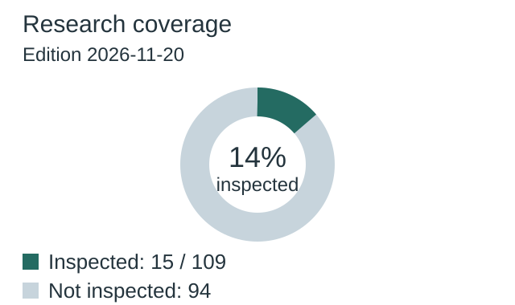
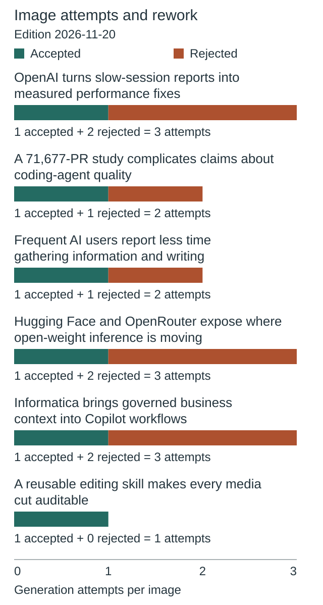
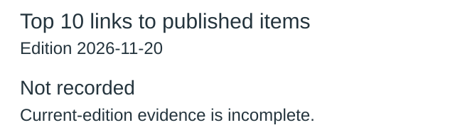
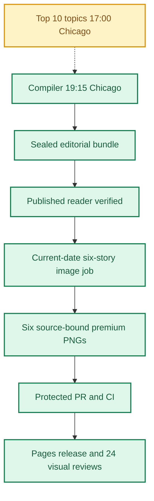
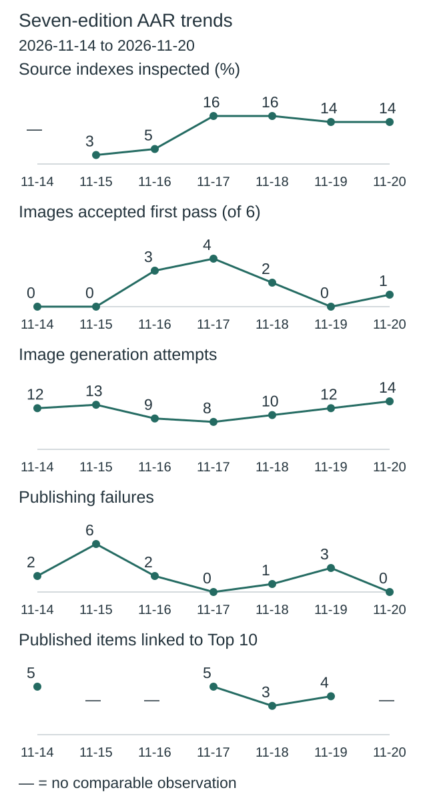
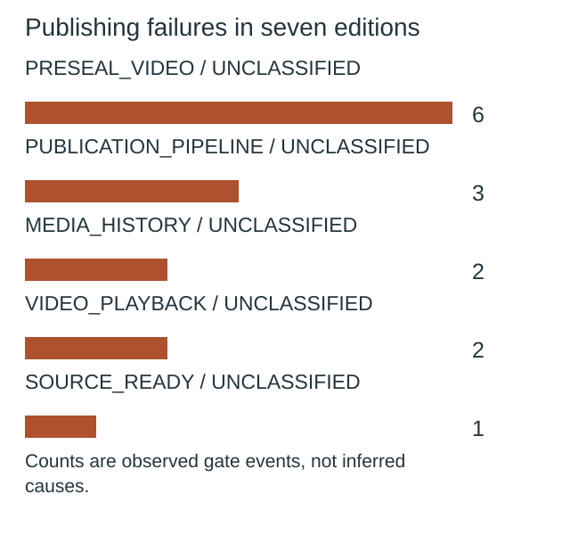
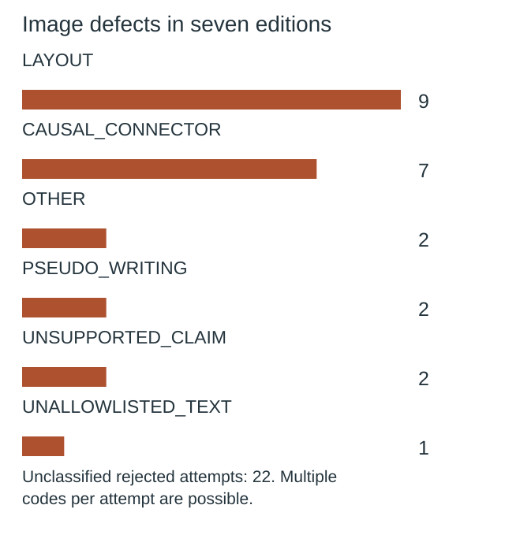

**🟩 RELEASE COMPLETE**
**TOP 10 PARTIAL** · **🟩 COMPILER VERIFIED** · **🟦 IMAGES 6/6 RELEASED** · **🟪 VISUAL QA 24/24 PASS**

# Daily AI Brief — Unified Production After-Action Report
**Edition:** November 20, 2026 · **Production evening:** 2026-11-19 · **Timezone:** America/Chicago
**Primary public reader:** [Open 2026-11-20 Brief](https://gttome.github.io/Daily-AI-Brief-Compiler/briefs/2026-11-20/) · **Repository:** [Daily-AI-Brief-Compiler](https://github.com/gttome/Daily-AI-Brief-Compiler)

> **IMPORTANT — VERIFIED PRODUCTION RESULT**
> **Executive release result: COMPLETE.** This is the single management-facing report covering Top 10 topic discovery, the editorial Compiler, published Brief and premium-image run. **Entire-system evidence: PARTIAL.** Top 10 report: **partial**; Compiler handoff: **RECEIVED_SNAPSHOT_BOUND**; guided searches: **INVALID**. Compiler public status: **VERIFIED**. Image release: **RELEASED_VERIFIED**. Direct 24-context visual quality: **24/24 PASS**. Autonomous completion: **UNPROVEN**. Missing evidence must not be promoted to a success claim.

**🕒 Production stage durations:** **Top 10 6m 41s** · **Compiler final seal window 16m 45s** · **Premium Images 44m 19s** (evidence-bounded elapsed times; the start/end events differ).

## Evidence reconciliation

Compiler final seal window: 16m 45s. Compiler state start to public verification: 35m 53s. Observed execution and final seal windows are distinct.
Image capability route preflight: RECORDED; scheduler origin remains UNPROVEN.
Image efficiency: 1/6 first-pass accepts; 14 total attempts. Approved prospective efficiency target: at least 4/6 first-pass and no more than 8 total attempts, strictly advisory, with unchanged quality floor.
Image review completed: 2026-11-20T04:16:49Z; review-record commit: 2026-11-20T04:17:52.000Z; protected review merge: 2026-11-20T04:20:23.000Z.
Eligible source indexes: 109; editorial inspections reported: 15 (13.8%); inaccessible in editorial audit: 0; explicitly unreviewed IDs: 94; unclassified editorial IDs: 0. Automated index parsing is separate from editorial inspection and cannot substantiate exhaustive freshness claims.

Registered video sources: 29; attempted this edition: 29; unattempted: 0; enabled: 28; qualification-only: 1; sources yielding candidate URLs: 0. Status: REPORTED_ALL_ATTEMPTED. Attempt evidence is not automatic proof of source-content review or playback.

Eligible source partition **VALID**. Full original-item reads **2**. Bounded index searches **13**. Qualification-only sources recorded separately **0**.

### Protected preseal video outcomes

| Original publisher | Distinct programs submitted | Archive rejects | Playback passes | Playback unverified | Probes skipped |
|---|---:|---:|---:|---:|---:|
| abcnews.com | 1 | 0 | 0 | 1 | 0 |
| cbsnews.com | 1 | 0 | 2 | 0 | 0 |
| foxbusiness.com | 1 | 0 | 1 | 0 | 0 |
| pbs.org | 1 | 0 | 1 | 0 | 0 |
| sky.com | 1 | 0 | 0 | 1 | 0 |

Outcomes count observed checks across all saved requests. Programs can be submitted again after a different slot changes.

- AI giant's IPO one of the biggest ever - but has it already peaked? received PUBLIC_VIDEO_PLAYBACK_UNVERIFIED. [Original run](https://github.com/gttome/Daily-AI-Brief-Compiler/actions/runs/44653929258)
- How AI is impacting learning in the classroom received PUBLIC_VIDEO_PLAYBACK_UNVERIFIED. [Original run](https://github.com/gttome/Daily-AI-Brief-Compiler/actions/runs/44653929258)

## Approved November 20 improvement evidence

Editorial runtime declarations: **DECLARED_RESTRICTED_EDITORIAL_RUNTIME**. Actual billing and scheduled origin remain unknown.

Video candidate evidence: **NOT_RECORDED**; substantive candidates Not recorded, non-news Not recorded, original publisher families Not recorded, selected non-news Not recorded. Targets 12 / 8 / 6 / 2 are advisory; unchanged duration, promotion, novelty and full-program playback checks still apply.

Source failure categories: RESPONSE_SIZE_LIMIT 25, ACCESS_BLOCKED 5, PARSER_OR_OTHER 1. Empty, blocked, oversized and unreviewed sources are distinct.

Original-paper cadence: one qualified paper within 3 editions when available. Current review timing POSTPUBLICATION; postpublication review is not evidence of preselection reading.


IMG19 artistic changes retain their existing November 22 three-eligible-edition evaluation. Missing pixels, owner feedback and usage remain unknown; no retrospective source, query or artwork acceptance is invented.

## Daily AAR charts

These charts use this edition’s receipts. Missing data is not zero.

### Research coverage



**15 of 109 indexes inspected (14%).**

| Editorial inspection | Indexes |
|---|---:|
| Inspected | 15 |
| Not inspected | 94 |

Not inspected includes every index without a recorded editorial inspection; this is not proof of missed stories.

### Image attempts and rework



**14 attempts; 1 of 6 images accepted on their first attempt.**

Recorded ongoing from November 8 target: at least 3/6 first-pass accepts; no more than 2 attempts per image. This is an efficiency target, not a quality cutoff.

| Image | Accepted | Rejected | Total attempts |
|---|---:|---:|---:|
| OpenAI turns slow-session reports into measured performance fixes | 1 | 2 | 3 |
| A 71,677-PR study complicates claims about coding-agent quality | 1 | 1 | 2 |
| Frequent AI users report less time gathering information and writing | 1 | 1 | 2 |
| Hugging Face and OpenRouter expose where open-weight inference is moving | 1 | 2 | 3 |
| Informatica brings governed business context into Copilot workflows | 1 | 2 | 3 |
| A reusable editing skill makes every media cut auditable | 1 | 0 | 1 |

Generation attempts measure rework, not runtime or cost. Quality and publication checks remain separate.

### Top 10 links to published items



**Not recorded:** current-edition evidence is missing or inconsistent.

No selection quota. Topic linkage does not establish better quality, popularity or causal improvement.

[Chart data](charts.json)

One edition at a time. Missing evidence is not zero. Trend claims require comparable recorded cycles.

## Performance dashboard

| Measure | Recorded result | Source / caveat |
|:--|:--:|:--|
| Entire-system evidence | **PARTIAL** | Full Top 10 list, bound Compiler input, all-format search receipts and existing release checks; separate from publication and autonomy |
| Top 10 report | **partial · 10 topics** | Same Chicago cycle report; provisional/partial coverage remains disclosed |
| Top 10 received by Compiler | **RECEIVED_SNAPSHOT_BOUND** | Exact report snapshot bytes; consumed commit separately corroborated: YES |
| Top 10 guided article/video/podcast searches | **INVALID** | Actual source-search receipts and selected/rejected topic outcomes |
| Top 10 stage duration | **6m 41s** | Same-cycle run receipt only; no runtime or usage estimate |
| Editorial publication | **PASS** | State and public reader integrity receipt |
| **Unattended autonomy (separate from publication)** | **UNPROVEN** | Owner incident receipt takes precedence over unverified producer self-attestation |
| Recorded protected publishing gate failures | **0** | Actual same-edition GitHub failure sidecar only; earlier unrecorded failures remain unknown |
| Articles | **6** | Exactly 2 technical / 2 knowledge-worker / 2 agents required |
| Original scientific-paper-led articles | **1** | Rolling target: one qualified original paper in 3 editions; POSTPUBLICATION_REVIEW_BUNDLE_MATCH. Preprints are not peer-reviewed by default |
| Verified original sources within preceding 24 hours | **0 / 6** | Original publisher dates only; other sources require a documented fallback rationale |
| Distinct selected article publishers | **6** | Six different primary organizations preferred |
| Videos over seven days old | **0** | Must be labeled evergreen, not a new development |
| Distinct selected video publishers | **2** | One channel is one publisher even across multiple videos |
| Cross-media topic diversity | **FOUR_DISTINCT_EVENTS_REVIEW_RECORDED** | Four video/podcast events and six pairwise original-source comparisons; editorial claims remain producer-attested |
| Video discovery source attempts | **29 / 29** | Attempt evidence across enabled and qualification-only leads; REPORTED_ALL_ATTEMPTED. Not a claim of full content review or player verification | 
| Duplicate active Watchlist display titles | **Not recorded** | Published canonical Watchlist only; historical evidence retained |
| Original-release video playback (historical) | **TWO_PUBLISHED_VIDEOS_PLAYBACK_PASS** | Later reader corrections may replace these originally verified videos; see incident register | 
| Postpublication reader incidents | **NOT_RECORDED** | Edition-specific owner reports and corrective PRs, not inferred absence | 
| Verified postpublication video corrections | **NOT_RECORDED** | Incident register tracks correction PR, actual playback evidence and reader preservation |
| Editorial index second-pass attempts | **0** | Bounded public GET retries only; never proof of original article reading |
| Editorial index reads recovered | **0** | Successful page fetch can still yield zero eligible dated items |
| Recorded scheduler capability route | **UNPROVEN** | Same-invocation route receipt only; GitHub is not scheduler authentication |
| Avoidable incomplete-staging CI failures | **Not independently audited** | Existing image-package push CI is disabled; exact-head protected PR CI remains required. A failure count requires actual workflow evidence |
| Media | **2 videos + 2 podcasts** | Sealed bundle |
| **Compiler final seal window** | **16m 45s (16.7 min)** | Final sealed-state timestamp → verified public reader; initial execution is separate |
| **Image processing stage duration** | **44m 19s** | First accepted PNG Git checkpoint → final 24/24 review; auditable stage elapsed time |
| Image scheduled-to-final-review window | **Not independently recorded** | Only with a saved one-cycle schedule anchor; does not attest exact generation start |
| Executor-observed generation-to-final-review | **51m 02s** | Only if the worker recorded a same-execution clock before its first native call; not independently verified provider runtime |
| Accepted premium PNGs | **6 / 6** | Exact package and public release hashes |
| Native image generation attempts | **14** | Image worker AAR; no estimation |
| Rejected candidates | **8** | Image worker AAR |
| Final worker checkpoint reconciliation | **PASS** | Oct25+ verifies exact generation count, per-story attempts, six accepted story/image/hash bindings and final release |
| Saved visual contexts | **24 / 24 PASS** | Dated/permanent desktop/mobile review |
| Public SHA-256 checks | **44** | Image release receipt |
| October 8 immutable history | **17 / 17** | Independent content-preservation checks |
| **Owner-reported weekly Work usage for this run** | **Not reported** | No per-cycle usage supplied |

> **EFFICIENCY NOTE**
> **Resource reporting policy:** No usage figure was supplied for this cycle, so none is assumed. Future runs show **Not reported** unless the owner supplies new cycle-specific usage metadata. No approval or extra step is required to generate the AAR.

## Production architecture and checkpoints



## Daily AI Topic Top 10 and Compiler handoff

**Research cycle:** 2026-11-19 · **Target Brief:** 2026-11-20 · **Scheduled start:** 17:00 America/Chicago

| Dimension | Recorded evidence |
|---|---|
| Run/report result | PARTIAL |
| Report status / topics | partial / 10 |
| Freshness | FRESH\_AT\_CONSUMPTION |
| Compiler handoff | RECEIVED\_SNAPSHOT\_BOUND |
| Search coverage | INVALID |
| Selection mapping verification | INVALID |
| Observed start / finish | 2026-11-19T23:01:26Z / 2026-11-19T23:08:07Z |
| Elapsed minutes | 6.68 |
| Usage percent | Not reported |
| Cost USD | Not reported |
| Independent scheduler autonomy | UNPROVEN |
| Compiler-recorded consumed commit | eb47fa37e8631a1063e345c8b300f8ff919bed41 |
| Report SHA-256 | cb7b50fa363cc2ffae6fcef05e2a9e2dd936683032a9964abac568902ad274e1 |

| Discovery order | AI topic | Summary | Confidence | Evidence |
|---:|---|---|---|---|
| 1 | ArtCraft’s creative-tools talk gains another day of attention | Coding agents are being used to build adaptable open-source creative tools, with prototypes still distinct from complete commercial replacements. | medium | [Source](https://www.youtube.com/watch?v=UCL4K36SHp0) · [Source](https://ai.engineer/code/2026/talks/brandon-thomas) |
| 2 | GPT-6.2 attracts fresh tests and mixed reactions | OpenAI’s professional-work models are drawing tests that separate benchmark claims from practical results. | medium | [Source](https://www.youtube.com/watch?v=JVHkb8PTMvc) · [Source](https://www.youtube.com/watch?v=rYsIpPP6QY4) · [Source](https://www.youtube.com/watch?v=jm_h5nRZoCg) · [Source](https://openai.com/index/introducing-gpt-6-2-astra-sol/) |
| 3 | Anthropic prices its public offering | Anthropic’s priced offering puts its financing and compute economics under wider public scrutiny. | medium | [Source](https://www.youtube.com/watch?v=2r-lgy94M_s) · [Source](https://www.youtube.com/watch?v=JpfTrtSE1j8) · [Source](https://www.anthropic.com/news/anthropic-prices-initial-public-offering) |
| 4 | Gemini 4 Neon receives independent launch-day scrutiny | Google’s new model targets demanding analysis and coding with an emphasis on task completion speed. | medium | [Source](https://www.youtube.com/watch?v=R0rXSJmymTc) · [Source](https://www.youtube.com/watch?v=-0uvPVwPFgM) · [Source](https://news.ycombinator.com/item?id=50552424) · [Source](https://blog.google/innovation-and-ai/models-and-research/gemini-models/introducing-gemini-4-neon/) |
| 5 | Project Genie opens a new interactive-world experience | Eligible subscribers can explore worlds with mid-session changes, adaptive audio and a shared gallery. | medium | [Source](https://news.ycombinator.com/item?id=50550415) · [Source](https://www.youtube.com/watch?v=pVc6KkjeCfU) · [Source](https://www.youtube.com/watch?v=EDp4IoAUsXY) · [Source](https://blog.google/innovation-and-ai/models-and-research/google-deepmind/genie-4-now-available-project-genie/) |
| 6 | Claude Code’s experimental Code Mode draws renewed attention | Claude can compose tool calls into scripts while permission rules and hooks still govern individual tools. | medium | [Source](https://x.com/ClaudeDevs/status/2122801681939234950) · [Source](https://code.claude.com/docs/en/code-mode) |
| 7 | Mistral Vibe brings agent work to the desktop | A desktop interface combines local or remote agent work with reviewable outputs. | medium | [Source](https://x.com/MistralAI/status/2123073168659141119) · [Source](https://www.testingcatalog.com/icymi-mistral-launches-vibe-desktop-for-macos-and-windows/) · [Source](https://docs.mistral.ai/vibe) |
| 8 | An agent skill demonstrates editing raw footage | A creator demonstrates a reusable workflow for turning raw footage into an edited video through Claude Code. | low | [Source](https://www.youtube.com/watch?v=a90pZ1DSyls) · [Source](https://github.com/coleam00/skills) |
| 9 | DaisyRose-27B tests a compact agent-training recipe | RadixArk released a model trained on curated long-running agent tasks, along with a report on its infrastructure and evaluation. | medium | [Source](https://news.ycombinator.com/item?id=50551046) · [Source](https://www.radixark.com/blog/daisyrose-27b) |
| 10 | EmbeddingGemma 2’s retrieval explainer keeps attracting viewers | A recent explainer revisits searching text, images, audio and video in one embedding space. | medium | [Source](https://www.youtube.com/watch?v=aRIFzzr_Mi0) · [Source](https://blog.google/innovation-and-ai/technology/developers-tools/embeddinggemma-2-technical-report/) |

**Sample scope:** {"metadata\_screened\_videos":42,"unique\_videos":42,"distinct\_screened\_channels":30,"full\_video\_reviews":0,"direct\_youtube\_counter\_verifications":0,"full\_transcript\_reviews":0,"partial\_original\_publisher\_transcript\_reviews":1,"substantive\_original\_event\_document\_reviews":9,"original\_watch\_attempts":42,"original\_watch\_outcomes":{"throttled":35,"title\_shell":5,"unexpected\_status":2},"comparable\_video\_observations":5,"freshness\_reference\_at":"2026-11-19T23:06:21Z","notes":"Prioritized24h, widened72h then7d. Long-form known only where duration visible; date-only records excluded from exact hourly bins. Full-video40–80 target unmet. Partial transcript was an older mismatched podcast, rejected as current.","freshness\_counts":{"within\_24h\_timestamped":3,"additional\_within\_72h\_timestamped":11,"additional\_within\_7d\_timestamped":2,"date\_only":26,"older":0}}. **Ranking basis:** {"attention":"Named-event video reach and same-source interval accumulation, independent reporting and public discussion; no cross-platform audience sum.","limitations":"Incomplete original video access, unknown index measurement clocks and no channel-relative baselines prevent precise popularity ordering."}.

| Search format | Receipt rows | Attempts recorded | Explicitly not attempted |
|---|---:|---:|---:|
| article | 0 | 0 | 0 |
| video | 0 | 0 | 0 |
| podcast | 0 | 0 | 0 |

**Selected Brief items linked to trends:**

No validated selection-to-topic mapping was recorded.

**Raw, unverified Top 10 receipt observations:** 30 search rows across 30 topic/format pairs; 1 claimed mapping rows (0 with noncanonical fields). Noncanonical outcomes: searched_no_qualified_candidate. These counts are NOT validated search attempts or verified selections.

**Gaps and limitations:**

- Claimed trend-to-selection mappings are not verified against the same-edition selected bundle.
- Per-topic article/video/podcast search coverage is incomplete, invalid or bound to a different input.
- The report labels its research partial.
- Partial research: zero verified full-video reviews, complete transcripts and direct YouTube counters.
- 42 metadata-screened videos do not satisfy40–80 full-video reviews; one indexed identity conflict was excluded.
- Missing counters, durations, subscribers and sponsorship are unavailable/null. Promotional titles are not verified capability claims.
- Five rounded same-source comparisons describe specific videos only, not global topic velocity. No CTR, retention, global coverage or composite score invented.
- Report receipt does not establish Compiler searches, selection impact, publication, images or scheduler origin.

**Recorded run issues:**

- {"issue":"Original watch routes throttled, returned unexpected status or page shells.","effect":"No verified full playback, complete program transcripts or direct YouTube counters.","correction":"Original event documents and bounded metadata retained; report remains partial."}
- {"issue":"Specific video-editing skill tree and raw-file routes unavailable.","effect":"Cannot verify the advertised procedure or qualify it as the Brief Skills item.","correction":"Repository overview only, low confidence; Compiler owns qualification."}
- {"issue":"Old Dwarkesh transcript does not match the newly indexed excerpt.","effect":"Cannot establish fresh podcast eligibility from that original route.","correction":"Rejected the mismatched episode as a current podcast candidate; retained no fabricated media match."}
- {"issue":"Copied validator module required newly added image-editorial-feedback dependency.","effect":"Initial local validation import failed before evaluating report.","correction":"Fetched exact dependency at the same protected-main commit; validation passed against saved and committed report bytes."}

**Recorded improvements:**

- {"change":"Reviewed original Code Mode permission mechanics and original release documents before retaining fresh event leads.","reason":"Prior AAR still lacks selected video/podcast linkage; metadata does not establish verification depth.","expected\_effect":"Give Compiler exact bounded claims and preserve original-date and format qualification gaps.","status":"implemented\_in\_current\_research"}

### Daily improvement and effect on the Brief

**Fixed baseline:** nov03-2026-v1 / INPUT\_FROZEN. **Outcome baseline:** FROZEN\_AFTER\_VERIFIED\_PUBLICATION. **Prior cycle:** 2026-11-18.

| Input measure | Current | November 3 baseline | Change from baseline | Change from prior cycle |
|---|---:|---:|---:|---:|
| topic count | 10 | 10 | 0 | 0 |
| validation resource count | Not reported | 14 | Not reported | Not reported |
| additional video metadata records | Not reported | 63 | Not reported | Not reported |
| additional video channels | Not reported | 21 | Not reported | Not reported |
| total video observations | Not reported | 79 | Not reported | Not reported |
| unique videos | Not reported | 71 | Not reported | Not reported |
| full video reviews | Not reported | 0 | Not reported | Not reported |
| direct youtube counter verifications | Not reported | 0 | Not reported | Not reported |
| broader evidence band topics | 5 | 3 | 2 | 0 |
| limited evidence band topics | 5 | 7 | -2 | 0 |

**Observed downstream measurements:** PENDING\_OR\_INCOMPLETE.

| Outcome measure | Current | Change from frozen outcome | Change from prior cycle |
|---|---:|---:|---:|
| expected topic format pairs | 30 | 0 | 0 |
| attempted topic format pairs | Not reported | Not reported | Not reported |
| explicitly unattempted pairs | Not reported | Not reported | Not reported |
| discovered candidate count | Not reported | Not reported | Not reported |
| searched source host count | Not reported | Not reported | Not reported |
| selected article count | Not reported | Not reported | Not reported |
| selected video count | Not reported | Not reported | Not reported |
| selected podcast count | Not reported | Not reported | Not reported |

**Source changes:** {"added":\[\],"removed":\[\]}.

**Candidate review depth:** NOT\_RECORDED.

| Review measure | Current | Change from prior comparable cycle |
|---|---:|---:|
| reviewed candidate count | Not reported | Not reported |
| qualified candidate count | Not reported | Not reported |
| rejected candidate count | Not reported | Not reported |
| metadata only count | Not reported | Not reported |
| full video reviews | Not reported | Not reported |
| transcript reviews | Not reported | Not reported |

The frozen November 3 baseline has no candidate-level review ledger; no retrospective value is invented. Recorded reviews do not independently establish content quality, audience interest or causal benefit.

**Method/resource review:** {"baseline\_id":"nov03-2026-v1","previous\_report\_date":"2026-11-18","previous\_method\_version":"2026-11-03.2-event-review","method\_version":"2026-11-03.2-event-review","feedback":{"aar\_url":"https://github.com/gttome/Daily-AI-Brief-Compiler/blob/81ccd09e77e80946e0097b1a358df1d413f69fc9/daily/2026-11-18/combined.json","charts\_url":"https://github.com/gttome/Daily-AI-Brief-Compiler/blob/81ccd09e77e80946e0097b1a358df1d413f69fc9/daily/2026-11-18/charts.json","metrics\_url":"https://github.com/gttome/Daily-AI-Brief-Compiler/blob/81ccd09e77e80946e0097b1a358df1d413f69fc9/daily/2026-11-18/improvement-metrics.json","observation":"November19 edition records bound consumption, observed searches and four article mappings, zero video/podcast mappings; source inspections15/109; images12 attempts and zero first-pass acceptances. These are independent dimensions, not causal quality evidence."},"changes":\[{"change":"Reviewed original Code Mode permission mechanics and original release documents before retaining fresh event leads.","reason":"Prior AAR still lacks selected video/podcast linkage; metadata does not establish verification depth.","expected\_effect":"Give Compiler exact bounded claims and preserve original-date and format qualification gaps."}\],"resource\_candidates":\[{"url":"https://code.claude.com/docs/en/code-mode","role":"Original technical documentation","access":"Public original text","review\_scope":"Script/tool visibility, per-tool permissions, hooks and classifier limitations.","independence":"Anthropic source; same family as vendor attention post.","decision":"accepted","reason":"Exact current event with substantive permission boundaries.","contribution":"Avoids assuming script batching bypasses tool permissions."},{"url":"https://www.dwarkesh.com/p/paul-christiano","role":"Original podcast transcript candidate","access":"Public original text","review\_scope":"Overview and partial transcript; date/context do not match the new indexed clip.","independence":"Original Dwarkesh publisher, not a new independent measured event.","decision":"rejected","reason":"Old episode context cannot establish freshness of the November18 excerpt.","contribution":"Prevented a false fresh podcast recommendation."},{"url":"https://github.com/coleam00/skills/tree/main/.claude/skills/edit-video","role":"Creator skill source","access":"Specific tree and raw file routes unavailable; repository overview accessible.","review\_scope":"Overview only; skill implementation unverified.","independence":"Same family as the video creator.","decision":"deferred","reason":"Unavailable specific file prevents substantive procedure review.","contribution":"Kept demonstration confidence low and left Skills qualification with Compiler."}\],"observed\_effects":\[{"observation":"42 distinct video metadata records and five comparable video pairs versus prior51 and one pair.","effect":"Different sample, no full playbacks; smaller count and stronger comparable subset do not independently prove quality."}\],"next\_improvement":"Inspect next independently bound Compiler candidate dispositions and original playable media. Broader metadata counts are secondary to exact event depth.","limitations":\["November10 pilot inactive.","Usage, costs, scheduler origin and current downstream outcomes unknown."\],"change\_evaluations":\[{"change\_id":"NOV16-P1-09","reviewed\_edition":"2026-11-19","decision":"keep","result":"inconclusive","reason":"Latest earlier AAR verifies four article mappings and no media mappings; these associations do not establish incremental candidate yield or causal selection improvement. Due-edition outcome20 is not yet observed.","evidence\_refs":\["https://github.com/gttome/Daily-AI-Brief-Compiler/blob/81ccd09e77e80946e0097b1a358df1d413f69fc9/daily/2026-11-18/combined.json","https://github.com/gttome/Daily-AI-Brief-Compiler/blob/81ccd09e77e80946e0097b1a358df1d413f69fc9/daily/2026-11-18/improvement-metrics.json"\]},{"change\_id":"NOV15-02","reviewed\_edition":"2026-11-19","decision":"keep","result":"met","reason":"Latest earlier AAR independently records a bound consumed snapshot, observed search receipts and four article mappings. That proves integration for that edition, not better future quality.","evidence\_refs":\["https://github.com/gttome/Daily-AI-Brief-Compiler/blob/81ccd09e77e80946e0097b1a358df1d413f69fc9/daily/2026-11-18/combined.json","https://github.com/gttome/Daily-AI-Brief-Compiler/blob/81ccd09e77e80946e0097b1a358df1d413f69fc9/daily/2026-11-18/charts.json"\]}\]}.

**Current reconciled conclusion:** PENDING\_OR\_INCOMPLETE; outcome baseline FROZEN\_AFTER\_VERIFIED\_PUBLICATION; candidate review ledger NOT\_RECORDED.

**Historical producer observations (not current status):** The following snapshot preserves what the producer reported at the time. Its pending statuses and candidate-quality claims are not independently reconciled conclusions. Use the current tables above for publication-bound measurements; an absent candidate review ledger remains unknown.

<details><summary>Original producer effects and gaps — historical snapshot</summary>

```json
null
```

</details>

**Next improvement:** Inspect next independently bound Compiler candidate dispositions and original playable media. Broader metadata counts are secondary to exact event depth.

Counts show coverage and observed association, not audience popularity, source independence, candidate quality or causal uplift. Compare source/method changes before interpreting deltas. Unknown values are not zero. Publication, reader corrections, runtime and image outcomes retain their separate AAR evidence.

Report, source-readback and search receipts are separate observations. Snapshot binding verifies the collected report bytes; the consumed commit is independently corroborated only when the separately fetched source bytes match. These records do not independently attest scheduler identity or source truth. Top 10 reporting does not change Brief/image release status.


## Track 1 — Compiler

**State:** `SHADOW_VERIFIED` · **Bundle:** `BUNDLE_READY` · **Compiler final seal window:** 16m 45s (16.7 min).

| Publication gate | Result |
|---|:---:|
| Canonical reader build | ✅ |
| Reader parity | ✅ |
| Public verification of dated edition | ✅ |
| Previous editions preserved | ✅ |
| Permanent story routes and feeds | ✅ |

**Selected coverage:**

| Lane | Story |
|---|---|
| Technical AI Engineering | OpenAI turns slow-session reports into measured performance fixes |
| Technical AI Engineering | A 71,677-PR study complicates claims about coding-agent quality |
| Applied Generative AI for Knowledge Workers | Frequent AI users report less time gathering information and writing |
| Applied Generative AI for Knowledge Workers | Hugging Face and OpenRouter expose where open-weight inference is moving |
| Agents for Everyone | Informatica brings governed business context into Copilot workflows |
| Agents for Everyone | A reusable editing skill makes every media cut auditable |

### Scientific paper opportunity and publication evidence

**Current edition:** POSTPUBLICATION_REVIEW_BUNDLE_MATCH; **paper-led stories:** 1. Editorial target: at least one genuinely qualified original-paper-based story in seven editions, with methods, limitations, and an explicit preprint/peer-review distinction. No stale or weak paper is selected solely to fill a quota.
- Reliable Mining of Heterogeneous AI Coding-Agent Data: Context-Aware Prediction and Resource-Aware Ranking (PREPRINT): https://arxiv.org/abs/2611.20297 — linked article: nov20-t2-agent-prs.


## Track 2 — Premium images

**Public status:** `RELEASED_VERIFIED` · **Saved images:** 6/6 · **Actual generation attempts:** 14 · **Rejected candidates:** 8.

### Image production duration — Git-verified milestones

**Auditable image stage duration:** **44m 19s** (first accepted binary saved in Git → first persisted 24-context quality-review record). **First asset to public image release:** **36m 30s**.
**Scheduled-to-final-review window:** **Not independently recorded**. This is a scheduled-clock comparison only when a separately recorded exact-date schedule exists; it is **not** measured native image-generation runtime.

| Production milestone | Chicago local time | Evidence |
|---|---|---|
| Scheduled image start (if exact-date record exists) | Not independently recorded | Time planned, not actual execution start |
| First executor-observed start | 9:15:06 PM | Worker self-attestation, not a first-party scheduler event |
| First native generation observation | 9:26:50 PM | Worker clock recorded immediately before first native call, not model-provider telemetry |
| First accepted PNG bytes saved to Git | 9:33:33 PM | Immutable binary-stage commit |
| Six-image package / reviews committed | 10:05:13 PM | Exact-head PR source commit |
| Protected package merged | 10:08:50 PM | Merge SHA and required CI |
| Public images verified | 10:10:03 PM | Image-release receipt |
| 24/24 review record committed | 10:17:52 PM | Immutable first review-approval commit |

> **Duration interpretation:** The audited stage excludes unobservable pre-checkpoint creative work. The scheduled-start window includes it but must not be interpreted as precise active processing time. Missing timestamps appear as **Not independently recorded**, never an estimate.


| Source-bound image | Attempts | File size | Public page |
|---|---:|---:|---|
| OpenAI turns slow-session reports into measured performance fixes | 3 | 0.82 MiB | [View original](https://gttome.github.io/Daily-AI-Brief-Compiler/briefs/images/2026-11-20/dab-edition-2026-11-20-m01.png) |
| A 71,677-PR study complicates claims about coding-agent quality | 2 | 0.69 MiB | [View original](https://gttome.github.io/Daily-AI-Brief-Compiler/briefs/images/2026-11-20/dab-edition-2026-11-20-m02.png) |
| Frequent AI users report less time gathering information and writing | 2 | 1.10 MiB | [View original](https://gttome.github.io/Daily-AI-Brief-Compiler/briefs/images/2026-11-20/dab-edition-2026-11-20-m10.png) |
| Hugging Face and OpenRouter expose where open-weight inference is moving | 3 | 0.68 MiB | [View original](https://gttome.github.io/Daily-AI-Brief-Compiler/briefs/images/2026-11-20/dab-edition-2026-11-20-m11.png) |
| Informatica brings governed business context into Copilot workflows | 3 | 1.14 MiB | [View original](https://gttome.github.io/Daily-AI-Brief-Compiler/briefs/images/2026-11-20/dab-edition-2026-11-20-m12.png) |
| A reusable editing skill makes every media cut auditable | 1 | 1.01 MiB | [View original](https://gttome.github.io/Daily-AI-Brief-Compiler/briefs/images/2026-11-20/dab-edition-2026-11-20-m14.png) |

**Immutable-release and visual gates:**

| Release gate | Result |
|---|:---:|
| Protected public image receipt | ✅ |
| Accepted-image Git hash bindings | ✅ |
| Six live PNGs | 6/6 |
| Dated/permanent story placements | 12/12 recorded in release evidence |
| Desktop/mobile visual inspection | 24/24 PASS |
| Historical Oct 8 integrity | 17/17 |

### Published premium illustrations

<table>
<tr><td width="50%"><a href="https://gttome.github.io/Daily-AI-Brief-Compiler/briefs/images/2026-11-20/dab-edition-2026-11-20-m01.png"></a><br/><b>OpenAI turns slow-session reports into measured performance fixes</b></td><td width="50%"><a href="https://gttome.github.io/Daily-AI-Brief-Compiler/briefs/images/2026-11-20/dab-edition-2026-11-20-m02.png"></a><br/><b>A 71,677-PR study complicates claims about coding-agent quality</b></td></tr>
<tr><td width="50%"><a href="https://gttome.github.io/Daily-AI-Brief-Compiler/briefs/images/2026-11-20/dab-edition-2026-11-20-m10.png"></a><br/><b>Frequent AI users report less time gathering information and writing</b></td><td width="50%"><a href="https://gttome.github.io/Daily-AI-Brief-Compiler/briefs/images/2026-11-20/dab-edition-2026-11-20-m11.png"></a><br/><b>Hugging Face and OpenRouter expose where open-weight inference is moving</b></td></tr>
<tr><td width="50%"><a href="https://gttome.github.io/Daily-AI-Brief-Compiler/briefs/images/2026-11-20/dab-edition-2026-11-20-m12.png"></a><br/><b>Informatica brings governed business context into Copilot workflows</b></td><td width="50%"><a href="https://gttome.github.io/Daily-AI-Brief-Compiler/briefs/images/2026-11-20/dab-edition-2026-11-20-m14.png"></a><br/><b>A reusable editing skill makes every media cut auditable</b></td></tr>
</table>

## Incidents, corrections and learning

### Postpublication reader incidents (updated when new evidence is merged)

No current-edition postpublication incident register was available; this is **NOT_RECORDED**, not a certification of zero incidents.


**Editor recovery classification:** UNPROVEN. **Owner intervention:** Unproven either way. **Protected same-edition failures recorded:** 0. 
**Latest failed protected stage:** Not in same-edition receipts; [Action evidence](https://github.com/gttome/Daily-AI-Brief-Compiler/actions). Exact stage durations are available only where real source timestamps exist.

| Stage | Verified issue | Corrective action |
|---|---|---|
| Native generation saved-pixel rejection | Actual saved provenance draft has the two intended arrows and eight correct labels, but Definitions is rendered on a botanical leaf, an unsupported scenic metaphor, and repeating cream plaques dominate its text architecture. Detached lower caveat descenders crowd the bottom safe floor. Preserve the policy boundary and lineage ties; replace botanical art with glossary anatomy and direct annotations. | Source-bound localized correction frozen and committed before the next native edit; full saved pixels and320px rendition re-reviewed. |
| Native generation saved-pixel rejection | Saved second provenance export correctly replaces the plant with a blank glossary and removes four repeated cream plaques. The detached caveat still has locally descenders at y596 (tesseract assistance), beyond y590 mandatory floor. All source relationships and other labels pass. Move only the caveat up, preserving all artwork. | Source-bound localized correction frozen and committed before the next native edit; full saved pixels and320px rendition re-reviewed. |
| Native generation saved-pixel rejection | Actual saved full-size PNG contains simulated writing strokes on information and drafting documents. Segmented meeting rings resemble unsupported quantitative dials. The continuous folded map, seven literal labels, one methodological arrow and detached source caveat are otherwise sound. Remove only faux writing and ring divisions; preserve the explanatory map. | Source-bound localized correction frozen and committed before the next native edit; full saved pixels and320px rendition re-reviewed. |
| Native generation saved-pixel rejection | Saved routing draft repeats Provider choice inside the router, adds a prohibited shield/check and speed dial, and uses an unfrozen router-to-middle arrow while the intended upper-to-lower retry lacks a directed endpoint. Preserve distinct open topology and detached population caveat; remove unsupported motifs and correct the exact three-edge system. | Source-bound localized correction frozen and committed before the next native edit; full saved pixels and320px rendition re-reviewed. |
| Native generation saved-pixel rejection | Actual saved second routing export fixes unsupported motifs and all three causal arrowheads. The Retry on failure caption remains edge-crowded at the far right, with glyphs within roughly34px of the boundary. Move only that caption inward; preserve all accepted-looking routing ports and disconnected population explanation. | Source-bound localized correction frozen and committed before the next native edit; full saved pixels and320px rendition re-reviewed. |
| Native generation saved-pixel rejection | Actual complete 1200x630 PNG inspected: Find cause and Challenge diagnosis glyphs begin around y27-32, below 40px safety; Engineer review extends near x1190. Publisher account has an unplanned headless leader to the recovery comparator, violating detached caveat. Preserve four intended arrowheads and detailed diagnostic route; correct only label positions and remove caveat leader. | Source-bound localized correction frozen and committed before the next native edit; full saved pixels and320px rendition re-reviewed. |
| Native generation saved-pixel rejection | Full saved PNG visual review and tesseract glyph assistance locate Challenge diagnosis at y38, two pixels beyond mandatory y40 glyph floor. Caveat leader is correctly removed. Preserve all good text and source geometry; lower only the top-center heading and inset left handle. | Source-bound localized correction frozen and committed before the next native edit; full saved pixels and320px rendition re-reviewed. |
| Native generation saved-pixel rejection | The first context illustration has correct labels and one methodological arrow but crowded top and bottom glyphs breach 40px saved-export floor. Repeated blank leaves supply weak explanatory detail: context layers need distinct source-grounded agent, repository and workflow mechanisms. Correct within the same composition, preserving the comparison caveat and one-arrow restriction. | Source-bound localized correction frozen and committed before the next native edit; full saved pixels and320px rendition re-reviewed. |
| Large PNG exact byte transport | Contents endpoint returned empty base64 content above1MiB; an unreferenced initial blob used truncated terminal output and was rejected by blob mismatch. One Git readback initially yielded before command completion. | Used fixed256KiB segments with exact blob validation, then exact remote Git commit readback/cmp for larger PNGs. Awaited completed readback. No accepted art regenerated. |

> **OPERATIONAL NOTE**
> This report distinguishes a published and verified production outcome from scheduler metadata exposed to another conversation. Lack of a live host heartbeat in a separate normal chat is not a Compiler production failure.

## Usage and cost stewardship

| Item | Per-cycle value |
|---|---|
| **Weekly Work usage reported by owner** | **Not reported** |
| Internal weekly usage reference | Target under 5% |
| Genuine image-generation attempts | 14 |
| Accepted diagrams | 6 |
| Regeneration after acceptance | 0 |
| Top 10 reported usage | Not reported |
| Top 10 reported cost | Not reported |
| Account-level billing telemetry | Not independently accessible to deterministic GitHub reporting |

**Future reporting rule:** For cycles without an optional owner-usage record, publish the complete AAR with `Not reported`; do not reuse prior percentages, guess remaining weekly credits or delay tomorrow's production.

## Next-edition operating handoff

| Control | Recurring contract |
|---|---|
| AI Topic Top 10 | Sole report task · 17:00 America/Chicago · saved dated list guides same-evening research |
| Primary Compiler | Sole existing task · 19:15 America/Chicago |
| Premium image production | Sole existing task · standard 21:15 America/Chicago |
| Exact image job selection | Newly published next-date `PUBLISHED_PENDING` only |
| AAR | Combined report generated automatically from new GitHub receipts |
| Optional Work usage | Owner-supplied per cycle, otherwise `Not reported` |

> **SCHEDULE RESTORATION NOTE**
> A temporary scheduling exception must be explicitly restored before claiming standard-time readiness. This deterministic document generator reads existing state only; it does not modify production schedules.

## Evidence register

| Evidence | Link |
|---|---|
| Compiler state | [Open receipt](https://github.com/gttome/Daily-AI-Brief-Compiler/blob/shadow/2026-11-20/shadow-runs/2026-11-20/compiler-state.json) |
| Compiler compile receipt | [Open receipt](https://github.com/gttome/Daily-AI-Brief-Compiler/blob/shadow/2026-11-20/shadow-runs/2026-11-20/compiler/compile-receipt.json) |
| Compiler public integrity | [Open receipt](https://github.com/gttome/Daily-AI-Brief-Compiler/blob/shadow/2026-11-20/shadow-runs/2026-11-20/compiler/postpublish-integrity.json) |
| Image release receipt | [Open receipt](https://github.com/gttome/Daily-AI-Brief-Compiler/blob/shadow-pages-history/site/image-jobs/2026-11-20/release.json) |
| Image review | [Open receipt](https://github.com/gttome/Daily-AI-Brief-Compiler/blob/main/external-image-packages/2026-11-20/reviews/live/semantic-pixel-review.json) |
| Original image AAR | [Open receipt](https://github.com/gttome/Daily-AI-Brief-Compiler/blob/main/external-image-packages/2026-11-20/reviews/after-action.md) |
| Observed editorial index retries | [Open receipt](https://github.com/gttome/Daily-AI-Brief-Compiler/blob/shadow/2026-11-20/shadow-runs/2026-11-20/editorial/source-item-retries.json) |
| Scientific paper selection review | [Open receipt](https://github.com/gttome/Daily-AI-Brief-Compiler/blob/shadow/2026-11-20/shadow-runs/2026-11-20/editorial/scientific-paper-coverage.json) |
| Published player playback receipt | [Open receipt](https://github.com/gttome/Daily-AI-Brief-Compiler/blob/shadow/2026-11-20/shadow-runs/2026-11-20/compiler/postpublish-video-playback.json) |
| Top 10 ranked topic report | [Open receipt](https://github.com/gttome/Daily-AI-Brief-Compiler/blob/35b822be2542a58b846fa65abef0d6d36e786633/signals/ai-topic-top10/2026-11-19.json) |
| Top 10 run after-action receipt | [Open receipt](https://github.com/gttome/Daily-AI-Brief-Compiler/blob/35b822be2542a58b846fa65abef0d6d36e786633/signals/ai-topic-top10/2026-11-19.aar.json) |
| Compiler Top 10 input snapshot | [Open receipt](https://github.com/gttome/Daily-AI-Brief-Compiler/blob/shadow/2026-11-20/shadow-runs/2026-11-20/editorial/trend-input.json) |
| Top 10 article/video/podcast search coverage | [Open receipt](https://github.com/gttome/Daily-AI-Brief-Compiler/blob/shadow/2026-11-20/shadow-runs/2026-11-20/editorial/trend-search-coverage.json) |

**Image workflow:** [Workflow evidence](https://github.com/gttome/Daily-AI-Brief-Compiler/actions/runs/44672447221).

---

*Generated deterministically from cycle- and edition-specific GitHub records. The report combines the Top 10 discovery priorities, its Compiler handoff and searches, the published Brief, and the image run; original research, Compiler, image, hash, and review receipts remain immutable. This reporting action creates no stories, images, releases, extra AI tasks, or schedule changes.*

<!-- continuous-improvement:start -->
## Continuous improvement review

Edition **2026-11-20**. Measurements use 7/7 recorded editions in this window. Missing data stays **Not recorded**.

### Daily corrective-action review

**3 evidence-based findings**; open production blockers: 0. Cumulative evaluation checkpoint: **2026-11-20**. The daily review never waits for that date to act on a safe live problem.

| Priority | Observed issue | Existing owner / next correction | When |
|---|---|---|---|
| P1 | This edition has invalid Top 10 search-coverage receipts. | Compiler: Verify event-to-format searches and actual selected mappings in the next unlocked edition; do not rewrite a sealed historical bundle. | Next genuine run |
| P1 | 8 rejected image candidates preceded the verified six-image release. | Images: Inspect saved rejection evidence and apply source-specific geometry, causal-arrow and label corrections before the next native generation. | Next genuine run |
| P2 | Publication success does not independently attest the originating scheduler. | Compiler / Recovery: Capture real first-party scheduler and execution evidence if available; do not convert unknown provenance into a failure or a success. | Next genuine run |

Findings are observational and do not claim a repair was executed by the reporter.

### Approved change evaluations

| Change | Evaluate by | Outcome status | Latest decision |
|---|---|---|---|
| NOV03-01 — Earlier publication checks and precise recovery | 2026-11-11 | REVIEWED | revise |
| NOV03-02 — Broader genuine source review | 2026-11-11 | REVIEWED | revise |
| NOV03-03 — Source-bound image rejection lessons | 2026-11-11 | REVIEWED | revise |
| NOV03-04 — Substantive Top 10 review evidence | 2026-11-11 | REVIEWED | keep |
| AAR-01 — Current conclusions separated from historical claims | 2026-11-11 | REVIEWED | keep |
| AAR-02 — Consolidated current task contracts | 2026-11-11 | REVIEWED | keep |
| AAR-03 — Dated improvement evaluations | 2026-11-11 | REVIEWED | keep |
| AAR-04 — Seven-edition trend charts | 2026-11-11 | REVIEWED | keep |
| AAR-05 — Recurring publication failure causes | 2026-11-11 | REVIEWED | revise |
| AAR-06 — Recovery interval reporting | 2026-11-11 | REVIEWED | revise |
| AAR-07 — Source inspection history | 2026-11-11 | REVIEWED | revise |
| AAR-08 — Rolling source contribution | 2026-11-11 | REVIEWED | revise |
| AAR-09 — Recurring image defect categories | 2026-11-11 | REVIEWED | keep |
| AAR-10 — Top 10 publisher-family sensitivity | 2026-11-11 | REVIEWED | keep |
| NOV15-01 — Six premium images must not share an editorial template | 2026-11-17 | REVIEWED | keep |
| NOV15-02 — Exact Top 10 handoff and three-format search use | 2026-11-17 | REVIEWED | keep |
| NOV15-03 — Original failed protected gate causes and early prevention | 2026-11-17 | REVIEWED | keep |
| NOV15-04 — Improve image first-pass acceptance without weakening quality | 2026-11-17 | REVIEWED | revise |
| NOV15-05 — Independently attest unattended scheduler-to-release autonomy | 2026-11-17 | REVIEWED | keep |
| NOV16-P0-01 — Exact Top 10 event-format search receipts | 2026-11-18 | OVERDUE | Not recorded |
| NOV16-P0-02 — Substantive source inspections before selection lock | 2026-11-19 | OVERDUE | Not recorded |
| NOV16-P0-03 — Outside-family playable video sourcing | 2026-11-19 | OVERDUE | Not recorded |
| NOV16-P0-04 — Unified AAR packaging regression coverage | 2026-11-22 | PENDING | Not recorded |
| NOV16-P1-05 — Fresh-first original article discovery | 2026-11-20 | PENDING | Not recorded |
| NOV16-P1-06 — Classify and reduce failing source indexes | 2026-11-20 | PENDING | Not recorded |
| NOV16-P1-07 — Image first-pass yield and visual differentiation | 2026-11-20 | REVIEWED | revise |
| NOV16-P1-08 — Exact video identity with punctuation-only normalization | 2026-11-18 | OVERDUE | Not recorded |
| NOV16-P1-09 — Attributable Top 10 incremental research yield | 2026-11-20 | PENDING | Not recorded |
| NOV16-P1-10 — Three-edition original paper priority and vendor attribution | 2026-11-20 | PENDING | Not recorded |
| NOV16-P1-11 — Verify unattended scheduler provenance without self-attestation | 2026-11-20 | PENDING | Not recorded |
| NOV16-P2-12 — Seven-edition improvement decision dashboard | 2026-11-23 | PENDING | Not recorded |
| IMG19-01 — Useful internal detail | 2026-11-22 | PENDING | Not recorded |
| IMG19-02 — Distinct visual identity | 2026-11-22 | PENDING | Not recorded |
| IMG19-03 — Novelty across days | 2026-11-22 | PENDING | Not recorded |
| IMG19-04 — Better first-attempt yield | 2026-11-22 | PENDING | Not recorded |
| IMG19-05 — Margins and legibility | 2026-11-22 | PENDING | Not recorded |
| IMG19-06 — Reliable reporting | 2026-11-22 | PENDING | Not recorded |
| IMG19-07 — Evidence of artistic improvement | 2026-11-22 | PENDING | Not recorded |
| IMG19-08 — Reusable learning without repeated shells | 2026-11-22 | PENDING | Not recorded |
| NOV20-01 — Canonical Top 10 search and selected-candidate association | 2026-11-24 | NOT_YET_EFFECTIVE | Not recorded |
| NOV20-02 — Original source date and citation metadata | 2026-11-24 | PENDING | Not recorded |
| NOV20-03 — Truthful runtime policy reconciliation | 2026-11-24 | PENDING | Not recorded |
| NOV20-04 — More substantive preselection source reads | 2026-11-24 | NOT_YET_EFFECTIVE | Not recorded |
| NOV20-05 — Broader non-news video discovery | 2026-11-24 | NOT_YET_EFFECTIVE | Not recorded |
| NOV20-06 — First-pass image geometry and connector planning | 2026-11-24 | NOT_YET_EFFECTIVE | Not recorded |
| NOV20-07 — Watchlist score and corroboration retention | 2026-11-24 | PENDING | Not recorded |
| NOV20-08 — Specific newer lane alternatives | 2026-11-24 | NOT_YET_EFFECTIVE | Not recorded |
| NOV20-09 — Original-paper review and three-edition cadence | 2026-11-24 | NOT_YET_EFFECTIVE | Not recorded |
| NOV20-10 — Separate completion and evidence statuses | 2026-11-24 | PENDING | Not recorded |
| NOV20-11 — Neutral AI video coverage badges | 2026-11-24 | PENDING | Not recorded |
| NOV20-12 — Continue existing IMG19 evaluation | 2026-11-22 | PENDING | Not recorded |

Pending: 21; overdue: 4; reviewed: 20. Implemented controls await measured results; review decisions do not disable controls.

#### Reviews of production evidence

- **NOV03-01 · 2026-11-12 · not met.** Two media requests still required correction. The first had two stalled embeds and a certificate-date error. The second reached protected playback before two archived programs were disqualified. The edition recovered and published. [Evidence 1](https://github.com/gttome/Daily-AI-Brief-Compiler/blob/1d8c6be/shadow-runs/2026-11-12/editorial/preseal-video-receipt.json) · [Evidence 2](https://github.com/gttome/Daily-AI-Brief-Compiler/blob/shadow/2026-11-12/shadow-runs/2026-11-12/execution-milestones.json)
- **NOV03-02 · 2026-11-12 · inconclusive.** The raw audit recorded 34 inspected entries and 76 unreviewed for 109 eligible sources. It included qualification-only Zapier in the inspection entries. The audited breadth is unknown. Five distinct article publishers were recorded and zero articles had verified 24-hour timestamps. [Evidence 1](https://github.com/gttome/Daily-AI-Brief-Compiler/blob/shadow/2026-11-12/shadow-runs/2026-11-12/editorial/index-review.json) · [Evidence 2](https://github.com/gttome/Daily-AI-Brief-Compiler/blob/dac33c1e16f891121a0571a0a5e25d09b691bee5/daily/2026-11-11/combined.md)
- **AAR-01 · 2026-11-12 · met.** The reviewed closeout identified the live release and 24 visual checks as complete. It separately displayed partial research evidence and unproven autonomy. The original Top 10 snapshot retains its production-stage claims. [Evidence 1](https://github.com/gttome/Daily-AI-Brief-Compiler/blob/dac33c1e16f891121a0571a0a5e25d09b691bee5/daily/2026-11-11/combined.md) · [Evidence 2](https://github.com/gttome/Daily-AI-Brief-Compiler/blob/6e6911d0a393a3117160841950ecf3b2c3665777/signals/ai-topic-top10/2026-11-11.aar.json)
- **AAR-04 · 2026-11-12 · met.** The November 6–12 series included seven image-attempt observations and a median of 12. The chart marked missing coverage and selection observations as gaps and disclosed the registry change. [Evidence 1](https://github.com/gttome/Daily-AI-Brief-Compiler/blob/dac33c1e16f891121a0571a0a5e25d09b691bee5/daily/2026-11-11/improvement-metrics.json) · [Evidence 2](https://github.com/gttome/Daily-AI-Brief-Compiler/blob/dac33c1e16f891121a0571a0a5e25d09b691bee5/daily/2026-11-11/charts/seven-edition-trends.svg)
- **AAR-05 · 2026-11-12 · not met.** The November 12 failure chart counted zero failed workflow jobs while the candidate evidence showed a blocked probe and an archive rejection. The recurring-failure table still contains unclassified events. Preserve the original outcomes so these types remain visible. [Evidence 1](https://github.com/gttome/Daily-AI-Brief-Compiler/blob/dac33c1e16f891121a0571a0a5e25d09b691bee5/daily/2026-11-11/improvement-metrics.json) · [Evidence 2](https://github.com/gttome/Daily-AI-Brief-Compiler/blob/shadow/2026-11-12/shadow-runs/2026-11-12/execution-milestones.json)
- **AAR-06 · 2026-11-12 · inconclusive.** Compiler milestones preserve detection and subsequent state changes. The reconciled report has zero recovery incidents with all required clocks and exact references. Separate repair and verification intervals and unattended origin remain unproven. [Evidence 1](https://github.com/gttome/Daily-AI-Brief-Compiler/blob/shadow/2026-11-12/shadow-runs/2026-11-12/execution-milestones.json) · [Evidence 2](https://github.com/gttome/Daily-AI-Brief-Compiler/blob/dac33c1e16f891121a0571a0a5e25d09b691bee5/daily/2026-11-11/improvement-metrics.json)
- **AAR-07 · 2026-11-12 · not met.** The November 12 index audit failed to reconcile by eligible ID. The current cycle could not update certified inspection coverage from that partition. Review the actual source scopes and clocks with the enabled roster before selection. [Evidence 1](https://github.com/gttome/Daily-AI-Brief-Compiler/blob/shadow/2026-11-12/shadow-runs/2026-11-12/editorial/index-review.json) · [Evidence 2](https://github.com/gttome/Daily-AI-Brief-Compiler/blob/dac33c1e16f891121a0571a0a5e25d09b691bee5/daily/2026-11-11/improvement-metrics.json)
- **AAR-08 · 2026-11-12 · inconclusive.** Five published items had validated topic mappings. The rolling contribution table had no validated substantive candidate review rows attributed to registry IDs. The relative contribution of individual sources remains unknown. [Evidence 1](https://github.com/gttome/Daily-AI-Brief-Compiler/blob/shadow/2026-11-12/shadow-runs/2026-11-12/editorial/trend-search-coverage.json) · [Evidence 2](https://github.com/gttome/Daily-AI-Brief-Compiler/blob/dac33c1e16f891121a0571a0a5e25d09b691bee5/daily/2026-11-11/improvement-metrics.json)

### Seven-edition trends



| Edition | Coverage | First pass / 6 | Image attempts | Publishing failures | Top 10 links |
|---|---|---:|---:|---:|---:|
| 2026-11-14 | Not recorded | 0 | 12 | 2 | 5 |
| 2026-11-15 | 3/109 (3%) | 0 | 13 | 6 | Not recorded |
| 2026-11-16 | 5/109 (5%) | 3 | 9 | 2 | Not recorded |
| 2026-11-17 | 17/109 (16%) | 4 | 8 | 0 | 5 |
| 2026-11-18 | 17/109 (16%) | 2 | 10 | 1 | 3 |
| 2026-11-19 | 15/109 (14%) | 0 | 12 | 3 | 4 |
| 2026-11-20 | 15/109 (14%) | 1 | 14 | 0 | Not recorded |

| Measure | Recorded editions | Window median |
|---|---:|---:|
| coverage percent | 6 | 14 |
| first pass accepted | 7 | 1 |
| image attempts | 7 | 12 |
| top10 linked items | 4 | 4.5 |
| publication failures | 7 | 2 |

Recorded source-set identities are comparable in this window.

### Publishing failures by stage and recorded cause



| Stage | Recorded cause | Failures | Editions | Recurred | Delay median (seconds; documented samples only) |
|---|---|---:|---|---|---:|
| PRESEAL_VIDEO | UNCLASSIFIED | 6 | 2026-11-14, 2026-11-15, 2026-11-19 | Yes | Not recorded (0 samples) |
| PUBLICATION_PIPELINE | UNCLASSIFIED | 3 | 2026-11-14, 2026-11-16, 2026-11-19 | Yes | Not recorded (0 samples) |
| MEDIA_HISTORY | UNCLASSIFIED | 2 | 2026-11-15, 2026-11-19 | Yes | Not recorded (0 samples) |
| VIDEO_PLAYBACK | UNCLASSIFIED | 2 | 2026-11-16, 2026-11-18 | Yes | Not recorded (0 samples) |
| SOURCE_READY | UNCLASSIFIED | 1 | 2026-11-15 | No within observed window | Not recorded (0 samples) |

Unclassified means the original gate is known but no structured cause review is recorded. Stage names do not establish root causes. No rows establish no failures only when the recorded receipt explicitly has none.

### Recovery intervals

| Recorded mode | Incidents | Detection seconds | Queue seconds | Repair seconds | Verification seconds | Total seconds |
|---|---:|---:|---:|---:|---:|---:|

**Not recorded:** no valid incident has all required timing and evidence references.

### Source inspection history

| Source | Last inspected edition | Editions since inspection |
|---|---|---:|
| acl-anthology | 2026-11-20 | 0 |
| anthropic | 2026-11-18 | 2 |
| anthropic-news | 2026-11-20 | 0 |
| article-databricks-ai-research | 2026-11-17 | 3 |
| article-ibm-research-ai | 2026-11-17 | 3 |
| article-nvidia-technical-ai | Not recorded | Not recorded |
| arxiv-cs-ai | 2026-11-20 | 0 |
| arxiv-cs-cl | 2026-11-20 | 0 |
| arxiv-cs-lg | 2026-11-20 | 0 |
| berkeley-bair | Not recorded | Not recorded |
| deep-20261026-a01-google-research | 2026-11-20 | 0 |
| deep-20261026-a02-microsoft-ai | 2026-11-20 | 0 |
| deep-20261026-a03-nvidia-news | 2026-11-17 | 3 |
| deep-20261026-p01-lex | Not recorded | Not recorded |
| deep-20261026-p02-data-skeptic | Not recorded | Not recorded |
| deep-20261026-v01-two-minute-papers | 2026-11-13 | 7 |
| deepseek-news | Not recorded | Not recorded |
| directory-055badde01b32d19771532e7 | Not recorded | Not recorded |
| directory-06aa5423549ae7ab03534d6d | Not recorded | Not recorded |
| directory-0be5c22bd2fbf2c24835cdf8 | Not recorded | Not recorded |
| directory-0dffb60aadd4ba31b5c090dc | Not recorded | Not recorded |
| directory-1c6f5db2559c3c226a112873 | 2026-11-16 | 4 |
| directory-207b781e953be997d6f84c93 | Not recorded | Not recorded |
| directory-22bfce3172fd5a67ebfcdde4 | Not recorded | Not recorded |
| directory-242c2a2fc81a43d41f199129 | 2026-11-10 | 10 |
| directory-2f92b46f1e169255a4c25763 | Not recorded | Not recorded |
| directory-30c771704ce20d310317aee8 | Not recorded | Not recorded |
| directory-3834a0112c0e3a754320b557 | 2026-11-13 | 7 |
| directory-3c29ebc2d9cbcc9f11312e28 | Not recorded | Not recorded |
| directory-3c8435418a50bbe5096c415b | Not recorded | Not recorded |
| directory-3ccc18a956cae0b1e24b5968 | Not recorded | Not recorded |
| directory-3d9b47e80ca1f30e4b17fff2 | Not recorded | Not recorded |
| directory-411bf5f837e28f35220736eb | 2026-11-16 | 4 |
| directory-4852e367f74118ff2dc1eec9 | 2026-11-13 | 7 |
| directory-48665d874f6008894d0d9385 | 2026-11-13 | 7 |
| directory-4c16d138c4a736e78a68127e | 2026-11-13 | 7 |
| directory-54d90ff964a74ff98851ae11 | Not recorded | Not recorded |
| directory-581aeefb9198185f59bfc7df | Not recorded | Not recorded |
| directory-5c5d3d02a420135949164552 | 2026-11-13 | 7 |
| directory-5e90c3904ae9e6147f058897 | Not recorded | Not recorded |
| directory-64b811560a52e317d4a76b1f | Not recorded | Not recorded |
| directory-64f0886a6793aa8858a4b62d | Not recorded | Not recorded |
| directory-6bb864602986d830dee61c52 | Not recorded | Not recorded |
| directory-6e0e32e58ba2e488ad8c4c61 | Not recorded | Not recorded |
| directory-6ea6e283349c7b62ac1ced9d | Not recorded | Not recorded |
| directory-6fc2c16051b6c5876b5c143e | Not recorded | Not recorded |
| directory-76ddf221aa9a485fd35e51d6 | Not recorded | Not recorded |
| directory-79e16cd5beb5c662c4022a9f | 2026-11-13 | 7 |
| directory-7f3807ea3e16f9a7ad5c1e52 | Not recorded | Not recorded |
| directory-8263ca4c9f560c8d9c4df0de | 2026-11-13 | 7 |
| directory-85ee8e554a07476bacde4af4 | Not recorded | Not recorded |
| directory-86ca1c8904dd91903440c2a9 | Not recorded | Not recorded |
| directory-88944f584a55367d3844df62 | Not recorded | Not recorded |
| directory-89818f9d7e6b4cd85a2537d5 | Not recorded | Not recorded |
| directory-8b0eaafedc559312fb655fc6 | Not recorded | Not recorded |
| directory-8df3614a9972a25fc59475ed | 2026-11-07 | 13 |
| directory-8ec4fd458a38bc0447f4cded | Not recorded | Not recorded |
| directory-8f73fa03dd8761b82ed67771 | Not recorded | Not recorded |
| directory-8ff038a44faf8336fd28b74b | Not recorded | Not recorded |
| directory-935fbe5ba89ff5f91fc8c69b | 2026-11-15 | 5 |
| directory-970506fbc577e6091a33c64d | 2026-11-13 | 7 |
| directory-985e561bc559a1cd2b93119f | Not recorded | Not recorded |
| directory-9ad7c274f2d56274bcd5ddcc | 2026-11-18 | 2 |
| directory-9c0885bdb370f69c9262b88c | 2026-11-07 | 13 |
| directory-9d99ff8f4466a1f65bfc4917 | Not recorded | Not recorded |
| directory-9daf9da90f479955fe3e7700 | Not recorded | Not recorded |
| directory-9f7087ce2c030a4b9da58499 | 2026-11-13 | 7 |
| directory-a639b4426b7c8da8a060bd66 | Not recorded | Not recorded |
| directory-a65ed82afa514bd8b255231d | Not recorded | Not recorded |
| directory-a74f303f4b0c39344c1314cf | 2026-11-06 | 14 |
| directory-b51c54b09007109b0ed9dd27 | Not recorded | Not recorded |
| directory-b73c74c7240ac52cda5485c4 | Not recorded | Not recorded |
| directory-b93e2368e85f0f95c066463e | 2026-11-13 | 7 |
| directory-bb4f514f62ba0e0a08d6af6b | Not recorded | Not recorded |
| directory-c15ce5b4a9c1e9e23b12e5c5 | Not recorded | Not recorded |
| directory-c511698feee38a8793924c12 | Not recorded | Not recorded |
| directory-c6b8a33e7fa162cc41136fa5 | Not recorded | Not recorded |
| directory-c831ea242dd43dc46401a87a | Not recorded | Not recorded |
| directory-cc8c40e66ad241091baabb53 | Not recorded | Not recorded |
| directory-d1527db7c06b4e83370b7546 | 2026-11-13 | 7 |
| directory-d2316acd033bdfbce6d25fa2 | Not recorded | Not recorded |
| directory-d4bdf42a0b23db56b0e5a7b1 | Not recorded | Not recorded |
| directory-d5428d030dfff7d4639258e3 | 2026-11-13 | 7 |
| directory-d6cf3f9fa167b8173a35228b | Not recorded | Not recorded |
| directory-d7d6951e0913cca8d43e64dc | Not recorded | Not recorded |
| directory-d8bbfa9efb621702f6eb9672 | Not recorded | Not recorded |
| directory-db682c52794328eb69ebc377 | 2026-11-13 | 7 |
| directory-dbb55a0c7c63ce90174a69ac | Not recorded | Not recorded |
| directory-dbdbb37cd61bd05d3daa5975 | Not recorded | Not recorded |
| directory-e09ae3dc4358cf271491a3ac | Not recorded | Not recorded |
| directory-e2f33b502b264e51983a338a | 2026-11-13 | 7 |
| directory-e645db24d69ee7a0f21d8767 | Not recorded | Not recorded |
| directory-e7b100b6b999ac748e052327 | 2026-11-13 | 7 |
| directory-ecf69ec2f036e803388f40ca | 2026-11-13 | 7 |
| directory-f333686bf009f24fa95a8068 | Not recorded | Not recorded |
| directory-f771d4f56ad4dbaab6f21e0e | Not recorded | Not recorded |
| directory-f8085f0f6e72cfbdfde3a0f8 | 2026-11-13 | 7 |
| directory-fd36049347d409f38c9f9a67 | Not recorded | Not recorded |
| directory-ffef3b45859d4601fbc60c69 | Not recorded | Not recorded |
| github-ai-agents | 2026-11-17 | 3 |
| github-generative-ai | Not recorded | Not recorded |
| github-llm | Not recorded | Not recorded |
| github-trending | Not recorded | Not recorded |
| google-deepmind-blog | 2026-11-19 | 1 |
| hacker-news-newest | Not recorded | Not recorded |
| hacker-news-show | Not recorded | Not recorded |
| hugging-face-daily-papers | 2026-11-20 | 0 |
| hugging-face-datasets | Not recorded | Not recorded |
| hugging-face-models | Not recorded | Not recorded |
| hugging-face-spaces | Not recorded | Not recorded |
| iclr | 2026-11-19 | 1 |
| icml | 2026-11-19 | 1 |
| meta-ai-blog | 2026-11-17 | 3 |
| mistral-news | 2026-11-17 | 3 |
| mit-csail | Not recorded | Not recorded |
| neurips | 2026-11-19 | 1 |
| openai-news | 2026-11-20 | 0 |
| openreview | 2026-11-19 | 1 |
| podcast-a16z-show | 2026-11-10 | 10 |
| podcast-agora-briefing | Not recorded | Not recorded |
| podcast-ai-daily-brief | 2026-11-06 | 14 |
| podcast-ai-for-humans | Not recorded | Not recorded |
| podcast-ai-future-work | Not recorded | Not recorded |
| podcast-ai-inside | Not recorded | Not recorded |
| podcast-artificial-intelligence-show | Not recorded | Not recorded |
| podcast-cognitive-revolution | 2026-11-18 | 2 |
| podcast-data-exchange | Not recorded | Not recorded |
| podcast-everyday-ai | Not recorded | Not recorded |
| podcast-eye-on-ai | 2026-11-18 | 2 |
| podcast-gradient-dissent | Not recorded | Not recorded |
| podcast-latent-space | 2026-11-10 | 10 |
| podcast-no-priors | 2026-11-20 | 0 |
| podcast-nvidia-ai | 2026-11-18 | 2 |
| podcast-practical-ai | 2026-11-20 | 0 |
| podcast-twiml | Not recorded | Not recorded |
| qwen-blog | 2026-11-20 | 0 |
| reddit-localllama | Not recorded | Not recorded |
| reddit-machinelearning | Not recorded | Not recorded |
| research-20261026-a01 | Not recorded | Not recorded |
| research-20261026-a03 | Not recorded | Not recorded |
| research-20261026-a04 | Not recorded | Not recorded |
| research-20261026-a05 | Not recorded | Not recorded |
| research-20261026-a06 | Not recorded | Not recorded |
| research-20261026-a07 | Not recorded | Not recorded |
| research-20261026-a08 | Not recorded | Not recorded |
| research-20261026-a09 | Not recorded | Not recorded |
| research-20261026-a10 | Not recorded | Not recorded |
| research-20261026-a11 | Not recorded | Not recorded |
| research-20261026-a12 | 2026-11-18 | 2 |
| research-20261026-a13 | Not recorded | Not recorded |
| research-20261026-a14 | Not recorded | Not recorded |
| research-20261026-p01 | Not recorded | Not recorded |
| research-20261026-p02 | Not recorded | Not recorded |
| research-20261026-p03 | Not recorded | Not recorded |
| research-20261026-p04 | Not recorded | Not recorded |
| research-20261026-p05 | Not recorded | Not recorded |
| research-20261026-p06 | Not recorded | Not recorded |
| research-20261026-p07 | Not recorded | Not recorded |
| research-20261026-v01 | 2026-11-13 | 7 |
| research-20261026-v02 | 2026-11-13 | 7 |
| research-20261026-v03 | Not recorded | Not recorded |
| research-20261026-v04 | 2026-11-13 | 7 |
| research-20261026-v05 | 2026-11-13 | 7 |
| research-20261026-v06 | 2026-11-13 | 7 |
| research-20261026-v07 | 2026-11-13 | 7 |
| specialized-discords | Not recorded | Not recorded |
| stanford-hai | 2026-11-17 | 3 |
| the-batch | Not recorded | Not recorded |
| universe-20261026-every-ai-editorial | Not recorded | Not recorded |
| video-20261120-3blue1brown | Not recorded | Not recorded |
| video-20261120-ai-coffee-break | Not recorded | Not recorded |
| video-20261120-computerphile | Not recorded | Not recorded |
| video-20261120-full-stack-deep-learning | Not recorded | Not recorded |
| video-20261120-mit-csail-video | Not recorded | Not recorded |
| video-20261120-mit-embodied-intelligence | Not recorded | Not recorded |
| video-20261120-pytorch-foundation | Not recorded | Not recorded |
| video-20261120-statquest | Not recorded | Not recorded |
| x-research-feeds | Not recorded | Not recorded |
| xai-news | Not recorded | Not recorded |
| youtube-anthropic | 2026-11-20 | 0 |
| youtube-google-deepmind | 2026-11-20 | 0 |
| youtube-openai | 2026-11-20 | 0 |

Only exact inspected source IDs and pre-selection review timestamps count. No observation means history is unavailable.

### Source contribution in this window

| Source | Substantively reviewed | Qualified | Selected | Editions with attributed reviews |
|---|---:|---:|---:|---:|

**Not recorded:** no validated substantive reviews have registry source IDs.

### Image rejection causes



| Recorded defect | Rejected attempts with defect | Recurred across editions |
|---|---:|---|
| LAYOUT | 9 | Yes |
| CAUSAL_CONNECTOR | 7 | Yes |
| OTHER | 2 | No within observed window |
| PSEUDO_WRITING | 2 | Yes |
| UNSUPPORTED_CLAIM | 2 | No within observed window |
| UNALLOWLISTED_TEXT | 1 | No within observed window |

Total rejected: 36; unclassified: 22. A rejected attempt can have several defect codes.

### Useful image detail and recent artwork comparisons

Review evidence: **RECORDED**. Stories reviewed: 6; exact earlier-image comparisons: 6. Owner feedback: **UNKNOWN**.

| Story | Useful internal detail | Text architecture | Closest earlier image | Recorded assessment |
|---|---|---|---|---|
| nov20-t1-performance-factory | Saved full-size and actual320px inspected: two evidence lenses, engineer boundary and postdeployment comparator form one horseshoe with four source-supported arrowheads. Detached caveat has no connector; inset labels are clear and margins now pass. Unnumbered traces are conceptual comparisons, not measurements. Distinct red pen linework and circular return silhouette differ from previous trial machine. Fine facets benefit from full-size viewer. | Direct open-margin annotations without plaques. Actual pixels use direct serif annotations without plaques. | 2026-11-16 / nov16-a1-workflow-redesign: Earlier trial uses twin horizontal specimen lanes feeding a boxed approval machine; current red circuit uses unequal diagnosis lenses and a conditional recovery return. | inconclusive |
| nov20-t2-agent-prs | Actual full-size and 320px pixels inspected. A pooled PR specimen leads to source, repository and workflow strata; distinct source shapes, repository dependency topology, prior-activity segments and attribution/task/disposition anatomy clarify context. One methodological arrow; brackets are nondirectional. The detached noncausal caveat remains separate. All seven labels read without edge clipping. Coral/indigo planar layers contrast with the red circular first image. Fine metadata anatomy needs enlargement. | Free-standing level captions with fine nondirectional bracket guides. Actual pixels use indigo layer captions. | 2026-11-18 / nov18-k2-safety-evals: Earlier current revision is a matched balance with a separate uncertainty tube; current source-context dissection uses exploded metadata strata, contextual anatomy and compared mixtures. | inconclusive |
| nov20-k1-workplace-time | Full-size and actual320px saved pixels inspected: one folded sage evidence map separates self reports, qualitative gathering/writing comparisons, stable empty meeting rings and recommended direct audit. Writing strokes and ring divisions removed. One methodological arrow, headless comparison rules, detached caveat. All seven exact labels read within margins. No quantified savings/productivity implied. GitHub contents API returned empty content above1MiB; exact remote commit Git readback byte comparison, length, SHA256 and blob verified instead. | Integrated margin notes and open baseline labels. Actual pixels use integrated map labels. | 2026-11-15 / nov15-k1-freelance-work: Earlier freelance image combines task tabs in a folder; current survey map separates original self reports, three qualitative task comparisons and a recommended direct audit. | inconclusive |
| nov20-k2-openrouter-hf | Full-size and actual320px saved pixels inspected. The triangular open router exposes price, path and retry criteria, with exactly three source-supported arrowheads: request to routing, routing to top host, top-host failure retry to middle-host port. Headless dashed availability guide reaches spare host; disconnected marketplace boundary states scope. Shield, check, dial and duplicate label removed. Retry caption moved safely inward. Six exact labels clear, no statistical proportions or enterprise adoption claim. Cyan angular topology differs from three preceding images. | Labels following open routing corridors, no ribbons or plaques. Actual pixels use direct architectural labels. | 2026-11-19 / nov19-t2-neon: Earlier Neon image splits equal tasks into two thick model ribbons; current router has an angular decision surface, three hosts, an outer conditional retry and disconnected population boundary. | inconclusive |
| nov20-a1-governed-context | Full-size and actual320px saved pixels inspected. Blank glossary, quality lens and lineage braid associate through headless metadata ties with one access-policy boundary. Identity tab, stopped branch and audit trace differ from two conditional arrows into recommendation and human review. Plant removed, four top plaques removed and caveat raised above glyph floor. Eight exact labels legible. Fine associations benefit from enlargement. Exact remote Git binary hash/blob/length/cmp matched after polling premature completion was corrected; contents endpoint supplied no large-file bytes. | Open side annotations and small integrated glossary tabs. Actual pixels use integrated top/context words with three remaining threshold frames. | 2026-11-18 / nov18-a2-sales-skill: Earlier current sales revision is a stitched folio with an envelope and approval latch; current provenance section has a metadata canopy, access-boundary cross-section and visible evidence associations. | inconclusive |
| nov20-a2-video-skill | Actual full-size and320px saved pixels inspected. Amber/carbon woodcut film and blank transcript tokens share two blue cut brackets, with rejected fragments outside the retained diagonal spine. Exactly two arrowheads lead into validation and then human review. Four headless blue branches distinguish word diff, frames, loudness envelope and aligned audio/frame markers. Seven exact labels read, all glyphs within safe margins; engraver hatching is image texture, not document writing. Detached procedure caveat avoids quality guarantee. Distinct diagonal hierarchy and line medium; fine audio/frame details need enlargement. | Direct timeline labels above and below the assembly. Actual pixels use amber woodcut captions. | 2026-11-16 / nov16-k1-style-atlas: Earlier media image is a three-object storyboard style assembly; current woodcut uses one long aligned film/transcript spine with four explicit validation branches. | inconclusive |

Six observed silhouettes differ: red return circuit, exploded indigo strata, sage folded map, cyan provider topology, forest/plum provenance section and amber film spine. Texture and some label frames remain shared; efficacy and owner response are inconclusive.

These are source-bound reviewer observations, not computer-vision scores, an independent source audit or owner artwork approval. Missing evidence remains unknown. See the original image AAR for exact PNG hashes, source-claim references, mobile notes and prior-image links.


| Edition | Artistic review evidence | Stories reviewed | Prior image comparisons | Owner feedback |
|---|---|---:|---:|---|
| 2026-11-20 | RECORDED | 6 | 6 | UNKNOWN |

Compare the next three genuinely eligible editions; these observations do not establish a causal improvement or create a publication gate.

### Video publisher diversity and candidate qualification

Seven-edition measurement: **COMPLETE**. Publisher families: **5**; largest family's slots: **4**; HHI: **0.2347**; prospective variety target: **MET**.

| Verified family | Actual selections in window |
|---|---:|
| cbs | 3 |
| fortune | 2 |
| pbs | 4 |
| publisher-host:euronews.com | 1 |
| publisher-host:foxbusiness.com | 4 |

| Edition | Sources attempted | Candidate-bearing routes | Qualified/played from routes |
|---|---:|---:|---|
| 2026-11-14 | 29 | 6 | Not established by discovery sweep |
| 2026-11-15 | 29 | 0 | Not established by discovery sweep |
| 2026-11-16 | 29 | 1 | Not established by discovery sweep |
| 2026-11-17 | 29 | 0 | Not established by discovery sweep |
| 2026-11-18 | 29 | 0 | Not established by discovery sweep |
| 2026-11-19 | 29 | 0 | Not established by discovery sweep |
| 2026-11-20 | 29 | 0 | Not established by discovery sweep |

A discovered URL is not a fully reviewed, correctly dated and signed-out playable video. Unverified publisher identities or missing editions prohibit a numeric seven-edition target result.

### Owner-independent recovery evidence

| Edition | Owner request needed | Evidence |
|---|---|---|
| 2026-11-14 | Not recorded | NOT_RECORDED |
| 2026-11-15 | Not recorded | NOT_RECORDED |
| 2026-11-16 | Not recorded | NOT_RECORDED |
| 2026-11-17 | Not recorded | NOT_RECORDED |
| 2026-11-18 | Not recorded | NOT_RECORDED |
| 2026-11-19 | Not recorded | NOT_RECORDED |
| 2026-11-20 | Not recorded | NOT_RECORDED |

A pre-release AAR marking intervention false does not prove nobody later prompted a recovery. Missing incident evidence remains unknown.

### Top 10 publisher-family sensitivity

| Topic | Review status | Families | Evidence weakened after removal |
|---|---|---:|---|
| artcraft-open-source-world-talk-nov12 | RECORDED_EDITORIAL_ASSESSMENT | 1 | Yes |
| gpt-62-astra-sol-launch-nov17 | RECORDED_EDITORIAL_ASSESSMENT | 3 | No in recorded assessment |
| anthropic-ipo-pricing-nov18 | RECORDED_EDITORIAL_ASSESSMENT | 2 | Yes |
| gemini4-neon-launch-nov18 | RECORDED_EDITORIAL_ASSESSMENT | 3 | No in recorded assessment |
| genie4-project-genie-access-nov18 | RECORDED_EDITORIAL_ASSESSMENT | 2 | Yes |
| claude-code-experimental-code-mode-nov17 | RECORDED_EDITORIAL_ASSESSMENT | 1 | Yes |
| mistral-vibe-desktop-update-nov18 | RECORDED_EDITORIAL_ASSESSMENT | 2 | Yes |
| cole-medin-video-editing-skill-nov19 | RECORDED_EDITORIAL_ASSESSMENT | 1 | Yes |
| daisyrose27b-posttraining-release-nov18 | RECORDED_EDITORIAL_ASSESSMENT | 1 | Yes |
| embeddinggemma2-technical-explainer-nov17 | RECORDED_EDITORIAL_ASSESSMENT | 1 | Yes |

Overall status: **RECORDED**. Band changes are documented editorial assessments; source counts do not establish popularity.

[Full measurement data](improvement-metrics.json) · [Exact observation inputs](improvement-observations.json)

- Seven calendar edition dates; missing observations are gaps, never zero.
- Source counts and registry/method changes limit comparison; no causal improvement claim.
- Source contribution covers only resource-attributed substantive review records; it is not an exhaustive source ranking.
- No last inspection record means not recorded, not proof the source was never read.
- Image defects may have multiple codes per rejected attempt; category totals are not attempt totals.
- Recorded recovery mode is not first-party scheduler attestation.
- Keep/revise/retire reviews do not automatically change production controls.
<!-- continuous-improvement:end -->
