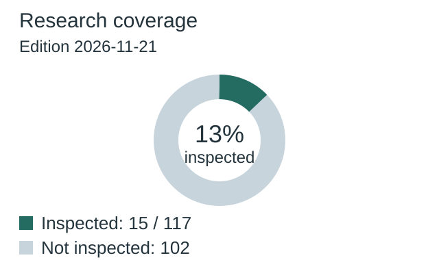
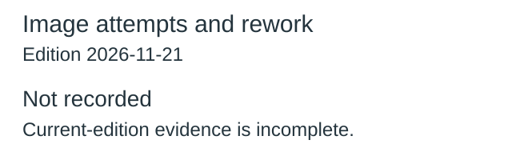
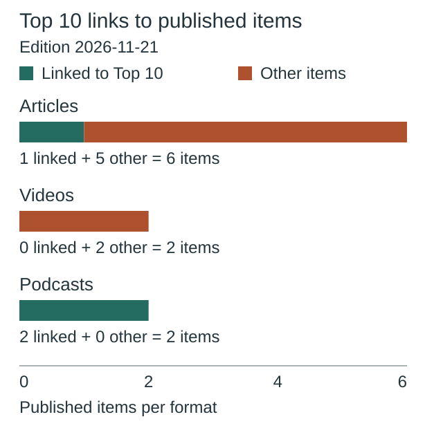
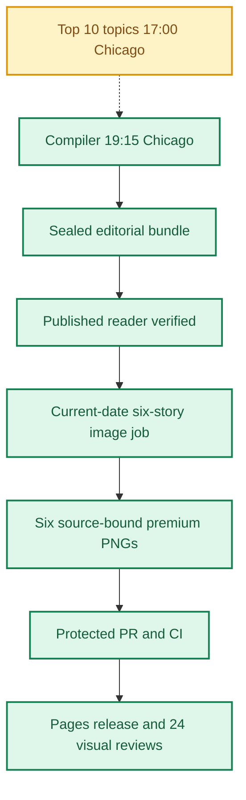
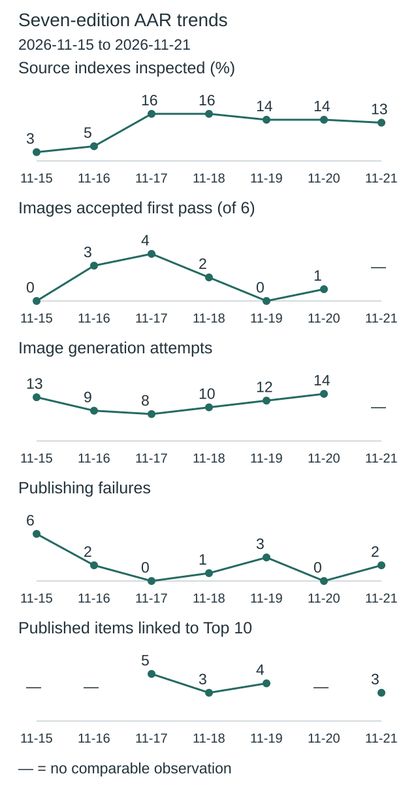
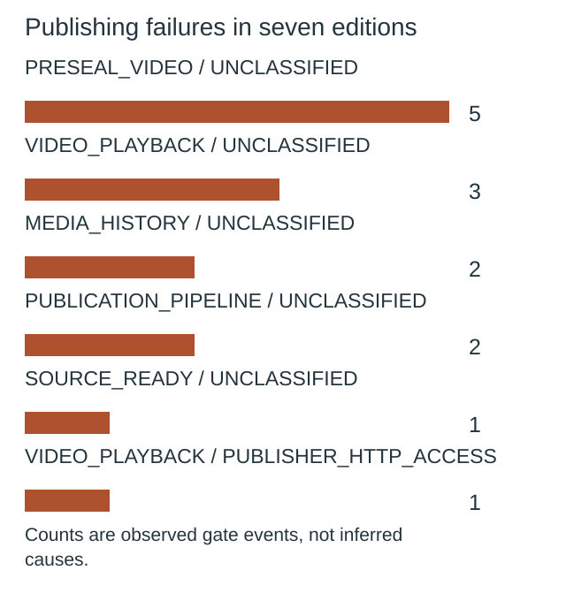
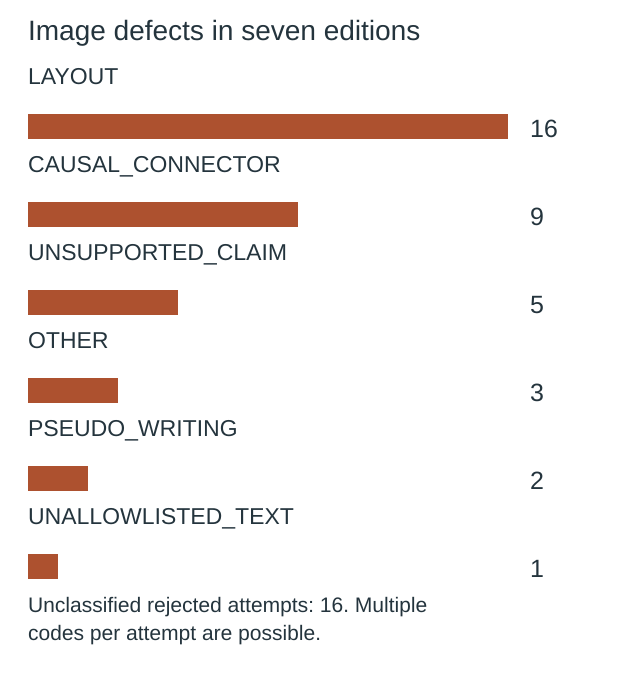

**🟩 RELEASE COMPLETE**
**TOP 10 PARTIAL** · **🟩 COMPILER VERIFIED** · **🟦 IMAGES 6/6 RELEASED** · **🟪 VISUAL QA 24/24 PASS**

# Daily AI Brief — Unified Production After-Action Report
**Edition:** November 21, 2026 · **Production evening:** 2026-11-20 · **Timezone:** America/Chicago
**Primary public reader:** [Open 2026-11-21 Brief](https://gttome.github.io/Daily-AI-Brief-Compiler/briefs/2026-11-21/) · **Repository:** [Daily-AI-Brief-Compiler](https://github.com/gttome/Daily-AI-Brief-Compiler)

> **IMPORTANT — VERIFIED PRODUCTION RESULT**
> **Executive release result: COMPLETE.** This is the single management-facing report covering Top 10 topic discovery, the editorial Compiler, published Brief and premium-image run. **Entire-system evidence: PARTIAL.** Top 10 report: **partial**; Compiler handoff: **RECEIVED_SNAPSHOT_BOUND**; guided searches: **RECEIPTS_OBSERVED**. Compiler public status: **VERIFIED**. Image release: **RELEASED_VERIFIED**. Direct 24-context visual quality: **24/24 PASS**. Autonomous completion: **UNPROVEN**. Missing evidence must not be promoted to a success claim.

**🕒 Production stage durations:** **Top 10 9m 47s** · **Compiler final seal window 4m 55s** · **Premium Images 36m 04s** (evidence-bounded elapsed times; the start/end events differ).

## Evidence reconciliation

Compiler final seal window: 4m 55s. Compiler state start to public verification: 55m 13s. Observed execution and final seal windows are distinct.
Image capability route preflight: RECORDED; scheduler origin remains UNPROVEN.
Image efficiency: 1/6 first-pass accepts; 14 total attempts. Approved prospective efficiency target: at least 4/6 first-pass and no more than 8 total attempts, strictly advisory, with unchanged quality floor.
Image review completed: 2026-11-21T04:04:41Z; review-record commit: 2026-11-21T04:07:28.000Z; protected review merge: 2026-11-21T04:09:59.000Z.
Eligible source indexes: 117; editorial inspections reported: 15 (12.8%); inaccessible in editorial audit: 0; explicitly unreviewed IDs: 102; unclassified editorial IDs: 0. Automated index parsing is separate from editorial inspection and cannot substantiate exhaustive freshness claims.

Registered video sources: 37; attempted this edition: 37; unattempted: 0; enabled: 36; qualification-only: 1; sources yielding candidate URLs: 3. Status: REPORTED_ALL_ATTEMPTED. Attempt evidence is not automatic proof of source-content review or playback.

Eligible source partition **VALID**. Full original-item reads **4**. Bounded index searches **11**. Qualification-only sources recorded separately **1**.

### Video candidate discovery

| Discovery source | Eligibility | Candidate URLs |
|---|---|---:|
| AI Engineer | Enabled | 1 |
| Microsoft Developer YouTube | Enabled | 2 |
| IBM Technology YouTube | Enabled | 3 |

### Protected preseal video outcomes

| Original publisher | Distinct programs submitted | Archive rejects | Playback passes | Playback unverified | Probes skipped |
|---|---:|---:|---:|---:|---:|
| cbsnews.com | 1 | 0 | 2 | 0 | 0 |
| foxnews.com | 1 | 0 | 2 | 0 | 0 |
| pbs.org | 1 | 0 | 2 | 0 | 0 |
| youtube-channel:UCKWaEZ-_VweaEx1j62do_vQ | 1 | 0 | 0 | 1 | 0 |
| youtube-channel:UCLKPca3kwwd-B59HNr-_lvA | 1 | 0 | 0 | 1 | 0 |
| youtube-channel:UCsMica-v34Irf9KVTh6xx-g | 1 | 0 | 0 | 1 | 0 |

Outcomes count observed checks across all saved requests. Programs can be submitted again after a different slot changes.

- The Sweet Side of the Bitter Lesson — Thariq Shihipar, Independent received PUBLIC_VIDEO_PLAYBACK_UNVERIFIED. [Original run](https://github.com/gttome/Daily-AI-Brief-Compiler/actions/runs/44851534728)
- What does it really take to ship an AI agent? received PUBLIC_VIDEO_PLAYBACK_UNVERIFIED. [Original run](https://github.com/gttome/Daily-AI-Brief-Compiler/actions/runs/44851534728)
- AI Model vs Agentic Harness: What Actually Drives AI received PUBLIC_VIDEO_PLAYBACK_UNVERIFIED. [Original run](https://github.com/gttome/Daily-AI-Brief-Compiler/actions/runs/44851534728)

## Approved November 20 improvement evidence

Editorial runtime declarations: **DECLARED_RESTRICTED_EDITORIAL_RUNTIME**. Actual billing and scheduled origin remain unknown.

Video candidate evidence: **NOT_RECORDED**; substantive candidates Not recorded, non-news Not recorded, original publisher families Not recorded, selected non-news Not recorded. Targets 12 / 8 / 6 / 2 are advisory; unchanged duration, promotion, novelty and full-program playback checks still apply.

Source failure categories: RESPONSE_SIZE_LIMIT 4, PARSER_OR_OTHER 2, ACCESS_BLOCKED 3. Empty, blocked, oversized and unreviewed sources are distinct.

Original-paper cadence: one qualified paper within 3 editions when available. Current review timing NOT_RECORDED; postpublication review is not evidence of preselection reading.


IMG19 artistic changes retain their existing November 22 three-eligible-edition evaluation. Missing pixels, owner feedback and usage remain unknown; no retrospective source, query or artwork acceptance is invented.

## Daily AAR charts

These charts use this edition’s receipts. Missing data is not zero.

### Research coverage



**15 of 117 indexes inspected (13%).**

| Editorial inspection | Indexes |
|---|---:|
| Inspected | 15 |
| Not inspected | 102 |

Not inspected includes every index without a recorded editorial inspection; this is not proof of missed stories.

### Image attempts and rework



**14 attempts; 1 of 6 images accepted on their first attempt.**

Recorded ongoing from November 8 target: at least 3/6 first-pass accepts; no more than 2 attempts per image. This is an efficiency target, not a quality cutoff.

| Image | Accepted | Rejected | Total attempts |
|---|---:|---:|---:|
| MedChemBench tests frontier models on medicinal-chemistry decisions | 1 | 2 | 3 |
| Harness adapters improve one coding agent without proving transfer | 1 | 1 | 2 |
| Turn reviewer annotations into a reusable agent quality bar | 1 | 2 | 3 |
| Governed context lifts agent answers beyond curated instructions alone | 1 | 2 | 3 |
| Gemini extends Duplex from restaurant calls to broader business tasks | 1 | 0 | 1 |
| Build a reviewable accounting Skill from a recurring reconciliation | 1 | 1 | 2 |

Generation attempts measure rework, not runtime or cost. Quality and publication checks remain separate.

### Top 10 links to published items



**3 of 10 unique published items link to Top 10 topics.**

| Format | Linked to Top 10 | Other items |
|---|---:|---:|
| Articles | 1 | 5 |
| Videos | 0 | 2 |
| Podcasts | 2 | 0 |

No selection quota. Topic linkage does not establish better quality, popularity or causal improvement.

[Chart data](charts.json)

One edition at a time. Missing evidence is not zero. Trend claims require comparable recorded cycles.

## Performance dashboard

| Measure | Recorded result | Source / caveat |
|:--|:--:|:--|
| Entire-system evidence | **PARTIAL** | Full Top 10 list, bound Compiler input, all-format search receipts and existing release checks; separate from publication and autonomy |
| Top 10 report | **partial · 10 topics** | Same Chicago cycle report; provisional/partial coverage remains disclosed |
| Top 10 received by Compiler | **RECEIVED_SNAPSHOT_BOUND** | Exact report snapshot bytes; consumed commit separately corroborated: YES |
| Top 10 guided article/video/podcast searches | **RECEIPTS_OBSERVED** | Actual source-search receipts and selected/rejected topic outcomes |
| Top 10 stage duration | **9m 47s** | Same-cycle run receipt only; no runtime or usage estimate |
| Editorial publication | **PASS** | State and public reader integrity receipt |
| **Unattended autonomy (separate from publication)** | **UNPROVEN** | Owner incident receipt takes precedence over unverified producer self-attestation |
| Recorded protected publishing gate failures | **2** | Actual same-edition GitHub failure sidecar only; earlier unrecorded failures remain unknown |
| Articles | **6** | Exactly 2 technical / 2 knowledge-worker / 2 agents required |
| Original scientific-paper-led articles | **0** | Rolling target: one qualified original paper in 3 editions; PRODUCER_REPORTED_BUNDLE_MATCH. Preprints are not peer-reviewed by default |
| Verified original sources within preceding 24 hours | **0 / 6** | Original publisher dates only; other sources require a documented fallback rationale |
| Distinct selected article publishers | **5** | Six different primary organizations preferred |
| Videos over seven days old | **2** | Must be labeled evergreen, not a new development |
| Distinct selected video publishers | **2** | One channel is one publisher even across multiple videos |
| Cross-media topic diversity | **FOUR_DISTINCT_EVENTS_REVIEW_RECORDED** | Four video/podcast events and six pairwise original-source comparisons; editorial claims remain producer-attested |
| Video discovery source attempts | **37 / 37** | Attempt evidence across enabled and qualification-only leads; REPORTED_ALL_ATTEMPTED. Not a claim of full content review or player verification | 
| Duplicate active Watchlist display titles | **Not recorded** | Published canonical Watchlist only; historical evidence retained |
| Original-release video playback (historical) | **TWO_PUBLISHED_VIDEOS_PLAYBACK_PASS** | Later reader corrections may replace these originally verified videos; see incident register | 
| Postpublication reader incidents | **NOT_RECORDED** | Edition-specific owner reports and corrective PRs, not inferred absence | 
| Verified postpublication video corrections | **NOT_RECORDED** | Incident register tracks correction PR, actual playback evidence and reader preservation |
| Editorial index second-pass attempts | **0** | Bounded public GET retries only; never proof of original article reading |
| Editorial index reads recovered | **0** | Successful page fetch can still yield zero eligible dated items |
| Recorded scheduler capability route | **UNPROVEN** | Same-invocation route receipt only; GitHub is not scheduler authentication |
| Avoidable incomplete-staging CI failures | **Not independently audited** | Existing image-package push CI is disabled; exact-head protected PR CI remains required. A failure count requires actual workflow evidence |
| Media | **2 videos + 2 podcasts** | Sealed bundle |
| **Compiler final seal window** | **4m 55s (4.9 min)** | Final sealed-state timestamp → verified public reader; initial execution is separate |
| **Image processing stage duration** | **36m 04s** | First accepted PNG Git checkpoint → final 24/24 review; auditable stage elapsed time |
| Image scheduled-to-final-review window | **Not independently recorded** | Only with a saved one-cycle schedule anchor; does not attest exact generation start |
| Executor-observed generation-to-final-review | **42m 09s** | Only if the worker recorded a same-execution clock before its first native call; not independently verified provider runtime |
| Accepted premium PNGs | **6 / 6** | Exact package and public release hashes |
| Native image generation attempts | **14** | Image worker AAR; no estimation |
| Rejected candidates | **8** | Image worker AAR |
| Final worker checkpoint reconciliation | **PASS** | Oct25+ verifies exact generation count, per-story attempts, six accepted story/image/hash bindings and final release |
| Saved visual contexts | **24 / 24 PASS** | Dated/permanent desktop/mobile review |
| Public SHA-256 checks | **44** | Image release receipt |
| October 8 immutable history | **17 / 17** | Independent content-preservation checks |
| **Owner-reported weekly Work usage for this run** | **Not reported** | No per-cycle usage supplied |

> **EFFICIENCY NOTE**
> **Resource reporting policy:** No usage figure was supplied for this cycle, so none is assumed. Future runs show **Not reported** unless the owner supplies new cycle-specific usage metadata. No approval or extra step is required to generate the AAR.

## Production architecture and checkpoints



## Daily AI Topic Top 10 and Compiler handoff

**Research cycle:** 2026-11-20 · **Target Brief:** 2026-11-21 · **Scheduled start:** 17:00 America/Chicago

| Dimension | Recorded evidence |
|---|---|
| Run/report result | PARTIAL |
| Report status / topics | partial / 10 |
| Freshness | FRESH\_AT\_CONSUMPTION |
| Compiler handoff | RECEIVED\_SNAPSHOT\_BOUND |
| Search coverage | RECEIPTS\_OBSERVED |
| Selection mapping verification | MATCHES\_EDITION\_BUNDLE |
| Observed start / finish | 2026-11-20T22:57:36Z / 2026-11-20T23:07:23Z |
| Elapsed minutes | 9.78 |
| Usage percent | Not reported |
| Cost USD | Not reported |
| Independent scheduler autonomy | UNPROVEN |
| Compiler-recorded consumed commit | 63bb1d49855af609e2a39419ad3fe551095ee2ad |
| Report SHA-256 | cf942b03927669e156088adb64ab698e340a975bcfa9e5803004978e67556b68 |

| Discovery order | AI topic | Summary | Confidence | Evidence |
|---:|---|---|---|---|
| 1 | Anthropic’s Nasdaq debut draws scrutiny of AI economics | The public-market debut is drawing reporting and analysis about the business supporting Claude. | medium | [Source](https://www.youtube.com/watch?v=MGZPIGffCxU) · [Source](https://www.youtube.com/watch?v=DrZ9yxyXtgc) · [Source](https://www.youtube.com/watch?v=iYq5Ot9qEZg) · [Source](https://news.ycombinator.com/item?id=50562754) · [Source](https://www.reuters.com/business/finance/anthropics-historic-debut-put-ais-promise-peril-wall-st-test-2026-11-19/) |
| 2 | GPT-6.2 attracts another round of practical reviews | Creator tests revisit the new models’ usefulness on actual coding and professional tasks. | medium | [Source](https://www.youtube.com/watch?v=rYsIpPP6QY4) · [Source](https://www.youtube.com/watch?v=jm_h5nRZoCg) · [Source](https://openai.com/index/introducing-gpt-6-2-astra-sol/) |
| 3 | Gemini 4 Neon draws hands-on workload comparisons | Independent creators examine how Google’s new model handles concrete coding and knowledge-work tasks. | medium | [Source](https://www.youtube.com/watch?v=Q0ShBenKyqo) · [Source](https://www.youtube.com/watch?v=90vN0xFeLcQ) · [Source](https://www.youtube.com/watch?v=5eON_8rgKzk) · [Source](https://blog.google/innovation-and-ai/models-and-research/gemini-models/introducing-gemini-4-neon/) |
| 4 | ChatGPT for Accounting connects records to reviewed drafts | Accounting workflows combine source records, connected apps and human review for reconciliations and reports. | medium | [Source](https://x.com/ChatGPT/status/2123159134963196357) · [Source](https://openai.com/business/solutions/accounting/) · [Source](https://help.openai.com/en/articles/20001709-using-chatgpt-for-accounting-work) |
| 5 | A one-person media workflow demonstrates coordinated agent routines | A creator interview demonstrates research, planning and editing routines that keep a person directing the output. | low | [Source](https://www.youtube.com/watch?v=vKobP6DkC1E) · [Source](https://plinkhq.com/i/1593424985/e/1000802796944) |
| 6 | A new AlphaGenome 2 explainer renews attention to cell-specific DNA predictions | A creator explains research on predicting how DNA changes affect gene regulation in specific cell types. | medium | [Source](https://www.youtube.com/watch?v=Cy7Wz6Z4TWU) · [Source](https://deepmind.google/blog/alphagenome-2-deciphering-how-cells-read-dna-to-better-understand-disease/) · [Source](https://www.biorxiv.org/content/10.64898/2026.11.11.765857) |
| 7 | Claude-assisted black-hole research prompts a methods debate | Two theoretical results raise questions about how AI-led work is checked, attributed and independently assessed. | medium | [Source](https://news.ycombinator.com/item?id=50563148) · [Source](https://www.anthropic.com/research/claude-black-hole-physics) · [Source](https://hexagonmath.org/2611.00175v1) · [Source](https://hexagonmath.org/2611.00174v1) |
| 8 | A DeepMind interview discusses reliability on the path to general AI | Hannah Fry and Koray Kavukcuoglu discuss model development, product feedback, safety and evaluations. | medium | [Source](https://www.youtube.com/watch?v=FORdPIWOH5k) · [Source](https://sozai.app/transcript/gemini-path-to-agi-koray-kavukcuoglu/) |
| 9 | A coding demonstration keeps humans inside the creative loop | A game-building talk separates agent-built engine code from readable controls a human can adjust directly. | medium | [Source](https://www.youtube.com/watch?v=xRJMiaUoD_8) · [Source](https://ai.engineer/code/2026/talks/thariq-shihipar) |
| 10 | Gemini for Mac adds visible background computer use | The desktop assistant can work across apps and files in a separate window with visible controls. | medium | [Source](https://x.com/GeminiApp/status/2123513203745538423) · [Source](https://appleinsider.com/articles/26/11/19/gemini-can-now-control-mac-apps-but-you-still-shouldnt-let-it) · [Source](https://blog.google/innovation-and-ai/products/gemini-app/computer-use-mac/) |

**Sample scope:** {"metadata\_screened\_videos":43,"unique\_videos":43,"distinct\_screened\_channels":32,"full\_video\_reviews":0,"full\_program\_reviews":0,"complete\_transcript\_reviews":0,"direct\_youtube\_counter\_verifications":0,"partial\_original\_publisher\_transcript\_reviews":1,"partial\_third\_party\_transcript\_reviews":1,"indexed\_partial\_transcript\_excerpt\_reviews":1,"full\_original\_article\_reads":1,"bounded\_original\_event\_document\_reviews":10,"original\_watch\_attempts":43,"original\_watch\_outcomes":{"throttled":35,"title\_shell":8},"new\_video\_routes\_attempted":8,"new\_route\_original\_publisher\_families":7,"comparable\_video\_observations":2,"freshness\_counts":{"within\_24h\_timestamped":1,"additional\_within\_72h\_timestamped":14,"additional\_within\_7d\_timestamped":2,"date\_only":26,"older":0},"freshness\_reference\_at":"2026-11-20T23:05:23Z","notes":"24h priority, then72h and7d; old research explicitly labeled. Metadata43 is not40–80 full-video reviews or twelve substantive candidate reviews. Compiler owns selection and complete registry sweep."}. **Ranking basis:** {"attention":"Specific-event video reach, two same-source interval comparisons, public discussion and independent coverage. No sum of overlapping audiences or platform scores.","limitations":"Direct counters and full playback unavailable; exact ranking unverified. Useful topics without matched attention stay outside retained ten."}.

| Search format | Receipt rows | Attempts recorded | Explicitly not attempted |
|---|---:|---:|---:|
| article | 10 | 10 | 0 |
| video | 10 | 10 | 0 |
| podcast | 10 | 10 | 0 |

**Selected Brief items linked to trends:**

| Topic | Format | Selected item | Reason |
|---|---|---|---|
| gemini4-neon-launch-nov18 | podcast | https://www.owenonthenet.com/podcast/2026-11-20/ · [Source](https://www.owenonthenet.com/podcast/2026-11-20/) | This exact transcript-bearing episode was selected for its independent task-completion cost framing of Gemini Neon and competing model releases. |
| chatgpt-accounting-launch-nov18 | article | nov21-a2-accounting-skill · [Source](https://help.openai.com/en/articles/20001709-using-chatgpt-for-accounting-work) | This exact full guide supports the selected bounded accounting Skill, including permitted records, citations, duplicate checks, uncertainty and human sign-off. |
| chatgpt-accounting-launch-nov18 | podcast | https://daylift.io/signal/accounting-ai-permissions-just-became-strategy-589 · [Source](https://daylift.io/signal/accounting-ai-permissions-just-became-strategy-589) | This exact dated episode was selected for its bounded independent analysis of accounting connector permissions, write-back risk and approval ownership. |

**Gaps and limitations:**

- The report labels its research partial.
- Researchpartial: zero complete video/program reviews and zero direct YouTube counter checks;43 metadata screens do not meet full-review targets.
- Original-source substance, index screening, partial transcripts, snippets and playback are distinct. Complete-paper and peer-review qualification not established.
- Missing metrics, source measurement clocks, sponsors, durations and channel baselines remain null or unknown. NoCTR,retention,global coverage or exact composite score claimed.
- Eight added routes screened as seven publisher families; this is not a complete37-route Compiler sweep or a twelve-program substantive pool.
- No completed history, reader correction, accepted images, production branches, workflows or schedules changed.
- Compiler consumption, actual searches, candidate-bound mappings and publication impact require independent current receipts.

**Recorded run issues:**

- {"issue":"Original YouTube watch routes throttled or returned title shells.","effect":"Zero full program review or direct YouTube counters; current research remains partial.","correction":"Bounded original documents, organizer text, partial transcript and publisher-attributed notes distinguished from playback."}
- {"issue":"Computerphile original site502, StatQuest first path redirected, MIT EI returned a shell; other new indexes did not establish a currently qualified exact program.","effect":"Expanded route access does not meet substantive program-review targets.","correction":"Used bounded indexed/original alternatives, recorded eight distinct routes and grouped both MIT routes; did not claim the catalog contained no items."}
- {"issue":"AlphaGenome original preprint403; old preprint dates and fresh attention dates differ.","effect":"Scientific-paper qualification and peer review not established.","correction":"Preserved original release and preprint identities and labeled renewed attention; Hexagon abstracts/provenance reviewed without certifying proofs."}
- {"issue":"Greg transcript mirrors unavailable and original RSS refused as unsupported application/xml.","effect":"No complete transcript or original audio playback.","correction":"Recorded exact failed routes and used Plink publisher-attributed episode notes only; not independent audience breadth."}
- {"issue":"Latest earlier AAR marks Compiler search receiptINVALID.","effect":"Prior consumer search/mapping evidence criterion is not met; missing outcomes remain unknown.","correction":"Recorded NOV16-P1-09 not\_met evidence assessment and supplied current meaningful thirty-slot handoff without retroactively changing history."}

**Recorded improvements:**

- {"change":"Broadened discovery to all eight newly approved video routes and included event-matched non-news demonstrations, interviews and research explainers.","reason":"Owner approved less dependence on routine news; prior source coverage and canonical mapping remain weak.","expected\_effect":"Expose useful original non-news alternatives without pretending index checks are full-program reviews.","status":"implemented\_in\_current\_research"}
- {"change":"Bound research topics to original methods, explicit publication precision and distinct attention dates.","reason":"Original-paper age and original program dates differ from current discussion and indexed uploads.","expected\_effect":"Prevent false freshness, duplicated attention and paper qualification claims.","status":"implemented\_in\_current\_research"}

### Daily improvement and effect on the Brief

**Fixed baseline:** nov03-2026-v1 / INPUT\_FROZEN. **Outcome baseline:** FROZEN\_AFTER\_VERIFIED\_PUBLICATION. **Prior cycle:** 2026-11-19.

| Input measure | Current | November 3 baseline | Change from baseline | Change from prior cycle |
|---|---:|---:|---:|---:|
| topic count | 10 | 10 | 0 | 0 |
| validation resource count | Not reported | 14 | Not reported | Not reported |
| additional video metadata records | Not reported | 63 | Not reported | Not reported |
| additional video channels | Not reported | 21 | Not reported | Not reported |
| total video observations | Not reported | 79 | Not reported | Not reported |
| unique videos | Not reported | 71 | Not reported | Not reported |
| full video reviews | Not reported | 0 | Not reported | Not reported |
| direct youtube counter verifications | Not reported | 0 | Not reported | Not reported |
| broader evidence band topics | 4 | 3 | 1 | -1 |
| limited evidence band topics | 6 | 7 | -1 | 1 |

**Observed downstream measurements:** OBSERVED.

| Outcome measure | Current | Change from frozen outcome | Change from prior cycle |
|---|---:|---:|---:|
| expected topic format pairs | 30 | 0 | Not reported |
| attempted topic format pairs | 30 | 0 | Not reported |
| explicitly unattempted pairs | 0 | 0 | Not reported |
| discovered candidate count | 36 | -4 | Not reported |
| searched source host count | 33 | 17 | Not reported |
| selected article count | 1 | -2 | Not reported |
| selected video count | 0 | 0 | Not reported |
| selected podcast count | 2 | 1 | Not reported |

**Source changes:** {"added":\[\],"removed":\[\]}.

**Candidate review depth:** NOT\_RECORDED.

| Review measure | Current | Change from prior comparable cycle |
|---|---:|---:|
| reviewed candidate count | Not reported | Not reported |
| qualified candidate count | Not reported | Not reported |
| rejected candidate count | Not reported | Not reported |
| metadata only count | Not reported | Not reported |
| full video reviews | Not reported | Not reported |
| transcript reviews | Not reported | Not reported |

The frozen November 3 baseline has no candidate-level review ledger; no retrospective value is invented. Recorded reviews do not independently establish content quality, audience interest or causal benefit.

**Method/resource review:** {"baseline\_id":"nov03-2026-v1","previous\_report\_date":"2026-11-19","previous\_method\_version":"2026-11-03.2-event-review","method\_version":"2026-11-03.2-event-review","feedback":{"aar\_url":"https://github.com/gttome/Daily-AI-Brief-Compiler/blob/0898773cbb7e9b74b4b194ab577670195bc4a3bb/daily/2026-11-19/combined.json","charts\_url":"https://github.com/gttome/Daily-AI-Brief-Compiler/blob/0898773cbb7e9b74b4b194ab577670195bc4a3bb/daily/2026-11-19/charts.json","metrics\_url":"https://github.com/gttome/Daily-AI-Brief-Compiler/blob/0898773cbb7e9b74b4b194ab577670195bc4a3bb/daily/2026-11-19/improvement-metrics.json","observation":"November20 AAR: consumed snapshot bound, searchesINVALID, no verified mappings; publicationCOMPLETE while overall evidencePARTIAL. Source chart15/109 inspected, images14 attempts and one first-pass acceptance. No causal quality uplift inferred."},"changes":\[{"change":"Broadened discovery to all eight newly approved video routes and included event-matched non-news demonstrations, interviews and research explainers.","reason":"Owner approved less dependence on routine news; prior source coverage and canonical mapping remain weak.","expected\_effect":"Expose useful original non-news alternatives without pretending index checks are full-program reviews."},{"change":"Bound research topics to original methods, explicit publication precision and distinct attention dates.","reason":"Original-paper age and original program dates differ from current discussion and indexed uploads.","expected\_effect":"Prevent false freshness, duplicated attention and paper qualification claims."}\],"resource\_candidates":\[{"name":"Computerphile","url":"https://www.computerphile.com/","publisher\_family":"computerphile","outcome":"HTTP502; indexed November12 Atomic Operations lead is older than7d and not retained as a current AI event.","observed\_at":"2026-11-20T23:02:15Z","review\_scope":"Publisher index and bounded public search; not a program review","decision":"deferred"},{"name":"3Blue1Brown","url":"https://www.3blue1brown.com/","publisher\_family":"3blue1brown","outcome":"Original index readable; indexed compression and older math/AI leads lack sufficiently verified current event attention.","observed\_at":"2026-11-20T23:02:15Z","review\_scope":"Publisher index and bounded public search; not a program review","decision":"deferred"},{"name":"StatQuest","url":"https://statquest.org/video\_index.html","publisher\_family":"statquest","outcome":"First route redirected; actual alternative original index readable. No dated current event-matched program verified.","observed\_at":"2026-11-20T23:02:15Z","review\_scope":"Publisher index and bounded public search; not a program review","decision":"deferred"},{"name":"AI Coffee Break","url":"https://aicoffeebreak.com/","publisher\_family":"ai-coffee-break","outcome":"Original index readable; current program identity/date and event-specific attention not established.","observed\_at":"2026-11-20T23:02:15Z","review\_scope":"Publisher index and bounded public search; not a program review","decision":"deferred"},{"name":"MIT CSAIL","url":"https://www.csail.mit.edu/csail\_videoarchive","publisher\_family":"mit","outcome":"Original archive and November17 seminar lead screened; no original current program qualified.","observed\_at":"2026-11-20T23:02:15Z","review\_scope":"Publisher index and bounded public search; not a program review","decision":"deferred"},{"name":"MIT Embodied Intelligence","url":"https://ei.csail.mit.edu/seminars.html","publisher\_family":"mit","outcome":"Original page shell and indexed seminar descriptions; no original current program qualified. Same MIT family.","observed\_at":"2026-11-20T23:02:15Z","review\_scope":"Publisher index and bounded public search; not a program review","decision":"deferred"},{"name":"PyTorch Foundation","url":"https://pytorch.org/blog/","publisher\_family":"pytorch-foundation","outcome":"Original blog and conference/community leads screened; no current full program reviewed.","observed\_at":"2026-11-20T23:02:15Z","review\_scope":"Publisher index and bounded public search; not a program review","decision":"deferred"},{"name":"Full Stack Deep Learning","url":"https://fullstackdeeplearning.com/","publisher\_family":"full-stack-deep-learning","outcome":"Original site readable; specific currently dated program not established by bounded search.","observed\_at":"2026-11-20T23:02:15Z","review\_scope":"Publisher index and bounded public search; not a program review","decision":"deferred"},{"url":"https://ai.engineer/code/2026/talks/thariq-shihipar","role":"Original organizer summary and timed transcript","access":"Public original text","review\_scope":"Readable behavior layer, human control and selected timed passages; partial transcript.","independence":"Same organizer as the measured AI Engineer upload.","decision":"accepted","reason":"Exact demonstration, with event date and source-recording boundaries.","contribution":"Substantive non-news discovery lead with scope limits."},{"url":"https://hexagonmath.org/2611.00174v1","role":"Original preprint provenance","access":"Public abstract and provenance","review\_scope":"Assumptions, claimed bound, version date and AI/human contribution; not full proof review.","independence":"Contributed by Anthropic, same research family; no independent replication.","decision":"accepted","reason":"Identifies older source and limits of current science claim.","contribution":"Separates renewed attention from paper freshness and peer-review status."},{"url":"https://sozai.app/transcript/gemini-path-to-agi-koray-kavukcuoglu/","role":"Transcript fallback","access":"Third-party public text","review\_scope":"Introduction and a later model-development passage only.","independence":"Mirror of original interview, not independent corroboration.","decision":"accepted","reason":"Original watch unavailable; bounded transcript depth helps identify discussion scope.","contribution":"Partial transcript review only; no original transcript or playback claim."}\],"observed\_effects":\[{"observation":"43 video metadata records versus prior42; two comparable timed video pairs versus prior5. Zero full program reviews in both.","effect":"Changed coverage and sample composition, not evidence of improved production outcomes."},{"observation":"Latest AAR marks canonical search evidenceINVALID.","effect":"Producer supplies real30-slot queries; consumer outcomes require new independent receipts."}\],"next\_improvement":"Prioritize complete original programs or complete original transcripts for the new research/explainer routes when accessible, then assess actual candidate-bound selections in the existing AAR.","limitations":\["No full-program reviews, direct counters or prospective selection outcomes verified.","The November10 one-day pilot is inactive.","New register actions are evaluated in this authorized producer receipt; register, Compiler and reader mutations are outside this role."\],"change\_evaluations":\[{"change\_id":"NOV16-P1-09","reviewed\_edition":"2026-11-20","decision":"revise","result":"not\_met","reason":"Due-edition AAR marks searchesINVALID and provides no verified selected mappings. The evidence criterion was not met; actual unrecorded searches and causal selection yield remain unknown rather than zero.","evidence\_refs":\["https://github.com/gttome/Daily-AI-Brief-Compiler/blob/0898773cbb7e9b74b4b194ab577670195bc4a3bb/daily/2026-11-19/combined.json","https://github.com/gttome/Daily-AI-Brief-Compiler/blob/0898773cbb7e9b74b4b194ab577670195bc4a3bb/daily/2026-11-19/improvement-metrics.json"\]},{"change\_id":"NOV20-01","reviewed\_edition":"2026-11-21","decision":"keep","result":"inconclusive","reason":"Producer preserves ten real identities and30 useful queries. Prospective Compiler canonical searches, candidate associations and selections are not yet independently observed.","evidence\_refs":\["https://github.com/gttome/Daily-AI-Brief-Compiler/blob/a021413138e92358bb5b6c5bffc08cb5e5e915c5/docs/automation/NOV20\_APPROVED\_AAR\_IMPLEMENTATION.md"\]},{"change\_id":"NOV20-05","reviewed\_edition":"2026-11-21","decision":"keep","result":"inconclusive","reason":"All eight added discovery routes were genuinely screened, with two MIT routes grouped. Zero complete program reviews were possible; candidate-pool and final video outcomes belong to Compiler and remain unobserved.","evidence\_refs":\["https://github.com/gttome/Daily-AI-Brief-Compiler/blob/a021413138e92358bb5b6c5bffc08cb5e5e915c5/docs/automation/NOV20\_APPROVED\_AAR\_IMPLEMENTATION.md"\]}\]}.

**Current reconciled conclusion:** OBSERVED; outcome baseline FROZEN\_AFTER\_VERIFIED\_PUBLICATION; candidate review ledger NOT\_RECORDED.

**Historical producer observations (not current status):** The following snapshot preserves what the producer reported at the time. Its pending statuses and candidate-quality claims are not independently reconciled conclusions. Use the current tables above for publication-bound measurements; an absent candidate review ledger remains unknown.

<details><summary>Original producer effects and gaps — historical snapshot</summary>

```json
null
```

</details>

**Next improvement:** Prioritize complete original programs or complete original transcripts for the new research/explainer routes when accessible, then assess actual candidate-bound selections in the existing AAR.

Counts show coverage and observed association, not audience popularity, source independence, candidate quality or causal uplift. Compare source/method changes before interpreting deltas. Unknown values are not zero. Publication, reader corrections, runtime and image outcomes retain their separate AAR evidence.

Report, source-readback and search receipts are separate observations. Snapshot binding verifies the collected report bytes; the consumed commit is independently corroborated only when the separately fetched source bytes match. These records do not independently attest scheduler identity or source truth. Top 10 reporting does not change Brief/image release status.


## Track 1 — Compiler

**State:** `SHADOW_VERIFIED` · **Bundle:** `BUNDLE_READY` · **Compiler final seal window:** 4m 55s (4.9 min).

| Publication gate | Result |
|---|:---:|
| Canonical reader build | ✅ |
| Reader parity | ✅ |
| Public verification of dated edition | ✅ |
| Previous editions preserved | ✅ |
| Permanent story routes and feeds | ✅ |

**Selected coverage:**

| Lane | Story |
|---|---|
| Technical AI Engineering | MedChemBench tests frontier models on medicinal-chemistry decisions |
| Technical AI Engineering | Harness adapters improve one coding agent without proving transfer |
| Applied Generative AI for Knowledge Workers | Turn reviewer annotations into a reusable agent quality bar |
| Applied Generative AI for Knowledge Workers | Governed context lifts agent answers beyond curated instructions alone |
| Agents for Everyone | Gemini extends Duplex from restaurant calls to broader business tasks |
| Agents for Everyone | Build a reviewable accounting Skill from a recurring reconciliation |

### Scientific paper opportunity and publication evidence

**Current edition:** PRODUCER_REPORTED_BUNDLE_MATCH; **paper-led stories:** 0. Editorial target: at least one genuinely qualified original-paper-based story in seven editions, with methods, limitations, and an explicit preprint/peer-review distinction. No stale or weak paper is selected solely to fill a quota.


## Track 2 — Premium images

**Public status:** `RELEASED_VERIFIED` · **Saved images:** 6/6 · **Actual generation attempts:** 14 · **Rejected candidates:** 8.

### Image production duration — Git-verified milestones

**Auditable image stage duration:** **36m 04s** (first accepted binary saved in Git → first persisted 24-context quality-review record). **First asset to public image release:** **27m 22s**.
**Scheduled-to-final-review window:** **Not independently recorded**. This is a scheduled-clock comparison only when a separately recorded exact-date schedule exists; it is **not** measured native image-generation runtime.

| Production milestone | Chicago local time | Evidence |
|---|---|---|
| Scheduled image start (if exact-date record exists) | Not independently recorded | Time planned, not actual execution start |
| First executor-observed start | 9:14:41 PM | Worker self-attestation, not a first-party scheduler event |
| First native generation observation | 9:25:19 PM | Worker clock recorded immediately before first native call, not model-provider telemetry |
| First accepted PNG bytes saved to Git | 9:31:24 PM | Immutable binary-stage commit |
| Six-image package / reviews committed | 9:54:01 PM | Exact-head PR source commit |
| Protected package merged | 9:57:31 PM | Merge SHA and required CI |
| Public images verified | 9:58:46 PM | Image-release receipt |
| 24/24 review record committed | 10:07:28 PM | Immutable first review-approval commit |

> **Duration interpretation:** The audited stage excludes unobservable pre-checkpoint creative work. The scheduled-start window includes it but must not be interpreted as precise active processing time. Missing timestamps appear as **Not independently recorded**, never an estimate.


| Source-bound image | Attempts | File size | Public page |
|---|---:|---:|---|
| MedChemBench tests frontier models on medicinal-chemistry decisions | 3 | 0.89 MiB | [View original](https://gttome.github.io/Daily-AI-Brief-Compiler/briefs/images/2026-11-21/dab-edition-2026-11-21-m01.png) |
| Harness adapters improve one coding agent without proving transfer | 2 | 1.03 MiB | [View original](https://gttome.github.io/Daily-AI-Brief-Compiler/briefs/images/2026-11-21/dab-edition-2026-11-21-m02.png) |
| Turn reviewer annotations into a reusable agent quality bar | 3 | 0.89 MiB | [View original](https://gttome.github.io/Daily-AI-Brief-Compiler/briefs/images/2026-11-21/dab-edition-2026-11-21-m10.png) |
| Governed context lifts agent answers beyond curated instructions alone | 3 | 0.87 MiB | [View original](https://gttome.github.io/Daily-AI-Brief-Compiler/briefs/images/2026-11-21/dab-edition-2026-11-21-m11.png) |
| Gemini extends Duplex from restaurant calls to broader business tasks | 1 | 0.89 MiB | [View original](https://gttome.github.io/Daily-AI-Brief-Compiler/briefs/images/2026-11-21/dab-edition-2026-11-21-m12.png) |
| Build a reviewable accounting Skill from a recurring reconciliation | 2 | 0.93 MiB | [View original](https://gttome.github.io/Daily-AI-Brief-Compiler/briefs/images/2026-11-21/dab-edition-2026-11-21-m14.png) |

**Immutable-release and visual gates:**

| Release gate | Result |
|---|:---:|
| Protected public image receipt | ✅ |
| Accepted-image Git hash bindings | ✅ |
| Six live PNGs | 6/6 |
| Dated/permanent story placements | 12/12 recorded in release evidence |
| Desktop/mobile visual inspection | 24/24 PASS |
| Historical Oct 8 integrity | 17/17 |

### Published premium illustrations

<table>
<tr><td width="50%"><a href="https://gttome.github.io/Daily-AI-Brief-Compiler/briefs/images/2026-11-21/dab-edition-2026-11-21-m01.png"></a><br/><b>MedChemBench tests frontier models on medicinal-chemistry decisions</b></td><td width="50%"><a href="https://gttome.github.io/Daily-AI-Brief-Compiler/briefs/images/2026-11-21/dab-edition-2026-11-21-m02.png"></a><br/><b>Harness adapters improve one coding agent without proving transfer</b></td></tr>
<tr><td width="50%"><a href="https://gttome.github.io/Daily-AI-Brief-Compiler/briefs/images/2026-11-21/dab-edition-2026-11-21-m10.png"></a><br/><b>Turn reviewer annotations into a reusable agent quality bar</b></td><td width="50%"><a href="https://gttome.github.io/Daily-AI-Brief-Compiler/briefs/images/2026-11-21/dab-edition-2026-11-21-m11.png"></a><br/><b>Governed context lifts agent answers beyond curated instructions alone</b></td></tr>
<tr><td width="50%"><a href="https://gttome.github.io/Daily-AI-Brief-Compiler/briefs/images/2026-11-21/dab-edition-2026-11-21-m12.png"></a><br/><b>Gemini extends Duplex from restaurant calls to broader business tasks</b></td><td width="50%"><a href="https://gttome.github.io/Daily-AI-Brief-Compiler/briefs/images/2026-11-21/dab-edition-2026-11-21-m14.png"></a><br/><b>Build a reviewable accounting Skill from a recurring reconciliation</b></td></tr>
</table>

## Incidents, corrections and learning

### Postpublication reader incidents (updated when new evidence is merged)

No current-edition postpublication incident register was available; this is **NOT_RECORDED**, not a certification of zero incidents.


**Editor recovery classification:** UNPROVEN. **Owner intervention:** Unproven either way. **Protected same-edition failures recorded:** 2. 
**Latest failed protected stage:** VIDEO_PLAYBACK; [Action evidence](https://github.com/gttome/Daily-AI-Brief-Compiler/actions/runs/44854060544). Exact stage durations are available only where real source timestamps exist.

| Stage | Verified issue | Corrective action |
|---|---|---|
| Native generation saved-pixel rejection | Final saved-glyph audit finds Reviewer sign-off letters ending nearx1162, two pixels beyond mandatoryx1160 floor. Prior accepted-looking exact bytes retained and acceptance superseded for this narrow defect. The no-posting caption reaches but does not cross mandatoryy590; a small planned inset is prudent. | Preserve the entire accounting reconciliation spread, both record rails, matched notches, separate duplicate/missing/uncertainty exceptions, exactly two arrows and unpassed reviewer boundary. Move ONLY Reviewer sign-off text LEFT by at least50 final pixels so the last glyph ends at x1110 or earlier, retaining its font size and physical reviewer-boundary object. Move No automatic posting text and caption UP by20 final pixels while keeping at least8px white clearance below the reviewer-boundary artwork. Every final glyph must remain inside x60..1140 and y60..575. Keep all seven labels exactly, no new marks, text, arrows or automatic action. Original predecessor is preserved; this is a versioned correction of a two-pixel margin defect. |
| Native generation saved-pixel rejection | Complete saved1200x630 and320px inspected. Continuous trace/annotation/test fan, seven exact labels and headless expected-output/rubric comparison are coherent, but second arrowhead terminates in Keep expected outputs caption rather than the dataset object. A star rating and X error symbol introduce avoidable ambiguous success/failure markings. Preserve all passing art and label positions. | Change only three regions. Remove the star and the X completely, leaving a plain unmarked rating tile and a plain coral trace specimen; do not replace them with symbols or text. Reroute ONLY the second annotation-to-test arrow upward, starting at its existing round annotation junction and ending at a clearly visible small physical port on the LEFT EDGE of the upper blank expected-output dataset sheets, well ABOVE the Keep expected outputs caption. Its arrowhead must touch the sheet port, never any label or whitespace. Keep exactly two arrowheads total, all original seven exact labels, continuous fan weave, white background and detached caveat. Preserve all label sizes and inset positions; no extra arrows or writing. |
| Native generation saved-pixel rejection | Final glyph audit of exact saved PNG isolates navy caveat descenders through y591, one pixel outside mandatoryy590 limit. Earlier visual acceptance missed this; candidate acceptance is superseded with immutable predecessor bytes retained. All mechanism and other label observations remain valid. | Preserve the complete coral/navy fan, seven exact labels, all source components, exactly two arrows with their corrected physical dataset port, and headless comparisons. Move ONLY the detached bottom Evaluation, not model training caption and its ribbon UP by at least40 final pixels. Its full glyphs including g descenders must fit y505..550, safely above y590. Do not shrink fonts, change wording or move any other component. Keep it detached from every connector, with white breathing room. This is a versioned correction of a one-pixel descender defect; preserve all other artwork. |
| Native generation saved-pixel rejection | Actual saved1200x630 and320px inspected. Two complementary evidence bridges and exactly two arrows meet physical answer ports; table strata and document path explain separate mechanisms. Business definitions glyphs crowd top40px floor and Answer paths glyphs approach right floor. Seven cream bordered plaques repeat a treatment seen in earlier sets and weaken text architecture variety. | Preserve bridge geometry, table strata, metric plate, domain and document anatomy, exact two arrows into the same answer object ports, and all seven exact words. Remove decorative cream plaques and ornate borders around the labels Business definitions, Document context, Same tables, Test end to end and Local rules need updates; render those labels directly on open white in dark green with no frame. Move Business definitions down at least40 final pixels so first glyph begins at y75 or later. Move Answer paths LEFT by at least70 final pixels so last glyph ends at x1100 or earlier; preserve its physical answer-join object and arrow ports. Keep all labels x65..1135 y65..565, unchanged font sizes. Remove no source mechanism; add no arrows, symbols or writing. Keep Vendor study detached and the test comparison headless. |
| Native generation saved-pixel rejection | Final color-isolated glyph audit confirms Local rules need updates descender at y591, one pixel outside mandatory floor; lower source caveat also has insufficient planning buffer. Prior accepted-looking bytes and review preserved, actual acceptance superseded for this localized quality defect. | Preserve the entire copper/green bridge, two arrows attached to real answer ports, seven exact labels, open caption architecture, blank source documents and every source relationship. Move ONLY Local rules need updates UP by40 final pixels, and Vendor study text plus its separate source-paper specimen UP by35 final pixels. Keep both completely detached, with every descender above y560, and keep font sizes. Do not move or add any other label, connector, icon or art. This is a versioned one-pixel glyph-floor correction; original bytes are preserved. |
| Native generation saved-pixel rejection | Complete final1200x630 and320px inspected. Assay brace has an unplanned left-pointing arrow at center; right comparison and caveat glyphs approach x1170, below40px floor. Right surface resembles an unsupported quantitative plot. Three framed boards dominate rather than continuous scientific specimen. All six exact labels otherwise read. | Preserve source evidence, molecular reconstruction, cell/permeability/metabolism anatomy and one left-to-center arrow. Remove central leftward arrowhead, right surface graph and broad panel housings; use white open annotations and detached withheld-evidence specimen. Inset all glyphs to at least60px, right ends<=1130. |
| Native generation saved-pixel rejection | Actual full-size and320px saved PNG inspected. Extra arrowhead and plot mesh removed; open captions replace plaques. Research evidence begins near x30; right comparison ends near x1180 and caveat near x1172, failing40px floor. Mechanism otherwise preserved. | Move only those three labels inward; keep existing font sizes and all art. Every right glyph must end<=1130 and left glyph begin>=75. |
| Native generation saved-pixel rejection | Actual full saved1200x630 and320px inspected. One correctly anchored training-to-adapter arrow and headless registration guides; distinct base versus low-rank leaf, validation controls and held-out shapes. But validation has prohibited check and cross success symbols, and Transfer unresolved extends too close to right edge. Six exact labels otherwise read. | Preserve the exploded purple adapter above the unchanged charcoal base, exact one training-to-adapter arrow and all six exact labels. Remove both circled checkmark and circled X from task-validation specimens completely; leave those two source faces blank and use no success/failure symbols or extra marks. Move ONLY Transfer unresolved LEFT by at least90 final pixels so its last glyph ends at x1100 or earlier; keep font size. All labels must remain fully inside x60..1140 and y60..570. Do not add heads to dashed registration guides, symbols, text, metrics or controls. Keep source caveat disconnected. |
| Final acceptance audit correction | Initial visual checks incorrectly provisionally locked three candidates before the final glyph audit isolated1–2px floor defects. Their exact bytes and original reviews are retained. | Superseded provisional acceptance honestly, preserved immutable predecessor PNGs and prepared source-bound versioned successors only for the actual saved-pixel defect. No final qualified image was regenerated for Git, CI or deployment. |
| Final status metadata deployment | Original image-only release44863696999 deployed images, verified six hashes/12 pairings and17 protected objects, and captured24 contexts. Final Pages metadata artifact lookup failed despite uploaded artifact. Existing connector lacks dispatch; cloud is signed out. | Preserve every accepted image. Protect the actual24-context semantic review and exact captures; add a current-edition-only receipt-merge resume to existing metadata-sync workflow, with original-run/history/review/manifest binding and all existing postrelease verification gates. Outcome pending. Verified outcome: existing metadata-sync run 44865220417 succeeded, reusing the exact protected24-context review and preserving all accepted PNGs. |
| Metadata sync attempt1 | Existing sync44864730831 attempt1 uploaded artifact14691566314 but immediate Pages lookup reported zero artifacts. The exact service-side cause of visibility lag is unknown. | Protected PR398 added bounded exact-attempt artifact visibility proof before the same existing deploy-pages action; no accepted image changed. |
| Metadata sync attempt2 | Normal failed-job retry uploaded artifact14691710261 under the same run-only name; Pages then found two matching artifacts and failed closed. | Protected PR398 made upload/deploy names unique by run_id plus run_attempt and resumed the same current-edition metadata lane. Final observed successful run is https://github.com/gttome/Daily-AI-Brief-Compiler/actions/runs/44865220417 |

> **OPERATIONAL NOTE**
> This report distinguishes a published and verified production outcome from scheduler metadata exposed to another conversation. Lack of a live host heartbeat in a separate normal chat is not a Compiler production failure.

## Usage and cost stewardship

| Item | Per-cycle value |
|---|---|
| **Weekly Work usage reported by owner** | **Not reported** |
| Internal weekly usage reference | Target under 5% |
| Genuine image-generation attempts | 14 |
| Accepted diagrams | 6 |
| Regeneration after acceptance | 0 |
| Top 10 reported usage | Not reported |
| Top 10 reported cost | Not reported |
| Account-level billing telemetry | Not independently accessible to deterministic GitHub reporting |

**Future reporting rule:** For cycles without an optional owner-usage record, publish the complete AAR with `Not reported`; do not reuse prior percentages, guess remaining weekly credits or delay tomorrow's production.

## Next-edition operating handoff

| Control | Recurring contract |
|---|---|
| AI Topic Top 10 | Sole report task · 17:00 America/Chicago · saved dated list guides same-evening research |
| Primary Compiler | Sole existing task · 19:15 America/Chicago |
| Premium image production | Sole existing task · standard 21:15 America/Chicago |
| Exact image job selection | Newly published next-date `PUBLISHED_PENDING` only |
| AAR | Combined report generated automatically from new GitHub receipts |
| Optional Work usage | Owner-supplied per cycle, otherwise `Not reported` |

> **SCHEDULE RESTORATION NOTE**
> A temporary scheduling exception must be explicitly restored before claiming standard-time readiness. This deterministic document generator reads existing state only; it does not modify production schedules.

## Evidence register

| Evidence | Link |
|---|---|
| Compiler state | [Open receipt](https://github.com/gttome/Daily-AI-Brief-Compiler/blob/shadow/2026-11-21/shadow-runs/2026-11-21/compiler-state.json) |
| Compiler compile receipt | [Open receipt](https://github.com/gttome/Daily-AI-Brief-Compiler/blob/shadow/2026-11-21/shadow-runs/2026-11-21/compiler/compile-receipt.json) |
| Compiler public integrity | [Open receipt](https://github.com/gttome/Daily-AI-Brief-Compiler/blob/shadow/2026-11-21/shadow-runs/2026-11-21/compiler/postpublish-integrity.json) |
| Image release receipt | [Open receipt](https://github.com/gttome/Daily-AI-Brief-Compiler/blob/shadow-pages-history/site/image-jobs/2026-11-21/release.json) |
| Image review | [Open receipt](https://github.com/gttome/Daily-AI-Brief-Compiler/blob/main/external-image-packages/2026-11-21/reviews/live/semantic-pixel-review.json) |
| Original image AAR | [Open receipt](https://github.com/gttome/Daily-AI-Brief-Compiler/blob/main/external-image-packages/2026-11-21/reviews/after-action.md) |
| Observed editorial index retries | [Open receipt](https://github.com/gttome/Daily-AI-Brief-Compiler/blob/shadow/2026-11-21/shadow-runs/2026-11-21/editorial/source-item-retries.json) |
| Scientific paper selection review | [Open receipt](https://github.com/gttome/Daily-AI-Brief-Compiler/blob/shadow/2026-11-21/shadow-runs/2026-11-21/editorial/scientific-paper-coverage.json) |
| Published player playback receipt | [Open receipt](https://github.com/gttome/Daily-AI-Brief-Compiler/blob/shadow/2026-11-21/shadow-runs/2026-11-21/compiler/postpublish-video-playback.json) |
| Top 10 ranked topic report | [Open receipt](https://github.com/gttome/Daily-AI-Brief-Compiler/blob/218dea45021e29dbe8e62661a3a753d132fba5b8/signals/ai-topic-top10/2026-11-20.json) |
| Top 10 run after-action receipt | [Open receipt](https://github.com/gttome/Daily-AI-Brief-Compiler/blob/218dea45021e29dbe8e62661a3a753d132fba5b8/signals/ai-topic-top10/2026-11-20.aar.json) |
| Compiler Top 10 input snapshot | [Open receipt](https://github.com/gttome/Daily-AI-Brief-Compiler/blob/shadow/2026-11-21/shadow-runs/2026-11-21/editorial/trend-input.json) |
| Top 10 article/video/podcast search coverage | [Open receipt](https://github.com/gttome/Daily-AI-Brief-Compiler/blob/shadow/2026-11-21/shadow-runs/2026-11-21/editorial/trend-search-coverage.json) |

**Image workflow:** [Workflow evidence](https://github.com/gttome/Daily-AI-Brief-Compiler/actions/runs/44863696999).

---

*Generated deterministically from cycle- and edition-specific GitHub records. The report combines the Top 10 discovery priorities, its Compiler handoff and searches, the published Brief, and the image run; original research, Compiler, image, hash, and review receipts remain immutable. This reporting action creates no stories, images, releases, extra AI tasks, or schedule changes.*

<!-- continuous-improvement:start -->
## Continuous improvement review

Edition **2026-11-21**. Measurements use 7/7 recorded editions in this window. Missing data stays **Not recorded**.

### Daily corrective-action review

**3 evidence-based findings**; open production blockers: 0. Cumulative evaluation checkpoint: **2026-11-22**. The daily review never waits for that date to act on a safe live problem.

| Priority | Observed issue | Existing owner / next correction | When |
|---|---|---|---|
| P1 | 2 failed protected publication gates were recorded (1 unclassified causes). | Compiler / Recovery: Read original failed job logs, record real causes and move the relevant existing validation before the next readiness signal; do not replay the released edition. | Next genuine run |
| P1 | 8 rejected image candidates preceded the verified six-image release. | Images: Inspect saved rejection evidence and apply source-specific geometry, causal-arrow and label corrections before the next native generation. | Next genuine run |
| P2 | Publication success does not independently attest the originating scheduler. | Compiler / Recovery: Capture real first-party scheduler and execution evidence if available; do not convert unknown provenance into a failure or a success. | Next genuine run |

Findings are observational and do not claim a repair was executed by the reporter.

### Approved change evaluations

| Change | Evaluate by | Outcome status | Latest decision |
|---|---|---|---|
| NOV03-01 — Earlier publication checks and precise recovery | 2026-11-11 | REVIEWED | revise |
| NOV03-02 — Broader genuine source review | 2026-11-11 | REVIEWED | revise |
| NOV03-03 — Source-bound image rejection lessons | 2026-11-11 | REVIEWED | revise |
| NOV03-04 — Substantive Top 10 review evidence | 2026-11-11 | REVIEWED | keep |
| AAR-01 — Current conclusions separated from historical claims | 2026-11-11 | REVIEWED | keep |
| AAR-02 — Consolidated current task contracts | 2026-11-11 | REVIEWED | keep |
| AAR-03 — Dated improvement evaluations | 2026-11-11 | REVIEWED | keep |
| AAR-04 — Seven-edition trend charts | 2026-11-11 | REVIEWED | keep |
| AAR-05 — Recurring publication failure causes | 2026-11-11 | REVIEWED | revise |
| AAR-06 — Recovery interval reporting | 2026-11-11 | REVIEWED | revise |
| AAR-07 — Source inspection history | 2026-11-11 | REVIEWED | revise |
| AAR-08 — Rolling source contribution | 2026-11-11 | REVIEWED | revise |
| AAR-09 — Recurring image defect categories | 2026-11-11 | REVIEWED | keep |
| AAR-10 — Top 10 publisher-family sensitivity | 2026-11-11 | REVIEWED | keep |
| NOV15-01 — Six premium images must not share an editorial template | 2026-11-17 | REVIEWED | keep |
| NOV15-02 — Exact Top 10 handoff and three-format search use | 2026-11-17 | REVIEWED | keep |
| NOV15-03 — Original failed protected gate causes and early prevention | 2026-11-17 | REVIEWED | keep |
| NOV15-04 — Improve image first-pass acceptance without weakening quality | 2026-11-17 | REVIEWED | revise |
| NOV15-05 — Independently attest unattended scheduler-to-release autonomy | 2026-11-17 | REVIEWED | keep |
| NOV16-P0-01 — Exact Top 10 event-format search receipts | 2026-11-18 | OVERDUE | Not recorded |
| NOV16-P0-02 — Substantive source inspections before selection lock | 2026-11-19 | OVERDUE | Not recorded |
| NOV16-P0-03 — Outside-family playable video sourcing | 2026-11-19 | OVERDUE | Not recorded |
| NOV16-P0-04 — Unified AAR packaging regression coverage | 2026-11-22 | PENDING | Not recorded |
| NOV16-P1-05 — Fresh-first original article discovery | 2026-11-20 | OVERDUE | Not recorded |
| NOV16-P1-06 — Classify and reduce failing source indexes | 2026-11-20 | OVERDUE | Not recorded |
| NOV16-P1-07 — Image first-pass yield and visual differentiation | 2026-11-20 | REVIEWED | revise |
| NOV16-P1-08 — Exact video identity with punctuation-only normalization | 2026-11-18 | OVERDUE | Not recorded |
| NOV16-P1-09 — Attributable Top 10 incremental research yield | 2026-11-20 | OVERDUE | Not recorded |
| NOV16-P1-10 — Three-edition original paper priority and vendor attribution | 2026-11-20 | OVERDUE | Not recorded |
| NOV16-P1-11 — Verify unattended scheduler provenance without self-attestation | 2026-11-20 | OVERDUE | Not recorded |
| NOV16-P2-12 — Seven-edition improvement decision dashboard | 2026-11-23 | PENDING | Not recorded |
| IMG19-01 — Useful internal detail | 2026-11-22 | REVIEWED | keep |
| IMG19-02 — Distinct visual identity | 2026-11-22 | REVIEWED | keep |
| IMG19-03 — Novelty across days | 2026-11-22 | REVIEWED | keep |
| IMG19-04 — Better first-attempt yield | 2026-11-22 | REVIEWED | revise |
| IMG19-05 — Margins and legibility | 2026-11-22 | REVIEWED | revise |
| IMG19-06 — Reliable reporting | 2026-11-22 | REVIEWED | keep |
| IMG19-07 — Evidence of artistic improvement | 2026-11-22 | REVIEWED | keep |
| IMG19-08 — Reusable learning without repeated shells | 2026-11-22 | REVIEWED | keep |
| NOV20-01 — Canonical Top 10 search and selected-candidate association | 2026-11-24 | REVIEWED | keep |
| NOV20-02 — Original source date and citation metadata | 2026-11-24 | PENDING | Not recorded |
| NOV20-03 — Truthful runtime policy reconciliation | 2026-11-24 | PENDING | Not recorded |
| NOV20-04 — More substantive preselection source reads | 2026-11-24 | PENDING | Not recorded |
| NOV20-05 — Broader non-news video discovery | 2026-11-24 | REVIEWED | keep |
| NOV20-06 — First-pass image geometry and connector planning | 2026-11-24 | REVIEWED | revise |
| NOV20-07 — Watchlist score and corroboration retention | 2026-11-24 | PENDING | Not recorded |
| NOV20-08 — Specific newer lane alternatives | 2026-11-24 | PENDING | Not recorded |
| NOV20-09 — Original-paper review and three-edition cadence | 2026-11-24 | PENDING | Not recorded |
| NOV20-10 — Separate completion and evidence statuses | 2026-11-24 | PENDING | Not recorded |
| NOV20-11 — Neutral AI video coverage badges | 2026-11-24 | PENDING | Not recorded |
| NOV20-12 — Continue existing IMG19 evaluation | 2026-11-22 | REVIEWED | keep |

Pending: 10; overdue: 9; reviewed: 32. Implemented controls await measured results; review decisions do not disable controls.

#### Reviews of production evidence

- **NOV03-01 · 2026-11-12 · not met.** Two media requests still required correction. The first had two stalled embeds and a certificate-date error. The second reached protected playback before two archived programs were disqualified. The edition recovered and published. [Evidence 1](https://github.com/gttome/Daily-AI-Brief-Compiler/blob/1d8c6be/shadow-runs/2026-11-12/editorial/preseal-video-receipt.json) · [Evidence 2](https://github.com/gttome/Daily-AI-Brief-Compiler/blob/shadow/2026-11-12/shadow-runs/2026-11-12/execution-milestones.json)
- **NOV03-02 · 2026-11-12 · inconclusive.** The raw audit recorded 34 inspected entries and 76 unreviewed for 109 eligible sources. It included qualification-only Zapier in the inspection entries. The audited breadth is unknown. Five distinct article publishers were recorded and zero articles had verified 24-hour timestamps. [Evidence 1](https://github.com/gttome/Daily-AI-Brief-Compiler/blob/shadow/2026-11-12/shadow-runs/2026-11-12/editorial/index-review.json) · [Evidence 2](https://github.com/gttome/Daily-AI-Brief-Compiler/blob/dac33c1e16f891121a0571a0a5e25d09b691bee5/daily/2026-11-11/combined.md)
- **AAR-01 · 2026-11-12 · met.** The reviewed closeout identified the live release and 24 visual checks as complete. It separately displayed partial research evidence and unproven autonomy. The original Top 10 snapshot retains its production-stage claims. [Evidence 1](https://github.com/gttome/Daily-AI-Brief-Compiler/blob/dac33c1e16f891121a0571a0a5e25d09b691bee5/daily/2026-11-11/combined.md) · [Evidence 2](https://github.com/gttome/Daily-AI-Brief-Compiler/blob/6e6911d0a393a3117160841950ecf3b2c3665777/signals/ai-topic-top10/2026-11-11.aar.json)
- **AAR-04 · 2026-11-12 · met.** The November 6–12 series included seven image-attempt observations and a median of 12. The chart marked missing coverage and selection observations as gaps and disclosed the registry change. [Evidence 1](https://github.com/gttome/Daily-AI-Brief-Compiler/blob/dac33c1e16f891121a0571a0a5e25d09b691bee5/daily/2026-11-11/improvement-metrics.json) · [Evidence 2](https://github.com/gttome/Daily-AI-Brief-Compiler/blob/dac33c1e16f891121a0571a0a5e25d09b691bee5/daily/2026-11-11/charts/seven-edition-trends.svg)
- **AAR-05 · 2026-11-12 · not met.** The November 12 failure chart counted zero failed workflow jobs while the candidate evidence showed a blocked probe and an archive rejection. The recurring-failure table still contains unclassified events. Preserve the original outcomes so these types remain visible. [Evidence 1](https://github.com/gttome/Daily-AI-Brief-Compiler/blob/dac33c1e16f891121a0571a0a5e25d09b691bee5/daily/2026-11-11/improvement-metrics.json) · [Evidence 2](https://github.com/gttome/Daily-AI-Brief-Compiler/blob/shadow/2026-11-12/shadow-runs/2026-11-12/execution-milestones.json)
- **AAR-06 · 2026-11-12 · inconclusive.** Compiler milestones preserve detection and subsequent state changes. The reconciled report has zero recovery incidents with all required clocks and exact references. Separate repair and verification intervals and unattended origin remain unproven. [Evidence 1](https://github.com/gttome/Daily-AI-Brief-Compiler/blob/shadow/2026-11-12/shadow-runs/2026-11-12/execution-milestones.json) · [Evidence 2](https://github.com/gttome/Daily-AI-Brief-Compiler/blob/dac33c1e16f891121a0571a0a5e25d09b691bee5/daily/2026-11-11/improvement-metrics.json)
- **AAR-07 · 2026-11-12 · not met.** The November 12 index audit failed to reconcile by eligible ID. The current cycle could not update certified inspection coverage from that partition. Review the actual source scopes and clocks with the enabled roster before selection. [Evidence 1](https://github.com/gttome/Daily-AI-Brief-Compiler/blob/shadow/2026-11-12/shadow-runs/2026-11-12/editorial/index-review.json) · [Evidence 2](https://github.com/gttome/Daily-AI-Brief-Compiler/blob/dac33c1e16f891121a0571a0a5e25d09b691bee5/daily/2026-11-11/improvement-metrics.json)
- **AAR-08 · 2026-11-12 · inconclusive.** Five published items had validated topic mappings. The rolling contribution table had no validated substantive candidate review rows attributed to registry IDs. The relative contribution of individual sources remains unknown. [Evidence 1](https://github.com/gttome/Daily-AI-Brief-Compiler/blob/shadow/2026-11-12/shadow-runs/2026-11-12/editorial/trend-search-coverage.json) · [Evidence 2](https://github.com/gttome/Daily-AI-Brief-Compiler/blob/dac33c1e16f891121a0571a0a5e25d09b691bee5/daily/2026-11-11/improvement-metrics.json)

### Seven-edition trends



| Edition | Coverage | First pass / 6 | Image attempts | Publishing failures | Top 10 links |
|---|---|---:|---:|---:|---:|
| 2026-11-15 | 3/109 (3%) | 0 | 13 | 6 | Not recorded |
| 2026-11-16 | 5/109 (5%) | 3 | 9 | 2 | Not recorded |
| 2026-11-17 | 17/109 (16%) | 4 | 8 | 0 | 5 |
| 2026-11-18 | 17/109 (16%) | 2 | 10 | 1 | 3 |
| 2026-11-19 | 15/109 (14%) | 0 | 12 | 3 | 4 |
| 2026-11-20 | 15/109 (14%) | 1 | 14 | 0 | Not recorded |
| 2026-11-21 | 15/117 (13%) | 1 | 14 | 2 | 3 |

| Measure | Recorded editions | Window median |
|---|---:|---:|
| coverage percent | 7 | 14 |
| first pass accepted | 7 | 1 |
| image attempts | 7 | 12 |
| top10 linked items | 4 | 3.5 |
| publication failures | 7 | 2 |

**Registry changed in this window; coverage percentages use different source sets.**

### Publishing failures by stage and recorded cause



| Stage | Recorded cause | Failures | Editions | Recurred | Delay median (seconds; documented samples only) |
|---|---|---:|---|---|---:|
| PRESEAL_VIDEO | UNCLASSIFIED | 5 | 2026-11-15, 2026-11-19 | Yes | Not recorded (0 samples) |
| VIDEO_PLAYBACK | UNCLASSIFIED | 3 | 2026-11-16, 2026-11-18, 2026-11-21 | Yes | Not recorded (0 samples) |
| MEDIA_HISTORY | UNCLASSIFIED | 2 | 2026-11-15, 2026-11-19 | Yes | Not recorded (0 samples) |
| PUBLICATION_PIPELINE | UNCLASSIFIED | 2 | 2026-11-16, 2026-11-19 | Yes | Not recorded (0 samples) |
| SOURCE_READY | UNCLASSIFIED | 1 | 2026-11-15 | No within observed window | Not recorded (0 samples) |
| VIDEO_PLAYBACK | PUBLISHER_HTTP_ACCESS | 1 | 2026-11-21 | No within observed window | Not recorded (0 samples) |

Unclassified means the original gate is known but no structured cause review is recorded. Stage names do not establish root causes. No rows establish no failures only when the recorded receipt explicitly has none.

### Recovery intervals

| Recorded mode | Incidents | Detection seconds | Queue seconds | Repair seconds | Verification seconds | Total seconds |
|---|---:|---:|---:|---:|---:|---:|

**Not recorded:** no valid incident has all required timing and evidence references.

### Source inspection history

| Source | Last inspected edition | Editions since inspection |
|---|---|---:|
| acl-anthology | 2026-11-20 | 1 |
| anthropic | 2026-11-18 | 3 |
| anthropic-news | 2026-11-20 | 1 |
| article-databricks-ai-research | 2026-11-21 | 0 |
| article-ibm-research-ai | 2026-11-21 | 0 |
| article-nvidia-technical-ai | Not recorded | Not recorded |
| arxiv-cs-ai | 2026-11-21 | 0 |
| arxiv-cs-cl | 2026-11-21 | 0 |
| arxiv-cs-lg | 2026-11-21 | 0 |
| berkeley-bair | Not recorded | Not recorded |
| deep-20261026-a01-google-research | 2026-11-21 | 0 |
| deep-20261026-a02-microsoft-ai | 2026-11-21 | 0 |
| deep-20261026-a03-nvidia-news | 2026-11-17 | 4 |
| deep-20261026-p01-lex | Not recorded | Not recorded |
| deep-20261026-p02-data-skeptic | Not recorded | Not recorded |
| deep-20261026-v01-two-minute-papers | 2026-11-13 | 8 |
| deepseek-news | Not recorded | Not recorded |
| directory-055badde01b32d19771532e7 | Not recorded | Not recorded |
| directory-06aa5423549ae7ab03534d6d | Not recorded | Not recorded |
| directory-0be5c22bd2fbf2c24835cdf8 | Not recorded | Not recorded |
| directory-0dffb60aadd4ba31b5c090dc | Not recorded | Not recorded |
| directory-1c6f5db2559c3c226a112873 | 2026-11-21 | 0 |
| directory-207b781e953be997d6f84c93 | Not recorded | Not recorded |
| directory-22bfce3172fd5a67ebfcdde4 | Not recorded | Not recorded |
| directory-242c2a2fc81a43d41f199129 | 2026-11-10 | 11 |
| directory-2f92b46f1e169255a4c25763 | Not recorded | Not recorded |
| directory-30c771704ce20d310317aee8 | Not recorded | Not recorded |
| directory-3834a0112c0e3a754320b557 | 2026-11-21 | 0 |
| directory-3c29ebc2d9cbcc9f11312e28 | Not recorded | Not recorded |
| directory-3c8435418a50bbe5096c415b | Not recorded | Not recorded |
| directory-3ccc18a956cae0b1e24b5968 | Not recorded | Not recorded |
| directory-3d9b47e80ca1f30e4b17fff2 | Not recorded | Not recorded |
| directory-411bf5f837e28f35220736eb | 2026-11-16 | 5 |
| directory-4852e367f74118ff2dc1eec9 | 2026-11-13 | 8 |
| directory-48665d874f6008894d0d9385 | 2026-11-13 | 8 |
| directory-4c16d138c4a736e78a68127e | 2026-11-13 | 8 |
| directory-54d90ff964a74ff98851ae11 | Not recorded | Not recorded |
| directory-581aeefb9198185f59bfc7df | Not recorded | Not recorded |
| directory-5c5d3d02a420135949164552 | 2026-11-13 | 8 |
| directory-5e90c3904ae9e6147f058897 | Not recorded | Not recorded |
| directory-64b811560a52e317d4a76b1f | Not recorded | Not recorded |
| directory-64f0886a6793aa8858a4b62d | Not recorded | Not recorded |
| directory-6bb864602986d830dee61c52 | Not recorded | Not recorded |
| directory-6e0e32e58ba2e488ad8c4c61 | Not recorded | Not recorded |
| directory-6ea6e283349c7b62ac1ced9d | Not recorded | Not recorded |
| directory-6fc2c16051b6c5876b5c143e | Not recorded | Not recorded |
| directory-76ddf221aa9a485fd35e51d6 | Not recorded | Not recorded |
| directory-79e16cd5beb5c662c4022a9f | 2026-11-13 | 8 |
| directory-7f3807ea3e16f9a7ad5c1e52 | Not recorded | Not recorded |
| directory-8263ca4c9f560c8d9c4df0de | 2026-11-13 | 8 |
| directory-85ee8e554a07476bacde4af4 | Not recorded | Not recorded |
| directory-86ca1c8904dd91903440c2a9 | Not recorded | Not recorded |
| directory-88944f584a55367d3844df62 | Not recorded | Not recorded |
| directory-89818f9d7e6b4cd85a2537d5 | Not recorded | Not recorded |
| directory-8b0eaafedc559312fb655fc6 | Not recorded | Not recorded |
| directory-8df3614a9972a25fc59475ed | 2026-11-07 | 14 |
| directory-8ec4fd458a38bc0447f4cded | Not recorded | Not recorded |
| directory-8f73fa03dd8761b82ed67771 | Not recorded | Not recorded |
| directory-8ff038a44faf8336fd28b74b | Not recorded | Not recorded |
| directory-935fbe5ba89ff5f91fc8c69b | 2026-11-21 | 0 |
| directory-970506fbc577e6091a33c64d | 2026-11-13 | 8 |
| directory-985e561bc559a1cd2b93119f | Not recorded | Not recorded |
| directory-9ad7c274f2d56274bcd5ddcc | 2026-11-18 | 3 |
| directory-9c0885bdb370f69c9262b88c | 2026-11-07 | 14 |
| directory-9d99ff8f4466a1f65bfc4917 | Not recorded | Not recorded |
| directory-9daf9da90f479955fe3e7700 | Not recorded | Not recorded |
| directory-9f7087ce2c030a4b9da58499 | 2026-11-13 | 8 |
| directory-a639b4426b7c8da8a060bd66 | Not recorded | Not recorded |
| directory-a65ed82afa514bd8b255231d | Not recorded | Not recorded |
| directory-a74f303f4b0c39344c1314cf | 2026-11-06 | 15 |
| directory-b51c54b09007109b0ed9dd27 | Not recorded | Not recorded |
| directory-b73c74c7240ac52cda5485c4 | Not recorded | Not recorded |
| directory-b93e2368e85f0f95c066463e | 2026-11-13 | 8 |
| directory-bb4f514f62ba0e0a08d6af6b | Not recorded | Not recorded |
| directory-c15ce5b4a9c1e9e23b12e5c5 | Not recorded | Not recorded |
| directory-c511698feee38a8793924c12 | Not recorded | Not recorded |
| directory-c6b8a33e7fa162cc41136fa5 | Not recorded | Not recorded |
| directory-c831ea242dd43dc46401a87a | Not recorded | Not recorded |
| directory-cc8c40e66ad241091baabb53 | Not recorded | Not recorded |
| directory-d1527db7c06b4e83370b7546 | 2026-11-13 | 8 |
| directory-d2316acd033bdfbce6d25fa2 | Not recorded | Not recorded |
| directory-d4bdf42a0b23db56b0e5a7b1 | Not recorded | Not recorded |
| directory-d5428d030dfff7d4639258e3 | 2026-11-21 | 0 |
| directory-d6cf3f9fa167b8173a35228b | Not recorded | Not recorded |
| directory-d7d6951e0913cca8d43e64dc | Not recorded | Not recorded |
| directory-d8bbfa9efb621702f6eb9672 | Not recorded | Not recorded |
| directory-db682c52794328eb69ebc377 | 2026-11-13 | 8 |
| directory-dbb55a0c7c63ce90174a69ac | Not recorded | Not recorded |
| directory-dbdbb37cd61bd05d3daa5975 | Not recorded | Not recorded |
| directory-e09ae3dc4358cf271491a3ac | Not recorded | Not recorded |
| directory-e2f33b502b264e51983a338a | 2026-11-13 | 8 |
| directory-e645db24d69ee7a0f21d8767 | Not recorded | Not recorded |
| directory-e7b100b6b999ac748e052327 | 2026-11-13 | 8 |
| directory-ecf69ec2f036e803388f40ca | 2026-11-13 | 8 |
| directory-f333686bf009f24fa95a8068 | Not recorded | Not recorded |
| directory-f771d4f56ad4dbaab6f21e0e | Not recorded | Not recorded |
| directory-f8085f0f6e72cfbdfde3a0f8 | 2026-11-13 | 8 |
| directory-fd36049347d409f38c9f9a67 | Not recorded | Not recorded |
| directory-ffef3b45859d4601fbc60c69 | Not recorded | Not recorded |
| github-ai-agents | 2026-11-17 | 4 |
| github-generative-ai | Not recorded | Not recorded |
| github-llm | Not recorded | Not recorded |
| github-trending | Not recorded | Not recorded |
| google-deepmind-blog | 2026-11-21 | 0 |
| hacker-news-newest | Not recorded | Not recorded |
| hacker-news-show | Not recorded | Not recorded |
| hugging-face-daily-papers | 2026-11-20 | 1 |
| hugging-face-datasets | Not recorded | Not recorded |
| hugging-face-models | Not recorded | Not recorded |
| hugging-face-spaces | Not recorded | Not recorded |
| iclr | 2026-11-19 | 2 |
| icml | 2026-11-19 | 2 |
| meta-ai-blog | 2026-11-17 | 4 |
| mistral-news | 2026-11-17 | 4 |
| mit-csail | Not recorded | Not recorded |
| neurips | 2026-11-19 | 2 |
| openai-news | 2026-11-21 | 0 |
| openreview | 2026-11-19 | 2 |
| podcast-a16z-show | 2026-11-10 | 11 |
| podcast-agora-briefing | Not recorded | Not recorded |
| podcast-ai-daily-brief | 2026-11-06 | 15 |
| podcast-ai-for-humans | Not recorded | Not recorded |
| podcast-ai-future-work | Not recorded | Not recorded |
| podcast-ai-inside | Not recorded | Not recorded |
| podcast-artificial-intelligence-show | Not recorded | Not recorded |
| podcast-cognitive-revolution | 2026-11-18 | 3 |
| podcast-data-exchange | Not recorded | Not recorded |
| podcast-everyday-ai | Not recorded | Not recorded |
| podcast-eye-on-ai | 2026-11-18 | 3 |
| podcast-gradient-dissent | Not recorded | Not recorded |
| podcast-latent-space | 2026-11-10 | 11 |
| podcast-no-priors | 2026-11-20 | 1 |
| podcast-nvidia-ai | 2026-11-18 | 3 |
| podcast-practical-ai | 2026-11-21 | 0 |
| podcast-twiml | Not recorded | Not recorded |
| qwen-blog | 2026-11-21 | 0 |
| reddit-localllama | Not recorded | Not recorded |
| reddit-machinelearning | Not recorded | Not recorded |
| research-20261026-a01 | Not recorded | Not recorded |
| research-20261026-a03 | Not recorded | Not recorded |
| research-20261026-a04 | Not recorded | Not recorded |
| research-20261026-a05 | Not recorded | Not recorded |
| research-20261026-a06 | Not recorded | Not recorded |
| research-20261026-a07 | Not recorded | Not recorded |
| research-20261026-a08 | Not recorded | Not recorded |
| research-20261026-a09 | Not recorded | Not recorded |
| research-20261026-a10 | Not recorded | Not recorded |
| research-20261026-a11 | Not recorded | Not recorded |
| research-20261026-a12 | 2026-11-18 | 3 |
| research-20261026-a13 | Not recorded | Not recorded |
| research-20261026-a14 | Not recorded | Not recorded |
| research-20261026-p01 | Not recorded | Not recorded |
| research-20261026-p02 | Not recorded | Not recorded |
| research-20261026-p03 | Not recorded | Not recorded |
| research-20261026-p04 | Not recorded | Not recorded |
| research-20261026-p05 | Not recorded | Not recorded |
| research-20261026-p06 | Not recorded | Not recorded |
| research-20261026-p07 | Not recorded | Not recorded |
| research-20261026-v01 | 2026-11-13 | 8 |
| research-20261026-v02 | 2026-11-13 | 8 |
| research-20261026-v03 | Not recorded | Not recorded |
| research-20261026-v04 | 2026-11-13 | 8 |
| research-20261026-v05 | 2026-11-13 | 8 |
| research-20261026-v06 | 2026-11-13 | 8 |
| research-20261026-v07 | 2026-11-13 | 8 |
| specialized-discords | Not recorded | Not recorded |
| stanford-hai | 2026-11-17 | 4 |
| the-batch | Not recorded | Not recorded |
| universe-20261026-every-ai-editorial | Not recorded | Not recorded |
| video-20261120-3blue1brown | Not recorded | Not recorded |
| video-20261120-ai-coffee-break | Not recorded | Not recorded |
| video-20261120-computerphile | Not recorded | Not recorded |
| video-20261120-full-stack-deep-learning | Not recorded | Not recorded |
| video-20261120-mit-csail-video | Not recorded | Not recorded |
| video-20261120-mit-embodied-intelligence | Not recorded | Not recorded |
| video-20261120-pytorch-foundation | Not recorded | Not recorded |
| video-20261120-statquest | Not recorded | Not recorded |
| x-research-feeds | Not recorded | Not recorded |
| xai-news | Not recorded | Not recorded |
| youtube-anthropic | 2026-11-20 | 1 |
| youtube-google-deepmind | 2026-11-20 | 1 |
| youtube-openai | 2026-11-20 | 1 |

Only exact inspected source IDs and pre-selection review timestamps count. No observation means history is unavailable.

### Source contribution in this window

| Source | Substantively reviewed | Qualified | Selected | Editions with attributed reviews |
|---|---:|---:|---:|---:|

**Not recorded:** no validated substantive reviews have registry source IDs.

### Image rejection causes



| Recorded defect | Rejected attempts with defect | Recurred across editions |
|---|---:|---|
| LAYOUT | 16 | Yes |
| CAUSAL_CONNECTOR | 9 | Yes |
| UNSUPPORTED_CLAIM | 5 | Yes |
| OTHER | 3 | Yes |
| PSEUDO_WRITING | 2 | Yes |
| UNALLOWLISTED_TEXT | 1 | No within observed window |

Total rejected: 38; unclassified: 16. A rejected attempt can have several defect codes.

### Useful image detail and recent artwork comparisons

Review evidence: **RECORDED**. Stories reviewed: 6; exact earlier-image comparisons: 6. Owner feedback: **UNKNOWN**.

| Story | Useful internal detail | Text architecture | Closest earlier image | Recorded assessment |
|---|---|---|---|---|
| nov21-t1-medchembench | Full saved1200x630 and actual320px inspected: molecular source/reconstruction feeds property reasoning through exactly one directed arrow. Cell activity, membrane permeability and metabolism assays form headless associations; withheld comparison remains separate. Six exact labels are now safely inset; pseudo-plot and extra arrow removed. No drug-discovery claim. Priority explanation is readable inline; fine assay detail and secondary comparison text benefit from full-size view. Set comparison subsequently completed with all15 current pairs recorded in the locked manifest. | Direct open scientific annotations. Actual saved text was inspected against all exact labels; set review compares framing and reading paths. | 2026-11-18 / nov18-t1-sciresearch-eval: 2026-11-18 nov18-t1-sciresearch-eval: Unlike the earlier separate heating and model-fit housings, this is one continuous scientific specimen section with a visibly isolated withheld-evidence sleeve. | inconclusive |
| nov21-t2-harness-adapters | Actual complete1200x630 and320px inspected: one training-to-adapter arrow terminates at a visible low-rank leaf port above unchanged base weights. Registration guides remain headless; validation controls are blank, and held-out versus unfamiliar task shapes are separated by a distribution boundary. Check and cross symbols removed; six exact labels now fit mandatory glyph margins. No transferable-general-intelligence claim or plotted benchmark. The purple diagonal etched assembly contrasts with the teal chemistry specimen section. Main labels are recognizable at320px; fine low-rank and test-shape details benefit from full-size viewing. All fifteen current-set pairs subsequently inspected. | Integrated layer captions and open side callouts. Actual saved text was inspected against all exact labels; set review compares framing and reading paths. | 2026-11-14 / nov14-t2-managed-agents: 2026-11-14 nov14-t2-managed-agents: The earlier managed-agent image encloses servers inside an infrastructure boundary; this isolates a thin trained update above unchanged weights and separates unseen task distributions. | inconclusive |
| nov21-k1-feedback-quality-bar | Full saved1200x630 and real320px inspected. The continuous coral/navy fan preserves conversation context, reviewer ratings/tags/comments/expected-output roles, curated expected outputs and separate rubric inspection. Exactly two causal arrows now attach at the trace annotation join and visible dataset inlet port; comparison braces remain headless. Star and X removed. Seven exact labels fit40px glyph margins and explain evaluation rather than model training. Distinct fan silhouette, woven seams and curved text architecture contrast with chemistry dissection and exploded adapter. At320px main headings and relationship read; fine blank specimen roles and secondary text benefit from full-size viewing. All fifteen current-set pairs subsequently inspected.  Final targeted successor raises the detached caveat; original y591 predecessor retained. New full-size glyphs remain above mandatory floor. | Labels integrated with open fan margins. Actual saved text was inspected against all exact labels; set review compares framing and reading paths. | 2026-11-16 / nov16-a2-rsi-assumptions: 2026-11-16 nov16-a2-rsi-assumptions: Earlier research feedback uses a circular compute wheel; this fan preserves expected outputs and separates rubric generation from response comparison, with no autonomous learning loop. | inconclusive |
| nov21-k2-governed-context | Complete saved1200x630 and320px inspected. Two distinct governed-definition and curated-document bridge spans share three scoped table strata and converge through exactly two arrows on visible answer ports. Definition plate, domain boundary, explanatory page, instruction fold and document retrieval remain distinct. End-to-end comparison brace is headless and local-rule maintenance plus vendor-study caveat stay detached. Seven exact labels are inset beyond40px; five ornate label frames removed. Copper/forest engraved bridge silhouette differs from the prior canopy context image and the current fan, adapter and chemistry section. Primary relationship reads at320px; fine domain and retrieval parts benefit from full-size viewing. No benchmark guarantee or invented numerical results. All fifteen current-set pairs subsequently inspected.  Final targeted successor raises maintenance and vendor-study glyphs above safety floor; exact predecessor retained. | Open architectural captions and headless provenance guides. Actual saved text was inspected against all exact labels; set review compares framing and reading paths. | 2026-11-20 / nov20-a1-governed-context: 2026-11-20 nov20-a1-governed-context: Earlier context image uses a metadata canopy over an access gate; this bridge separates definition and document answer routes, with a common data bed and no permission-to-correctness implication. | inconclusive |
| nov21-a1-duplex-calling | Full saved1200x630 and actual320px inspected. Turquoise/ochre acoustic S-section has bounded task input, interleaved understanding/planning/dialogue leaves, compressed speech membrane and separate background-noise envelope, two permitted arrows to core and physical phone-line port, integrated disclosure, stopped merchant opt-out and headless call-summary association. Seven exact labels fit40px glyph safety. No brand mark, people, extra arrows or automatic-payment promise. Large flowing acoustic silhouette and watercolor medium differ from the bridge, etched adapter, fan and chemistry specimen. Priority labels remain readable at320px; fine acoustic texture and minor captions benefit from full size. Operator-account caveat is detached. All fifteen current-set pairs subsequently inspected. | Integrated acoustic labels on open white. Actual saved text was inspected against all exact labels; set review compares framing and reading paths. | 2026-11-18 / nov18-a1-gemini-tasks: 2026-11-18 nov18-a1-gemini-tasks: Earlier task image uses a glass room and separate buying barrier; this is a non-scenic acoustic section with a visible disclosure tab and merchant-controlled stopped call branch. | inconclusive |
| nov21-a2-accounting-skill | Complete saved1200x630 and actual320px inspected. Two crossed authorized record rails align through company/period/rule scope tabs and cited notched matches; duplicate pair, missing-record gap and uncertainty flag remain in a separate exception channel. Exactly two arrows lead from authorized source object to proposed matches and into physical reviewer-boundary port; no arrow continues to the posting specimen. Seven exact labels fit40px saved glyph margins. Blank record faces contain no writing or invented amounts. The graphite/burgundy forensic spread differs from earlier film Skill and current acoustic S-section, copper bridge, coral fan, violet adapter and teal chemistry section. Priority labels and review boundary recognizable at320px; fine record-notch detail uses full-size viewer. All fifteen current-set pairs subsequently inspected.  Final targeted successor insets Reviewer sign-off and lower no-posting caption; exact predecessor retained after final audit. | Open marginal captions and integrated scope tabs. Actual saved text was inspected against all exact labels; set review compares framing and reading paths. | 2026-11-20 / nov20-a2-video-skill: 2026-11-20 nov20-a2-video-skill: Earlier reusable editing procedure has a diagonal film spine with validation branches; this crosses two same-period record rails and isolates accounting exceptions before sign-off, without a folio or media metaphor. | inconclusive |

Actual final six-up has six distinct silhouettes and text architectures, with useful source-specific internal detail. Serif weight and some cream label surfaces recur, but dominant shapes, media, focal masses and reading paths differ in all fifteen pairs. Earlier edge defects required targeted successors. Owner reception remains unknown.

These are source-bound reviewer observations, not computer-vision scores, an independent source audit or owner artwork approval. Missing evidence remains unknown. See the original image AAR for exact PNG hashes, source-claim references, mobile notes and prior-image links.


| Edition | Artistic review evidence | Stories reviewed | Prior image comparisons | Owner feedback |
|---|---|---:|---:|---|
| 2026-11-20 | RECORDED | 6 | 6 | UNKNOWN |
| 2026-11-21 | RECORDED | 6 | 6 | UNKNOWN |

Compare the next three genuinely eligible editions; these observations do not establish a causal improvement or create a publication gate.

### Video publisher diversity and candidate qualification

Seven-edition measurement: **COMPLETE**. Publisher families: **5**; largest family's slots: **4**; HHI: **0.2551**; prospective variety target: **MET**.

| Verified family | Actual selections in window |
|---|---:|
| cbs | 4 |
| fortune | 1 |
| fox-news | 1 |
| pbs | 4 |
| publisher-host:foxbusiness.com | 4 |

| Edition | Sources attempted | Candidate-bearing routes | Qualified/played from routes |
|---|---:|---:|---|
| 2026-11-15 | 29 | 0 | Not established by discovery sweep |
| 2026-11-16 | 29 | 1 | Not established by discovery sweep |
| 2026-11-17 | 29 | 0 | Not established by discovery sweep |
| 2026-11-18 | 29 | 0 | Not established by discovery sweep |
| 2026-11-19 | 29 | 0 | Not established by discovery sweep |
| 2026-11-20 | 29 | 0 | Not established by discovery sweep |
| 2026-11-21 | 37 | 3 | Not established by discovery sweep |

A discovered URL is not a fully reviewed, correctly dated and signed-out playable video. Unverified publisher identities or missing editions prohibit a numeric seven-edition target result.

### Owner-independent recovery evidence

| Edition | Owner request needed | Evidence |
|---|---|---|
| 2026-11-15 | Not recorded | NOT_RECORDED |
| 2026-11-16 | Not recorded | NOT_RECORDED |
| 2026-11-17 | Not recorded | NOT_RECORDED |
| 2026-11-18 | Not recorded | NOT_RECORDED |
| 2026-11-19 | Not recorded | NOT_RECORDED |
| 2026-11-20 | Not recorded | NOT_RECORDED |
| 2026-11-21 | Not recorded | NOT_RECORDED |

A pre-release AAR marking intervention false does not prove nobody later prompted a recovery. Missing incident evidence remains unknown.

### Top 10 publisher-family sensitivity

| Topic | Review status | Families | Evidence weakened after removal |
|---|---|---:|---|
| anthropic-nasdaq-debut-nov19 | RECORDED_EDITORIAL_ASSESSMENT | 4 | No in recorded assessment |
| gpt-62-astra-sol-launch-nov17 | RECORDED_EDITORIAL_ASSESSMENT | 2 | Yes |
| gemini4-neon-launch-nov18 | RECORDED_EDITORIAL_ASSESSMENT | 3 | No in recorded assessment |
| chatgpt-accounting-launch-nov18 | RECORDED_EDITORIAL_ASSESSMENT | 1 | Yes |
| greg-isenberg-grokbot-media-workflow-nov18 | RECORDED_EDITORIAL_ASSESSMENT | 1 | Yes |
| alphagenome2-explainer-nov19 | RECORDED_EDITORIAL_ASSESSMENT | 1 | Yes |
| claude-black-hole-preprints-attention-nov19 | RECORDED_EDITORIAL_ASSESSMENT | 1 | Yes |
| deepmind-koray-hannah-fry-interview-nov19 | RECORDED_EDITORIAL_ASSESSMENT | 1 | Yes |
| thariq-sweet-side-bitter-lesson-talk-nov12 | RECORDED_EDITORIAL_ASSESSMENT | 1 | Yes |
| gemini-mac-computer-use-nov19 | RECORDED_EDITORIAL_ASSESSMENT | 2 | Yes |

Overall status: **RECORDED**. Band changes are documented editorial assessments; source counts do not establish popularity.

[Full measurement data](improvement-metrics.json) · [Exact observation inputs](improvement-observations.json)

- Seven calendar edition dates; missing observations are gaps, never zero.
- Source counts and registry/method changes limit comparison; no causal improvement claim.
- Source contribution covers only resource-attributed substantive review records; it is not an exhaustive source ranking.
- No last inspection record means not recorded, not proof the source was never read.
- Image defects may have multiple codes per rejected attempt; category totals are not attempt totals.
- Recorded recovery mode is not first-party scheduler attestation.
- Keep/revise/retire reviews do not automatically change production controls.
<!-- continuous-improvement:end -->
