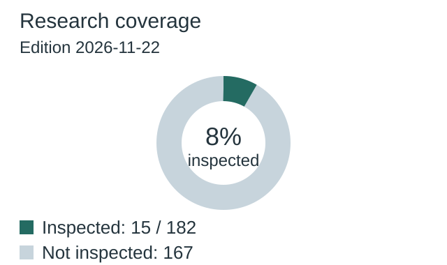
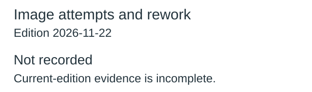
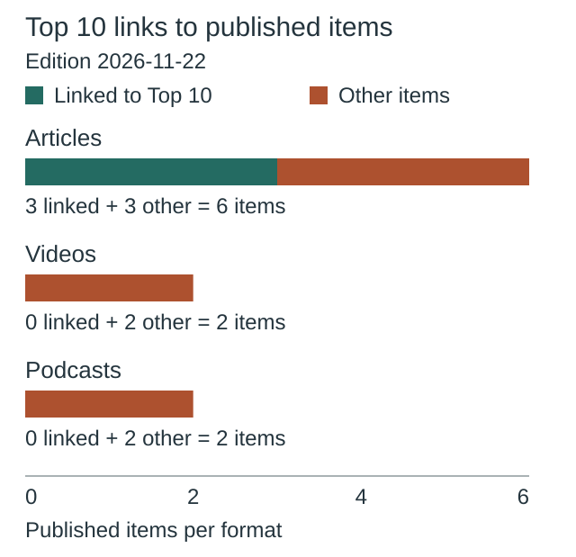
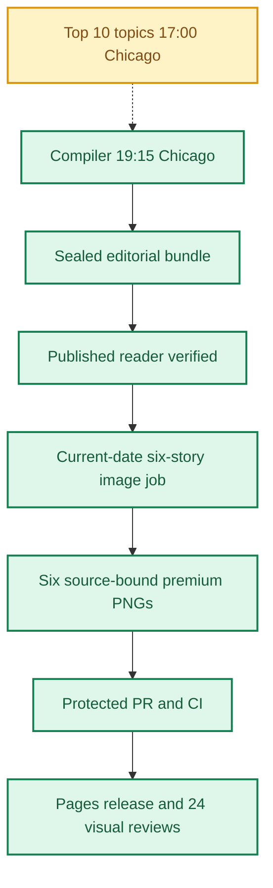
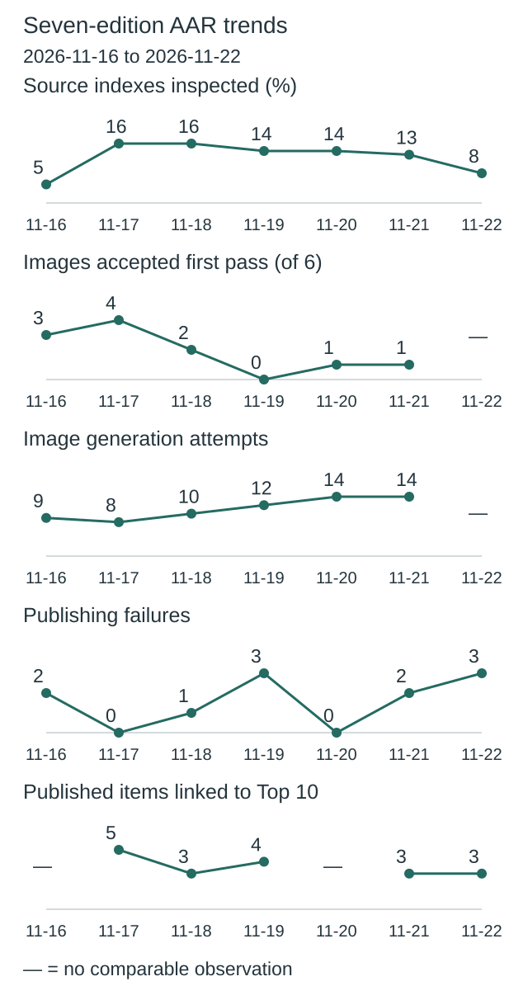
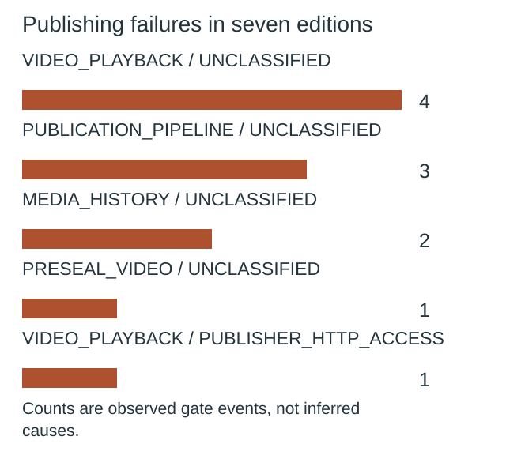
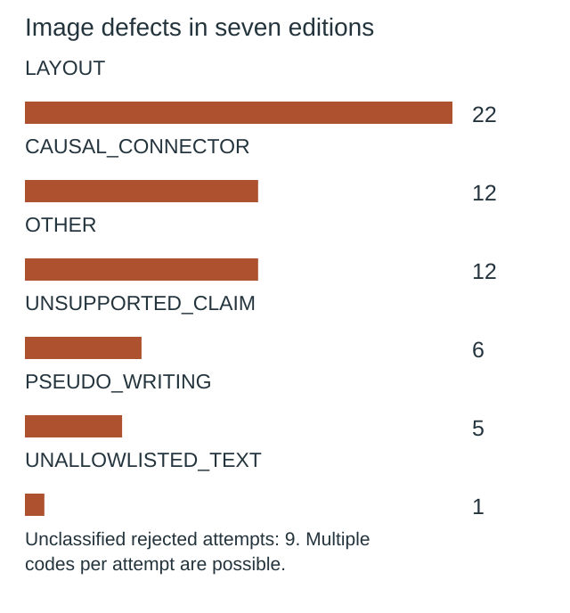

**🟩 RELEASE COMPLETE**
**TOP 10 PARTIAL** · **🟩 COMPILER VERIFIED** · **🟦 IMAGES 6/6 RELEASED** · **🟪 VISUAL QA 24/24 PASS**

# Daily AI Brief — Unified Production After-Action Report
**Edition:** November 22, 2026 · **Production evening:** 2026-11-21 · **Timezone:** America/Chicago
**Primary public reader:** [Open 2026-11-22 Brief](https://gttome.github.io/Daily-AI-Brief-Compiler/briefs/2026-11-22/) · **Repository:** [Daily-AI-Brief-Compiler](https://github.com/gttome/Daily-AI-Brief-Compiler)

> **IMPORTANT — VERIFIED PRODUCTION RESULT**
> **Executive release result: COMPLETE.** This is the single management-facing report covering Top 10 topic discovery, the editorial Compiler, published Brief and premium-image run. **Entire-system evidence: PARTIAL.** Top 10 report: **partial**; Compiler handoff: **RECEIVED_SNAPSHOT_BOUND**; guided searches: **RECEIPTS_OBSERVED**. Compiler public status: **VERIFIED**. Image release: **RELEASED_VERIFIED**. Direct 24-context visual quality: **24/24 PASS**. Autonomous completion: **UNPROVEN**. Missing evidence must not be promoted to a success claim.

**🕒 Production stage durations:** **Top 10 13m 27s** · **Compiler final seal window 7m 17s** · **Premium Images 39m 47s** (evidence-bounded elapsed times; the start/end events differ).

## Evidence reconciliation

Compiler final seal window: 7m 17s. Compiler state start to public verification: 56m 13s. Observed execution and final seal windows are distinct.
Image capability route preflight: RECORDED; scheduler origin remains UNPROVEN.
Image efficiency: 0/6 first-pass accepts; 16 total attempts. Approved prospective efficiency target: at least 4/6 first-pass and no more than 8 total attempts, strictly advisory, with unchanged quality floor.
Image review completed: 2026-11-22T04:08:43.075606Z; review-record commit: 2026-11-22T04:10:37.000Z; protected review merge: 2026-11-22T04:12:58.000Z.
Eligible source indexes: 182; editorial inspections reported: 15 (8.2%); inaccessible in editorial audit: 0; explicitly unreviewed IDs: 167; unclassified editorial IDs: 0. Automated index parsing is separate from editorial inspection and cannot substantiate exhaustive freshness claims.

Registered video sources: 37; attempted this edition: 37; unattempted: 0; enabled: 37; qualification-only: 0; sources yielding candidate URLs: 5. Status: REPORTED_ALL_ATTEMPTED. Attempt evidence is not automatic proof of source-content review or playback.

Eligible source partition **VALID**. Full original-item reads **15**. Bounded index searches **0**. Qualification-only sources recorded separately **0**.

### Video candidate discovery

| Discovery source | Eligibility | Candidate URLs |
|---|---|---:|
| Two Minute Papers — AI Research Explainers | Enabled | 1 |
| AI Engineer | Enabled | 1 |
| IBM Technology YouTube | Enabled | 2 |
| OpenAI Academy On-Demand Workshops | Enabled | 1 |
| Anthropic on YouTube | Enabled | 1 |

### Protected preseal video outcomes

| Original publisher | Distinct programs submitted | Archive rejects | Playback passes | Playback unverified | Probes skipped |
|---|---:|---:|---:|---:|---:|
| nvidia.com | 1 | 0 | 3 | 0 | 0 |
| openai | 1 | 0 | 0 | 1 | 0 |
| pbs.org | 3 | 1 | 3 | 0 | 0 |
| ted.com | 1 | 0 | 4 | 0 | 1 |
| worldsciencefestival.com | 1 | 0 | 0 | 1 | 0 |
| youtube-channel:UCbfYPyITQ-7l4upoX8nvctg | 1 | 0 | 0 | 1 | 0 |
| youtube-channel:UCKWaEZ-_VweaEx1j62do_vQ | 2 | 0 | 0 | 2 | 1 |

Outcomes count observed checks across all saved requests. Programs can be submitted again after a different slot changes.

- 4 Types of AI Agent Loops: From Human-Led to Autonomous received PUBLIC_VIDEO_PLAYBACK_UNVERIFIED. [Original run](https://github.com/gttome/Daily-AI-Brief-Compiler/actions/runs/44972016727)
- DeepMind Just Released The Best Thing AI Ever Did received PUBLIC_VIDEO_PLAYBACK_UNVERIFIED. [Original run](https://github.com/gttome/Daily-AI-Brief-Compiler/actions/runs/44972016727)
- Has AI Solved Math's Pinnacle Problem? received PUBLIC_VIDEO_PLAYBACK_UNVERIFIED. [Original run](https://github.com/gttome/Daily-AI-Brief-Compiler/actions/runs/44972016727)
- AI and the Next Decade received PRESEAL_ARCHIVE_REPEAT. Earlier editions 2026-11-11. [Original run](https://github.com/gttome/Daily-AI-Brief-Compiler/actions/runs/44972455891)
- Understanding AI Agent Hallucination in AI Systems received PUBLIC_VIDEO_PLAYBACK_UNVERIFIED. [Original run](https://github.com/gttome/Daily-AI-Brief-Compiler/actions/runs/44972893553)
- ChatGPT Sites For Newsroom Scheduling received PUBLIC_VIDEO_PLAYBACK_UNVERIFIED. [Original run](https://github.com/gttome/Daily-AI-Brief-Compiler/actions/runs/44972893553)

## Approved November 20 improvement evidence

Editorial runtime declarations: **DECLARED_RESTRICTED_EDITORIAL_RUNTIME**. Actual billing and scheduled origin remain unknown.

Video candidate evidence: **NOT_RECORDED**; substantive candidates Not recorded, non-news Not recorded, original publisher families Not recorded, selected non-news Not recorded. Targets 12 / 8 / 6 / 2 are advisory; unchanged duration, promotion, novelty and full-program playback checks still apply.

Source failure categories: RESPONSE_SIZE_LIMIT 7, PARSER_OR_OTHER 2, ACCESS_BLOCKED 6. Empty, blocked, oversized and unreviewed sources are distinct.

Original-paper cadence: one qualified paper within 3 editions when available. Current review timing NOT_RECORDED; postpublication review is not evidence of preselection reading.


IMG19 artistic changes retain their existing November 22 three-eligible-edition evaluation. Missing pixels, owner feedback and usage remain unknown; no retrospective source, query or artwork acceptance is invented.

## Daily AAR charts

These charts use this edition’s receipts. Missing data is not zero.

### Research coverage



**15 of 182 indexes inspected (8%).**

| Editorial inspection | Indexes |
|---|---:|
| Inspected | 15 |
| Not inspected | 167 |

Not inspected includes every index without a recorded editorial inspection; this is not proof of missed stories.

### Image attempts and rework



**16 attempts; 0 of 6 images accepted on their first attempt.**

Recorded ongoing from November 8 target: at least 3/6 first-pass accepts; no more than 2 attempts per image. This is an efficiency target, not a quality cutoff.

| Image | Accepted | Rejected | Total attempts |
|---|---:|---:|---:|
| OpenAI tests defenses against adversarial model distillation | 1 | 2 | 3 |
| A large multi-agent study exposes research coordination limits | 1 | 2 | 3 |
| Microsoft’s model price claims need task-level local tests | 1 | 1 | 2 |
| Model-flexible workflows need stable tests before provider switches | 1 | 2 | 3 |
| Turn one Slack agent workflow into a bounded reusable Skill | 1 | 2 | 3 |
| Microsoft packages agents around sessions, journals and approvals | 1 | 1 | 2 |

Generation attempts measure rework, not runtime or cost. Quality and publication checks remain separate.

### Top 10 links to published items



**3 of 10 unique published items link to Top 10 topics.**

| Format | Linked to Top 10 | Other items |
|---|---:|---:|
| Articles | 3 | 3 |
| Videos | 0 | 2 |
| Podcasts | 0 | 2 |

No selection quota. Topic linkage does not establish better quality, popularity or causal improvement.

[Chart data](charts.json)

One edition at a time. Missing evidence is not zero. Trend claims require comparable recorded cycles.

## Performance dashboard

| Measure | Recorded result | Source / caveat |
|:--|:--:|:--|
| Entire-system evidence | **PARTIAL** | Full Top 10 list, bound Compiler input, all-format search receipts and existing release checks; separate from publication and autonomy |
| Top 10 report | **partial · 10 topics** | Same Chicago cycle report; provisional/partial coverage remains disclosed |
| Top 10 received by Compiler | **RECEIVED_SNAPSHOT_BOUND** | Exact report snapshot bytes; consumed commit separately corroborated: YES |
| Top 10 guided article/video/podcast searches | **RECEIPTS_OBSERVED** | Actual source-search receipts and selected/rejected topic outcomes |
| Top 10 stage duration | **13m 27s** | Same-cycle run receipt only; no runtime or usage estimate |
| Editorial publication | **PASS** | State and public reader integrity receipt |
| **Unattended autonomy (separate from publication)** | **UNPROVEN** | Owner incident receipt takes precedence over unverified producer self-attestation |
| Recorded protected publishing gate failures | **3** | Actual same-edition GitHub failure sidecar only; earlier unrecorded failures remain unknown |
| Articles | **6** | Exactly 2 technical / 2 knowledge-worker / 2 agents required |
| Original scientific-paper-led articles | **Not recorded** | Rolling target: one qualified original paper in 3 editions; UNVERIFIED_RECEIPT. Preprints are not peer-reviewed by default |
| Verified original sources within preceding 24 hours | **0 / 6** | Original publisher dates only; other sources require a documented fallback rationale |
| Distinct selected article publishers | **6** | Six different primary organizations preferred |
| Videos over seven days old | **2** | Must be labeled evergreen, not a new development |
| Distinct selected video publishers | **2** | One channel is one publisher even across multiple videos |
| Cross-media topic diversity | **FOUR_DISTINCT_EVENTS_REVIEW_RECORDED** | Four video/podcast events and six pairwise original-source comparisons; editorial claims remain producer-attested |
| Video discovery source attempts | **37 / 37** | Attempt evidence across enabled and qualification-only leads; REPORTED_ALL_ATTEMPTED. Not a claim of full content review or player verification | 
| Duplicate active Watchlist display titles | **Not recorded** | Published canonical Watchlist only; historical evidence retained |
| Original-release video playback (historical) | **TWO_PUBLISHED_VIDEOS_PLAYBACK_PASS** | Later reader corrections may replace these originally verified videos; see incident register | 
| Postpublication reader incidents | **NOT_RECORDED** | Edition-specific owner reports and corrective PRs, not inferred absence | 
| Verified postpublication video corrections | **NOT_RECORDED** | Incident register tracks correction PR, actual playback evidence and reader preservation |
| Editorial index second-pass attempts | **0** | Bounded public GET retries only; never proof of original article reading |
| Editorial index reads recovered | **0** | Successful page fetch can still yield zero eligible dated items |
| Recorded scheduler capability route | **UNPROVEN** | Same-invocation route receipt only; GitHub is not scheduler authentication |
| Avoidable incomplete-staging CI failures | **Not independently audited** | Existing image-package push CI is disabled; exact-head protected PR CI remains required. A failure count requires actual workflow evidence |
| Media | **2 videos + 2 podcasts** | Sealed bundle |
| **Compiler final seal window** | **7m 17s (7.3 min)** | Final sealed-state timestamp → verified public reader; initial execution is separate |
| **Image processing stage duration** | **39m 47s** | First accepted PNG Git checkpoint → final 24/24 review; auditable stage elapsed time |
| Image scheduled-to-final-review window | **Not independently recorded** | Only with a saved one-cycle schedule anchor; does not attest exact generation start |
| Executor-observed generation-to-final-review | **46m 52s** | Only if the worker recorded a same-execution clock before its first native call; not independently verified provider runtime |
| Accepted premium PNGs | **6 / 6** | Exact package and public release hashes |
| Native image generation attempts | **16** | Image worker AAR; no estimation |
| Rejected candidates | **10** | Image worker AAR |
| Final worker checkpoint reconciliation | **PASS** | Oct25+ verifies exact generation count, per-story attempts, six accepted story/image/hash bindings and final release |
| Saved visual contexts | **24 / 24 PASS** | Dated/permanent desktop/mobile review |
| Public SHA-256 checks | **44** | Image release receipt |
| October 8 immutable history | **17 / 17** | Independent content-preservation checks |
| **Owner-reported weekly Work usage for this run** | **Not reported** | No per-cycle usage supplied |

> **EFFICIENCY NOTE**
> **Resource reporting policy:** No usage figure was supplied for this cycle, so none is assumed. Future runs show **Not reported** unless the owner supplies new cycle-specific usage metadata. No approval or extra step is required to generate the AAR.

## Production architecture and checkpoints



## Daily AI Topic Top 10 and Compiler handoff

**Research cycle:** 2026-11-21 · **Target Brief:** 2026-11-22 · **Scheduled start:** 17:00 America/Chicago

| Dimension | Recorded evidence |
|---|---|
| Run/report result | PARTIAL |
| Report status / topics | partial / 10 |
| Freshness | FRESH\_AT\_CONSUMPTION |
| Compiler handoff | RECEIVED\_SNAPSHOT\_BOUND |
| Search coverage | RECEIPTS\_OBSERVED |
| Selection mapping verification | MATCHES\_EDITION\_BUNDLE |
| Observed start / finish | 2026-11-21T23:02:37Z / 2026-11-21T23:16:04Z |
| Elapsed minutes | 13.45 |
| Usage percent | Not reported |
| Cost USD | Not reported |
| Independent scheduler autonomy | UNPROVEN |
| Compiler-recorded consumed commit | 35b822be2542a58b846fa65abef0d6d36e786633 |
| Report SHA-256 | 1d00e2ed2ea02bbbc6212a9b162b9400cc7d515092db65b75faf52bab9cf917d |

| Discovery order | AI topic | Summary | Confidence | Evidence |
|---:|---|---|---|---|
| 1 | Claude-assisted Riemann proof draws independent formal checks | A mathematician’s AI-assisted proof announcement is attracting scrutiny of what formal verification establishes and what still needs mathematical explanation. | medium | [Source](https://www.youtube.com/watch?v=GXTC-G_oOtQ) · [Source](https://www.youtube.com/watch?v=bKJo5-BY-QY) · [Source](https://news.ycombinator.com/item?id=50589618) · [Source](https://math.mit.edu/~drew/grh/) · [Source](https://alpo.ge/remark.pdf) |
| 2 | Anthropic’s public-market debut keeps AI economics in view | Coverage of Anthropic’s market debut continues as viewers examine the economics supporting AI vendors. | medium | [Source](https://www.youtube.com/watch?v=MGZPIGffCxU) · [Source](https://www.youtube.com/watch?v=tu43EchVdio) · [Source](https://www.anthropic.com/news/ipo-close) · [Source](https://www.nasdaq.com/newsroom/anthropic-marks-ipo-at-nasdaq) |
| 3 | Gemini 4 Neon draws practical workload comparisons | Creators test Google’s model on concrete coding and knowledge-work tasks rather than relying only on launch benchmarks. | medium | [Source](https://www.youtube.com/watch?v=Q0ShBenKyqo) · [Source](https://www.youtube.com/watch?v=tCY7zMknCJQ) · [Source](https://www.youtube.com/watch?v=5eON_8rgKzk) · [Source](https://blog.google/innovation-and-ai/models-and-research/gemini-models/introducing-gemini-4-neon/) |
| 4 | An AlphaGenome 2 explainer renews interest in cell-specific DNA prediction | A new explainer discusses research predicting how DNA changes affect gene regulation in different cell types. | medium | [Source](https://www.youtube.com/watch?v=Cy7Wz6Z4TWU) · [Source](https://deepmind.google/blog/alphagenome-2-deciphering-how-cells-read-dna-to-better-understand-disease/) |
| 5 | A software-factory talk treats coding agents as an engineering system | Zach Lloyd demonstrates a loop that records agent work, diagnoses defects and tests proposed workflow changes against real tasks. | medium | [Source](https://www.youtube.com/watch?v=0LeT996Hz3E) · [Source](https://ai.engineer/code/2026/talks/zach-lloyd) |
| 6 | Microsoft’s Ignite harness updates prompt an architecture explainer | An independent explainer examines the runtime, isolation and session controls around Microsoft’s agents. | medium | [Source](https://www.youtube.com/watch?v=iVm3lsgxH64) · [Source](https://commandline.microsoft.com/microsoft-copilot-sdk-2-0-github/) |
| 7 | An agent research archive tests whether scientific checks emerge in groups | A study documents how936 agents shared studies, criticism, code and results over twelve weeks. | medium | [Source](https://x.com/askalphaxiv/status/2123456265858740600) · [Source](https://casrai.org/news/alphaxiv-agent-936-ai-generated-preprints-12-weeks-2026) · [Source](https://www.alphaxiv.org/abs/2611.society-ai-scientists) · [Source](https://www.alphaxiv.org/abs/2611.society-ai-scientists.pdf) |
| 8 | Tencent opens Hy4 weights with a model card and deployment details | The release gives developers a large multimodal model to inspect while exposing hardware, license and evaluation constraints. | medium | [Source](https://x.com/TencentHunyuan/status/2123625549147070538) · [Source](https://huggingface.co/tencent/Hy4) · [Source](https://github.com/Tencent-Hunyuan/Hy4) |
| 9 | OpenAI reports layered defenses against adversarial distillation | The research describes combining model safeguards with account-level investigations to reduce unauthorized capability extraction. | low | [Source](https://x.com/OpenAI/status/2123862344422088794) · [Source](https://openai.com/index/combatting-adversarial-distillation/) |
| 10 | Gemini adds prompt-generated looping GIFs | The app can turn prompts or images into short animated GIFs for everyday communication and creative work. | low | [Source](https://x.com/GeminiApp/status/2123813017855103449) · [Source](https://support.google.com/gemini/answer/16126339?hl=en) · [Source](https://support.google.com/gemini/answer/14286560?hl=en) |

**Sample scope:** {"metadata\_screened\_videos":34,"unique\_videos":34,"distinct\_screened\_channels":23,"full\_video\_reviews":0,"full\_program\_reviews":0,"complete\_transcript\_reviews":1,"complete\_original\_publisher\_transcript\_reviews":1,"partial\_original\_publisher\_transcript\_reviews":0,"direct\_youtube\_counter\_verifications":0,"bounded\_original\_manuscript\_reviews":1,"complete\_original\_paper\_reviews":0,"full\_original\_article\_reads":0,"bounded\_original\_document\_items":18,"original\_watch\_attempts\_for\_screened\_videos":34,"original\_watch\_outcomes\_for\_screened\_videos":{"throttled":25,"title\_shell":9},"additional\_unretained\_or\_recording\_video\_id\_attempts":10,"distinct\_original\_video\_ids\_attempted":44,"new\_video\_routes\_attempted":8,"new\_route\_original\_publisher\_families":7,"comparable\_video\_observations":3,"freshness\_counts":{"within\_24h\_timestamped":2,"additional\_within\_72h\_timestamped":11,"additional\_within\_7d\_timestamped":2,"date\_only":19,"older":0},"freshness\_reference\_at":"2026-11-21T23:13:29Z","screened\_source\_items":56,"retained\_source\_items":27,"screened\_and\_retained\_by\_category":{"video":{"screened":34,"retained":10},"original\_release\_paper\_model\_card\_repository":{"screened":18,"retained":15},"independent\_report\_test\_interview":{"screened":1,"retained":1},"public\_discussion\_thread":{"screened":3,"retained":1}},"trackers\_separately\_counted":4,"additional\_discovery\_route\_indexes\_separately\_counted":8,"notes":"Counts refer to the explicit deduplicated item ledger, not every incidental search hit. Metadata screening is not substantive full-video review. One complete organizer source transcript is distinct from viewing the standalone edit.24h preference widened to72h and7d; old model/talk dates are labeled."}. **Ranking basis:** {"attention":"Event-matched YouTube reach and attributable creator breadth are the main discovery signals, with three comparable same-source video snapshot pairs. Original posts, public discussion and independent event coverage supplement attention. No overlapping audiences are summed.","quality":"Attention confidence, original claim review, usefulness, promotion risk and playback qualification remain separate.","uncertainty":"No direct YouTube counters or verified playback; some counter clocks unavailable. Exact ordering is unsupported, and vendor social views are not comparable to video views. Six of ten topics have one attention family; all ten undergo a documented family-removal review."}.

| Search format | Receipt rows | Attempts recorded | Explicitly not attempted |
|---|---:|---:|---:|
| article | 10 | 10 | 0 |
| video | 10 | 10 | 0 |
| podcast | 10 | 10 | 0 |

**Selected Brief items linked to trends:**

| Topic | Format | Selected item | Reason |
|---|---|---|---|
| microsoft-ignite-agent-harness-announcements-nov17 | article | nov22-a2-copilot-agent-workflows · [Source](https://commandline.microsoft.com/microsoft-copilot-sdk-2-0-github/) | The selected article is the exact original Copilot SDK 2.0 architecture source discovered in the rank-six search. |
| alphaxiv-agent-preprint-server-announcement-nov19 | article | nov22-t2-society-ai-scientists · [Source](https://www.alphaxiv.org/abs/2611.society-ai-scientists) | The selected technical story is the exact full manuscript discovered and read for the rank-seven search. |
| openai-adversarial-distillation-research-nov20 | article | nov22-t1-adversarial-distillation · [Source](https://openai.com/index/combatting-adversarial-distillation/) | The selected security story is the exact original research article discovered and read for the rank-nine search. |

**Gaps and limitations:**

- The report labels its research partial.
- PARTIAL research:34 metadata-screened videos from23 channels, one complete organizer transcript, zero full-video/playback reviews and zero direct YouTube counter verifications. The40–80 full-review target remains unmet.
- Reported views/likes are third-party snapshots. Comments, subscriber counts, sponsorship, missing durations and metric clocks remain null. Source publication times and observation clocks are distinct.
- No global coverage, exact composite score, CTR, retention, current velocity or unmatched tracker growth is claimed. Original-document review is bounded and complete paper qualification remains absent.
- Historical reports, frozenNovember3 baseline, production branches, workflows, schedules and accepted image bytes are preserved. November10 coverage pilot does not apply.
- This report supplies30 search terms, not30 actual Compiler searches. Current consumption, mappings, publication, image completion and combined AAR outcomes remain pending independent receipts.

**Recorded run issues:**

- {"issue":"Original YouTube routes throttled or returned title shells.","effect":"34 named metadata screens yielded zero full playback reviews and zero direct YouTube counter verifications.","correction":"Used bounded original publisher routes, including a complete organizer transcript, and retained partial status."}
- {"issue":"VCA display-to-click mappings shifted across responses.","effect":"Some returned IDs could not safely inherit displayed title/date associations.","correction":"Quarantined those associations;34 metadata denominator excludes them. Exact original watch attempts are separate from screens."}
- {"issue":"Original sites or documents had bounded access failures: Computerphile, initialStatQuest route, WSF program page, Lean community body, Reuters and Verge podcast.","effect":"No full review or qualification inferred from inaccessible pages or index titles.","correction":"Used canonicalStatQuest index and original MIT/company/organizer/event documents where accessible; exact unresolved program checks retained."}
- {"issue":"Conflicting freshness and licensing across versions.","effect":"alphaXiv announcement and currentPDF dates differ; oldHy4 preview coverage cannot establish current license; oldPerplexity extension is not a fresh launch.","correction":"Preserved separate clocks and current Tencent Hy License; excluded lower-confidence or misleading event claims from retained ten."}
- {"issue":"Local prior-report transfer initially exceeded the process argument-size limit.","effect":"One scratch command failed before any repository mutation.","correction":"Retried in14000-character chunks; exact150052 prior bytes, Git blob andSHA256 verified. Current report write/readback also byte-verified."}
- {"issue":"Source-level exact per-request clocks were not individually captured.","effect":"Individual fallback attempted\_at remains null rather than fabricated.","correction":"Preserved real research start, actual checkpoint observation clocks and bounded retrieval windows."}

**Recorded improvements:**

- {"change":"Read a complete original organizer transcript and flag the exact standalone video plus source recording for early Compiler review.","reason":"Prior AAR mapped zero selected videos and current watch routes still lack content/playback.","expected\_effect":"Supply substantive original material and expose playback, date, archive and edit-equivalence checks before final media qualification.","status":"IMPLEMENTED\_IN\_CURRENT\_PRODUCER\_RESEARCH"}
- {"change":"Quarantine unstable index-to-program associations and distinguish preprint/announcement/version clocks.","reason":"VCA click targets shifted; alphaXiv currentPDF date differs from announcement date; older preview licensing conflicts with currentHy4 license.","expected\_effect":"Reduce unsupported identity, freshness and license claims without treating a larger metadata sample as quality.","status":"IMPLEMENTED\_IN\_CURRENT\_PRODUCER\_RESEARCH"}
- {"change":"Include all ten ranks and an early original-video flag in current AAR; link the latest available downstream impact table.","status":"IMPLEMENTED\_CURRENT\_EDITION\_OUTCOMES\_PENDING","evidence\_refs":\["https://github.com/gttome/Daily-AI-Brief-Compiler/blob/d7a79c390b36aa092a80a027d6260e367fb6939f/signals/ai-topic-top10/2026-11-21.json","https://github.com/gttome/Daily-AI-Brief-Compiler/blob/9022a89eedaa9d3a3915d12980c651a3bfc73b11/daily/2026-11-20/combined.md#daily-ai-topic-top-10-and-compiler-handoff"\],"limitation":"Current downstream table is absent; no selections or playback inferred."}

### Daily improvement and effect on the Brief

**Fixed baseline:** nov03-2026-v1 / INPUT\_FROZEN. **Outcome baseline:** FROZEN\_AFTER\_VERIFIED\_PUBLICATION. **Prior cycle:** 2026-11-20.

| Input measure | Current | November 3 baseline | Change from baseline | Change from prior cycle |
|---|---:|---:|---:|---:|
| topic count | 10 | 10 | 0 | 0 |
| validation resource count | Not reported | 14 | Not reported | Not reported |
| additional video metadata records | Not reported | 63 | Not reported | Not reported |
| additional video channels | Not reported | 21 | Not reported | Not reported |
| total video observations | Not reported | 79 | Not reported | Not reported |
| unique videos | Not reported | 71 | Not reported | Not reported |
| full video reviews | Not reported | 0 | Not reported | Not reported |
| direct youtube counter verifications | Not reported | 0 | Not reported | Not reported |
| broader evidence band topics | 4 | 3 | 1 | 0 |
| limited evidence band topics | 6 | 7 | -1 | 0 |

**Observed downstream measurements:** OBSERVED.

| Outcome measure | Current | Change from frozen outcome | Change from prior cycle |
|---|---:|---:|---:|
| expected topic format pairs | 30 | 0 | 0 |
| attempted topic format pairs | 30 | 0 | 0 |
| explicitly unattempted pairs | 0 | 0 | 0 |
| discovered candidate count | 31 | -9 | -5 |
| searched source host count | 28 | 12 | -5 |
| selected article count | 3 | 0 | 2 |
| selected video count | 0 | 0 | 0 |
| selected podcast count | 0 | -1 | -2 |

**Source changes:** {"added":\[\],"removed":\[\]}.

**Candidate review depth:** NOT\_RECORDED.

| Review measure | Current | Change from prior comparable cycle |
|---|---:|---:|
| reviewed candidate count | Not reported | Not reported |
| qualified candidate count | Not reported | Not reported |
| rejected candidate count | Not reported | Not reported |
| metadata only count | Not reported | Not reported |
| full video reviews | Not reported | Not reported |
| transcript reviews | Not reported | Not reported |

The frozen November 3 baseline has no candidate-level review ledger; no retrospective value is invented. Recorded reviews do not independently establish content quality, audience interest or causal benefit.

**Method/resource review:** {"baseline\_id":"nov03-2026-v1","previous\_report\_date":"2026-11-20","method\_version":"2026-11-03.2-event-review","changes":\[{"change":"Read a complete original organizer transcript and flag the exact standalone video plus source recording for early Compiler review.","reason":"Prior AAR mapped zero selected videos and current watch routes still lack content/playback.","expected\_effect":"Supply substantive original material and expose playback, date, archive and edit-equivalence checks before final media qualification."},{"change":"Quarantine unstable index-to-program associations and distinguish preprint/announcement/version clocks.","reason":"VCA click targets shifted; alphaXiv currentPDF date differs from announcement date; older preview licensing conflicts with currentHy4 license.","expected\_effect":"Reduce unsupported identity, freshness and license claims without treating a larger metadata sample as quality."}\],"resource\_candidates":\[{"url":"https://math.mit.edu/~drew/grh/","role":"claim verification","access":"direct","review\_scope":"Original independent checker summary, theorem scope, complete/running check table.","independence":"Independent MIT checker relative to the announcing Anthropic researcher; not independent reexecution by this producer.","decision":"accepted","reason":"Directly separates completed formal checks from pending checks and narrows generalized-Riemann scope.","contribution":"Supports precise confidence and limitations for rank1."},{"url":"https://ai.engineer/code/2026/talks/zach-lloyd","role":"original program substance","access":"direct","review\_scope":"Complete331-passage organizer transcript and reading edition.","independence":"Original conference publisher and vendor speaker share the presented program; not another independent attention family.","decision":"accepted","reason":"Exposes an actionable measurement/demo sequence rather than a title-only review.","contribution":"Rank5 early-review flag, with standalone edit and playback still unresolved."},{"url":"https://leanprover-community.github.io/blog/posts/riemann-hypothesis/","role":"claim verification","access":"title\_shell\_then\_unavailable","review\_scope":"Original title only; bounded retry unavailable.","independence":"Original theorem-prover community; substantive content unavailable here.","decision":"deferred","reason":"No retrieved body establishes a complete primary review.","contribution":"HN links retained as discussion attention, not verification by an unread community article."}\],"observed\_effects":{"matched\_input\_comparison":{"previous\_metadata\_videos":43,"current\_metadata\_videos":34,"delta":-9,"previous\_full\_video\_reviews":0,"current\_full\_video\_reviews":0,"previous\_complete\_transcript\_reviews":0,"current\_complete\_transcript\_reviews":1,"interpretation":"Different sampled programs and route mix; metadata count decline and one deeper source review do not establish production quality improvement."},"previous\_edition\_verified\_outcomes":{"edition":"2026-11-21","report\_snapshot\_bound":true,"canonical\_searches":30,"selected\_mappings":3,"selected\_articles":1,"selected\_videos":0,"selected\_podcasts":2,"quality\_or\_causal\_improvement\_proven":false},"current\_downstream\_status":"PENDING","earlier\_aar\_charts":{"research\_inspected":15,"research\_total":117,"image\_attempts":14,"first\_pass\_accepted":1,"linked\_articles":1,"linked\_videos":0,"linked\_podcasts":2},"prior\_aar\_url":"https://github.com/gttome/Daily-AI-Brief-Compiler/blob/9022a89eedaa9d3a3915d12980c651a3bfc73b11/daily/2026-11-20/combined.md","prior\_chart\_data\_url":"https://github.com/gttome/Daily-AI-Brief-Compiler/blob/9022a89eedaa9d3a3915d12980c651a3bfc73b11/daily/2026-11-20/charts.json","prior\_improvement\_metrics\_url":"https://github.com/gttome/Daily-AI-Brief-Compiler/blob/9022a89eedaa9d3a3915d12980c651a3bfc73b11/daily/2026-11-20/improvement-metrics.json","downstream\_impact\_table\_url":"https://github.com/gttome/Daily-AI-Brief-Compiler/blob/9022a89eedaa9d3a3915d12980c651a3bfc73b11/daily/2026-11-20/combined.md#daily-ai-topic-top-10-and-compiler-handoff"},"next\_improvement":"Compiler should inspect the flagged exact standalone program early, verify its relationship to the complete organizer source, original date, archive novelty and signed-out advancing playback; then record actual canonical searches and final candidate-bound decisions.","limitations":\["One prior positive search/mapping observation is not efficacy proof. Current edition is unrun at this producer checkpoint.","Runtime and billing are not established by successful report persistence; usage and cost remain unknown."\],"change\_evaluations":\[{"change\_id":"NOV15-02","reviewed\_edition":"2026-11-22","decision":"keep","result":"met","reason":"The preceding November21 edition independently bound the original report bytes and recorded30 canonical searches with3 bundle-matched selected mappings. This evaluates that observed edition only; November22 consumption and outcomes are pending.","evidence\_refs":\["https://github.com/gttome/Daily-AI-Brief-Compiler/blob/9022a89eedaa9d3a3915d12980c651a3bfc73b11/daily/2026-11-20/combined.json","https://github.com/gttome/Daily-AI-Brief-Compiler/blob/9022a89eedaa9d3a3915d12980c651a3bfc73b11/daily/2026-11-20/improvement-metrics.json"\]},{"change\_id":"NOV16-P0-01","reviewed\_edition":"2026-11-22","decision":"keep","result":"met","reason":"The preceding edition reports10 real searches in each format and exact consumed-query identity, unlike the older invalid receipt. Current ten distinct events and30 useful query slots are producer inputs only, not proof that November22 searches occurred.","evidence\_refs":\["https://github.com/gttome/Daily-AI-Brief-Compiler/blob/9022a89eedaa9d3a3915d12980c651a3bfc73b11/daily/2026-11-20/combined.json"\]},{"change\_id":"NOV16-P1-09","reviewed\_edition":"2026-11-22","decision":"keep","result":"inconclusive","reason":"Three previous-edition bundle-verified mappings establish recorded association, not incremental causal yield. No counterfactual quality comparison or current-edition final selection exists at this producer checkpoint.","evidence\_refs":\["https://github.com/gttome/Daily-AI-Brief-Compiler/blob/9022a89eedaa9d3a3915d12980c651a3bfc73b11/daily/2026-11-20/combined.md#daily-ai-topic-top-10-and-compiler-handoff"\]},{"change\_id":"NOV20-01","reviewed\_edition":"2026-11-22","decision":"keep","result":"inconclusive","reason":"The November21 receipt supplies one positive canonical search/mapping observation. Its November24 review window is incomplete and the November22 Compiler has not yet produced independently reconciled observations.","evidence\_refs":\["https://github.com/gttome/Daily-AI-Brief-Compiler/blob/9022a89eedaa9d3a3915d12980c651a3bfc73b11/daily/2026-11-20/combined.json"\]},{"change\_id":"NOV20-05","reviewed\_edition":"2026-11-22","decision":"keep","result":"inconclusive","reason":"Current producer work includes research explainers, demonstrations and a complete organizer talk transcript, but no verified playback. Eight additional discovery routes do not establish twelve substantively qualified programs or final non-news selections; the Compiler owns those outcomes.","evidence\_refs":\["https://ai.engineer/code/2026/talks/zach-lloyd","https://github.com/gttome/Daily-AI-Brief-Compiler/blob/9022a89eedaa9d3a3915d12980c651a3bfc73b11/daily/2026-11-20/improvement-metrics.json"\]}\]}.

**Current reconciled conclusion:** OBSERVED; outcome baseline FROZEN\_AFTER\_VERIFIED\_PUBLICATION; candidate review ledger NOT\_RECORDED.

**Historical producer observations (not current status):** The following snapshot preserves what the producer reported at the time. Its pending statuses and candidate-quality claims are not independently reconciled conclusions. Use the current tables above for publication-bound measurements; an absent candidate review ledger remains unknown.

<details><summary>Original producer effects and gaps — historical snapshot</summary>

```json
{
  "observed_at": "2026-11-22T01:25:44.938Z",
  "actual_searches": 30,
  "candidate_bound_rows": 30,
  "freshness_or_quality_rejections": [
    "Prior-cycle podcast reuse was rejected for archive novelty.",
    "News-channel video candidates were rejected by the November 22 rolling cap.",
    "Short promotional social clips were rejected below the substantive-program requirement."
  ],
  "incremental_benefit": null,
  "causal_uplift": null,
  "limitation": "Search receipt counts document observed coverage and candidate yield; they do not prove selection quality or causal improvement.",
  "bundle_reconciliation": {
    "selected_article_count": 3,
    "selected_video_count": 0,
    "selected_podcast_count": 0,
    "distinct_ranks_represented": 3,
    "strongest_near_miss": {
      "topic_id": "zach-lloyd-factory-engineering-talk-nov12",
      "candidate_id": "ai-engineer-zach-talk-video",
      "reason": "Strongest Top 10 non-news talk was fully reviewed but its exact YouTube player failed the protected signed-out gate."
    }
  }
}
```

</details>

**Next improvement:** Compiler should inspect the flagged exact standalone program early, verify its relationship to the complete organizer source, original date, archive novelty and signed-out advancing playback; then record actual canonical searches and final candidate-bound decisions.

Counts show coverage and observed association, not audience popularity, source independence, candidate quality or causal uplift. Compare source/method changes before interpreting deltas. Unknown values are not zero. Publication, reader corrections, runtime and image outcomes retain their separate AAR evidence.

Report, source-readback and search receipts are separate observations. Snapshot binding verifies the collected report bytes; the consumed commit is independently corroborated only when the separately fetched source bytes match. These records do not independently attest scheduler identity or source truth. Top 10 reporting does not change Brief/image release status.


## Track 1 — Compiler

**State:** `SHADOW_VERIFIED` · **Bundle:** `BUNDLE_READY` · **Compiler final seal window:** 7m 17s (7.3 min).

| Publication gate | Result |
|---|:---:|
| Canonical reader build | ✅ |
| Reader parity | ✅ |
| Public verification of dated edition | ✅ |
| Previous editions preserved | ✅ |
| Permanent story routes and feeds | ✅ |

**Selected coverage:**

| Lane | Story |
|---|---|
| Technical AI Engineering | OpenAI tests defenses against adversarial model distillation |
| Technical AI Engineering | A large multi-agent study exposes research coordination limits |
| Applied Generative AI for Knowledge Workers | Microsoft’s model price claims need task-level local tests |
| Applied Generative AI for Knowledge Workers | Model-flexible workflows need stable tests before provider switches |
| Agents for Everyone | Turn one Slack agent workflow into a bounded reusable Skill |
| Agents for Everyone | Microsoft packages agents around sessions, journals and approvals |

### Scientific paper opportunity and publication evidence

**Current edition:** UNVERIFIED_RECEIPT; **paper-led stories:** Not recorded. Editorial target: at least one genuinely qualified original-paper-based story in seven editions, with methods, limitations, and an explicit preprint/peer-review distinction. No stale or weak paper is selected solely to fill a quota.


## Track 2 — Premium images

**Public status:** `RELEASED_VERIFIED` · **Saved images:** 6/6 · **Actual generation attempts:** 16 · **Rejected candidates:** 10.

### Image production duration — Git-verified milestones

**Auditable image stage duration:** **39m 47s** (first accepted binary saved in Git → first persisted 24-context quality-review record). **First asset to public image release:** **31m 22s**.
**Scheduled-to-final-review window:** **Not independently recorded**. This is a scheduled-clock comparison only when a separately recorded exact-date schedule exists; it is **not** measured native image-generation runtime.

| Production milestone | Chicago local time | Evidence |
|---|---|---|
| Scheduled image start (if exact-date record exists) | Not independently recorded | Time planned, not actual execution start |
| First executor-observed start | 9:11:34 PM | Worker self-attestation, not a first-party scheduler event |
| First native generation observation | 9:23:45 PM | Worker clock recorded immediately before first native call, not model-provider telemetry |
| First accepted PNG bytes saved to Git | 9:30:50 PM | Immutable binary-stage commit |
| Six-image package / reviews committed | 9:57:17 PM | Exact-head PR source commit |
| Protected package merged | 10:01:09 PM | Merge SHA and required CI |
| Public images verified | 10:02:12 PM | Image-release receipt |
| 24/24 review record committed | 10:10:37 PM | Immutable first review-approval commit |

> **Duration interpretation:** The audited stage excludes unobservable pre-checkpoint creative work. The scheduled-start window includes it but must not be interpreted as precise active processing time. Missing timestamps appear as **Not independently recorded**, never an estimate.


| Source-bound image | Attempts | File size | Public page |
|---|---:|---:|---|
| OpenAI tests defenses against adversarial model distillation | 3 | 0.92 MiB | [View original](https://gttome.github.io/Daily-AI-Brief-Compiler/briefs/images/2026-11-22/dab-edition-2026-11-22-m01.png) |
| A large multi-agent study exposes research coordination limits | 3 | 0.86 MiB | [View original](https://gttome.github.io/Daily-AI-Brief-Compiler/briefs/images/2026-11-22/dab-edition-2026-11-22-m02.png) |
| Microsoft’s model price claims need task-level local tests | 2 | 0.78 MiB | [View original](https://gttome.github.io/Daily-AI-Brief-Compiler/briefs/images/2026-11-22/dab-edition-2026-11-22-m10.png) |
| Model-flexible workflows need stable tests before provider switches | 3 | 0.77 MiB | [View original](https://gttome.github.io/Daily-AI-Brief-Compiler/briefs/images/2026-11-22/dab-edition-2026-11-22-m11.png) |
| Turn one Slack agent workflow into a bounded reusable Skill | 3 | 0.82 MiB | [View original](https://gttome.github.io/Daily-AI-Brief-Compiler/briefs/images/2026-11-22/dab-edition-2026-11-22-m12.png) |
| Microsoft packages agents around sessions, journals and approvals | 2 | 0.80 MiB | [View original](https://gttome.github.io/Daily-AI-Brief-Compiler/briefs/images/2026-11-22/dab-edition-2026-11-22-m14.png) |

**Immutable-release and visual gates:**

| Release gate | Result |
|---|:---:|
| Protected public image receipt | ✅ |
| Accepted-image Git hash bindings | ✅ |
| Six live PNGs | 6/6 |
| Dated/permanent story placements | 12/12 recorded in release evidence |
| Desktop/mobile visual inspection | 24/24 PASS |
| Historical Oct 8 integrity | 17/17 |

### Published premium illustrations

<table>
<tr><td width="50%"><a href="https://gttome.github.io/Daily-AI-Brief-Compiler/briefs/images/2026-11-22/dab-edition-2026-11-22-m01.png"></a><br/><b>OpenAI tests defenses against adversarial model distillation</b></td><td width="50%"><a href="https://gttome.github.io/Daily-AI-Brief-Compiler/briefs/images/2026-11-22/dab-edition-2026-11-22-m02.png"></a><br/><b>A large multi-agent study exposes research coordination limits</b></td></tr>
<tr><td width="50%"><a href="https://gttome.github.io/Daily-AI-Brief-Compiler/briefs/images/2026-11-22/dab-edition-2026-11-22-m10.png"></a><br/><b>Microsoft’s model price claims need task-level local tests</b></td><td width="50%"><a href="https://gttome.github.io/Daily-AI-Brief-Compiler/briefs/images/2026-11-22/dab-edition-2026-11-22-m11.png"></a><br/><b>Model-flexible workflows need stable tests before provider switches</b></td></tr>
<tr><td width="50%"><a href="https://gttome.github.io/Daily-AI-Brief-Compiler/briefs/images/2026-11-22/dab-edition-2026-11-22-m12.png"></a><br/><b>Turn one Slack agent workflow into a bounded reusable Skill</b></td><td width="50%"><a href="https://gttome.github.io/Daily-AI-Brief-Compiler/briefs/images/2026-11-22/dab-edition-2026-11-22-m14.png"></a><br/><b>Microsoft packages agents around sessions, journals and approvals</b></td></tr>
</table>

## Incidents, corrections and learning

### Postpublication reader incidents (updated when new evidence is merged)

No current-edition postpublication incident register was available; this is **NOT_RECORDED**, not a certification of zero incidents.


**Editor recovery classification:** UNPROVEN. **Owner intervention:** Unproven either way. **Protected same-edition failures recorded:** 3. 
**Latest failed protected stage:** PUBLICATION_PIPELINE; [Action evidence](https://github.com/gttome/Daily-AI-Brief-Compiler/actions/runs/44975166848). Exact stage durations are available only where real source timestamps exist.

| Stage | Verified issue | Corrective action |
|---|---|---|
| Native generation saved-pixel rejection | Paragraph-like ink rows simulate writing on four document faces. The second arrow ends on the review face without a physical port. Vendor qualification is printed on the downstream output object rather than detached. | Remove all simulated document writing, attach the review arrow to a physical edge port, keep approval visibly unpassed and move the source caveat into detached white space. Preserve specific Weekly status/Draft content and source-bound workflow. |
| Native generation saved-pixel rejection | Writing artifacts and arrow port corrected, but the front message/review/output faces remain blank apart from stage headings. The owner’s November22 detail requirement calls for concrete input, visible state and resulting artifact on those surfaces. | Print Status request on input, Awaiting approval on the review body, and Status row on the downstream write artifact. These are labeled conceptual Skill fields, not invented record contents or a quoted message. Preserve the unpassed approval boundary. |
| Native generation saved-pixel rejection | The session identity leaf became a botanical plant; three unplanned arrowheads appear on what should be a headless session bracket. State stack and separate session specimen are anonymous, and the host-policy caveat is integrated into the container base. | Replace plant with a labeled identity page, label the state and Other session, remove all bracket arrowheads while retaining the single journal-to-resume arrow, and detach host-policy caveat. |
| Native generation saved-pixel rejection | Input has faux paragraph bars and an unapproved success check; the central output plaque is blank; bottom foreground reaches595, failing40px. Realistic rock texture weakens the intended illustrative specimen style. | Replace input strokes with a concrete Code edit label and keyed task specimen, replace blank output plaque with Needs review, remove the check entirely, smooth to matte illustrative clay and raise/inset the base. Preserve distinct retries/review/recovery cost strata and detached vendor caveat. |
| Native generation saved-pixel rejection | Transcript/draft faces contain prohibited paragraph-like bars. Bottom policy beam reaches597, below the40px floor. Repeated framed labels weaken the architectural annotation treatment. | Remove only faux bars, keep specific artifact terms on smooth faces, use open labels and a small detached policy caveat above560. Preserve stable rail, physical replaceable joint and two port-bound arrows. |
| Native generation saved-pixel rejection | Requested test leaves were rendered as botanical foliage, introducing unsupported decorative scenery. Pseudo-writing and panel frames were otherwise corrected. | Replace only the two botanical leaves with smooth folded paper test specimens bearing the same exact words. Preserve the stable rail, model joint, approved labels and connector paths. |
| Native generation saved-pixel rejection | Saved foreground violates40px on all four sides. Request arrow ends on protected core instead of planned outer leak-check port. Anonymous top ribbons lack explanatory content; replace front with source-supported Adaptive attacks. | Inset all art and glyphs; preserve type sizes, correct only input arrow, label front trace bundle and enlarge tool-argument secondary text. Passing engraved cutaway, protected/public distinction and detached caveat preserved. |
| Native generation saved-pixel rejection | Source detail and arrow correction improved, but exported foreground remains left37 top27 bottom602: three mandatory40px foreground margins fail. | Reposition outer elements into a broader white border; preserve words, readable sizes and corrected physical arrows. |
| Native generation saved-pixel rejection | Green backing masses split the relief into three panel-like regions instead of one radial commons; foreground violates40px on all sides. Repeated cream plaques dominate the text architecture. | Join useful paper anatomy into one radial bound relief, remove separate backing boards and unnecessary cream plaques, print open captions and inset all art. Preserve explicit Paper/Code/Data, matched rerun shapes, withdrawn claim and null-result distinction. |
| Native generation saved-pixel rejection | The radial continuous paper assembly improves set variety and meaningful surfaces, but the native output changed to3:2 instead of required1200:630 composition. Stretching it is not an admissible export. Null-result leaf remains blank while its label is outside. | Return to wide1.90476:1 native composition with a broad white border and print Null results count directly on its front leaf. Preserve other source-bound paper anatomy and exact labels. |
| Progress checkpoint reporting | Intermediate orchestration load calls returned copies; attempted mutations of progress counts were not retained, leaving prior checkpoint counters at zero despite real native calls and persisted PNG reviews. | Preserved earlier checkpoints, reconciled actual sixteen native calls and six hash-bound assets in current worker state; copied real first-clock observations unchanged. |
| Visible-text metadata reconciliation | Three correction prompts froze additional exact words and face placement before generation, while typed starter-label arrays did not retain those additions. | Preserved actual pre-native prompts and geometry; recorded explicit prompt references and all final authorized terms in current saved-pixel reviews without backdating a typed-array fix. |
| Final public metadata deployment | Release run44983173414 deployed six images and completed 24 captures, then deploy-pages reported no exact final-metadata artifact although the artifact was finalized at the same second. An artifact visibility race is suspected, not proved. | Existing postrelease verify/metadata-sync workflow, protected exact-Nov22 visual review and same-content history deployment; no image regeneration or placeholder replacement. Existing metadata-only recovery completed; final independent HTTP public-index and release-receipt hashes matched, with six accepted image hashes and 12 correct article bindings. |
| Editorial observation reporting repair | The optional artistic-feedback decoder rejected two substage observations per story because those descriptions contained only short labels rather than the required descriptive observations. | Expanded the twelve observations from the actually inspected saved pixels and corrected their existing source-claim references. No image, source freeze, prior timestamp, owner acceptance or admission evidence changed. |

> **OPERATIONAL NOTE**
> This report distinguishes a published and verified production outcome from scheduler metadata exposed to another conversation. Lack of a live host heartbeat in a separate normal chat is not a Compiler production failure.

## Usage and cost stewardship

| Item | Per-cycle value |
|---|---|
| **Weekly Work usage reported by owner** | **Not reported** |
| Internal weekly usage reference | Target under 5% |
| Genuine image-generation attempts | 16 |
| Accepted diagrams | 6 |
| Regeneration after acceptance | 0 |
| Top 10 reported usage | Not reported |
| Top 10 reported cost | Not reported |
| Account-level billing telemetry | Not independently accessible to deterministic GitHub reporting |

**Future reporting rule:** For cycles without an optional owner-usage record, publish the complete AAR with `Not reported`; do not reuse prior percentages, guess remaining weekly credits or delay tomorrow's production.

## Next-edition operating handoff

| Control | Recurring contract |
|---|---|
| AI Topic Top 10 | Sole report task · 17:00 America/Chicago · saved dated list guides same-evening research |
| Primary Compiler | Sole existing task · 19:15 America/Chicago |
| Premium image production | Sole existing task · standard 21:15 America/Chicago |
| Exact image job selection | Newly published next-date `PUBLISHED_PENDING` only |
| AAR | Combined report generated automatically from new GitHub receipts |
| Optional Work usage | Owner-supplied per cycle, otherwise `Not reported` |

> **SCHEDULE RESTORATION NOTE**
> A temporary scheduling exception must be explicitly restored before claiming standard-time readiness. This deterministic document generator reads existing state only; it does not modify production schedules.

## Evidence register

| Evidence | Link |
|---|---|
| Compiler state | [Open receipt](https://github.com/gttome/Daily-AI-Brief-Compiler/blob/shadow/2026-11-22/shadow-runs/2026-11-22/compiler-state.json) |
| Compiler compile receipt | [Open receipt](https://github.com/gttome/Daily-AI-Brief-Compiler/blob/shadow/2026-11-22/shadow-runs/2026-11-22/compiler/compile-receipt.json) |
| Compiler public integrity | [Open receipt](https://github.com/gttome/Daily-AI-Brief-Compiler/blob/shadow/2026-11-22/shadow-runs/2026-11-22/compiler/postpublish-integrity.json) |
| Image release receipt | [Open receipt](https://github.com/gttome/Daily-AI-Brief-Compiler/blob/shadow-pages-history/site/image-jobs/2026-11-22/release.json) |
| Image review | [Open receipt](https://github.com/gttome/Daily-AI-Brief-Compiler/blob/main/external-image-packages/2026-11-22/reviews/live/semantic-pixel-review.json) |
| Original image AAR | [Open receipt](https://github.com/gttome/Daily-AI-Brief-Compiler/blob/main/external-image-packages/2026-11-22/reviews/after-action.md) |
| Observed editorial index retries | [Open receipt](https://github.com/gttome/Daily-AI-Brief-Compiler/blob/shadow/2026-11-22/shadow-runs/2026-11-22/editorial/source-item-retries.json) |
| Scientific paper selection review | [Open receipt](https://github.com/gttome/Daily-AI-Brief-Compiler/blob/shadow/2026-11-22/shadow-runs/2026-11-22/editorial/scientific-paper-coverage.json) |
| Published player playback receipt | [Open receipt](https://github.com/gttome/Daily-AI-Brief-Compiler/blob/shadow/2026-11-22/shadow-runs/2026-11-22/compiler/postpublish-video-playback.json) |
| Top 10 ranked topic report | [Open receipt](https://github.com/gttome/Daily-AI-Brief-Compiler/blob/456f8a7f888fa3c74ae7c70333c8a3e5893e4972/signals/ai-topic-top10/2026-11-21.json) |
| Top 10 run after-action receipt | [Open receipt](https://github.com/gttome/Daily-AI-Brief-Compiler/blob/456f8a7f888fa3c74ae7c70333c8a3e5893e4972/signals/ai-topic-top10/2026-11-21.aar.json) |
| Compiler Top 10 input snapshot | [Open receipt](https://github.com/gttome/Daily-AI-Brief-Compiler/blob/shadow/2026-11-22/shadow-runs/2026-11-22/editorial/trend-input.json) |
| Top 10 article/video/podcast search coverage | [Open receipt](https://github.com/gttome/Daily-AI-Brief-Compiler/blob/shadow/2026-11-22/shadow-runs/2026-11-22/editorial/trend-search-coverage.json) |

**Image workflow:** [Workflow evidence](https://github.com/gttome/Daily-AI-Brief-Compiler/actions/runs/44983173414).

---

*Generated deterministically from cycle- and edition-specific GitHub records. The report combines the Top 10 discovery priorities, its Compiler handoff and searches, the published Brief, and the image run; original research, Compiler, image, hash, and review receipts remain immutable. This reporting action creates no stories, images, releases, extra AI tasks, or schedule changes.*

<!-- continuous-improvement:start -->
## Continuous improvement review

Edition **2026-11-22**. Measurements use 7/7 recorded editions in this window. Missing data stays **Not recorded**.

### Daily corrective-action review

**3 evidence-based findings**; open production blockers: 0. Cumulative evaluation checkpoint: **2026-11-22**. The daily review never waits for that date to act on a safe live problem.

| Priority | Observed issue | Existing owner / next correction | When |
|---|---|---|---|
| P1 | 3 failed protected publication gates were recorded (3 unclassified causes). | Compiler / Recovery: Read original failed job logs, record real causes and move the relevant existing validation before the next readiness signal; do not replay the released edition. | Next genuine run |
| P1 | 10 rejected image candidates preceded the verified six-image release. | Images: Inspect saved rejection evidence and apply source-specific geometry, causal-arrow and label corrections before the next native generation. | Next genuine run |
| P2 | Publication success does not independently attest the originating scheduler. | Compiler / Recovery: Capture real first-party scheduler and execution evidence if available; do not convert unknown provenance into a failure or a success. | Next genuine run |

Findings are observational and do not claim a repair was executed by the reporter.

### Approved change evaluations

| Change | Evaluate by | Outcome status | Latest decision |
|---|---|---|---|
| NOV03-01 — Earlier publication checks and precise recovery | 2026-11-11 | REVIEWED | revise |
| NOV03-02 — Broader genuine source review | 2026-11-11 | REVIEWED | revise |
| NOV03-03 — Source-bound image rejection lessons | 2026-11-11 | REVIEWED | revise |
| NOV03-04 — Substantive Top 10 review evidence | 2026-11-11 | REVIEWED | keep |
| AAR-01 — Current conclusions separated from historical claims | 2026-11-11 | REVIEWED | keep |
| AAR-02 — Consolidated current task contracts | 2026-11-11 | REVIEWED | keep |
| AAR-03 — Dated improvement evaluations | 2026-11-11 | REVIEWED | keep |
| AAR-04 — Seven-edition trend charts | 2026-11-11 | REVIEWED | keep |
| AAR-05 — Recurring publication failure causes | 2026-11-11 | REVIEWED | revise |
| AAR-06 — Recovery interval reporting | 2026-11-11 | REVIEWED | revise |
| AAR-07 — Source inspection history | 2026-11-11 | REVIEWED | revise |
| AAR-08 — Rolling source contribution | 2026-11-11 | REVIEWED | revise |
| AAR-09 — Recurring image defect categories | 2026-11-11 | REVIEWED | keep |
| AAR-10 — Top 10 publisher-family sensitivity | 2026-11-11 | REVIEWED | keep |
| NOV15-01 — Six premium images must not share an editorial template | 2026-11-17 | REVIEWED | keep |
| NOV15-02 — Exact Top 10 handoff and three-format search use | 2026-11-17 | REVIEWED | keep |
| NOV15-03 — Original failed protected gate causes and early prevention | 2026-11-17 | REVIEWED | keep |
| NOV15-04 — Improve image first-pass acceptance without weakening quality | 2026-11-17 | REVIEWED | revise |
| NOV15-05 — Independently attest unattended scheduler-to-release autonomy | 2026-11-17 | REVIEWED | keep |
| NOV16-P0-01 — Exact Top 10 event-format search receipts | 2026-11-18 | REVIEWED | keep |
| NOV16-P0-02 — Substantive source inspections before selection lock | 2026-11-19 | OVERDUE | Not recorded |
| NOV16-P0-03 — Outside-family playable video sourcing | 2026-11-19 | OVERDUE | Not recorded |
| NOV16-P0-04 — Unified AAR packaging regression coverage | 2026-11-22 | PENDING | Not recorded |
| NOV16-P1-05 — Fresh-first original article discovery | 2026-11-20 | OVERDUE | Not recorded |
| NOV16-P1-06 — Classify and reduce failing source indexes | 2026-11-20 | OVERDUE | Not recorded |
| NOV16-P1-07 — Image first-pass yield and visual differentiation | 2026-11-20 | REVIEWED | revise |
| NOV16-P1-08 — Exact video identity with punctuation-only normalization | 2026-11-18 | OVERDUE | Not recorded |
| NOV16-P1-09 — Attributable Top 10 incremental research yield | 2026-11-20 | REVIEWED | keep |
| NOV16-P1-10 — Three-edition original paper priority and vendor attribution | 2026-11-20 | OVERDUE | Not recorded |
| NOV16-P1-11 — Verify unattended scheduler provenance without self-attestation | 2026-11-20 | OVERDUE | Not recorded |
| NOV16-P2-12 — Seven-edition improvement decision dashboard | 2026-11-23 | PENDING | Not recorded |
| IMG19-01 — Useful internal detail | 2026-11-22 | REVIEWED | revise |
| IMG19-02 — Distinct visual identity | 2026-11-22 | REVIEWED | keep |
| IMG19-03 — Novelty across days | 2026-11-22 | REVIEWED | keep |
| IMG19-04 — Better first-attempt yield | 2026-11-22 | REVIEWED | revise |
| IMG19-05 — Margins and legibility | 2026-11-22 | REVIEWED | revise |
| IMG19-06 — Reliable reporting | 2026-11-22 | REVIEWED | keep |
| IMG19-07 — Evidence of artistic improvement | 2026-11-22 | REVIEWED | keep |
| IMG19-08 — Reusable learning without repeated shells | 2026-11-22 | REVIEWED | keep |
| NOV20-01 — Canonical Top 10 search and selected-candidate association | 2026-11-24 | REVIEWED | keep |
| NOV20-02 — Original source date and citation metadata | 2026-11-24 | PENDING | Not recorded |
| NOV20-03 — Truthful runtime policy reconciliation | 2026-11-24 | PENDING | Not recorded |
| NOV20-04 — More substantive preselection source reads | 2026-11-24 | PENDING | Not recorded |
| NOV20-05 — Broader non-news video discovery | 2026-11-24 | REVIEWED | keep |
| NOV20-06 — First-pass image geometry and connector planning | 2026-11-24 | REVIEWED | revise |
| NOV20-07 — Watchlist score and corroboration retention | 2026-11-24 | PENDING | Not recorded |
| NOV20-08 — Specific newer lane alternatives | 2026-11-24 | PENDING | Not recorded |
| NOV20-09 — Original-paper review and three-edition cadence | 2026-11-24 | PENDING | Not recorded |
| NOV20-10 — Separate completion and evidence statuses | 2026-11-24 | PENDING | Not recorded |
| NOV20-11 — Neutral AI video coverage badges | 2026-11-24 | PENDING | Not recorded |
| NOV20-12 — Continue existing IMG19 evaluation | 2026-11-22 | REVIEWED | keep |

Pending: 10; overdue: 7; reviewed: 34. Implemented controls await measured results; review decisions do not disable controls.

#### Reviews of production evidence

- **NOV03-01 · 2026-11-12 · not met.** Two media requests still required correction. The first had two stalled embeds and a certificate-date error. The second reached protected playback before two archived programs were disqualified. The edition recovered and published. [Evidence 1](https://github.com/gttome/Daily-AI-Brief-Compiler/blob/1d8c6be/shadow-runs/2026-11-12/editorial/preseal-video-receipt.json) · [Evidence 2](https://github.com/gttome/Daily-AI-Brief-Compiler/blob/shadow/2026-11-12/shadow-runs/2026-11-12/execution-milestones.json)
- **NOV03-02 · 2026-11-12 · inconclusive.** The raw audit recorded 34 inspected entries and 76 unreviewed for 109 eligible sources. It included qualification-only Zapier in the inspection entries. The audited breadth is unknown. Five distinct article publishers were recorded and zero articles had verified 24-hour timestamps. [Evidence 1](https://github.com/gttome/Daily-AI-Brief-Compiler/blob/shadow/2026-11-12/shadow-runs/2026-11-12/editorial/index-review.json) · [Evidence 2](https://github.com/gttome/Daily-AI-Brief-Compiler/blob/dac33c1e16f891121a0571a0a5e25d09b691bee5/daily/2026-11-11/combined.md)
- **AAR-01 · 2026-11-12 · met.** The reviewed closeout identified the live release and 24 visual checks as complete. It separately displayed partial research evidence and unproven autonomy. The original Top 10 snapshot retains its production-stage claims. [Evidence 1](https://github.com/gttome/Daily-AI-Brief-Compiler/blob/dac33c1e16f891121a0571a0a5e25d09b691bee5/daily/2026-11-11/combined.md) · [Evidence 2](https://github.com/gttome/Daily-AI-Brief-Compiler/blob/6e6911d0a393a3117160841950ecf3b2c3665777/signals/ai-topic-top10/2026-11-11.aar.json)
- **AAR-04 · 2026-11-12 · met.** The November 6–12 series included seven image-attempt observations and a median of 12. The chart marked missing coverage and selection observations as gaps and disclosed the registry change. [Evidence 1](https://github.com/gttome/Daily-AI-Brief-Compiler/blob/dac33c1e16f891121a0571a0a5e25d09b691bee5/daily/2026-11-11/improvement-metrics.json) · [Evidence 2](https://github.com/gttome/Daily-AI-Brief-Compiler/blob/dac33c1e16f891121a0571a0a5e25d09b691bee5/daily/2026-11-11/charts/seven-edition-trends.svg)
- **AAR-05 · 2026-11-12 · not met.** The November 12 failure chart counted zero failed workflow jobs while the candidate evidence showed a blocked probe and an archive rejection. The recurring-failure table still contains unclassified events. Preserve the original outcomes so these types remain visible. [Evidence 1](https://github.com/gttome/Daily-AI-Brief-Compiler/blob/dac33c1e16f891121a0571a0a5e25d09b691bee5/daily/2026-11-11/improvement-metrics.json) · [Evidence 2](https://github.com/gttome/Daily-AI-Brief-Compiler/blob/shadow/2026-11-12/shadow-runs/2026-11-12/execution-milestones.json)
- **AAR-06 · 2026-11-12 · inconclusive.** Compiler milestones preserve detection and subsequent state changes. The reconciled report has zero recovery incidents with all required clocks and exact references. Separate repair and verification intervals and unattended origin remain unproven. [Evidence 1](https://github.com/gttome/Daily-AI-Brief-Compiler/blob/shadow/2026-11-12/shadow-runs/2026-11-12/execution-milestones.json) · [Evidence 2](https://github.com/gttome/Daily-AI-Brief-Compiler/blob/dac33c1e16f891121a0571a0a5e25d09b691bee5/daily/2026-11-11/improvement-metrics.json)
- **AAR-07 · 2026-11-12 · not met.** The November 12 index audit failed to reconcile by eligible ID. The current cycle could not update certified inspection coverage from that partition. Review the actual source scopes and clocks with the enabled roster before selection. [Evidence 1](https://github.com/gttome/Daily-AI-Brief-Compiler/blob/shadow/2026-11-12/shadow-runs/2026-11-12/editorial/index-review.json) · [Evidence 2](https://github.com/gttome/Daily-AI-Brief-Compiler/blob/dac33c1e16f891121a0571a0a5e25d09b691bee5/daily/2026-11-11/improvement-metrics.json)
- **AAR-08 · 2026-11-12 · inconclusive.** Five published items had validated topic mappings. The rolling contribution table had no validated substantive candidate review rows attributed to registry IDs. The relative contribution of individual sources remains unknown. [Evidence 1](https://github.com/gttome/Daily-AI-Brief-Compiler/blob/shadow/2026-11-12/shadow-runs/2026-11-12/editorial/trend-search-coverage.json) · [Evidence 2](https://github.com/gttome/Daily-AI-Brief-Compiler/blob/dac33c1e16f891121a0571a0a5e25d09b691bee5/daily/2026-11-11/improvement-metrics.json)

### Seven-edition trends



| Edition | Coverage | First pass / 6 | Image attempts | Publishing failures | Top 10 links |
|---|---|---:|---:|---:|---:|
| 2026-11-16 | 5/109 (5%) | 3 | 9 | 2 | Not recorded |
| 2026-11-17 | 17/109 (16%) | 4 | 8 | 0 | 5 |
| 2026-11-18 | 17/109 (16%) | 2 | 10 | 1 | 3 |
| 2026-11-19 | 15/109 (14%) | 0 | 12 | 3 | 4 |
| 2026-11-20 | 15/109 (14%) | 1 | 14 | 0 | Not recorded |
| 2026-11-21 | 15/117 (13%) | 1 | 14 | 2 | 3 |
| 2026-11-22 | 15/182 (8%) | 0 | 16 | 3 | 3 |

| Measure | Recorded editions | Window median |
|---|---:|---:|
| coverage percent | 7 | 14 |
| first pass accepted | 7 | 1 |
| image attempts | 7 | 12 |
| top10 linked items | 5 | 3 |
| publication failures | 7 | 2 |

**Registry changed in this window; coverage percentages use different source sets.**

### Publishing failures by stage and recorded cause



| Stage | Recorded cause | Failures | Editions | Recurred | Delay median (seconds; documented samples only) |
|---|---|---:|---|---|---:|
| VIDEO_PLAYBACK | UNCLASSIFIED | 4 | 2026-11-16, 2026-11-18, 2026-11-21, 2026-11-22 | Yes | Not recorded (0 samples) |
| PUBLICATION_PIPELINE | UNCLASSIFIED | 3 | 2026-11-16, 2026-11-19, 2026-11-22 | Yes | Not recorded (0 samples) |
| MEDIA_HISTORY | UNCLASSIFIED | 2 | 2026-11-19, 2026-11-22 | Yes | Not recorded (0 samples) |
| PRESEAL_VIDEO | UNCLASSIFIED | 1 | 2026-11-19 | No within observed window | Not recorded (0 samples) |
| VIDEO_PLAYBACK | PUBLISHER_HTTP_ACCESS | 1 | 2026-11-21 | No within observed window | Not recorded (0 samples) |

Unclassified means the original gate is known but no structured cause review is recorded. Stage names do not establish root causes. No rows establish no failures only when the recorded receipt explicitly has none.

### Recovery intervals

| Recorded mode | Incidents | Detection seconds | Queue seconds | Repair seconds | Verification seconds | Total seconds |
|---|---:|---:|---:|---:|---:|---:|

**Not recorded:** no valid incident has all required timing and evidence references.

### Source inspection history

| Source | Last inspected edition | Editions since inspection |
|---|---|---:|
| acl-anthology | 2026-11-20 | 2 |
| anthropic | 2026-11-18 | 4 |
| anthropic-news | 2026-11-20 | 2 |
| article-databricks-ai-research | 2026-11-21 | 1 |
| article-ibm-research-ai | 2026-11-21 | 1 |
| article-nvidia-technical-ai | Not recorded | Not recorded |
| arxiv-cs-ai | 2026-11-22 | 0 |
| arxiv-cs-cl | 2026-11-21 | 1 |
| arxiv-cs-lg | 2026-11-21 | 1 |
| berkeley-bair | Not recorded | Not recorded |
| deep-20261026-a01-google-research | 2026-11-22 | 0 |
| deep-20261026-a02-microsoft-ai | 2026-11-22 | 0 |
| deep-20261026-a03-nvidia-news | 2026-11-17 | 5 |
| deep-20261026-p01-lex | Not recorded | Not recorded |
| deep-20261026-p02-data-skeptic | Not recorded | Not recorded |
| deep-20261026-v01-two-minute-papers | 2026-11-22 | 0 |
| deepseek-news | Not recorded | Not recorded |
| directory-055badde01b32d19771532e7 | Not recorded | Not recorded |
| directory-06aa5423549ae7ab03534d6d | Not recorded | Not recorded |
| directory-0be5c22bd2fbf2c24835cdf8 | Not recorded | Not recorded |
| directory-0dffb60aadd4ba31b5c090dc | Not recorded | Not recorded |
| directory-1c6f5db2559c3c226a112873 | 2026-11-22 | 0 |
| directory-207b781e953be997d6f84c93 | Not recorded | Not recorded |
| directory-22bfce3172fd5a67ebfcdde4 | Not recorded | Not recorded |
| directory-242c2a2fc81a43d41f199129 | 2026-11-10 | 12 |
| directory-2f92b46f1e169255a4c25763 | Not recorded | Not recorded |
| directory-30c771704ce20d310317aee8 | 2026-11-22 | 0 |
| directory-3834a0112c0e3a754320b557 | 2026-11-21 | 1 |
| directory-3c29ebc2d9cbcc9f11312e28 | Not recorded | Not recorded |
| directory-3c8435418a50bbe5096c415b | Not recorded | Not recorded |
| directory-3ccc18a956cae0b1e24b5968 | Not recorded | Not recorded |
| directory-3d9b47e80ca1f30e4b17fff2 | Not recorded | Not recorded |
| directory-411bf5f837e28f35220736eb | 2026-11-16 | 6 |
| directory-4852e367f74118ff2dc1eec9 | 2026-11-13 | 9 |
| directory-48665d874f6008894d0d9385 | 2026-11-13 | 9 |
| directory-4c16d138c4a736e78a68127e | 2026-11-13 | 9 |
| directory-54d90ff964a74ff98851ae11 | Not recorded | Not recorded |
| directory-581aeefb9198185f59bfc7df | Not recorded | Not recorded |
| directory-5c5d3d02a420135949164552 | 2026-11-13 | 9 |
| directory-5e90c3904ae9e6147f058897 | Not recorded | Not recorded |
| directory-64b811560a52e317d4a76b1f | Not recorded | Not recorded |
| directory-64f0886a6793aa8858a4b62d | Not recorded | Not recorded |
| directory-6bb864602986d830dee61c52 | Not recorded | Not recorded |
| directory-6e0e32e58ba2e488ad8c4c61 | Not recorded | Not recorded |
| directory-6ea6e283349c7b62ac1ced9d | Not recorded | Not recorded |
| directory-6fc2c16051b6c5876b5c143e | Not recorded | Not recorded |
| directory-76ddf221aa9a485fd35e51d6 | Not recorded | Not recorded |
| directory-79e16cd5beb5c662c4022a9f | 2026-11-13 | 9 |
| directory-7f3807ea3e16f9a7ad5c1e52 | Not recorded | Not recorded |
| directory-8263ca4c9f560c8d9c4df0de | 2026-11-13 | 9 |
| directory-85ee8e554a07476bacde4af4 | Not recorded | Not recorded |
| directory-86ca1c8904dd91903440c2a9 | Not recorded | Not recorded |
| directory-88944f584a55367d3844df62 | Not recorded | Not recorded |
| directory-89818f9d7e6b4cd85a2537d5 | Not recorded | Not recorded |
| directory-8b0eaafedc559312fb655fc6 | Not recorded | Not recorded |
| directory-8df3614a9972a25fc59475ed | 2026-11-07 | 15 |
| directory-8ec4fd458a38bc0447f4cded | Not recorded | Not recorded |
| directory-8f73fa03dd8761b82ed67771 | Not recorded | Not recorded |
| directory-8ff038a44faf8336fd28b74b | Not recorded | Not recorded |
| directory-935fbe5ba89ff5f91fc8c69b | 2026-11-22 | 0 |
| directory-970506fbc577e6091a33c64d | 2026-11-13 | 9 |
| directory-985e561bc559a1cd2b93119f | Not recorded | Not recorded |
| directory-9ad7c274f2d56274bcd5ddcc | 2026-11-18 | 4 |
| directory-9c0885bdb370f69c9262b88c | 2026-11-07 | 15 |
| directory-9d99ff8f4466a1f65bfc4917 | Not recorded | Not recorded |
| directory-9daf9da90f479955fe3e7700 | Not recorded | Not recorded |
| directory-9f7087ce2c030a4b9da58499 | 2026-11-13 | 9 |
| directory-a639b4426b7c8da8a060bd66 | Not recorded | Not recorded |
| directory-a65ed82afa514bd8b255231d | Not recorded | Not recorded |
| directory-a74f303f4b0c39344c1314cf | 2026-11-06 | 16 |
| directory-b51c54b09007109b0ed9dd27 | Not recorded | Not recorded |
| directory-b73c74c7240ac52cda5485c4 | Not recorded | Not recorded |
| directory-b93e2368e85f0f95c066463e | 2026-11-13 | 9 |
| directory-bb4f514f62ba0e0a08d6af6b | Not recorded | Not recorded |
| directory-c15ce5b4a9c1e9e23b12e5c5 | Not recorded | Not recorded |
| directory-c511698feee38a8793924c12 | 2026-11-22 | 0 |
| directory-c6b8a33e7fa162cc41136fa5 | Not recorded | Not recorded |
| directory-c831ea242dd43dc46401a87a | Not recorded | Not recorded |
| directory-cc8c40e66ad241091baabb53 | Not recorded | Not recorded |
| directory-d1527db7c06b4e83370b7546 | 2026-11-13 | 9 |
| directory-d2316acd033bdfbce6d25fa2 | Not recorded | Not recorded |
| directory-d4bdf42a0b23db56b0e5a7b1 | Not recorded | Not recorded |
| directory-d5428d030dfff7d4639258e3 | 2026-11-22 | 0 |
| directory-d6cf3f9fa167b8173a35228b | Not recorded | Not recorded |
| directory-d7d6951e0913cca8d43e64dc | Not recorded | Not recorded |
| directory-d8bbfa9efb621702f6eb9672 | Not recorded | Not recorded |
| directory-db682c52794328eb69ebc377 | 2026-11-13 | 9 |
| directory-dbb55a0c7c63ce90174a69ac | Not recorded | Not recorded |
| directory-dbdbb37cd61bd05d3daa5975 | Not recorded | Not recorded |
| directory-e09ae3dc4358cf271491a3ac | Not recorded | Not recorded |
| directory-e2f33b502b264e51983a338a | 2026-11-13 | 9 |
| directory-e645db24d69ee7a0f21d8767 | Not recorded | Not recorded |
| directory-e7b100b6b999ac748e052327 | 2026-11-13 | 9 |
| directory-ecf69ec2f036e803388f40ca | 2026-11-13 | 9 |
| directory-f333686bf009f24fa95a8068 | Not recorded | Not recorded |
| directory-f771d4f56ad4dbaab6f21e0e | Not recorded | Not recorded |
| directory-f8085f0f6e72cfbdfde3a0f8 | 2026-11-13 | 9 |
| directory-fd36049347d409f38c9f9a67 | Not recorded | Not recorded |
| directory-ffef3b45859d4601fbc60c69 | Not recorded | Not recorded |
| github-ai-agents | 2026-11-17 | 5 |
| github-generative-ai | Not recorded | Not recorded |
| github-llm | Not recorded | Not recorded |
| github-trending | Not recorded | Not recorded |
| google-deepmind-blog | 2026-11-22 | 0 |
| hacker-news-newest | Not recorded | Not recorded |
| hacker-news-show | Not recorded | Not recorded |
| hugging-face-daily-papers | 2026-11-20 | 2 |
| hugging-face-datasets | Not recorded | Not recorded |
| hugging-face-models | Not recorded | Not recorded |
| hugging-face-spaces | Not recorded | Not recorded |
| iclr | 2026-11-19 | 3 |
| icml | 2026-11-19 | 3 |
| meta-ai-blog | 2026-11-17 | 5 |
| mistral-news | 2026-11-17 | 5 |
| mit-csail | Not recorded | Not recorded |
| neurips | 2026-11-19 | 3 |
| openai-news | 2026-11-22 | 0 |
| openreview | 2026-11-19 | 3 |
| podcast-a16z-show | 2026-11-10 | 12 |
| podcast-agora-briefing | Not recorded | Not recorded |
| podcast-ai-daily-brief | 2026-11-06 | 16 |
| podcast-ai-for-humans | Not recorded | Not recorded |
| podcast-ai-future-work | Not recorded | Not recorded |
| podcast-ai-inside | Not recorded | Not recorded |
| podcast-artificial-intelligence-show | Not recorded | Not recorded |
| podcast-cognitive-revolution | 2026-11-22 | 0 |
| podcast-data-exchange | Not recorded | Not recorded |
| podcast-everyday-ai | Not recorded | Not recorded |
| podcast-eye-on-ai | 2026-11-18 | 4 |
| podcast-gradient-dissent | Not recorded | Not recorded |
| podcast-latent-space | 2026-11-10 | 12 |
| podcast-no-priors | 2026-11-20 | 2 |
| podcast-nvidia-ai | 2026-11-18 | 4 |
| podcast-practical-ai | 2026-11-21 | 1 |
| podcast-twiml | Not recorded | Not recorded |
| qwen-blog | 2026-11-21 | 1 |
| reddit-localllama | Not recorded | Not recorded |
| reddit-machinelearning | Not recorded | Not recorded |
| research-20261026-a01 | 2026-11-22 | 0 |
| research-20261026-a03 | Not recorded | Not recorded |
| research-20261026-a04 | Not recorded | Not recorded |
| research-20261026-a05 | Not recorded | Not recorded |
| research-20261026-a06 | Not recorded | Not recorded |
| research-20261026-a07 | Not recorded | Not recorded |
| research-20261026-a08 | Not recorded | Not recorded |
| research-20261026-a09 | Not recorded | Not recorded |
| research-20261026-a10 | Not recorded | Not recorded |
| research-20261026-a11 | Not recorded | Not recorded |
| research-20261026-a12 | 2026-11-18 | 4 |
| research-20261026-a13 | Not recorded | Not recorded |
| research-20261026-a14 | Not recorded | Not recorded |
| research-20261026-p01 | Not recorded | Not recorded |
| research-20261026-p02 | Not recorded | Not recorded |
| research-20261026-p03 | 2026-11-22 | 0 |
| research-20261026-p04 | Not recorded | Not recorded |
| research-20261026-p05 | Not recorded | Not recorded |
| research-20261026-p06 | Not recorded | Not recorded |
| research-20261026-p07 | Not recorded | Not recorded |
| research-20261026-v01 | 2026-11-13 | 9 |
| research-20261026-v02 | 2026-11-13 | 9 |
| research-20261026-v03 | Not recorded | Not recorded |
| research-20261026-v04 | 2026-11-13 | 9 |
| research-20261026-v05 | 2026-11-13 | 9 |
| research-20261026-v06 | 2026-11-13 | 9 |
| research-20261026-v07 | 2026-11-13 | 9 |
| specialized-discords | Not recorded | Not recorded |
| stanford-hai | 2026-11-17 | 5 |
| the-batch | Not recorded | Not recorded |
| universe-20261026-every-ai-editorial | Not recorded | Not recorded |
| video-20261120-3blue1brown | Not recorded | Not recorded |
| video-20261120-ai-coffee-break | Not recorded | Not recorded |
| video-20261120-computerphile | Not recorded | Not recorded |
| video-20261120-full-stack-deep-learning | Not recorded | Not recorded |
| video-20261120-mit-csail-video | Not recorded | Not recorded |
| video-20261120-mit-embodied-intelligence | Not recorded | Not recorded |
| video-20261120-pytorch-foundation | Not recorded | Not recorded |
| video-20261120-statquest | Not recorded | Not recorded |
| x-research-feeds | Not recorded | Not recorded |
| xai-news | Not recorded | Not recorded |
| youtube-anthropic | 2026-11-22 | 0 |
| youtube-google-deepmind | 2026-11-20 | 2 |
| youtube-openai | 2026-11-20 | 2 |

Only exact inspected source IDs and pre-selection review timestamps count. No observation means history is unavailable.

### Source contribution in this window

| Source | Substantively reviewed | Qualified | Selected | Editions with attributed reviews |
|---|---:|---:|---:|---:|

**Not recorded:** no validated substantive reviews have registry source IDs.

### Image rejection causes



| Recorded defect | Rejected attempts with defect | Recurred across editions |
|---|---:|---|
| LAYOUT | 22 | Yes |
| CAUSAL_CONNECTOR | 12 | Yes |
| OTHER | 12 | Yes |
| UNSUPPORTED_CLAIM | 6 | Yes |
| PSEUDO_WRITING | 5 | Yes |
| UNALLOWLISTED_TEXT | 1 | No within observed window |

Total rejected: 41; unclassified: 9. A rejected attempt can have several defect codes.

### Useful image detail and recent artwork comparisons

Review evidence: **RECORDED**. Stories reviewed: 6; exact earlier-image comparisons: 6. Owner feedback: **UNKNOWN**.

| Story | Useful internal detail | Text architecture | Closest earlier image | Recorded assessment |
|---|---|---|---|---|
| nov22-t1-adversarial-distillation | Adaptive attacks on the upper trace bundle; Tool arguments on the central output channel; stopped extraction at the left core; Final answer on the right output strip. | Indigo copperplate engraving exposes one longitudinal protective shell, a dark reasoning core, screened output channels and a separate campaign lens. Dense crosshatching and ribbon entry differ from every other current treatment. | 2026-11-21 / nov21-t1-medchembench: Unlike the November 21 medicinal-chemistry specimen, this longitudinal engraved shell separates hidden reasoning from two public output surfaces and a campaign evidence comb. | inconclusive |
| nov22-t2-society-ai-scientists | Paper, Code and Data on central front leaves; Null results count on the lower-right folded leaf; matched rerun shapes at right; withdrawn claim at lower left. | Moss/terracotta cut-paper relief opens radially around a bound Paper/Code/Data commons, with a withdrawn claim pocket and matched rerun shapes. Visible paper edges and unequal folding silhouettes differ from the engineered shells. | 2026-11-21 / nov21-k1-feedback-quality-bar: Unlike the November 21 coral fan, this paper relief has an off-center circular commons with explicit Paper, Code and Data leaves, output replay and a withdrawn claim, without repeated blank trace bubbles. | inconclusive |
| nov22-k1-task-price-tests | Code edit on the left task object; Needs review on the central candidate; separate Retries, Review time and Recovery strata directly inside the cost specimen. | Ochre/graphite matte clay sculpture exposes completed-task cost strata with a thick pending-review result section, one input port and a detached vendor sample. Smooth material volume and heavy frontal mass differ from ink and paper. | 2026-11-19 / nov19-t2-neon: Unlike November 19 Neon’s two ribbon races into a score board, this matte scientific specimen exposes unmeasured retry, review and recovery strata inside a single completed task; it has no quantitative race or ledger. | inconclusive |
| nov22-k2-model-flexibility | Webinar transcript and Blog draft inside their own artifact faces; distinct keyed model inserts above the socket; Same input and Expected output on separate lower test specimens. | Forest/pale-blue ink-gouache side section uses an exposed removable model joint inside one invariant rail, two differently keyed inserts and paired paper tests. Open captions and narrow architectural outlines make the reading path planar. | 2026-11-20 / nov20-k2-openrouter-hf: Unlike the November 20 cyan routing triangle and provider loops, this side section isolates one mechanically removable joint inside an invariant rail, with explicit transcript, draft and expected-output surfaces rather than abstract provider paths. | inconclusive |
| nov22-a1-slack-agent-skill | Status request inside trigger; Awaiting approval inside review; Status row inside downstream artifact; physical arrows stop before an unpassed approval boundary. | Raspberry/charcoal linocut forms a sloping accordion with specific request/draft/awaiting-approval/status-row states and a closed exception envelope. Coarse edge grain and unpassed review boundary differ from the model and journal illustrations. | 2026-11-21 / nov21-a2-accounting-skill: Unlike November 21’s burgundy accounting ledger with matching records and mostly empty surfaces, this raspberry linocut unfolds a named weekly-status draft into an unpassed editable review boundary before a downstream write. | inconclusive |
| nov22-a2-copilot-agent-workflows | Session identity and Session state inside left cutaway; Messages/Tool calls/Results on the journal layers; Other session on the isolated upper-right specimen; one arrow into Resume history. | Teal/aubergine translucent pastel anatomy exposes a cylindrical session and a three-layer durable journal, with one curved resumption cable and a separate isolated session. Rounded translucency and vertical history hierarchy differ from other materials. | 2026-11-20 / nov20-a1-governed-context: Unlike November 20’s green horizontal evidence book and recommendation tube, this upright translucent journal anatomy exposes Messages, Tool calls and Results, and couples persisted history to a separate resumed runtime without conflating identity with action approval. | inconclusive |

Six visibly distinct media and silhouettes with specific information printed inside relevant artifacts. Native drafts repeatedly introduced faux document strokes, unintended foliage and marginal overflow; all final saved artifacts were corrected. Current owner acceptance remains unknown.

These are source-bound reviewer observations, not computer-vision scores, an independent source audit or owner artwork approval. Missing evidence remains unknown. See the original image AAR for exact PNG hashes, source-claim references, mobile notes and prior-image links.


| Edition | Artistic review evidence | Stories reviewed | Prior image comparisons | Owner feedback |
|---|---|---:|---:|---|
| 2026-11-20 | RECORDED | 6 | 6 | UNKNOWN |
| 2026-11-21 | RECORDED | 6 | 6 | UNKNOWN |
| 2026-11-22 | RECORDED | 6 | 6 | UNKNOWN |

Compare the next three genuinely eligible editions; these observations do not establish a causal improvement or create a publication gate.

### Video publisher diversity and candidate qualification

Seven-edition measurement: **COMPLETE**. Publisher families: **6**; largest family's slots: **4**; HHI: **0.2245**; prospective variety target: **MET**.

| Verified family | Actual selections in window |
|---|---:|
| cbs | 4 |
| fortune | 1 |
| fox-news | 1 |
| pbs | 4 |
| publisher-host:foxbusiness.com | 3 |
| ted | 1 |

| Edition | Sources attempted | Candidate-bearing routes | Qualified/played from routes |
|---|---:|---:|---|
| 2026-11-16 | 29 | 1 | Not established by discovery sweep |
| 2026-11-17 | 29 | 0 | Not established by discovery sweep |
| 2026-11-18 | 29 | 0 | Not established by discovery sweep |
| 2026-11-19 | 29 | 0 | Not established by discovery sweep |
| 2026-11-20 | 29 | 0 | Not established by discovery sweep |
| 2026-11-21 | 37 | 3 | Not established by discovery sweep |
| 2026-11-22 | 37 | 5 | Not established by discovery sweep |

A discovered URL is not a fully reviewed, correctly dated and signed-out playable video. Unverified publisher identities or missing editions prohibit a numeric seven-edition target result.

### Owner-independent recovery evidence

| Edition | Owner request needed | Evidence |
|---|---|---|
| 2026-11-16 | Not recorded | NOT_RECORDED |
| 2026-11-17 | Not recorded | NOT_RECORDED |
| 2026-11-18 | Not recorded | NOT_RECORDED |
| 2026-11-19 | Not recorded | NOT_RECORDED |
| 2026-11-20 | Not recorded | NOT_RECORDED |
| 2026-11-21 | Not recorded | NOT_RECORDED |
| 2026-11-22 | Not recorded | NOT_RECORDED |

A pre-release AAR marking intervention false does not prove nobody later prompted a recovery. Missing incident evidence remains unknown.

### Top 10 publisher-family sensitivity

| Topic | Review status | Families | Evidence weakened after removal |
|---|---|---:|---|
| claude-alpoge-riemann-proof-announcement-nov20 | RECORDED_EDITORIAL_ASSESSMENT | 3 | No in recorded assessment |
| anthropic-nasdaq-debut-nov19 | RECORDED_EDITORIAL_ASSESSMENT | 2 | Yes |
| gemini4-neon-launch-nov18 | RECORDED_EDITORIAL_ASSESSMENT | 3 | No in recorded assessment |
| alphagenome2-explainer-nov19 | RECORDED_EDITORIAL_ASSESSMENT | 1 | Yes |
| zach-lloyd-factory-engineering-talk-nov12 | RECORDED_EDITORIAL_ASSESSMENT | 1 | Yes |
| microsoft-ignite-agent-harness-announcements-nov17 | RECORDED_EDITORIAL_ASSESSMENT | 1 | Yes |
| alphaxiv-agent-preprint-server-announcement-nov19 | RECORDED_EDITORIAL_ASSESSMENT | 2 | Yes |
| tencent-hy4-open-weights-nov20 | RECORDED_EDITORIAL_ASSESSMENT | 1 | Yes |
| openai-adversarial-distillation-research-nov20 | RECORDED_EDITORIAL_ASSESSMENT | 1 | Yes |
| gemini-gif-app-rollout-nov20 | RECORDED_EDITORIAL_ASSESSMENT | 1 | Yes |

Overall status: **RECORDED**. Band changes are documented editorial assessments; source counts do not establish popularity.

[Full measurement data](improvement-metrics.json) · [Exact observation inputs](improvement-observations.json)

- Seven calendar edition dates; missing observations are gaps, never zero.
- Source counts and registry/method changes limit comparison; no causal improvement claim.
- Source contribution covers only resource-attributed substantive review records; it is not an exhaustive source ranking.
- No last inspection record means not recorded, not proof the source was never read.
- Image defects may have multiple codes per rejected attempt; category totals are not attempt totals.
- Recorded recovery mode is not first-party scheduler attestation.
- Keep/revise/retire reviews do not automatically change production controls.
<!-- continuous-improvement:end -->
