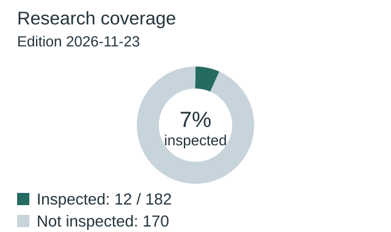
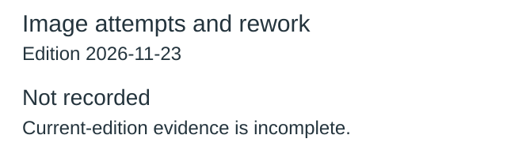
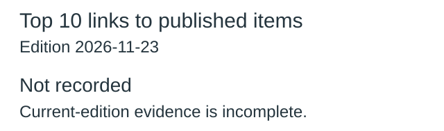
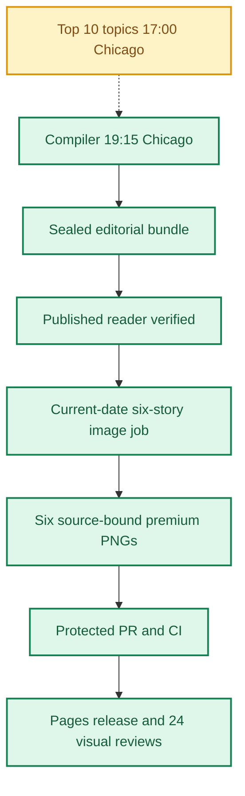
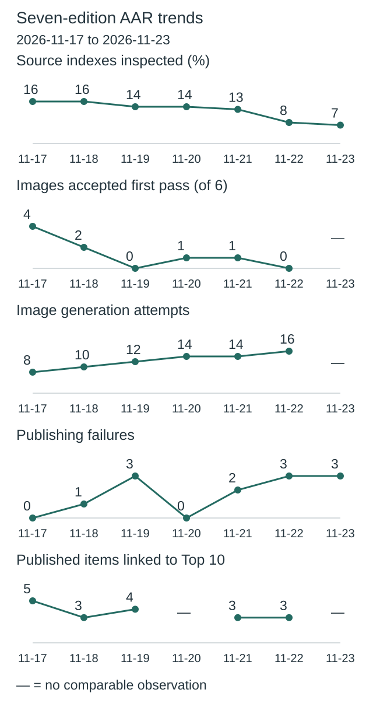
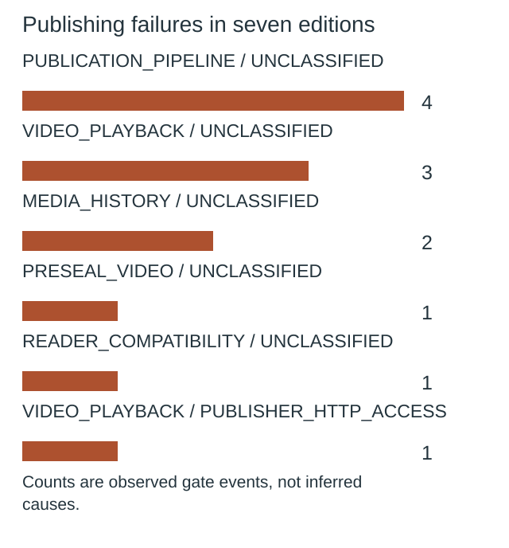
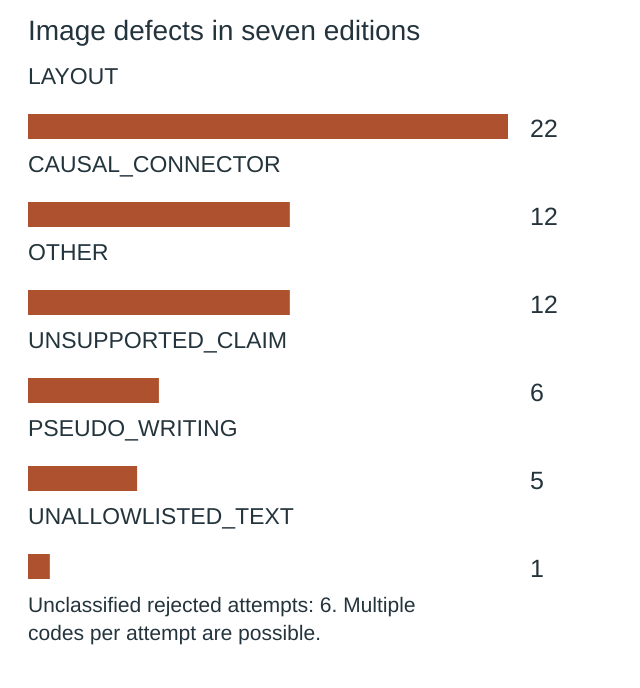

**🟨 RELEASE PARTIAL**
**TOP 10 PARTIAL** · **🟩 COMPILER VERIFIED** · **🟦 IMAGES 6/6 RELEASED** · **🟪 VISUAL QA 24/24 PASS**

# Daily AI Brief — Unified Production After-Action Report
**Edition:** November 23, 2026 · **Production evening:** 2026-11-22 · **Timezone:** America/Chicago
**Primary public reader:** [Open 2026-11-23 Brief](https://gttome.github.io/Daily-AI-Brief-Compiler/briefs/2026-11-23/) · **Repository:** [Daily-AI-Brief-Compiler](https://github.com/gttome/Daily-AI-Brief-Compiler)

> **IMPORTANT — VERIFIED PRODUCTION RESULT**
> **Executive release result: PARTIAL.** This is the single management-facing report covering Top 10 topic discovery, the editorial Compiler, published Brief and premium-image run. **Entire-system evidence: PARTIAL.** Top 10 report: **partial**; Compiler handoff: **RECEIVED_SNAPSHOT_BOUND**; guided searches: **RECEIPTS_OBSERVED**. Compiler public status: **VERIFIED**. Image release: **RELEASED_VERIFIED**. Direct 24-context visual quality: **24/24 PASS**. Autonomous completion: **UNPROVEN**. Missing evidence must not be promoted to a success claim.

**🕒 Production stage durations:** **Top 10 7m 19s** · **Compiler final seal window 12m 16s** · **Premium Images 19m 22s** (evidence-bounded elapsed times; the start/end events differ).

> **CLOSEOUT WARNING:** The exact image worker has not released its lease and recorded PUBLISHED_COMPLETE with the six accepted hashes.

## Evidence reconciliation

Compiler final seal window: 12m 16s. Compiler state start to public verification: 141m 45s. Observed execution and final seal windows are distinct.
Image capability route preflight: NOT OBSERVED; scheduler origin remains UNPROVEN.
Image efficiency: 1/6 first-pass accepts; 12 total attempts. Approved prospective efficiency target: at least 4/6 first-pass and no more than 8 total attempts, strictly advisory, with unchanged quality floor.
Image review completed: 2026-11-23T04:06:18.980129+00:00; review-record commit: 2026-11-23T04:06:33.000Z; protected review merge: 2026-11-23T04:08:06.000Z.
Eligible source indexes: 182; editorial inspections reported: 12 (6.6%); inaccessible in editorial audit: 0; explicitly unreviewed IDs: 170; unclassified editorial IDs: 0. Automated index parsing is separate from editorial inspection and cannot substantiate exhaustive freshness claims.

Registered video sources: 37; attempted this edition: 37; unattempted: 0; enabled: 37; qualification-only: 0; sources yielding candidate URLs: 6. Status: REPORTED_ALL_ATTEMPTED. Attempt evidence is not automatic proof of source-content review or playback.

Eligible source partition **VALID**. Full original-item reads **12**. Bounded index searches **0**. Qualification-only sources recorded separately **0**.

### Video candidate discovery

| Discovery source | Eligibility | Candidate URLs |
|---|---|---:|
| Two Minute Papers — AI Research Explainers | Enabled | 1 |
| AI Engineer | Enabled | 1 |
| NVIDIA Developer YouTube | Enabled | 1 |
| IBM Technology YouTube | Enabled | 1 |
| OpenAI Academy On-Demand Workshops | Enabled | 1 |
| Anthropic on YouTube | Enabled | 1 |

### Protected preseal video outcomes

| Original publisher | Distinct programs submitted | Archive rejects | Playback passes | Playback unverified | Probes skipped |
|---|---:|---:|---:|---:|---:|
| loom.com | 1 | 0 | 1 | 0 | 0 |
| nvidia.com | 1 | 0 | 1 | 4 | 0 |
| openai | 1 | 0 | 0 | 1 | 0 |
| pbs.org | 1 | 0 | 6 | 0 | 0 |
| ted.com | 2 | 0 | 4 | 1 | 0 |

Outcomes count observed checks across all saved requests. Programs can be submitted again after a different slot changes.

- NVIDIA GTC Studio   With Insights from Microsoft received PUBLIC_VIDEO_PLAYBACK_UNVERIFIED. [Original run](https://github.com/gttome/Daily-AI-Brief-Compiler/actions/runs/45095310699)
- ChatGPT Sites For Newsroom Scheduling received PUBLIC_VIDEO_PLAYBACK_UNVERIFIED. [Original run](https://github.com/gttome/Daily-AI-Brief-Compiler/actions/runs/45095310699)
- Can AI show us how language works? received PUBLIC_VIDEO_PLAYBACK_UNVERIFIED. [Original run](https://github.com/gttome/Daily-AI-Brief-Compiler/actions/runs/45095692598)
- NVIDIA GTC Studio   With Insights from Microsoft received PUBLIC_VIDEO_PLAYBACK_UNVERIFIED. [Original run](https://github.com/gttome/Daily-AI-Brief-Compiler/actions/runs/45096279458)
- NVIDIA GTC Studio   With Insights from Microsoft received PUBLIC_VIDEO_PLAYBACK_UNVERIFIED. [Original run](https://github.com/gttome/Daily-AI-Brief-Compiler/actions/runs/45096531980)
- NVIDIA GTC Studio   With Insights from Microsoft received PUBLIC_VIDEO_PLAYBACK_UNVERIFIED. [Original run](https://github.com/gttome/Daily-AI-Brief-Compiler/actions/runs/45096830828)

## Approved November 20 improvement evidence

Editorial runtime declarations: **DECLARED_RESTRICTED_EDITORIAL_RUNTIME**. Actual billing and scheduled origin remain unknown.

Video candidate evidence: **NOT_RECORDED**; substantive candidates Not recorded, non-news Not recorded, original publisher families Not recorded, selected non-news Not recorded. Targets 12 / 8 / 6 / 2 are advisory; unchanged duration, promotion, novelty and full-program playback checks still apply.

Source failure categories: RESPONSE_SIZE_LIMIT 7, ACCESS_BLOCKED 6, PARSER_OR_OTHER 2. Empty, blocked, oversized and unreviewed sources are distinct.

Original-paper cadence: one qualified paper within 3 editions when available. Current review timing NOT_RECORDED; postpublication review is not evidence of preselection reading.


IMG19 artistic changes retain their existing November 22 three-eligible-edition evaluation. Missing pixels, owner feedback and usage remain unknown; no retrospective source, query or artwork acceptance is invented.

## Daily AAR charts

These charts use this edition’s receipts. Missing data is not zero.

### Research coverage



**12 of 182 indexes inspected (7%).**

| Editorial inspection | Indexes |
|---|---:|
| Inspected | 12 |
| Not inspected | 170 |

Not inspected includes every index without a recorded editorial inspection; this is not proof of missed stories.

### Image attempts and rework



**12 attempts; 1 of 6 images accepted on their first attempt.**

Recorded ongoing from November 8 target: at least 3/6 first-pass accepts; no more than 2 attempts per image. This is an efficiency target, not a quality cutoff.

| Image | Accepted | Rejected | Total attempts |
|---|---:|---:|---:|
| Lean’s Riemann artifact makes assumptions inspectable | 1 | 1 | 2 |
| Inkling 2 Mini repeats its middle layers | 1 | 1 | 2 |
| Cheap tokens did not guarantee cheaper accepted tasks | 1 | 1 | 2 |
| Textract Insights grounds document extraction to source pages | 1 | 1 | 2 |
| Gemini’s Mac agent puts approvals inside a live preview | 1 | 2 | 3 |
| Build an editable short-video review handoff | 1 | 0 | 1 |

Generation attempts measure rework, not runtime or cost. Quality and publication checks remain separate.

### Top 10 links to published items



**Not recorded:** current-edition evidence is missing or inconsistent.

No selection quota. Topic linkage does not establish better quality, popularity or causal improvement.

[Chart data](charts.json)

One edition at a time. Missing evidence is not zero. Trend claims require comparable recorded cycles.

## Performance dashboard

| Measure | Recorded result | Source / caveat |
|:--|:--:|:--|
| Entire-system evidence | **PARTIAL** | Full Top 10 list, bound Compiler input, all-format search receipts and existing release checks; separate from publication and autonomy |
| Top 10 report | **partial · 10 topics** | Same Chicago cycle report; provisional/partial coverage remains disclosed |
| Top 10 received by Compiler | **RECEIVED_SNAPSHOT_BOUND** | Exact report snapshot bytes; consumed commit separately corroborated: YES |
| Top 10 guided article/video/podcast searches | **RECEIPTS_OBSERVED** | Actual source-search receipts and selected/rejected topic outcomes |
| Top 10 stage duration | **7m 19s** | Same-cycle run receipt only; no runtime or usage estimate |
| Editorial publication | **PASS** | State and public reader integrity receipt |
| **Unattended autonomy (separate from publication)** | **UNPROVEN** | Owner incident receipt takes precedence over unverified producer self-attestation |
| Recorded protected publishing gate failures | **3** | Actual same-edition GitHub failure sidecar only; earlier unrecorded failures remain unknown |
| Articles | **6** | Exactly 2 technical / 2 knowledge-worker / 2 agents required |
| Original scientific-paper-led articles | **Not recorded** | Rolling target: one qualified original paper in 3 editions; UNVERIFIED_RECEIPT. Preprints are not peer-reviewed by default |
| Verified original sources within preceding 24 hours | **0 / 6** | Original publisher dates only; other sources require a documented fallback rationale |
| Distinct selected article publishers | **6** | Six different primary organizations preferred |
| Videos over seven days old | **2** | Must be labeled evergreen, not a new development |
| Distinct selected video publishers | **2** | One channel is one publisher even across multiple videos |
| Cross-media topic diversity | **FOUR_DISTINCT_EVENTS_REVIEW_RECORDED** | Four video/podcast events and six pairwise original-source comparisons; editorial claims remain producer-attested |
| Video discovery source attempts | **37 / 37** | Attempt evidence across enabled and qualification-only leads; REPORTED_ALL_ATTEMPTED. Not a claim of full content review or player verification | 
| Duplicate active Watchlist display titles | **Not recorded** | Published canonical Watchlist only; historical evidence retained |
| Original-release video playback (historical) | **TWO_PUBLISHED_VIDEOS_PLAYBACK_PASS** | Later reader corrections may replace these originally verified videos; see incident register | 
| Postpublication reader incidents | **NOT_RECORDED** | Edition-specific owner reports and corrective PRs, not inferred absence | 
| Verified postpublication video corrections | **NOT_RECORDED** | Incident register tracks correction PR, actual playback evidence and reader preservation |
| Editorial index second-pass attempts | **0** | Bounded public GET retries only; never proof of original article reading |
| Editorial index reads recovered | **0** | Successful page fetch can still yield zero eligible dated items |
| Recorded scheduler capability route | **UNPROVEN** | Same-invocation route receipt only; GitHub is not scheduler authentication |
| Avoidable incomplete-staging CI failures | **Not independently audited** | Existing image-package push CI is disabled; exact-head protected PR CI remains required. A failure count requires actual workflow evidence |
| Media | **2 videos + 2 podcasts** | Sealed bundle |
| **Compiler final seal window** | **12m 16s (12.3 min)** | Final sealed-state timestamp → verified public reader; initial execution is separate |
| **Image processing stage duration** | **19m 22s** | First accepted PNG Git checkpoint → final 24/24 review; auditable stage elapsed time |
| Image scheduled-to-final-review window | **Not independently recorded** | Only with a saved one-cycle schedule anchor; does not attest exact generation start |
| Executor-observed generation-to-final-review | **22m 02s** | Only if the worker recorded a same-execution clock before its first native call; not independently verified provider runtime |
| Accepted premium PNGs | **6 / 6** | Exact package and public release hashes |
| Native image generation attempts | **12** | Image worker AAR; no estimation |
| Rejected candidates | **6** | Image worker AAR |
| Final worker checkpoint reconciliation | **MISMATCH** | Oct25+ verifies exact generation count, per-story attempts, six accepted story/image/hash bindings and final release |
| Saved visual contexts | **24 / 24 PASS** | Dated/permanent desktop/mobile review |
| Public SHA-256 checks | **44** | Image release receipt |
| October 8 immutable history | **17 / 17** | Independent content-preservation checks |
| **Owner-reported weekly Work usage for this run** | **Not reported** | No per-cycle usage supplied |

> **EFFICIENCY NOTE**
> **Resource reporting policy:** No usage figure was supplied for this cycle, so none is assumed. Future runs show **Not reported** unless the owner supplies new cycle-specific usage metadata. No approval or extra step is required to generate the AAR.

## Production architecture and checkpoints



## Daily AI Topic Top 10 and Compiler handoff

**Research cycle:** 2026-11-22 · **Target Brief:** 2026-11-23 · **Scheduled start:** 17:00 America/Chicago

| Dimension | Recorded evidence |
|---|---|
| Run/report result | PARTIAL |
| Report status / topics | partial / 10 |
| Freshness | FRESH\_AT\_CONSUMPTION |
| Compiler handoff | RECEIVED\_SNAPSHOT\_BOUND |
| Search coverage | RECEIPTS\_OBSERVED |
| Selection mapping verification | INVALID |
| Observed start / finish | 2026-11-22T22:59:54Z / 2026-11-22T23:07:13Z |
| Elapsed minutes | 7.32 |
| Usage percent | Not reported |
| Cost USD | Not reported |
| Independent scheduler autonomy | UNPROVEN |
| Compiler-recorded consumed commit | 744c8252af555ed630ac966497c3a4a6ad03af27 |
| Report SHA-256 | 0448b621989d59e8a4481477f2448c97decf2c13057e20ba95e3baebacc3c193 |

| Discovery order | AI topic | Summary | Confidence | Evidence |
|---:|---|---|---|---|
| 1 | Formal verification strengthens the Claude-assisted Riemann proof claim | The Lean and Mathlib communities now certify the formal statement and proof, while mathematical explanation and prize decisions remain separate. | medium | [Source](https://www.youtube.com/watch?v=xjX3jESpZqs) · [Source](https://www.youtube.com/watch?v=3XBZy472YTc) · [Source](https://leanprover-community.github.io/blog/posts/riemann-hypothesis/) |
| 2 | Inkling 2 Mini brings looped-model tests to local devices | Independent creators test a compact open-weight model while its author explains looping and monitorability tradeoffs. | medium | [Source](https://www.youtube.com/watch?v=SAc7Eq64L1I) · [Source](https://www.youtube.com/watch?v=OdMpNiByntM) · [Source](https://www.youtube.com/watch?v=cUuVObUqbn0) · [Source](https://thinkingmachines.ai/news/inkling-2-mini/) |
| 3 | A2UI demonstrations replace some text replies with native controls | An explainer renews attention to agents returning structured interfaces that an application renders with approved components. | medium | [Source](https://www.youtube.com/watch?v=qFAbevIeJN0) · [Source](https://developers.googleblog.com/a2ui-10-build-delightful-fast-reliable-agentic-experiences/) · [Source](https://flutter.dev/blog/a2ui-launch) · [Source](https://github.com/a2ui-project/a2ui) |
| 4 | Gemini Tasks attracts practical delegation walkthroughs | A walkthrough examines handing routine tasks to Gemini through text, email and connected apps. | medium | [Source](https://www.youtube.com/watch?v=ZTQ_c6Rq85o) · [Source](https://blog.google/innovation-and-ai/products/gemini-app/tasks-in-gemini-free-new-features/) |
| 5 | A new three-model comparison revisits Gemini Neon | Creators compare Neon with Fable and Astra on practical work rather than treating one benchmark as a universal winner. | medium | [Source](https://www.youtube.com/watch?v=n-LwSQq3xYE) · [Source](https://www.youtube.com/watch?v=5eON_8rgKzk) · [Source](https://www.youtube.com/watch?v=90vN0xFeLcQ) · [Source](https://blog.google/innovation-and-ai/models-and-research/gemini-models/introducing-gemini-4-neon/) |
| 6 | OpenAI’s extraction-defense disclosure continues drawing attention | The research combines model safeguards with detection of coordinated attempts to extract capabilities. | medium | [Source](https://x.com/OpenAI/status/2123862344422088794) · [Source](https://openai.com/index/combatting-adversarial-distillation/) |
| 7 | Microsoft’s agent harness update sustains architecture interest | An explainer examines session identity, tool boundaries and persistence in Microsoft’s agent runtime. | medium | [Source](https://www.youtube.com/watch?v=iVm3lsgxH64) · [Source](https://commandline.microsoft.com/microsoft-copilot-sdk-2-0-github/) |
| 8 | A DeepMind interview examines usefulness and the limits of benchmarks | Hannah Fry and Koray Kavukcuoglu discuss generality, efficiency and how product use informs model development. | medium | [Source](https://www.youtube.com/watch?v=FORdPIWOH5k) · [Source](https://sozai.app/transcript/gemini-path-to-agi-koray-kavukcuoglu/) |
| 9 | A CapCut tutorial demonstrates an editable product-video workflow | The walkthrough connects raw footage to an AI-assisted draft that can still be refined on a timeline. | low | [Source](https://www.youtube.com/watch?v=9zaRwgmJwEg) · [Source](https://www.capcut.com/tools/capcut-x-codex) |
| 10 | Claude Code’s experimental Code Mode prompts workflow discussion | The feature lets Claude use JavaScript to coordinate multiple tool calls while retaining documented permission and runtime constraints. | low | [Source](https://x.com/addyosmani/status/2124229492248019362) · [Source](https://code.claude.com/docs/en/code-mode) |

**Sample scope:** {"metadata\_screened\_videos":32,"unique\_videos":32,"distinct\_screened\_channels":21,"full\_video\_reviews":0,"full\_program\_reviews":0,"complete\_transcript\_reviews":0,"partial\_third\_party\_transcript\_reviews":1,"direct\_youtube\_counter\_verifications":0,"full\_original\_article\_reads":1,"full\_original\_article\_read\_identity":"Lean and Mathlib joint verification statement37lines","complete\_original\_paper\_reviews":0,"original\_watch\_attempts":32,"original\_watch\_outcomes":{"throttled":28,"title\_shell":4},"comparable\_video\_observations":2,"screened\_source\_items":47,"retained\_source\_items":25,"screened\_and\_retained\_by\_category":{"video":{"screened":32,"retained":13},"original\_release\_paper\_model\_card\_repository":{"screened":11,"retained":11},"transcript\_mirror":{"screened":1,"retained":1},"public\_discussion\_thread":{"screened":2,"retained":0},"independent\_report\_test\_interview":{"screened":1,"retained":0}},"trackers\_separately\_counted":3,"freshness\_counts":{"within\_24h\_timestamped":0,"additional\_within\_72h\_timestamped":11,"additional\_within\_7d\_timestamped":3,"date\_only":18,"older":0},"freshness\_reference\_at":"2026-11-22T23:05:27Z","notes":"Explicit item ledger is a bounded subset of actual searches, not a source census.32metadata screens are not40–80full reviews. Original statements/documents, mirrors, counters and playback counted separately; old releases with fresh explainer attention labeled."}. **Ranking basis:** {"attention":"YouTube specific-program attention and distinct creator breadth lead discovery; current timed social snapshots supplement them. No overlapping audience totals, fabricated scores or channel-relative baselines.","uncertainty":"Most individual metric fields unavailable. Current video source clock06:01Chicago, X06:00; other index clocks unknown. Exact rank is unsupported. Claim/usefulness/attention and final qualification remain distinct."}.

| Search format | Receipt rows | Attempts recorded | Explicitly not attempted |
|---|---:|---:|---:|
| article | 10 | 10 | 0 |
| video | 10 | 10 | 0 |
| podcast | 10 | 10 | 0 |

**Selected Brief items linked to trends:**

No validated selection-to-topic mapping was recorded.

**Gaps and limitations:**

- Claimed trend-to-selection mappings are not verified against the same-edition selected bundle.
- The report labels its research partial.
- Researchpartial:32metadata-screened videos, zero full-program reviews, zero full transcript reviews and zero direct YouTube counters. One partial third-party transcript review does not meet substantive full-review targets.
- Missing comments, subscribers, disclosures, durations and counter clocks remain null. No inferred sponsorship, CTR, retention, exact global rank or current velocity.
- Release dates, fresh upload dates and current observation dates differ; older carryovers are explicit. No complete scientific manuscript reviewed or peer review inferred.
- Thirty per-format query terms are provided; actual Compiler searches, playback, archive checks and selected mappings are separate pending outcomes.
- No new task, schedule, workflow, publishing action, accepted image change, production branch or historical report mutation. November10 pilot not applicable.

**Recorded run issues:**

- {"issue":"28original watch routes throttled;4returnedtitle shells.","effect":"Zero full program reviews or direct YouTube counters; research remains partial.","correction":"Bounded original source fallbacks and partial interview mirror excerpts recorded without relabeling them as playback."}
- {"issue":"Original DeepMind podcast index had no exact Koray match; A2UI secondary deep-dive route unavailable.","effect":"No complete original interview transcript or fully verified demonstration program.","correction":"Flagged exact original interview with partial mirror scope,46:58length and pending archive/playback; shorter demonstration remains unqualified alternative."}
- {"issue":"Third-party age/date/measurement discrepancies and old releases with fresh videos.","effect":"No source-independent global ordering or audience growth from mismatched counters.","correction":"Kept dated snapshots separate, treated A2UI/Code Mode as renewed attention, and compared only two exact same-source video pairs."}

**Recorded improvements:**

- {"change":"Distinguish old release dates from fresh demonstrations and renewed discussions.","reason":"A2UI1.0November11 and Code ModeNovember12 predate current attention.","expected\_effect":"Reduce false launch freshness and preserve event-specific queries.","status":"IMPLEMENTED\_PRODUCER\_METHOD; FUTURE\_OUTCOME\_UNPROVEN"}
- {"change":"Inspect independent original-program transcript excerpts and provide an explicit early-review flag with length and archive caveats.","reason":"Previous three mappings were articles, with no mapped video or podcast selection.","expected\_effect":"Give the Compiler a substantive lead early without manufacturing full review or qualification.","status":"IMPLEMENTED\_PRODUCER\_METHOD; FUTURE\_OUTCOME\_UNPROVEN"}

### Daily improvement and effect on the Brief

**Fixed baseline:** nov03-2026-v1 / INPUT\_FROZEN. **Outcome baseline:** FROZEN\_AFTER\_VERIFIED\_PUBLICATION. **Prior cycle:** 2026-11-21.

| Input measure | Current | November 3 baseline | Change from baseline | Change from prior cycle |
|---|---:|---:|---:|---:|
| topic count | 10 | 10 | 0 | 0 |
| validation resource count | Not reported | 14 | Not reported | Not reported |
| additional video metadata records | Not reported | 63 | Not reported | Not reported |
| additional video channels | Not reported | 21 | Not reported | Not reported |
| total video observations | Not reported | 79 | Not reported | Not reported |
| unique videos | Not reported | 71 | Not reported | Not reported |
| full video reviews | Not reported | 0 | Not reported | Not reported |
| direct youtube counter verifications | Not reported | 0 | Not reported | Not reported |
| broader evidence band topics | 3 | 3 | 0 | -1 |
| limited evidence band topics | 7 | 7 | 0 | 1 |

**Observed downstream measurements:** PENDING\_OR\_INCOMPLETE.

| Outcome measure | Current | Change from frozen outcome | Change from prior cycle |
|---|---:|---:|---:|
| expected topic format pairs | 30 | 0 | 0 |
| attempted topic format pairs | 30 | 0 | 0 |
| explicitly unattempted pairs | 0 | 0 | 0 |
| discovered candidate count | 33 | -7 | 2 |
| searched source host count | 13 | -3 | -15 |
| selected article count | Not reported | Not reported | Not reported |
| selected video count | Not reported | Not reported | Not reported |
| selected podcast count | Not reported | Not reported | Not reported |

**Source changes:** {"added":\[\],"removed":\[\]}.

**Candidate review depth:** NOT\_RECORDED.

| Review measure | Current | Change from prior comparable cycle |
|---|---:|---:|
| reviewed candidate count | Not reported | Not reported |
| qualified candidate count | Not reported | Not reported |
| rejected candidate count | Not reported | Not reported |
| metadata only count | Not reported | Not reported |
| full video reviews | Not reported | Not reported |
| transcript reviews | Not reported | Not reported |

The frozen November 3 baseline has no candidate-level review ledger; no retrospective value is invented. Recorded reviews do not independently establish content quality, audience interest or causal benefit.

**Method/resource review:** {"baseline\_id":"nov03-2026-v1","previous\_report\_date":"2026-11-21","method\_version":"2026-11-03.2-event-review","changes":\[{"change":"Distinguish old release dates from fresh demonstrations and renewed discussions.","reason":"A2UI1.0November11 and Code ModeNovember12 predate current attention.","expected\_effect":"Reduce false launch freshness and preserve event-specific queries."},{"change":"Inspect independent original-program transcript excerpts and provide an explicit early-review flag with length and archive caveats.","reason":"Previous three mappings were articles, with no mapped video or podcast selection.","expected\_effect":"Give the Compiler a substantive lead early without manufacturing full review or qualification."}\],"resource\_candidates":\[{"url":"https://flutter.dev/blog/a2ui-launch","role":"claim","decision":"accepted","reason":"Original selected sections add concrete deterministic-UI limits; same publisher family as Google, not extra independent reach.","access":"direct","review\_scope":"bounded original article sections","contribution":"Rank3 limits and practical value."}\],"observed\_effects":{"previous\_metadata\_videos":34,"current\_metadata\_videos":32,"previous\_complete\_transcripts":1,"current\_complete\_transcripts":0,"previous\_partial\_third\_party\_transcripts":null,"current\_partial\_third\_party\_transcripts":1,"interpretation":"Different samples; no increase in review depth or quality inferred.","previous\_edition":{"status":{"publication":"VERIFIED","images":"RELEASED\_AND\_24\_CONTEXTS\_VERIFIED","top10":"RECEIPTS\_OBSERVED","system":"PARTIAL","autonomy":"UNPROVEN","runtime\_policy":"DECLARED\_RESTRICTED\_EDITORIAL\_RUNTIME","usage":"UNKNOWN"},"top10":{"valid":true,"handoff":"RECEIVED\_SNAPSHOT\_BOUND","search":"RECEIPTS\_OBSERVED","counts":{"article":{"recorded":10,"attempted":10,"not\_attempted":0},"video":{"recorded":10,"attempted":10,"not\_attempted":0},"podcast":{"recorded":10,"attempted":10,"not\_attempted":0}},"mappings":\[{"topic\_id":"microsoft-ignite-agent-harness-announcements-nov17","format":"article","item\_id":"nov22-a2-copilot-agent-workflows","url":"https://commandline.microsoft.com/microsoft-copilot-sdk-2-0-github/","reason":"The selected article is the exact original Copilot SDK 2.0 architecture source discovered in the rank-six search.","candidate\_id":"microsoft-copilot-sdk2"},{"topic\_id":"alphaxiv-agent-preprint-server-announcement-nov19","format":"article","item\_id":"nov22-t2-society-ai-scientists","url":"https://www.alphaxiv.org/abs/2611.society-ai-scientists","reason":"The selected technical story is the exact full manuscript discovered and read for the rank-seven search.","candidate\_id":"alphaxiv-society-paper"},{"topic\_id":"openai-adversarial-distillation-research-nov20","format":"article","item\_id":"nov22-t1-adversarial-distillation","url":"https://openai.com/index/combatting-adversarial-distillation/","reason":"The selected security story is the exact original research article discovered and read for the rank-nine search.","candidate\_id":"openai-adversarial-distillation"}\]},"action":{"schema\_version":"daily-aar-action-review-v1","edition\_date":"2026-11-22","mode":"DAILY\_EVIDENCE\_LED\_TRIAGE","next\_cumulative\_review":"2026-11-22","cumulative\_review\_due\_today":true,"finding\_count":3,"open\_production\_blockers":0,"findings":\[{"id":"PROTECTED\_GATE\_FAILURES","priority":"P1","owner":"Compiler / Recovery","observation":"3 failed protected publication gates were recorded (3 unclassified causes).","action":"Read original failed job logs, record real causes and move the relevant existing validation before the next readiness signal; do not replay the released edition.","timing":"NEXT\_GENUINE\_CYCLE","kind":"RECURRENCE\_PREVENTION"},{"id":"PREMIUM\_IMAGE\_REWORK","priority":"P1","owner":"Images","observation":"10 rejected image candidates preceded the verified six-image release.","action":"Inspect saved rejection evidence and apply source-specific geometry, causal-arrow and label corrections before the next native generation.","timing":"NEXT\_GENUINE\_CYCLE","kind":"EFFICIENCY\_LESSON"},{"id":"SCHEDULER\_ORIGIN\_UNPROVEN","priority":"P2","owner":"Compiler / Recovery","observation":"Publication success does not independently attest the originating scheduler.","action":"Capture real first-party scheduler and execution evidence if available; do not convert unknown provenance into a failure or a success.","timing":"NEXT\_GENUINE\_CYCLE","kind":"EVIDENCE\_GAP"}\],"limitations":\["This report records findings and next actions; it does not execute corrections.","Existing owners must fix safe same-cycle faults immediately, without waiting for the cumulative review date.","A released edition remains immutable; lessons apply prospectively to the next genuine cycle.","Missing observations are not zero; no causality, autonomous recovery or effectiveness is inferred."\]},"summary":{"coverage\_percent":{"recorded\_editions":7,"median":14},"first\_pass\_accepted":{"recorded\_editions":7,"median":1},"image\_attempts":{"recorded\_editions":7,"median":12},"top10\_linked\_items":{"recorded\_editions":5,"median":3},"publication\_failures":{"recorded\_editions":7,"median":2}}},"chart\_data\_url":"https://github.com/gttome/Daily-AI-Brief-Compiler/blob/cba436d92c279e0fd2375eb7f7351d16c75beb9a/daily/2026-11-21/charts.json","improvement\_metrics\_url":"https://github.com/gttome/Daily-AI-Brief-Compiler/blob/cba436d92c279e0fd2375eb7f7351d16c75beb9a/daily/2026-11-21/improvement-metrics.json","charted\_aar\_url":"https://github.com/gttome/Daily-AI-Brief-Compiler/blob/cba436d92c279e0fd2375eb7f7351d16c75beb9a/daily/2026-11-21/combined.md","downstream\_impact\_table\_url":"https://github.com/gttome/Daily-AI-Brief-Compiler/blob/cba436d92c279e0fd2375eb7f7351d16c75beb9a/daily/2026-11-21/combined.md#daily-ai-topic-top-10-and-compiler-handoff","current\_downstream":"PENDING"},"change\_evaluations":\[{"change\_id":"NOV15-02","reviewed\_edition":"2026-11-23","decision":"keep","result":"met","reason":"The preceding November22 combined AAR independently binds the snapshot and reports30 real searches with3 bundle-matched article selections. This is a prior-edition evidence result only; November23 outcomes remain pending.","evidence\_refs":\["https://github.com/gttome/Daily-AI-Brief-Compiler/blob/cba436d92c279e0fd2375eb7f7351d16c75beb9a/daily/2026-11-21/combined.json"\]},{"change\_id":"NOV16-P1-09","reviewed\_edition":"2026-11-23","decision":"keep","result":"inconclusive","reason":"Three previous-edition article mappings establish association but no measured incremental causal quality gain, and no video or podcast mapping. Current consumer searches and final decisions are not yet observed.","evidence\_refs":\["https://github.com/gttome/Daily-AI-Brief-Compiler/blob/cba436d92c279e0fd2375eb7f7351d16c75beb9a/daily/2026-11-21/combined.md#daily-ai-topic-top-10-and-compiler-handoff"\]},{"change\_id":"NOV20-05","reviewed\_edition":"2026-11-23","decision":"keep","result":"inconclusive","reason":"Producer supplied original demonstrations, local-model tests and an expert interview, but watch routes still throttle and complete program qualification remains unavailable. Broader leads do not prove the Compiler qualified or selected more non-news programs.","evidence\_refs":\["https://github.com/gttome/Daily-AI-Brief-Compiler/blob/cba436d92c279e0fd2375eb7f7351d16c75beb9a/daily/2026-11-21/improvement-metrics.json","https://developers.googleblog.com/a2ui-10-build-delightful-fast-reliable-agentic-experiences/"\]}\],"next\_improvement":"Compiler should check the rank8 original interview early, resolve full review/playback/archive/length, and inspect the shorter rank3 demonstration before selection; retain exact canonical queries and candidate-bound decisions.","limitations":\["No completed future production outcome exists at this producer checkpoint.","Full-review targets remain unmet; a broader source list is not evidence of better outcomes."\]}.

**Current reconciled conclusion:** PENDING\_OR\_INCOMPLETE; outcome baseline FROZEN\_AFTER\_VERIFIED\_PUBLICATION; candidate review ledger NOT\_RECORDED.

**Historical producer observations (not current status):** The following snapshot preserves what the producer reported at the time. Its pending statuses and candidate-quality claims are not independently reconciled conclusions. Use the current tables above for publication-bound measurements; an absent candidate review ledger remains unknown.

<details><summary>Original producer effects and gaps — historical snapshot</summary>

```json
null
```

</details>

**Next improvement:** Compiler should check the rank8 original interview early, resolve full review/playback/archive/length, and inspect the shorter rank3 demonstration before selection; retain exact canonical queries and candidate-bound decisions.

Counts show coverage and observed association, not audience popularity, source independence, candidate quality or causal uplift. Compare source/method changes before interpreting deltas. Unknown values are not zero. Publication, reader corrections, runtime and image outcomes retain their separate AAR evidence.

Report, source-readback and search receipts are separate observations. Snapshot binding verifies the collected report bytes; the consumed commit is independently corroborated only when the separately fetched source bytes match. These records do not independently attest scheduler identity or source truth. Top 10 reporting does not change Brief/image release status.


## Track 1 — Compiler

**State:** `SHADOW_VERIFIED` · **Bundle:** `BUNDLE_READY` · **Compiler final seal window:** 12m 16s (12.3 min).

| Publication gate | Result |
|---|:---:|
| Canonical reader build | ✅ |
| Reader parity | ✅ |
| Public verification of dated edition | ✅ |
| Previous editions preserved | ✅ |
| Permanent story routes and feeds | ✅ |

**Selected coverage:**

| Lane | Story |
|---|---|
| Technical AI Engineering | Lean’s Riemann artifact makes assumptions inspectable |
| Technical AI Engineering | Inkling 2 Mini repeats its middle layers |
| Applied Generative AI for Knowledge Workers | Cheap tokens did not guarantee cheaper accepted tasks |
| Applied Generative AI for Knowledge Workers | Textract Insights grounds document extraction to source pages |
| Agents for Everyone | Gemini’s Mac agent puts approvals inside a live preview |
| Agents for Everyone | Build an editable short-video review handoff |

### Scientific paper opportunity and publication evidence

**Current edition:** UNVERIFIED_RECEIPT; **paper-led stories:** Not recorded. Editorial target: at least one genuinely qualified original-paper-based story in seven editions, with methods, limitations, and an explicit preprint/peer-review distinction. No stale or weak paper is selected solely to fill a quota.


## Track 2 — Premium images

**Public status:** `RELEASED_VERIFIED` · **Saved images:** 6/6 · **Actual generation attempts:** 12 · **Rejected candidates:** 6.

### Image production duration — Git-verified milestones

**Auditable image stage duration:** **19m 22s** (first accepted binary saved in Git → first persisted 24-context quality-review record). **First asset to public image release:** **16m 02s**.
**Scheduled-to-final-review window:** **Not independently recorded**. This is a scheduled-clock comparison only when a separately recorded exact-date schedule exists; it is **not** measured native image-generation runtime.

| Production milestone | Chicago local time | Evidence |
|---|---|---|
| Scheduled image start (if exact-date record exists) | Not independently recorded | Time planned, not actual execution start |
| First executor-observed start | 9:40:52 PM | Worker self-attestation, not a first-party scheduler event |
| First native generation observation | 9:44:30 PM | Worker clock recorded immediately before first native call, not model-provider telemetry |
| First accepted PNG bytes saved to Git | 9:47:11 PM | Immutable binary-stage commit |
| Six-image package / reviews committed | 9:59:40 PM | Exact-head PR source commit |
| Protected package merged | 10:02:10 PM | Merge SHA and required CI |
| Public images verified | 10:03:12 PM | Image-release receipt |
| 24/24 review record committed | 10:06:33 PM | Immutable first review-approval commit |

> **Duration interpretation:** The audited stage excludes unobservable pre-checkpoint creative work. The scheduled-start window includes it but must not be interpreted as precise active processing time. Missing timestamps appear as **Not independently recorded**, never an estimate.


| Source-bound image | Attempts | File size | Public page |
|---|---:|---:|---|
| Lean’s Riemann artifact makes assumptions inspectable | 2 | 0.76 MiB | [View original](https://gttome.github.io/Daily-AI-Brief-Compiler/briefs/images/2026-11-23/dab-edition-2026-11-23-m01.png) |
| Inkling 2 Mini repeats its middle layers | 2 | 1.22 MiB | [View original](https://gttome.github.io/Daily-AI-Brief-Compiler/briefs/images/2026-11-23/dab-edition-2026-11-23-m02.png) |
| Cheap tokens did not guarantee cheaper accepted tasks | 2 | 0.83 MiB | [View original](https://gttome.github.io/Daily-AI-Brief-Compiler/briefs/images/2026-11-23/dab-edition-2026-11-23-m10.png) |
| Textract Insights grounds document extraction to source pages | 2 | 1.02 MiB | [View original](https://gttome.github.io/Daily-AI-Brief-Compiler/briefs/images/2026-11-23/dab-edition-2026-11-23-m11.png) |
| Gemini’s Mac agent puts approvals inside a live preview | 3 | 0.88 MiB | [View original](https://gttome.github.io/Daily-AI-Brief-Compiler/briefs/images/2026-11-23/dab-edition-2026-11-23-m12.png) |
| Build an editable short-video review handoff | 1 | 0.97 MiB | [View original](https://gttome.github.io/Daily-AI-Brief-Compiler/briefs/images/2026-11-23/dab-edition-2026-11-23-m14.png) |

**Immutable-release and visual gates:**

| Release gate | Result |
|---|:---:|
| Protected public image receipt | ✅ |
| Accepted-image Git hash bindings | ✅ |
| Six live PNGs | 6/6 |
| Dated/permanent story placements | 12/12 recorded in release evidence |
| Desktop/mobile visual inspection | 24/24 PASS |
| Historical Oct 8 integrity | 17/17 |

### Published premium illustrations

<table>
<tr><td width="50%"><a href="https://gttome.github.io/Daily-AI-Brief-Compiler/briefs/images/2026-11-23/dab-edition-2026-11-23-m01.png"></a><br/><b>Lean’s Riemann artifact makes assumptions inspectable</b></td><td width="50%"><a href="https://gttome.github.io/Daily-AI-Brief-Compiler/briefs/images/2026-11-23/dab-edition-2026-11-23-m02.png"></a><br/><b>Inkling 2 Mini repeats its middle layers</b></td></tr>
<tr><td width="50%"><a href="https://gttome.github.io/Daily-AI-Brief-Compiler/briefs/images/2026-11-23/dab-edition-2026-11-23-m10.png"></a><br/><b>Cheap tokens did not guarantee cheaper accepted tasks</b></td><td width="50%"><a href="https://gttome.github.io/Daily-AI-Brief-Compiler/briefs/images/2026-11-23/dab-edition-2026-11-23-m11.png"></a><br/><b>Textract Insights grounds document extraction to source pages</b></td></tr>
<tr><td width="50%"><a href="https://gttome.github.io/Daily-AI-Brief-Compiler/briefs/images/2026-11-23/dab-edition-2026-11-23-m12.png"></a><br/><b>Gemini’s Mac agent puts approvals inside a live preview</b></td><td width="50%"><a href="https://gttome.github.io/Daily-AI-Brief-Compiler/briefs/images/2026-11-23/dab-edition-2026-11-23-m14.png"></a><br/><b>Build an editable short-video review handoff</b></td></tr>
</table>

## Incidents, corrections and learning

### Postpublication reader incidents (updated when new evidence is merged)

No current-edition postpublication incident register was available; this is **NOT_RECORDED**, not a certification of zero incidents.


**Editor recovery classification:** UNPROVEN. **Owner intervention:** Unproven either way. **Protected same-edition failures recorded:** 3. 
**Latest failed protected stage:** READER_COMPATIBILITY; [Action evidence](https://github.com/gttome/Daily-AI-Brief-Compiler/actions/runs/45106685214). Exact stage durations are available only where real source timestamps exist.

| Stage | Verified issue | Corrective action |
|---|---|---|
| Editorial source preflight | The original Inkling story described unsupported live controls. | Published the owner-approved three-pass story, verified the reader and issued a new image job while preserving the original. |
| Native generation review | First folio used human hands and simulated text. | Replaced hands with checker prisms and simplified the statement sheets. |
| Native generation review | Early passes incorrectly connected directly to output. | Showed one serial traversal with only the third pass feeding final layers. |
| Native generation review | Cost receipts contained model names, extra scores and text. | Used only the approved prices, labels and benchmark qualifier. |
| Native generation review | The extracted value and its original page region were both empty. | Named the payslip field on both layers and tethered the two matching regions. |
| Native generation review | The live preview contained only generic screen shapes. | Introduced the publisher’s batch color-grading example. |
| Native generation review | The revised desktop illustration still contained simulated document lines. | Removed filler lines and used two colored leaf specimens in the preview. |

> **OPERATIONAL NOTE**
> This report distinguishes a published and verified production outcome from scheduler metadata exposed to another conversation. Lack of a live host heartbeat in a separate normal chat is not a Compiler production failure.

## Usage and cost stewardship

| Item | Per-cycle value |
|---|---|
| **Weekly Work usage reported by owner** | **Not reported** |
| Internal weekly usage reference | Target under 5% |
| Genuine image-generation attempts | 12 |
| Accepted diagrams | 6 |
| Regeneration after acceptance | 0 |
| Top 10 reported usage | Not reported |
| Top 10 reported cost | Not reported |
| Account-level billing telemetry | Not independently accessible to deterministic GitHub reporting |

**Future reporting rule:** For cycles without an optional owner-usage record, publish the complete AAR with `Not reported`; do not reuse prior percentages, guess remaining weekly credits or delay tomorrow's production.

## Next-edition operating handoff

| Control | Recurring contract |
|---|---|
| AI Topic Top 10 | Sole report task · 17:00 America/Chicago · saved dated list guides same-evening research |
| Primary Compiler | Sole existing task · 19:15 America/Chicago |
| Premium image production | Sole existing task · standard 21:15 America/Chicago |
| Exact image job selection | Newly published next-date `PUBLISHED_PENDING` only |
| AAR | Combined report generated automatically from new GitHub receipts |
| Optional Work usage | Owner-supplied per cycle, otherwise `Not reported` |

> **SCHEDULE RESTORATION NOTE**
> A temporary scheduling exception must be explicitly restored before claiming standard-time readiness. This deterministic document generator reads existing state only; it does not modify production schedules.

## Evidence register

| Evidence | Link |
|---|---|
| Compiler state | [Open receipt](https://github.com/gttome/Daily-AI-Brief-Compiler/blob/shadow/2026-11-23/shadow-runs/2026-11-23/compiler-state.json) |
| Compiler compile receipt | [Open receipt](https://github.com/gttome/Daily-AI-Brief-Compiler/blob/shadow/2026-11-23/shadow-runs/2026-11-23/compiler/compile-receipt.json) |
| Compiler public integrity | [Open receipt](https://github.com/gttome/Daily-AI-Brief-Compiler/blob/shadow/2026-11-23/shadow-runs/2026-11-23/compiler/postpublish-integrity.json) |
| Image release receipt | [Open receipt](https://github.com/gttome/Daily-AI-Brief-Compiler/blob/shadow-pages-history/site/image-jobs/2026-11-23/release.json) |
| Image review | [Open receipt](https://github.com/gttome/Daily-AI-Brief-Compiler/blob/main/external-image-packages/2026-11-23/reviews/live/semantic-pixel-review.json) |
| Original image AAR | [Open receipt](https://github.com/gttome/Daily-AI-Brief-Compiler/blob/main/external-image-packages/2026-11-23/reviews/after-action.md) |
| Observed editorial index retries | [Open receipt](https://github.com/gttome/Daily-AI-Brief-Compiler/blob/shadow/2026-11-23/shadow-runs/2026-11-23/editorial/source-item-retries.json) |
| Scientific paper selection review | [Open receipt](https://github.com/gttome/Daily-AI-Brief-Compiler/blob/shadow/2026-11-23/shadow-runs/2026-11-23/editorial/scientific-paper-coverage.json) |
| Published player playback receipt | [Open receipt](https://github.com/gttome/Daily-AI-Brief-Compiler/blob/shadow/2026-11-23/shadow-runs/2026-11-23/compiler/postpublish-video-playback.json) |
| Top 10 ranked topic report | [Open receipt](https://github.com/gttome/Daily-AI-Brief-Compiler/blob/dc1728e5e0a60d1d1bdac2a2ef5280a0ac4e47c7/signals/ai-topic-top10/2026-11-22.json) |
| Top 10 run after-action receipt | [Open receipt](https://github.com/gttome/Daily-AI-Brief-Compiler/blob/dc1728e5e0a60d1d1bdac2a2ef5280a0ac4e47c7/signals/ai-topic-top10/2026-11-22.aar.json) |
| Compiler Top 10 input snapshot | [Open receipt](https://github.com/gttome/Daily-AI-Brief-Compiler/blob/shadow/2026-11-23/shadow-runs/2026-11-23/editorial/trend-input.json) |
| Top 10 article/video/podcast search coverage | [Open receipt](https://github.com/gttome/Daily-AI-Brief-Compiler/blob/shadow/2026-11-23/shadow-runs/2026-11-23/editorial/trend-search-coverage.json) |

**Image workflow:** [Workflow evidence](https://github.com/gttome/Daily-AI-Brief-Compiler/actions/runs/45109411427).

---

*Generated deterministically from cycle- and edition-specific GitHub records. The report combines the Top 10 discovery priorities, its Compiler handoff and searches, the published Brief, and the image run; original research, Compiler, image, hash, and review receipts remain immutable. This reporting action creates no stories, images, releases, extra AI tasks, or schedule changes.*

<!-- continuous-improvement:start -->
## Continuous improvement review

Edition **2026-11-23**. Measurements use 7/7 recorded editions in this window. Missing data stays **Not recorded**.

### Daily corrective-action review

**3 evidence-based findings**; open production blockers: 0. Cumulative evaluation checkpoint: **2026-11-23**. The daily review never waits for that date to act on a safe live problem.

| Priority | Observed issue | Existing owner / next correction | When |
|---|---|---|---|
| P1 | 3 failed protected publication gates were recorded (3 unclassified causes). | Compiler / Recovery: Read original failed job logs, record real causes and move the relevant existing validation before the next readiness signal; do not replay the released edition. | Next genuine run |
| P1 | 6 rejected image candidates preceded the verified six-image release. | Images: Inspect saved rejection evidence and apply source-specific geometry, causal-arrow and label corrections before the next native generation. | Next genuine run |
| P2 | Publication success does not independently attest the originating scheduler. | Compiler / Recovery: Capture real first-party scheduler and execution evidence if available; do not convert unknown provenance into a failure or a success. | Next genuine run |

Findings are observational and do not claim a repair was executed by the reporter.

### Approved change evaluations

| Change | Evaluate by | Outcome status | Latest decision |
|---|---|---|---|
| NOV03-01 — Earlier publication checks and precise recovery | 2026-11-11 | REVIEWED | revise |
| NOV03-02 — Broader genuine source review | 2026-11-11 | REVIEWED | revise |
| NOV03-03 — Source-bound image rejection lessons | 2026-11-11 | REVIEWED | revise |
| NOV03-04 — Substantive Top 10 review evidence | 2026-11-11 | REVIEWED | keep |
| AAR-01 — Current conclusions separated from historical claims | 2026-11-11 | REVIEWED | keep |
| AAR-02 — Consolidated current task contracts | 2026-11-11 | REVIEWED | keep |
| AAR-03 — Dated improvement evaluations | 2026-11-11 | REVIEWED | keep |
| AAR-04 — Seven-edition trend charts | 2026-11-11 | REVIEWED | keep |
| AAR-05 — Recurring publication failure causes | 2026-11-11 | REVIEWED | revise |
| AAR-06 — Recovery interval reporting | 2026-11-11 | REVIEWED | revise |
| AAR-07 — Source inspection history | 2026-11-11 | REVIEWED | revise |
| AAR-08 — Rolling source contribution | 2026-11-11 | REVIEWED | revise |
| AAR-09 — Recurring image defect categories | 2026-11-11 | REVIEWED | keep |
| AAR-10 — Top 10 publisher-family sensitivity | 2026-11-11 | REVIEWED | keep |
| NOV15-01 — Six premium images must not share an editorial template | 2026-11-17 | REVIEWED | keep |
| NOV15-02 — Exact Top 10 handoff and three-format search use | 2026-11-17 | REVIEWED | keep |
| NOV15-03 — Original failed protected gate causes and early prevention | 2026-11-17 | REVIEWED | keep |
| NOV15-04 — Improve image first-pass acceptance without weakening quality | 2026-11-17 | REVIEWED | revise |
| NOV15-05 — Independently attest unattended scheduler-to-release autonomy | 2026-11-17 | REVIEWED | keep |
| NOV16-P0-01 — Exact Top 10 event-format search receipts | 2026-11-18 | REVIEWED | keep |
| NOV16-P0-02 — Substantive source inspections before selection lock | 2026-11-19 | OVERDUE | Not recorded |
| NOV16-P0-03 — Outside-family playable video sourcing | 2026-11-19 | OVERDUE | Not recorded |
| NOV16-P0-04 — Unified AAR packaging regression coverage | 2026-11-22 | OVERDUE | Not recorded |
| NOV16-P1-05 — Fresh-first original article discovery | 2026-11-20 | OVERDUE | Not recorded |
| NOV16-P1-06 — Classify and reduce failing source indexes | 2026-11-20 | OVERDUE | Not recorded |
| NOV16-P1-07 — Image first-pass yield and visual differentiation | 2026-11-20 | REVIEWED | revise |
| NOV16-P1-08 — Exact video identity with punctuation-only normalization | 2026-11-18 | OVERDUE | Not recorded |
| NOV16-P1-09 — Attributable Top 10 incremental research yield | 2026-11-20 | REVIEWED | keep |
| NOV16-P1-10 — Three-edition original paper priority and vendor attribution | 2026-11-20 | OVERDUE | Not recorded |
| NOV16-P1-11 — Verify unattended scheduler provenance without self-attestation | 2026-11-20 | OVERDUE | Not recorded |
| NOV16-P2-12 — Seven-edition improvement decision dashboard | 2026-11-23 | PENDING | Not recorded |
| IMG19-01 — Useful internal detail | 2026-11-22 | REVIEWED | revise |
| IMG19-02 — Distinct visual identity | 2026-11-22 | REVIEWED | keep |
| IMG19-03 — Novelty across days | 2026-11-22 | REVIEWED | keep |
| IMG19-04 — Better first-attempt yield | 2026-11-22 | REVIEWED | revise |
| IMG19-05 — Margins and legibility | 2026-11-22 | REVIEWED | revise |
| IMG19-06 — Reliable reporting | 2026-11-22 | REVIEWED | keep |
| IMG19-07 — Evidence of artistic improvement | 2026-11-22 | REVIEWED | keep |
| IMG19-08 — Reusable learning without repeated shells | 2026-11-22 | REVIEWED | keep |
| NOV20-01 — Canonical Top 10 search and selected-candidate association | 2026-11-24 | REVIEWED | keep |
| NOV20-02 — Original source date and citation metadata | 2026-11-24 | PENDING | Not recorded |
| NOV20-03 — Truthful runtime policy reconciliation | 2026-11-24 | PENDING | Not recorded |
| NOV20-04 — More substantive preselection source reads | 2026-11-24 | PENDING | Not recorded |
| NOV20-05 — Broader non-news video discovery | 2026-11-24 | REVIEWED | keep |
| NOV20-06 — First-pass image geometry and connector planning | 2026-11-24 | REVIEWED | revise |
| NOV20-07 — Watchlist score and corroboration retention | 2026-11-24 | REVIEWED | keep |
| NOV20-08 — Specific newer lane alternatives | 2026-11-24 | PENDING | Not recorded |
| NOV20-09 — Original-paper review and three-edition cadence | 2026-11-24 | PENDING | Not recorded |
| NOV20-10 — Separate completion and evidence statuses | 2026-11-24 | PENDING | Not recorded |
| NOV20-11 — Neutral AI video coverage badges | 2026-11-24 | PENDING | Not recorded |
| NOV20-12 — Continue existing IMG19 evaluation | 2026-11-22 | REVIEWED | keep |
| NOV25-P0-01 — Count visible layout families at planning and thumbnail review | 2026-12-02 | NOT_YET_EFFECTIVE | Not recorded |
| NOV25-P0-02 — Compare actual layouts across recent verified editions | 2026-12-02 | NOT_YET_EFFECTIVE | Not recorded |
| NOV25-P0-03 — Report layout decisions and independent live QA separately | 2026-12-02 | NOT_YET_EFFECTIVE | Not recorded |
| NOV25-P1-01 — Bind observed silhouettes and prior comparisons to exact pixels | 2026-12-02 | NOT_YET_EFFECTIVE | Not recorded |
| NOV25-P1-02 — Record attempt-scoped Pages artifact visibility and missing-artifact failures | 2026-12-02 | NOT_YET_EFFECTIVE | Not recorded |
| NOV25-P2-01 — Evaluate the first seven eligible image editions | 2026-12-02 | NOT_YET_EFFECTIVE | Not recorded |

Pending: 8; overdue: 8; reviewed: 35. Implemented controls await measured results; review decisions do not disable controls.

#### Reviews of production evidence

- **NOV03-01 · 2026-11-12 · not met.** Two media requests still required correction. The first had two stalled embeds and a certificate-date error. The second reached protected playback before two archived programs were disqualified. The edition recovered and published. [Evidence 1](https://github.com/gttome/Daily-AI-Brief-Compiler/blob/1d8c6be/shadow-runs/2026-11-12/editorial/preseal-video-receipt.json) · [Evidence 2](https://github.com/gttome/Daily-AI-Brief-Compiler/blob/shadow/2026-11-12/shadow-runs/2026-11-12/execution-milestones.json)
- **NOV03-02 · 2026-11-12 · inconclusive.** The raw audit recorded 34 inspected entries and 76 unreviewed for 109 eligible sources. It included qualification-only Zapier in the inspection entries. The audited breadth is unknown. Five distinct article publishers were recorded and zero articles had verified 24-hour timestamps. [Evidence 1](https://github.com/gttome/Daily-AI-Brief-Compiler/blob/shadow/2026-11-12/shadow-runs/2026-11-12/editorial/index-review.json) · [Evidence 2](https://github.com/gttome/Daily-AI-Brief-Compiler/blob/dac33c1e16f891121a0571a0a5e25d09b691bee5/daily/2026-11-11/combined.md)
- **AAR-01 · 2026-11-12 · met.** The reviewed closeout identified the live release and 24 visual checks as complete. It separately displayed partial research evidence and unproven autonomy. The original Top 10 snapshot retains its production-stage claims. [Evidence 1](https://github.com/gttome/Daily-AI-Brief-Compiler/blob/dac33c1e16f891121a0571a0a5e25d09b691bee5/daily/2026-11-11/combined.md) · [Evidence 2](https://github.com/gttome/Daily-AI-Brief-Compiler/blob/6e6911d0a393a3117160841950ecf3b2c3665777/signals/ai-topic-top10/2026-11-11.aar.json)
- **AAR-04 · 2026-11-12 · met.** The November 6–12 series included seven image-attempt observations and a median of 12. The chart marked missing coverage and selection observations as gaps and disclosed the registry change. [Evidence 1](https://github.com/gttome/Daily-AI-Brief-Compiler/blob/dac33c1e16f891121a0571a0a5e25d09b691bee5/daily/2026-11-11/improvement-metrics.json) · [Evidence 2](https://github.com/gttome/Daily-AI-Brief-Compiler/blob/dac33c1e16f891121a0571a0a5e25d09b691bee5/daily/2026-11-11/charts/seven-edition-trends.svg)
- **AAR-05 · 2026-11-12 · not met.** The November 12 failure chart counted zero failed workflow jobs while the candidate evidence showed a blocked probe and an archive rejection. The recurring-failure table still contains unclassified events. Preserve the original outcomes so these types remain visible. [Evidence 1](https://github.com/gttome/Daily-AI-Brief-Compiler/blob/dac33c1e16f891121a0571a0a5e25d09b691bee5/daily/2026-11-11/improvement-metrics.json) · [Evidence 2](https://github.com/gttome/Daily-AI-Brief-Compiler/blob/shadow/2026-11-12/shadow-runs/2026-11-12/execution-milestones.json)
- **AAR-06 · 2026-11-12 · inconclusive.** Compiler milestones preserve detection and subsequent state changes. The reconciled report has zero recovery incidents with all required clocks and exact references. Separate repair and verification intervals and unattended origin remain unproven. [Evidence 1](https://github.com/gttome/Daily-AI-Brief-Compiler/blob/shadow/2026-11-12/shadow-runs/2026-11-12/execution-milestones.json) · [Evidence 2](https://github.com/gttome/Daily-AI-Brief-Compiler/blob/dac33c1e16f891121a0571a0a5e25d09b691bee5/daily/2026-11-11/improvement-metrics.json)
- **AAR-07 · 2026-11-12 · not met.** The November 12 index audit failed to reconcile by eligible ID. The current cycle could not update certified inspection coverage from that partition. Review the actual source scopes and clocks with the enabled roster before selection. [Evidence 1](https://github.com/gttome/Daily-AI-Brief-Compiler/blob/shadow/2026-11-12/shadow-runs/2026-11-12/editorial/index-review.json) · [Evidence 2](https://github.com/gttome/Daily-AI-Brief-Compiler/blob/dac33c1e16f891121a0571a0a5e25d09b691bee5/daily/2026-11-11/improvement-metrics.json)
- **AAR-08 · 2026-11-12 · inconclusive.** Five published items had validated topic mappings. The rolling contribution table had no validated substantive candidate review rows attributed to registry IDs. The relative contribution of individual sources remains unknown. [Evidence 1](https://github.com/gttome/Daily-AI-Brief-Compiler/blob/shadow/2026-11-12/shadow-runs/2026-11-12/editorial/trend-search-coverage.json) · [Evidence 2](https://github.com/gttome/Daily-AI-Brief-Compiler/blob/dac33c1e16f891121a0571a0a5e25d09b691bee5/daily/2026-11-11/improvement-metrics.json)

### Seven-edition trends



| Edition | Coverage | First pass / 6 | Image attempts | Publishing failures | Top 10 links |
|---|---|---:|---:|---:|---:|
| 2026-11-17 | 17/109 (16%) | 4 | 8 | 0 | 5 |
| 2026-11-18 | 17/109 (16%) | 2 | 10 | 1 | 3 |
| 2026-11-19 | 15/109 (14%) | 0 | 12 | 3 | 4 |
| 2026-11-20 | 15/109 (14%) | 1 | 14 | 0 | Not recorded |
| 2026-11-21 | 15/117 (13%) | 1 | 14 | 2 | 3 |
| 2026-11-22 | 15/182 (8%) | 0 | 16 | 3 | 3 |
| 2026-11-23 | 12/182 (7%) | 1 | 12 | 3 | Not recorded |

| Measure | Recorded editions | Window median |
|---|---:|---:|
| coverage percent | 7 | 14 |
| first pass accepted | 7 | 1 |
| image attempts | 7 | 12 |
| top10 linked items | 5 | 3 |
| publication failures | 7 | 2 |

**Registry changed in this window; coverage percentages use different source sets.**

### Publishing failures by stage and recorded cause



| Stage | Recorded cause | Failures | Editions | Recurred | Delay median (seconds; documented samples only) |
|---|---|---:|---|---|---:|
| PUBLICATION_PIPELINE | UNCLASSIFIED | 4 | 2026-11-19, 2026-11-22, 2026-11-23 | Yes | Not recorded (0 samples) |
| VIDEO_PLAYBACK | UNCLASSIFIED | 3 | 2026-11-18, 2026-11-21, 2026-11-22 | Yes | Not recorded (0 samples) |
| MEDIA_HISTORY | UNCLASSIFIED | 2 | 2026-11-19, 2026-11-22 | Yes | Not recorded (0 samples) |
| PRESEAL_VIDEO | UNCLASSIFIED | 1 | 2026-11-19 | No within observed window | Not recorded (0 samples) |
| READER_COMPATIBILITY | UNCLASSIFIED | 1 | 2026-11-23 | No within observed window | Not recorded (0 samples) |
| VIDEO_PLAYBACK | PUBLISHER_HTTP_ACCESS | 1 | 2026-11-21 | No within observed window | Not recorded (0 samples) |

Unclassified means the original gate is known but no structured cause review is recorded. Stage names do not establish root causes. No rows establish no failures only when the recorded receipt explicitly has none.

### Recovery intervals

| Recorded mode | Incidents | Detection seconds | Queue seconds | Repair seconds | Verification seconds | Total seconds |
|---|---:|---:|---:|---:|---:|---:|

**Not recorded:** no valid incident has all required timing and evidence references.

### Source inspection history

| Source | Last inspected edition | Editions since inspection |
|---|---|---:|
| acl-anthology | 2026-11-20 | 3 |
| anthropic | 2026-11-18 | 5 |
| anthropic-news | 2026-11-20 | 3 |
| article-databricks-ai-research | 2026-11-21 | 2 |
| article-ibm-research-ai | 2026-11-21 | 2 |
| article-nvidia-technical-ai | Not recorded | Not recorded |
| arxiv-cs-ai | 2026-11-23 | 0 |
| arxiv-cs-cl | 2026-11-21 | 2 |
| arxiv-cs-lg | 2026-11-21 | 2 |
| berkeley-bair | Not recorded | Not recorded |
| deep-20261026-a01-google-research | 2026-11-22 | 1 |
| deep-20261026-a02-microsoft-ai | 2026-11-22 | 1 |
| deep-20261026-a03-nvidia-news | 2026-11-17 | 6 |
| deep-20261026-p01-lex | Not recorded | Not recorded |
| deep-20261026-p02-data-skeptic | Not recorded | Not recorded |
| deep-20261026-v01-two-minute-papers | 2026-11-23 | 0 |
| deepseek-news | Not recorded | Not recorded |
| directory-055badde01b32d19771532e7 | Not recorded | Not recorded |
| directory-06aa5423549ae7ab03534d6d | Not recorded | Not recorded |
| directory-0be5c22bd2fbf2c24835cdf8 | Not recorded | Not recorded |
| directory-0dffb60aadd4ba31b5c090dc | Not recorded | Not recorded |
| directory-1c6f5db2559c3c226a112873 | 2026-11-23 | 0 |
| directory-207b781e953be997d6f84c93 | Not recorded | Not recorded |
| directory-22bfce3172fd5a67ebfcdde4 | Not recorded | Not recorded |
| directory-242c2a2fc81a43d41f199129 | 2026-11-10 | 13 |
| directory-2f92b46f1e169255a4c25763 | Not recorded | Not recorded |
| directory-30c771704ce20d310317aee8 | 2026-11-22 | 1 |
| directory-3834a0112c0e3a754320b557 | 2026-11-21 | 2 |
| directory-3c29ebc2d9cbcc9f11312e28 | Not recorded | Not recorded |
| directory-3c8435418a50bbe5096c415b | Not recorded | Not recorded |
| directory-3ccc18a956cae0b1e24b5968 | Not recorded | Not recorded |
| directory-3d9b47e80ca1f30e4b17fff2 | Not recorded | Not recorded |
| directory-411bf5f837e28f35220736eb | 2026-11-16 | 7 |
| directory-4852e367f74118ff2dc1eec9 | 2026-11-13 | 10 |
| directory-48665d874f6008894d0d9385 | 2026-11-13 | 10 |
| directory-4c16d138c4a736e78a68127e | 2026-11-13 | 10 |
| directory-54d90ff964a74ff98851ae11 | Not recorded | Not recorded |
| directory-581aeefb9198185f59bfc7df | 2026-11-23 | 0 |
| directory-5c5d3d02a420135949164552 | 2026-11-13 | 10 |
| directory-5e90c3904ae9e6147f058897 | Not recorded | Not recorded |
| directory-64b811560a52e317d4a76b1f | Not recorded | Not recorded |
| directory-64f0886a6793aa8858a4b62d | Not recorded | Not recorded |
| directory-6bb864602986d830dee61c52 | Not recorded | Not recorded |
| directory-6e0e32e58ba2e488ad8c4c61 | Not recorded | Not recorded |
| directory-6ea6e283349c7b62ac1ced9d | Not recorded | Not recorded |
| directory-6fc2c16051b6c5876b5c143e | Not recorded | Not recorded |
| directory-76ddf221aa9a485fd35e51d6 | Not recorded | Not recorded |
| directory-79e16cd5beb5c662c4022a9f | 2026-11-13 | 10 |
| directory-7f3807ea3e16f9a7ad5c1e52 | Not recorded | Not recorded |
| directory-8263ca4c9f560c8d9c4df0de | 2026-11-13 | 10 |
| directory-85ee8e554a07476bacde4af4 | Not recorded | Not recorded |
| directory-86ca1c8904dd91903440c2a9 | Not recorded | Not recorded |
| directory-88944f584a55367d3844df62 | Not recorded | Not recorded |
| directory-89818f9d7e6b4cd85a2537d5 | Not recorded | Not recorded |
| directory-8b0eaafedc559312fb655fc6 | Not recorded | Not recorded |
| directory-8df3614a9972a25fc59475ed | 2026-11-07 | 16 |
| directory-8ec4fd458a38bc0447f4cded | Not recorded | Not recorded |
| directory-8f73fa03dd8761b82ed67771 | Not recorded | Not recorded |
| directory-8ff038a44faf8336fd28b74b | Not recorded | Not recorded |
| directory-935fbe5ba89ff5f91fc8c69b | 2026-11-23 | 0 |
| directory-970506fbc577e6091a33c64d | 2026-11-13 | 10 |
| directory-985e561bc559a1cd2b93119f | Not recorded | Not recorded |
| directory-9ad7c274f2d56274bcd5ddcc | 2026-11-18 | 5 |
| directory-9c0885bdb370f69c9262b88c | 2026-11-07 | 16 |
| directory-9d99ff8f4466a1f65bfc4917 | Not recorded | Not recorded |
| directory-9daf9da90f479955fe3e7700 | Not recorded | Not recorded |
| directory-9f7087ce2c030a4b9da58499 | 2026-11-23 | 0 |
| directory-a639b4426b7c8da8a060bd66 | Not recorded | Not recorded |
| directory-a65ed82afa514bd8b255231d | Not recorded | Not recorded |
| directory-a74f303f4b0c39344c1314cf | 2026-11-06 | 17 |
| directory-b51c54b09007109b0ed9dd27 | Not recorded | Not recorded |
| directory-b73c74c7240ac52cda5485c4 | Not recorded | Not recorded |
| directory-b93e2368e85f0f95c066463e | 2026-11-13 | 10 |
| directory-bb4f514f62ba0e0a08d6af6b | Not recorded | Not recorded |
| directory-c15ce5b4a9c1e9e23b12e5c5 | Not recorded | Not recorded |
| directory-c511698feee38a8793924c12 | 2026-11-22 | 1 |
| directory-c6b8a33e7fa162cc41136fa5 | Not recorded | Not recorded |
| directory-c831ea242dd43dc46401a87a | Not recorded | Not recorded |
| directory-cc8c40e66ad241091baabb53 | Not recorded | Not recorded |
| directory-d1527db7c06b4e83370b7546 | 2026-11-13 | 10 |
| directory-d2316acd033bdfbce6d25fa2 | Not recorded | Not recorded |
| directory-d4bdf42a0b23db56b0e5a7b1 | Not recorded | Not recorded |
| directory-d5428d030dfff7d4639258e3 | 2026-11-23 | 0 |
| directory-d6cf3f9fa167b8173a35228b | Not recorded | Not recorded |
| directory-d7d6951e0913cca8d43e64dc | Not recorded | Not recorded |
| directory-d8bbfa9efb621702f6eb9672 | Not recorded | Not recorded |
| directory-db682c52794328eb69ebc377 | 2026-11-13 | 10 |
| directory-dbb55a0c7c63ce90174a69ac | Not recorded | Not recorded |
| directory-dbdbb37cd61bd05d3daa5975 | Not recorded | Not recorded |
| directory-e09ae3dc4358cf271491a3ac | Not recorded | Not recorded |
| directory-e2f33b502b264e51983a338a | 2026-11-13 | 10 |
| directory-e645db24d69ee7a0f21d8767 | Not recorded | Not recorded |
| directory-e7b100b6b999ac748e052327 | 2026-11-13 | 10 |
| directory-ecf69ec2f036e803388f40ca | 2026-11-13 | 10 |
| directory-f333686bf009f24fa95a8068 | Not recorded | Not recorded |
| directory-f771d4f56ad4dbaab6f21e0e | Not recorded | Not recorded |
| directory-f8085f0f6e72cfbdfde3a0f8 | 2026-11-13 | 10 |
| directory-fd36049347d409f38c9f9a67 | Not recorded | Not recorded |
| directory-ffef3b45859d4601fbc60c69 | Not recorded | Not recorded |
| github-ai-agents | 2026-11-17 | 6 |
| github-generative-ai | Not recorded | Not recorded |
| github-llm | Not recorded | Not recorded |
| github-trending | Not recorded | Not recorded |
| google-deepmind-blog | 2026-11-23 | 0 |
| hacker-news-newest | Not recorded | Not recorded |
| hacker-news-show | Not recorded | Not recorded |
| hugging-face-daily-papers | 2026-11-20 | 3 |
| hugging-face-datasets | Not recorded | Not recorded |
| hugging-face-models | Not recorded | Not recorded |
| hugging-face-spaces | Not recorded | Not recorded |
| iclr | 2026-11-19 | 4 |
| icml | 2026-11-19 | 4 |
| meta-ai-blog | 2026-11-23 | 0 |
| mistral-news | 2026-11-17 | 6 |
| mit-csail | Not recorded | Not recorded |
| neurips | 2026-11-19 | 4 |
| openai-news | 2026-11-23 | 0 |
| openreview | 2026-11-19 | 4 |
| podcast-a16z-show | 2026-11-10 | 13 |
| podcast-agora-briefing | Not recorded | Not recorded |
| podcast-ai-daily-brief | 2026-11-06 | 17 |
| podcast-ai-for-humans | Not recorded | Not recorded |
| podcast-ai-future-work | Not recorded | Not recorded |
| podcast-ai-inside | Not recorded | Not recorded |
| podcast-artificial-intelligence-show | Not recorded | Not recorded |
| podcast-cognitive-revolution | 2026-11-22 | 1 |
| podcast-data-exchange | Not recorded | Not recorded |
| podcast-everyday-ai | Not recorded | Not recorded |
| podcast-eye-on-ai | 2026-11-18 | 5 |
| podcast-gradient-dissent | Not recorded | Not recorded |
| podcast-latent-space | 2026-11-10 | 13 |
| podcast-no-priors | 2026-11-20 | 3 |
| podcast-nvidia-ai | 2026-11-18 | 5 |
| podcast-practical-ai | 2026-11-21 | 2 |
| podcast-twiml | Not recorded | Not recorded |
| qwen-blog | 2026-11-21 | 2 |
| reddit-localllama | Not recorded | Not recorded |
| reddit-machinelearning | Not recorded | Not recorded |
| research-20261026-a01 | 2026-11-22 | 1 |
| research-20261026-a03 | Not recorded | Not recorded |
| research-20261026-a04 | Not recorded | Not recorded |
| research-20261026-a05 | Not recorded | Not recorded |
| research-20261026-a06 | Not recorded | Not recorded |
| research-20261026-a07 | Not recorded | Not recorded |
| research-20261026-a08 | Not recorded | Not recorded |
| research-20261026-a09 | Not recorded | Not recorded |
| research-20261026-a10 | Not recorded | Not recorded |
| research-20261026-a11 | Not recorded | Not recorded |
| research-20261026-a12 | 2026-11-18 | 5 |
| research-20261026-a13 | Not recorded | Not recorded |
| research-20261026-a14 | Not recorded | Not recorded |
| research-20261026-p01 | Not recorded | Not recorded |
| research-20261026-p02 | Not recorded | Not recorded |
| research-20261026-p03 | 2026-11-22 | 1 |
| research-20261026-p04 | Not recorded | Not recorded |
| research-20261026-p05 | Not recorded | Not recorded |
| research-20261026-p06 | Not recorded | Not recorded |
| research-20261026-p07 | Not recorded | Not recorded |
| research-20261026-v01 | 2026-11-13 | 10 |
| research-20261026-v02 | 2026-11-13 | 10 |
| research-20261026-v03 | Not recorded | Not recorded |
| research-20261026-v04 | 2026-11-23 | 0 |
| research-20261026-v05 | 2026-11-13 | 10 |
| research-20261026-v06 | 2026-11-13 | 10 |
| research-20261026-v07 | 2026-11-13 | 10 |
| specialized-discords | Not recorded | Not recorded |
| stanford-hai | 2026-11-17 | 6 |
| the-batch | Not recorded | Not recorded |
| universe-20261026-every-ai-editorial | Not recorded | Not recorded |
| video-20261120-3blue1brown | Not recorded | Not recorded |
| video-20261120-ai-coffee-break | Not recorded | Not recorded |
| video-20261120-computerphile | Not recorded | Not recorded |
| video-20261120-full-stack-deep-learning | Not recorded | Not recorded |
| video-20261120-mit-csail-video | Not recorded | Not recorded |
| video-20261120-mit-embodied-intelligence | Not recorded | Not recorded |
| video-20261120-pytorch-foundation | Not recorded | Not recorded |
| video-20261120-statquest | Not recorded | Not recorded |
| x-research-feeds | Not recorded | Not recorded |
| xai-news | Not recorded | Not recorded |
| youtube-anthropic | 2026-11-23 | 0 |
| youtube-google-deepmind | 2026-11-20 | 3 |
| youtube-openai | 2026-11-20 | 3 |

Only exact inspected source IDs and pre-selection review timestamps count. No observation means history is unavailable.

### Source contribution in this window

| Source | Substantively reviewed | Qualified | Selected | Editions with attributed reviews |
|---|---:|---:|---:|---:|

**Not recorded:** no validated substantive reviews have registry source IDs.

### Image rejection causes



| Recorded defect | Rejected attempts with defect | Recurred across editions |
|---|---:|---|
| LAYOUT | 22 | Yes |
| CAUSAL_CONNECTOR | 12 | Yes |
| OTHER | 12 | Yes |
| UNSUPPORTED_CLAIM | 6 | Yes |
| PSEUDO_WRITING | 5 | Yes |
| UNALLOWLISTED_TEXT | 1 | No within observed window |

Total rejected: 44; unclassified: 12. A rejected attempt can have several defect codes.

### Useful image detail and recent artwork comparisons

Review evidence: **NOT_RECORDED**. Stories reviewed: Not recorded; exact earlier-image comparisons: Not recorded. Owner feedback: **UNKNOWN**.

| Story | Useful internal detail | Text architecture | Closest earlier image | Recorded assessment |
|---|---|---|---|---|

These are source-bound reviewer observations, not computer-vision scores, an independent source audit or owner artwork approval. Missing evidence remains unknown. See the original image AAR for exact PNG hashes, source-claim references, mobile notes and prior-image links.


| Edition | Artistic review evidence | Stories reviewed | Prior image comparisons | Owner feedback |
|---|---|---:|---:|---|
| 2026-11-20 | RECORDED | 6 | 6 | UNKNOWN |
| 2026-11-21 | RECORDED | 6 | 6 | UNKNOWN |
| 2026-11-22 | RECORDED | 6 | 6 | UNKNOWN |
| 2026-11-23 | NOT_RECORDED | Not recorded | Not recorded | UNKNOWN |

Compare the next three genuinely eligible editions; these observations do not establish a causal improvement or create a publication gate.

### Video publisher diversity and candidate qualification

Seven-edition measurement: **COMPLETE**. Publisher families: **7**; largest family's slots: **4**; HHI: **0.2041**; prospective variety target: **MET**.

| Verified family | Actual selections in window |
|---|---:|
| cbs | 4 |
| fortune | 1 |
| fox-news | 1 |
| pbs | 4 |
| publisher-host:foxbusiness.com | 2 |
| publisher-host:loom.com | 1 |
| ted | 1 |

| Edition | Sources attempted | Candidate-bearing routes | Qualified/played from routes |
|---|---:|---:|---|
| 2026-11-17 | 29 | 0 | Not established by discovery sweep |
| 2026-11-18 | 29 | 0 | Not established by discovery sweep |
| 2026-11-19 | 29 | 0 | Not established by discovery sweep |
| 2026-11-20 | 29 | 0 | Not established by discovery sweep |
| 2026-11-21 | 37 | 3 | Not established by discovery sweep |
| 2026-11-22 | 37 | 5 | Not established by discovery sweep |
| 2026-11-23 | 37 | 6 | Not established by discovery sweep |

A discovered URL is not a fully reviewed, correctly dated and signed-out playable video. Unverified publisher identities or missing editions prohibit a numeric seven-edition target result.

### Owner-independent recovery evidence

| Edition | Owner request needed | Evidence |
|---|---|---|
| 2026-11-17 | Not recorded | NOT_RECORDED |
| 2026-11-18 | Not recorded | NOT_RECORDED |
| 2026-11-19 | Not recorded | NOT_RECORDED |
| 2026-11-20 | Not recorded | NOT_RECORDED |
| 2026-11-21 | Not recorded | NOT_RECORDED |
| 2026-11-22 | Not recorded | NOT_RECORDED |
| 2026-11-23 | Not recorded | NOT_RECORDED |

A pre-release AAR marking intervention false does not prove nobody later prompted a recovery. Missing incident evidence remains unknown.

### Top 10 publisher-family sensitivity

| Topic | Review status | Families | Evidence weakened after removal |
|---|---|---:|---|
| claude-alpoge-riemann-proof-announcement-nov20 | RECORDED_EDITORIAL_ASSESSMENT | 2 | Yes |
| inkling2-mini-launch-nov20 | RECORDED_EDITORIAL_ASSESSMENT | 3 | No in recorded assessment |
| a2ui1-demo-renewed-attention-nov21 | RECORDED_EDITORIAL_ASSESSMENT | 1 | Yes |
| gemini-tasks-personal-agent-nov17 | RECORDED_EDITORIAL_ASSESSMENT | 1 | Yes |
| gemini4-neon-launch-nov18 | RECORDED_EDITORIAL_ASSESSMENT | 3 | No in recorded assessment |
| openai-adversarial-distillation-research-nov20 | RECORDED_EDITORIAL_ASSESSMENT | 1 | Yes |
| microsoft-ignite-agent-harness-announcements-nov17 | RECORDED_EDITORIAL_ASSESSMENT | 1 | Yes |
| deepmind-koray-hannah-fry-interview-nov19 | RECORDED_EDITORIAL_ASSESSMENT | 1 | Yes |
| capcut-chatgpt-editable-ad-demo-nov21 | RECORDED_EDITORIAL_ASSESSMENT | 1 | Yes |
| claude-code-mode-renewed-attention-nov21 | RECORDED_EDITORIAL_ASSESSMENT | 1 | Yes |

Overall status: **RECORDED**. Band changes are documented editorial assessments; source counts do not establish popularity.

[Full measurement data](improvement-metrics.json) · [Exact observation inputs](improvement-observations.json)

- Seven calendar edition dates; missing observations are gaps, never zero.
- Source counts and registry/method changes limit comparison; no causal improvement claim.
- Source contribution covers only resource-attributed substantive review records; it is not an exhaustive source ranking.
- No last inspection record means not recorded, not proof the source was never read.
- Image defects may have multiple codes per rejected attempt; category totals are not attempt totals.
- Recorded recovery mode is not first-party scheduler attestation.
- Keep/revise/retire reviews do not automatically change production controls.
<!-- continuous-improvement:end -->
