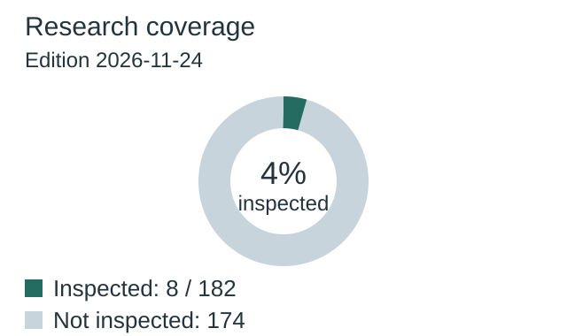
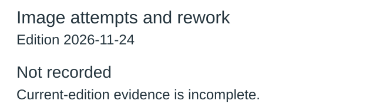
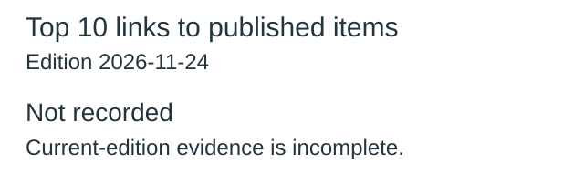
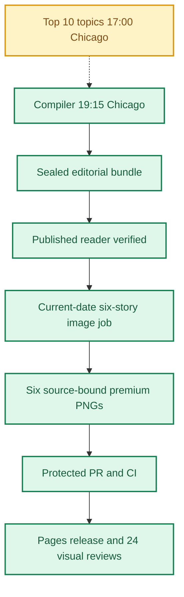
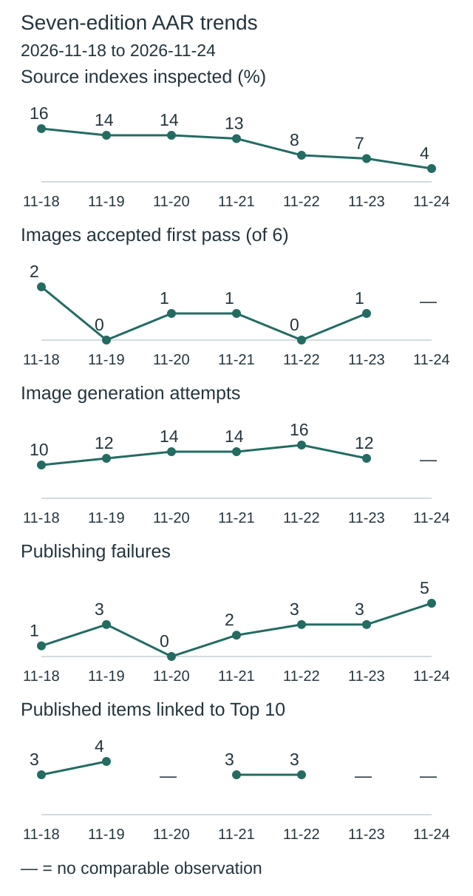
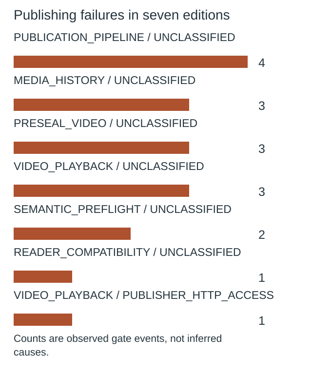
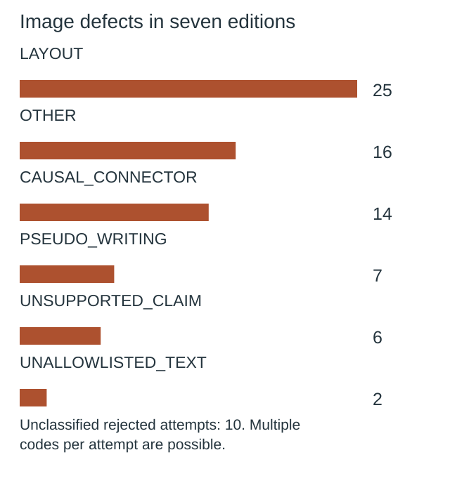

**🟨 RELEASE PARTIAL**
**TOP 10 PARTIAL** · **🟩 COMPILER VERIFIED** · **🟦 IMAGES 6/6 RELEASED** · **🟪 VISUAL QA 24/24 PASS**

# Daily AI Brief — Unified Production After-Action Report
**Edition:** November 24, 2026 · **Production evening:** 2026-11-23 · **Timezone:** America/Chicago
**Primary public reader:** [Open 2026-11-24 Brief](https://gttome.github.io/Daily-AI-Brief-Compiler/briefs/2026-11-24/) · **Repository:** [Daily-AI-Brief-Compiler](https://github.com/gttome/Daily-AI-Brief-Compiler)

> **IMPORTANT — VERIFIED PRODUCTION RESULT**
> **Executive release result: PARTIAL.** This is the single management-facing report covering Top 10 topic discovery, the editorial Compiler, published Brief and premium-image run. **Entire-system evidence: PARTIAL.** Top 10 report: **partial**; Compiler handoff: **INVALID**; guided searches: **INVALID**. Compiler public status: **VERIFIED**. Image release: **RELEASED_VERIFIED**. Direct 24-context visual quality: **24/24 PASS**. Autonomous completion: **UNPROVEN**. Missing evidence must not be promoted to a success claim.

**🕒 Production stage durations:** **Top 10 11m 43s** · **Compiler final seal window 5m 27s** · **Premium Images 31m 02s** (evidence-bounded elapsed times; the start/end events differ).

> **CLOSEOUT WARNING:** The exact image worker has not released its lease and recorded PUBLISHED_COMPLETE with the six accepted hashes.

## Evidence reconciliation

Compiler final seal window: 5m 27s. Compiler state start to public verification: 81m 18s. Initial execution start not established; final seal window is not total runtime.
Image capability route preflight: RECORDED; scheduler origin remains UNPROVEN.
Image efficiency: 0/6 first-pass accepts; 13 total attempts. Approved prospective efficiency target: at least 4/6 first-pass and no more than 8 total attempts, strictly advisory, with unchanged quality floor.
Image review completed: 2026-11-24T03:58:37Z; review-record commit: 2026-11-24T04:00:35.000Z; protected review merge: 2026-11-24T04:03:07.000Z.
Eligible source indexes: 182; editorial inspections reported: 8 (4.4%); inaccessible in editorial audit: 0; explicitly unreviewed IDs: 174; unclassified editorial IDs: 0. Automated index parsing is separate from editorial inspection and cannot substantiate exhaustive freshness claims.

Registered video sources: 37; attempted this edition: 37; unattempted: 0; enabled: 37; qualification-only: 0; sources yielding candidate URLs: 3. Status: REPORTED_ALL_ATTEMPTED. Attempt evidence is not automatic proof of source-content review or playback.

Eligible source partition **VALID**. Full original-item reads **6**. Bounded index searches **2**. Qualification-only sources recorded separately **0**.

### Video candidate discovery

| Discovery source | Eligibility | Candidate URLs |
|---|---|---:|
| AI Engineer | Enabled | 1 |
| IBM Technology YouTube | Enabled | 1 |
| NVIDIA Developer YouTube | Enabled | 1 |

### Protected preseal video outcomes

| Original publisher | Distinct programs submitted | Archive rejects | Playback passes | Playback unverified | Probes skipped |
|---|---:|---:|---:|---:|---:|
| ai.engineer | 1 | 0 | 0 | 1 | 0 |
| fantasy.co | 1 | 0 | 0 | 1 | 0 |
| mux.com | 1 | 0 | 1 | 0 | 0 |
| nvidia.com | 1 | 0 | 4 | 0 | 2 |
| openai | 1 | 0 | 0 | 1 | 0 |
| pbs.org | 2 | 2 | 0 | 0 | 0 |
| ted.com | 1 | 0 | 4 | 0 | 2 |
| vimeo.com | 1 | 0 | 1 | 0 | 0 |
| worldsciencefestival.com | 1 | 0 | 0 | 1 | 0 |
| youtube-channel:UCKWaEZ-_VweaEx1j62do_vQ | 1 | 0 | 0 | 1 | 0 |

Outcomes count observed checks across all saved requests. Programs can be submitted again after a different slot changes.

- Has AI Solved Math’s Pinnacle Problem? received PUBLIC_VIDEO_PLAYBACK_UNVERIFIED. [Original run](https://github.com/gttome/Daily-AI-Brief-Compiler/actions/runs/45307461777)
- The Software Atelier received PUBLIC_VIDEO_PLAYBACK_UNVERIFIED. [Original run](https://github.com/gttome/Daily-AI-Brief-Compiler/actions/runs/45307461777)
- 4 Types of AI Agent Loops: From Human-Led to Autonomous received PUBLIC_VIDEO_PLAYBACK_UNVERIFIED. [Original run](https://github.com/gttome/Daily-AI-Brief-Compiler/actions/runs/45307461777)
- AI and the Next Decade received PRESEAL_ARCHIVE_REPEAT. Earlier editions 2026-11-11. [Original run](https://github.com/gttome/Daily-AI-Brief-Compiler/actions/runs/45307850731)
- Machine Learning & A.I. - Crash Course Computer Science #34 received PRESEAL_ARCHIVE_REPEAT. Earlier editions 2026-11-22. [Original run](https://github.com/gttome/Daily-AI-Brief-Compiler/actions/runs/45308348762)
- ChatGPT Sites For Newsroom Scheduling received PUBLIC_VIDEO_PLAYBACK_UNVERIFIED. [Original run](https://github.com/gttome/Daily-AI-Brief-Compiler/actions/runs/45308527550)
- Conscious Interfaces: A Demo by Fantasy received PUBLIC_VIDEO_PLAYBACK_UNVERIFIED. [Original run](https://github.com/gttome/Daily-AI-Brief-Compiler/actions/runs/45309317412)

## Approved November 20 improvement evidence

Editorial runtime declarations: **DECLARED_RESTRICTED_EDITORIAL_RUNTIME**. Actual billing and scheduled origin remain unknown.

Video candidate evidence: **NOT_RECORDED**; substantive candidates Not recorded, non-news Not recorded, original publisher families Not recorded, selected non-news Not recorded. Targets 12 / 8 / 6 / 2 are advisory; unchanged duration, promotion, novelty and full-program playback checks still apply.

Source failure categories: PARSER_OR_OTHER 2, RESPONSE_SIZE_LIMIT 7, ACCESS_BLOCKED 6. Empty, blocked, oversized and unreviewed sources are distinct.

Original-paper cadence: one qualified paper within 3 editions when available. Current review timing NOT_RECORDED; postpublication review is not evidence of preselection reading.


IMG19 artistic changes retain their existing November 22 three-eligible-edition evaluation. Missing pixels, owner feedback and usage remain unknown; no retrospective source, query or artwork acceptance is invented.

## Daily AAR charts

These charts use this edition’s receipts. Missing data is not zero.

### Research coverage



**8 of 182 indexes inspected (4%).**

| Editorial inspection | Indexes |
|---|---:|
| Inspected | 8 |
| Not inspected | 174 |

Not inspected includes every index without a recorded editorial inspection; this is not proof of missed stories.

### Image attempts and rework



**13 attempts; 0 of 6 images accepted on their first attempt.**

Recorded ongoing from November 8 target: at least 3/6 first-pass accepts; no more than 2 attempts per image. This is an efficiency target, not a quality cutoff.

| Image | Accepted | Rejected | Total attempts |
|---|---:|---:|---:|
| Prediction loss could become a shared safety pace signal | 1 | 1 | 2 |
| GLM‑5.4 trades more repeated depth for the same parameters | 1 | 1 | 2 |
| Anthropic closes a $119.5 billion combined capital event | 1 | 1 | 2 |
| Creative workers describe bargaining power moving before jobs vanish | 1 | 1 | 2 |
| Superhuman Go puts approval and attribution around proactive work | 1 | 2 | 3 |
| Insert a human summary checkpoint before an agent’s final verification | 1 | 1 | 2 |

Generation attempts measure rework, not runtime or cost. Quality and publication checks remain separate.

### Top 10 links to published items



**Not recorded:** current-edition evidence is missing or inconsistent.

No selection quota. Topic linkage does not establish better quality, popularity or causal improvement.

[Chart data](charts.json)

One edition at a time. Missing evidence is not zero. Trend claims require comparable recorded cycles.

## Performance dashboard

| Measure | Recorded result | Source / caveat |
|:--|:--:|:--|
| Entire-system evidence | **PARTIAL** | Full Top 10 list, bound Compiler input, all-format search receipts and existing release checks; separate from publication and autonomy |
| Top 10 report | **partial · 10 topics** | Same Chicago cycle report; provisional/partial coverage remains disclosed |
| Top 10 received by Compiler | **INVALID** | Exact report snapshot bytes; consumed commit separately corroborated: UNPROVEN |
| Top 10 guided article/video/podcast searches | **INVALID** | Actual source-search receipts and selected/rejected topic outcomes |
| Top 10 stage duration | **11m 43s** | Same-cycle run receipt only; no runtime or usage estimate |
| Editorial publication | **PASS** | State and public reader integrity receipt |
| **Unattended autonomy (separate from publication)** | **UNPROVEN** | Owner incident receipt takes precedence over unverified producer self-attestation |
| Recorded protected publishing gate failures | **5** | Actual same-edition GitHub failure sidecar only; earlier unrecorded failures remain unknown |
| Articles | **6** | Exactly 2 technical / 2 knowledge-worker / 2 agents required |
| Original scientific-paper-led articles | **Not recorded** | Rolling target: one qualified original paper in 3 editions; UNVERIFIED_RECEIPT. Preprints are not peer-reviewed by default |
| Verified original sources within preceding 24 hours | **0 / 6** | Original publisher dates only; other sources require a documented fallback rationale |
| Distinct selected article publishers | **6** | Six different primary organizations preferred |
| Videos over seven days old | **2** | Must be labeled evergreen, not a new development |
| Distinct selected video publishers | **2** | One channel is one publisher even across multiple videos |
| Cross-media topic diversity | **FOUR_DISTINCT_EVENTS_REVIEW_RECORDED** | Four video/podcast events and six pairwise original-source comparisons; editorial claims remain producer-attested |
| Video discovery source attempts | **37 / 37** | Attempt evidence across enabled and qualification-only leads; REPORTED_ALL_ATTEMPTED. Not a claim of full content review or player verification | 
| Duplicate active Watchlist display titles | **0** | Published canonical Watchlist only; historical evidence retained |
| Original-release video playback (historical) | **TWO_PUBLISHED_VIDEOS_PLAYBACK_PASS** | Later reader corrections may replace these originally verified videos; see incident register | 
| Postpublication reader incidents | **NOT_RECORDED** | Edition-specific owner reports and corrective PRs, not inferred absence | 
| Verified postpublication video corrections | **NOT_RECORDED** | Incident register tracks correction PR, actual playback evidence and reader preservation |
| Editorial index second-pass attempts | **0** | Bounded public GET retries only; never proof of original article reading |
| Editorial index reads recovered | **0** | Successful page fetch can still yield zero eligible dated items |
| Recorded scheduler capability route | **UNPROVEN** | Same-invocation route receipt only; GitHub is not scheduler authentication |
| Avoidable incomplete-staging CI failures | **Not independently audited** | Existing image-package push CI is disabled; exact-head protected PR CI remains required. A failure count requires actual workflow evidence |
| Media | **2 videos + 2 podcasts** | Sealed bundle |
| **Compiler final seal window** | **5m 27s (5.5 min)** | Final sealed-state timestamp → verified public reader; initial execution is separate |
| **Image processing stage duration** | **31m 02s** | First accepted PNG Git checkpoint → final 24/24 review; auditable stage elapsed time |
| Image scheduled-to-final-review window | **Not independently recorded** | Only with a saved one-cycle schedule anchor; does not attest exact generation start |
| Executor-observed generation-to-final-review | **34m 49s** | Only if the worker recorded a same-execution clock before its first native call; not independently verified provider runtime |
| Accepted premium PNGs | **6 / 6** | Exact package and public release hashes |
| Native image generation attempts | **13** | Image worker AAR; no estimation |
| Rejected candidates | **7** | Image worker AAR |
| Final worker checkpoint reconciliation | **MISMATCH** | Oct25+ verifies exact generation count, per-story attempts, six accepted story/image/hash bindings and final release |
| Saved visual contexts | **24 / 24 PASS** | Dated/permanent desktop/mobile review |
| Public SHA-256 checks | **44** | Image release receipt |
| October 8 immutable history | **17 / 17** | Independent content-preservation checks |
| **Owner-reported weekly Work usage for this run** | **Not reported** | No per-cycle usage supplied |

> **EFFICIENCY NOTE**
> **Resource reporting policy:** No usage figure was supplied for this cycle, so none is assumed. Future runs show **Not reported** unless the owner supplies new cycle-specific usage metadata. No approval or extra step is required to generate the AAR.

## Production architecture and checkpoints



## Daily AI Topic Top 10 and Compiler handoff

**Research cycle:** 2026-11-23 · **Target Brief:** 2026-11-24 · **Scheduled start:** 17:00 America/Chicago

| Dimension | Recorded evidence |
|---|---|
| Run/report result | PARTIAL |
| Report status / topics | partial / 10 |
| Freshness | FRESH\_AT\_CONSUMPTION |
| Compiler handoff | INVALID |
| Search coverage | INVALID |
| Selection mapping verification | INVALID |
| Observed start / finish | 2026-11-23T23:01:58Z / 2026-11-23T23:13:41Z |
| Elapsed minutes | 11.72 |
| Usage percent | Not reported |
| Cost USD | Not reported |
| Independent scheduler autonomy | UNPROVEN |
| Compiler-recorded consumed commit | Not reported |
| Report SHA-256 | 93666c31516ddf53f7ef974291cbdb0b64dbab8237b0134d37fcf9d2d68d7bf2 |

| Discovery order | AI topic | Summary | Confidence | Evidence |
|---:|---|---|---|---|
| 1 | OpenAI proposes shared pretraining safety limits | Pachocki proposes prediction-loss measures to pace development; no industry agreement is established. | medium | [Source](https://www.youtube.com/watch?v=f5_c0O_chy4) · [Source](https://x.com/merettm/status/2124549218995949967) · [Source](https://news.ycombinator.com/item?id=50601525) · [Source](https://openai.com/index/perplexity-and-intelligence/) |
| 2 | Riemann proof verification draws fresh explainers | France24’s new program follows Lean and Mathlib certification of Alpöge’s Claude-assisted proof. | medium | [Source](https://www.youtube.com/watch?v=fvN_vCRuBec) · [Source](https://www.youtube.com/watch?v=xjX3jESpZqs) · [Source](https://leanprover-community.github.io/blog/posts/riemann-hypothesis/) |
| 3 | Anthropic IPO economics gets independent explainers | Fresh financial programs discuss the IPO, whose issuer separates public-offering proceeds from private placement. | medium | [Source](https://www.youtube.com/watch?v=Qt5F0D6E5f0) · [Source](https://www.youtube.com/watch?v=7oa-LxS68zA) · [Source](https://www.anthropic.com/news/ipo-close) |
| 4 | Coding agents need better human checkpoints | Ronacher’s new standalone upload argues that comprehension and maintenance constrain faster coding agents. | medium | [Source](https://www.youtube.com/watch?v=JNexz3Tbiu8) · [Source](https://ai.engineer/code/2026/talks/armin-ronacher) |
| 5 | Inkling 2 Mini draws local-model testing | Fresh creator tests examine a looped open-weight model’s local use and monitoring tradeoffs. | medium | [Source](https://www.youtube.com/watch?v=cUuVObUqbn0) · [Source](https://www.youtube.com/watch?v=OdMpNiByntM) · [Source](https://news.ycombinator.com/item?id=50581260) · [Source](https://thinkingmachines.ai/news/inkling-2-mini/) · [Source](https://huggingface.co/thinkingmachines/Inkling-2-Mini) |
| 6 | GLM5.4 introduces a looped coding architecture | Z.ai describes reused layers for visual coding, with API and weight releases still forthcoming. | low | [Source](https://x.com/Zai_org/status/2124811995912286352) · [Source](https://www.youtube.com/watch?v=7n3cZzR0tVE) · [Source](https://z.ai/blog/glm-5.4) |
| 7 | DW documents creative workers losing assignments | DW’s fresh program follows individual workers facing AI substitution and disputed voice use. | low | [Source](https://www.youtube.com/watch?v=TWhr_M5u-FI) · [Source](https://www.dw.com/en/when-ai-takes-over-creatives-fight-for-their-jobs/video-80008739) |
| 8 | Tripo demonstration tests a 3D character workflow | A fresh creator demo revisits a node-based tool for generating, rigging and exporting assets. | low | [Source](https://www.youtube.com/watch?v=zGi4XE02S4w) · [Source](https://www.tripo3d.ai/product-doc/agentic-canvas/agentic-canvas-guide) |
| 9 | Claude cache habits get a practical explainer | A new program discusses repeated context while official docs supply cache and plan-usage diagnostics. | low | [Source](https://www.youtube.com/watch?v=0RF9ml43ups) · [Source](https://code.claude.com/docs/en/costs) · [Source](https://platform.claude.com/docs/en/build-with-claude/prompt-caching) |
| 10 | YouArt Desktop receives an editing demonstration | A fresh small-audience program revisits the desktop agent’s work with creative software and local projects. | low | [Source](https://www.youtube.com/watch?v=_sqNWwOpii4) · [Source](https://youart.ai/release_log) |

**Sample scope:** {"metadata\_screened\_videos":34,"unique\_videos":34,"distinct\_screened\_channels":23,"full\_video\_reviews":0,"full\_program\_reviews":0,"complete\_transcript\_reviews":0,"partial\_original\_transcript\_reviews":1,"partial\_third\_party\_transcript\_reviews":0,"direct\_youtube\_counter\_verifications":0,"full\_original\_article\_reads":3,"full\_original\_article\_read\_identities":\["OpenAI article body and footnotes","Lean and Mathlib complete37-line statement","Anthropic IPO announcement body32–36"\],"complete\_original\_reading\_editions":1,"complete\_original\_paper\_reviews":0,"original\_watch\_attempts":34,"original\_watch\_outcomes":{"throttled":30,"title\_shell":4},"auxiliary\_source\_recording\_watch\_attempts":1,"auxiliary\_source\_recording\_outcome":"title\_shell","comparable\_video\_observations":1,"screened\_source\_items":50,"retained\_source\_items":29,"screened\_and\_retained\_by\_category":{"video":{"screened":34,"retained":13},"public\_discussion\_thread":{"screened":4,"retained":4},"original\_release\_paper\_model\_card\_repository":{"screened":11,"retained":11},"independent\_report\_test\_interview":{"screened":1,"retained":1}},"trackers\_separately\_counted":3,"freshness\_counts":{"within\_24h\_timestamped":1,"additional\_within\_72h\_timestamped":12,"additional\_within\_7d\_timestamped":1,"date\_only":20,"older":0},"freshness\_reference\_at":"2026-11-23T23:10:38Z","notes":"Bounded deduplicated ledger, not every search result or registered-source census.34metadata screens are not40–80full-video reviews."}. **Ranking basis:** {"attention":"YouTube program attention and creator breadth lead discovery, supplemented by timed social snapshots and community counters. No added overlapping audiences, invented scores or channel-normalized baselines.","uncertainty":"WITL video clock07:04Eastern; other indexes lack counter clocks. Missing metrics stay null. One small creative demonstration has limited attention, not proven broad popularity. Claim strength and Brief value separate."}.

| Search format | Receipt rows | Attempts recorded | Explicitly not attempted |
|---|---:|---:|---:|
| article | 10 | 10 | 0 |
| video | 10 | 10 | 0 |
| podcast | 10 | 10 | 0 |

**Selected Brief items linked to trends:**

No validated selection-to-topic mapping was recorded.

**Raw, unverified Top 10 receipt observations:** 30 search rows across 30 topic/format pairs; 9 claimed mapping rows (0 with noncanonical fields). Noncanonical outcomes: none. These counts are NOT validated search attempts or verified selections.

**Gaps and limitations:**

- Compiler trend input is not a fresh, date-correct, exact-report snapshot bound to independently collected bytes.
- Claimed trend-to-selection mappings are not verified against the same-edition selected bundle.
- Per-topic article/video/podcast search coverage is incomplete, invalid or bound to a different input.
- The report labels its research partial.
- Partial research:34metadata-screened videos, zero complete program/transcript reviews and zero direct YouTube counter checks. One original reading edition and partial source transcript do not satisfy40–80full-video target.
- Unavailable metrics, sponsorship, durations and source clocks are null. No inferred CTR, retention, velocity, world rank or universal performance.
- Original dates, fresh upload dates and attention dates differ. Inaccessible source details remain Compiler verification leads.
- Thirty query terms supplied; actual Compiler consumption, searches, final mappings, publication and images PENDING.
- November10pilot inactive; no task/schedule, code, daily/\*\*, production branch, accepted image or historical edition change.
- The exact Compiler-consumed commit has not been independently corroborated.

**Recorded run issues:**

- {"issue":"30of34 original video routes throttled;4title shells. Auxiliary livestream title shell.","effect":"No full playback/program review or direct YouTube counter verification.","correction":"Used bounded original documents, one complete reading edition and partial original transcript; research remainspartial."}
- {"issue":"GLM original direct route, DW original/transcript route, third-party Armin mirror and Lean GitHub source route inaccessible/restricted.","effect":"Some claim checks indexed-only; no full manuscript, transcript or proof rerun.","correction":"Used original indexed GLM text, original Lean statement and canonical non-www AI Engineer reading edition; scope and gaps retained."}
- {"issue":"Third-party publication dates disagree for Wes proof video; tracker measurement clocks differ or are missing.","effect":"Precise original publication and current global rank/growth unavailable for most videos.","correction":"Preserved both reported dates, missing metricsnull, same-source Austin snapshot comparison only. Comparison is screened tutorial, not retainedtopic."}
- {"issue":"Local preparation parser failed on leading whitespace, then report assembly referenced an undefined discovery constant before persistence.","effect":"Two local preparation attempts stopped; no remote report mutation occurred.","correction":"Corrected parsing, rebuilt prepared report and ran pinned validators plus independent byte/hash checks successfully before upload."}

**Recorded improvements:**

- {"change":"Bind fresh Armin upload to its original reading edition and older source date.","reason":"Producer needs substantive non-news leads with honest original chronology.","expected\_effect":"Support early qualification without misrepresenting a fresh upload as a fresh event.","status":"IMPLEMENTED\_PRODUCER\_METHOD; FUTURE\_OUTCOME\_UNPROVEN"}
- {"change":"Add direct bounded HN observations and exact publisher-family removal reviews.","reason":"Direct video counters unavailable and several topics rely on one publisher.","expected\_effect":"Expose fragile attention attribution; broader sampling alone is not better outcomes.","status":"IMPLEMENTED\_PRODUCER\_METHOD; FUTURE\_OUTCOME\_UNPROVEN"}

### Daily improvement and effect on the Brief

**Fixed baseline:** nov03-2026-v1 / INPUT\_FROZEN. **Outcome baseline:** FROZEN\_AFTER\_VERIFIED\_PUBLICATION. **Prior cycle:** 2026-11-22.

| Input measure | Current | November 3 baseline | Change from baseline | Change from prior cycle |
|---|---:|---:|---:|---:|
| topic count | 10 | 10 | 0 | 0 |
| validation resource count | Not reported | 14 | Not reported | Not reported |
| additional video metadata records | Not reported | 63 | Not reported | Not reported |
| additional video channels | Not reported | 21 | Not reported | Not reported |
| total video observations | Not reported | 79 | Not reported | Not reported |
| unique videos | Not reported | 71 | Not reported | Not reported |
| full video reviews | Not reported | 0 | Not reported | Not reported |
| direct youtube counter verifications | Not reported | 0 | Not reported | Not reported |
| broader evidence band topics | 5 | 3 | 2 | 2 |
| limited evidence band topics | 5 | 7 | -2 | -2 |

**Observed downstream measurements:** PENDING\_OR\_INCOMPLETE.

| Outcome measure | Current | Change from frozen outcome | Change from prior cycle |
|---|---:|---:|---:|
| expected topic format pairs | 30 | 0 | Not reported |
| attempted topic format pairs | Not reported | Not reported | Not reported |
| explicitly unattempted pairs | Not reported | Not reported | Not reported |
| discovered candidate count | Not reported | Not reported | Not reported |
| searched source host count | Not reported | Not reported | Not reported |
| selected article count | Not reported | Not reported | Not reported |
| selected video count | Not reported | Not reported | Not reported |
| selected podcast count | Not reported | Not reported | Not reported |

**Source changes:** {"added":\[\],"removed":\[\]}.

**Candidate review depth:** NOT\_RECORDED.

| Review measure | Current | Change from prior comparable cycle |
|---|---:|---:|
| reviewed candidate count | Not reported | Not reported |
| qualified candidate count | Not reported | Not reported |
| rejected candidate count | Not reported | Not reported |
| metadata only count | Not reported | Not reported |
| full video reviews | Not reported | Not reported |
| transcript reviews | Not reported | Not reported |

The frozen November 3 baseline has no candidate-level review ledger; no retrospective value is invented. Recorded reviews do not independently establish content quality, audience interest or causal benefit.

**Method/resource review:** {"baseline\_id":"nov03-2026-v1","previous\_report\_date":"2026-11-22","method\_version":"2026-11-03.2-event-review","changes":\[{"change":"Bind fresh Armin upload to its original reading edition and older source date.","reason":"Producer needs substantive non-news leads with honest original chronology.","expected\_effect":"Support early qualification without misrepresenting a fresh upload as a fresh event."},{"change":"Add direct bounded HN observations and exact publisher-family removal reviews.","reason":"Direct video counters unavailable and several topics rely on one publisher.","expected\_effect":"Expose fragile attention attribution; broader sampling alone is not better outcomes."}\],"resource\_candidates":\[{"url":"https://ai.engineer/code/2026/talks/armin-ronacher","role":"claim","decision":"accepted","access":"direct","review\_scope":"Complete original reading-edition body and partial original transcript; no full transcript or playback.","independence":"Same original AI Engineer program, not extra independent attention.","reason":"Adds substantive explanation, practical checkpoint and originalNovember12date.","contribution":"Rank4earlyreview flag and useful dated queries."},{"url":"https://speakernotes.dev/video/build-the-workshop-before-the-software-factory-armin-ronacher-earendil-JNexz3Tbiu8","role":"claim","decision":"deferred","access":"unavailable","review\_scope":"Indexed extract only","independence":"Program mirror, not independent event replication.","reason":"Direct transcript inaccessible; original reading edition supplied bounded substitute.","contribution":"No full transcript count."}\],"observed\_effects":{"feedback":{"source\_commit":"14f7d5093477b72d53dfa04eb29a61f3ca73c735","status":{"publication":"VERIFIED","images":"RELEASED\_AND\_24\_CONTEXTS\_VERIFIED","top10":"RECEIPTS\_OBSERVED","system":"PARTIAL","autonomy":"UNPROVEN","runtime\_policy":"DECLARED\_RESTRICTED\_EDITORIAL\_RUNTIME","usage":"UNKNOWN"},"top10":{"report\_valid":true,"handoff\_status":"RECEIVED\_SNAPSHOT\_BOUND","search\_status":"RECEIPTS\_OBSERVED","search\_counts":{"article":{"recorded":10,"attempted":10,"not\_attempted":0},"video":{"recorded":10,"attempted":10,"not\_attempted":0},"podcast":{"recorded":10,"attempted":10,"not\_attempted":0}},"selection\_mapping\_status":"INVALID","selection\_mappings\_reported":3,"selected\_mappings":\[\]},"daily\_action\_review":{"schema\_version":"daily-aar-action-review-v1","edition\_date":"2026-11-23","mode":"DAILY\_EVIDENCE\_LED\_TRIAGE","next\_cumulative\_review":"2026-11-23","cumulative\_review\_due\_today":true,"finding\_count":3,"open\_production\_blockers":0,"findings":\[{"id":"PROTECTED\_GATE\_FAILURES","priority":"P1","owner":"Compiler / Recovery","observation":"3 failed protected publication gates were recorded (3 unclassified causes).","action":"Read original failed job logs, record real causes and move the relevant existing validation before the next readiness signal; do not replay the released edition.","timing":"NEXT\_GENUINE\_CYCLE","kind":"RECURRENCE\_PREVENTION"},{"id":"PREMIUM\_IMAGE\_REWORK","priority":"P1","owner":"Images","observation":"6 rejected image candidates preceded the verified six-image release.","action":"Inspect saved rejection evidence and apply source-specific geometry, causal-arrow and label corrections before the next native generation.","timing":"NEXT\_GENUINE\_CYCLE","kind":"EFFICIENCY\_LESSON"},{"id":"SCHEDULER\_ORIGIN\_UNPROVEN","priority":"P2","owner":"Compiler / Recovery","observation":"Publication success does not independently attest the originating scheduler.","action":"Capture real first-party scheduler and execution evidence if available; do not convert unknown provenance into a failure or a success.","timing":"NEXT\_GENUINE\_CYCLE","kind":"EVIDENCE\_GAP"}\],"limitations":\["This report records findings and next actions; it does not execute corrections.","Existing owners must fix safe same-cycle faults immediately, without waiting for the cumulative review date.","A released edition remains immutable; lessons apply prospectively to the next genuine cycle.","Missing observations are not zero; no causality, autonomous recovery or effectiveness is inferred."\]},"chart\_keys":\["schema\_version","edition\_date","charts","interpretation"\],"metric\_summary":{"coverage\_percent":{"recorded\_editions":7,"median":14},"first\_pass\_accepted":{"recorded\_editions":7,"median":1},"image\_attempts":{"recorded\_editions":7,"median":12},"top10\_linked\_items":{"recorded\_editions":5,"median":3},"publication\_failures":{"recorded\_editions":7,"median":2}}},"charted\_aar\_url":"https://github.com/gttome/Daily-AI-Brief-Compiler/blob/14f7d5093477b72d53dfa04eb29a61f3ca73c735/daily/2026-11-22/combined.md","chart\_data\_url":"https://github.com/gttome/Daily-AI-Brief-Compiler/blob/14f7d5093477b72d53dfa04eb29a61f3ca73c735/daily/2026-11-22/charts.json","improvement\_metrics\_url":"https://github.com/gttome/Daily-AI-Brief-Compiler/blob/14f7d5093477b72d53dfa04eb29a61f3ca73c735/daily/2026-11-22/improvement-metrics.json","downstream\_impact\_table\_url":"https://github.com/gttome/Daily-AI-Brief-Compiler/blob/14f7d5093477b72d53dfa04eb29a61f3ca73c735/daily/2026-11-22/combined.md#daily-ai-topic-top-10-and-compiler-handoff","current\_downstream":"PENDING","charts\_reviewed":{"research\_coverage":"12/182inspected,7%; automated fetches excluded.","image\_rework":"12attempts,1first-pass accept; separate image-owner result.","top10\_selection":"NOT\_RECORDED;3claimed mappings invalid, not zero verified selections."},"interpretation":"Prior publication/images verified separately.30searches observed;3claimed mappings invalid. Current producer does not repair history or certify current future outcomes."},"change\_evaluations":\[{"change\_id":"NOV15-02","reviewed\_edition":"2026-11-24","decision":"keep","result":"inconclusive","reason":"Latest earlier AAR validates exact snapshot and30searches but rejects3claimed mappings. Source/search binding observed; complete selection linkage unverified.","evidence\_refs":\["https://github.com/gttome/Daily-AI-Brief-Compiler/blob/14f7d5093477b72d53dfa04eb29a61f3ca73c735/daily/2026-11-22/combined.json"\]},{"change\_id":"NOV16-P1-09","reviewed\_edition":"2026-11-24","decision":"keep","result":"inconclusive","reason":"Thirty current meaningful queries supplied, but current consumer receipt is absent. Prior mapping statusINVALID prevents selected-format or causal-quality claims.","evidence\_refs":\["https://github.com/gttome/Daily-AI-Brief-Compiler/blob/14f7d5093477b72d53dfa04eb29a61f3ca73c735/daily/2026-11-22/combined.md#daily-ai-topic-top-10-and-compiler-handoff"\]},{"change\_id":"NOV20-01","reviewed\_edition":"2026-11-24","decision":"keep","result":"not\_met","reason":"Prior edition records30attempted canonical slots but its3selected mappings fail bundle verification. This evaluates that prior result, not futureNovember24production.","evidence\_refs":\["https://github.com/gttome/Daily-AI-Brief-Compiler/blob/14f7d5093477b72d53dfa04eb29a61f3ca73c735/daily/2026-11-22/combined.json"\]},{"change\_id":"NOV20-02","reviewed\_edition":"2026-11-24","decision":"keep","result":"inconclusive","reason":"Producer separates originalNovember12talk,November14release and freshNovember22uploads. Current final selected-source metadata and reader corrections remain other-owner outcomes.","evidence\_refs":\["https://ai.engineer/code/2026/talks/armin-ronacher","https://youart.ai/release\_log"\]},{"change\_id":"NOV20-03","reviewed\_edition":"2026-11-24","decision":"keep","result":"inconclusive","reason":"Application declares Work Mode with Codex tooling; independent host, actual billing and scheduled origin unavailable. Prior AAR likewise says autonomyUNPROVEN and usageUNKNOWN.","evidence\_refs":\["https://github.com/gttome/Daily-AI-Brief-Compiler/blob/14f7d5093477b72d53dfa04eb29a61f3ca73c735/daily/2026-11-22/combined.json"\]},{"change\_id":"NOV20-04","reviewed\_edition":"2026-11-24","decision":"keep","result":"not\_met","reason":"Current producer34metadata screens, zero complete programs/transcripts,3complete short original text bodies and1reading edition leave substantive full-program target unmet. Compiler fifteen-read result is separate.","evidence\_refs":\["https://ai.engineer/code/2026/talks/armin-ronacher","https://leanprover-community.github.io/blog/posts/riemann-hypothesis/"\]},{"change\_id":"NOV20-05","reviewed\_edition":"2026-11-24","decision":"keep","result":"inconclusive","reason":"Pool includes original practical talk, local tests and creative demonstrations; zero complete programs and pending selections do not demonstrate twelve reviewed candidates or two selected non-news programs.","evidence\_refs":\["https://ai.engineer/code/2026/talks/armin-ronacher","https://github.com/gttome/Daily-AI-Brief-Compiler/blob/14f7d5093477b72d53dfa04eb29a61f3ca73c735/daily/2026-11-22/improvement-metrics.json"\]},{"change\_id":"NOV20-09","reviewed\_edition":"2026-11-24","decision":"keep","result":"inconclusive","reason":"No complete manuscript methods/results review here. Vendor articles and model cards do not satisfy paper-led cadence; actual rolling three-edition selection stays with Compiler/reporting.","evidence\_refs":\["https://github.com/gttome/Daily-AI-Brief-Compiler/blob/14f7d5093477b72d53dfa04eb29a61f3ca73c735/daily/2026-11-22/combined.json"\]},{"change\_id":"NOV20-10","reviewed\_edition":"2026-11-24","decision":"keep","result":"met","reason":"Producer separates partial research, pending consumer/publication/images and unknown billing/scheduler evidence. Prior AAR also separates verified publication/images from partial overall system evidence.","evidence\_refs":\["https://github.com/gttome/Daily-AI-Brief-Compiler/blob/14f7d5093477b72d53dfa04eb29a61f3ca73c735/daily/2026-11-22/combined.json"\]}\],"next\_improvement":"Compiler should inspect rank4early, resolve originalNovember12 archive/date/duration/playback and assess a qualified fresher alternative; record30actual searches and candidate-bound mappings.","limitations":\["Implementation and larger samples do not prove production efficacy.","Existing daily\_improvement is the role’s register-reporting route; protected main register not edited."\]}.

**Current reconciled conclusion:** PENDING\_OR\_INCOMPLETE; outcome baseline FROZEN\_AFTER\_VERIFIED\_PUBLICATION; candidate review ledger NOT\_RECORDED.

**Historical producer observations (not current status):** The following snapshot preserves what the producer reported at the time. Its pending statuses and candidate-quality claims are not independently reconciled conclusions. Use the current tables above for publication-bound measurements; an absent candidate review ledger remains unknown.

<details><summary>Original producer effects and gaps — historical snapshot</summary>

```json
null
```

</details>

**Next improvement:** Compiler should inspect rank4early, resolve originalNovember12 archive/date/duration/playback and assess a qualified fresher alternative; record30actual searches and candidate-bound mappings.

Counts show coverage and observed association, not audience popularity, source independence, candidate quality or causal uplift. Compare source/method changes before interpreting deltas. Unknown values are not zero. Publication, reader corrections, runtime and image outcomes retain their separate AAR evidence.

Report, source-readback and search receipts are separate observations. Snapshot binding verifies the collected report bytes; the consumed commit is independently corroborated only when the separately fetched source bytes match. These records do not independently attest scheduler identity or source truth. Top 10 reporting does not change Brief/image release status.


## Track 1 — Compiler

**State:** `SHADOW_VERIFIED` · **Bundle:** `BUNDLE_READY` · **Compiler final seal window:** 5m 27s (5.5 min).

| Publication gate | Result |
|---|:---:|
| Canonical reader build | ✅ |
| Reader parity | ✅ |
| Public verification of dated edition | ✅ |
| Previous editions preserved | ✅ |
| Permanent story routes and feeds | ✅ |

**Selected coverage:**

| Lane | Story |
|---|---|
| Technical AI Engineering | Prediction loss could become a shared safety pace signal |
| Technical AI Engineering | GLM‑5.4 trades more repeated depth for the same parameters |
| Applied Generative AI for Knowledge Workers | Anthropic closes a $119.5 billion combined capital event |
| Applied Generative AI for Knowledge Workers | Creative workers describe bargaining power moving before jobs vanish |
| Agents for Everyone | Superhuman Go puts approval and attribution around proactive work |
| Agents for Everyone | Insert a human summary checkpoint before an agent’s final verification |

### Scientific paper opportunity and publication evidence

**Current edition:** UNVERIFIED_RECEIPT; **paper-led stories:** Not recorded. Editorial target: at least one genuinely qualified original-paper-based story in seven editions, with methods, limitations, and an explicit preprint/peer-review distinction. No stale or weak paper is selected solely to fill a quota.


## Track 2 — Premium images

**Public status:** `RELEASED_VERIFIED` · **Saved images:** 6/6 · **Actual generation attempts:** 13 · **Rejected candidates:** 7.

### Image production duration — Git-verified milestones

**Auditable image stage duration:** **31m 02s** (first accepted binary saved in Git → first persisted 24-context quality-review record). **First asset to public image release:** **25m 58s**.
**Scheduled-to-final-review window:** **Not independently recorded**. This is a scheduled-clock comparison only when a separately recorded exact-date schedule exists; it is **not** measured native image-generation runtime.

| Production milestone | Chicago local time | Evidence |
|---|---|---|
| Scheduled image start (if exact-date record exists) | Not independently recorded | Time planned, not actual execution start |
| First executor-observed start | 9:16:32 PM | Worker self-attestation, not a first-party scheduler event |
| First native generation observation | 9:25:46 PM | Worker clock recorded immediately before first native call, not model-provider telemetry |
| First accepted PNG bytes saved to Git | 9:29:33 PM | Immutable binary-stage commit |
| Six-image package / reviews committed | 9:51:15 PM | Exact-head PR source commit |
| Protected package merged | 9:54:16 PM | Merge SHA and required CI |
| Public images verified | 9:55:31 PM | Image-release receipt |
| 24/24 review record committed | 10:00:35 PM | Immutable first review-approval commit |

> **Duration interpretation:** The audited stage excludes unobservable pre-checkpoint creative work. The scheduled-start window includes it but must not be interpreted as precise active processing time. Missing timestamps appear as **Not independently recorded**, never an estimate.


| Source-bound image | Attempts | File size | Public page |
|---|---:|---:|---|
| Prediction loss could become a shared safety pace signal | 2 | 0.81 MiB | [View original](https://gttome.github.io/Daily-AI-Brief-Compiler/briefs/images/2026-11-24/dab-edition-2026-11-24-m01.png) |
| GLM‑5.4 trades more repeated depth for the same parameters | 2 | 1.10 MiB | [View original](https://gttome.github.io/Daily-AI-Brief-Compiler/briefs/images/2026-11-24/dab-edition-2026-11-24-m02.png) |
| Anthropic closes a $119.5 billion combined capital event | 2 | 1.03 MiB | [View original](https://gttome.github.io/Daily-AI-Brief-Compiler/briefs/images/2026-11-24/dab-edition-2026-11-24-m10.png) |
| Creative workers describe bargaining power moving before jobs vanish | 2 | 1.02 MiB | [View original](https://gttome.github.io/Daily-AI-Brief-Compiler/briefs/images/2026-11-24/dab-edition-2026-11-24-m11.png) |
| Superhuman Go puts approval and attribution around proactive work | 3 | 0.99 MiB | [View original](https://gttome.github.io/Daily-AI-Brief-Compiler/briefs/images/2026-11-24/dab-edition-2026-11-24-m12.png) |
| Insert a human summary checkpoint before an agent’s final verification | 2 | 0.83 MiB | [View original](https://gttome.github.io/Daily-AI-Brief-Compiler/briefs/images/2026-11-24/dab-edition-2026-11-24-m14.png) |

**Immutable-release and visual gates:**

| Release gate | Result |
|---|:---:|
| Protected public image receipt | ✅ |
| Accepted-image Git hash bindings | ✅ |
| Six live PNGs | 6/6 |
| Dated/permanent story placements | 12/12 recorded in release evidence |
| Desktop/mobile visual inspection | 24/24 PASS |
| Historical Oct 8 integrity | 17/17 |

### Published premium illustrations

<table>
<tr><td width="50%"><a href="https://gttome.github.io/Daily-AI-Brief-Compiler/briefs/images/2026-11-24/dab-edition-2026-11-24-m01.png"></a><br/><b>Prediction loss could become a shared safety pace signal</b></td><td width="50%"><a href="https://gttome.github.io/Daily-AI-Brief-Compiler/briefs/images/2026-11-24/dab-edition-2026-11-24-m02.png"></a><br/><b>GLM‑5.4 trades more repeated depth for the same parameters</b></td></tr>
<tr><td width="50%"><a href="https://gttome.github.io/Daily-AI-Brief-Compiler/briefs/images/2026-11-24/dab-edition-2026-11-24-m10.png"></a><br/><b>Anthropic closes a $119.5 billion combined capital event</b></td><td width="50%"><a href="https://gttome.github.io/Daily-AI-Brief-Compiler/briefs/images/2026-11-24/dab-edition-2026-11-24-m11.png"></a><br/><b>Creative workers describe bargaining power moving before jobs vanish</b></td></tr>
<tr><td width="50%"><a href="https://gttome.github.io/Daily-AI-Brief-Compiler/briefs/images/2026-11-24/dab-edition-2026-11-24-m12.png"></a><br/><b>Superhuman Go puts approval and attribution around proactive work</b></td><td width="50%"><a href="https://gttome.github.io/Daily-AI-Brief-Compiler/briefs/images/2026-11-24/dab-edition-2026-11-24-m14.png"></a><br/><b>Insert a human summary checkpoint before an agent’s final verification</b></td></tr>
</table>

## Incidents, corrections and learning

### Postpublication reader incidents (updated when new evidence is merged)

No current-edition postpublication incident register was available; this is **NOT_RECORDED**, not a certification of zero incidents.


**Editor recovery classification:** UNPROVEN. **Owner intervention:** Unproven either way. **Protected same-edition failures recorded:** 5. 
**Latest failed protected stage:** MEDIA_HISTORY; [Action evidence](https://github.com/gttome/Daily-AI-Brief-Compiler/actions/runs/45313653616). Exact stage durations are available only where real source timestamps exist.

| Stage | Verified issue | Corrective action |
|---|---|---|
| Native image generation | Source amounts, qualifier and both contribution arrows are correct. Foreground extends within the mandatory 40px edge margin, particularly bottom shadows and left paper. Inset whole unlocked arrangement; retain amounts and relationships. | Source-bound native edit was frozen before the next attempt; corrected complete final-size and 320px exports were inspected. |
| Native image generation | Source distinctions and wide margins are useful, but the translation, employment and legal papers contain simulated paragraphs, decorative seal and unsupported color-key boxes. Remove these and move exact approved terms onto informative front surfaces. | Source-bound native edit was frozen before the next attempt; corrected complete final-size and 320px exports were inspected. |
| Native image generation | Meeting tile contains a prohibited people pictogram. Both sheets contain simulated paragraph bars; approval joint resembles an unsupported control knob. Replace the tile with audio evidence, move approved terms inside smooth document faces, and remove the knob. | Source-bound native edit was frozen before the next attempt; corrected complete final-size and 320px exports were inspected. |
| Native image generation | People, knob and simulated writing corrected. The attribution record still has an empty value cell next to Approver. Fill it with the source-supported generic role User; no invented identity. | Source-bound native edit was frozen before the next attempt; corrected complete final-size and 320px exports were inspected. |
| Native image generation | Five summary terms, decision branches and approved verification path are visible. Redirect has an additional arrowhead not in the frozen causal-edge plan and points near the Risks field. Remove that head; retain a nondirectional guide clear of words. | Source-bound native edit was frozen before the next attempt; corrected complete final-size and 320px exports were inspected. |
| Native image generation | Saved full-size and 320px pixels show a prohibited gear and foreground outside the 40px margin. Correct those unlocked regions only. | Source-bound native edit was frozen before the next attempt; corrected complete final-size and 320px exports were inspected. |
| Native image generation | Visible extra per-token update gates text is unallowlisted; assembly and detached caveat crowd export edges; parallel upper/lower paths imply an unsupported first-pass exit to final layers. | Source-bound native edit was frozen before the next attempt; corrected complete final-size and 320px exports were inspected. |
| GitHub transport | Direct git push could not read a GitHub username in this runtime. | Used connected create_blob/tree/commit and expected-head update_ref on the sole canonical branch. |
| GitHub binary readback | Contents API gave empty base64 for three files over 1 MiB; Git-data connector rejected binary response. | Read those exact immutable raw GitHub binaries and independently compared complete bytes, SHA-256, Git blob and length. |
| Local browser capture | Playwright browser absent; system Chromium launch aborted because socket() was Operation not permitted. | Use the existing protected release runner for actual 24-context captures and inspect its completed artifact; no local capture PASS is asserted. |

> **OPERATIONAL NOTE**
> This report distinguishes a published and verified production outcome from scheduler metadata exposed to another conversation. Lack of a live host heartbeat in a separate normal chat is not a Compiler production failure.

## Usage and cost stewardship

| Item | Per-cycle value |
|---|---|
| **Weekly Work usage reported by owner** | **Not reported** |
| Internal weekly usage reference | Target under 5% |
| Genuine image-generation attempts | 13 |
| Accepted diagrams | 6 |
| Regeneration after acceptance | 0 |
| Top 10 reported usage | Not reported |
| Top 10 reported cost | Not reported |
| Account-level billing telemetry | Not independently accessible to deterministic GitHub reporting |

**Future reporting rule:** For cycles without an optional owner-usage record, publish the complete AAR with `Not reported`; do not reuse prior percentages, guess remaining weekly credits or delay tomorrow's production.

## Next-edition operating handoff

| Control | Recurring contract |
|---|---|
| AI Topic Top 10 | Sole report task · 17:00 America/Chicago · saved dated list guides same-evening research |
| Primary Compiler | Sole existing task · 19:15 America/Chicago |
| Premium image production | Sole existing task · standard 21:15 America/Chicago |
| Exact image job selection | Newly published next-date `PUBLISHED_PENDING` only |
| AAR | Combined report generated automatically from new GitHub receipts |
| Optional Work usage | Owner-supplied per cycle, otherwise `Not reported` |

> **SCHEDULE RESTORATION NOTE**
> A temporary scheduling exception must be explicitly restored before claiming standard-time readiness. This deterministic document generator reads existing state only; it does not modify production schedules.

## Evidence register

| Evidence | Link |
|---|---|
| Compiler state | [Open receipt](https://github.com/gttome/Daily-AI-Brief-Compiler/blob/shadow/2026-11-24/shadow-runs/2026-11-24/compiler-state.json) |
| Compiler compile receipt | [Open receipt](https://github.com/gttome/Daily-AI-Brief-Compiler/blob/shadow/2026-11-24/shadow-runs/2026-11-24/compiler/compile-receipt.json) |
| Compiler public integrity | [Open receipt](https://github.com/gttome/Daily-AI-Brief-Compiler/blob/shadow/2026-11-24/shadow-runs/2026-11-24/compiler/postpublish-integrity.json) |
| Image release receipt | [Open receipt](https://github.com/gttome/Daily-AI-Brief-Compiler/blob/shadow-pages-history/site/image-jobs/2026-11-24/release.json) |
| Image review | [Open receipt](https://github.com/gttome/Daily-AI-Brief-Compiler/blob/main/external-image-packages/2026-11-24/reviews/live/semantic-pixel-review.json) |
| Original image AAR | [Open receipt](https://github.com/gttome/Daily-AI-Brief-Compiler/blob/main/external-image-packages/2026-11-24/reviews/after-action.md) |
| Observed editorial index retries | [Open receipt](https://github.com/gttome/Daily-AI-Brief-Compiler/blob/shadow/2026-11-24/shadow-runs/2026-11-24/editorial/source-item-retries.json) |
| Scientific paper selection review | [Open receipt](https://github.com/gttome/Daily-AI-Brief-Compiler/blob/shadow/2026-11-24/shadow-runs/2026-11-24/editorial/scientific-paper-coverage.json) |
| Published player playback receipt | [Open receipt](https://github.com/gttome/Daily-AI-Brief-Compiler/blob/shadow/2026-11-24/shadow-runs/2026-11-24/compiler/postpublish-video-playback.json) |
| Top 10 ranked topic report | [Open receipt](https://github.com/gttome/Daily-AI-Brief-Compiler/blob/218dea45021e29dbe8e62661a3a753d132fba5b8/signals/ai-topic-top10/2026-11-23.json) |
| Top 10 run after-action receipt | [Open receipt](https://github.com/gttome/Daily-AI-Brief-Compiler/blob/218dea45021e29dbe8e62661a3a753d132fba5b8/signals/ai-topic-top10/2026-11-23.aar.json) |
| Compiler Top 10 input snapshot | [Open receipt](https://github.com/gttome/Daily-AI-Brief-Compiler/blob/shadow/2026-11-24/shadow-runs/2026-11-24/editorial/trend-input.json) |
| Top 10 article/video/podcast search coverage | [Open receipt](https://github.com/gttome/Daily-AI-Brief-Compiler/blob/shadow/2026-11-24/shadow-runs/2026-11-24/editorial/trend-search-coverage.json) |

**Image workflow:** [Workflow evidence](https://github.com/gttome/Daily-AI-Brief-Compiler/actions/runs/45322676908).

---

*Generated deterministically from cycle- and edition-specific GitHub records. The report combines the Top 10 discovery priorities, its Compiler handoff and searches, the published Brief, and the image run; original research, Compiler, image, hash, and review receipts remain immutable. This reporting action creates no stories, images, releases, extra AI tasks, or schedule changes.*

<!-- continuous-improvement:start -->
## Continuous improvement review

Edition **2026-11-24**. Measurements use 7/7 recorded editions in this window. Missing data stays **Not recorded**.

### Daily corrective-action review

**4 evidence-based findings**; open production blockers: 0. Cumulative evaluation checkpoint: **2026-11-24**. The daily review never waits for that date to act on a safe live problem.

| Priority | Observed issue | Existing owner / next correction | When |
|---|---|---|---|
| P1 | This edition has invalid Top 10 search-coverage receipts. | Compiler: Verify event-to-format searches and actual selected mappings in the next unlocked edition; do not rewrite a sealed historical bundle. | Next genuine run |
| P1 | 5 failed protected publication gates were recorded (5 unclassified causes). | Compiler / Recovery: Read original failed job logs, record real causes and move the relevant existing validation before the next readiness signal; do not replay the released edition. | Next genuine run |
| P1 | 7 rejected image candidates preceded the verified six-image release. | Images: Inspect saved rejection evidence and apply source-specific geometry, causal-arrow and label corrections before the next native generation. | Next genuine run |
| P2 | Publication success does not independently attest the originating scheduler. | Compiler / Recovery: Capture real first-party scheduler and execution evidence if available; do not convert unknown provenance into a failure or a success. | Next genuine run |

Findings are observational and do not claim a repair was executed by the reporter.

### Approved change evaluations

| Change | Evaluate by | Outcome status | Latest decision |
|---|---|---|---|
| NOV03-01 — Earlier publication checks and precise recovery | 2026-11-11 | REVIEWED | revise |
| NOV03-02 — Broader genuine source review | 2026-11-11 | REVIEWED | revise |
| NOV03-03 — Source-bound image rejection lessons | 2026-11-11 | REVIEWED | revise |
| NOV03-04 — Substantive Top 10 review evidence | 2026-11-11 | REVIEWED | keep |
| AAR-01 — Current conclusions separated from historical claims | 2026-11-11 | REVIEWED | keep |
| AAR-02 — Consolidated current task contracts | 2026-11-11 | REVIEWED | keep |
| AAR-03 — Dated improvement evaluations | 2026-11-11 | REVIEWED | keep |
| AAR-04 — Seven-edition trend charts | 2026-11-11 | REVIEWED | keep |
| AAR-05 — Recurring publication failure causes | 2026-11-11 | REVIEWED | revise |
| AAR-06 — Recovery interval reporting | 2026-11-11 | REVIEWED | revise |
| AAR-07 — Source inspection history | 2026-11-11 | REVIEWED | revise |
| AAR-08 — Rolling source contribution | 2026-11-11 | REVIEWED | revise |
| AAR-09 — Recurring image defect categories | 2026-11-11 | REVIEWED | keep |
| AAR-10 — Top 10 publisher-family sensitivity | 2026-11-11 | REVIEWED | keep |
| NOV15-01 — Six premium images must not share an editorial template | 2026-11-17 | REVIEWED | keep |
| NOV15-02 — Exact Top 10 handoff and three-format search use | 2026-11-17 | REVIEWED | keep |
| NOV15-03 — Original failed protected gate causes and early prevention | 2026-11-17 | REVIEWED | keep |
| NOV15-04 — Improve image first-pass acceptance without weakening quality | 2026-11-17 | REVIEWED | revise |
| NOV15-05 — Independently attest unattended scheduler-to-release autonomy | 2026-11-17 | REVIEWED | keep |
| NOV16-P0-01 — Exact Top 10 event-format search receipts | 2026-11-18 | REVIEWED | keep |
| NOV16-P0-02 — Substantive source inspections before selection lock | 2026-11-19 | OVERDUE | Not recorded |
| NOV16-P0-03 — Outside-family playable video sourcing | 2026-11-19 | OVERDUE | Not recorded |
| NOV16-P0-04 — Unified AAR packaging regression coverage | 2026-11-22 | OVERDUE | Not recorded |
| NOV16-P1-05 — Fresh-first original article discovery | 2026-11-20 | OVERDUE | Not recorded |
| NOV16-P1-06 — Classify and reduce failing source indexes | 2026-11-20 | OVERDUE | Not recorded |
| NOV16-P1-07 — Image first-pass yield and visual differentiation | 2026-11-20 | REVIEWED | revise |
| NOV16-P1-08 — Exact video identity with punctuation-only normalization | 2026-11-18 | OVERDUE | Not recorded |
| NOV16-P1-09 — Attributable Top 10 incremental research yield | 2026-11-20 | REVIEWED | keep |
| NOV16-P1-10 — Three-edition original paper priority and vendor attribution | 2026-11-20 | OVERDUE | Not recorded |
| NOV16-P1-11 — Verify unattended scheduler provenance without self-attestation | 2026-11-20 | OVERDUE | Not recorded |
| NOV16-P2-12 — Seven-edition improvement decision dashboard | 2026-11-23 | OVERDUE | Not recorded |
| IMG19-01 — Useful internal detail | 2026-11-22 | REVIEWED | revise |
| IMG19-02 — Distinct visual identity | 2026-11-22 | REVIEWED | keep |
| IMG19-03 — Novelty across days | 2026-11-22 | REVIEWED | keep |
| IMG19-04 — Better first-attempt yield | 2026-11-22 | REVIEWED | revise |
| IMG19-05 — Margins and legibility | 2026-11-22 | REVIEWED | revise |
| IMG19-06 — Reliable reporting | 2026-11-22 | REVIEWED | keep |
| IMG19-07 — Evidence of artistic improvement | 2026-11-22 | REVIEWED | keep |
| IMG19-08 — Reusable learning without repeated shells | 2026-11-22 | REVIEWED | keep |
| NOV20-01 — Canonical Top 10 search and selected-candidate association | 2026-11-24 | REVIEWED | keep |
| NOV20-02 — Original source date and citation metadata | 2026-11-24 | REVIEWED | keep |
| NOV20-03 — Truthful runtime policy reconciliation | 2026-11-24 | REVIEWED | keep |
| NOV20-04 — More substantive preselection source reads | 2026-11-24 | REVIEWED | keep |
| NOV20-05 — Broader non-news video discovery | 2026-11-24 | REVIEWED | keep |
| NOV20-06 — First-pass image geometry and connector planning | 2026-11-24 | REVIEWED | revise |
| NOV20-07 — Watchlist score and corroboration retention | 2026-11-24 | REVIEWED | keep |
| NOV20-08 — Specific newer lane alternatives | 2026-11-24 | PENDING | Not recorded |
| NOV20-09 — Original-paper review and three-edition cadence | 2026-11-24 | REVIEWED | keep |
| NOV20-10 — Separate completion and evidence statuses | 2026-11-24 | REVIEWED | keep |
| NOV20-11 — Neutral AI video coverage badges | 2026-11-24 | PENDING | Not recorded |
| NOV20-12 — Continue existing IMG19 evaluation | 2026-11-22 | REVIEWED | keep |

Pending: 2; overdue: 9; reviewed: 40. Implemented controls await measured results; review decisions do not disable controls.

#### Reviews of production evidence

- **NOV03-01 · 2026-11-12 · not met.** Two media requests still required correction. The first had two stalled embeds and a certificate-date error. The second reached protected playback before two archived programs were disqualified. The edition recovered and published. [Evidence 1](https://github.com/gttome/Daily-AI-Brief-Compiler/blob/1d8c6be/shadow-runs/2026-11-12/editorial/preseal-video-receipt.json) · [Evidence 2](https://github.com/gttome/Daily-AI-Brief-Compiler/blob/shadow/2026-11-12/shadow-runs/2026-11-12/execution-milestones.json)
- **NOV03-02 · 2026-11-12 · inconclusive.** The raw audit recorded 34 inspected entries and 76 unreviewed for 109 eligible sources. It included qualification-only Zapier in the inspection entries. The audited breadth is unknown. Five distinct article publishers were recorded and zero articles had verified 24-hour timestamps. [Evidence 1](https://github.com/gttome/Daily-AI-Brief-Compiler/blob/shadow/2026-11-12/shadow-runs/2026-11-12/editorial/index-review.json) · [Evidence 2](https://github.com/gttome/Daily-AI-Brief-Compiler/blob/dac33c1e16f891121a0571a0a5e25d09b691bee5/daily/2026-11-11/combined.md)
- **AAR-01 · 2026-11-12 · met.** The reviewed closeout identified the live release and 24 visual checks as complete. It separately displayed partial research evidence and unproven autonomy. The original Top 10 snapshot retains its production-stage claims. [Evidence 1](https://github.com/gttome/Daily-AI-Brief-Compiler/blob/dac33c1e16f891121a0571a0a5e25d09b691bee5/daily/2026-11-11/combined.md) · [Evidence 2](https://github.com/gttome/Daily-AI-Brief-Compiler/blob/6e6911d0a393a3117160841950ecf3b2c3665777/signals/ai-topic-top10/2026-11-11.aar.json)
- **AAR-04 · 2026-11-12 · met.** The November 6–12 series included seven image-attempt observations and a median of 12. The chart marked missing coverage and selection observations as gaps and disclosed the registry change. [Evidence 1](https://github.com/gttome/Daily-AI-Brief-Compiler/blob/dac33c1e16f891121a0571a0a5e25d09b691bee5/daily/2026-11-11/improvement-metrics.json) · [Evidence 2](https://github.com/gttome/Daily-AI-Brief-Compiler/blob/dac33c1e16f891121a0571a0a5e25d09b691bee5/daily/2026-11-11/charts/seven-edition-trends.svg)
- **AAR-05 · 2026-11-12 · not met.** The November 12 failure chart counted zero failed workflow jobs while the candidate evidence showed a blocked probe and an archive rejection. The recurring-failure table still contains unclassified events. Preserve the original outcomes so these types remain visible. [Evidence 1](https://github.com/gttome/Daily-AI-Brief-Compiler/blob/dac33c1e16f891121a0571a0a5e25d09b691bee5/daily/2026-11-11/improvement-metrics.json) · [Evidence 2](https://github.com/gttome/Daily-AI-Brief-Compiler/blob/shadow/2026-11-12/shadow-runs/2026-11-12/execution-milestones.json)
- **AAR-06 · 2026-11-12 · inconclusive.** Compiler milestones preserve detection and subsequent state changes. The reconciled report has zero recovery incidents with all required clocks and exact references. Separate repair and verification intervals and unattended origin remain unproven. [Evidence 1](https://github.com/gttome/Daily-AI-Brief-Compiler/blob/shadow/2026-11-12/shadow-runs/2026-11-12/execution-milestones.json) · [Evidence 2](https://github.com/gttome/Daily-AI-Brief-Compiler/blob/dac33c1e16f891121a0571a0a5e25d09b691bee5/daily/2026-11-11/improvement-metrics.json)
- **AAR-07 · 2026-11-12 · not met.** The November 12 index audit failed to reconcile by eligible ID. The current cycle could not update certified inspection coverage from that partition. Review the actual source scopes and clocks with the enabled roster before selection. [Evidence 1](https://github.com/gttome/Daily-AI-Brief-Compiler/blob/shadow/2026-11-12/shadow-runs/2026-11-12/editorial/index-review.json) · [Evidence 2](https://github.com/gttome/Daily-AI-Brief-Compiler/blob/dac33c1e16f891121a0571a0a5e25d09b691bee5/daily/2026-11-11/improvement-metrics.json)
- **AAR-08 · 2026-11-12 · inconclusive.** Five published items had validated topic mappings. The rolling contribution table had no validated substantive candidate review rows attributed to registry IDs. The relative contribution of individual sources remains unknown. [Evidence 1](https://github.com/gttome/Daily-AI-Brief-Compiler/blob/shadow/2026-11-12/shadow-runs/2026-11-12/editorial/trend-search-coverage.json) · [Evidence 2](https://github.com/gttome/Daily-AI-Brief-Compiler/blob/dac33c1e16f891121a0571a0a5e25d09b691bee5/daily/2026-11-11/improvement-metrics.json)

### Seven-edition trends



| Edition | Coverage | First pass / 6 | Image attempts | Publishing failures | Top 10 links |
|---|---|---:|---:|---:|---:|
| 2026-11-18 | 17/109 (16%) | 2 | 10 | 1 | 3 |
| 2026-11-19 | 15/109 (14%) | 0 | 12 | 3 | 4 |
| 2026-11-20 | 15/109 (14%) | 1 | 14 | 0 | Not recorded |
| 2026-11-21 | 15/117 (13%) | 1 | 14 | 2 | 3 |
| 2026-11-22 | 15/182 (8%) | 0 | 16 | 3 | 3 |
| 2026-11-23 | 12/182 (7%) | 1 | 12 | 3 | Not recorded |
| 2026-11-24 | 8/182 (4%) | 0 | 13 | 5 | Not recorded |

| Measure | Recorded editions | Window median |
|---|---:|---:|
| coverage percent | 7 | 13 |
| first pass accepted | 7 | 1 |
| image attempts | 7 | 13 |
| top10 linked items | 4 | 3 |
| publication failures | 7 | 3 |

**Registry changed in this window; coverage percentages use different source sets.**

### Publishing failures by stage and recorded cause



| Stage | Recorded cause | Failures | Editions | Recurred | Delay median (seconds; documented samples only) |
|---|---|---:|---|---|---:|
| PUBLICATION_PIPELINE | UNCLASSIFIED | 4 | 2026-11-19, 2026-11-22, 2026-11-23 | Yes | Not recorded (0 samples) |
| MEDIA_HISTORY | UNCLASSIFIED | 3 | 2026-11-19, 2026-11-22, 2026-11-24 | Yes | Not recorded (0 samples) |
| PRESEAL_VIDEO | UNCLASSIFIED | 3 | 2026-11-19, 2026-11-24 | Yes | Not recorded (0 samples) |
| VIDEO_PLAYBACK | UNCLASSIFIED | 3 | 2026-11-18, 2026-11-21, 2026-11-22 | Yes | Not recorded (0 samples) |
| SEMANTIC_PREFLIGHT | UNCLASSIFIED | 2 | 2026-11-24 | No within observed window | Not recorded (0 samples) |
| READER_COMPATIBILITY | UNCLASSIFIED | 1 | 2026-11-23 | No within observed window | Not recorded (0 samples) |
| VIDEO_PLAYBACK | PUBLISHER_HTTP_ACCESS | 1 | 2026-11-21 | No within observed window | Not recorded (0 samples) |

Unclassified means the original gate is known but no structured cause review is recorded. Stage names do not establish root causes. No rows establish no failures only when the recorded receipt explicitly has none.

### Recovery intervals

| Recorded mode | Incidents | Detection seconds | Queue seconds | Repair seconds | Verification seconds | Total seconds |
|---|---:|---:|---:|---:|---:|---:|

**Not recorded:** no valid incident has all required timing and evidence references.

### Source inspection history

| Source | Last inspected edition | Editions since inspection |
|---|---|---:|
| acl-anthology | 2026-11-20 | 4 |
| anthropic | 2026-11-24 | 0 |
| anthropic-news | 2026-11-24 | 0 |
| article-databricks-ai-research | 2026-11-21 | 3 |
| article-ibm-research-ai | 2026-11-21 | 3 |
| article-nvidia-technical-ai | Not recorded | Not recorded |
| arxiv-cs-ai | 2026-11-23 | 1 |
| arxiv-cs-cl | 2026-11-21 | 3 |
| arxiv-cs-lg | 2026-11-21 | 3 |
| berkeley-bair | Not recorded | Not recorded |
| deep-20261026-a01-google-research | 2026-11-22 | 2 |
| deep-20261026-a02-microsoft-ai | 2026-11-22 | 2 |
| deep-20261026-a03-nvidia-news | 2026-11-17 | 7 |
| deep-20261026-p01-lex | Not recorded | Not recorded |
| deep-20261026-p02-data-skeptic | Not recorded | Not recorded |
| deep-20261026-v01-two-minute-papers | 2026-11-23 | 1 |
| deepseek-news | Not recorded | Not recorded |
| directory-055badde01b32d19771532e7 | Not recorded | Not recorded |
| directory-06aa5423549ae7ab03534d6d | Not recorded | Not recorded |
| directory-0be5c22bd2fbf2c24835cdf8 | Not recorded | Not recorded |
| directory-0dffb60aadd4ba31b5c090dc | Not recorded | Not recorded |
| directory-1c6f5db2559c3c226a112873 | 2026-11-24 | 0 |
| directory-207b781e953be997d6f84c93 | 2026-11-24 | 0 |
| directory-22bfce3172fd5a67ebfcdde4 | Not recorded | Not recorded |
| directory-242c2a2fc81a43d41f199129 | 2026-11-10 | 14 |
| directory-2f92b46f1e169255a4c25763 | Not recorded | Not recorded |
| directory-30c771704ce20d310317aee8 | 2026-11-22 | 2 |
| directory-3834a0112c0e3a754320b557 | 2026-11-21 | 3 |
| directory-3c29ebc2d9cbcc9f11312e28 | Not recorded | Not recorded |
| directory-3c8435418a50bbe5096c415b | Not recorded | Not recorded |
| directory-3ccc18a956cae0b1e24b5968 | Not recorded | Not recorded |
| directory-3d9b47e80ca1f30e4b17fff2 | Not recorded | Not recorded |
| directory-411bf5f837e28f35220736eb | 2026-11-16 | 8 |
| directory-4852e367f74118ff2dc1eec9 | 2026-11-13 | 11 |
| directory-48665d874f6008894d0d9385 | 2026-11-13 | 11 |
| directory-4c16d138c4a736e78a68127e | 2026-11-13 | 11 |
| directory-54d90ff964a74ff98851ae11 | Not recorded | Not recorded |
| directory-581aeefb9198185f59bfc7df | 2026-11-23 | 1 |
| directory-5c5d3d02a420135949164552 | 2026-11-13 | 11 |
| directory-5e90c3904ae9e6147f058897 | Not recorded | Not recorded |
| directory-64b811560a52e317d4a76b1f | Not recorded | Not recorded |
| directory-64f0886a6793aa8858a4b62d | Not recorded | Not recorded |
| directory-6bb864602986d830dee61c52 | Not recorded | Not recorded |
| directory-6e0e32e58ba2e488ad8c4c61 | Not recorded | Not recorded |
| directory-6ea6e283349c7b62ac1ced9d | Not recorded | Not recorded |
| directory-6fc2c16051b6c5876b5c143e | Not recorded | Not recorded |
| directory-76ddf221aa9a485fd35e51d6 | Not recorded | Not recorded |
| directory-79e16cd5beb5c662c4022a9f | 2026-11-13 | 11 |
| directory-7f3807ea3e16f9a7ad5c1e52 | Not recorded | Not recorded |
| directory-8263ca4c9f560c8d9c4df0de | 2026-11-13 | 11 |
| directory-85ee8e554a07476bacde4af4 | Not recorded | Not recorded |
| directory-86ca1c8904dd91903440c2a9 | Not recorded | Not recorded |
| directory-88944f584a55367d3844df62 | Not recorded | Not recorded |
| directory-89818f9d7e6b4cd85a2537d5 | Not recorded | Not recorded |
| directory-8b0eaafedc559312fb655fc6 | Not recorded | Not recorded |
| directory-8df3614a9972a25fc59475ed | 2026-11-07 | 17 |
| directory-8ec4fd458a38bc0447f4cded | Not recorded | Not recorded |
| directory-8f73fa03dd8761b82ed67771 | Not recorded | Not recorded |
| directory-8ff038a44faf8336fd28b74b | Not recorded | Not recorded |
| directory-935fbe5ba89ff5f91fc8c69b | 2026-11-23 | 1 |
| directory-970506fbc577e6091a33c64d | 2026-11-13 | 11 |
| directory-985e561bc559a1cd2b93119f | Not recorded | Not recorded |
| directory-9ad7c274f2d56274bcd5ddcc | 2026-11-18 | 6 |
| directory-9c0885bdb370f69c9262b88c | 2026-11-07 | 17 |
| directory-9d99ff8f4466a1f65bfc4917 | Not recorded | Not recorded |
| directory-9daf9da90f479955fe3e7700 | Not recorded | Not recorded |
| directory-9f7087ce2c030a4b9da58499 | 2026-11-23 | 1 |
| directory-a639b4426b7c8da8a060bd66 | Not recorded | Not recorded |
| directory-a65ed82afa514bd8b255231d | Not recorded | Not recorded |
| directory-a74f303f4b0c39344c1314cf | 2026-11-06 | 18 |
| directory-b51c54b09007109b0ed9dd27 | Not recorded | Not recorded |
| directory-b73c74c7240ac52cda5485c4 | Not recorded | Not recorded |
| directory-b93e2368e85f0f95c066463e | 2026-11-13 | 11 |
| directory-bb4f514f62ba0e0a08d6af6b | Not recorded | Not recorded |
| directory-c15ce5b4a9c1e9e23b12e5c5 | Not recorded | Not recorded |
| directory-c511698feee38a8793924c12 | 2026-11-22 | 2 |
| directory-c6b8a33e7fa162cc41136fa5 | Not recorded | Not recorded |
| directory-c831ea242dd43dc46401a87a | Not recorded | Not recorded |
| directory-cc8c40e66ad241091baabb53 | Not recorded | Not recorded |
| directory-d1527db7c06b4e83370b7546 | 2026-11-13 | 11 |
| directory-d2316acd033bdfbce6d25fa2 | Not recorded | Not recorded |
| directory-d4bdf42a0b23db56b0e5a7b1 | Not recorded | Not recorded |
| directory-d5428d030dfff7d4639258e3 | 2026-11-24 | 0 |
| directory-d6cf3f9fa167b8173a35228b | Not recorded | Not recorded |
| directory-d7d6951e0913cca8d43e64dc | Not recorded | Not recorded |
| directory-d8bbfa9efb621702f6eb9672 | Not recorded | Not recorded |
| directory-db682c52794328eb69ebc377 | 2026-11-13 | 11 |
| directory-dbb55a0c7c63ce90174a69ac | Not recorded | Not recorded |
| directory-dbdbb37cd61bd05d3daa5975 | Not recorded | Not recorded |
| directory-e09ae3dc4358cf271491a3ac | Not recorded | Not recorded |
| directory-e2f33b502b264e51983a338a | 2026-11-13 | 11 |
| directory-e645db24d69ee7a0f21d8767 | Not recorded | Not recorded |
| directory-e7b100b6b999ac748e052327 | 2026-11-13 | 11 |
| directory-ecf69ec2f036e803388f40ca | 2026-11-13 | 11 |
| directory-f333686bf009f24fa95a8068 | Not recorded | Not recorded |
| directory-f771d4f56ad4dbaab6f21e0e | Not recorded | Not recorded |
| directory-f8085f0f6e72cfbdfde3a0f8 | 2026-11-13 | 11 |
| directory-fd36049347d409f38c9f9a67 | Not recorded | Not recorded |
| directory-ffef3b45859d4601fbc60c69 | Not recorded | Not recorded |
| github-ai-agents | 2026-11-17 | 7 |
| github-generative-ai | Not recorded | Not recorded |
| github-llm | Not recorded | Not recorded |
| github-trending | Not recorded | Not recorded |
| google-deepmind-blog | 2026-11-23 | 1 |
| hacker-news-newest | Not recorded | Not recorded |
| hacker-news-show | Not recorded | Not recorded |
| hugging-face-daily-papers | 2026-11-20 | 4 |
| hugging-face-datasets | Not recorded | Not recorded |
| hugging-face-models | Not recorded | Not recorded |
| hugging-face-spaces | Not recorded | Not recorded |
| iclr | 2026-11-19 | 5 |
| icml | 2026-11-19 | 5 |
| meta-ai-blog | 2026-11-23 | 1 |
| mistral-news | 2026-11-17 | 7 |
| mit-csail | Not recorded | Not recorded |
| neurips | 2026-11-19 | 5 |
| openai-news | 2026-11-24 | 0 |
| openreview | 2026-11-19 | 5 |
| podcast-a16z-show | 2026-11-10 | 14 |
| podcast-agora-briefing | Not recorded | Not recorded |
| podcast-ai-daily-brief | 2026-11-06 | 18 |
| podcast-ai-for-humans | Not recorded | Not recorded |
| podcast-ai-future-work | Not recorded | Not recorded |
| podcast-ai-inside | Not recorded | Not recorded |
| podcast-artificial-intelligence-show | Not recorded | Not recorded |
| podcast-cognitive-revolution | 2026-11-22 | 2 |
| podcast-data-exchange | Not recorded | Not recorded |
| podcast-everyday-ai | Not recorded | Not recorded |
| podcast-eye-on-ai | 2026-11-18 | 6 |
| podcast-gradient-dissent | Not recorded | Not recorded |
| podcast-latent-space | 2026-11-10 | 14 |
| podcast-no-priors | 2026-11-20 | 4 |
| podcast-nvidia-ai | 2026-11-18 | 6 |
| podcast-practical-ai | 2026-11-21 | 3 |
| podcast-twiml | Not recorded | Not recorded |
| qwen-blog | 2026-11-21 | 3 |
| reddit-localllama | Not recorded | Not recorded |
| reddit-machinelearning | Not recorded | Not recorded |
| research-20261026-a01 | 2026-11-22 | 2 |
| research-20261026-a03 | Not recorded | Not recorded |
| research-20261026-a04 | Not recorded | Not recorded |
| research-20261026-a05 | Not recorded | Not recorded |
| research-20261026-a06 | Not recorded | Not recorded |
| research-20261026-a07 | Not recorded | Not recorded |
| research-20261026-a08 | Not recorded | Not recorded |
| research-20261026-a09 | Not recorded | Not recorded |
| research-20261026-a10 | Not recorded | Not recorded |
| research-20261026-a11 | Not recorded | Not recorded |
| research-20261026-a12 | 2026-11-18 | 6 |
| research-20261026-a13 | Not recorded | Not recorded |
| research-20261026-a14 | Not recorded | Not recorded |
| research-20261026-p01 | Not recorded | Not recorded |
| research-20261026-p02 | Not recorded | Not recorded |
| research-20261026-p03 | 2026-11-22 | 2 |
| research-20261026-p04 | Not recorded | Not recorded |
| research-20261026-p05 | Not recorded | Not recorded |
| research-20261026-p06 | Not recorded | Not recorded |
| research-20261026-p07 | 2026-11-24 | 0 |
| research-20261026-v01 | 2026-11-13 | 11 |
| research-20261026-v02 | 2026-11-13 | 11 |
| research-20261026-v03 | Not recorded | Not recorded |
| research-20261026-v04 | 2026-11-23 | 1 |
| research-20261026-v05 | 2026-11-13 | 11 |
| research-20261026-v06 | 2026-11-13 | 11 |
| research-20261026-v07 | 2026-11-13 | 11 |
| specialized-discords | Not recorded | Not recorded |
| stanford-hai | 2026-11-17 | 7 |
| the-batch | Not recorded | Not recorded |
| universe-20261026-every-ai-editorial | Not recorded | Not recorded |
| video-20261120-3blue1brown | Not recorded | Not recorded |
| video-20261120-ai-coffee-break | Not recorded | Not recorded |
| video-20261120-computerphile | 2026-11-24 | 0 |
| video-20261120-full-stack-deep-learning | Not recorded | Not recorded |
| video-20261120-mit-csail-video | Not recorded | Not recorded |
| video-20261120-mit-embodied-intelligence | Not recorded | Not recorded |
| video-20261120-pytorch-foundation | Not recorded | Not recorded |
| video-20261120-statquest | Not recorded | Not recorded |
| x-research-feeds | Not recorded | Not recorded |
| xai-news | Not recorded | Not recorded |
| youtube-anthropic | 2026-11-23 | 1 |
| youtube-google-deepmind | 2026-11-20 | 4 |
| youtube-openai | 2026-11-20 | 4 |

Only exact inspected source IDs and pre-selection review timestamps count. No observation means history is unavailable.

### Source contribution in this window

| Source | Substantively reviewed | Qualified | Selected | Editions with attributed reviews |
|---|---:|---:|---:|---:|

**Not recorded:** no validated substantive reviews have registry source IDs.

### Image rejection causes



| Recorded defect | Rejected attempts with defect | Recurred across editions |
|---|---:|---|
| LAYOUT | 25 | Yes |
| OTHER | 16 | Yes |
| CAUSAL_CONNECTOR | 14 | Yes |
| PSEUDO_WRITING | 7 | Yes |
| UNSUPPORTED_CLAIM | 6 | Yes |
| UNALLOWLISTED_TEXT | 2 | Yes |

Total rejected: 49; unclassified: 10. A rejected attempt can have several defect codes.

### Useful image detail and recent artwork comparisons

Review evidence: **RECORDED**. Stories reviewed: 6; exact earlier-image comparisons: 6. Owner feedback: **UNKNOWN**.

| Story | Useful internal detail | Text architecture | Closest earlier image | Recorded assessment |
|---|---|---|---|---|
| nov24-t1-perplexity-limits | An indigo actual-token leader identifies the held-out target while a second leader identifies the predicted cell inside an enlarged comparison aperture. A visibly open coral proposal boundary is separate from the different-dataset stacks, excluded post-training layers and unknown-floor note. At 320px the prediction comparison and proposed boundary remain visible; fine secondary distinctions are clearer full-size. | Watercolor specimen aperture, asymmetric held-out sequence and separate open proposal frame. | 2026-11-23 / nov23-k1-gemini-task-cost: The earlier paired price folio uses two numerical receipt curls; the new watercolor specimen exposes actual versus predicted cells and an explicitly open proposed limit. | inconclusive |
| nov24-t2-glm54-loop | The engraved shared middle section carries visibly separate First pass and Second pass ribbons. Output attaches to the lower second-pass level, rather than an independent upper exit. A narrow Local window is visibly distinct from the broader Shared context slab. At 320px the shared section, two pass terms and output remain readable; fine gate hatching is full-size detail. | Graphite engraving exposes a broad shared-layer cutaway, dual passes and two cache strata. | 2026-11-23 / nov23-t2-inkling-mini-control: The earlier turquoise architecture is a three-turn vertical helix; the new graphite cutaway is a broad single shared block with two traversals and distinct local/global cache layers. | inconclusive |
| nov24-a1-anthropic-ipo | The green upper IPO contribution contains distinct issuer and seller terms; the lower private-placement contribution reaches the same combined gross page. Exact $93.5B and $26.0B amounts meet the $119.5B total, with Before fees detached underneath. At 320px the two contributions and combined total are readable; issuer detail benefits from full-size viewing. | Green and ochre paper folds converge from two contribution channels into one large total. | 2026-11-22 / nov22-k1-task-price-tests: The prior amber task-cost assembly stacks recovery components in a central chamber; the new green folded account converges two exact capital contributions on one gross total. | inconclusive |
| nov24-a2-creative-labor | A translation brief routes into AI translation beside Client lost. The center design artifact and torn employment sheet have a nondirectional chronology tie beside Job lost; it does not assert a proved causal link. At right, the waveform, separated consent term and unresolved case file distinguish allegation from a judgment. The case-scope limitation remains visible at 320px. | Aubergine and rust lithographic evidence branches braid into one open case-scope book. | 2026-11-21 / nov21-k1-feedback-quality-bar: The prior feedback illustration has two opposing red/blue fans with empty annotation surfaces; the new ink braid distinguishes translation substitution, job loss and a disputed voice-training case. | inconclusive |
| nov24-g1-superhuman-go-approvals | Calendar, envelope and meeting-audio context lead into a labeled Draft reply that waits at a plain approval partition. Only the authorized side carries the changed document and its action record, whose Approver value explicitly reads User. The approval distinction and attribution remain visible at 320px; no real identity, control knob or product screenshot is asserted. | Cobalt and terracotta matte ceramic context trays stop at an upright approval partition. | 2026-11-23 / nov23-a1-gemini-mac-computer-use: The prior computer-use illustration uses translucent stacked preview windows; the new matte ceramic cross-section makes an approval gap and an attributable activity record its focal relationship. | inconclusive |
| nov24-g2-software-atelier | The proof sheet makes Goal, Changes, Tradeoffs, Risks and Proposed checks visible inside the summary itself. Approve alone points to Final verification. Redirect uses a rounded nondirectional return guide; Stop has a blunt end. The five fields and three choices remain readable at 320px without invented work records. | Graphite proof sheet with red-pencil review bracket and three diverging decision ribbons. | 2026-11-23 / nov23-a2-capcut-editable-video: The earlier graphite editor diagram centers film clips and tracks; the new proof sheet centers five summary fields and the approve, redirect and stop decision structures. | inconclusive |

All six preserve a visible concrete distinction and differentiated silhouette; several still use serif labels and folded-paper vocabulary. Internal review is not owner aesthetic acceptance. Thirteen calls and zero first-pass accepts do not demonstrate improved efficiency.

These are source-bound reviewer observations, not computer-vision scores, an independent source audit or owner artwork approval. Missing evidence remains unknown. See the original image AAR for exact PNG hashes, source-claim references, mobile notes and prior-image links.


| Edition | Artistic review evidence | Stories reviewed | Prior image comparisons | Owner feedback |
|---|---|---:|---:|---|
| 2026-11-20 | RECORDED | 6 | 6 | UNKNOWN |
| 2026-11-21 | RECORDED | 6 | 6 | UNKNOWN |
| 2026-11-22 | RECORDED | 6 | 6 | UNKNOWN |
| 2026-11-23 | NOT_RECORDED | Not recorded | Not recorded | UNKNOWN |
| 2026-11-24 | RECORDED | 6 | 6 | UNKNOWN |

Compare the next three genuinely eligible editions; these observations do not establish a causal improvement or create a publication gate.

### Video publisher diversity and candidate qualification

Seven-edition measurement: **COMPLETE**. Publisher families: **7**; largest family's slots: **4**; HHI: **0.1837**; prospective variety target: **MET**.

| Verified family | Actual selections in window |
|---|---:|
| cbs | 3 |
| fox-news | 1 |
| pbs | 4 |
| publisher-host:foxbusiness.com | 2 |
| publisher-host:loom.com | 1 |
| publisher-host:nvidia.com | 1 |
| ted | 2 |

| Edition | Sources attempted | Candidate-bearing routes | Qualified/played from routes |
|---|---:|---:|---|
| 2026-11-18 | 29 | 0 | Not established by discovery sweep |
| 2026-11-19 | 29 | 0 | Not established by discovery sweep |
| 2026-11-20 | 29 | 0 | Not established by discovery sweep |
| 2026-11-21 | 37 | 3 | Not established by discovery sweep |
| 2026-11-22 | 37 | 5 | Not established by discovery sweep |
| 2026-11-23 | 37 | 6 | Not established by discovery sweep |
| 2026-11-24 | 37 | 3 | Not established by discovery sweep |

A discovered URL is not a fully reviewed, correctly dated and signed-out playable video. Unverified publisher identities or missing editions prohibit a numeric seven-edition target result.

### Owner-independent recovery evidence

| Edition | Owner request needed | Evidence |
|---|---|---|
| 2026-11-18 | Not recorded | NOT_RECORDED |
| 2026-11-19 | Not recorded | NOT_RECORDED |
| 2026-11-20 | Not recorded | NOT_RECORDED |
| 2026-11-21 | Not recorded | NOT_RECORDED |
| 2026-11-22 | Not recorded | NOT_RECORDED |
| 2026-11-23 | Not recorded | NOT_RECORDED |
| 2026-11-24 | Not recorded | NOT_RECORDED |

A pre-release AAR marking intervention false does not prove nobody later prompted a recovery. Missing incident evidence remains unknown.

### Top 10 publisher-family sensitivity

| Topic | Review status | Families | Evidence weakened after removal |
|---|---|---:|---|
| openai-perplexity-safety-limits-nov22 | RECORDED_EDITORIAL_ASSESSMENT | 3 | No in recorded assessment |
| claude-alpoge-riemann-proof-announcement-nov20 | RECORDED_EDITORIAL_ASSESSMENT | 2 | Yes |
| anthropic-ipo-close-market-explainers-nov22 | RECORDED_EDITORIAL_ASSESSMENT | 2 | Yes |
| armin-software-atelier-renewed-attention-nov22 | RECORDED_EDITORIAL_ASSESSMENT | 1 | Yes |
| inkling2-mini-launch-nov20 | RECORDED_EDITORIAL_ASSESSMENT | 3 | No in recorded assessment |
| glm54-loop-transformer-launch-nov23 | RECORDED_EDITORIAL_ASSESSMENT | 2 | Yes |
| dw-creative-labor-program-nov22 | RECORDED_EDITORIAL_ASSESSMENT | 1 | Yes |
| tripo-agentic-canvas-demo-nov22 | RECORDED_EDITORIAL_ASSESSMENT | 1 | Yes |
| claude-prompt-cache-explainer-nov22 | RECORDED_EDITORIAL_ASSESSMENT | 1 | Yes |
| youart-desktop-aftereffects-demo-nov22 | RECORDED_EDITORIAL_ASSESSMENT | 1 | Yes |

Overall status: **RECORDED**. Band changes are documented editorial assessments; source counts do not establish popularity.

[Full measurement data](improvement-metrics.json) · [Exact observation inputs](improvement-observations.json)

- Seven calendar edition dates; missing observations are gaps, never zero.
- Source counts and registry/method changes limit comparison; no causal improvement claim.
- Source contribution covers only resource-attributed substantive review records; it is not an exhaustive source ranking.
- No last inspection record means not recorded, not proof the source was never read.
- Image defects may have multiple codes per rejected attempt; category totals are not attempt totals.
- Recorded recovery mode is not first-party scheduler attestation.
- Keep/revise/retire reviews do not automatically change production controls.
<!-- continuous-improvement:end -->
