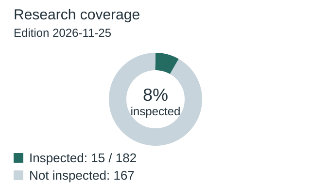
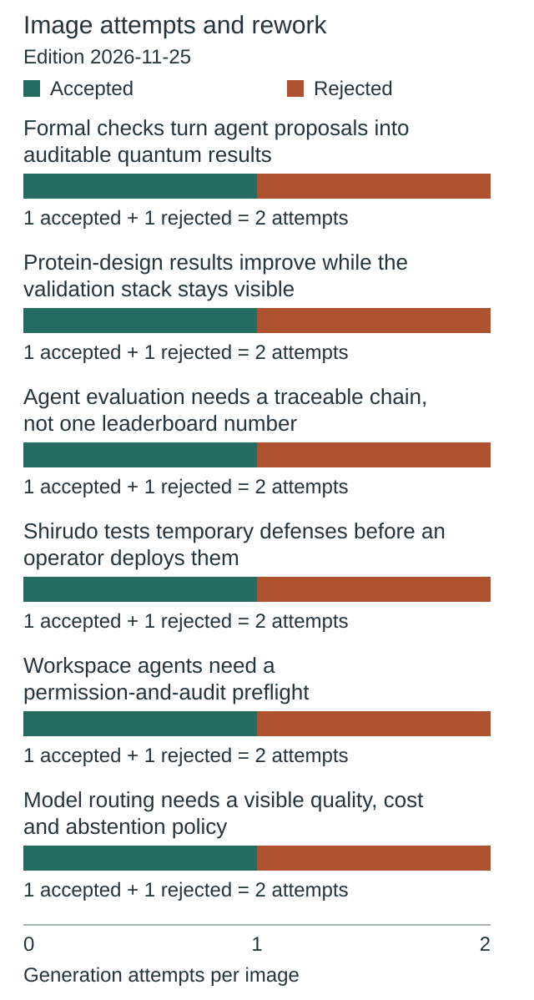
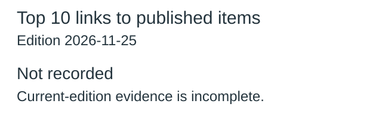
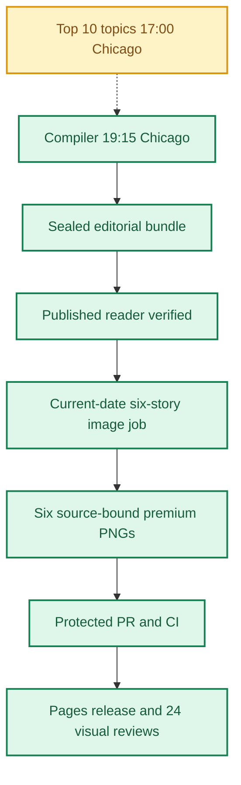
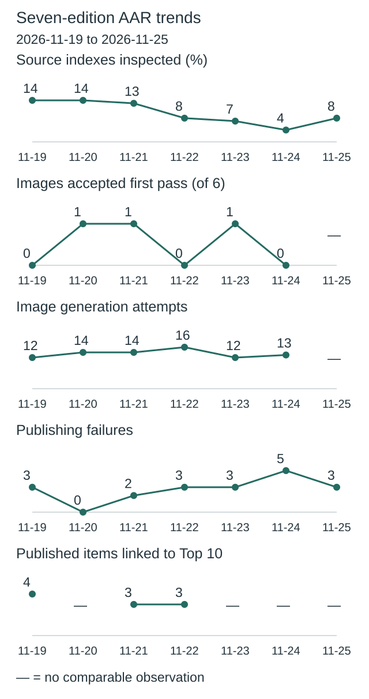
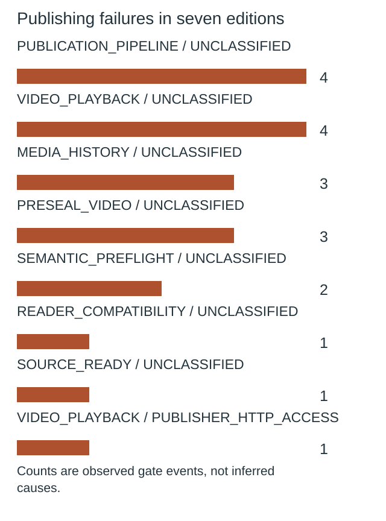
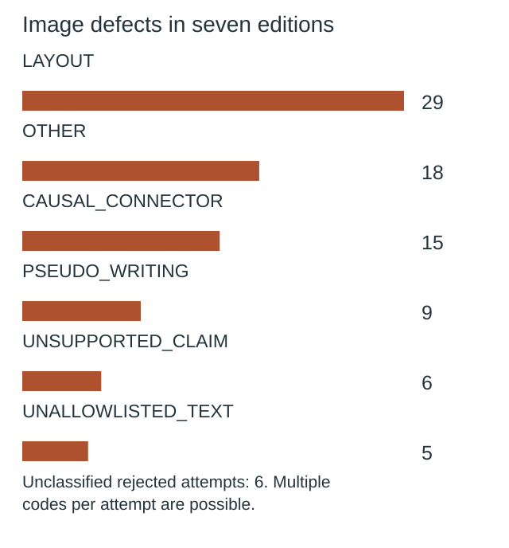

**🟩 RELEASE COMPLETE**
**TOP 10 PARTIAL** · **🟩 COMPILER VERIFIED** · **🟦 IMAGES 6/6 RELEASED** · **🟪 VISUAL QA 24/24 PASS**

# Daily AI Brief — Unified Production After-Action Report
**Edition:** November 25, 2026 · **Production evening:** 2026-11-24 · **Timezone:** America/Chicago
**Primary public reader:** [Open 2026-11-25 Brief](https://gttome.github.io/Daily-AI-Brief-Compiler/briefs/2026-11-25/) · **Repository:** [Daily-AI-Brief-Compiler](https://github.com/gttome/Daily-AI-Brief-Compiler)

> **IMPORTANT — VERIFIED PRODUCTION RESULT**
> **Executive release result: COMPLETE.** This is the single management-facing report covering Top 10 topic discovery, the editorial Compiler, published Brief and premium-image run. **Entire-system evidence: PARTIAL.** Top 10 report: **partial**; Compiler handoff: **INVALID**; guided searches: **INVALID**. Compiler public status: **VERIFIED**. Image release: **RELEASED_VERIFIED**. Direct 24-context visual quality: **24/24 PASS**. Autonomous completion: **UNPROVEN**. Missing evidence must not be promoted to a success claim.

**🕒 Production stage durations:** **Top 10 6m 18s** · **Compiler final seal window 7m 35s** · **Premium Images 29m 19s** (evidence-bounded elapsed times; the start/end events differ).

## Evidence reconciliation

Compiler final seal window: 7m 35s. Compiler state start to public verification: 45m 10s. Initial execution start not established; final seal window is not total runtime.
Image capability route preflight: RECORDED; scheduler origin remains UNPROVEN.
Image efficiency: 0/6 first-pass accepts; 12 total attempts. Approved prospective efficiency target: at least 4/6 first-pass and no more than 8 total attempts, strictly advisory, with unchanged quality floor.
Image review completed: 2026-11-25T03:54:31.176806Z; review-record commit: 2026-11-25T03:56:43.000Z; protected review merge: 2026-11-25T03:59:24.000Z.
Eligible source indexes: 182; editorial inspections reported: 15 (8.2%); inaccessible in editorial audit: 0; explicitly unreviewed IDs: 167; unclassified editorial IDs: 0. Automated index parsing is separate from editorial inspection and cannot substantiate exhaustive freshness claims.

Registered video sources: 37; attempted this edition: 37; unattempted: 0; enabled: 37; qualification-only: 0; sources yielding candidate URLs: 7. Status: REPORTED_ALL_ATTEMPTED. Attempt evidence is not automatic proof of source-content review or playback.

Eligible source partition **VALID**. Full original-item reads **15**. Bounded index searches **0**. Qualification-only sources recorded separately **0**.

### Video candidate discovery

| Discovery source | Eligibility | Candidate URLs |
|---|---|---:|
| Two Minute Papers — AI Research Explainers | Enabled | 1 |
| AI Engineer | Enabled | 2 |
| Hugging Face YouTube | Enabled | 1 |
| NVIDIA Developer YouTube | Enabled | 1 |
| IBM Technology YouTube | Enabled | 2 |
| OpenAI Academy On-Demand Workshops | Enabled | 1 |
| Anthropic on YouTube | Enabled | 1 |

### Protected preseal video outcomes

| Original publisher | Distinct programs submitted | Archive rejects | Playback passes | Playback unverified | Probes skipped |
|---|---:|---:|---:|---:|---:|
| mux.com | 1 | 0 | 4 | 0 | 0 |
| ted.com | 2 | 0 | 4 | 0 | 0 |
| vimeo.com | 1 | 0 | 4 | 0 | 0 |

Outcomes count observed checks across all saved requests. Programs can be submitted again after a different slot changes.


## Approved November 20 improvement evidence

Editorial runtime declarations: **DECLARED_RESTRICTED_EDITORIAL_RUNTIME**. Actual billing and scheduled origin remain unknown.

Video candidate evidence: **NOT_RECORDED**; substantive candidates Not recorded, non-news Not recorded, original publisher families Not recorded, selected non-news Not recorded. Targets 12 / 8 / 6 / 2 are advisory; unchanged duration, promotion, novelty and full-program playback checks still apply.

Source failure categories: PARSER_OR_OTHER 3, RESPONSE_SIZE_LIMIT 8, ACCESS_BLOCKED 6. Empty, blocked, oversized and unreviewed sources are distinct.

Original-paper cadence: one qualified paper within 3 editions when available. Current review timing NOT_RECORDED; postpublication review is not evidence of preselection reading.


IMG19 artistic changes retain their existing November 22 three-eligible-edition evaluation. Missing pixels, owner feedback and usage remain unknown; no retrospective source, query or artwork acceptance is invented.

## Daily AAR charts

These charts use this edition’s receipts. Missing data is not zero.

### Research coverage



**15 of 182 indexes inspected (8%).**

| Editorial inspection | Indexes |
|---|---:|
| Inspected | 15 |
| Not inspected | 167 |

Not inspected includes every index without a recorded editorial inspection; this is not proof of missed stories.

### Image attempts and rework



**12 attempts; 0 of 6 images accepted on their first attempt.**

Recorded ongoing from November 8 target: at least 3/6 first-pass accepts; no more than 2 attempts per image. This is an efficiency target, not a quality cutoff.

| Image | Accepted | Rejected | Total attempts |
|---|---:|---:|---:|
| Formal checks turn agent proposals into auditable quantum results | 1 | 1 | 2 |
| Protein-design results improve while the validation stack stays visible | 1 | 1 | 2 |
| Agent evaluation needs a traceable chain, not one leaderboard number | 1 | 1 | 2 |
| Shirudo tests temporary defenses before an operator deploys them | 1 | 1 | 2 |
| Workspace agents need a permission-and-audit preflight | 1 | 1 | 2 |
| Model routing needs a visible quality, cost and abstention policy | 1 | 1 | 2 |

Generation attempts measure rework, not runtime or cost. Quality and publication checks remain separate.

### Top 10 links to published items



**Not recorded:** current-edition evidence is missing or inconsistent.

No selection quota. Topic linkage does not establish better quality, popularity or causal improvement.

[Chart data](charts.json)

One edition at a time. Missing evidence is not zero. Trend claims require comparable recorded cycles.

## Performance dashboard

| Measure | Recorded result | Source / caveat |
|:--|:--:|:--|
| Entire-system evidence | **PARTIAL** | Full Top 10 list, bound Compiler input, all-format search receipts and existing release checks; separate from publication and autonomy |
| Top 10 report | **partial · 10 topics** | Same Chicago cycle report; provisional/partial coverage remains disclosed |
| Top 10 received by Compiler | **INVALID** | Exact report snapshot bytes; consumed commit separately corroborated: UNPROVEN |
| Top 10 guided article/video/podcast searches | **INVALID** | Actual source-search receipts and selected/rejected topic outcomes |
| Top 10 stage duration | **6m 18s** | Same-cycle run receipt only; no runtime or usage estimate |
| Editorial publication | **PASS** | State and public reader integrity receipt |
| **Unattended autonomy (separate from publication)** | **UNPROVEN** | Owner incident receipt takes precedence over unverified producer self-attestation |
| Recorded protected publishing gate failures | **3** | Actual same-edition GitHub failure sidecar only; earlier unrecorded failures remain unknown |
| Articles | **6** | Exactly 2 technical / 2 knowledge-worker / 2 agents required |
| Original scientific-paper-led articles | **Not recorded** | Rolling target: one qualified original paper in 3 editions; UNVERIFIED_RECEIPT. Preprints are not peer-reviewed by default |
| Verified original sources within preceding 24 hours | **0 / 6** | Original publisher dates only; other sources require a documented fallback rationale |
| Distinct selected article publishers | **6** | Six different primary organizations preferred |
| Videos over seven days old | **2** | Must be labeled evergreen, not a new development |
| Distinct selected video publishers | **2** | One channel is one publisher even across multiple videos |
| Cross-media topic diversity | **FOUR_DISTINCT_EVENTS_REVIEW_RECORDED** | Four video/podcast events and six pairwise original-source comparisons; editorial claims remain producer-attested |
| Video discovery source attempts | **37 / 37** | Attempt evidence across enabled and qualification-only leads; REPORTED_ALL_ATTEMPTED. Not a claim of full content review or player verification | 
| Duplicate active Watchlist display titles | **Not recorded** | Published canonical Watchlist only; historical evidence retained |
| Original-release video playback (historical) | **TWO_PUBLISHED_VIDEOS_PLAYBACK_PASS** | Later reader corrections may replace these originally verified videos; see incident register | 
| Postpublication reader incidents | **NOT_RECORDED** | Edition-specific owner reports and corrective PRs, not inferred absence | 
| Verified postpublication video corrections | **NOT_RECORDED** | Incident register tracks correction PR, actual playback evidence and reader preservation |
| Editorial index second-pass attempts | **0** | Bounded public GET retries only; never proof of original article reading |
| Editorial index reads recovered | **0** | Successful page fetch can still yield zero eligible dated items |
| Recorded scheduler capability route | **UNPROVEN** | Same-invocation route receipt only; GitHub is not scheduler authentication |
| Avoidable incomplete-staging CI failures | **Not independently audited** | Existing image-package push CI is disabled; exact-head protected PR CI remains required. A failure count requires actual workflow evidence |
| Media | **2 videos + 2 podcasts** | Sealed bundle |
| **Compiler final seal window** | **7m 35s (7.6 min)** | Final sealed-state timestamp → verified public reader; initial execution is separate |
| **Image processing stage duration** | **29m 19s** | First accepted PNG Git checkpoint → final 24/24 review; auditable stage elapsed time |
| Image scheduled-to-final-review window | **Not independently recorded** | Only with a saved one-cycle schedule anchor; does not attest exact generation start |
| Executor-observed generation-to-final-review | **33m 34s** | Only if the worker recorded a same-execution clock before its first native call; not independently verified provider runtime |
| Accepted premium PNGs | **6 / 6** | Exact package and public release hashes |
| Native image generation attempts | **12** | Image worker AAR; no estimation |
| Rejected candidates | **6** | Image worker AAR |
| Final worker checkpoint reconciliation | **PASS** | Oct25+ verifies exact generation count, per-story attempts, six accepted story/image/hash bindings and final release |
| Saved visual contexts | **24 / 24 PASS** | Dated/permanent desktop/mobile review |
| Public SHA-256 checks | **44** | Image release receipt |
| October 8 immutable history | **17 / 17** | Independent content-preservation checks |
| **Owner-reported weekly Work usage for this run** | **Not reported** | No per-cycle usage supplied |

> **EFFICIENCY NOTE**
> **Resource reporting policy:** No usage figure was supplied for this cycle, so none is assumed. Future runs show **Not reported** unless the owner supplies new cycle-specific usage metadata. No approval or extra step is required to generate the AAR.

## Production architecture and checkpoints



## Daily AI Topic Top 10 and Compiler handoff

**Research cycle:** 2026-11-24 · **Target Brief:** 2026-11-25 · **Scheduled start:** 17:00 America/Chicago

| Dimension | Recorded evidence |
|---|---|
| Run/report result | PARTIAL |
| Report status / topics | partial / 10 |
| Freshness | FRESH\_AT\_CONSUMPTION |
| Compiler handoff | INVALID |
| Search coverage | INVALID |
| Selection mapping verification | INVALID |
| Observed start / finish | 2026-11-24T23:02:52Z / 2026-11-24T23:09:10Z |
| Elapsed minutes | 6.3 |
| Usage percent | Not reported |
| Cost USD | Not reported |
| Independent scheduler autonomy | UNPROVEN |
| Compiler-recorded consumed commit | Not reported |
| Report SHA-256 | a41c6322bf47cb0d57219eb6f2047376f6d323db6568eedca97fd525c8798a78 |

| Discovery order | AI topic | Summary | Confidence | Evidence |
|---:|---|---|---|---|
| 1 | Claude Ship ties coding automation to approval policy | Anthropic separates PR review, fixes and policy-controlled approval. | medium | [Source](https://x.com/ClaudeDevs/status/2124959436640858475) · [Source](https://claude.com/resources/articles/introducing-claude-ship) |
| 2 | Riemann proof verification draws fresh explainers | France24’s new program follows Lean and Mathlib certification of Alpöge’s Claude-assisted proof. | medium | [Source](https://www.youtube.com/watch?v=fvN_vCRuBec) · [Source](https://www.youtube.com/watch?v=xjX3jESpZqs) · [Source](https://leanprover-community.github.io/blog/posts/riemann-hypothesis/) |
| 3 | GLM5.4 introduces a looped coding architecture | Z.ai describes reused layers for visual coding, with API and weight releases still forthcoming. | low | [Source](https://www.youtube.com/watch?v=UEgw4P7aWY4) · [Source](https://www.youtube.com/watch?v=7n3cZzR0tVE) · [Source](https://x.com/Zai_org/status/2124811995912286352) · [Source](https://z.ai/blog/glm-5.4) · [Source](https://news.ycombinator.com/item?id=50607775) |
| 4 | Anthropic IPO economics gets independent explainers | Fresh financial programs discuss the IPO, whose issuer separates public-offering proceeds from private placement. | medium | [Source](https://www.youtube.com/watch?v=Qt5F0D6E5f0) · [Source](https://www.anthropic.com/news/ipo-close) |
| 5 | Software factories need rules against accumulated slop | Dex Horthy’s new upload advocates planning and validation for maintainable generated code. | low | [Source](https://www.youtube.com/watch?v=-NFMsM2y0Vk) |
| 6 | Vibe versus agentic coding gets a focused explainer | IBM’s new program compares context, planning and validation across coding workflows. | low | [Source](https://www.youtube.com/watch?v=h4tHDFCPmQE) |
| 7 | A security interview distinguishes findings from verified fixes | OpenAI’s fresh researcher conversation revisits staged validation and human patch review. | medium | [Source](https://www.youtube.com/watch?v=MpsO8Ds8uyo) · [Source](https://openai.com/index/a-thousand-fewer-paths-to-root/) |
| 8 | DW documents creative workers losing assignments | DW’s fresh program follows individual workers facing AI substitution and disputed voice use. | low | [Source](https://www.youtube.com/watch?v=TWhr_M5u-FI) |
| 9 | Tripo demonstration tests a 3D character workflow | A fresh creator demo revisits a node-based tool for generating, rigging and exporting assets. | low | [Source](https://www.youtube.com/watch?v=zGi4XE02S4w) · [Source](https://www.tripo3d.ai/product-doc/agentic-canvas/agentic-canvas-guide) |
| 10 | Gemini teams search for formally checked quantum circuits | DeepMind describes Lean-checked algorithms with substantial remaining hardware limits. | medium | [Source](https://x.com/GoogleDeepMind/status/2124911073266413634) · [Source](https://deepmind.google/blog/finding-faster-quantum-algorithms-with-agents-and-formal-verification/) · [Source](https://arxiv.org/abs/2611.09822) |

**Sample scope:** {"metadata\_screened\_videos":28,"distinct\_screened\_channels":18,"unique\_videos":28,"full\_video\_reviews":0,"full\_program\_reviews":0,"complete\_transcript\_reviews":0,"partial\_transcript\_reviews":0,"direct\_youtube\_counter\_verifications":0,"full\_original\_article\_reads":3,"full\_original\_article\_read\_identities":\["Lean/Mathlib statement37lines","Claude Ship substantive article34–95","DeepMind quantum article123–147"\],"complete\_original\_guides\_read":1,"guide\_identity":"Tripo body98–252","complete\_original\_paper\_reviews":0,"paper\_abstract\_version\_history\_reviews":1,"original\_watch\_attempts":30,"unique\_watch\_programs":28,"original\_watch\_outcomes\_unique":{"throttled":25,"title\_shell":3},"additional\_repeat\_watch\_attempts":1,"comparable\_video\_observations":5,"screened\_source\_items":40,"retained\_source\_items":22,"screened\_and\_retained\_by\_category":{"video":{"screened":28,"retained":10},"public\_discussion\_thread":{"screened":4,"retained":4},"original\_release\_document":{"screened":7,"retained":7},"original\_paper":{"screened":1,"retained":1}},"trackers\_separately\_counted":3,"freshness\_counts":{"within\_24h\_timestamped":1,"additional\_within\_72h\_timestamped":8,"additional\_within\_7d\_timestamped":1,"date\_only":18,"older":0},"freshness\_reference\_at":"2026-11-24T23:07:34Z","notes":"Ledger counts explicit retained/evaluated items only, not every search hit.28metadata records do not meet40–80full-video target. AI Roundup remainsNov23, with unknown counter clocks; its numbers not refreshed or included as fresh observations."}. **Ranking basis:** {"attention":"YouTube program-specific reach and creator breadth lead discovery; timed social snapshots and direct community points supplement. No overlapping audiences summed or composite score invented.","uncertainty":"WITL video measurement07:02Eastern/social07:01Eastern. AUA counters unavailable; original routes throttle. Creator breadth does not establish independence of underlying claims. Positions are search priorities."}.

| Search format | Receipt rows | Attempts recorded | Explicitly not attempted |
|---|---:|---:|---:|
| article | 0 | 0 | 0 |
| video | 0 | 0 | 0 |
| podcast | 0 | 0 | 0 |

**Selected Brief items linked to trends:**

No validated selection-to-topic mapping was recorded.

**Raw, unverified Top 10 receipt observations:** 30 search rows across 30 topic/format pairs; 2 claimed mapping rows (0 with noncanonical fields). Noncanonical outcomes: none. These counts are NOT validated search attempts or verified selections.

**Gaps and limitations:**

- Compiler trend input is not a fresh, date-correct, exact-report snapshot bound to independently collected bytes.
- Claimed trend-to-selection mappings are not verified against the same-edition selected bundle.
- Per-topic article/video/podcast search coverage is incomplete, invalid or bound to a different input.
- The report labels its research partial.
- Partial research:28metadata screens across18channels; zero full program, complete transcript or direct YouTube counter checks. No claim40–80full-video target met.
- Unavailable metrics, disclosures, counter clocks and dates remain null; no inferred sponsorship, current velocity or global rank.
- Several single-publisher topics and inaccessible originals remain low-confidence leads; qualitative bands disclose fragility.
- Thirty query terms are inputs only; Compiler consumption, actual searches, final mappings, publication and imagesPENDING.
- No new task or schedule, paidAPI/browser, production/code/daily/\*\*/historical report/image mutation. November10pilot inactive.
- The exact Compiler-consumed commit has not been independently corroborated.

**Recorded run issues:**

- {"issue":"25of28unique watch routes throttled;3title shells.","effect":"Zero full program or direct YouTube counter reviews.","correction":"Bounded original documentation and one complete guide; partial scope retained."}
- {"issue":"Dex original page,manifesto and mirror; IBM article and DW original unavailable. GLM direct page empty.","effect":"Several low-confidence single-publisher leads and no complete transcript.","correction":"Kept metadata separate and used original indexed GLM material without pretending direct access."}
- {"issue":"AI Roundup still datedNovember23; search-extract counters differ from timed tracker.","effect":"Cannot treat either as a fresh direct measurement or compare mismatched sources.","correction":"Did not renew old counters. Growth only5same-source video pairs; discrepancies preserved separately."}
- {"issue":"Local preparation used unavailable structuredClone helper and stopped before any remote write.","effect":"No repository mutation from failed preparation.","correction":"Rebuilt with JSON serialization; full pinned validation and immutable byte readback passed."}

**Recorded improvements:**

- {"change":"Separate fresh program dates from older studies and exact preprint version dates.","reason":"New demonstrations can make old research look like a new finding.","expected\_effect":"More accurate freshness and usable expert queries; no final selection benefit asserted.","status":"IMPLEMENTED\_PRODUCER\_METHOD; OUTCOMES\_UNPROVEN"}
- {"change":"Flag exact11:57original researcher interview early with unresolved full review/playback.","reason":"Latest earlier handoff/search evidenceINVALID; source input and downstream claims must stay independently verified.","expected\_effect":"Concrete media lead without inventing30consumer searches or impact.","status":"IMPLEMENTED\_PRODUCER\_METHOD; OUTCOMES\_UNPROVEN"}

### Daily improvement and effect on the Brief

**Fixed baseline:** nov03-2026-v1 / INPUT\_FROZEN. **Outcome baseline:** FROZEN\_AFTER\_VERIFIED\_PUBLICATION. **Prior cycle:** 2026-11-23.

| Input measure | Current | November 3 baseline | Change from baseline | Change from prior cycle |
|---|---:|---:|---:|---:|
| topic count | 10 | 10 | 0 | 0 |
| validation resource count | Not reported | 14 | Not reported | Not reported |
| additional video metadata records | Not reported | 63 | Not reported | Not reported |
| additional video channels | Not reported | 21 | Not reported | Not reported |
| total video observations | Not reported | 79 | Not reported | Not reported |
| unique videos | Not reported | 71 | Not reported | Not reported |
| full video reviews | Not reported | 0 | Not reported | Not reported |
| direct youtube counter verifications | Not reported | 0 | Not reported | Not reported |
| broader evidence band topics | 2 | 3 | -1 | -3 |
| limited evidence band topics | 8 | 7 | 1 | 3 |

**Observed downstream measurements:** PENDING\_OR\_INCOMPLETE.

| Outcome measure | Current | Change from frozen outcome | Change from prior cycle |
|---|---:|---:|---:|
| expected topic format pairs | 30 | 0 | Not reported |
| attempted topic format pairs | Not reported | Not reported | Not reported |
| explicitly unattempted pairs | Not reported | Not reported | Not reported |
| discovered candidate count | Not reported | Not reported | Not reported |
| searched source host count | Not reported | Not reported | Not reported |
| selected article count | Not reported | Not reported | Not reported |
| selected video count | Not reported | Not reported | Not reported |
| selected podcast count | Not reported | Not reported | Not reported |

**Source changes:** {"added":\[\],"removed":\[\]}.

**Candidate review depth:** NOT\_RECORDED.

| Review measure | Current | Change from prior comparable cycle |
|---|---:|---:|
| reviewed candidate count | Not reported | Not reported |
| qualified candidate count | Not reported | Not reported |
| rejected candidate count | Not reported | Not reported |
| metadata only count | Not reported | Not reported |
| full video reviews | Not reported | Not reported |
| transcript reviews | Not reported | Not reported |

The frozen November 3 baseline has no candidate-level review ledger; no retrospective value is invented. Recorded reviews do not independently establish content quality, audience interest or causal benefit.

**Method/resource review:** {"baseline\_id":"nov03-2026-v1","previous\_report\_date":"2026-11-23","method\_version":"2026-11-03.2-event-review","changes":\[{"change":"Separate fresh program dates from older studies and exact preprint version dates.","reason":"New demonstrations can make old research look like a new finding.","expected\_effect":"More accurate freshness and usable expert queries; no final selection benefit asserted."},{"change":"Flag exact11:57original researcher interview early with unresolved full review/playback.","reason":"Latest earlier handoff/search evidenceINVALID; source input and downstream claims must stay independently verified.","expected\_effect":"Concrete media lead without inventing30consumer searches or impact."}\],"resource\_candidates":\[{"url":"https://arxiv.org/abs/2611.09822","role":"claim","decision":"accepted","access":"direct","review\_scope":"Original abstract/version history only","independence":"Same DeepMind paper authors; not independent attention.","reason":"DistinguishesNovember6preprint/November16revision fromNovember23announcement.","contribution":"Date accuracy and PREPRINT label."},{"url":"https://www.usetranscribe.io/yt/-NFMsM2y0Vk/software-factory","role":"claim","decision":"deferred","access":"unavailable","review\_scope":"Indexed partial transcript extract only","independence":"Third-party mirror, not independent event confirmation.","reason":"Direct retrieval unavailable; zero full transcript count retained.","contribution":"No qualification inferred."}\],"observed\_effects":{"feedback":{"status":{"publication":"VERIFIED","images":"RELEASED\_AND\_24\_CONTEXTS\_VERIFIED","top10":"INVALID","system":"PARTIAL","autonomy":"UNPROVEN","runtime\_policy":"DECLARED\_RESTRICTED\_EDITORIAL\_RUNTIME","usage":"UNKNOWN"},"top10":{"valid":true,"handoff":"INVALID","search":{"article":{"recorded":10,"attempted":10,"not\_attempted":0},"video":{"recorded":10,"attempted":10,"not\_attempted":0},"podcast":{"recorded":10,"attempted":10,"not\_attempted":0}},"mapping\_status":"INVALID","mappings":\[\]},"actions":{"schema\_version":"daily-aar-action-review-v1","edition\_date":"2026-11-24","mode":"DAILY\_EVIDENCE\_LED\_TRIAGE","next\_cumulative\_review":"2026-11-24","cumulative\_review\_due\_today":true,"finding\_count":4,"open\_production\_blockers":0,"findings":\[{"id":"TOP10\_SEARCH\_EVIDENCE\_INVALID","priority":"P1","owner":"Compiler","observation":"This edition has invalid Top 10 search-coverage receipts.","action":"Verify event-to-format searches and actual selected mappings in the next unlocked edition; do not rewrite a sealed historical bundle.","timing":"NEXT\_GENUINE\_CYCLE","kind":"EVIDENCE\_GAP"},{"id":"PROTECTED\_GATE\_FAILURES","priority":"P1","owner":"Compiler / Recovery","observation":"5 failed protected publication gates were recorded (5 unclassified causes).","action":"Read original failed job logs, record real causes and move the relevant existing validation before the next readiness signal; do not replay the released edition.","timing":"NEXT\_GENUINE\_CYCLE","kind":"RECURRENCE\_PREVENTION"},{"id":"PREMIUM\_IMAGE\_REWORK","priority":"P1","owner":"Images","observation":"7 rejected image candidates preceded the verified six-image release.","action":"Inspect saved rejection evidence and apply source-specific geometry, causal-arrow and label corrections before the next native generation.","timing":"NEXT\_GENUINE\_CYCLE","kind":"EFFICIENCY\_LESSON"},{"id":"SCHEDULER\_ORIGIN\_UNPROVEN","priority":"P2","owner":"Compiler / Recovery","observation":"Publication success does not independently attest the originating scheduler.","action":"Capture real first-party scheduler and execution evidence if available; do not convert unknown provenance into a failure or a success.","timing":"NEXT\_GENUINE\_CYCLE","kind":"EVIDENCE\_GAP"}\],"limitations":\["This report records findings and next actions; it does not execute corrections.","Existing owners must fix safe same-cycle faults immediately, without waiting for the cumulative review date.","A released edition remains immutable; lessons apply prospectively to the next genuine cycle.","Missing observations are not zero; no causality, autonomous recovery or effectiveness is inferred."\]},"metrics":{"coverage\_percent":{"recorded\_editions":7,"median":13},"first\_pass\_accepted":{"recorded\_editions":7,"median":1},"image\_attempts":{"recorded\_editions":7,"median":13},"top10\_linked\_items":{"recorded\_editions":4,"median":3},"publication\_failures":{"recorded\_editions":7,"median":3}},"charts":{"schema\_version":"daily-ai-brief-aar-charts-v1","edition\_date":"2026-11-24","charts":\[{"id":"research-coverage","title":"Research coverage","description":"Editorial source-index inspection; automated fetches are excluded.","status":"OBSERVED","rows":\[{"label":"Inspected","value":8},{"label":"Not inspected","value":174}\],"total":182,"inspected\_percent":4,"note":"Not inspected includes every index without a recorded editorial inspection; this is not proof of missed stories."},{"id":"image-rework","title":"Image attempts and rework","description":"Accepted and rejected candidates for each final image.","status":"OBSERVED","rows":\[{"id":"nov24-t1-perplexity-limits","label":"Prediction loss could become a shared safety pace signal","accepted":1,"rejected":1},{"id":"nov24-t2-glm54-loop","label":"GLM‑5.4 trades more repeated depth for the same parameters","accepted":1,"rejected":1},{"id":"nov24-a1-anthropic-ipo","label":"Anthropic closes a $119.5 billion combined capital event","accepted":1,"rejected":1},{"id":"nov24-a2-creative-labor","label":"Creative workers describe bargaining power moving before jobs vanish","accepted":1,"rejected":1},{"id":"nov24-g1-superhuman-go-approvals","label":"Superhuman Go puts approval and attribution around proactive work","accepted":1,"rejected":2},{"id":"nov24-g2-software-atelier","label":"Insert a human summary checkpoint before an agent’s final verification","accepted":1,"rejected":1}\],"total\_attempts":13,"first\_pass\_accepted":0,"target":{"first\_pass":3,"max\_attempts":2,"window":"ongoing from November 8"},"note":"Generation attempts measure rework, not runtime or cost. Quality and publication checks remain separate."},{"id":"top10-selection","title":"Top 10 links to published items","description":"Unique published items by format, not the number of topic mappings.","status":"NOT\_RECORDED","rows":null,"note":"No selection quota. Topic linkage does not establish better quality, popularity or causal improvement."}\],"interpretation":"One edition at a time. Missing evidence is not zero. Trend claims require comparable recorded cycles."}},"charted\_aar\_url":"https://github.com/gttome/Daily-AI-Brief-Compiler/blob/9567452c3a2bf11c39fc1f4a6527e3815b38a877/daily/2026-11-23/combined.md","chart\_data\_url":"https://github.com/gttome/Daily-AI-Brief-Compiler/blob/9567452c3a2bf11c39fc1f4a6527e3815b38a877/daily/2026-11-23/charts.json","improvement\_metrics\_url":"https://github.com/gttome/Daily-AI-Brief-Compiler/blob/9567452c3a2bf11c39fc1f4a6527e3815b38a877/daily/2026-11-23/improvement-metrics.json","downstream\_impact\_table\_url":"https://github.com/gttome/Daily-AI-Brief-Compiler/blob/9567452c3a2bf11c39fc1f4a6527e3815b38a877/daily/2026-11-23/combined.md#daily-ai-topic-top-10-and-compiler-handoff","current\_downstream":"PENDING","interpretation":"Prior publication/images verified separately; Top10handoff and selection mappingsINVALID. Raw10/10format counts do not override invalid binding. Current impact unknown."},"change\_evaluations":\[{"change\_id":"NOV15-02","result":"not\_met","reason":"Latest earlier AAR reports valid producer JSON butINVALIDhandoff and mappings. Current exact source receipt will not certify consumer binding or searches.","reviewed\_edition":"2026-11-25","decision":"keep","evidence\_refs":\["https://github.com/gttome/Daily-AI-Brief-Compiler/blob/9567452c3a2bf11c39fc1f4a6527e3815b38a877/daily/2026-11-23/combined.json","https://arxiv.org/abs/2611.09822"\]},{"change\_id":"NOV20-01","result":"not\_met","reason":"Prior raw thirty-slot counts exist but handoff and selected mapping statusesINVALID; no valid end-to-end result can be claimed.","reviewed\_edition":"2026-11-25","decision":"keep","evidence\_refs":\["https://github.com/gttome/Daily-AI-Brief-Compiler/blob/9567452c3a2bf11c39fc1f4a6527e3815b38a877/daily/2026-11-23/combined.json","https://arxiv.org/abs/2611.09822"\]},{"change\_id":"NOV20-04","result":"not\_met","reason":"Current28metadata screens, zero complete programs/transcripts and bounded original documents do not meet substantive full-program targets.","reviewed\_edition":"2026-11-25","decision":"keep","evidence\_refs":\["https://github.com/gttome/Daily-AI-Brief-Compiler/blob/9567452c3a2bf11c39fc1f4a6527e3815b38a877/daily/2026-11-23/combined.json","https://arxiv.org/abs/2611.09822"\]},{"change\_id":"NOV20-05","result":"inconclusive","reason":"Practical explainers, demonstration and original interview supplied, but no complete-program review or final current selection exists.","reviewed\_edition":"2026-11-25","decision":"keep","evidence\_refs":\["https://github.com/gttome/Daily-AI-Brief-Compiler/blob/9567452c3a2bf11c39fc1f4a6527e3815b38a877/daily/2026-11-23/combined.json","https://arxiv.org/abs/2611.09822"\]},{"change\_id":"NOV20-09","result":"inconclusive","reason":"Original preprint abstract/version history reviewed, not full methods/results; no peer-review evidence or current rolling selected-paper receipt.","reviewed\_edition":"2026-11-25","decision":"keep","evidence\_refs":\["https://github.com/gttome/Daily-AI-Brief-Compiler/blob/9567452c3a2bf11c39fc1f4a6527e3815b38a877/daily/2026-11-23/combined.json","https://arxiv.org/abs/2611.09822"\]},{"change\_id":"NOV20-10","result":"met","reason":"Producer researchpartial, durable source verification, pending downstream production and unknown billing/scheduler origin reported separately.","reviewed\_edition":"2026-11-25","decision":"keep","evidence\_refs":\["https://github.com/gttome/Daily-AI-Brief-Compiler/blob/9567452c3a2bf11c39fc1f4a6527e3815b38a877/daily/2026-11-23/combined.json","https://arxiv.org/abs/2611.09822"\]}\],"next\_improvement":"Compiler independently bind exact report, record30genuine canonical topic-format searches and candidate-bound selections; qualify rank7early and seek independent fresh non-news alternatives.","limitations":\["Implementation is not efficacy. Protected improvement register unchanged; evaluations use existing role receipt."\]}.

**Current reconciled conclusion:** PENDING\_OR\_INCOMPLETE; outcome baseline FROZEN\_AFTER\_VERIFIED\_PUBLICATION; candidate review ledger NOT\_RECORDED.

**Historical producer observations (not current status):** The following snapshot preserves what the producer reported at the time. Its pending statuses and candidate-quality claims are not independently reconciled conclusions. Use the current tables above for publication-bound measurements; an absent candidate review ledger remains unknown.

<details><summary>Original producer effects and gaps — historical snapshot</summary>

```json
null
```

</details>

**Next improvement:** Compiler independently bind exact report, record30genuine canonical topic-format searches and candidate-bound selections; qualify rank7early and seek independent fresh non-news alternatives.

Counts show coverage and observed association, not audience popularity, source independence, candidate quality or causal uplift. Compare source/method changes before interpreting deltas. Unknown values are not zero. Publication, reader corrections, runtime and image outcomes retain their separate AAR evidence.

Report, source-readback and search receipts are separate observations. Snapshot binding verifies the collected report bytes; the consumed commit is independently corroborated only when the separately fetched source bytes match. These records do not independently attest scheduler identity or source truth. Top 10 reporting does not change Brief/image release status.


## Track 1 — Compiler

**State:** `SHADOW_VERIFIED` · **Bundle:** `BUNDLE_READY` · **Compiler final seal window:** 7m 35s (7.6 min).

| Publication gate | Result |
|---|:---:|
| Canonical reader build | ✅ |
| Reader parity | ✅ |
| Public verification of dated edition | ✅ |
| Previous editions preserved | ✅ |
| Permanent story routes and feeds | ✅ |

**Selected coverage:**

| Lane | Story |
|---|---|
| Technical AI Engineering | Formal checks turn agent proposals into auditable quantum results |
| Technical AI Engineering | Protein-design results improve while the validation stack stays visible |
| Applied Generative AI for Knowledge Workers | Agent evaluation needs a traceable chain, not one leaderboard number |
| Applied Generative AI for Knowledge Workers | Shirudo tests temporary defenses before an operator deploys them |
| Agents for Everyone | Workspace agents need a permission-and-audit preflight |
| Agents for Everyone | Model routing needs a visible quality, cost and abstention policy |

### Scientific paper opportunity and publication evidence

**Current edition:** UNVERIFIED_RECEIPT; **paper-led stories:** Not recorded. Editorial target: at least one genuinely qualified original-paper-based story in seven editions, with methods, limitations, and an explicit preprint/peer-review distinction. No stale or weak paper is selected solely to fill a quota.


## Track 2 — Premium images

**Public status:** `RELEASED_VERIFIED` · **Saved images:** 6/6 · **Actual generation attempts:** 12 · **Rejected candidates:** 6.

### Image production duration — Git-verified milestones

**Auditable image stage duration:** **29m 19s** (first accepted binary saved in Git → first persisted 24-context quality-review record). **First asset to public image release:** **23m 10s**.
**Scheduled-to-final-review window:** **Not independently recorded**. This is a scheduled-clock comparison only when a separately recorded exact-date schedule exists; it is **not** measured native image-generation runtime.

| Production milestone | Chicago local time | Evidence |
|---|---|---|
| Scheduled image start (if exact-date record exists) | Not independently recorded | Time planned, not actual execution start |
| First executor-observed start | 9:16:14 PM | Worker self-attestation, not a first-party scheduler event |
| First native generation observation | 9:23:09 PM | Worker clock recorded immediately before first native call, not model-provider telemetry |
| First accepted PNG bytes saved to Git | 9:27:24 PM | Immutable binary-stage commit |
| Six-image package / reviews committed | 9:44:41 PM | Exact-head PR source commit |
| Protected package merged | 9:47:59 PM | Merge SHA and required CI |
| Public images verified | 9:50:33 PM | Image-release receipt |
| 24/24 review record committed | 9:56:43 PM | Immutable first review-approval commit |

> **Duration interpretation:** The audited stage excludes unobservable pre-checkpoint creative work. The scheduled-start window includes it but must not be interpreted as precise active processing time. Missing timestamps appear as **Not independently recorded**, never an estimate.


| Source-bound image | Attempts | File size | Public page |
|---|---:|---:|---|
| Formal checks turn agent proposals into auditable quantum results | 2 | 1.02 MiB | [View original](https://gttome.github.io/Daily-AI-Brief-Compiler/briefs/images/2026-11-25/dab-edition-2026-11-25-m01.png) |
| Protein-design results improve while the validation stack stays visible | 2 | 0.82 MiB | [View original](https://gttome.github.io/Daily-AI-Brief-Compiler/briefs/images/2026-11-25/dab-edition-2026-11-25-m02.png) |
| Agent evaluation needs a traceable chain, not one leaderboard number | 2 | 0.81 MiB | [View original](https://gttome.github.io/Daily-AI-Brief-Compiler/briefs/images/2026-11-25/dab-edition-2026-11-25-m10.png) |
| Shirudo tests temporary defenses before an operator deploys them | 2 | 1.16 MiB | [View original](https://gttome.github.io/Daily-AI-Brief-Compiler/briefs/images/2026-11-25/dab-edition-2026-11-25-m11.png) |
| Workspace agents need a permission-and-audit preflight | 2 | 0.63 MiB | [View original](https://gttome.github.io/Daily-AI-Brief-Compiler/briefs/images/2026-11-25/dab-edition-2026-11-25-m12.png) |
| Model routing needs a visible quality, cost and abstention policy | 2 | 0.63 MiB | [View original](https://gttome.github.io/Daily-AI-Brief-Compiler/briefs/images/2026-11-25/dab-edition-2026-11-25-m14.png) |

**Immutable-release and visual gates:**

| Release gate | Result |
|---|:---:|
| Protected public image receipt | ✅ |
| Accepted-image Git hash bindings | ✅ |
| Six live PNGs | 6/6 |
| Dated/permanent story placements | 12/12 recorded in release evidence |
| Desktop/mobile visual inspection | 24/24 PASS |
| Historical Oct 8 integrity | 17/17 |

### Published premium illustrations

<table>
<tr><td width="50%"><a href="https://gttome.github.io/Daily-AI-Brief-Compiler/briefs/images/2026-11-25/dab-edition-2026-11-25-m01.png"></a><br/><b>Formal checks turn agent proposals into auditable quantum results</b></td><td width="50%"><a href="https://gttome.github.io/Daily-AI-Brief-Compiler/briefs/images/2026-11-25/dab-edition-2026-11-25-m02.png"></a><br/><b>Protein-design results improve while the validation stack stays visible</b></td></tr>
<tr><td width="50%"><a href="https://gttome.github.io/Daily-AI-Brief-Compiler/briefs/images/2026-11-25/dab-edition-2026-11-25-m10.png"></a><br/><b>Agent evaluation needs a traceable chain, not one leaderboard number</b></td><td width="50%"><a href="https://gttome.github.io/Daily-AI-Brief-Compiler/briefs/images/2026-11-25/dab-edition-2026-11-25-m11.png"></a><br/><b>Shirudo tests temporary defenses before an operator deploys them</b></td></tr>
<tr><td width="50%"><a href="https://gttome.github.io/Daily-AI-Brief-Compiler/briefs/images/2026-11-25/dab-edition-2026-11-25-m12.png"></a><br/><b>Workspace agents need a permission-and-audit preflight</b></td><td width="50%"><a href="https://gttome.github.io/Daily-AI-Brief-Compiler/briefs/images/2026-11-25/dab-edition-2026-11-25-m14.png"></a><br/><b>Model routing needs a visible quality, cost and abstention policy</b></td></tr>
</table>

## Incidents, corrections and learning

### Postpublication reader incidents (updated when new evidence is merged)

No current-edition postpublication incident register was available; this is **NOT_RECORDED**, not a certification of zero incidents.


**Editor recovery classification:** UNPROVEN. **Owner intervention:** Unproven either way. **Protected same-edition failures recorded:** 3. 
**Latest failed protected stage:** SOURCE_READY; [Action evidence](https://github.com/gttome/Daily-AI-Brief-Compiler/actions/runs/45531493606). Exact stage durations are available only where real source timestamps exist.

| Stage | Verified issue | Corrective action |
|---|---|---|
| Native image generation | Saved export has foreground and scenery within 40px of edges; fake paragraph lines on claim/proof pages; added Candidate circuit layer, Claim layer and Formal proof layer labels; unsupported mountain scenery, fusion machine and arithmetic keypad. Preserve two tributaries, proof boundary and real outcome text; remove failed regions and inset complete artwork. | Targeted source-bound native edit was frozen and persisted before correction; complete 1200x630 and 320px saved outputs were inspected before acceptance. |
| Native image generation | The saved protein specimen, top headings and bottom endpoint caveat breach the mandatory 40px foreground margin. Inset the entire illustration and text by approximately 12 percent. Preserve the target contact, specialist selection, attached-versus-detached assay states and exact tested/positive counts. | Targeted source-bound native edit was frozen and persisted before correction; complete 1200x630 and 320px saved outputs were inspected before acceptance. |
| Native image generation | The chain foreground and lower caveat extend inside the mandatory 40px margins, and the central added word Ratio with equals signs is not allowlisted. Remove that middle disc and both equals signs. Keep the two informative test slips Fit required and Ratio alone fails; do not replace them with a blank information slot. Inset the complete folded chain and all labels approximately 12 percent while preserving both intended arrows. | Targeted source-bound native edit was frozen and persisted before correction; complete 1200x630 and 320px saved outputs were inspected before acceptance. |
| Native image generation | Actual saved-pixel foreground bounding box ends at y597, below the mandatory y590 limit. Move only the detached lower caveat upward by 35 pixels, leaving its entire outline above y565, and keep the runtime assembly intact. Enlarge the three priority texts Exploit blocked, Operator approval and Signed defense to clearly meet 36px effective type at 1200x630, using two lines where needed. Preserve the blocked exploit, open legitimate path, single approval arrow and nondirectional retirement and rollback guides. | Targeted source-bound native edit was frozen and persisted before correction; complete 1200x630 and 320px saved outputs were inspected before acceptance. |
| Native image generation | Saved request and audit documents contain simulated paragraph strokes. Remove every faux writing stroke from both content surfaces. Place the useful labels directly on their otherwise smooth faces, without simulated ruled lines. Preserve the visible confirmation boundary, two intended arrows, action record and named admin owner. | Targeted source-bound native edit was frozen and persisted before correction; complete 1200x630 and 320px saved outputs were inspected before acceptance. |
| Native image generation | The draft repeats Profiled cost four times despite the once-only allowlist. Retain a single Profiled cost label with a nondirectional brace applying to all candidate specimens; remove the other three duplicate labels, without anonymous value boxes. Make the two alternate routing conditions explicit: Meets threshold on the eligible cost path, and None qualifies on the abstention path. Preserve the no-model-call distinction, held-out test and detached workload/version caveat. No new arrowheads. | Targeted source-bound native edit was frozen and persisted before correction; complete 1200x630 and 320px saved outputs were inspected before acceptance. |
| GitHub binary transport | Local git push lacks credentials; GitHub contents API returns empty base64 for accepted PNGs larger than one MiB. | Connected blob/tree/commit/expected-head ref writes preserved exact assets; immutable remote Git object readback independently compared the complete PNG bytes, SHA256, blob and length. |
| Pages artifact discovery | Attempt 1 uploaded image-pages-45542444360-1, artifact 14989857659, at 03:48:48Z; deploy-pages immediately reported zero matching artifacts at 03:48:49Z. | Verified the artifact now exists through the connected GitHub artifact listing, then requested the existing failed image-only job retry. Attempt-scoped artifact names preserve both attempts; accepted PNGs unchanged. |
| Final public status deployment | Attempt 2 published six images, verified live hashes and captured all 24 contexts, then the separate metadata deploy could not see image-final-metadata-45542444360-2 immediately after upload at 03:51:44Z. | Reuse all 24 reviewed captures and exact accepted PNGs through the existing metadata-only verification/sync lane; bind the original failed job, protected review hash, manifest hash and exact released-history head. No placeholder replacement or native regeneration. |
| Metadata artifact visibility check | Sync run 45543688440 saw the new artifact through the full-page probe at 04:00:16Z, but deploy-pages returned zero artifacts at 04:00:17Z. A single positive probe was insufficient. | Strengthen the existing wait in both image release deployments and metadata sync to require repeated unique-artifact agreement on default and full listings plus a bounded settling interval. Resume only the exact November25 metadata and reuse every accepted PNG and all24 reviewed captures; future effectiveness remains unproven. |

> **OPERATIONAL NOTE**
> This report distinguishes a published and verified production outcome from scheduler metadata exposed to another conversation. Lack of a live host heartbeat in a separate normal chat is not a Compiler production failure.

## Usage and cost stewardship

| Item | Per-cycle value |
|---|---|
| **Weekly Work usage reported by owner** | **Not reported** |
| Internal weekly usage reference | Target under 5% |
| Genuine image-generation attempts | 12 |
| Accepted diagrams | 6 |
| Regeneration after acceptance | 0 |
| Top 10 reported usage | Not reported |
| Top 10 reported cost | Not reported |
| Account-level billing telemetry | Not independently accessible to deterministic GitHub reporting |

**Future reporting rule:** For cycles without an optional owner-usage record, publish the complete AAR with `Not reported`; do not reuse prior percentages, guess remaining weekly credits or delay tomorrow's production.

## Next-edition operating handoff

| Control | Recurring contract |
|---|---|
| AI Topic Top 10 | Sole report task · 17:00 America/Chicago · saved dated list guides same-evening research |
| Primary Compiler | Sole existing task · 19:15 America/Chicago |
| Premium image production | Sole existing task · standard 21:15 America/Chicago |
| Exact image job selection | Newly published next-date `PUBLISHED_PENDING` only |
| AAR | Combined report generated automatically from new GitHub receipts |
| Optional Work usage | Owner-supplied per cycle, otherwise `Not reported` |

> **SCHEDULE RESTORATION NOTE**
> A temporary scheduling exception must be explicitly restored before claiming standard-time readiness. This deterministic document generator reads existing state only; it does not modify production schedules.

## Evidence register

| Evidence | Link |
|---|---|
| Compiler state | [Open receipt](https://github.com/gttome/Daily-AI-Brief-Compiler/blob/shadow/2026-11-25/shadow-runs/2026-11-25/compiler-state.json) |
| Compiler compile receipt | [Open receipt](https://github.com/gttome/Daily-AI-Brief-Compiler/blob/shadow/2026-11-25/shadow-runs/2026-11-25/compiler/compile-receipt.json) |
| Compiler public integrity | [Open receipt](https://github.com/gttome/Daily-AI-Brief-Compiler/blob/shadow/2026-11-25/shadow-runs/2026-11-25/compiler/postpublish-integrity.json) |
| Image release receipt | [Open receipt](https://github.com/gttome/Daily-AI-Brief-Compiler/blob/shadow-pages-history/site/image-jobs/2026-11-25/release.json) |
| Image review | [Open receipt](https://github.com/gttome/Daily-AI-Brief-Compiler/blob/main/external-image-packages/2026-11-25/reviews/live/semantic-pixel-review.json) |
| Original image AAR | [Open receipt](https://github.com/gttome/Daily-AI-Brief-Compiler/blob/main/external-image-packages/2026-11-25/reviews/after-action.md) |
| Observed editorial index retries | [Open receipt](https://github.com/gttome/Daily-AI-Brief-Compiler/blob/shadow/2026-11-25/shadow-runs/2026-11-25/editorial/source-item-retries.json) |
| Scientific paper selection review | [Open receipt](https://github.com/gttome/Daily-AI-Brief-Compiler/blob/shadow/2026-11-25/shadow-runs/2026-11-25/editorial/scientific-paper-coverage.json) |
| Published player playback receipt | [Open receipt](https://github.com/gttome/Daily-AI-Brief-Compiler/blob/shadow/2026-11-25/shadow-runs/2026-11-25/compiler/postpublish-video-playback.json) |
| Top 10 ranked topic report | [Open receipt](https://github.com/gttome/Daily-AI-Brief-Compiler/blob/f38e954a3ebf96191140ab98f570ab0c5bc88e97/signals/ai-topic-top10/2026-11-24.json) |
| Top 10 run after-action receipt | [Open receipt](https://github.com/gttome/Daily-AI-Brief-Compiler/blob/f38e954a3ebf96191140ab98f570ab0c5bc88e97/signals/ai-topic-top10/2026-11-24.aar.json) |
| Compiler Top 10 input snapshot | [Open receipt](https://github.com/gttome/Daily-AI-Brief-Compiler/blob/shadow/2026-11-25/shadow-runs/2026-11-25/editorial/trend-input.json) |
| Top 10 article/video/podcast search coverage | [Open receipt](https://github.com/gttome/Daily-AI-Brief-Compiler/blob/shadow/2026-11-25/shadow-runs/2026-11-25/editorial/trend-search-coverage.json) |

**Image workflow:** [Workflow evidence](https://github.com/gttome/Daily-AI-Brief-Compiler/actions/runs/45542444360).

---

*Generated deterministically from cycle- and edition-specific GitHub records. The report combines the Top 10 discovery priorities, its Compiler handoff and searches, the published Brief, and the image run; original research, Compiler, image, hash, and review receipts remain immutable. This reporting action creates no stories, images, releases, extra AI tasks, or schedule changes.*

<!-- continuous-improvement:start -->
## Continuous improvement review

Edition **2026-11-25**. Measurements use 7/7 recorded editions in this window. Missing data stays **Not recorded**.

### Daily corrective-action review

**4 evidence-based findings**; open production blockers: 0. Cumulative evaluation checkpoint: **2026-12-02**. The daily review never waits for that date to act on a safe live problem.

| Priority | Observed issue | Existing owner / next correction | When |
|---|---|---|---|
| P1 | This edition has invalid Top 10 search-coverage receipts. | Compiler: Verify event-to-format searches and actual selected mappings in the next unlocked edition; do not rewrite a sealed historical bundle. | Next genuine run |
| P1 | 3 failed protected publication gates were recorded (3 unclassified causes). | Compiler / Recovery: Read original failed job logs, record real causes and move the relevant existing validation before the next readiness signal; do not replay the released edition. | Next genuine run |
| P1 | 6 rejected image candidates preceded the verified six-image release. | Images: Inspect saved rejection evidence and apply source-specific geometry, causal-arrow and label corrections before the next native generation. | Next genuine run |
| P2 | Publication success does not independently attest the originating scheduler. | Compiler / Recovery: Capture real first-party scheduler and execution evidence if available; do not convert unknown provenance into a failure or a success. | Next genuine run |

Findings are observational and do not claim a repair was executed by the reporter.

### Approved change evaluations

| Change | Evaluate by | Outcome status | Latest decision |
|---|---|---|---|
| NOV03-01 — Earlier publication checks and precise recovery | 2026-11-11 | REVIEWED | revise |
| NOV03-02 — Broader genuine source review | 2026-11-11 | REVIEWED | revise |
| NOV03-03 — Source-bound image rejection lessons | 2026-11-11 | REVIEWED | revise |
| NOV03-04 — Substantive Top 10 review evidence | 2026-11-11 | REVIEWED | keep |
| AAR-01 — Current conclusions separated from historical claims | 2026-11-11 | REVIEWED | keep |
| AAR-02 — Consolidated current task contracts | 2026-11-11 | REVIEWED | keep |
| AAR-03 — Dated improvement evaluations | 2026-11-11 | REVIEWED | keep |
| AAR-04 — Seven-edition trend charts | 2026-11-11 | REVIEWED | keep |
| AAR-05 — Recurring publication failure causes | 2026-11-11 | REVIEWED | revise |
| AAR-06 — Recovery interval reporting | 2026-11-11 | REVIEWED | revise |
| AAR-07 — Source inspection history | 2026-11-11 | REVIEWED | revise |
| AAR-08 — Rolling source contribution | 2026-11-11 | REVIEWED | revise |
| AAR-09 — Recurring image defect categories | 2026-11-11 | REVIEWED | keep |
| AAR-10 — Top 10 publisher-family sensitivity | 2026-11-11 | REVIEWED | keep |
| NOV15-01 — Six premium images must not share an editorial template | 2026-11-17 | REVIEWED | keep |
| NOV15-02 — Exact Top 10 handoff and three-format search use | 2026-11-17 | REVIEWED | keep |
| NOV15-03 — Original failed protected gate causes and early prevention | 2026-11-17 | REVIEWED | keep |
| NOV15-04 — Improve image first-pass acceptance without weakening quality | 2026-11-17 | REVIEWED | revise |
| NOV15-05 — Independently attest unattended scheduler-to-release autonomy | 2026-11-17 | REVIEWED | keep |
| NOV16-P0-01 — Exact Top 10 event-format search receipts | 2026-11-18 | REVIEWED | keep |
| NOV16-P0-02 — Substantive source inspections before selection lock | 2026-11-19 | OVERDUE | Not recorded |
| NOV16-P0-03 — Outside-family playable video sourcing | 2026-11-19 | OVERDUE | Not recorded |
| NOV16-P0-04 — Unified AAR packaging regression coverage | 2026-11-22 | OVERDUE | Not recorded |
| NOV16-P1-05 — Fresh-first original article discovery | 2026-11-20 | OVERDUE | Not recorded |
| NOV16-P1-06 — Classify and reduce failing source indexes | 2026-11-20 | OVERDUE | Not recorded |
| NOV16-P1-07 — Image first-pass yield and visual differentiation | 2026-11-20 | REVIEWED | revise |
| NOV16-P1-08 — Exact video identity with punctuation-only normalization | 2026-11-18 | OVERDUE | Not recorded |
| NOV16-P1-09 — Attributable Top 10 incremental research yield | 2026-11-20 | REVIEWED | keep |
| NOV16-P1-10 — Three-edition original paper priority and vendor attribution | 2026-11-20 | OVERDUE | Not recorded |
| NOV16-P1-11 — Verify unattended scheduler provenance without self-attestation | 2026-11-20 | OVERDUE | Not recorded |
| NOV16-P2-12 — Seven-edition improvement decision dashboard | 2026-11-23 | OVERDUE | Not recorded |
| IMG19-01 — Useful internal detail | 2026-11-22 | REVIEWED | revise |
| IMG19-02 — Distinct visual identity | 2026-11-22 | REVIEWED | keep |
| IMG19-03 — Novelty across days | 2026-11-22 | REVIEWED | keep |
| IMG19-04 — Better first-attempt yield | 2026-11-22 | REVIEWED | revise |
| IMG19-05 — Margins and legibility | 2026-11-22 | REVIEWED | revise |
| IMG19-06 — Reliable reporting | 2026-11-22 | REVIEWED | keep |
| IMG19-07 — Evidence of artistic improvement | 2026-11-22 | REVIEWED | keep |
| IMG19-08 — Reusable learning without repeated shells | 2026-11-22 | REVIEWED | keep |
| NOV20-01 — Canonical Top 10 search and selected-candidate association | 2026-11-24 | REVIEWED | keep |
| NOV20-02 — Original source date and citation metadata | 2026-11-24 | REVIEWED | keep |
| NOV20-03 — Truthful runtime policy reconciliation | 2026-11-24 | REVIEWED | keep |
| NOV20-04 — More substantive preselection source reads | 2026-11-24 | REVIEWED | keep |
| NOV20-05 — Broader non-news video discovery | 2026-11-24 | REVIEWED | keep |
| NOV20-06 — First-pass image geometry and connector planning | 2026-11-24 | REVIEWED | revise |
| NOV20-07 — Watchlist score and corroboration retention | 2026-11-24 | REVIEWED | keep |
| NOV20-08 — Specific newer lane alternatives | 2026-11-24 | OVERDUE | Not recorded |
| NOV20-09 — Original-paper review and three-edition cadence | 2026-11-24 | REVIEWED | keep |
| NOV20-10 — Separate completion and evidence statuses | 2026-11-24 | REVIEWED | keep |
| NOV20-11 — Neutral AI video coverage badges | 2026-11-24 | OVERDUE | Not recorded |
| NOV20-12 — Continue existing IMG19 evaluation | 2026-11-22 | REVIEWED | keep |
| NOV25-P0-01 — Count visible layout families at planning and thumbnail review | 2026-12-02 | NOT_YET_EFFECTIVE | Not recorded |
| NOV25-P0-02 — Compare actual layouts across recent verified editions | 2026-12-02 | NOT_YET_EFFECTIVE | Not recorded |
| NOV25-P0-03 — Report layout decisions and independent live QA separately | 2026-12-02 | NOT_YET_EFFECTIVE | Not recorded |
| NOV25-P1-01 — Bind observed silhouettes and prior comparisons to exact pixels | 2026-12-02 | NOT_YET_EFFECTIVE | Not recorded |
| NOV25-P1-02 — Record attempt-scoped Pages artifact visibility and missing-artifact failures | 2026-12-02 | NOT_YET_EFFECTIVE | Not recorded |
| NOV25-P2-01 — Evaluate the first seven eligible image editions | 2026-12-02 | NOT_YET_EFFECTIVE | Not recorded |

Pending: 0; overdue: 11; reviewed: 40. Implemented controls await measured results; review decisions do not disable controls.

#### Reviews of production evidence

- **NOV03-01 · 2026-11-12 · not met.** Two media requests still required correction. The first had two stalled embeds and a certificate-date error. The second reached protected playback before two archived programs were disqualified. The edition recovered and published. [Evidence 1](https://github.com/gttome/Daily-AI-Brief-Compiler/blob/1d8c6be/shadow-runs/2026-11-12/editorial/preseal-video-receipt.json) · [Evidence 2](https://github.com/gttome/Daily-AI-Brief-Compiler/blob/shadow/2026-11-12/shadow-runs/2026-11-12/execution-milestones.json)
- **NOV03-02 · 2026-11-12 · inconclusive.** The raw audit recorded 34 inspected entries and 76 unreviewed for 109 eligible sources. It included qualification-only Zapier in the inspection entries. The audited breadth is unknown. Five distinct article publishers were recorded and zero articles had verified 24-hour timestamps. [Evidence 1](https://github.com/gttome/Daily-AI-Brief-Compiler/blob/shadow/2026-11-12/shadow-runs/2026-11-12/editorial/index-review.json) · [Evidence 2](https://github.com/gttome/Daily-AI-Brief-Compiler/blob/dac33c1e16f891121a0571a0a5e25d09b691bee5/daily/2026-11-11/combined.md)
- **AAR-01 · 2026-11-12 · met.** The reviewed closeout identified the live release and 24 visual checks as complete. It separately displayed partial research evidence and unproven autonomy. The original Top 10 snapshot retains its production-stage claims. [Evidence 1](https://github.com/gttome/Daily-AI-Brief-Compiler/blob/dac33c1e16f891121a0571a0a5e25d09b691bee5/daily/2026-11-11/combined.md) · [Evidence 2](https://github.com/gttome/Daily-AI-Brief-Compiler/blob/6e6911d0a393a3117160841950ecf3b2c3665777/signals/ai-topic-top10/2026-11-11.aar.json)
- **AAR-04 · 2026-11-12 · met.** The November 6–12 series included seven image-attempt observations and a median of 12. The chart marked missing coverage and selection observations as gaps and disclosed the registry change. [Evidence 1](https://github.com/gttome/Daily-AI-Brief-Compiler/blob/dac33c1e16f891121a0571a0a5e25d09b691bee5/daily/2026-11-11/improvement-metrics.json) · [Evidence 2](https://github.com/gttome/Daily-AI-Brief-Compiler/blob/dac33c1e16f891121a0571a0a5e25d09b691bee5/daily/2026-11-11/charts/seven-edition-trends.svg)
- **AAR-05 · 2026-11-12 · not met.** The November 12 failure chart counted zero failed workflow jobs while the candidate evidence showed a blocked probe and an archive rejection. The recurring-failure table still contains unclassified events. Preserve the original outcomes so these types remain visible. [Evidence 1](https://github.com/gttome/Daily-AI-Brief-Compiler/blob/dac33c1e16f891121a0571a0a5e25d09b691bee5/daily/2026-11-11/improvement-metrics.json) · [Evidence 2](https://github.com/gttome/Daily-AI-Brief-Compiler/blob/shadow/2026-11-12/shadow-runs/2026-11-12/execution-milestones.json)
- **AAR-06 · 2026-11-12 · inconclusive.** Compiler milestones preserve detection and subsequent state changes. The reconciled report has zero recovery incidents with all required clocks and exact references. Separate repair and verification intervals and unattended origin remain unproven. [Evidence 1](https://github.com/gttome/Daily-AI-Brief-Compiler/blob/shadow/2026-11-12/shadow-runs/2026-11-12/execution-milestones.json) · [Evidence 2](https://github.com/gttome/Daily-AI-Brief-Compiler/blob/dac33c1e16f891121a0571a0a5e25d09b691bee5/daily/2026-11-11/improvement-metrics.json)
- **AAR-07 · 2026-11-12 · not met.** The November 12 index audit failed to reconcile by eligible ID. The current cycle could not update certified inspection coverage from that partition. Review the actual source scopes and clocks with the enabled roster before selection. [Evidence 1](https://github.com/gttome/Daily-AI-Brief-Compiler/blob/shadow/2026-11-12/shadow-runs/2026-11-12/editorial/index-review.json) · [Evidence 2](https://github.com/gttome/Daily-AI-Brief-Compiler/blob/dac33c1e16f891121a0571a0a5e25d09b691bee5/daily/2026-11-11/improvement-metrics.json)
- **AAR-08 · 2026-11-12 · inconclusive.** Five published items had validated topic mappings. The rolling contribution table had no validated substantive candidate review rows attributed to registry IDs. The relative contribution of individual sources remains unknown. [Evidence 1](https://github.com/gttome/Daily-AI-Brief-Compiler/blob/shadow/2026-11-12/shadow-runs/2026-11-12/editorial/trend-search-coverage.json) · [Evidence 2](https://github.com/gttome/Daily-AI-Brief-Compiler/blob/dac33c1e16f891121a0571a0a5e25d09b691bee5/daily/2026-11-11/improvement-metrics.json)

### Seven-edition trends



| Edition | Coverage | First pass / 6 | Image attempts | Publishing failures | Top 10 links |
|---|---|---:|---:|---:|---:|
| 2026-11-19 | 15/109 (14%) | 0 | 12 | 3 | 4 |
| 2026-11-20 | 15/109 (14%) | 1 | 14 | 0 | Not recorded |
| 2026-11-21 | 15/117 (13%) | 1 | 14 | 2 | 3 |
| 2026-11-22 | 15/182 (8%) | 0 | 16 | 3 | 3 |
| 2026-11-23 | 12/182 (7%) | 1 | 12 | 3 | Not recorded |
| 2026-11-24 | 8/182 (4%) | 0 | 13 | 5 | Not recorded |
| 2026-11-25 | 15/182 (8%) | 0 | 12 | 3 | Not recorded |

| Measure | Recorded editions | Window median |
|---|---:|---:|
| coverage percent | 7 | 8 |
| first pass accepted | 7 | 0 |
| image attempts | 7 | 13 |
| top10 linked items | 3 | 3 |
| publication failures | 7 | 3 |

**Registry changed in this window; coverage percentages use different source sets.**

### Publishing failures by stage and recorded cause



| Stage | Recorded cause | Failures | Editions | Recurred | Delay median (seconds; documented samples only) |
|---|---|---:|---|---|---:|
| PUBLICATION_PIPELINE | UNCLASSIFIED | 4 | 2026-11-19, 2026-11-22, 2026-11-23 | Yes | Not recorded (0 samples) |
| VIDEO_PLAYBACK | UNCLASSIFIED | 4 | 2026-11-21, 2026-11-22, 2026-11-25 | Yes | Not recorded (0 samples) |
| MEDIA_HISTORY | UNCLASSIFIED | 3 | 2026-11-19, 2026-11-22, 2026-11-24 | Yes | Not recorded (0 samples) |
| PRESEAL_VIDEO | UNCLASSIFIED | 3 | 2026-11-19, 2026-11-24 | Yes | Not recorded (0 samples) |
| SEMANTIC_PREFLIGHT | UNCLASSIFIED | 2 | 2026-11-24 | No within observed window | Not recorded (0 samples) |
| READER_COMPATIBILITY | UNCLASSIFIED | 1 | 2026-11-23 | No within observed window | Not recorded (0 samples) |
| SOURCE_READY | UNCLASSIFIED | 1 | 2026-11-25 | No within observed window | Not recorded (0 samples) |
| VIDEO_PLAYBACK | PUBLISHER_HTTP_ACCESS | 1 | 2026-11-21 | No within observed window | Not recorded (0 samples) |

Unclassified means the original gate is known but no structured cause review is recorded. Stage names do not establish root causes. No rows establish no failures only when the recorded receipt explicitly has none.

### Recovery intervals

| Recorded mode | Incidents | Detection seconds | Queue seconds | Repair seconds | Verification seconds | Total seconds |
|---|---:|---:|---:|---:|---:|---:|

**Not recorded:** no valid incident has all required timing and evidence references.

### Source inspection history

| Source | Last inspected edition | Editions since inspection |
|---|---|---:|
| acl-anthology | 2026-11-20 | 5 |
| anthropic | 2026-11-24 | 1 |
| anthropic-news | 2026-11-24 | 1 |
| article-databricks-ai-research | 2026-11-21 | 4 |
| article-ibm-research-ai | 2026-11-21 | 4 |
| article-nvidia-technical-ai | Not recorded | Not recorded |
| arxiv-cs-ai | 2026-11-23 | 2 |
| arxiv-cs-cl | 2026-11-21 | 4 |
| arxiv-cs-lg | 2026-11-21 | 4 |
| berkeley-bair | Not recorded | Not recorded |
| deep-20261026-a01-google-research | 2026-11-22 | 3 |
| deep-20261026-a02-microsoft-ai | 2026-11-25 | 0 |
| deep-20261026-a03-nvidia-news | 2026-11-25 | 0 |
| deep-20261026-p01-lex | Not recorded | Not recorded |
| deep-20261026-p02-data-skeptic | Not recorded | Not recorded |
| deep-20261026-v01-two-minute-papers | 2026-11-23 | 2 |
| deepseek-news | Not recorded | Not recorded |
| directory-055badde01b32d19771532e7 | Not recorded | Not recorded |
| directory-06aa5423549ae7ab03534d6d | Not recorded | Not recorded |
| directory-0be5c22bd2fbf2c24835cdf8 | Not recorded | Not recorded |
| directory-0dffb60aadd4ba31b5c090dc | Not recorded | Not recorded |
| directory-1c6f5db2559c3c226a112873 | 2026-11-24 | 1 |
| directory-207b781e953be997d6f84c93 | 2026-11-24 | 1 |
| directory-22bfce3172fd5a67ebfcdde4 | Not recorded | Not recorded |
| directory-242c2a2fc81a43d41f199129 | 2026-11-10 | 15 |
| directory-2f92b46f1e169255a4c25763 | Not recorded | Not recorded |
| directory-30c771704ce20d310317aee8 | 2026-11-22 | 3 |
| directory-3834a0112c0e3a754320b557 | 2026-11-21 | 4 |
| directory-3c29ebc2d9cbcc9f11312e28 | Not recorded | Not recorded |
| directory-3c8435418a50bbe5096c415b | Not recorded | Not recorded |
| directory-3ccc18a956cae0b1e24b5968 | Not recorded | Not recorded |
| directory-3d9b47e80ca1f30e4b17fff2 | Not recorded | Not recorded |
| directory-411bf5f837e28f35220736eb | 2026-11-16 | 9 |
| directory-4852e367f74118ff2dc1eec9 | 2026-11-13 | 12 |
| directory-48665d874f6008894d0d9385 | 2026-11-13 | 12 |
| directory-4c16d138c4a736e78a68127e | 2026-11-13 | 12 |
| directory-54d90ff964a74ff98851ae11 | Not recorded | Not recorded |
| directory-581aeefb9198185f59bfc7df | 2026-11-23 | 2 |
| directory-5c5d3d02a420135949164552 | 2026-11-13 | 12 |
| directory-5e90c3904ae9e6147f058897 | Not recorded | Not recorded |
| directory-64b811560a52e317d4a76b1f | Not recorded | Not recorded |
| directory-64f0886a6793aa8858a4b62d | Not recorded | Not recorded |
| directory-6bb864602986d830dee61c52 | Not recorded | Not recorded |
| directory-6e0e32e58ba2e488ad8c4c61 | Not recorded | Not recorded |
| directory-6ea6e283349c7b62ac1ced9d | Not recorded | Not recorded |
| directory-6fc2c16051b6c5876b5c143e | Not recorded | Not recorded |
| directory-76ddf221aa9a485fd35e51d6 | Not recorded | Not recorded |
| directory-79e16cd5beb5c662c4022a9f | 2026-11-13 | 12 |
| directory-7f3807ea3e16f9a7ad5c1e52 | Not recorded | Not recorded |
| directory-8263ca4c9f560c8d9c4df0de | 2026-11-13 | 12 |
| directory-85ee8e554a07476bacde4af4 | Not recorded | Not recorded |
| directory-86ca1c8904dd91903440c2a9 | Not recorded | Not recorded |
| directory-88944f584a55367d3844df62 | Not recorded | Not recorded |
| directory-89818f9d7e6b4cd85a2537d5 | Not recorded | Not recorded |
| directory-8b0eaafedc559312fb655fc6 | Not recorded | Not recorded |
| directory-8df3614a9972a25fc59475ed | 2026-11-07 | 18 |
| directory-8ec4fd458a38bc0447f4cded | Not recorded | Not recorded |
| directory-8f73fa03dd8761b82ed67771 | Not recorded | Not recorded |
| directory-8ff038a44faf8336fd28b74b | Not recorded | Not recorded |
| directory-935fbe5ba89ff5f91fc8c69b | 2026-11-23 | 2 |
| directory-970506fbc577e6091a33c64d | 2026-11-13 | 12 |
| directory-985e561bc559a1cd2b93119f | Not recorded | Not recorded |
| directory-9ad7c274f2d56274bcd5ddcc | 2026-11-18 | 7 |
| directory-9c0885bdb370f69c9262b88c | 2026-11-07 | 18 |
| directory-9d99ff8f4466a1f65bfc4917 | Not recorded | Not recorded |
| directory-9daf9da90f479955fe3e7700 | Not recorded | Not recorded |
| directory-9f7087ce2c030a4b9da58499 | 2026-11-23 | 2 |
| directory-a639b4426b7c8da8a060bd66 | Not recorded | Not recorded |
| directory-a65ed82afa514bd8b255231d | Not recorded | Not recorded |
| directory-a74f303f4b0c39344c1314cf | 2026-11-06 | 19 |
| directory-b51c54b09007109b0ed9dd27 | Not recorded | Not recorded |
| directory-b73c74c7240ac52cda5485c4 | Not recorded | Not recorded |
| directory-b93e2368e85f0f95c066463e | 2026-11-13 | 12 |
| directory-bb4f514f62ba0e0a08d6af6b | Not recorded | Not recorded |
| directory-c15ce5b4a9c1e9e23b12e5c5 | Not recorded | Not recorded |
| directory-c511698feee38a8793924c12 | 2026-11-22 | 3 |
| directory-c6b8a33e7fa162cc41136fa5 | Not recorded | Not recorded |
| directory-c831ea242dd43dc46401a87a | Not recorded | Not recorded |
| directory-cc8c40e66ad241091baabb53 | Not recorded | Not recorded |
| directory-d1527db7c06b4e83370b7546 | 2026-11-13 | 12 |
| directory-d2316acd033bdfbce6d25fa2 | Not recorded | Not recorded |
| directory-d4bdf42a0b23db56b0e5a7b1 | Not recorded | Not recorded |
| directory-d5428d030dfff7d4639258e3 | 2026-11-24 | 1 |
| directory-d6cf3f9fa167b8173a35228b | Not recorded | Not recorded |
| directory-d7d6951e0913cca8d43e64dc | Not recorded | Not recorded |
| directory-d8bbfa9efb621702f6eb9672 | Not recorded | Not recorded |
| directory-db682c52794328eb69ebc377 | 2026-11-13 | 12 |
| directory-dbb55a0c7c63ce90174a69ac | Not recorded | Not recorded |
| directory-dbdbb37cd61bd05d3daa5975 | Not recorded | Not recorded |
| directory-e09ae3dc4358cf271491a3ac | Not recorded | Not recorded |
| directory-e2f33b502b264e51983a338a | 2026-11-13 | 12 |
| directory-e645db24d69ee7a0f21d8767 | Not recorded | Not recorded |
| directory-e7b100b6b999ac748e052327 | 2026-11-13 | 12 |
| directory-ecf69ec2f036e803388f40ca | 2026-11-13 | 12 |
| directory-f333686bf009f24fa95a8068 | Not recorded | Not recorded |
| directory-f771d4f56ad4dbaab6f21e0e | Not recorded | Not recorded |
| directory-f8085f0f6e72cfbdfde3a0f8 | 2026-11-13 | 12 |
| directory-fd36049347d409f38c9f9a67 | Not recorded | Not recorded |
| directory-ffef3b45859d4601fbc60c69 | Not recorded | Not recorded |
| github-ai-agents | 2026-11-17 | 8 |
| github-generative-ai | Not recorded | Not recorded |
| github-llm | Not recorded | Not recorded |
| github-trending | Not recorded | Not recorded |
| google-deepmind-blog | 2026-11-25 | 0 |
| hacker-news-newest | Not recorded | Not recorded |
| hacker-news-show | Not recorded | Not recorded |
| hugging-face-daily-papers | 2026-11-25 | 0 |
| hugging-face-datasets | Not recorded | Not recorded |
| hugging-face-models | Not recorded | Not recorded |
| hugging-face-spaces | Not recorded | Not recorded |
| iclr | 2026-11-19 | 6 |
| icml | 2026-11-19 | 6 |
| meta-ai-blog | 2026-11-23 | 2 |
| mistral-news | 2026-11-17 | 8 |
| mit-csail | Not recorded | Not recorded |
| neurips | 2026-11-19 | 6 |
| openai-news | 2026-11-25 | 0 |
| openreview | 2026-11-19 | 6 |
| podcast-a16z-show | 2026-11-10 | 15 |
| podcast-agora-briefing | Not recorded | Not recorded |
| podcast-ai-daily-brief | 2026-11-06 | 19 |
| podcast-ai-for-humans | Not recorded | Not recorded |
| podcast-ai-future-work | Not recorded | Not recorded |
| podcast-ai-inside | Not recorded | Not recorded |
| podcast-artificial-intelligence-show | 2026-11-25 | 0 |
| podcast-cognitive-revolution | 2026-11-22 | 3 |
| podcast-data-exchange | Not recorded | Not recorded |
| podcast-everyday-ai | Not recorded | Not recorded |
| podcast-eye-on-ai | 2026-11-18 | 7 |
| podcast-gradient-dissent | Not recorded | Not recorded |
| podcast-latent-space | 2026-11-10 | 15 |
| podcast-no-priors | 2026-11-20 | 5 |
| podcast-nvidia-ai | 2026-11-18 | 7 |
| podcast-practical-ai | 2026-11-21 | 4 |
| podcast-twiml | Not recorded | Not recorded |
| qwen-blog | 2026-11-21 | 4 |
| reddit-localllama | Not recorded | Not recorded |
| reddit-machinelearning | Not recorded | Not recorded |
| research-20261026-a01 | 2026-11-25 | 0 |
| research-20261026-a03 | 2026-11-25 | 0 |
| research-20261026-a04 | 2026-11-25 | 0 |
| research-20261026-a05 | 2026-11-25 | 0 |
| research-20261026-a06 | 2026-11-25 | 0 |
| research-20261026-a07 | 2026-11-25 | 0 |
| research-20261026-a08 | Not recorded | Not recorded |
| research-20261026-a09 | Not recorded | Not recorded |
| research-20261026-a10 | Not recorded | Not recorded |
| research-20261026-a11 | Not recorded | Not recorded |
| research-20261026-a12 | 2026-11-18 | 7 |
| research-20261026-a13 | Not recorded | Not recorded |
| research-20261026-a14 | Not recorded | Not recorded |
| research-20261026-p01 | Not recorded | Not recorded |
| research-20261026-p02 | Not recorded | Not recorded |
| research-20261026-p03 | 2026-11-22 | 3 |
| research-20261026-p04 | Not recorded | Not recorded |
| research-20261026-p05 | Not recorded | Not recorded |
| research-20261026-p06 | Not recorded | Not recorded |
| research-20261026-p07 | 2026-11-25 | 0 |
| research-20261026-v01 | 2026-11-13 | 12 |
| research-20261026-v02 | 2026-11-13 | 12 |
| research-20261026-v03 | Not recorded | Not recorded |
| research-20261026-v04 | 2026-11-25 | 0 |
| research-20261026-v05 | 2026-11-13 | 12 |
| research-20261026-v06 | 2026-11-13 | 12 |
| research-20261026-v07 | 2026-11-13 | 12 |
| specialized-discords | Not recorded | Not recorded |
| stanford-hai | 2026-11-17 | 8 |
| the-batch | Not recorded | Not recorded |
| universe-20261026-every-ai-editorial | Not recorded | Not recorded |
| video-20261120-3blue1brown | Not recorded | Not recorded |
| video-20261120-ai-coffee-break | Not recorded | Not recorded |
| video-20261120-computerphile | 2026-11-24 | 1 |
| video-20261120-full-stack-deep-learning | Not recorded | Not recorded |
| video-20261120-mit-csail-video | 2026-11-25 | 0 |
| video-20261120-mit-embodied-intelligence | Not recorded | Not recorded |
| video-20261120-pytorch-foundation | Not recorded | Not recorded |
| video-20261120-statquest | Not recorded | Not recorded |
| x-research-feeds | Not recorded | Not recorded |
| xai-news | Not recorded | Not recorded |
| youtube-anthropic | 2026-11-23 | 2 |
| youtube-google-deepmind | 2026-11-20 | 5 |
| youtube-openai | 2026-11-20 | 5 |

Only exact inspected source IDs and pre-selection review timestamps count. No observation means history is unavailable.

### Source contribution in this window

| Source | Substantively reviewed | Qualified | Selected | Editions with attributed reviews |
|---|---:|---:|---:|---:|

**Not recorded:** no validated substantive reviews have registry source IDs.

### Image rejection causes



| Recorded defect | Rejected attempts with defect | Recurred across editions |
|---|---:|---|
| LAYOUT | 29 | Yes |
| OTHER | 18 | Yes |
| CAUSAL_CONNECTOR | 15 | Yes |
| PSEUDO_WRITING | 9 | Yes |
| UNSUPPORTED_CLAIM | 6 | Yes |
| UNALLOWLISTED_TEXT | 5 | Yes |

Total rejected: 51; unclassified: 6. A rejected attempt can have several defect codes.

### Useful image detail and recent artwork comparisons

Review evidence: **INVALID**. Stories reviewed: Not recorded; exact earlier-image comparisons: Not recorded. Owner feedback: **UNKNOWN**.

| Story | Useful internal detail | Text architecture | Closest earlier image | Recorded assessment |
|---|---|---|---|---|

These are source-bound reviewer observations, not computer-vision scores, an independent source audit or owner artwork approval. Missing evidence remains unknown. See the original image AAR for exact PNG hashes, source-claim references, mobile notes and prior-image links.


| Edition | Artistic review evidence | Stories reviewed | Prior image comparisons | Owner feedback |
|---|---|---:|---:|---|
| 2026-11-20 | RECORDED | 6 | 6 | UNKNOWN |
| 2026-11-21 | RECORDED | 6 | 6 | UNKNOWN |
| 2026-11-22 | RECORDED | 6 | 6 | UNKNOWN |
| 2026-11-23 | NOT_RECORDED | Not recorded | Not recorded | UNKNOWN |
| 2026-11-24 | RECORDED | 6 | 6 | UNKNOWN |
| 2026-11-25 | INVALID | Not recorded | Not recorded | UNKNOWN |

Compare the next three genuinely eligible editions; these observations do not establish a causal improvement or create a publication gate.

### Video publisher diversity and candidate qualification

Seven-edition measurement: **COMPLETE**. Publisher families: **8**; largest family's slots: **4**; HHI: **0.1735**; prospective variety target: **MET**.

| Verified family | Actual selections in window |
|---|---:|
| cbs | 2 |
| fox-news | 1 |
| pbs | 4 |
| publisher-host:foxbusiness.com | 1 |
| publisher-host:loom.com | 1 |
| publisher-host:nvidia.com | 1 |
| publisher-host:stream.mux.com | 1 |
| ted | 3 |

| Edition | Sources attempted | Candidate-bearing routes | Qualified/played from routes |
|---|---:|---:|---|
| 2026-11-19 | 29 | 0 | Not established by discovery sweep |
| 2026-11-20 | 29 | 0 | Not established by discovery sweep |
| 2026-11-21 | 37 | 3 | Not established by discovery sweep |
| 2026-11-22 | 37 | 5 | Not established by discovery sweep |
| 2026-11-23 | 37 | 6 | Not established by discovery sweep |
| 2026-11-24 | 37 | 3 | Not established by discovery sweep |
| 2026-11-25 | 37 | 7 | Not established by discovery sweep |

A discovered URL is not a fully reviewed, correctly dated and signed-out playable video. Unverified publisher identities or missing editions prohibit a numeric seven-edition target result.

### Owner-independent recovery evidence

| Edition | Owner request needed | Evidence |
|---|---|---|
| 2026-11-19 | Not recorded | NOT_RECORDED |
| 2026-11-20 | Not recorded | NOT_RECORDED |
| 2026-11-21 | Not recorded | NOT_RECORDED |
| 2026-11-22 | Not recorded | NOT_RECORDED |
| 2026-11-23 | Not recorded | NOT_RECORDED |
| 2026-11-24 | Not recorded | NOT_RECORDED |
| 2026-11-25 | Not recorded | NOT_RECORDED |

A pre-release AAR marking intervention false does not prove nobody later prompted a recovery. Missing incident evidence remains unknown.

### Top 10 publisher-family sensitivity

| Topic | Review status | Families | Evidence weakened after removal |
|---|---|---:|---|
| claude-ship-beta-nov23 | RECORDED_EDITORIAL_ASSESSMENT | 1 | Yes |
| claude-alpoge-riemann-proof-announcement-nov20 | RECORDED_EDITORIAL_ASSESSMENT | 2 | Yes |
| glm54-loop-transformer-launch-nov23 | RECORDED_EDITORIAL_ASSESSMENT | 4 | No in recorded assessment |
| anthropic-ipo-close-market-explainers-nov22 | RECORDED_EDITORIAL_ASSESSMENT | 1 | Yes |
| dex-horthy-software-factory-rules-upload-nov23 | RECORDED_EDITORIAL_ASSESSMENT | 1 | Yes |
| ibm-vibe-agentic-coding-explainer-nov23 | RECORDED_EDITORIAL_ASSESSMENT | 1 | Yes |
| gpt6-cyber-linux-interview-nov23 | RECORDED_EDITORIAL_ASSESSMENT | 1 | Yes |
| dw-creative-labor-program-nov22 | RECORDED_EDITORIAL_ASSESSMENT | 1 | Yes |
| tripo-agentic-canvas-demo-nov22 | RECORDED_EDITORIAL_ASSESSMENT | 1 | Yes |
| deepmind-quantum-formal-verification-announcement-nov23 | RECORDED_EDITORIAL_ASSESSMENT | 1 | Yes |

Overall status: **RECORDED**. Band changes are documented editorial assessments; source counts do not establish popularity.

[Full measurement data](improvement-metrics.json) · [Exact observation inputs](improvement-observations.json)

- Seven calendar edition dates; missing observations are gaps, never zero.
- Source counts and registry/method changes limit comparison; no causal improvement claim.
- Source contribution covers only resource-attributed substantive review records; it is not an exhaustive source ranking.
- No last inspection record means not recorded, not proof the source was never read.
- Image defects may have multiple codes per rejected attempt; category totals are not attempt totals.
- Recorded recovery mode is not first-party scheduler attestation.
- Keep/revise/retire reviews do not automatically change production controls.
<!-- continuous-improvement:end -->
