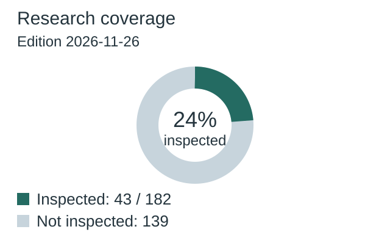
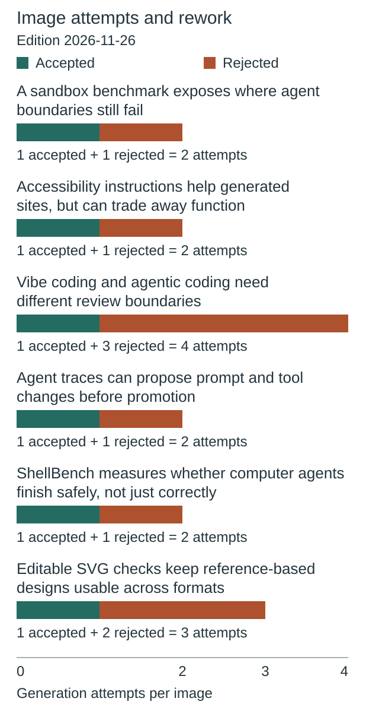
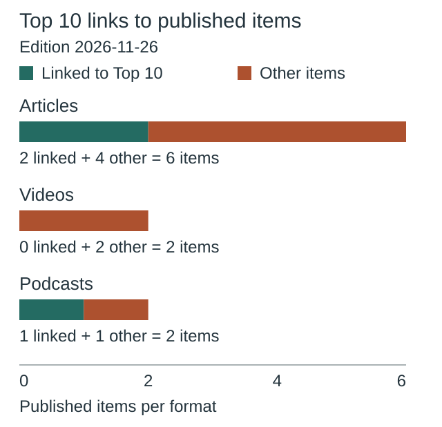
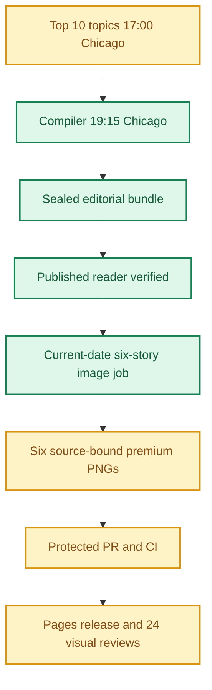
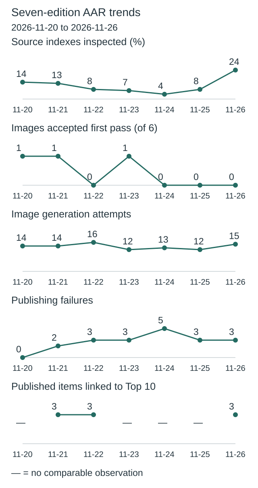
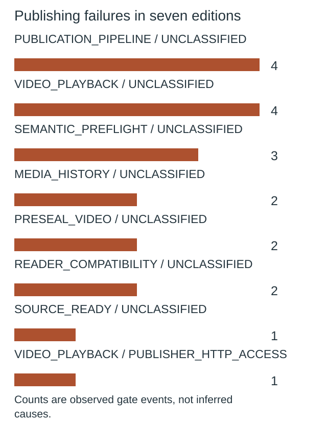
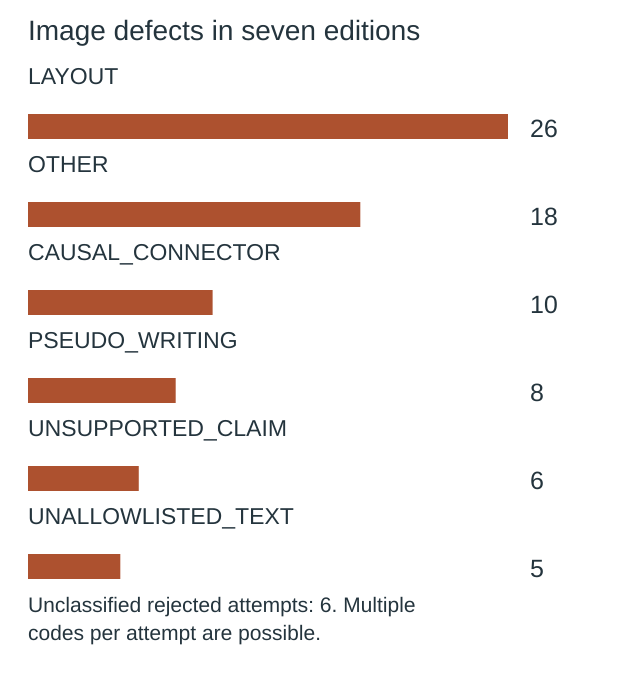

**🟨 RELEASE PARTIAL**
**TOP 10 PARTIAL** · **🟩 COMPILER VERIFIED** · **🟨 IMAGES NOT YET COMPLETE** · **🟨 VISUAL QA NOT YET VERIFIED**

# Daily AI Brief — Unified Production After-Action Report
**Edition:** November 26, 2026 · **Production evening:** 2026-11-25 · **Timezone:** America/Chicago
**Primary public reader:** [Open 2026-11-26 Brief](https://gttome.github.io/Daily-AI-Brief-Compiler/briefs/2026-11-26/) · **Repository:** [Daily-AI-Brief-Compiler](https://github.com/gttome/Daily-AI-Brief-Compiler)

> **IMPORTANT — VERIFIED PRODUCTION RESULT**
> **Executive release result: PARTIAL.** This is the single management-facing report covering Top 10 topic discovery, the editorial Compiler, published Brief and premium-image run. **Entire-system evidence: PARTIAL.** Top 10 report: **partial**; Compiler handoff: **RECEIVED_SNAPSHOT_BOUND**; guided searches: **RECEIPTS_OBSERVED**. Compiler public status: **VERIFIED**. Image release: **not complete**. Direct 24-context visual quality: **not yet evidenced**. Autonomous completion: **UNPROVEN**. Missing evidence must not be promoted to a success claim.

**🕒 Production stage durations:** **Top 10 8m 54s** · **Compiler final seal window 16m 19s** · **Premium Images Not independently recorded** (evidence-bounded elapsed times; the start/end events differ).

> **CLOSEOUT WARNING:** The exact image worker has not released its lease and recorded PUBLISHED_COMPLETE with the six accepted hashes.

## Evidence reconciliation

Compiler final seal window: 16m 19s. Compiler state start to public verification: 76m 53s. Observed execution and final seal windows are distinct.
Image capability route preflight: RECORDED; scheduler origin remains UNPROVEN.
Image efficiency: 0/6 first-pass accepts; 15 total attempts. Approved prospective efficiency target: at least 4/6 first-pass and no more than 8 total attempts, strictly advisory, with unchanged quality floor.
Image review completed: Not recorded; review-record commit: Not recorded; protected review merge: Not recorded.
Eligible source indexes: 182; editorial inspections reported: 43 (23.6%); inaccessible in editorial audit: 0; explicitly unreviewed IDs: 139; unclassified editorial IDs: 0. Automated index parsing is separate from editorial inspection and cannot substantiate exhaustive freshness claims.

Registered video sources: 37; attempted this edition: 37; unattempted: 0; enabled: 37; qualification-only: 0; sources yielding candidate URLs: 8. Status: REPORTED_ALL_ATTEMPTED. Attempt evidence is not automatic proof of source-content review or playback.

Eligible source partition **VALID**. Full original-item reads **7**. Bounded index searches **36**. Qualification-only sources recorded separately **0**.

### Video candidate discovery

| Discovery source | Eligibility | Candidate URLs |
|---|---|---:|
| Two Minute Papers — AI Research Explainers | Enabled | 1 |
| Weights & Biases / CoreWeave Videos | Enabled | 1 |
| IBM Technology YouTube | Enabled | 1 |
| 3Blue1Brown AI and neural network explanations | Enabled | 1 |
| PyTorch Foundation technical talks and demonstrations | Enabled | 1 |
| Anthropic on YouTube | Enabled | 1 |
| Google DeepMind on YouTube | Enabled | 1 |
| OpenAI on YouTube | Enabled | 2 |

### Protected preseal video outcomes

| Original publisher | Distinct programs submitted | Archive rejects | Playback passes | Playback unverified | Probes skipped |
|---|---:|---:|---:|---:|---:|
| nvidia.com | 1 | 0 | 2 | 0 | 0 |
| ted.com | 1 | 0 | 3 | 0 | 0 |
| vimeo.com | 1 | 0 | 2 | 0 | 0 |
| youtube-channel:UCKWaEZ-_VweaEx1j62do_vQ | 1 | 0 | 0 | 1 | 0 |
| youtube-channel:UCXZCJLdBC09xxGZ6gcdrc6A | 1 | 0 | 0 | 1 | 0 |

Outcomes count observed checks across all saved requests. Programs can be submitted again after a different slot changes.

- Vibe Coding vs. Agentic Coding: Which Should You Use? received PUBLIC_VIDEO_PLAYBACK_UNVERIFIED. [Original run](https://github.com/gttome/Daily-AI-Brief-Compiler/actions/runs/45738108951)
- Experiment with SVG & 3D Design with the Codex Plugin received PUBLIC_VIDEO_PLAYBACK_UNVERIFIED. [Original run](https://github.com/gttome/Daily-AI-Brief-Compiler/actions/runs/45738108951)

## Approved November 20 improvement evidence

Editorial runtime declarations: **DECLARED_RESTRICTED_EDITORIAL_RUNTIME**. Actual billing and scheduled origin remain unknown.

Video candidate evidence: **NOT_RECORDED**; substantive candidates Not recorded, non-news Not recorded, original publisher families Not recorded, selected non-news Not recorded. Targets 12 / 8 / 6 / 2 are advisory; unchanged duration, promotion, novelty and full-program playback checks still apply.

Source failure categories: PARSER_OR_OTHER 2, RESPONSE_SIZE_LIMIT 7, ACCESS_BLOCKED 6. Empty, blocked, oversized and unreviewed sources are distinct.

Original-paper cadence: one qualified paper within 3 editions when available. Current review timing NOT_RECORDED; postpublication review is not evidence of preselection reading.

- recurring federal measures of business AI use: published 81, unchanged-rubric calculation 81, retained original source links 1.

IMG19 artistic changes retain their existing November 22 three-eligible-edition evaluation. Missing pixels, owner feedback and usage remain unknown; no retrospective source, query or artwork acceptance is invented.

## Daily AAR charts

These charts use this edition’s receipts. Missing data is not zero.

### Research coverage



**43 of 182 indexes inspected (24%).**

| Editorial inspection | Indexes |
|---|---:|
| Inspected | 43 |
| Not inspected | 139 |

Not inspected includes every index without a recorded editorial inspection; this is not proof of missed stories.

### Image attempts and rework



**Not recorded:** current-edition evidence is missing or inconsistent.

Generation attempts measure rework, not runtime or cost. Quality and publication checks remain separate.

### Top 10 links to published items



**3 of 10 unique published items link to Top 10 topics.**

| Format | Linked to Top 10 | Other items |
|---|---:|---:|
| Articles | 2 | 4 |
| Videos | 0 | 2 |
| Podcasts | 1 | 1 |

No selection quota. Topic linkage does not establish better quality, popularity or causal improvement.

[Chart data](charts.json)

One edition at a time. Missing evidence is not zero. Trend claims require comparable recorded cycles.

## Performance dashboard

| Measure | Recorded result | Source / caveat |
|:--|:--:|:--|
| Entire-system evidence | **PARTIAL** | Full Top 10 list, bound Compiler input, all-format search receipts and existing release checks; separate from publication and autonomy |
| Top 10 report | **partial · 10 topics** | Same Chicago cycle report; provisional/partial coverage remains disclosed |
| Top 10 received by Compiler | **RECEIVED_SNAPSHOT_BOUND** | Exact report snapshot bytes; consumed commit separately corroborated: YES |
| Top 10 guided article/video/podcast searches | **RECEIPTS_OBSERVED** | Actual source-search receipts and selected/rejected topic outcomes |
| Top 10 stage duration | **8m 54s** | Same-cycle run receipt only; no runtime or usage estimate |
| Editorial publication | **PASS** | State and public reader integrity receipt |
| **Unattended autonomy (separate from publication)** | **UNPROVEN** | Owner incident receipt takes precedence over unverified producer self-attestation |
| Recorded protected publishing gate failures | **3** | Actual same-edition GitHub failure sidecar only; earlier unrecorded failures remain unknown |
| Articles | **6** | Exactly 2 technical / 2 knowledge-worker / 2 agents required |
| Original scientific-paper-led articles | **Not recorded** | Rolling target: one qualified original paper in 3 editions; UNVERIFIED_RECEIPT. Preprints are not peer-reviewed by default |
| Verified original sources within preceding 24 hours | **0 / 6** | Original publisher dates only; other sources require a documented fallback rationale |
| Distinct selected article publishers | **6** | Six different primary organizations preferred |
| Videos over seven days old | **2** | Must be labeled evergreen, not a new development |
| Distinct selected video publishers | **2** | One channel is one publisher even across multiple videos |
| Cross-media topic diversity | **FOUR_DISTINCT_EVENTS_REVIEW_RECORDED** | Four video/podcast events and six pairwise original-source comparisons; editorial claims remain producer-attested |
| Video discovery source attempts | **37 / 37** | Attempt evidence across enabled and qualification-only leads; REPORTED_ALL_ATTEMPTED. Not a claim of full content review or player verification | 
| Duplicate active Watchlist display titles | **0** | Published canonical Watchlist only; historical evidence retained |
| Original-release video playback (historical) | **TWO_PUBLISHED_VIDEOS_PLAYBACK_PASS** | Later reader corrections may replace these originally verified videos; see incident register | 
| Postpublication reader incidents | **NOT_RECORDED** | Edition-specific owner reports and corrective PRs, not inferred absence | 
| Verified postpublication video corrections | **NOT_RECORDED** | Incident register tracks correction PR, actual playback evidence and reader preservation |
| Editorial index second-pass attempts | **0** | Bounded public GET retries only; never proof of original article reading |
| Editorial index reads recovered | **0** | Successful page fetch can still yield zero eligible dated items |
| Recorded scheduler capability route | **UNPROVEN** | Same-invocation route receipt only; GitHub is not scheduler authentication |
| Avoidable incomplete-staging CI failures | **Not independently audited** | Existing image-package push CI is disabled; exact-head protected PR CI remains required. A failure count requires actual workflow evidence |
| Media | **2 videos + 2 podcasts** | Sealed bundle |
| **Compiler final seal window** | **16m 19s (16.3 min)** | Final sealed-state timestamp → verified public reader; initial execution is separate |
| **Image processing stage duration** | **Not independently recorded** | First accepted PNG Git checkpoint → final 24/24 review; auditable stage elapsed time |
| Image scheduled-to-final-review window | **Not independently recorded** | Only with a saved one-cycle schedule anchor; does not attest exact generation start |
| Executor-observed generation-to-final-review | **Not independently recorded** | Only if the worker recorded a same-execution clock before its first native call; not independently verified provider runtime |
| Accepted premium PNGs | **Not complete / 6** | Exact package and public release hashes |
| Native image generation attempts | **15** | Image worker AAR; no estimation |
| Rejected candidates | **9** | Image worker AAR |
| Final worker checkpoint reconciliation | **MISMATCH** | Oct25+ verifies exact generation count, per-story attempts, six accepted story/image/hash bindings and final release |
| Saved visual contexts | **Unverified** | Dated/permanent desktop/mobile review |
| Public SHA-256 checks | **Not recorded** | Image release receipt |
| October 8 immutable history | **17 / 17** | Independent content-preservation checks |
| **Owner-reported weekly Work usage for this run** | **Not reported** | No per-cycle usage supplied |

> **EFFICIENCY NOTE**
> **Resource reporting policy:** No usage figure was supplied for this cycle, so none is assumed. Future runs show **Not reported** unless the owner supplies new cycle-specific usage metadata. No approval or extra step is required to generate the AAR.

## Production architecture and checkpoints



## Daily AI Topic Top 10 and Compiler handoff

**Research cycle:** 2026-11-25 · **Target Brief:** 2026-11-26 · **Scheduled start:** 17:00 America/Chicago

| Dimension | Recorded evidence |
|---|---|
| Run/report result | PARTIAL |
| Report status / topics | partial / 10 |
| Freshness | FRESH\_AT\_CONSUMPTION |
| Compiler handoff | RECEIVED\_SNAPSHOT\_BOUND |
| Search coverage | RECEIPTS\_OBSERVED |
| Selection mapping verification | MATCHES\_EDITION\_BUNDLE |
| Observed start / finish | 2026-11-25T23:01:17Z / 2026-11-25T23:10:11Z |
| Elapsed minutes | 8.9 |
| Usage percent | Not reported |
| Cost USD | Not reported |
| Independent scheduler autonomy | UNPROVEN |
| Compiler-recorded consumed commit | 6a8ffa2d58877bb1991107c25050924657943904 |
| Report SHA-256 | 0567eeb8f5255dd175858e4e026b60868938d83942322f99ee25875e772ca031 |

| Discovery order | AI topic | Summary | Confidence | Evidence |
|---:|---|---|---|---|
| 1 | Claude Ship ties coding automation to approval policy | Anthropic separates PR review, fixes and policy-controlled approval. | medium | [Source](https://x.com/ClaudeDevs/status/2124959436640858475) · [Source](https://claude.com/resources/articles/introducing-claude-ship) |
| 2 | Riemann proof verification draws fresh explainers | France24’s new program follows Lean and Mathlib certification of Alpöge’s Claude-assisted proof. | medium | [Source](https://www.youtube.com/watch?v=fvN_vCRuBec) · [Source](https://www.youtube.com/watch?v=xjX3jESpZqs) · [Source](https://leanprover-community.github.io/blog/posts/riemann-hypothesis/) |
| 3 | Software factories need rules against accumulated slop | Dex Horthy’s new upload advocates planning and validation for maintainable generated code. | low | [Source](https://www.youtube.com/watch?v=-NFMsM2y0Vk) · [Source](https://www.youtube.com/watch?v=i1IbHVstmH4) |
| 4 | Anthropic IPO economics gets independent explainers | Fresh financial programs discuss the IPO, whose issuer separates public-offering proceeds from private placement. | medium | [Source](https://www.youtube.com/watch?v=Qt5F0D6E5f0) · [Source](https://www.anthropic.com/news/ipo-close) |
| 5 | Vibe versus agentic coding gets a focused explainer | IBM’s new program compares context, planning and validation across coding workflows. | low | [Source](https://www.youtube.com/watch?v=h4tHDFCPmQE) |
| 6 | Siren tests whether agents choose to cross sandbox boundaries | Anthropic distinguishes reaching outside, using material and clearly unauthorized use in deliberately tempting tests. | medium | [Source](https://x.com/AnthropicAI/status/2125341904644763678) · [Source](https://safeguards.anthropic.com/2026/siren/) |
| 7 | Codex demonstration turns references into editable graphics | A short original demonstration shows reference-guided SVG and3D assets, backed by a readable official workflow guide. | medium | [Source](https://www.youtube.com/watch?v=1u0hTd86_HU) · [Source](https://learn.chatgpt.com/guides/svg-3d-design) |
| 8 | Managed-agent builders explain state and memory tradeoffs | A fresh team discussion describes checkpointed sessions, orchestration and memory consolidation. | medium | [Source](https://www.youtube.com/watch?v=8Aoq6mJeAXI) · [Source](https://platform.claude.com/docs/en/managed-agents/overview) · [Source](https://sozai.app/transcript/lessons-building-agents-claude-platform/) |
| 9 | Neuroscience interview explores AI as a tool for understanding learning | Hannah Fry interviews Maria Eckstein and Kim Stachenfeld about using AI to study the brain. | low | [Source](https://www.youtube.com/watch?v=K8rdrWQRd20) · [Source](https://x.com/GoogleDeepMind/status/2125286866496671873) · [Source](https://podcasts.apple.com/us/podcast/the-brain-helped-us-build-ai-now-ai-is-explaining-the-brain/id1476316441?i=1000803842544) |
| 10 | Gemini teams search for formally checked quantum circuits | DeepMind describes Lean-checked algorithms with substantial remaining hardware limits. | medium | [Source](https://x.com/GoogleDeepMind/status/2124911073266413634) · [Source](https://deepmind.google/blog/finding-faster-quantum-algorithms-with-agents-and-formal-verification/) |

**Sample scope:** {"metadata\_screened\_videos":33,"unique\_videos":33,"distinct\_screened\_channels":21,"full\_video\_reviews":0,"full\_program\_reviews":0,"complete\_transcript\_reviews":0,"partial\_third\_party\_indexed\_transcript\_reviews":1,"direct\_youtube\_counter\_verifications":0,"full\_original\_statement\_reads":1,"full\_original\_statement\_identity":"Lean and Mathlib37-linejointstatement","complete\_original\_guides\_read":1,"guide\_identity":"ChatGPTLearn SVG/3D guide body950–992","substantive\_original\_overview\_reads":1,"overview\_identity":"Managed Agents79–205","complete\_original\_paper\_reviews":0,"original\_watch\_attempts":35,"unique\_watch\_programs":33,"original\_watch\_outcomes\_unique":{"throttled":30,"title\_shell":3},"comparable\_video\_observations":6,"screened\_source\_items":46,"retained\_source\_items":22,"screened\_and\_retained\_by\_category":{"video":{"screened":33,"retained":9},"public\_discussion\_post":{"screened":4,"retained":4},"original\_document":{"screened":7,"retained":7},"transcript\_mirror":{"screened":1,"retained":1},"podcast\_show\_notes":{"screened":1,"retained":1}},"trackers\_separately\_counted":3,"freshness\_counts":{"within\_24h\_timestamped":3,"additional\_within\_72h\_timestamped":8,"additional\_within\_7d\_timestamped":3,"date\_only":19,"older":0},"freshness\_reference\_at":"2026-11-25T23:06:19Z","notes":"Explicit inspected item ledger, not every search result or full registered-source census.33metadata screens are not40–80substantive full-video reviews. Guide/statement/overview/show notes/partial mirror separately counted."}. **Ranking basis:** {"attention":"YouTube program reach and independently credited creator breadth are the main discovery input. Timed social snapshots supplement research/safety topics; no overlapping audiences summed, composite scores or channel-relative baselines invented.","uncertainty":"WITL video source clock07:03Eastern and social07:02Eastern. Other tracker clocks unknown; all direct watch counters/playback unverified. Same Google DeepMind video/post belong to one family. Claim quality and Brief usefulness remain separate."}.

| Search format | Receipt rows | Attempts recorded | Explicitly not attempted |
|---|---:|---:|---:|
| article | 10 | 10 | 0 |
| video | 10 | 10 | 0 |
| podcast | 10 | 10 | 0 |

**Selected Brief items linked to trends:**

| Topic | Format | Selected item | Reason |
|---|---|---|---|
| anthropic-siren-sandbox-evaluation-nov24 | article | nov26-t1-siren-agent-boundaries · [Source](https://safeguards.anthropic.com/2026/siren/) | Exact original report selected after complete methods and limitations review. |
| codex-svg3d-original-demo-nov24 | article | nov26-k2-svg-design-skill · [Source](https://learn.chatgpt.com/guides/svg-3d-design) | Exact original guide selected as the edition single Agent Skills story. |
| dex-horthy-software-factory-rules-upload-nov23 | podcast | https://podcastdex.com/podcast/mts/stop-sending-walls-of-unread-ai-slop-dex-horthy · [Source](https://podcastdex.com/podcast/mts/stop-sending-walls-of-unread-ai-slop-dex-horthy) | Exact complete episode selected after publisher-RSS chapter review, identity/date verification and show-family cooldown checks. |

**Gaps and limitations:**

- The report labels its research partial.
- Researchpartial:33metadata-screened videos across21channels, zero full programs/complete transcripts/directYouTubecounters. One partial third-party transcript does not meet40–80full-review target.
- Most topics rely on one original attention organization; mirrors and indexURLs do not count as independent breadth. Exact rank unsupported.
- Missing counters,sourceclocks,disclosures,dates and durations remain null; no inferred sponsorship, global coverage, CTR,retention or current velocity.
- Thirty article/video/podcast queries supplied; actual Compiler input/search receipts, selected mappings, publication and imagesPENDING.
- No task/schedule/environment changes, paidAPI/meteredbrowser, production/code/daily/\*\*/historical report/accepted image mutation. November10pilotinactive.

**Recorded run issues:**

- {"problem":"Original YouTube retrieval incomplete","effect":"30 of 33 distinct watch routes throttled; three returned title shells. No direct counters or complete playback/transcript verification.","correction":"Used bounded original-publisher and free public search fallback; retained metadata provenance and partial status."}
- {"problem":"Some original/mirror routes unavailable","effect":"Manifesto, IBM fallback and direct transcript mirror could not establish full original-program review.","correction":"Recorded exact gaps; indexed excerpts explicitly remain partial third-party evidence."}
- {"problem":"Advertised SVG guide Markdown route returned DisabledError","effect":"Markdown route unavailable.","correction":"Ordinary original HTML guide retrieved and its complete guide body reviewed."}
- {"problem":"Duration and measurement provenance differ by distribution route","effect":"Managed Agents tracker 16:29 differs from mirror 16:24; neuroscience podcast listing is not the video version. AI roundup measurement clocks unavailable.","correction":"Preserved source-specific values, null unknown clocks, and unresolved final Compiler checks."}

**Recorded improvements:**

- {"status":"IMPLEMENTED\_PRODUCER\_METHOD","change":"Deepen practical original demo and team-interview leads using actual original guide and overview reads.","observed\_outcome":"Concrete constraints and mechanisms added; zero complete program reviews remains a limitation.","production\_effectiveness":"UNPROVEN"}
- {"status":"IMPLEMENTED\_PRODUCER\_METHOD","change":"Merge Google DeepMind video and post into one publisher family and test family-removal sensitivity for all ten topics.","observed\_outcome":"All ten evidence bands weaken when a publisher family is removed. Discovery order remains provisional.","production\_effectiveness":"UNPROVEN"}
- {"status":"PROPOSED\_EXISTING\_COMPILER\_FOLLOWUP","change":"Review rank 8 early, qualify the rank 7 demonstration, bind actual searches to this exact report and reconcile final candidate-bound selections.","observed\_outcome":"PENDING","production\_effectiveness":"PENDING"}

### Daily improvement and effect on the Brief

**Fixed baseline:** nov03-2026-v1 / INPUT\_FROZEN. **Outcome baseline:** FROZEN\_AFTER\_VERIFIED\_PUBLICATION. **Prior cycle:** 2026-11-24.

| Input measure | Current | November 3 baseline | Change from baseline | Change from prior cycle |
|---|---:|---:|---:|---:|
| topic count | 10 | 10 | 0 | 0 |
| validation resource count | Not reported | 14 | Not reported | Not reported |
| additional video metadata records | Not reported | 63 | Not reported | Not reported |
| additional video channels | Not reported | 21 | Not reported | Not reported |
| total video observations | Not reported | 79 | Not reported | Not reported |
| unique videos | Not reported | 71 | Not reported | Not reported |
| full video reviews | Not reported | 0 | Not reported | Not reported |
| direct youtube counter verifications | Not reported | 0 | Not reported | Not reported |
| broader evidence band topics | 2 | 3 | -1 | 0 |
| limited evidence band topics | 8 | 7 | 1 | 0 |

**Observed downstream measurements:** OBSERVED.

| Outcome measure | Current | Change from frozen outcome | Change from prior cycle |
|---|---:|---:|---:|
| expected topic format pairs | 30 | 0 | Not reported |
| attempted topic format pairs | 30 | 0 | Not reported |
| explicitly unattempted pairs | 0 | 0 | Not reported |
| discovered candidate count | 24 | -16 | Not reported |
| searched source host count | 17 | 1 | Not reported |
| selected article count | 2 | -1 | Not reported |
| selected video count | 0 | 0 | Not reported |
| selected podcast count | 1 | 0 | Not reported |

**Source changes:** {"added":\[\],"removed":\[\]}.

**Candidate review depth:** NOT\_RECORDED.

| Review measure | Current | Change from prior comparable cycle |
|---|---:|---:|
| reviewed candidate count | Not reported | Not reported |
| qualified candidate count | Not reported | Not reported |
| rejected candidate count | Not reported | Not reported |
| metadata only count | Not reported | Not reported |
| full video reviews | Not reported | Not reported |
| transcript reviews | Not reported | Not reported |

The frozen November 3 baseline has no candidate-level review ledger; no retrospective value is invented. Recorded reviews do not independently establish content quality, audience interest or causal benefit.

**Method/resource review:** {"baseline\_id":"nov03-2026-v1","previous\_report\_date":"2026-11-24","method\_version":"2026-11-03.2-event-review","changes":\[{"change":"Use original editable-asset guide and stateful-agent overview to deepen new media leads.","reason":"Previous cycle still had zero complete program/transcript reviews; more metadata alone does not solve depth.","expected\_effect":"Provide concrete artifact constraints and state/retention limits without pretending playback."},{"change":"Merge Google DeepMind video/post into one publisher family and retain source-specific duration discrepancies.","reason":"Distribution routes and differing audio/video versions can otherwise inflate breadth or obscure lengths.","expected\_effect":"More honest sensitivity review and early Compiler qualification; final benefit unproved."}\],"resource\_candidates":\[{"url":"https://learn.chatgpt.com/guides/svg-3d-design","role":"claim","decision":"accepted","access":"direct","review\_scope":"Complete original guide body950–992","independence":"Same OpenAI program family, not additional independent attention.","reason":"Adds editable vector constraints, animation controls and reference-driven3D workflow.","contribution":"Rank7practical value and honest original demo lead."},{"url":"https://sozai.app/transcript/lessons-building-agents-claude-platform/","role":"claim","decision":"deferred","access":"indexed\_only","review\_scope":"Partial transcript excerpts00:30–03:41,09:22–10:21,12:36–15:48; directrouteunavailable.","independence":"Third-party mirror; no independent performance test.","reason":"Useful bounded content, but cannot establish complete transcript review or playback.","contribution":"Rank8checkpoint/memory mechanisms with explicit gaps."}\],"observed\_effects":{"feedback":{"status":{"publication":"VERIFIED","images":"RELEASED\_AND\_24\_CONTEXTS\_VERIFIED","top10":"INVALID","system":"PARTIAL","autonomy":"UNPROVEN","runtime\_policy":"DECLARED\_RESTRICTED\_EDITORIAL\_RUNTIME","usage":"UNKNOWN"},"top10":{"valid":true,"handoff":"INVALID","search":{"article":{"recorded":0,"attempted":0,"not\_attempted":0},"video":{"recorded":0,"attempted":0,"not\_attempted":0},"podcast":{"recorded":0,"attempted":0,"not\_attempted":0}},"mapping\_status":"INVALID","mappings":\[\],"defects":\["Compiler trend input is not a fresh, date-correct, exact-report snapshot bound to independently collected bytes.","Claimed trend-to-selection mappings are not verified against the same-edition selected bundle.","Per-topic article/video/podcast search coverage is incomplete, invalid or bound to a different input."\]},"actions":{"schema\_version":"daily-aar-action-review-v1","edition\_date":"2026-11-25","mode":"DAILY\_EVIDENCE\_LED\_TRIAGE","next\_cumulative\_review":"2026-12-02","cumulative\_review\_due\_today":false,"finding\_count":4,"open\_production\_blockers":0,"findings":\[{"id":"TOP10\_SEARCH\_EVIDENCE\_INVALID","priority":"P1","owner":"Compiler","observation":"This edition has invalid Top 10 search-coverage receipts.","action":"Verify event-to-format searches and actual selected mappings in the next unlocked edition; do not rewrite a sealed historical bundle.","timing":"NEXT\_GENUINE\_CYCLE","kind":"EVIDENCE\_GAP"},{"id":"PROTECTED\_GATE\_FAILURES","priority":"P1","owner":"Compiler / Recovery","observation":"3 failed protected publication gates were recorded (3 unclassified causes).","action":"Read original failed job logs, record real causes and move the relevant existing validation before the next readiness signal; do not replay the released edition.","timing":"NEXT\_GENUINE\_CYCLE","kind":"RECURRENCE\_PREVENTION"},{"id":"PREMIUM\_IMAGE\_REWORK","priority":"P1","owner":"Images","observation":"6 rejected image candidates preceded the verified six-image release.","action":"Inspect saved rejection evidence and apply source-specific geometry, causal-arrow and label corrections before the next native generation.","timing":"NEXT\_GENUINE\_CYCLE","kind":"EFFICIENCY\_LESSON"},{"id":"SCHEDULER\_ORIGIN\_UNPROVEN","priority":"P2","owner":"Compiler / Recovery","observation":"Publication success does not independently attest the originating scheduler.","action":"Capture real first-party scheduler and execution evidence if available; do not convert unknown provenance into a failure or a success.","timing":"NEXT\_GENUINE\_CYCLE","kind":"EVIDENCE\_GAP"}\],"limitations":\["This report records findings and next actions; it does not execute corrections.","Existing owners must fix safe same-cycle faults immediately, without waiting for the cumulative review date.","A released edition remains immutable; lessons apply prospectively to the next genuine cycle.","Missing observations are not zero; no causality, autonomous recovery or effectiveness is inferred."\]},"metrics":{"coverage\_percent":{"recorded\_editions":7,"median":8},"first\_pass\_accepted":{"recorded\_editions":7,"median":0},"image\_attempts":{"recorded\_editions":7,"median":13},"top10\_linked\_items":{"recorded\_editions":3,"median":3},"publication\_failures":{"recorded\_editions":7,"median":3}},"charts":{"schema\_version":"daily-ai-brief-aar-charts-v1","edition\_date":"2026-11-25","charts":\[{"id":"research-coverage","title":"Research coverage","description":"Editorial source-index inspection; automated fetches are excluded.","status":"OBSERVED","rows":\[{"label":"Inspected","value":15},{"label":"Not inspected","value":167}\],"total":182,"inspected\_percent":8,"note":"Not inspected includes every index without a recorded editorial inspection; this is not proof of missed stories."},{"id":"image-rework","title":"Image attempts and rework","description":"Accepted and rejected candidates for each final image.","status":"OBSERVED","rows":\[{"id":"nov25-t1-quantum-verified-agents","label":"Formal checks turn agent proposals into auditable quantum results","accepted":1,"rejected":1},{"id":"nov25-t2-protein-design","label":"Protein-design results improve while the validation stack stays visible","accepted":1,"rejected":1},{"id":"nov25-a1-agentic-eval-chain","label":"Agent evaluation needs a traceable chain, not one leaderboard number","accepted":1,"rejected":1},{"id":"nov25-a2-shirudo-runtime","label":"Shirudo tests temporary defenses before an operator deploys them","accepted":1,"rejected":1},{"id":"nov25-g1-workspace-mcp","label":"Workspace agents need a permission-and-audit preflight","accepted":1,"rejected":1},{"id":"nov25-g2-switchcraft-routing","label":"Model routing needs a visible quality, cost and abstention policy","accepted":1,"rejected":1}\],"total\_attempts":12,"first\_pass\_accepted":0,"target":{"first\_pass":3,"max\_attempts":2,"window":"ongoing from November 8"},"note":"Generation attempts measure rework, not runtime or cost. Quality and publication checks remain separate."},{"id":"top10-selection","title":"Top 10 links to published items","description":"Unique published items by format, not the number of topic mappings.","status":"NOT\_RECORDED","rows":null,"note":"No selection quota. Topic linkage does not establish better quality, popularity or causal improvement."}\],"interpretation":"One edition at a time. Missing evidence is not zero. Trend claims require comparable recorded cycles."}},"charted\_aar\_url":"https://github.com/gttome/Daily-AI-Brief-Compiler/blob/56c675f96ef1b5ca4dcae01ff363b08c41a94d48/daily/2026-11-24/combined.md","chart\_data\_url":"https://github.com/gttome/Daily-AI-Brief-Compiler/blob/56c675f96ef1b5ca4dcae01ff363b08c41a94d48/daily/2026-11-24/charts.json","improvement\_metrics\_url":"https://github.com/gttome/Daily-AI-Brief-Compiler/blob/56c675f96ef1b5ca4dcae01ff363b08c41a94d48/daily/2026-11-24/improvement-metrics.json","downstream\_impact\_table\_url":"https://github.com/gttome/Daily-AI-Brief-Compiler/blob/56c675f96ef1b5ca4dcae01ff363b08c41a94d48/daily/2026-11-24/combined.md#daily-ai-topic-top-10-and-compiler-handoff","current\_downstream":"PENDING","interpretation":"Prior AAR reports producerJSONvalid butinput/searchbindingINVALID and0recordedformatrows; no claim that actual searches were zero. Publication/images verified separately."},"change\_evaluations":\[{"change\_id":"NOV15-02","result":"not\_met","reason":"Latest earlier combined AAR still reports invalid exact-input binding and selection mappings. Current producer verification cannot certify downstream consumed bytes.","reviewed\_edition":"2026-11-26","decision":"keep","evidence\_refs":\["https://github.com/gttome/Daily-AI-Brief-Compiler/blob/56c675f96ef1b5ca4dcae01ff363b08c41a94d48/daily/2026-11-24/combined.json","https://learn.chatgpt.com/guides/svg-3d-design"\]},{"change\_id":"NOV20-01","result":"not\_met","reason":"Prior AAR shows zero recorded valid-format rows and invalid receipts, not proof no searches occurred. Current30queryterms remain inputs pending genuine consumer receipts.","reviewed\_edition":"2026-11-26","decision":"keep","evidence\_refs":\["https://github.com/gttome/Daily-AI-Brief-Compiler/blob/56c675f96ef1b5ca4dcae01ff363b08c41a94d48/daily/2026-11-24/combined.json","https://learn.chatgpt.com/guides/svg-3d-design"\]},{"change\_id":"NOV20-04","result":"not\_met","reason":"Current33metadata screens and zero complete programs/transcripts leave the substantive program-review target unmet despite original document depth.","reviewed\_edition":"2026-11-26","decision":"keep","evidence\_refs":\["https://github.com/gttome/Daily-AI-Brief-Compiler/blob/56c675f96ef1b5ca4dcae01ff363b08c41a94d48/daily/2026-11-24/combined.json","https://learn.chatgpt.com/guides/svg-3d-design"\]},{"change\_id":"NOV20-05","result":"inconclusive","reason":"Fresh original demonstration, team interview and neuroscience program broaden non-news leads. No complete reviews or final current selected programs demonstrate outcome targets.","reviewed\_edition":"2026-11-26","decision":"keep","evidence\_refs":\["https://github.com/gttome/Daily-AI-Brief-Compiler/blob/56c675f96ef1b5ca4dcae01ff363b08c41a94d48/daily/2026-11-24/combined.json","https://learn.chatgpt.com/guides/svg-3d-design"\]},{"change\_id":"NOV20-09","result":"inconclusive","reason":"No complete original scientific manuscript reviewed here; quantumannouncement is not a paper-led cadence receipt. Compiler rolling3editionqualification remains independently observed.","reviewed\_edition":"2026-11-26","decision":"keep","evidence\_refs":\["https://github.com/gttome/Daily-AI-Brief-Compiler/blob/56c675f96ef1b5ca4dcae01ff363b08c41a94d48/daily/2026-11-24/combined.json","https://learn.chatgpt.com/guides/svg-3d-design"\]},{"change\_id":"NOV20-10","result":"met","reason":"Partial research, verified-source step, pending current production and unknown host/billing/scheduler evidence remain separate from prior published/image results.","reviewed\_edition":"2026-11-26","decision":"keep","evidence\_refs":\["https://github.com/gttome/Daily-AI-Brief-Compiler/blob/56c675f96ef1b5ca4dcae01ff363b08c41a94d48/daily/2026-11-24/combined.json","https://learn.chatgpt.com/guides/svg-3d-design"\]}\],"next\_improvement":"Compiler should qualify rank8early against exact original program/length/archive/playback, inspect rank7short demonstration and independently bind30canonical query attempts and candidate-bound final selections.","limitations":\["Implementation and larger sample are not evidence of better production outcomes.","Protected register unchanged; existing daily\_improvement is the authorized role evaluation path."\]}.

**Current reconciled conclusion:** OBSERVED; outcome baseline FROZEN\_AFTER\_VERIFIED\_PUBLICATION; candidate review ledger NOT\_RECORDED.

**Historical producer observations (not current status):** The following snapshot preserves what the producer reported at the time. Its pending statuses and candidate-quality claims are not independently reconciled conclusions. Use the current tables above for publication-bound measurements; an absent candidate review ledger remains unknown.

<details><summary>Original producer effects and gaps — historical snapshot</summary>

```json
null
```

</details>

**Next improvement:** Compiler should qualify rank8early against exact original program/length/archive/playback, inspect rank7short demonstration and independently bind30canonical query attempts and candidate-bound final selections.

Counts show coverage and observed association, not audience popularity, source independence, candidate quality or causal uplift. Compare source/method changes before interpreting deltas. Unknown values are not zero. Publication, reader corrections, runtime and image outcomes retain their separate AAR evidence.

Report, source-readback and search receipts are separate observations. Snapshot binding verifies the collected report bytes; the consumed commit is independently corroborated only when the separately fetched source bytes match. These records do not independently attest scheduler identity or source truth. Top 10 reporting does not change Brief/image release status.


## Track 1 — Compiler

**State:** `SHADOW_VERIFIED` · **Bundle:** `BUNDLE_READY` · **Compiler final seal window:** 16m 19s (16.3 min).

| Publication gate | Result |
|---|:---:|
| Canonical reader build | ✅ |
| Reader parity | ✅ |
| Public verification of dated edition | ✅ |
| Previous editions preserved | ✅ |
| Permanent story routes and feeds | ✅ |

**Selected coverage:**

| Lane | Story |
|---|---|
| Technical AI Engineering | A sandbox benchmark exposes where agent boundaries still fail |
| Technical AI Engineering | Accessibility instructions help generated sites, but can trade away function |
| Applied Generative AI for Knowledge Workers | Vibe coding and agentic coding need different review boundaries |
| Applied Generative AI for Knowledge Workers | Agent traces can propose prompt and tool changes before promotion |
| Agents for Everyone | ShellBench measures whether computer agents finish safely, not just correctly |
| Agents for Everyone | Editable SVG checks keep reference-based designs usable across formats |

### Scientific paper opportunity and publication evidence

**Current edition:** UNVERIFIED_RECEIPT; **paper-led stories:** Not recorded. Editorial target: at least one genuinely qualified original-paper-based story in seven editions, with methods, limitations, and an explicit preprint/peer-review distinction. No stale or weak paper is selected solely to fill a quota.


## Track 2 — Premium images

**Public status:** `NOT_OBSERVED` · **Saved images:** 0/6 · **Actual generation attempts:** 15 · **Rejected candidates:** 9.

### Image production duration — Git-verified milestones

**Auditable image stage duration:** **Not independently recorded** (first accepted binary saved in Git → first persisted 24-context quality-review record). **First asset to public image release:** **Not independently recorded**.
**Scheduled-to-final-review window:** **Not independently recorded**. This is a scheduled-clock comparison only when a separately recorded exact-date schedule exists; it is **not** measured native image-generation runtime.

| Production milestone | Chicago local time | Evidence |
|---|---|---|
| Scheduled image start (if exact-date record exists) | Not independently recorded | Time planned, not actual execution start |
| First executor-observed start | Not independently recorded | Worker self-attestation, not a first-party scheduler event |
| First native generation observation | Not independently recorded | Worker clock recorded immediately before first native call, not model-provider telemetry |
| First accepted PNG bytes saved to Git | Not independently recorded | Immutable binary-stage commit |
| Six-image package / reviews committed | Not independently recorded | Exact-head PR source commit |
| Protected package merged | Not independently recorded | Merge SHA and required CI |
| Public images verified | Not independently recorded | Image-release receipt |
| 24/24 review record committed | Not independently recorded | Immutable first review-approval commit |

> **Duration interpretation:** The audited stage excludes unobservable pre-checkpoint creative work. The scheduled-start window includes it but must not be interpreted as precise active processing time. Missing timestamps appear as **Not independently recorded**, never an estimate.


| Source-bound image | Attempts | File size | Public page |
|---|---:|---:|---|

**Immutable-release and visual gates:**

| Release gate | Result |
|---|:---:|
| Protected public image receipt | Not yet evidenced |
| Accepted-image Git hash bindings | Not yet evidenced |
| Six live PNGs | Not verified |
| Dated/permanent story placements | Not verified |
| Desktop/mobile visual inspection | Not verified |
| Historical Oct 8 integrity | Not verified |

### Published premium illustrations

No six-image public release gallery available yet.

## Incidents, corrections and learning

### Postpublication reader incidents (updated when new evidence is merged)

No current-edition postpublication incident register was available; this is **NOT_RECORDED**, not a certification of zero incidents.


**Editor recovery classification:** UNPROVEN. **Owner intervention:** Unproven either way. **Protected same-edition failures recorded:** 3. 
**Latest failed protected stage:** SEMANTIC_PREFLIGHT; [Action evidence](https://github.com/gttome/Daily-AI-Brief-Compiler/actions/runs/45742811332). Exact stage durations are available only where real source timestamps exist.

| Stage | Verified issue | Corrective action |
|---|---|---|
| Native image generation | Actual full-size and 320px saved draft adds simulated document writing, success checkmarks/seal, a decorative seedling and ochre halos/underlines; foreground extends inside the 40px edge floor. Preserve the asymmetric oversight fork and single test-to-review arrow; relocate exact labels onto smooth meaningful faces, remove unsupported marks and inset the artwork. | Targeted source-bound correction specification was frozen before the next native call; actual full-size and 320px pixels were inspected and only the passing final image was locked. |
| Native image generation | Saved full-size and 320px second draft removes faux writing and success marks but repeats Context beside and inside the same repository folder. Keep the informative label on the folder, erase only its external duplicate and preserve the correct branching structure and margins. | Targeted source-bound correction specification was frozen before the next native call; actual full-size and 320px pixels were inspected and only the passing final image was locked. |
| Native image generation | The duplicate label is gone, but the edit stripped the carved treatment and leaves the source-specific oversight explanation too sparse. The original source supports explicit goals, write limits and action logging; freeze those three exact additional explanatory components before the targeted correction. No accepted image is being regenerated. | Targeted source-bound correction specification was frozen before the next native call; actual full-size and 320px pixels were inspected and only the passing final image was locked. |
| Native image generation | The saved full-size and 320px trace illustration is accurate and has exact labels, but the evaluation is a generic closed folio hiding the read-only tool boundary and candidate-result distinction. Freeze four supported short terms and expose the interior rather than counting anonymous repeated layers as meaningful detail. Preserve existing source facts and diagonal composition. | Targeted source-bound correction specification was frozen before the next native call; actual full-size and 320px pixels were inspected and only the passing final image was locked. |
| Native image generation | Actual full-size and 320px draft contains embossed simulated writing on two record stacks, left foreground inside the 40px floor, and an unexplained red tile that hides the correct-result/unsafe-path distinction. Name the actual source-record, all-criteria and safety-failure states with four frozen exact terms, preserve the denominator and correct numeric evidence, and inset the complete art. | Targeted source-bound correction specification was frozen before the next native call; actual full-size and 320px pixels were inspected and only the passing final image was locked. |
| Native image generation | The actual 1200x630 and 320px draft printed the article headline, summary and practical-action paragraphs outside the seven-label allowlist and inside edge margins. Theme examples lacked a visible dark/light surface distinction, and guides unnecessarily attached the detached caveat and destination note. Preserve the good moth/path anatomy, remove prose, expose actual theme test swatches and correct guide placement. | Targeted source-bound correction specification was frozen before the next native call; actual full-size and 320px pixels were inspected and only the passing final image was locked. |
| Native image generation | Actual exported 1200x630 and 320px image now has only the seven approved labels and meaningful light/dark checks, but the left reference moth wing is inside the mandatory 40px margin. Apply an overall native inset preserving all factual and artistic content. Its actual dominant grouping reads as a horizontal-strip with a larger center and lower size check, not the planned radial silhouette; record that observed difference honestly in the set review. | Targeted source-bound correction specification was frozen before the next native call; actual full-size and 320px pixels were inspected and only the passing final image was locked. |
| Native image generation | Actual exported 1200x630 and 320px images contain simulated checklist strokes on the task and report surfaces, an unsupported success tick, and stipple foreground extending inside the 40px floor at the left edge. Preserve the source-faithful nested measures and repair those regions; no accepted image exists yet. | Targeted source-bound correction specification was frozen before the next native call; actual full-size and 320px pixels were inspected and only the passing final image was locked. |
| Native image generation | Actual saved 1200x630 and 320px output has foreground inside the mandatory 40px margins, invented browser-window dots/chrome, unlabeled UI strokes and three chevron key glyphs outside the allowlist. Correct these while preserving the accessibility/function tradeoff and asymmetrical structure. | Targeted source-bound correction specification was frozen before the next native call; actual full-size and 320px pixels were inspected and only the passing final image was locked. |
| Exact binary transport | Connected fetch_file with base64 returned empty content for the two accepted PNGs larger than one MiB; the JSON blob-fetch fallback refused binary. | Preserved accepted bytes and used genuine immutable Git fetch/git-show readbacks, cmp byte equality and independent SHA256 for those two files; the other four matched full connected base64 readbacks. |
| Local browser capability | The available Playwright package had no installed browser, the system chromium wrapper pointed to a missing binary, and the ordinary browser download returned HTTP403. | Retain the existing protected image-release capture route, download its real 24-context artifact after deployment and inspect actual pixels; no owner computer or alternate metered browser is required. |
| Correction-plan audit | The initial six-spec admission passed, and all exact correction prompts were frozen before calls, but two later correction coordinate plans were not validated before their calls. Do not backdate validation or treat protected baseline CI as proof those two plans passed. Preserve accepted artwork; the observed planning/audit gap is separate from actual saved-pixel quality. | Preserved the exact historical frozen correction prompts and recorded the postgeneration coordinate findings honestly. Actual final pixels were independently inspected; no new pre-generation PASS was fabricated and no accepted art was regenerated. |

> **OPERATIONAL NOTE**
> This report distinguishes a published and verified production outcome from scheduler metadata exposed to another conversation. Lack of a live host heartbeat in a separate normal chat is not a Compiler production failure.

## Usage and cost stewardship

| Item | Per-cycle value |
|---|---|
| **Weekly Work usage reported by owner** | **Not reported** |
| Internal weekly usage reference | Target under 5% |
| Genuine image-generation attempts | 15 |
| Accepted diagrams | 6 |
| Regeneration after acceptance | 0 |
| Top 10 reported usage | Not reported |
| Top 10 reported cost | Not reported |
| Account-level billing telemetry | Not independently accessible to deterministic GitHub reporting |

**Future reporting rule:** For cycles without an optional owner-usage record, publish the complete AAR with `Not reported`; do not reuse prior percentages, guess remaining weekly credits or delay tomorrow's production.

## Next-edition operating handoff

| Control | Recurring contract |
|---|---|
| AI Topic Top 10 | Sole report task · 17:00 America/Chicago · saved dated list guides same-evening research |
| Primary Compiler | Sole existing task · 19:15 America/Chicago |
| Premium image production | Sole existing task · standard 21:15 America/Chicago |
| Exact image job selection | Newly published next-date `PUBLISHED_PENDING` only |
| AAR | Combined report generated automatically from new GitHub receipts |
| Optional Work usage | Owner-supplied per cycle, otherwise `Not reported` |

> **SCHEDULE RESTORATION NOTE**
> A temporary scheduling exception must be explicitly restored before claiming standard-time readiness. This deterministic document generator reads existing state only; it does not modify production schedules.

## Evidence register

| Evidence | Link |
|---|---|
| Compiler state | [Open receipt](https://github.com/gttome/Daily-AI-Brief-Compiler/blob/shadow/2026-11-26/shadow-runs/2026-11-26/compiler-state.json) |
| Compiler compile receipt | [Open receipt](https://github.com/gttome/Daily-AI-Brief-Compiler/blob/shadow/2026-11-26/shadow-runs/2026-11-26/compiler/compile-receipt.json) |
| Compiler public integrity | [Open receipt](https://github.com/gttome/Daily-AI-Brief-Compiler/blob/shadow/2026-11-26/shadow-runs/2026-11-26/compiler/postpublish-integrity.json) |
| Image release receipt | [Open receipt](https://github.com/gttome/Daily-AI-Brief-Compiler/blob/shadow-pages-history/site/image-jobs/2026-11-26/release.json) |
| Image review | [Open receipt](https://github.com/gttome/Daily-AI-Brief-Compiler/blob/main/external-image-packages/2026-11-26/reviews/live/image-element24/semantic-reviews.json) |
| Original image AAR | [Open receipt](https://github.com/gttome/Daily-AI-Brief-Compiler/blob/main/external-image-packages/2026-11-26/reviews/after-action.md) |
| Observed editorial index retries | [Open receipt](https://github.com/gttome/Daily-AI-Brief-Compiler/blob/shadow/2026-11-26/shadow-runs/2026-11-26/editorial/source-item-retries.json) |
| Scientific paper selection review | [Open receipt](https://github.com/gttome/Daily-AI-Brief-Compiler/blob/shadow/2026-11-26/shadow-runs/2026-11-26/editorial/scientific-paper-coverage.json) |
| Published player playback receipt | [Open receipt](https://github.com/gttome/Daily-AI-Brief-Compiler/blob/shadow/2026-11-26/shadow-runs/2026-11-26/compiler/postpublish-video-playback.json) |
| Top 10 ranked topic report | [Open receipt](https://github.com/gttome/Daily-AI-Brief-Compiler/blob/61d9c547a9a24121e61092f8fb2b5042f288027f/signals/ai-topic-top10/2026-11-25.json) |
| Top 10 run after-action receipt | [Open receipt](https://github.com/gttome/Daily-AI-Brief-Compiler/blob/61d9c547a9a24121e61092f8fb2b5042f288027f/signals/ai-topic-top10/2026-11-25.aar.json) |
| Compiler Top 10 input snapshot | [Open receipt](https://github.com/gttome/Daily-AI-Brief-Compiler/blob/shadow/2026-11-26/shadow-runs/2026-11-26/editorial/trend-input.json) |
| Top 10 article/video/podcast search coverage | [Open receipt](https://github.com/gttome/Daily-AI-Brief-Compiler/blob/shadow/2026-11-26/shadow-runs/2026-11-26/editorial/trend-search-coverage.json) |

**Image workflow:** Not yet available.

---

*Generated deterministically from cycle- and edition-specific GitHub records. The report combines the Top 10 discovery priorities, its Compiler handoff and searches, the published Brief, and the image run; original research, Compiler, image, hash, and review receipts remain immutable. This reporting action creates no stories, images, releases, extra AI tasks, or schedule changes.*

<!-- continuous-improvement:start -->
## Continuous improvement review

Edition **2026-11-26**. Measurements use 7/7 recorded editions in this window. Missing data stays **Not recorded**.

### Daily corrective-action review

**3 evidence-based findings**; open production blockers: 1. Cumulative evaluation checkpoint: **2026-12-02**. The daily review never waits for that date to act on a safe live problem.

| Priority | Observed issue | Existing owner / next correction | When |
|---|---|---|---|
| P0 | Editorial publication is verified but the image release is not verified. | Images: Use the existing canonical image owner and protected release; do not regenerate accepted assets or create a competing worker. | Immediate, if ownership and gates allow |
| P1 | 3 failed protected publication gates were recorded (3 unclassified causes). | Compiler / Recovery: Read original failed job logs, record real causes and move the relevant existing validation before the next readiness signal; do not replay the released edition. | Immediate, if ownership and gates allow |
| P2 | Publication success does not independently attest the originating scheduler. | Compiler / Recovery: Capture real first-party scheduler and execution evidence if available; do not convert unknown provenance into a failure or a success. | Next genuine run |

Findings are observational and do not claim a repair was executed by the reporter.

### Approved change evaluations

| Change | Evaluate by | Outcome status | Latest decision |
|---|---|---|---|
| NOV03-01 — Earlier publication checks and precise recovery | 2026-11-11 | REVIEWED | revise |
| NOV03-02 — Broader genuine source review | 2026-11-11 | REVIEWED | revise |
| NOV03-03 — Source-bound image rejection lessons | 2026-11-11 | REVIEWED | revise |
| NOV03-04 — Substantive Top 10 review evidence | 2026-11-11 | REVIEWED | keep |
| AAR-01 — Current conclusions separated from historical claims | 2026-11-11 | REVIEWED | keep |
| AAR-02 — Consolidated current task contracts | 2026-11-11 | REVIEWED | keep |
| AAR-03 — Dated improvement evaluations | 2026-11-11 | REVIEWED | keep |
| AAR-04 — Seven-edition trend charts | 2026-11-11 | REVIEWED | keep |
| AAR-05 — Recurring publication failure causes | 2026-11-11 | REVIEWED | revise |
| AAR-06 — Recovery interval reporting | 2026-11-11 | REVIEWED | revise |
| AAR-07 — Source inspection history | 2026-11-11 | REVIEWED | revise |
| AAR-08 — Rolling source contribution | 2026-11-11 | REVIEWED | revise |
| AAR-09 — Recurring image defect categories | 2026-11-11 | REVIEWED | keep |
| AAR-10 — Top 10 publisher-family sensitivity | 2026-11-11 | REVIEWED | keep |
| NOV15-01 — Six premium images must not share an editorial template | 2026-11-17 | REVIEWED | keep |
| NOV15-02 — Exact Top 10 handoff and three-format search use | 2026-11-17 | REVIEWED | keep |
| NOV15-03 — Original failed protected gate causes and early prevention | 2026-11-17 | REVIEWED | keep |
| NOV15-04 — Improve image first-pass acceptance without weakening quality | 2026-11-17 | REVIEWED | revise |
| NOV15-05 — Independently attest unattended scheduler-to-release autonomy | 2026-11-17 | REVIEWED | keep |
| NOV16-P0-01 — Exact Top 10 event-format search receipts | 2026-11-18 | REVIEWED | keep |
| NOV16-P0-02 — Substantive source inspections before selection lock | 2026-11-19 | OVERDUE | Not recorded |
| NOV16-P0-03 — Outside-family playable video sourcing | 2026-11-19 | OVERDUE | Not recorded |
| NOV16-P0-04 — Unified AAR packaging regression coverage | 2026-11-22 | OVERDUE | Not recorded |
| NOV16-P1-05 — Fresh-first original article discovery | 2026-11-20 | OVERDUE | Not recorded |
| NOV16-P1-06 — Classify and reduce failing source indexes | 2026-11-20 | OVERDUE | Not recorded |
| NOV16-P1-07 — Image first-pass yield and visual differentiation | 2026-11-20 | REVIEWED | revise |
| NOV16-P1-08 — Exact video identity with punctuation-only normalization | 2026-11-18 | OVERDUE | Not recorded |
| NOV16-P1-09 — Attributable Top 10 incremental research yield | 2026-11-20 | REVIEWED | keep |
| NOV16-P1-10 — Three-edition original paper priority and vendor attribution | 2026-11-20 | OVERDUE | Not recorded |
| NOV16-P1-11 — Verify unattended scheduler provenance without self-attestation | 2026-11-20 | OVERDUE | Not recorded |
| NOV16-P2-12 — Seven-edition improvement decision dashboard | 2026-11-23 | OVERDUE | Not recorded |
| IMG19-01 — Useful internal detail | 2026-11-22 | REVIEWED | revise |
| IMG19-02 — Distinct visual identity | 2026-11-22 | REVIEWED | keep |
| IMG19-03 — Novelty across days | 2026-11-22 | REVIEWED | keep |
| IMG19-04 — Better first-attempt yield | 2026-11-22 | REVIEWED | revise |
| IMG19-05 — Margins and legibility | 2026-11-22 | REVIEWED | revise |
| IMG19-06 — Reliable reporting | 2026-11-22 | REVIEWED | keep |
| IMG19-07 — Evidence of artistic improvement | 2026-11-22 | REVIEWED | keep |
| IMG19-08 — Reusable learning without repeated shells | 2026-11-22 | REVIEWED | keep |
| NOV20-01 — Canonical Top 10 search and selected-candidate association | 2026-11-24 | REVIEWED | keep |
| NOV20-02 — Original source date and citation metadata | 2026-11-24 | REVIEWED | keep |
| NOV20-03 — Truthful runtime policy reconciliation | 2026-11-24 | REVIEWED | keep |
| NOV20-04 — More substantive preselection source reads | 2026-11-24 | REVIEWED | keep |
| NOV20-05 — Broader non-news video discovery | 2026-11-24 | REVIEWED | keep |
| NOV20-06 — First-pass image geometry and connector planning | 2026-11-24 | REVIEWED | revise |
| NOV20-07 — Watchlist score and corroboration retention | 2026-11-24 | REVIEWED | keep |
| NOV20-08 — Specific newer lane alternatives | 2026-11-24 | OVERDUE | Not recorded |
| NOV20-09 — Original-paper review and three-edition cadence | 2026-11-24 | REVIEWED | keep |
| NOV20-10 — Separate completion and evidence statuses | 2026-11-24 | REVIEWED | keep |
| NOV20-11 — Neutral AI video coverage badges | 2026-11-24 | OVERDUE | Not recorded |
| NOV20-12 — Continue existing IMG19 evaluation | 2026-11-22 | REVIEWED | keep |
| NOV25-P0-01 — Count visible layout families at planning and thumbnail review | 2026-12-02 | PENDING | Not recorded |
| NOV25-P0-02 — Compare actual layouts across recent verified editions | 2026-12-02 | PENDING | Not recorded |
| NOV25-P0-03 — Report layout decisions and independent live QA separately | 2026-12-02 | PENDING | Not recorded |
| NOV25-P1-01 — Bind observed silhouettes and prior comparisons to exact pixels | 2026-12-02 | PENDING | Not recorded |
| NOV25-P1-02 — Record attempt-scoped Pages artifact visibility and missing-artifact failures | 2026-12-02 | PENDING | Not recorded |
| NOV25-P2-01 — Evaluate the first seven eligible image editions | 2026-12-02 | PENDING | Not recorded |

Pending: 6; overdue: 11; reviewed: 40. Implemented controls await measured results; review decisions do not disable controls.

#### Reviews of production evidence

- **NOV03-01 · 2026-11-12 · not met.** Two media requests still required correction. The first had two stalled embeds and a certificate-date error. The second reached protected playback before two archived programs were disqualified. The edition recovered and published. [Evidence 1](https://github.com/gttome/Daily-AI-Brief-Compiler/blob/1d8c6be/shadow-runs/2026-11-12/editorial/preseal-video-receipt.json) · [Evidence 2](https://github.com/gttome/Daily-AI-Brief-Compiler/blob/shadow/2026-11-12/shadow-runs/2026-11-12/execution-milestones.json)
- **NOV03-02 · 2026-11-12 · inconclusive.** The raw audit recorded 34 inspected entries and 76 unreviewed for 109 eligible sources. It included qualification-only Zapier in the inspection entries. The audited breadth is unknown. Five distinct article publishers were recorded and zero articles had verified 24-hour timestamps. [Evidence 1](https://github.com/gttome/Daily-AI-Brief-Compiler/blob/shadow/2026-11-12/shadow-runs/2026-11-12/editorial/index-review.json) · [Evidence 2](https://github.com/gttome/Daily-AI-Brief-Compiler/blob/dac33c1e16f891121a0571a0a5e25d09b691bee5/daily/2026-11-11/combined.md)
- **AAR-01 · 2026-11-12 · met.** The reviewed closeout identified the live release and 24 visual checks as complete. It separately displayed partial research evidence and unproven autonomy. The original Top 10 snapshot retains its production-stage claims. [Evidence 1](https://github.com/gttome/Daily-AI-Brief-Compiler/blob/dac33c1e16f891121a0571a0a5e25d09b691bee5/daily/2026-11-11/combined.md) · [Evidence 2](https://github.com/gttome/Daily-AI-Brief-Compiler/blob/6e6911d0a393a3117160841950ecf3b2c3665777/signals/ai-topic-top10/2026-11-11.aar.json)
- **AAR-04 · 2026-11-12 · met.** The November 6–12 series included seven image-attempt observations and a median of 12. The chart marked missing coverage and selection observations as gaps and disclosed the registry change. [Evidence 1](https://github.com/gttome/Daily-AI-Brief-Compiler/blob/dac33c1e16f891121a0571a0a5e25d09b691bee5/daily/2026-11-11/improvement-metrics.json) · [Evidence 2](https://github.com/gttome/Daily-AI-Brief-Compiler/blob/dac33c1e16f891121a0571a0a5e25d09b691bee5/daily/2026-11-11/charts/seven-edition-trends.svg)
- **AAR-05 · 2026-11-12 · not met.** The November 12 failure chart counted zero failed workflow jobs while the candidate evidence showed a blocked probe and an archive rejection. The recurring-failure table still contains unclassified events. Preserve the original outcomes so these types remain visible. [Evidence 1](https://github.com/gttome/Daily-AI-Brief-Compiler/blob/dac33c1e16f891121a0571a0a5e25d09b691bee5/daily/2026-11-11/improvement-metrics.json) · [Evidence 2](https://github.com/gttome/Daily-AI-Brief-Compiler/blob/shadow/2026-11-12/shadow-runs/2026-11-12/execution-milestones.json)
- **AAR-06 · 2026-11-12 · inconclusive.** Compiler milestones preserve detection and subsequent state changes. The reconciled report has zero recovery incidents with all required clocks and exact references. Separate repair and verification intervals and unattended origin remain unproven. [Evidence 1](https://github.com/gttome/Daily-AI-Brief-Compiler/blob/shadow/2026-11-12/shadow-runs/2026-11-12/execution-milestones.json) · [Evidence 2](https://github.com/gttome/Daily-AI-Brief-Compiler/blob/dac33c1e16f891121a0571a0a5e25d09b691bee5/daily/2026-11-11/improvement-metrics.json)
- **AAR-07 · 2026-11-12 · not met.** The November 12 index audit failed to reconcile by eligible ID. The current cycle could not update certified inspection coverage from that partition. Review the actual source scopes and clocks with the enabled roster before selection. [Evidence 1](https://github.com/gttome/Daily-AI-Brief-Compiler/blob/shadow/2026-11-12/shadow-runs/2026-11-12/editorial/index-review.json) · [Evidence 2](https://github.com/gttome/Daily-AI-Brief-Compiler/blob/dac33c1e16f891121a0571a0a5e25d09b691bee5/daily/2026-11-11/improvement-metrics.json)
- **AAR-08 · 2026-11-12 · inconclusive.** Five published items had validated topic mappings. The rolling contribution table had no validated substantive candidate review rows attributed to registry IDs. The relative contribution of individual sources remains unknown. [Evidence 1](https://github.com/gttome/Daily-AI-Brief-Compiler/blob/shadow/2026-11-12/shadow-runs/2026-11-12/editorial/trend-search-coverage.json) · [Evidence 2](https://github.com/gttome/Daily-AI-Brief-Compiler/blob/dac33c1e16f891121a0571a0a5e25d09b691bee5/daily/2026-11-11/improvement-metrics.json)

### Seven-edition trends



| Edition | Coverage | First pass / 6 | Image attempts | Publishing failures | Top 10 links |
|---|---|---:|---:|---:|---:|
| 2026-11-20 | 15/109 (14%) | 1 | 14 | 0 | Not recorded |
| 2026-11-21 | 15/117 (13%) | 1 | 14 | 2 | 3 |
| 2026-11-22 | 15/182 (8%) | 0 | 16 | 3 | 3 |
| 2026-11-23 | 12/182 (7%) | 1 | 12 | 3 | Not recorded |
| 2026-11-24 | 8/182 (4%) | 0 | 13 | 5 | Not recorded |
| 2026-11-25 | 15/182 (8%) | 0 | 12 | 3 | Not recorded |
| 2026-11-26 | 43/182 (24%) | Not recorded | Not recorded | 3 | 3 |

| Measure | Recorded editions | Window median |
|---|---:|---:|
| coverage percent | 7 | 8 |
| first pass accepted | 6 | 0.5 |
| image attempts | 6 | 13.5 |
| top10 linked items | 3 | 3 |
| publication failures | 7 | 3 |

**Registry changed in this window; coverage percentages use different source sets.**

### Publishing failures by stage and recorded cause



| Stage | Recorded cause | Failures | Editions | Recurred | Delay median (seconds; documented samples only) |
|---|---|---:|---|---|---:|
| PUBLICATION_PIPELINE | UNCLASSIFIED | 4 | 2026-11-22, 2026-11-23, 2026-11-26 | Yes | Not recorded (0 samples) |
| VIDEO_PLAYBACK | UNCLASSIFIED | 4 | 2026-11-21, 2026-11-22, 2026-11-25 | Yes | Not recorded (0 samples) |
| SEMANTIC_PREFLIGHT | UNCLASSIFIED | 3 | 2026-11-24, 2026-11-26 | Yes | Not recorded (0 samples) |
| MEDIA_HISTORY | UNCLASSIFIED | 2 | 2026-11-22, 2026-11-24 | Yes | Not recorded (0 samples) |
| PRESEAL_VIDEO | UNCLASSIFIED | 2 | 2026-11-24 | No within observed window | Not recorded (0 samples) |
| READER_COMPATIBILITY | UNCLASSIFIED | 2 | 2026-11-23, 2026-11-26 | Yes | Not recorded (0 samples) |
| SOURCE_READY | UNCLASSIFIED | 1 | 2026-11-25 | No within observed window | Not recorded (0 samples) |
| VIDEO_PLAYBACK | PUBLISHER_HTTP_ACCESS | 1 | 2026-11-21 | No within observed window | Not recorded (0 samples) |

Unclassified means the original gate is known but no structured cause review is recorded. Stage names do not establish root causes. No rows establish no failures only when the recorded receipt explicitly has none.

### Recovery intervals

| Recorded mode | Incidents | Detection seconds | Queue seconds | Repair seconds | Verification seconds | Total seconds |
|---|---:|---:|---:|---:|---:|---:|

**Not recorded:** no valid incident has all required timing and evidence references.

### Source inspection history

| Source | Last inspected edition | Editions since inspection |
|---|---|---:|
| acl-anthology | 2026-11-20 | 6 |
| anthropic | 2026-11-26 | 0 |
| anthropic-news | 2026-11-24 | 2 |
| article-databricks-ai-research | 2026-11-21 | 5 |
| article-ibm-research-ai | 2026-11-21 | 5 |
| article-nvidia-technical-ai | Not recorded | Not recorded |
| arxiv-cs-ai | 2026-11-23 | 3 |
| arxiv-cs-cl | 2026-11-21 | 5 |
| arxiv-cs-lg | 2026-11-21 | 5 |
| berkeley-bair | Not recorded | Not recorded |
| deep-20261026-a01-google-research | 2026-11-22 | 4 |
| deep-20261026-a02-microsoft-ai | 2026-11-25 | 1 |
| deep-20261026-a03-nvidia-news | 2026-11-25 | 1 |
| deep-20261026-p01-lex | Not recorded | Not recorded |
| deep-20261026-p02-data-skeptic | Not recorded | Not recorded |
| deep-20261026-v01-two-minute-papers | 2026-11-26 | 0 |
| deepseek-news | Not recorded | Not recorded |
| directory-055badde01b32d19771532e7 | Not recorded | Not recorded |
| directory-06aa5423549ae7ab03534d6d | Not recorded | Not recorded |
| directory-0be5c22bd2fbf2c24835cdf8 | Not recorded | Not recorded |
| directory-0dffb60aadd4ba31b5c090dc | Not recorded | Not recorded |
| directory-1c6f5db2559c3c226a112873 | 2026-11-26 | 0 |
| directory-207b781e953be997d6f84c93 | 2026-11-24 | 2 |
| directory-22bfce3172fd5a67ebfcdde4 | Not recorded | Not recorded |
| directory-242c2a2fc81a43d41f199129 | 2026-11-10 | 16 |
| directory-2f92b46f1e169255a4c25763 | Not recorded | Not recorded |
| directory-30c771704ce20d310317aee8 | 2026-11-22 | 4 |
| directory-3834a0112c0e3a754320b557 | 2026-11-26 | 0 |
| directory-3c29ebc2d9cbcc9f11312e28 | Not recorded | Not recorded |
| directory-3c8435418a50bbe5096c415b | Not recorded | Not recorded |
| directory-3ccc18a956cae0b1e24b5968 | Not recorded | Not recorded |
| directory-3d9b47e80ca1f30e4b17fff2 | Not recorded | Not recorded |
| directory-411bf5f837e28f35220736eb | 2026-11-16 | 10 |
| directory-4852e367f74118ff2dc1eec9 | 2026-11-26 | 0 |
| directory-48665d874f6008894d0d9385 | 2026-11-26 | 0 |
| directory-4c16d138c4a736e78a68127e | 2026-11-26 | 0 |
| directory-54d90ff964a74ff98851ae11 | Not recorded | Not recorded |
| directory-581aeefb9198185f59bfc7df | 2026-11-23 | 3 |
| directory-5c5d3d02a420135949164552 | 2026-11-26 | 0 |
| directory-5e90c3904ae9e6147f058897 | Not recorded | Not recorded |
| directory-64b811560a52e317d4a76b1f | Not recorded | Not recorded |
| directory-64f0886a6793aa8858a4b62d | Not recorded | Not recorded |
| directory-6bb864602986d830dee61c52 | Not recorded | Not recorded |
| directory-6e0e32e58ba2e488ad8c4c61 | Not recorded | Not recorded |
| directory-6ea6e283349c7b62ac1ced9d | Not recorded | Not recorded |
| directory-6fc2c16051b6c5876b5c143e | Not recorded | Not recorded |
| directory-76ddf221aa9a485fd35e51d6 | Not recorded | Not recorded |
| directory-79e16cd5beb5c662c4022a9f | 2026-11-26 | 0 |
| directory-7f3807ea3e16f9a7ad5c1e52 | Not recorded | Not recorded |
| directory-8263ca4c9f560c8d9c4df0de | 2026-11-26 | 0 |
| directory-85ee8e554a07476bacde4af4 | Not recorded | Not recorded |
| directory-86ca1c8904dd91903440c2a9 | Not recorded | Not recorded |
| directory-88944f584a55367d3844df62 | Not recorded | Not recorded |
| directory-89818f9d7e6b4cd85a2537d5 | Not recorded | Not recorded |
| directory-8b0eaafedc559312fb655fc6 | Not recorded | Not recorded |
| directory-8df3614a9972a25fc59475ed | 2026-11-07 | 19 |
| directory-8ec4fd458a38bc0447f4cded | Not recorded | Not recorded |
| directory-8f73fa03dd8761b82ed67771 | Not recorded | Not recorded |
| directory-8ff038a44faf8336fd28b74b | Not recorded | Not recorded |
| directory-935fbe5ba89ff5f91fc8c69b | 2026-11-23 | 3 |
| directory-970506fbc577e6091a33c64d | 2026-11-26 | 0 |
| directory-985e561bc559a1cd2b93119f | Not recorded | Not recorded |
| directory-9ad7c274f2d56274bcd5ddcc | 2026-11-18 | 8 |
| directory-9c0885bdb370f69c9262b88c | 2026-11-07 | 19 |
| directory-9d99ff8f4466a1f65bfc4917 | Not recorded | Not recorded |
| directory-9daf9da90f479955fe3e7700 | 2026-11-26 | 0 |
| directory-9f7087ce2c030a4b9da58499 | 2026-11-26 | 0 |
| directory-a639b4426b7c8da8a060bd66 | Not recorded | Not recorded |
| directory-a65ed82afa514bd8b255231d | Not recorded | Not recorded |
| directory-a74f303f4b0c39344c1314cf | 2026-11-06 | 20 |
| directory-b51c54b09007109b0ed9dd27 | Not recorded | Not recorded |
| directory-b73c74c7240ac52cda5485c4 | Not recorded | Not recorded |
| directory-b93e2368e85f0f95c066463e | 2026-11-26 | 0 |
| directory-bb4f514f62ba0e0a08d6af6b | Not recorded | Not recorded |
| directory-c15ce5b4a9c1e9e23b12e5c5 | Not recorded | Not recorded |
| directory-c511698feee38a8793924c12 | 2026-11-22 | 4 |
| directory-c6b8a33e7fa162cc41136fa5 | Not recorded | Not recorded |
| directory-c831ea242dd43dc46401a87a | Not recorded | Not recorded |
| directory-cc8c40e66ad241091baabb53 | Not recorded | Not recorded |
| directory-d1527db7c06b4e83370b7546 | 2026-11-26 | 0 |
| directory-d2316acd033bdfbce6d25fa2 | Not recorded | Not recorded |
| directory-d4bdf42a0b23db56b0e5a7b1 | Not recorded | Not recorded |
| directory-d5428d030dfff7d4639258e3 | 2026-11-26 | 0 |
| directory-d6cf3f9fa167b8173a35228b | Not recorded | Not recorded |
| directory-d7d6951e0913cca8d43e64dc | Not recorded | Not recorded |
| directory-d8bbfa9efb621702f6eb9672 | Not recorded | Not recorded |
| directory-db682c52794328eb69ebc377 | 2026-11-26 | 0 |
| directory-dbb55a0c7c63ce90174a69ac | Not recorded | Not recorded |
| directory-dbdbb37cd61bd05d3daa5975 | Not recorded | Not recorded |
| directory-e09ae3dc4358cf271491a3ac | Not recorded | Not recorded |
| directory-e2f33b502b264e51983a338a | 2026-11-26 | 0 |
| directory-e645db24d69ee7a0f21d8767 | Not recorded | Not recorded |
| directory-e7b100b6b999ac748e052327 | 2026-11-26 | 0 |
| directory-ecf69ec2f036e803388f40ca | 2026-11-26 | 0 |
| directory-f333686bf009f24fa95a8068 | Not recorded | Not recorded |
| directory-f771d4f56ad4dbaab6f21e0e | Not recorded | Not recorded |
| directory-f8085f0f6e72cfbdfde3a0f8 | 2026-11-26 | 0 |
| directory-fd36049347d409f38c9f9a67 | Not recorded | Not recorded |
| directory-ffef3b45859d4601fbc60c69 | Not recorded | Not recorded |
| github-ai-agents | 2026-11-17 | 9 |
| github-generative-ai | Not recorded | Not recorded |
| github-llm | Not recorded | Not recorded |
| github-trending | Not recorded | Not recorded |
| google-deepmind-blog | 2026-11-26 | 0 |
| hacker-news-newest | Not recorded | Not recorded |
| hacker-news-show | Not recorded | Not recorded |
| hugging-face-daily-papers | 2026-11-25 | 1 |
| hugging-face-datasets | Not recorded | Not recorded |
| hugging-face-models | Not recorded | Not recorded |
| hugging-face-spaces | Not recorded | Not recorded |
| iclr | 2026-11-19 | 7 |
| icml | 2026-11-19 | 7 |
| meta-ai-blog | 2026-11-23 | 3 |
| mistral-news | 2026-11-17 | 9 |
| mit-csail | Not recorded | Not recorded |
| neurips | 2026-11-19 | 7 |
| openai-news | 2026-11-26 | 0 |
| openreview | 2026-11-19 | 7 |
| podcast-a16z-show | 2026-11-10 | 16 |
| podcast-agora-briefing | Not recorded | Not recorded |
| podcast-ai-daily-brief | 2026-11-06 | 20 |
| podcast-ai-for-humans | Not recorded | Not recorded |
| podcast-ai-future-work | Not recorded | Not recorded |
| podcast-ai-inside | Not recorded | Not recorded |
| podcast-artificial-intelligence-show | 2026-11-25 | 1 |
| podcast-cognitive-revolution | 2026-11-22 | 4 |
| podcast-data-exchange | Not recorded | Not recorded |
| podcast-everyday-ai | Not recorded | Not recorded |
| podcast-eye-on-ai | 2026-11-18 | 8 |
| podcast-gradient-dissent | Not recorded | Not recorded |
| podcast-latent-space | 2026-11-10 | 16 |
| podcast-no-priors | 2026-11-20 | 6 |
| podcast-nvidia-ai | 2026-11-18 | 8 |
| podcast-practical-ai | 2026-11-21 | 5 |
| podcast-twiml | 2026-11-26 | 0 |
| qwen-blog | 2026-11-21 | 5 |
| reddit-localllama | Not recorded | Not recorded |
| reddit-machinelearning | Not recorded | Not recorded |
| research-20261026-a01 | 2026-11-25 | 1 |
| research-20261026-a03 | 2026-11-25 | 1 |
| research-20261026-a04 | 2026-11-25 | 1 |
| research-20261026-a05 | 2026-11-25 | 1 |
| research-20261026-a06 | 2026-11-25 | 1 |
| research-20261026-a07 | 2026-11-25 | 1 |
| research-20261026-a08 | Not recorded | Not recorded |
| research-20261026-a09 | Not recorded | Not recorded |
| research-20261026-a10 | Not recorded | Not recorded |
| research-20261026-a11 | Not recorded | Not recorded |
| research-20261026-a12 | 2026-11-18 | 8 |
| research-20261026-a13 | Not recorded | Not recorded |
| research-20261026-a14 | Not recorded | Not recorded |
| research-20261026-p01 | Not recorded | Not recorded |
| research-20261026-p02 | Not recorded | Not recorded |
| research-20261026-p03 | 2026-11-22 | 4 |
| research-20261026-p04 | Not recorded | Not recorded |
| research-20261026-p05 | Not recorded | Not recorded |
| research-20261026-p06 | Not recorded | Not recorded |
| research-20261026-p07 | 2026-11-26 | 0 |
| research-20261026-v01 | 2026-11-26 | 0 |
| research-20261026-v02 | 2026-11-26 | 0 |
| research-20261026-v03 | 2026-11-26 | 0 |
| research-20261026-v04 | 2026-11-26 | 0 |
| research-20261026-v05 | 2026-11-26 | 0 |
| research-20261026-v06 | 2026-11-26 | 0 |
| research-20261026-v07 | 2026-11-26 | 0 |
| specialized-discords | Not recorded | Not recorded |
| stanford-hai | 2026-11-17 | 9 |
| the-batch | Not recorded | Not recorded |
| universe-20261026-every-ai-editorial | Not recorded | Not recorded |
| video-20261120-3blue1brown | 2026-11-26 | 0 |
| video-20261120-ai-coffee-break | 2026-11-26 | 0 |
| video-20261120-computerphile | 2026-11-26 | 0 |
| video-20261120-full-stack-deep-learning | 2026-11-26 | 0 |
| video-20261120-mit-csail-video | 2026-11-26 | 0 |
| video-20261120-mit-embodied-intelligence | 2026-11-26 | 0 |
| video-20261120-pytorch-foundation | 2026-11-26 | 0 |
| video-20261120-statquest | 2026-11-26 | 0 |
| x-research-feeds | Not recorded | Not recorded |
| xai-news | Not recorded | Not recorded |
| youtube-anthropic | 2026-11-26 | 0 |
| youtube-google-deepmind | 2026-11-26 | 0 |
| youtube-openai | 2026-11-26 | 0 |

Only exact inspected source IDs and pre-selection review timestamps count. No observation means history is unavailable.

### Source contribution in this window

| Source | Substantively reviewed | Qualified | Selected | Editions with attributed reviews |
|---|---:|---:|---:|---:|

**Not recorded:** no validated substantive reviews have registry source IDs.

### Image rejection causes



| Recorded defect | Rejected attempts with defect | Recurred across editions |
|---|---:|---|
| LAYOUT | 26 | Yes |
| OTHER | 18 | Yes |
| CAUSAL_CONNECTOR | 10 | Yes |
| PSEUDO_WRITING | 8 | Yes |
| UNSUPPORTED_CLAIM | 6 | Yes |
| UNALLOWLISTED_TEXT | 5 | Yes |

Total rejected: 45; unclassified: 6. A rejected attempt can have several defect codes.

### Useful image detail and recent artwork comparisons

Review evidence: **RECORDED**. Stories reviewed: 6; exact earlier-image comparisons: 6. Owner feedback: **UNKNOWN**.

| Story | Useful internal detail | Text architecture | Closest earlier image | Recorded assessment |
|---|---|---|---|---|
| nov26-t1-siren-agent-boundaries | The dominant cut-open sandbox visibly separates the inside task from outside material. Nested outlines at upper right distinguish reaching, use and misaligned-use subset without a guaranteed escalation. A single conditional crossing reaches the real external file. Explicit rules attach to the inside boundary, and the lower reporting tray is labeled as the safe alternative. The detached lower-right note limits the measurements to test rates. Corrected task/report surfaces have no simulated writing or success tick. At 320px the inside/outside distinction and nested measure labels survive; fine stipple and secondary caveat benefit from the full-size viewer. Its enclosure silhouette differs from the five remaining reserved layouts. | Fine stippled technical engraving with restrained ink washes with source-specific label hierarchy; exact label list verified and no extra writing. | 2026-11-25 / nov25-a2-shirudo-runtime: The earlier runtime is a horizontal engraved channel assembly. This image wraps an opened sandbox around one task and separates nested outside measures; stippling replaces metallic crosshatch. | inconclusive |
| nov26-t2-accessible-vibe-coding | The off-center gouache specimen exposes label attachment and keyboard flow; the large upper-right inset compares actual light/dark contrast marks. Separate upper accessibility and right functional outcomes carry +4.07 and −19.01 points with their correct signs and associations. The functional connection stays visibly broken despite the improved accessibility statement. The 24 matched runs/three-project caveat is detached. Window controls, chevrons and fake UI writing were removed. The artwork is an asymmetric main specimen with magnified inset, visibly different from the engraved sandbox enclosure. At 320px the tradeoff, numeric changes and scope remain legible; brush texture is subordinate. | Gouache and dry-brush educational illustration with clean sans-serif labels with source-specific label hierarchy; exact label list verified and no extra writing. | 2026-11-25 / nov25-a1-agentic-eval-chain: The earlier trace-review lens is central within a radial engraved loop. This image puts a large painted specimen at left with a secondary upper-right contrast lens and a separate functional break. | inconclusive |
| nov26-a1-agentic-coding-boundaries | The unequal carved branching tree contrasts a small prompt/draft prototype branch with deeper repository oversight. Context is explicitly linked with Goals, Permissions with Write limits, and the lower Tests sheet and Action log feed a Review changes record; only the test-evidence path has an arrowhead. Twelve meaningful labeled roles replace the earlier sparse/decorative draft. Documents carry exact terms without fake writing, ticks or approval seals. The caveat remains separate. At 320px the asymmetry and three paired oversight distinctions remain readable. It is visibly a branch tree, not a three-station strip or the earlier cutaway/inset. | Two-color linocut print with bold carved contours with source-specific label hierarchy; exact label list verified and no extra writing. | 2026-11-25 / nov25-g2-switchcraft-routing: The prior thin blueprint branches from a quality filter. This still uses the broad branching family, but a carved unequal tree and paired oversight leaves replace the fine-line funnel and abstention path. | inconclusive |
| nov26-a2-foundry-trace-optimization | Success and Failure are explicit states on the bound lower-left trace collection. Two distinct middle leaves expose Instructions and Tool descriptions as Candidate changes. The diagonal path enters an opened evaluation folio whose interior explicitly names read-only tools, isolated production and evaluation results, with a separate review-before-promotion threshold and no outgoing automatic-promotion arrow. The upper-left preview/prompt-agent scope is detached. The 320px view preserves the diagonal progression and major labels; the tool-isolation wording is clearer in the full-size viewer. All twelve terms are source-supported facts or the article's bounded testing recommendation. Final foreground mask reaches x1159 and y588 and still meets the mandatory 40px floor; preferred 60–72px inset was not achieved on the faint outer pencil shadow. | Translucent vellum and colored-pencil layers with violet graphite edges with source-specific label hierarchy; exact label list verified and no extra writing. | 2026-11-25 / nov25-t1-quantum-verified-agents: The prior proposal/proof/notebook composition is a horizontal sequence of paper evidence groups. This uses a rising diagonal of vellum folios with an opened upper-right isolated evaluation interior. | inconclusive |
| nov26-k1-shellbench | The ceramic teaching specimen has a correct-output stratum above a separately inspected safe-path stratum. Check both and All criteria required make the relationship explicit. The held-back red tile says Safety can fail, so it is meaningful rather than a generic block. Privacy and Irreversible actions name source-supported safety boundaries. The left 9.9% figure is expressly limited to Correctness-passing runs; the top-right note preserves twenty public tasks and predominantly LLM judging. Record stacks are smooth, with Source records naming their role. The 320px view retains the independent quality layers and safety-failure tile, while the denominator and long caveat are easier in full-size view. Foreground meets the mandatory 40px floor. | Matte ceramic scientific teaching model with softly carved labels with source-specific label hierarchy; exact label list verified and no extra writing. | 2026-11-25 / nov25-a2-shirudo-runtime: The earlier runtime has parallel horizontal channels and red linework labels. This has two vertically stacked matte ceramic grading layers and conditional evidence to either side. | inconclusive |
| nov26-k2-svg-design-skill | A small approved moth reference points once to a larger editable-path specimen with three meaningful edit nodes. The right paired checks use the same conceptual moth geometry on visibly light and dark surfaces, and a tiny lower specimen makes the size check concrete. Same SVG is grouped with the theme pair. State destination and the first-party-evidence caveat are detached notes with no causal guides. All seven labels occur once; article prose was removed. At 320px the reference/editability/theme/size relationship remains visible. Actual dominant topology is a horizontal-strip with unequal central mass and subordinate lower size test, not the original planned radial-loop. It is the only horizontal-strip in this set, so the observed six-family mix satisfies diversity without relabeling. All foreground is comfortably inside 40px. | Screenprinted vector-like color woodcut with visible crisp contour layers with source-specific label hierarchy; exact label list verified and no extra writing. | 2026-11-25 / nov25-t2-protein-design: The prior protein explanation has three horizontal groups and watercolor material. This also reads horizontally, but one larger flat editable moth and light/dark/size tests replace sequential protein filtering. | inconclusive |

All fifteen actual full-color and grayscale thumbnail pairs were inspected. One opened stippled enclosure, asymmetric painted magnification, carved branching tree, diagonal vellum folios, vertical ceramic strata and unequal horizontal moth study have different dominant structures and rendering treatments. The moth reads as horizontal-strip, not its original radial plan. No look-alike pair causes a repeated family. Internal review is separate from owner acceptance and later live-context QA.

These are source-bound reviewer observations, not computer-vision scores, an independent source audit or owner artwork approval. Missing evidence remains unknown. See the original image AAR for exact PNG hashes, source-claim references, mobile notes and prior-image links.


| Edition | Artistic review evidence | Stories reviewed | Prior image comparisons | Owner feedback |
|---|---|---:|---:|---|
| 2026-11-20 | RECORDED | 6 | 6 | UNKNOWN |
| 2026-11-21 | RECORDED | 6 | 6 | UNKNOWN |
| 2026-11-22 | RECORDED | 6 | 6 | UNKNOWN |
| 2026-11-23 | NOT_RECORDED | Not recorded | Not recorded | UNKNOWN |
| 2026-11-24 | RECORDED | 6 | 6 | UNKNOWN |
| 2026-11-25 | INVALID | Not recorded | Not recorded | UNKNOWN |
| 2026-11-26 | RECORDED | 6 | 6 | UNKNOWN |

Compare the next three genuinely eligible editions; these observations do not establish a causal improvement or create a publication gate.

### Video publisher diversity and candidate qualification

Seven-edition measurement: **INCOMPLETE**. Publisher families: **7**; largest family's slots: **3**; HHI: **0.1806**; prospective variety target: **NOT_EVALUABLE**.

| Verified family | Actual selections in window |
|---|---:|
| cbs | 2 |
| fox-news | 1 |
| pbs | 3 |
| publisher-host:loom.com | 1 |
| publisher-host:nvidia.com | 1 |
| publisher-host:stream.mux.com | 1 |
| ted | 3 |

| Edition | Sources attempted | Candidate-bearing routes | Qualified/played from routes |
|---|---:|---:|---|
| 2026-11-20 | 29 | 0 | Not established by discovery sweep |
| 2026-11-21 | 37 | 3 | Not established by discovery sweep |
| 2026-11-22 | 37 | 5 | Not established by discovery sweep |
| 2026-11-23 | 37 | 6 | Not established by discovery sweep |
| 2026-11-24 | 37 | 3 | Not established by discovery sweep |
| 2026-11-25 | 37 | 7 | Not established by discovery sweep |
| 2026-11-26 | 37 | 8 | Not established by discovery sweep |

A discovered URL is not a fully reviewed, correctly dated and signed-out playable video. Unverified publisher identities or missing editions prohibit a numeric seven-edition target result.

### Owner-independent recovery evidence

| Edition | Owner request needed | Evidence |
|---|---|---|
| 2026-11-20 | Not recorded | NOT_RECORDED |
| 2026-11-21 | Not recorded | NOT_RECORDED |
| 2026-11-22 | Not recorded | NOT_RECORDED |
| 2026-11-23 | Not recorded | NOT_RECORDED |
| 2026-11-24 | Not recorded | NOT_RECORDED |
| 2026-11-25 | Not recorded | NOT_RECORDED |
| 2026-11-26 | Not recorded | NOT_RECORDED |

A pre-release AAR marking intervention false does not prove nobody later prompted a recovery. Missing incident evidence remains unknown.

### Top 10 publisher-family sensitivity

| Topic | Review status | Families | Evidence weakened after removal |
|---|---|---:|---|
| claude-ship-beta-nov23 | RECORDED_EDITORIAL_ASSESSMENT | 1 | Yes |
| claude-alpoge-riemann-proof-announcement-nov20 | RECORDED_EDITORIAL_ASSESSMENT | 2 | Yes |
| dex-horthy-software-factory-rules-upload-nov23 | RECORDED_EDITORIAL_ASSESSMENT | 2 | Yes |
| anthropic-ipo-close-market-explainers-nov22 | RECORDED_EDITORIAL_ASSESSMENT | 1 | Yes |
| ibm-vibe-agentic-coding-explainer-nov23 | RECORDED_EDITORIAL_ASSESSMENT | 1 | Yes |
| anthropic-siren-sandbox-evaluation-nov24 | RECORDED_EDITORIAL_ASSESSMENT | 1 | Yes |
| codex-svg3d-original-demo-nov24 | RECORDED_EDITORIAL_ASSESSMENT | 1 | Yes |
| claude-managed-agents-lessons-program-nov24 | RECORDED_EDITORIAL_ASSESSMENT | 1 | Yes |
| deepmind-neuroscience-interview-nov24 | RECORDED_EDITORIAL_ASSESSMENT | 1 | Yes |
| deepmind-quantum-formal-verification-announcement-nov23 | RECORDED_EDITORIAL_ASSESSMENT | 1 | Yes |

Overall status: **RECORDED**. Band changes are documented editorial assessments; source counts do not establish popularity.

[Full measurement data](improvement-metrics.json) · [Exact observation inputs](improvement-observations.json)

- Seven calendar edition dates; missing observations are gaps, never zero.
- Source counts and registry/method changes limit comparison; no causal improvement claim.
- Source contribution covers only resource-attributed substantive review records; it is not an exhaustive source ranking.
- No last inspection record means not recorded, not proof the source was never read.
- Image defects may have multiple codes per rejected attempt; category totals are not attempt totals.
- Recorded recovery mode is not first-party scheduler attestation.
- Keep/revise/retire reviews do not automatically change production controls.
<!-- continuous-improvement:end -->
