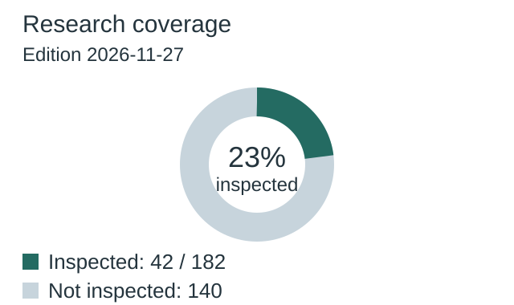
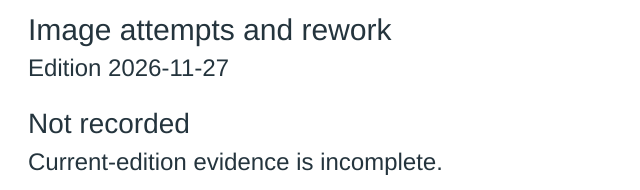
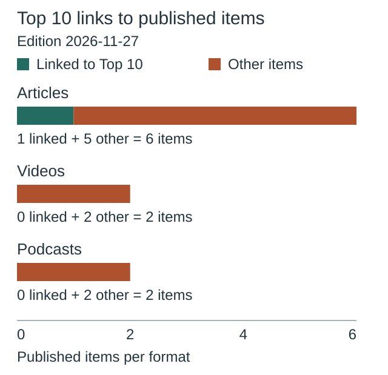
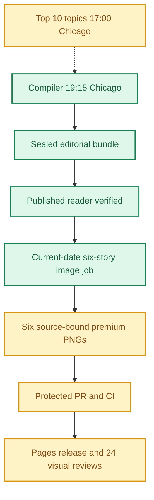
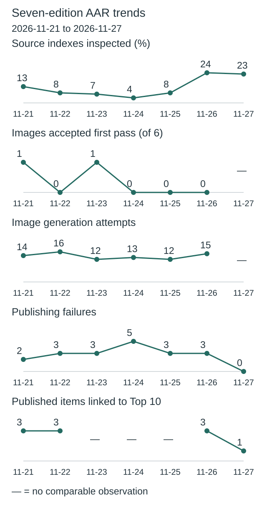
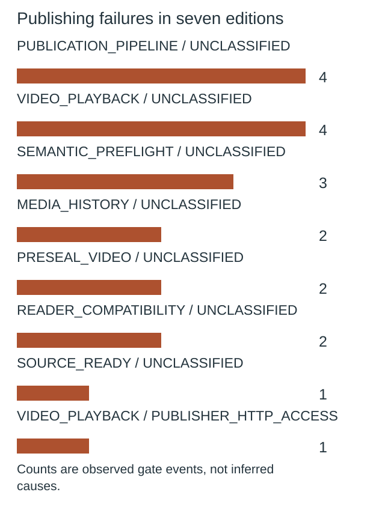
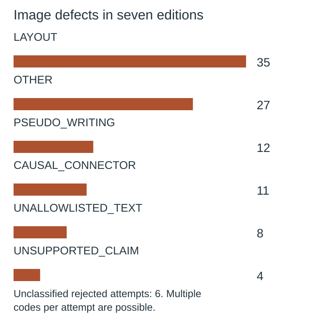

**🟨 RELEASE PARTIAL**
**TOP 10 PARTIAL** · **🟩 COMPILER VERIFIED** · **🟦 IMAGES 6/6 RELEASED** · **🟨 VISUAL QA NOT YET VERIFIED**

# Daily AI Brief — Unified Production After-Action Report
**Edition:** November 27, 2026 · **Production evening:** 2026-11-26 · **Timezone:** America/Chicago
**Primary public reader:** [Open 2026-11-27 Brief](https://gttome.github.io/Daily-AI-Brief-Compiler/briefs/2026-11-27/) · **Repository:** [Daily-AI-Brief-Compiler](https://github.com/gttome/Daily-AI-Brief-Compiler)

> **IMPORTANT — VERIFIED PRODUCTION RESULT**
> **Executive release result: PARTIAL.** This is the single management-facing report covering Top 10 topic discovery, the editorial Compiler, published Brief and premium-image run. **Entire-system evidence: PARTIAL.** Top 10 report: **partial**; Compiler handoff: **RECEIVED_SNAPSHOT_BOUND**; guided searches: **RECEIPTS_OBSERVED**. Compiler public status: **VERIFIED**. Image release: **RELEASED_VERIFIED**. Direct 24-context visual quality: **not yet evidenced**. Autonomous completion: **UNPROVEN**. Missing evidence must not be promoted to a success claim.

**🕒 Production stage durations:** **Top 10 6m 39s** · **Compiler final seal window 5m 57s** · **Premium Images Not independently recorded** (evidence-bounded elapsed times; the start/end events differ).

> **CLOSEOUT WARNING:** The exact image worker has not released its lease and recorded PUBLISHED_COMPLETE with the six accepted hashes.

## Evidence reconciliation

Compiler final seal window: 5m 57s. Compiler state start to public verification: 67m 05s. Observed execution and final seal windows are distinct.
Image capability route preflight: RECORDED; scheduler origin remains UNPROVEN.
Image efficiency: 0/6 first-pass accepts; 15 total attempts. Approved prospective efficiency target: at least 4/6 first-pass and no more than 8 total attempts, strictly advisory, with unchanged quality floor.
Image review completed: Not recorded; review-record commit: Not recorded; protected review merge: Not recorded.
Eligible source indexes: 182; editorial inspections reported: 42 (23.1%); inaccessible in editorial audit: 0; explicitly unreviewed IDs: 140; unclassified editorial IDs: 0. Automated index parsing is separate from editorial inspection and cannot substantiate exhaustive freshness claims.

Registered video sources: 37; attempted this edition: 37; unattempted: 0; enabled: 37; qualification-only: 0; sources yielding candidate URLs: 13. Status: REPORTED_ALL_ATTEMPTED. Attempt evidence is not automatic proof of source-content review or playback.

Eligible source partition **VALID**. Full original-item reads **15**. Bounded index searches **27**. Qualification-only sources recorded separately **0**.

### Video candidate discovery

| Discovery source | Eligibility | Candidate URLs |
|---|---|---:|
| Two Minute Papers — AI Research Explainers | Enabled | 1 |
| AI Engineer | Enabled | 2 |
| Google Cloud Tech YouTube | Enabled | 1 |
| GitHub YouTube | Enabled | 1 |
| IBM Technology YouTube | Enabled | 1 |
| Databricks YouTube | Enabled | 1 |
| Google for Developers Video Channel | Enabled | 1 |
| Microsoft Copilot Tutorial Videos | Enabled | 1 |
| Computerphile AI explanations | Enabled | 1 |
| MIT CSAIL research video archive | Enabled | 1 |
| Anthropic on YouTube | Enabled | 1 |
| Google DeepMind on YouTube | Enabled | 1 |
| OpenAI on YouTube | Enabled | 1 |

### Protected preseal video outcomes

| Original publisher | Distinct programs submitted | Archive rejects | Playback passes | Playback unverified | Probes skipped |
|---|---:|---:|---:|---:|---:|
| apple.com | 1 | 0 | 1 | 0 | 0 |
| ibm.com | 2 | 1 | 1 | 1 | 0 |
| microsoft | 1 | 0 | 0 | 1 | 0 |
| nvidia.com | 1 | 0 | 4 | 0 | 2 |
| openai | 1 | 0 | 0 | 1 | 0 |
| pbs.org | 1 | 1 | 0 | 0 | 0 |
| ted.com | 2 | 1 | 3 | 0 | 1 |
| worldsciencefestival.com | 1 | 0 | 0 | 1 | 0 |
| youtube-channel:UC_x5XG1OV2P6uZZ5FSM9Ttw | 1 | 0 | 0 | 1 | 0 |
| youtube-channel:UCKWaEZ-_VweaEx1j62do_vQ | 1 | 0 | 0 | 1 | 0 |

Outcomes count observed checks across all saved requests. Programs can be submitted again after a different slot changes.

- Vibe Coding vs. Agentic Coding: Which Should You Use? received PUBLIC_VIDEO_PLAYBACK_UNVERIFIED. [Original run](https://github.com/gttome/Daily-AI-Brief-Compiler/actions/runs/45924068293)
- 5 developer tips for working with Gemini 4 received PUBLIC_VIDEO_PLAYBACK_UNVERIFIED. [Original run](https://github.com/gttome/Daily-AI-Brief-Compiler/actions/runs/45924068293)
- Has AI Solved Math’s Pinnacle Problem? received PUBLIC_VIDEO_PLAYBACK_UNVERIFIED. [Original run](https://github.com/gttome/Daily-AI-Brief-Compiler/actions/runs/45924068293)
- Pressing Matters   AI received PRESEAL_ARCHIVE_REPEAT. Earlier editions 2026-11-13. [Original run](https://github.com/gttome/Daily-AI-Brief-Compiler/actions/runs/45925083825)
- How I created OpenClaw, the breakthrough AI agent received PRESEAL_ARCHIVE_REPEAT. Earlier editions 2026-11-12. [Original run](https://github.com/gttome/Daily-AI-Brief-Compiler/actions/runs/45925083825)
- Meet Dots: Personal AI Assistants received PUBLIC_VIDEO_PLAYBACK_UNVERIFIED. [Original run](https://github.com/gttome/Daily-AI-Brief-Compiler/actions/runs/45925402335)
- What are AI agents? (Part 1 of 10) received PUBLIC_VIDEO_PLAYBACK_UNVERIFIED. [Original run](https://github.com/gttome/Daily-AI-Brief-Compiler/actions/runs/45925857440)
- Reimagine business productivity with AI agents and assistants received PRESEAL_ARCHIVE_REPEAT. Earlier editions 2026-10-17. [Original run](https://github.com/gttome/Daily-AI-Brief-Compiler/actions/runs/45926567567)
- Putting AI to work for integration received PUBLIC_VIDEO_PLAYBACK_UNVERIFIED. [Original run](https://github.com/gttome/Daily-AI-Brief-Compiler/actions/runs/45926825197)

## Approved November 20 improvement evidence

Editorial runtime declarations: **DECLARED_RESTRICTED_EDITORIAL_RUNTIME**. Actual billing and scheduled origin remain unknown.

Video candidate evidence: **NOT_RECORDED**; substantive candidates Not recorded, non-news Not recorded, original publisher families Not recorded, selected non-news Not recorded. Targets 12 / 8 / 6 / 2 are advisory; unchanged duration, promotion, novelty and full-program playback checks still apply.

Source failure categories: PARSER_OR_OTHER 3, RESPONSE_SIZE_LIMIT 7, ACCESS_BLOCKED 6. Empty, blocked, oversized and unreviewed sources are distinct.

Original-paper cadence: one qualified paper within 3 editions when available. Current review timing PRESELECTION_FULL_METHODS_AND_RESULTS; postpublication review is not evidence of preselection reading.

- user-mediated social reasoning evaluation: published 65, unchanged-rubric calculation 65, retained original source links 1.

IMG19 artistic changes retain their existing November 22 three-eligible-edition evaluation. Missing pixels, owner feedback and usage remain unknown; no retrospective source, query or artwork acceptance is invented.

## Daily AAR charts

These charts use this edition’s receipts. Missing data is not zero.

### Research coverage



**42 of 182 indexes inspected (23%).**

| Editorial inspection | Indexes |
|---|---:|
| Inspected | 42 |
| Not inspected | 140 |

Not inspected includes every index without a recorded editorial inspection; this is not proof of missed stories.

### Image attempts and rework



**15 attempts; 0 of 6 images accepted on their first attempt.**

Recorded ongoing from November 8 target: at least 3/6 first-pass accepts; no more than 2 attempts per image. This is an efficiency target, not a quality cutoff.

| Image | Accepted | Rejected | Total attempts |
|---|---:|---:|---:|
| Production traffic becomes the verifier for an agent-written API migration | 1 | 2 | 3 |
| A website can advertise one search endpoint to visiting agents | 1 | 2 | 3 |
| A terminal coding agent exposes its harness as swappable capabilities | 1 | 1 | 2 |
| Scientists want agents judged on method, access and accountability | 1 | 1 | 2 |
| A social-reasoning test gives assistants verifiable hidden motives | 1 | 1 | 2 |
| Health workers report less general-purpose workplace AI use | 1 | 2 | 3 |

Generation attempts measure rework, not runtime or cost. Quality and publication checks remain separate.

### Top 10 links to published items



**1 of 10 unique published items link to Top 10 topics.**

| Format | Linked to Top 10 | Other items |
|---|---:|---:|
| Articles | 1 | 5 |
| Videos | 0 | 2 |
| Podcasts | 0 | 2 |

No selection quota. Topic linkage does not establish better quality, popularity or causal improvement.

[Chart data](charts.json)

One edition at a time. Missing evidence is not zero. Trend claims require comparable recorded cycles.

## Performance dashboard

| Measure | Recorded result | Source / caveat |
|:--|:--:|:--|
| Entire-system evidence | **PARTIAL** | Full Top 10 list, bound Compiler input, all-format search receipts and existing release checks; separate from publication and autonomy |
| Top 10 report | **partial · 10 topics** | Same Chicago cycle report; provisional/partial coverage remains disclosed |
| Top 10 received by Compiler | **RECEIVED_SNAPSHOT_BOUND** | Exact report snapshot bytes; consumed commit separately corroborated: YES |
| Top 10 guided article/video/podcast searches | **RECEIPTS_OBSERVED** | Actual source-search receipts and selected/rejected topic outcomes |
| Top 10 stage duration | **6m 39s** | Same-cycle run receipt only; no runtime or usage estimate |
| Editorial publication | **PASS** | State and public reader integrity receipt |
| **Unattended autonomy (separate from publication)** | **UNPROVEN** | Owner incident receipt takes precedence over unverified producer self-attestation |
| Recorded protected publishing gate failures | **0** | Actual same-edition GitHub failure sidecar only; earlier unrecorded failures remain unknown |
| Articles | **6** | Exactly 2 technical / 2 knowledge-worker / 2 agents required |
| Original scientific-paper-led articles | **1** | Rolling target: one qualified original paper in 3 editions; PRODUCER_REPORTED_BUNDLE_MATCH. Preprints are not peer-reviewed by default |
| Verified original sources within preceding 24 hours | **0 / 6** | Original publisher dates only; other sources require a documented fallback rationale |
| Distinct selected article publishers | **6** | Six different primary organizations preferred |
| Videos over seven days old | **2** | Must be labeled evergreen, not a new development |
| Distinct selected video publishers | **2** | One channel is one publisher even across multiple videos |
| Cross-media topic diversity | **FOUR_DISTINCT_EVENTS_REVIEW_RECORDED** | Four video/podcast events and six pairwise original-source comparisons; editorial claims remain producer-attested |
| Video discovery source attempts | **37 / 37** | Attempt evidence across enabled and qualification-only leads; REPORTED_ALL_ATTEMPTED. Not a claim of full content review or player verification | 
| Duplicate active Watchlist display titles | **0** | Published canonical Watchlist only; historical evidence retained |
| Original-release video playback (historical) | **TWO_PUBLISHED_VIDEOS_PLAYBACK_PASS** | Later reader corrections may replace these originally verified videos; see incident register | 
| Postpublication reader incidents | **NOT_RECORDED** | Edition-specific owner reports and corrective PRs, not inferred absence | 
| Verified postpublication video corrections | **NOT_RECORDED** | Incident register tracks correction PR, actual playback evidence and reader preservation |
| Editorial index second-pass attempts | **0** | Bounded public GET retries only; never proof of original article reading |
| Editorial index reads recovered | **0** | Successful page fetch can still yield zero eligible dated items |
| Recorded scheduler capability route | **UNPROVEN** | Same-invocation route receipt only; GitHub is not scheduler authentication |
| Avoidable incomplete-staging CI failures | **Not independently audited** | Existing image-package push CI is disabled; exact-head protected PR CI remains required. A failure count requires actual workflow evidence |
| Media | **2 videos + 2 podcasts** | Sealed bundle |
| **Compiler final seal window** | **5m 57s (5.9 min)** | Final sealed-state timestamp → verified public reader; initial execution is separate |
| **Image processing stage duration** | **Not independently recorded** | First accepted PNG Git checkpoint → final 24/24 review; auditable stage elapsed time |
| Image scheduled-to-final-review window | **Not independently recorded** | Only with a saved one-cycle schedule anchor; does not attest exact generation start |
| Executor-observed generation-to-final-review | **Not independently recorded** | Only if the worker recorded a same-execution clock before its first native call; not independently verified provider runtime |
| Accepted premium PNGs | **6 / 6** | Exact package and public release hashes |
| Native image generation attempts | **15** | Image worker AAR; no estimation |
| Rejected candidates | **9** | Image worker AAR |
| Final worker checkpoint reconciliation | **MISMATCH** | Oct25+ verifies exact generation count, per-story attempts, six accepted story/image/hash bindings and final release |
| Saved visual contexts | **Unverified** | Dated/permanent desktop/mobile review |
| Public SHA-256 checks | **44** | Image release receipt |
| October 8 immutable history | **17 / 17** | Independent content-preservation checks |
| **Owner-reported weekly Work usage for this run** | **Not reported** | No per-cycle usage supplied |

> **EFFICIENCY NOTE**
> **Resource reporting policy:** No usage figure was supplied for this cycle, so none is assumed. Future runs show **Not reported** unless the owner supplies new cycle-specific usage metadata. No approval or extra step is required to generate the AAR.

## Production architecture and checkpoints



## Daily AI Topic Top 10 and Compiler handoff

**Research cycle:** 2026-11-26 · **Target Brief:** 2026-11-27 · **Scheduled start:** 17:00 America/Chicago

| Dimension | Recorded evidence |
|---|---|
| Run/report result | PARTIAL |
| Report status / topics | partial / 10 |
| Freshness | FRESH\_AT\_CONSUMPTION |
| Compiler handoff | RECEIVED\_SNAPSHOT\_BOUND |
| Search coverage | RECEIPTS\_OBSERVED |
| Selection mapping verification | MATCHES\_EDITION\_BUNDLE |
| Observed start / finish | 2026-11-26T23:05:34Z / 2026-11-26T23:12:13Z |
| Elapsed minutes | 6.65 |
| Usage percent | Not reported |
| Cost USD | Not reported |
| Independent scheduler autonomy | UNPROVEN |
| Compiler-recorded consumed commit | ed17c425a36add7bd02b1b2fe3c77f8232d6c1c1 |
| Report SHA-256 | 69751748c0ada6592c5695f6e9bf606c1f80e5b5d0bc93fbb28b8af60b559301 |

| Discovery order | AI topic | Summary | Confidence | Evidence |
|---:|---|---|---|---|
| 1 | New critique renews attention to Claude-assisted mathematics | A fresh explainer questions the celebrated proof claim; the exact criticism still needs complete-program review. | low | [Source](https://www.youtube.com/watch?v=hwWlEuI359w) · [Source](https://leanprover-community.github.io/blog/posts/riemann-hypothesis/) |
| 2 | Anthropic explains verification loops for its Rust migration | The engineering account shows how shadow comparisons and human review constrained agent-written migration fixes. | medium | [Source](https://x.com/AnthropicAI/status/2125627317263466739) · [Source](https://www.anthropic.com/research/migrating-api-to-rust) |
| 3 | Vibe and agentic coding need different review boundaries | IBM compares coding workflows; the educational framing is not an independently measured productivity result. | low | [Source](https://www.youtube.com/watch?v=h4tHDFCPmQE) · [Source](https://www.ibm.com/think/topics/vibe-coding-vs-agentic-coding) |
| 4 | Software-factory rules keep generated code maintainable | Dex Horthy’s program addresses validation and accumulated code quality problems in agent-driven development. | low | [Source](https://www.youtube.com/watch?v=-NFMsM2y0Vk) · [Source](https://slopmanifesto.com/) |
| 5 | Hermes deployment gets a new practical walkthrough | A fresh walkthrough discusses keeping an agent running remotely; official installation guidance supports only deployment context. | low | [Source](https://www.youtube.com/watch?v=uClZwJ-BoSc) · [Source](https://hermes-agent.nousresearch.com/docs/getting-started/installation) |
| 6 | Obsidian connectors give agents access to shared notes | Official connector documentation distinguishes local file ownership from notes being processed by the chosen model. | medium | [Source](https://x.com/obsdmd/status/2125700941156651151) · [Source](https://obsidian.md/help/connectors) |
| 7 | Codex demonstrates editable graphics from visual references | The original demonstration and guide show how references guide editable vector and three-dimensional assets. | medium | [Source](https://www.youtube.com/watch?v=1u0hTd86_HU) · [Source](https://learn.chatgpt.com/guides/svg-3d-design) |
| 8 | A fresh recap revisits Claude Code permissions and verification | New commentary revisits an older original talk separating model guidance, enforceable restrictions and verification checkpoints. | medium | [Source](https://www.youtube.com/watch?v=nT_oMAIZ3P4) · [Source](https://ai.engineer/code/2026/talks/lydia-hallie) |
| 9 | Muse’s UK rollout raises permission and privacy questions | An independent news program examines personal-agent access while Meta’s original policy describes approval controls. | medium | [Source](https://www.youtube.com/watch?v=XgFrNPVzItU) · [Source](https://about.fb.com/news/2026/11/introducing-muse-in-the-uk-a-personal-ai-agent-you-control/) |
| 10 | Google publishes a short Gemini workflow tips program | A new original developer program offers workflow advice; its substance remains metadata-screened here. | low | [Source](https://www.youtube.com/watch?v=WN5O4vWCa54) |

**Sample scope:** {"metadata\_screened\_videos":31,"unique\_videos":31,"distinct\_screened\_channels":19,"full\_video\_reviews":0,"full\_program\_reviews":0,"complete\_transcript\_reviews":0,"direct\_youtube\_counter\_verifications":0,"full\_original\_statement\_reads":1,"complete\_original\_guides\_read":1,"complete\_original\_reading\_edition\_reviews":1,"complete\_original\_paper\_reviews":0,"original\_watch\_attempts":34,"unique\_watch\_programs":31,"original\_watch\_outcomes\_unique":{"throttled":28,"title\_shell":3},"comparable\_video\_observations":6,"screened\_source\_items":40,"retained\_source\_items":17,"screened\_and\_retained\_by\_category":{"video":{"screened":31,"retained":8},"public\_discussion\_post":{"screened":2,"retained":2},"original\_document":{"screened":7,"retained":7}},"trackers\_separately\_counted":5,"freshness\_counts":{"within\_24h\_timestamped":1,"additional\_within\_72h\_timestamped":10,"date\_only":17,"additional\_within\_7d\_timestamped":3},"freshness\_reference\_at":"2026-11-26T23:10:12Z","notes":"Explicit item ledger is bounded, not every incidental search result. Original document reading is not program review. Thirty-one metadata screens do not meet 40–80 substantive full-video target; 24h search widened to 72h and seven days. Older November 11 talk is background to a fresh recap, not a fresh original program."}. **Ranking basis:** {"attention":"YouTube reach and comparable same-program snapshots are main inputs; two event-specific social announcements supplement the mix. No raw audience sums or exact composite score.","uncertainty":"One attention publisher per retained topic; all ten weaken upon family removal. Direct counters/playback unavailable. Tracker clocks preserved separately from observation. WITL header refreshed later than counter check; actual video measurement uses 06:58 Eastern, not 07:05 update or 17:08 page header."}.

| Search format | Receipt rows | Attempts recorded | Explicitly not attempted |
|---|---:|---:|---:|
| article | 10 | 10 | 0 |
| video | 10 | 10 | 0 |
| podcast | 10 | 10 | 0 |

**Selected Brief items linked to trends:**

| Topic | Format | Selected item | Reason |
|---|---|---|---|
| anthropic-messages-rust-migration-nov25 | article | nov27-t1-rust-migration-verifiers · [Source](https://www.anthropic.com/research/migrating-api-to-rust) | The original report supplied the selected migration story and was encountered in the exact candidate-bound article search. |

**Gaps and limitations:**

- The report labels its research partial.
- Partial research: 31 video metadata records across 19 channels; zero complete programs/transcripts/direct counters.
- All ten retained topics depend on one originating attention family; quantitative global order unsupported.
- Missing duration, publication precision, measurement clock, sponsorship or counters remain null.
- Prior published selections cannot establish current Compiler searches or causal improvement. Current downstream PENDING.
- No November 10 pilot, new task, paid service, production/image changes or historical rewrite.

**Recorded run issues:**

- {"problem":"Original YouTube access incomplete","effect":"28 unique watch routes throttled; three title shells. No complete program or direct counter verification.","correction":"Used bounded original-document fallback and kept partial status."}
- {"problem":"Original manifesto, IBM and Obsidian direct routes unavailable; BBC robots block; AEAIO video route stale October shell","effect":"No complete source/program review inferred; stale shell excluded from current sample.","correction":"Indexed original Obsidian and Meta text used with explicit scope; no unrelated program substituted."}
- {"problem":"Initial publisher-family validation failed","effect":"Tracker measurement URL occupied source\_url, preventing canonical attention URL partition.","correction":"Moved tracker URL to measurement\_source\_url and kept original event URL in source\_url; reran all ten family checks successfully before commit."}
- {"problem":"First local validator fetch used nonexistent scripts/lib paths","effect":"Four read-only 404 responses; no remote changes.","correction":"Fetched actual scripts/\*.mjs at pinned main and used those bytes for validation."}

**Recorded improvements:**

- {"status":"IMPLEMENTED\_PRODUCER\_METHOD","change":"Read migration verification mechanism and connector privacy constraints from original sources.","observed\_effect":"Added concrete caveats beyond metadata; full-program depth still zero.","production\_effectiveness":"UNPROVEN"}
- {"status":"VERIFIED\_LOCAL\_CORRECTION","change":"Separate original attention URL and tracker measurement URL.","observed\_effect":"Current-main attribution validator passes for all ten topics.","production\_effectiveness":"This validates producer bookkeeping, not downstream editorial benefit."}
- {"status":"PROPOSED\_EXISTING\_COMPILER\_ACTION","change":"Qualify rank 7 original program, check prior guide/story novelty and bind exact bytes to genuine searches.","observed\_effect":"PENDING"}

### Daily improvement and effect on the Brief

**Fixed baseline:** nov03-2026-v1 / INPUT\_FROZEN. **Outcome baseline:** FROZEN\_AFTER\_VERIFIED\_PUBLICATION. **Prior cycle:** 2026-11-25.

| Input measure | Current | November 3 baseline | Change from baseline | Change from prior cycle |
|---|---:|---:|---:|---:|
| topic count | 10 | 10 | 0 | 0 |
| validation resource count | Not reported | 14 | Not reported | Not reported |
| additional video metadata records | Not reported | 63 | Not reported | Not reported |
| additional video channels | Not reported | 21 | Not reported | Not reported |
| total video observations | Not reported | 79 | Not reported | Not reported |
| unique videos | Not reported | 71 | Not reported | Not reported |
| full video reviews | Not reported | 0 | Not reported | Not reported |
| direct youtube counter verifications | Not reported | 0 | Not reported | Not reported |
| broader evidence band topics | 0 | 3 | -3 | -2 |
| limited evidence band topics | 10 | 7 | 3 | 2 |

**Observed downstream measurements:** OBSERVED.

| Outcome measure | Current | Change from frozen outcome | Change from prior cycle |
|---|---:|---:|---:|
| expected topic format pairs | 30 | 0 | 0 |
| attempted topic format pairs | 30 | 0 | 0 |
| explicitly unattempted pairs | 0 | 0 | 0 |
| discovered candidate count | 24 | -16 | 0 |
| searched source host count | 18 | 2 | 1 |
| selected article count | 1 | -2 | -1 |
| selected video count | 0 | 0 | 0 |
| selected podcast count | 0 | -1 | -1 |

**Source changes:** {"added":\[\],"removed":\[\]}.

**Candidate review depth:** NOT\_RECORDED.

| Review measure | Current | Change from prior comparable cycle |
|---|---:|---:|
| reviewed candidate count | Not reported | Not reported |
| qualified candidate count | Not reported | Not reported |
| rejected candidate count | Not reported | Not reported |
| metadata only count | Not reported | Not reported |
| full video reviews | Not reported | Not reported |
| transcript reviews | Not reported | Not reported |

The frozen November 3 baseline has no candidate-level review ledger; no retrospective value is invented. Recorded reviews do not independently establish content quality, audience interest or causal benefit.

**Method/resource review:** {"baseline\_id":"nov03-2026-v1","previous\_report\_date":"2026-11-25","method\_version":"2026-11-03.2-event-review","changes":\[{"change":"Read an event-matched original migration mechanism and indexed connector privacy guidance.","reason":"Prior run still had zero complete media reviews; additional counters alone cannot improve substantive understanding.","expected\_effect":"More useful boundaries and verification caveats for Compiler qualification."}\],"resource\_candidates":\[{"url":"https://obsidian.md/help/connectors","role":"claim","access":"indexed\_only","review\_scope":"Substantive indexed original requirements/privacy text; direct retrieval unavailable","independence":"Original Obsidian documentation shares the launch-post family; not independent audience evidence.","decision":"accepted","reason":"Explains that local ownership does not keep model-processed notes local.","contribution":"Ranks 6 privacy and setup constraints."},{"url":"https://www.anthropic.com/research/migrating-api-to-rust","role":"claim","access":"direct","review\_scope":"Substantive original sections read: 43–64, 93–150, 153–185; not claiming complete article coverage. Single-run replay, fingerprint grouping, review seam and production loop inspected.","independence":"Same Anthropic announcement family; no independent performance replication.","decision":"accepted","reason":"Documents an actual human review seam and local-versus-production verification limits.","contribution":"Rank 2 mechanism and vendor-performance caveats."}\],"observed\_effects":{"status":{"publication":"VERIFIED","images":"RELEASED\_AND\_24\_CONTEXTS\_VERIFIED","top10":"RECEIPTS\_OBSERVED","system":"PARTIAL","autonomy":"UNPROVEN","runtime\_policy":"DECLARED\_RESTRICTED\_EDITORIAL\_RUNTIME","usage":"UNKNOWN"},"handoff":"RECEIVED\_SNAPSHOT\_BOUND","search\_counts":{"article":{"recorded":10,"attempted":10,"not\_attempted":0},"video":{"recorded":10,"attempted":10,"not\_attempted":0},"podcast":{"recorded":10,"attempted":10,"not\_attempted":0}},"selected\_mappings":\[{"topic\_id":"anthropic-siren-sandbox-evaluation-nov24","format":"article","item\_id":"nov26-t1-siren-agent-boundaries","candidate\_id":"TOP10-16-1","url":"https://safeguards.anthropic.com/2026/siren/","reason":"Exact original report selected after complete methods and limitations review."},{"topic\_id":"codex-svg3d-original-demo-nov24","format":"article","item\_id":"nov26-k2-svg-design-skill","candidate\_id":"TOP10-19-1","url":"https://learn.chatgpt.com/guides/svg-3d-design","reason":"Exact original guide selected as the edition single Agent Skills story."},{"topic\_id":"dex-horthy-software-factory-rules-upload-nov23","format":"podcast","item\_id":"https://podcastdex.com/podcast/mts/stop-sending-walls-of-unread-ai-slop-dex-horthy","candidate\_id":"TOP10-9-1","url":"https://podcastdex.com/podcast/mts/stop-sending-walls-of-unread-ai-slop-dex-horthy","reason":"Exact complete episode selected after publisher-RSS chapter review, identity/date verification and show-family cooldown checks."}\],"selection\_mapping\_status":"MATCHES\_EDITION\_BUNDLE","charts":{"schema\_version":"daily-ai-brief-aar-charts-v1","edition\_date":"2026-11-26","charts":\[{"id":"research-coverage","title":"Research coverage","description":"Editorial source-index inspection; automated fetches are excluded.","status":"OBSERVED","rows":\[{"label":"Inspected","value":43},{"label":"Not inspected","value":139}\],"total":182,"inspected\_percent":24,"note":"Not inspected includes every index without a recorded editorial inspection; this is not proof of missed stories."},{"id":"image-rework","title":"Image attempts and rework","description":"Accepted and rejected candidates for each final image.","status":"OBSERVED","rows":\[{"id":"nov26-t1-siren-agent-boundaries","label":"A sandbox benchmark exposes where agent boundaries still fail","accepted":1,"rejected":1},{"id":"nov26-t2-accessible-vibe-coding","label":"Accessibility instructions help generated sites, but can trade away function","accepted":1,"rejected":1},{"id":"nov26-a1-agentic-coding-boundaries","label":"Vibe coding and agentic coding need different review boundaries","accepted":1,"rejected":3},{"id":"nov26-a2-foundry-trace-optimization","label":"Agent traces can propose prompt and tool changes before promotion","accepted":1,"rejected":1},{"id":"nov26-k1-shellbench","label":"ShellBench measures whether computer agents finish safely, not just correctly","accepted":1,"rejected":1},{"id":"nov26-k2-svg-design-skill","label":"Editable SVG checks keep reference-based designs usable across formats","accepted":1,"rejected":2}\],"total\_attempts":15,"first\_pass\_accepted":0,"target":{"first\_pass":3,"max\_attempts":2,"window":"ongoing from November 8"},"note":"Generation attempts measure rework, not runtime or cost. Quality and publication checks remain separate."},{"id":"top10-selection","title":"Top 10 links to published items","description":"Unique published items by format, not the number of topic mappings.","status":"OBSERVED","rows":\[{"label":"Articles","linked":2,"other":4},{"label":"Videos","linked":0,"other":2},{"label":"Podcasts","linked":1,"other":1}\],"linked\_items":3,"total\_items":10,"note":"No selection quota. Topic linkage does not establish better quality, popularity or causal improvement."}\],"interpretation":"One edition at a time. Missing evidence is not zero. Trend claims require comparable recorded cycles."},"seven\_edition\_summary":{"coverage\_percent":{"recorded\_editions":7,"median":8},"first\_pass\_accepted":{"recorded\_editions":7,"median":0},"image\_attempts":{"recorded\_editions":7,"median":14},"top10\_linked\_items":{"recorded\_editions":3,"median":3},"publication\_failures":{"recorded\_editions":7,"median":3}},"daily\_action\_review":{"schema\_version":"daily-aar-action-review-v1","edition\_date":"2026-11-26","mode":"DAILY\_EVIDENCE\_LED\_TRIAGE","next\_cumulative\_review":"2026-12-02","cumulative\_review\_due\_today":false,"finding\_count":3,"open\_production\_blockers":0,"findings":\[{"id":"PROTECTED\_GATE\_FAILURES","priority":"P1","owner":"Compiler / Recovery","observation":"3 failed protected publication gates were recorded (3 unclassified causes).","action":"Read original failed job logs, record real causes and move the relevant existing validation before the next readiness signal; do not replay the released edition.","timing":"NEXT\_GENUINE\_CYCLE","kind":"RECURRENCE\_PREVENTION"},{"id":"PREMIUM\_IMAGE\_REWORK","priority":"P1","owner":"Images","observation":"9 rejected image candidates preceded the verified six-image release.","action":"Inspect saved rejection evidence and apply source-specific geometry, causal-arrow and label corrections before the next native generation.","timing":"NEXT\_GENUINE\_CYCLE","kind":"EFFICIENCY\_LESSON"},{"id":"SCHEDULER\_ORIGIN\_UNPROVEN","priority":"P2","owner":"Compiler / Recovery","observation":"Publication success does not independently attest the originating scheduler.","action":"Capture real first-party scheduler and execution evidence if available; do not convert unknown provenance into a failure or a success.","timing":"NEXT\_GENUINE\_CYCLE","kind":"EVIDENCE\_GAP"}\],"limitations":\["This report records findings and next actions; it does not execute corrections.","Existing owners must fix safe same-cycle faults immediately, without waiting for the cumulative review date.","A released edition remains immutable; lessons apply prospectively to the next genuine cycle.","Missing observations are not zero; no causality, autonomous recovery or effectiveness is inferred."\]},"charted\_aar\_url":"https://github.com/gttome/Daily-AI-Brief-Compiler/blob/be9b3845e6243b39bdc0b8906dc11bd5d65d7237/daily/2026-11-25/combined.md","chart\_data\_url":"https://github.com/gttome/Daily-AI-Brief-Compiler/blob/be9b3845e6243b39bdc0b8906dc11bd5d65d7237/daily/2026-11-25/charts.json","improvement\_metrics\_url":"https://github.com/gttome/Daily-AI-Brief-Compiler/blob/be9b3845e6243b39bdc0b8906dc11bd5d65d7237/daily/2026-11-25/improvement-metrics.json","downstream\_impact\_table\_url":"https://github.com/gttome/Daily-AI-Brief-Compiler/blob/be9b3845e6243b39bdc0b8906dc11bd5d65d7237/daily/2026-11-25/combined.md#daily-ai-topic-top-10-and-compiler-handoff","interpretation":"Earlier edition evidence only: bound input, 30 attempted slots and verified mappings observed; 2 articles, 0 videos, 1 podcast linked. Association, not causal quality gain. Current edition downstream remains pending."},"change\_evaluations":\[{"change\_id":"NOV15-02","result":"met","reason":"Latest earlier AAR records RECEIVED\_SNAPSHOT\_BOUND and ten attempted slots per format with three final mappings; this does not prove today’s future consumer outcome.","reviewed\_edition":"2026-11-27","decision":"keep","evidence\_refs":\["https://github.com/gttome/Daily-AI-Brief-Compiler/blob/be9b3845e6243b39bdc0b8906dc11bd5d65d7237/daily/2026-11-25/combined.json","https://github.com/gttome/Daily-AI-Brief-Compiler/blob/be9b3845e6243b39bdc0b8906dc11bd5d65d7237/daily/2026-11-25/improvement-metrics.json"\]},{"change\_id":"NOV20-01","result":"met","reason":"Earlier reconciled AAR records 30 actual slots and candidate-bound selected mappings. Current producer supplies queries only; consumer searches remain pending.","reviewed\_edition":"2026-11-27","decision":"keep","evidence\_refs":\["https://github.com/gttome/Daily-AI-Brief-Compiler/blob/be9b3845e6243b39bdc0b8906dc11bd5d65d7237/daily/2026-11-25/combined.json","https://github.com/gttome/Daily-AI-Brief-Compiler/blob/be9b3845e6243b39bdc0b8906dc11bd5d65d7237/daily/2026-11-25/improvement-metrics.json"\]},{"change\_id":"NOV20-04","result":"not\_met","reason":"Current original document depth improved the mechanism evidence, but zero full programs or complete transcripts leaves substantive media review targets unmet.","reviewed\_edition":"2026-11-27","decision":"keep","evidence\_refs":\["https://github.com/gttome/Daily-AI-Brief-Compiler/blob/be9b3845e6243b39bdc0b8906dc11bd5d65d7237/daily/2026-11-25/combined.json","https://github.com/gttome/Daily-AI-Brief-Compiler/blob/be9b3845e6243b39bdc0b8906dc11bd5d65d7237/daily/2026-11-25/improvement-metrics.json"\]},{"change\_id":"NOV20-05","result":"inconclusive","reason":"Independent explanation and original practical demo leads identified; current complete-program review and final non-news selection targets not established.","reviewed\_edition":"2026-11-27","decision":"keep","evidence\_refs":\["https://github.com/gttome/Daily-AI-Brief-Compiler/blob/be9b3845e6243b39bdc0b8906dc11bd5d65d7237/daily/2026-11-25/combined.json","https://github.com/gttome/Daily-AI-Brief-Compiler/blob/be9b3845e6243b39bdc0b8906dc11bd5d65d7237/daily/2026-11-25/improvement-metrics.json"\]},{"change\_id":"NOV20-09","result":"inconclusive","reason":"No complete scientific manuscript read in this producer run; paper-led rolling editorial qualification remains with the Compiler.","reviewed\_edition":"2026-11-27","decision":"keep","evidence\_refs":\["https://github.com/gttome/Daily-AI-Brief-Compiler/blob/be9b3845e6243b39bdc0b8906dc11bd5d65d7237/daily/2026-11-25/combined.json","https://github.com/gttome/Daily-AI-Brief-Compiler/blob/be9b3845e6243b39bdc0b8906dc11bd5d65d7237/daily/2026-11-25/improvement-metrics.json"\]},{"change\_id":"NOV20-10","result":"met","reason":"Earlier publication/images and handoff evidence are separated from overall partial evidence and unknown usage/autonomy; current production remains pending.","reviewed\_edition":"2026-11-27","decision":"keep","evidence\_refs":\["https://github.com/gttome/Daily-AI-Brief-Compiler/blob/be9b3845e6243b39bdc0b8906dc11bd5d65d7237/daily/2026-11-25/combined.json","https://github.com/gttome/Daily-AI-Brief-Compiler/blob/be9b3845e6243b39bdc0b8906dc11bd5d65d7237/daily/2026-11-25/improvement-metrics.json"\]}\],"next\_improvement":"Compiler to qualify the original short demo against archive and playback, then independently snapshot these exact bytes and record real candidate-bound searches across all three formats.","limitations":\["Method implementation is not evidence of improved future outcomes.","Sample fell from 33 to 31 metadata videos; publisher mix and item definitions limit count comparison. Prior 46 item ledger versus current 40 does not measure audience decline.","Protected improvement register unchanged; evaluations recorded through authorized daily\_improvement."\]}.

**Current reconciled conclusion:** OBSERVED; outcome baseline FROZEN\_AFTER\_VERIFIED\_PUBLICATION; candidate review ledger NOT\_RECORDED.

**Historical producer observations (not current status):** The following snapshot preserves what the producer reported at the time. Its pending statuses and candidate-quality claims are not independently reconciled conclusions. Use the current tables above for publication-bound measurements; an absent candidate review ledger remains unknown.

<details><summary>Original producer effects and gaps — historical snapshot</summary>

```json
null
```

</details>

**Next improvement:** Compiler to qualify the original short demo against archive and playback, then independently snapshot these exact bytes and record real candidate-bound searches across all three formats.

Counts show coverage and observed association, not audience popularity, source independence, candidate quality or causal uplift. Compare source/method changes before interpreting deltas. Unknown values are not zero. Publication, reader corrections, runtime and image outcomes retain their separate AAR evidence.

Report, source-readback and search receipts are separate observations. Snapshot binding verifies the collected report bytes; the consumed commit is independently corroborated only when the separately fetched source bytes match. These records do not independently attest scheduler identity or source truth. Top 10 reporting does not change Brief/image release status.


## Track 1 — Compiler

**State:** `SHADOW_VERIFIED` · **Bundle:** `BUNDLE_READY` · **Compiler final seal window:** 5m 57s (5.9 min).

| Publication gate | Result |
|---|:---:|
| Canonical reader build | ✅ |
| Reader parity | ✅ |
| Public verification of dated edition | ✅ |
| Previous editions preserved | ✅ |
| Permanent story routes and feeds | ✅ |

**Selected coverage:**

| Lane | Story |
|---|---|
| Technical AI Engineering | Production traffic becomes the verifier for an agent-written API migration |
| Technical AI Engineering | A website can advertise one search endpoint to visiting agents |
| Applied Generative AI for Knowledge Workers | A terminal coding agent exposes its harness as swappable capabilities |
| Applied Generative AI for Knowledge Workers | Scientists want agents judged on method, access and accountability |
| Agents for Everyone | A social-reasoning test gives assistants verifiable hidden motives |
| Agents for Everyone | Health workers report less general-purpose workplace AI use |

### Scientific paper opportunity and publication evidence

**Current edition:** PRODUCER_REPORTED_BUNDLE_MATCH; **paper-led stories:** 1. Editorial target: at least one genuinely qualified original-paper-based story in seven editions, with methods, limitations, and an explicit preprint/peer-review distinction. No stale or weak paper is selected solely to fill a quota.
- Workplace Artificial Intelligence Use in Health Care and Non–Health Care Occupations (PEER_REVIEWED): https://doi.org/10.1001/jamahealthforum.2026.4427 — linked article: nov27-e2-healthcare-workplace-ai-gap.


## Track 2 — Premium images

**Public status:** `RELEASED_VERIFIED` · **Saved images:** 6/6 · **Actual generation attempts:** 15 · **Rejected candidates:** 9.

### Image production duration — Git-verified milestones

**Auditable image stage duration:** **Not independently recorded** (first accepted binary saved in Git → first persisted 24-context quality-review record). **First asset to public image release:** **Not independently recorded**.
**Scheduled-to-final-review window:** **Not independently recorded**. This is a scheduled-clock comparison only when a separately recorded exact-date schedule exists; it is **not** measured native image-generation runtime.

| Production milestone | Chicago local time | Evidence |
|---|---|---|
| Scheduled image start (if exact-date record exists) | Not independently recorded | Time planned, not actual execution start |
| First executor-observed start | Not independently recorded | Worker self-attestation, not a first-party scheduler event |
| First native generation observation | Not independently recorded | Worker clock recorded immediately before first native call, not model-provider telemetry |
| First accepted PNG bytes saved to Git | Not independently recorded | Immutable binary-stage commit |
| Six-image package / reviews committed | Not independently recorded | Exact-head PR source commit |
| Protected package merged | Not independently recorded | Merge SHA and required CI |
| Public images verified | Not independently recorded | Image-release receipt |
| 24/24 review record committed | Not independently recorded | Immutable first review-approval commit |

> **Duration interpretation:** The audited stage excludes unobservable pre-checkpoint creative work. The scheduled-start window includes it but must not be interpreted as precise active processing time. Missing timestamps appear as **Not independently recorded**, never an estimate.


| Source-bound image | Attempts | File size | Public page |
|---|---:|---:|---|
| Production traffic becomes the verifier for an agent-written API migration | 3 | 1.06 MiB | [View original](https://gttome.github.io/Daily-AI-Brief-Compiler/briefs/images/2026-11-27/dab-edition-2026-11-27-m01.png) |
| A website can advertise one search endpoint to visiting agents | 3 | 0.88 MiB | [View original](https://gttome.github.io/Daily-AI-Brief-Compiler/briefs/images/2026-11-27/dab-edition-2026-11-27-m02.png) |
| A terminal coding agent exposes its harness as swappable capabilities | 2 | 0.89 MiB | [View original](https://gttome.github.io/Daily-AI-Brief-Compiler/briefs/images/2026-11-27/dab-edition-2026-11-27-m10.png) |
| Scientists want agents judged on method, access and accountability | 2 | 0.79 MiB | [View original](https://gttome.github.io/Daily-AI-Brief-Compiler/briefs/images/2026-11-27/dab-edition-2026-11-27-m11.png) |
| A social-reasoning test gives assistants verifiable hidden motives | 2 | 0.76 MiB | [View original](https://gttome.github.io/Daily-AI-Brief-Compiler/briefs/images/2026-11-27/dab-edition-2026-11-27-m12.png) |
| Health workers report less general-purpose workplace AI use | 3 | 0.83 MiB | [View original](https://gttome.github.io/Daily-AI-Brief-Compiler/briefs/images/2026-11-27/dab-edition-2026-11-27-m14.png) |

**Immutable-release and visual gates:**

| Release gate | Result |
|---|:---:|
| Protected public image receipt | ✅ |
| Accepted-image Git hash bindings | ✅ |
| Six live PNGs | 6/6 |
| Dated/permanent story placements | 12/12 recorded in release evidence |
| Desktop/mobile visual inspection | Not verified |
| Historical Oct 8 integrity | 17/17 |

### Published premium illustrations

<table>
<tr><td width="50%"><a href="https://gttome.github.io/Daily-AI-Brief-Compiler/briefs/images/2026-11-27/dab-edition-2026-11-27-m01.png"></a><br/><b>Production traffic becomes the verifier for an agent-written API migration</b></td><td width="50%"><a href="https://gttome.github.io/Daily-AI-Brief-Compiler/briefs/images/2026-11-27/dab-edition-2026-11-27-m02.png"></a><br/><b>A website can advertise one search endpoint to visiting agents</b></td></tr>
<tr><td width="50%"><a href="https://gttome.github.io/Daily-AI-Brief-Compiler/briefs/images/2026-11-27/dab-edition-2026-11-27-m10.png"></a><br/><b>A terminal coding agent exposes its harness as swappable capabilities</b></td><td width="50%"><a href="https://gttome.github.io/Daily-AI-Brief-Compiler/briefs/images/2026-11-27/dab-edition-2026-11-27-m11.png"></a><br/><b>Scientists want agents judged on method, access and accountability</b></td></tr>
<tr><td width="50%"><a href="https://gttome.github.io/Daily-AI-Brief-Compiler/briefs/images/2026-11-27/dab-edition-2026-11-27-m12.png"></a><br/><b>A social-reasoning test gives assistants verifiable hidden motives</b></td><td width="50%"><a href="https://gttome.github.io/Daily-AI-Brief-Compiler/briefs/images/2026-11-27/dab-edition-2026-11-27-m14.png"></a><br/><b>Health workers report less general-purpose workplace AI use</b></td></tr>
</table>

## Incidents, corrections and learning

### Postpublication reader incidents (updated when new evidence is merged)

No current-edition postpublication incident register was available; this is **NOT_RECORDED**, not a certification of zero incidents.


**Editor recovery classification:** UNPROVEN. **Owner intervention:** Unproven either way. **Protected same-edition failures recorded:** 0. 
**Latest failed protected stage:** Not in same-edition receipts; [Action evidence](https://github.com/gttome/Daily-AI-Brief-Compiler/actions). Exact stage durations are available only where real source timestamps exist.

| Stage | Verified issue | Corrective action |
|---|---|---|
| Native image generation | Actual first export added gears, wrench, approval seal, repeated labels, simulated writing and an arrow terminating on lettering; margins measured3/10/2/7px. | The exact source-bound replacement plan was frozen and validated before its native call. Actual final1200x630 and320px pixels were inspected; only passing originals were locked. |
| Native image generation | Second export removed unsupported symbols and duplicate labels, but margins28/36/29/22px still failed. | The exact source-bound replacement plan was frozen and validated before its native call. Actual final1200x630 and320px pixels were inspected; only passing originals were locked. |
| Native image generation | First export had margins5/22/10/11px and anonymous folds hiding crawl/conversion details. | The exact source-bound replacement plan was frozen and validated before its native call. Actual final1200x630 and320px pixels were inspected; only passing originals were locked. |
| Native image generation | Second export exposed crawl/conversion and matched-page detail but its21px bottom shadow margin failed. | The exact source-bound replacement plan was frozen and validated before its native call. Actual final1200x630 and320px pixels were inspected; only passing originals were locked. |
| Native image generation | First export had21px bottom margin and an unexplained lower workspace interface. | The exact source-bound replacement plan was frozen and validated before its native call. Actual final1200x630 and320px pixels were inspected; only passing originals were locked. |
| Native image generation | First export had36px bottom margin, an unnecessary caveat leader and a closed file compartment without explicit outside-scope meaning. | The exact source-bound replacement plan was frozen and validated before its native call. Actual final1200x630 and320px pixels were inspected; only passing originals were locked. |
| Native image generation | First export met the44px minimum margin but added three simulated writing lines, botanical ornament and glossy decorative china treatment. | The exact source-bound replacement plan was frozen and validated before its native call. Actual final1200x630 and320px pixels were inspected; only passing originals were locked. |
| Native image generation | First export had35/34/55/22px margins and omitted the occupational comparison behind lower/higher use. | The exact source-bound replacement plan was frozen and validated before its native call. Actual final1200x630 and320px pixels were inspected; only passing originals were locked. |
| Native image generation | Second export corrected the comparison population but its22px top and21px bottom margins still failed. | The exact source-bound replacement plan was frozen and validated before its native call. Actual final1200x630 and320px pixels were inspected; only passing originals were locked. |
| Exact binary readback | Connected base64 readback returned empty content for the1.11MiB first accepted PNG; five other complete connected readbacks matched. | Reused the accepted bytes with immutable Git fetch/git-show readback and exact byte comparison plus independent SHA256. All six also passed actual fixed256KiB-offset transfer/reassembly. |
| Pre-call correction validation | The healthcare third-attempt margin-plan refinement created overlapping context and medical labels; existing validation rejected it before generation. | Moved the medical-care label below its context heading, recomputed the exact prompt geometry digest and reran the unchanged validator successfully before the one actual third call. |
| Checkpoint schema compatibility | The initial own worker receipt used a noncanonical schema label and story/hash objects in accepted_hashes rather than the reporting schema string array. | Before the first package PR, retained the same token, clock observations, source bindings and owned branch; aligned image-worker-state-v1, accepted_images and string accepted_hashes through an expected-head write. |

> **OPERATIONAL NOTE**
> This report distinguishes a published and verified production outcome from scheduler metadata exposed to another conversation. Lack of a live host heartbeat in a separate normal chat is not a Compiler production failure.

## Usage and cost stewardship

| Item | Per-cycle value |
|---|---|
| **Weekly Work usage reported by owner** | **Not reported** |
| Internal weekly usage reference | Target under 5% |
| Genuine image-generation attempts | 15 |
| Accepted diagrams | 6 |
| Regeneration after acceptance | 0 |
| Top 10 reported usage | Not reported |
| Top 10 reported cost | Not reported |
| Account-level billing telemetry | Not independently accessible to deterministic GitHub reporting |

**Future reporting rule:** For cycles without an optional owner-usage record, publish the complete AAR with `Not reported`; do not reuse prior percentages, guess remaining weekly credits or delay tomorrow's production.

## Next-edition operating handoff

| Control | Recurring contract |
|---|---|
| AI Topic Top 10 | Sole report task · 17:00 America/Chicago · saved dated list guides same-evening research |
| Primary Compiler | Sole existing task · 19:15 America/Chicago |
| Premium image production | Sole existing task · standard 21:15 America/Chicago |
| Exact image job selection | Newly published next-date `PUBLISHED_PENDING` only |
| AAR | Combined report generated automatically from new GitHub receipts |
| Optional Work usage | Owner-supplied per cycle, otherwise `Not reported` |

> **SCHEDULE RESTORATION NOTE**
> A temporary scheduling exception must be explicitly restored before claiming standard-time readiness. This deterministic document generator reads existing state only; it does not modify production schedules.

## Evidence register

| Evidence | Link |
|---|---|
| Compiler state | [Open receipt](https://github.com/gttome/Daily-AI-Brief-Compiler/blob/shadow/2026-11-27/shadow-runs/2026-11-27/compiler-state.json) |
| Compiler compile receipt | [Open receipt](https://github.com/gttome/Daily-AI-Brief-Compiler/blob/shadow/2026-11-27/shadow-runs/2026-11-27/compiler/compile-receipt.json) |
| Compiler public integrity | [Open receipt](https://github.com/gttome/Daily-AI-Brief-Compiler/blob/shadow/2026-11-27/shadow-runs/2026-11-27/compiler/postpublish-integrity.json) |
| Image release receipt | [Open receipt](https://github.com/gttome/Daily-AI-Brief-Compiler/blob/shadow-pages-history/site/image-jobs/2026-11-27/release.json) |
| Image review | [Open receipt](https://github.com/gttome/Daily-AI-Brief-Compiler/blob/main/external-image-packages/2026-11-27/reviews/live/image-element24/semantic-reviews.json) |
| Original image AAR | [Open receipt](https://github.com/gttome/Daily-AI-Brief-Compiler/blob/main/external-image-packages/2026-11-27/reviews/after-action.md) |
| Observed editorial index retries | [Open receipt](https://github.com/gttome/Daily-AI-Brief-Compiler/blob/shadow/2026-11-27/shadow-runs/2026-11-27/editorial/source-item-retries.json) |
| Scientific paper selection review | [Open receipt](https://github.com/gttome/Daily-AI-Brief-Compiler/blob/shadow/2026-11-27/shadow-runs/2026-11-27/editorial/scientific-paper-coverage.json) |
| Published player playback receipt | [Open receipt](https://github.com/gttome/Daily-AI-Brief-Compiler/blob/shadow/2026-11-27/shadow-runs/2026-11-27/compiler/postpublish-video-playback.json) |
| Top 10 ranked topic report | [Open receipt](https://github.com/gttome/Daily-AI-Brief-Compiler/blob/f38e954a3ebf96191140ab98f570ab0c5bc88e97/signals/ai-topic-top10/2026-11-26.json) |
| Top 10 run after-action receipt | [Open receipt](https://github.com/gttome/Daily-AI-Brief-Compiler/blob/f38e954a3ebf96191140ab98f570ab0c5bc88e97/signals/ai-topic-top10/2026-11-26.aar.json) |
| Compiler Top 10 input snapshot | [Open receipt](https://github.com/gttome/Daily-AI-Brief-Compiler/blob/shadow/2026-11-27/shadow-runs/2026-11-27/editorial/trend-input.json) |
| Top 10 article/video/podcast search coverage | [Open receipt](https://github.com/gttome/Daily-AI-Brief-Compiler/blob/shadow/2026-11-27/shadow-runs/2026-11-27/editorial/trend-search-coverage.json) |

**Image workflow:** [Workflow evidence](https://github.com/gttome/Daily-AI-Brief-Compiler/actions/runs/45938430730).

---

*Generated deterministically from cycle- and edition-specific GitHub records. The report combines the Top 10 discovery priorities, its Compiler handoff and searches, the published Brief, and the image run; original research, Compiler, image, hash, and review receipts remain immutable. This reporting action creates no stories, images, releases, extra AI tasks, or schedule changes.*

<!-- continuous-improvement:start -->
## Continuous improvement review

Edition **2026-11-27**. Measurements use 7/7 recorded editions in this window. Missing data stays **Not recorded**.

### Daily corrective-action review

**1 evidence-based findings**; open production blockers: 0. Cumulative evaluation checkpoint: **2026-12-02**. The daily review never waits for that date to act on a safe live problem.

| Priority | Observed issue | Existing owner / next correction | When |
|---|---|---|---|
| P2 | Publication success does not independently attest the originating scheduler. | Compiler / Recovery: Capture real first-party scheduler and execution evidence if available; do not convert unknown provenance into a failure or a success. | Next genuine run |

Findings are observational and do not claim a repair was executed by the reporter.

### Approved change evaluations

| Change | Evaluate by | Outcome status | Latest decision |
|---|---|---|---|
| NOV03-01 — Earlier publication checks and precise recovery | 2026-11-11 | REVIEWED | revise |
| NOV03-02 — Broader genuine source review | 2026-11-11 | REVIEWED | revise |
| NOV03-03 — Source-bound image rejection lessons | 2026-11-11 | REVIEWED | revise |
| NOV03-04 — Substantive Top 10 review evidence | 2026-11-11 | REVIEWED | keep |
| AAR-01 — Current conclusions separated from historical claims | 2026-11-11 | REVIEWED | keep |
| AAR-02 — Consolidated current task contracts | 2026-11-11 | REVIEWED | keep |
| AAR-03 — Dated improvement evaluations | 2026-11-11 | REVIEWED | keep |
| AAR-04 — Seven-edition trend charts | 2026-11-11 | REVIEWED | keep |
| AAR-05 — Recurring publication failure causes | 2026-11-11 | REVIEWED | revise |
| AAR-06 — Recovery interval reporting | 2026-11-11 | REVIEWED | revise |
| AAR-07 — Source inspection history | 2026-11-11 | REVIEWED | revise |
| AAR-08 — Rolling source contribution | 2026-11-11 | REVIEWED | revise |
| AAR-09 — Recurring image defect categories | 2026-11-11 | REVIEWED | keep |
| AAR-10 — Top 10 publisher-family sensitivity | 2026-11-11 | REVIEWED | keep |
| NOV15-01 — Six premium images must not share an editorial template | 2026-11-17 | REVIEWED | keep |
| NOV15-02 — Exact Top 10 handoff and three-format search use | 2026-11-17 | REVIEWED | keep |
| NOV15-03 — Original failed protected gate causes and early prevention | 2026-11-17 | REVIEWED | keep |
| NOV15-04 — Improve image first-pass acceptance without weakening quality | 2026-11-17 | REVIEWED | revise |
| NOV15-05 — Independently attest unattended scheduler-to-release autonomy | 2026-11-17 | REVIEWED | keep |
| NOV16-P0-01 — Exact Top 10 event-format search receipts | 2026-11-18 | REVIEWED | keep |
| NOV16-P0-02 — Substantive source inspections before selection lock | 2026-11-19 | OVERDUE | Not recorded |
| NOV16-P0-03 — Outside-family playable video sourcing | 2026-11-19 | OVERDUE | Not recorded |
| NOV16-P0-04 — Unified AAR packaging regression coverage | 2026-11-22 | OVERDUE | Not recorded |
| NOV16-P1-05 — Fresh-first original article discovery | 2026-11-20 | OVERDUE | Not recorded |
| NOV16-P1-06 — Classify and reduce failing source indexes | 2026-11-20 | OVERDUE | Not recorded |
| NOV16-P1-07 — Image first-pass yield and visual differentiation | 2026-11-20 | REVIEWED | revise |
| NOV16-P1-08 — Exact video identity with punctuation-only normalization | 2026-11-18 | OVERDUE | Not recorded |
| NOV16-P1-09 — Attributable Top 10 incremental research yield | 2026-11-20 | REVIEWED | keep |
| NOV16-P1-10 — Three-edition original paper priority and vendor attribution | 2026-11-20 | OVERDUE | Not recorded |
| NOV16-P1-11 — Verify unattended scheduler provenance without self-attestation | 2026-11-20 | OVERDUE | Not recorded |
| NOV16-P2-12 — Seven-edition improvement decision dashboard | 2026-11-23 | OVERDUE | Not recorded |
| IMG19-01 — Useful internal detail | 2026-11-22 | REVIEWED | keep |
| IMG19-02 — Distinct visual identity | 2026-11-22 | REVIEWED | keep |
| IMG19-03 — Novelty across days | 2026-11-22 | REVIEWED | keep |
| IMG19-04 — Better first-attempt yield | 2026-11-22 | REVIEWED | revise |
| IMG19-05 — Margins and legibility | 2026-11-22 | REVIEWED | revise |
| IMG19-06 — Reliable reporting | 2026-11-22 | REVIEWED | keep |
| IMG19-07 — Evidence of artistic improvement | 2026-11-22 | REVIEWED | keep |
| IMG19-08 — Reusable learning without repeated shells | 2026-11-22 | REVIEWED | keep |
| NOV20-01 — Canonical Top 10 search and selected-candidate association | 2026-11-24 | REVIEWED | keep |
| NOV20-02 — Original source date and citation metadata | 2026-11-24 | REVIEWED | keep |
| NOV20-03 — Truthful runtime policy reconciliation | 2026-11-24 | REVIEWED | keep |
| NOV20-04 — More substantive preselection source reads | 2026-11-24 | REVIEWED | keep |
| NOV20-05 — Broader non-news video discovery | 2026-11-24 | REVIEWED | keep |
| NOV20-06 — First-pass image geometry and connector planning | 2026-11-24 | REVIEWED | revise |
| NOV20-07 — Watchlist score and corroboration retention | 2026-11-24 | REVIEWED | keep |
| NOV20-08 — Specific newer lane alternatives | 2026-11-24 | OVERDUE | Not recorded |
| NOV20-09 — Original-paper review and three-edition cadence | 2026-11-24 | REVIEWED | keep |
| NOV20-10 — Separate completion and evidence statuses | 2026-11-24 | REVIEWED | keep |
| NOV20-11 — Neutral AI video coverage badges | 2026-11-24 | OVERDUE | Not recorded |
| NOV20-12 — Continue existing IMG19 evaluation | 2026-11-22 | REVIEWED | keep |
| NOV25-P0-01 — Count visible layout families at planning and thumbnail review | 2026-12-02 | PENDING | Not recorded |
| NOV25-P0-02 — Compare actual layouts across recent verified editions | 2026-12-02 | PENDING | Not recorded |
| NOV25-P0-03 — Report layout decisions and independent live QA separately | 2026-12-02 | PENDING | Not recorded |
| NOV25-P1-01 — Bind observed silhouettes and prior comparisons to exact pixels | 2026-12-02 | PENDING | Not recorded |
| NOV25-P1-02 — Record attempt-scoped Pages artifact visibility and missing-artifact failures | 2026-12-02 | PENDING | Not recorded |
| NOV25-P2-01 — Evaluate the first seven eligible image editions | 2026-12-02 | PENDING | Not recorded |

Pending: 6; overdue: 11; reviewed: 40. Implemented controls await measured results; review decisions do not disable controls.

#### Reviews of production evidence

- **NOV03-01 · 2026-11-12 · not met.** Two media requests still required correction. The first had two stalled embeds and a certificate-date error. The second reached protected playback before two archived programs were disqualified. The edition recovered and published. [Evidence 1](https://github.com/gttome/Daily-AI-Brief-Compiler/blob/1d8c6be/shadow-runs/2026-11-12/editorial/preseal-video-receipt.json) · [Evidence 2](https://github.com/gttome/Daily-AI-Brief-Compiler/blob/shadow/2026-11-12/shadow-runs/2026-11-12/execution-milestones.json)
- **NOV03-02 · 2026-11-12 · inconclusive.** The raw audit recorded 34 inspected entries and 76 unreviewed for 109 eligible sources. It included qualification-only Zapier in the inspection entries. The audited breadth is unknown. Five distinct article publishers were recorded and zero articles had verified 24-hour timestamps. [Evidence 1](https://github.com/gttome/Daily-AI-Brief-Compiler/blob/shadow/2026-11-12/shadow-runs/2026-11-12/editorial/index-review.json) · [Evidence 2](https://github.com/gttome/Daily-AI-Brief-Compiler/blob/dac33c1e16f891121a0571a0a5e25d09b691bee5/daily/2026-11-11/combined.md)
- **AAR-01 · 2026-11-12 · met.** The reviewed closeout identified the live release and 24 visual checks as complete. It separately displayed partial research evidence and unproven autonomy. The original Top 10 snapshot retains its production-stage claims. [Evidence 1](https://github.com/gttome/Daily-AI-Brief-Compiler/blob/dac33c1e16f891121a0571a0a5e25d09b691bee5/daily/2026-11-11/combined.md) · [Evidence 2](https://github.com/gttome/Daily-AI-Brief-Compiler/blob/6e6911d0a393a3117160841950ecf3b2c3665777/signals/ai-topic-top10/2026-11-11.aar.json)
- **AAR-04 · 2026-11-12 · met.** The November 6–12 series included seven image-attempt observations and a median of 12. The chart marked missing coverage and selection observations as gaps and disclosed the registry change. [Evidence 1](https://github.com/gttome/Daily-AI-Brief-Compiler/blob/dac33c1e16f891121a0571a0a5e25d09b691bee5/daily/2026-11-11/improvement-metrics.json) · [Evidence 2](https://github.com/gttome/Daily-AI-Brief-Compiler/blob/dac33c1e16f891121a0571a0a5e25d09b691bee5/daily/2026-11-11/charts/seven-edition-trends.svg)
- **AAR-05 · 2026-11-12 · not met.** The November 12 failure chart counted zero failed workflow jobs while the candidate evidence showed a blocked probe and an archive rejection. The recurring-failure table still contains unclassified events. Preserve the original outcomes so these types remain visible. [Evidence 1](https://github.com/gttome/Daily-AI-Brief-Compiler/blob/dac33c1e16f891121a0571a0a5e25d09b691bee5/daily/2026-11-11/improvement-metrics.json) · [Evidence 2](https://github.com/gttome/Daily-AI-Brief-Compiler/blob/shadow/2026-11-12/shadow-runs/2026-11-12/execution-milestones.json)
- **AAR-06 · 2026-11-12 · inconclusive.** Compiler milestones preserve detection and subsequent state changes. The reconciled report has zero recovery incidents with all required clocks and exact references. Separate repair and verification intervals and unattended origin remain unproven. [Evidence 1](https://github.com/gttome/Daily-AI-Brief-Compiler/blob/shadow/2026-11-12/shadow-runs/2026-11-12/execution-milestones.json) · [Evidence 2](https://github.com/gttome/Daily-AI-Brief-Compiler/blob/dac33c1e16f891121a0571a0a5e25d09b691bee5/daily/2026-11-11/improvement-metrics.json)
- **AAR-07 · 2026-11-12 · not met.** The November 12 index audit failed to reconcile by eligible ID. The current cycle could not update certified inspection coverage from that partition. Review the actual source scopes and clocks with the enabled roster before selection. [Evidence 1](https://github.com/gttome/Daily-AI-Brief-Compiler/blob/shadow/2026-11-12/shadow-runs/2026-11-12/editorial/index-review.json) · [Evidence 2](https://github.com/gttome/Daily-AI-Brief-Compiler/blob/dac33c1e16f891121a0571a0a5e25d09b691bee5/daily/2026-11-11/improvement-metrics.json)
- **AAR-08 · 2026-11-12 · inconclusive.** Five published items had validated topic mappings. The rolling contribution table had no validated substantive candidate review rows attributed to registry IDs. The relative contribution of individual sources remains unknown. [Evidence 1](https://github.com/gttome/Daily-AI-Brief-Compiler/blob/shadow/2026-11-12/shadow-runs/2026-11-12/editorial/trend-search-coverage.json) · [Evidence 2](https://github.com/gttome/Daily-AI-Brief-Compiler/blob/dac33c1e16f891121a0571a0a5e25d09b691bee5/daily/2026-11-11/improvement-metrics.json)

### Seven-edition trends



| Edition | Coverage | First pass / 6 | Image attempts | Publishing failures | Top 10 links |
|---|---|---:|---:|---:|---:|
| 2026-11-21 | 15/117 (13%) | 1 | 14 | 2 | 3 |
| 2026-11-22 | 15/182 (8%) | 0 | 16 | 3 | 3 |
| 2026-11-23 | 12/182 (7%) | 1 | 12 | 3 | Not recorded |
| 2026-11-24 | 8/182 (4%) | 0 | 13 | 5 | Not recorded |
| 2026-11-25 | 15/182 (8%) | 0 | 12 | 3 | Not recorded |
| 2026-11-26 | 43/182 (24%) | 0 | 15 | 3 | 3 |
| 2026-11-27 | 42/182 (23%) | 0 | 15 | 0 | 1 |

| Measure | Recorded editions | Window median |
|---|---:|---:|
| coverage percent | 7 | 8 |
| first pass accepted | 7 | 0 |
| image attempts | 7 | 14 |
| top10 linked items | 4 | 3 |
| publication failures | 7 | 3 |

**Registry changed in this window; coverage percentages use different source sets.**

### Publishing failures by stage and recorded cause



| Stage | Recorded cause | Failures | Editions | Recurred | Delay median (seconds; documented samples only) |
|---|---|---:|---|---|---:|
| PUBLICATION_PIPELINE | UNCLASSIFIED | 4 | 2026-11-22, 2026-11-23, 2026-11-26 | Yes | Not recorded (0 samples) |
| VIDEO_PLAYBACK | UNCLASSIFIED | 4 | 2026-11-21, 2026-11-22, 2026-11-25 | Yes | Not recorded (0 samples) |
| SEMANTIC_PREFLIGHT | UNCLASSIFIED | 3 | 2026-11-24, 2026-11-26 | Yes | Not recorded (0 samples) |
| MEDIA_HISTORY | UNCLASSIFIED | 2 | 2026-11-22, 2026-11-24 | Yes | Not recorded (0 samples) |
| PRESEAL_VIDEO | UNCLASSIFIED | 2 | 2026-11-24 | No within observed window | Not recorded (0 samples) |
| READER_COMPATIBILITY | UNCLASSIFIED | 2 | 2026-11-23, 2026-11-26 | Yes | Not recorded (0 samples) |
| SOURCE_READY | UNCLASSIFIED | 1 | 2026-11-25 | No within observed window | Not recorded (0 samples) |
| VIDEO_PLAYBACK | PUBLISHER_HTTP_ACCESS | 1 | 2026-11-21 | No within observed window | Not recorded (0 samples) |

Unclassified means the original gate is known but no structured cause review is recorded. Stage names do not establish root causes. No rows establish no failures only when the recorded receipt explicitly has none.

### Recovery intervals

| Recorded mode | Incidents | Detection seconds | Queue seconds | Repair seconds | Verification seconds | Total seconds |
|---|---:|---:|---:|---:|---:|---:|

**Not recorded:** no valid incident has all required timing and evidence references.

### Source inspection history

| Source | Last inspected edition | Editions since inspection |
|---|---|---:|
| acl-anthology | 2026-11-20 | 7 |
| anthropic | 2026-11-27 | 0 |
| anthropic-news | 2026-11-24 | 3 |
| article-databricks-ai-research | 2026-11-21 | 6 |
| article-ibm-research-ai | 2026-11-21 | 6 |
| article-nvidia-technical-ai | Not recorded | Not recorded |
| arxiv-cs-ai | 2026-11-23 | 4 |
| arxiv-cs-cl | 2026-11-21 | 6 |
| arxiv-cs-lg | 2026-11-21 | 6 |
| berkeley-bair | Not recorded | Not recorded |
| deep-20261026-a01-google-research | 2026-11-27 | 0 |
| deep-20261026-a02-microsoft-ai | 2026-11-25 | 2 |
| deep-20261026-a03-nvidia-news | 2026-11-25 | 2 |
| deep-20261026-p01-lex | Not recorded | Not recorded |
| deep-20261026-p02-data-skeptic | Not recorded | Not recorded |
| deep-20261026-v01-two-minute-papers | 2026-11-27 | 0 |
| deepseek-news | Not recorded | Not recorded |
| directory-055badde01b32d19771532e7 | Not recorded | Not recorded |
| directory-06aa5423549ae7ab03534d6d | Not recorded | Not recorded |
| directory-0be5c22bd2fbf2c24835cdf8 | Not recorded | Not recorded |
| directory-0dffb60aadd4ba31b5c090dc | Not recorded | Not recorded |
| directory-1c6f5db2559c3c226a112873 | 2026-11-27 | 0 |
| directory-207b781e953be997d6f84c93 | 2026-11-24 | 3 |
| directory-22bfce3172fd5a67ebfcdde4 | Not recorded | Not recorded |
| directory-242c2a2fc81a43d41f199129 | 2026-11-10 | 17 |
| directory-2f92b46f1e169255a4c25763 | Not recorded | Not recorded |
| directory-30c771704ce20d310317aee8 | 2026-11-22 | 5 |
| directory-3834a0112c0e3a754320b557 | 2026-11-27 | 0 |
| directory-3c29ebc2d9cbcc9f11312e28 | Not recorded | Not recorded |
| directory-3c8435418a50bbe5096c415b | Not recorded | Not recorded |
| directory-3ccc18a956cae0b1e24b5968 | Not recorded | Not recorded |
| directory-3d9b47e80ca1f30e4b17fff2 | Not recorded | Not recorded |
| directory-411bf5f837e28f35220736eb | 2026-11-16 | 11 |
| directory-4852e367f74118ff2dc1eec9 | 2026-11-27 | 0 |
| directory-48665d874f6008894d0d9385 | 2026-11-27 | 0 |
| directory-4c16d138c4a736e78a68127e | 2026-11-27 | 0 |
| directory-54d90ff964a74ff98851ae11 | Not recorded | Not recorded |
| directory-581aeefb9198185f59bfc7df | 2026-11-23 | 4 |
| directory-5c5d3d02a420135949164552 | 2026-11-27 | 0 |
| directory-5e90c3904ae9e6147f058897 | Not recorded | Not recorded |
| directory-64b811560a52e317d4a76b1f | Not recorded | Not recorded |
| directory-64f0886a6793aa8858a4b62d | Not recorded | Not recorded |
| directory-6bb864602986d830dee61c52 | Not recorded | Not recorded |
| directory-6e0e32e58ba2e488ad8c4c61 | Not recorded | Not recorded |
| directory-6ea6e283349c7b62ac1ced9d | Not recorded | Not recorded |
| directory-6fc2c16051b6c5876b5c143e | Not recorded | Not recorded |
| directory-76ddf221aa9a485fd35e51d6 | Not recorded | Not recorded |
| directory-79e16cd5beb5c662c4022a9f | 2026-11-27 | 0 |
| directory-7f3807ea3e16f9a7ad5c1e52 | Not recorded | Not recorded |
| directory-8263ca4c9f560c8d9c4df0de | 2026-11-27 | 0 |
| directory-85ee8e554a07476bacde4af4 | Not recorded | Not recorded |
| directory-86ca1c8904dd91903440c2a9 | Not recorded | Not recorded |
| directory-88944f584a55367d3844df62 | Not recorded | Not recorded |
| directory-89818f9d7e6b4cd85a2537d5 | Not recorded | Not recorded |
| directory-8b0eaafedc559312fb655fc6 | Not recorded | Not recorded |
| directory-8df3614a9972a25fc59475ed | 2026-11-07 | 20 |
| directory-8ec4fd458a38bc0447f4cded | Not recorded | Not recorded |
| directory-8f73fa03dd8761b82ed67771 | Not recorded | Not recorded |
| directory-8ff038a44faf8336fd28b74b | Not recorded | Not recorded |
| directory-935fbe5ba89ff5f91fc8c69b | 2026-11-23 | 4 |
| directory-970506fbc577e6091a33c64d | 2026-11-27 | 0 |
| directory-985e561bc559a1cd2b93119f | Not recorded | Not recorded |
| directory-9ad7c274f2d56274bcd5ddcc | 2026-11-18 | 9 |
| directory-9c0885bdb370f69c9262b88c | 2026-11-07 | 20 |
| directory-9d99ff8f4466a1f65bfc4917 | Not recorded | Not recorded |
| directory-9daf9da90f479955fe3e7700 | 2026-11-26 | 1 |
| directory-9f7087ce2c030a4b9da58499 | 2026-11-27 | 0 |
| directory-a639b4426b7c8da8a060bd66 | Not recorded | Not recorded |
| directory-a65ed82afa514bd8b255231d | Not recorded | Not recorded |
| directory-a74f303f4b0c39344c1314cf | 2026-11-27 | 0 |
| directory-b51c54b09007109b0ed9dd27 | 2026-11-27 | 0 |
| directory-b73c74c7240ac52cda5485c4 | Not recorded | Not recorded |
| directory-b93e2368e85f0f95c066463e | 2026-11-27 | 0 |
| directory-bb4f514f62ba0e0a08d6af6b | Not recorded | Not recorded |
| directory-c15ce5b4a9c1e9e23b12e5c5 | Not recorded | Not recorded |
| directory-c511698feee38a8793924c12 | 2026-11-22 | 5 |
| directory-c6b8a33e7fa162cc41136fa5 | Not recorded | Not recorded |
| directory-c831ea242dd43dc46401a87a | Not recorded | Not recorded |
| directory-cc8c40e66ad241091baabb53 | Not recorded | Not recorded |
| directory-d1527db7c06b4e83370b7546 | 2026-11-27 | 0 |
| directory-d2316acd033bdfbce6d25fa2 | Not recorded | Not recorded |
| directory-d4bdf42a0b23db56b0e5a7b1 | Not recorded | Not recorded |
| directory-d5428d030dfff7d4639258e3 | 2026-11-27 | 0 |
| directory-d6cf3f9fa167b8173a35228b | Not recorded | Not recorded |
| directory-d7d6951e0913cca8d43e64dc | Not recorded | Not recorded |
| directory-d8bbfa9efb621702f6eb9672 | Not recorded | Not recorded |
| directory-db682c52794328eb69ebc377 | 2026-11-27 | 0 |
| directory-dbb55a0c7c63ce90174a69ac | Not recorded | Not recorded |
| directory-dbdbb37cd61bd05d3daa5975 | Not recorded | Not recorded |
| directory-e09ae3dc4358cf271491a3ac | Not recorded | Not recorded |
| directory-e2f33b502b264e51983a338a | 2026-11-27 | 0 |
| directory-e645db24d69ee7a0f21d8767 | Not recorded | Not recorded |
| directory-e7b100b6b999ac748e052327 | 2026-11-27 | 0 |
| directory-ecf69ec2f036e803388f40ca | 2026-11-27 | 0 |
| directory-f333686bf009f24fa95a8068 | Not recorded | Not recorded |
| directory-f771d4f56ad4dbaab6f21e0e | Not recorded | Not recorded |
| directory-f8085f0f6e72cfbdfde3a0f8 | 2026-11-27 | 0 |
| directory-fd36049347d409f38c9f9a67 | Not recorded | Not recorded |
| directory-ffef3b45859d4601fbc60c69 | Not recorded | Not recorded |
| github-ai-agents | 2026-11-17 | 10 |
| github-generative-ai | Not recorded | Not recorded |
| github-llm | Not recorded | Not recorded |
| github-trending | Not recorded | Not recorded |
| google-deepmind-blog | 2026-11-26 | 1 |
| hacker-news-newest | Not recorded | Not recorded |
| hacker-news-show | Not recorded | Not recorded |
| hugging-face-daily-papers | 2026-11-25 | 2 |
| hugging-face-datasets | Not recorded | Not recorded |
| hugging-face-models | Not recorded | Not recorded |
| hugging-face-spaces | Not recorded | Not recorded |
| iclr | 2026-11-19 | 8 |
| icml | 2026-11-19 | 8 |
| meta-ai-blog | 2026-11-23 | 4 |
| mistral-news | 2026-11-17 | 10 |
| mit-csail | Not recorded | Not recorded |
| neurips | 2026-11-19 | 8 |
| openai-news | 2026-11-26 | 1 |
| openreview | 2026-11-19 | 8 |
| podcast-a16z-show | 2026-11-10 | 17 |
| podcast-agora-briefing | Not recorded | Not recorded |
| podcast-ai-daily-brief | 2026-11-06 | 21 |
| podcast-ai-for-humans | Not recorded | Not recorded |
| podcast-ai-future-work | Not recorded | Not recorded |
| podcast-ai-inside | Not recorded | Not recorded |
| podcast-artificial-intelligence-show | 2026-11-25 | 2 |
| podcast-cognitive-revolution | 2026-11-22 | 5 |
| podcast-data-exchange | Not recorded | Not recorded |
| podcast-everyday-ai | Not recorded | Not recorded |
| podcast-eye-on-ai | 2026-11-18 | 9 |
| podcast-gradient-dissent | Not recorded | Not recorded |
| podcast-latent-space | 2026-11-10 | 17 |
| podcast-no-priors | 2026-11-20 | 7 |
| podcast-nvidia-ai | 2026-11-18 | 9 |
| podcast-practical-ai | 2026-11-21 | 6 |
| podcast-twiml | 2026-11-26 | 1 |
| qwen-blog | 2026-11-21 | 6 |
| reddit-localllama | Not recorded | Not recorded |
| reddit-machinelearning | Not recorded | Not recorded |
| research-20261026-a01 | 2026-11-25 | 2 |
| research-20261026-a03 | 2026-11-25 | 2 |
| research-20261026-a04 | 2026-11-27 | 0 |
| research-20261026-a05 | 2026-11-25 | 2 |
| research-20261026-a06 | 2026-11-25 | 2 |
| research-20261026-a07 | 2026-11-25 | 2 |
| research-20261026-a08 | Not recorded | Not recorded |
| research-20261026-a09 | Not recorded | Not recorded |
| research-20261026-a10 | Not recorded | Not recorded |
| research-20261026-a11 | Not recorded | Not recorded |
| research-20261026-a12 | 2026-11-18 | 9 |
| research-20261026-a13 | Not recorded | Not recorded |
| research-20261026-a14 | Not recorded | Not recorded |
| research-20261026-p01 | Not recorded | Not recorded |
| research-20261026-p02 | Not recorded | Not recorded |
| research-20261026-p03 | 2026-11-22 | 5 |
| research-20261026-p04 | Not recorded | Not recorded |
| research-20261026-p05 | Not recorded | Not recorded |
| research-20261026-p06 | Not recorded | Not recorded |
| research-20261026-p07 | 2026-11-26 | 1 |
| research-20261026-v01 | 2026-11-27 | 0 |
| research-20261026-v02 | 2026-11-27 | 0 |
| research-20261026-v03 | 2026-11-27 | 0 |
| research-20261026-v04 | 2026-11-27 | 0 |
| research-20261026-v05 | 2026-11-27 | 0 |
| research-20261026-v06 | 2026-11-27 | 0 |
| research-20261026-v07 | 2026-11-27 | 0 |
| specialized-discords | Not recorded | Not recorded |
| stanford-hai | 2026-11-17 | 10 |
| the-batch | Not recorded | Not recorded |
| universe-20261026-every-ai-editorial | Not recorded | Not recorded |
| video-20261120-3blue1brown | 2026-11-27 | 0 |
| video-20261120-ai-coffee-break | 2026-11-27 | 0 |
| video-20261120-computerphile | 2026-11-27 | 0 |
| video-20261120-full-stack-deep-learning | 2026-11-27 | 0 |
| video-20261120-mit-csail-video | 2026-11-27 | 0 |
| video-20261120-mit-embodied-intelligence | 2026-11-27 | 0 |
| video-20261120-pytorch-foundation | 2026-11-27 | 0 |
| video-20261120-statquest | 2026-11-27 | 0 |
| x-research-feeds | Not recorded | Not recorded |
| xai-news | Not recorded | Not recorded |
| youtube-anthropic | 2026-11-27 | 0 |
| youtube-google-deepmind | 2026-11-27 | 0 |
| youtube-openai | 2026-11-27 | 0 |

Only exact inspected source IDs and pre-selection review timestamps count. No observation means history is unavailable.

### Source contribution in this window

| Source | Substantively reviewed | Qualified | Selected | Editions with attributed reviews |
|---|---:|---:|---:|---:|

**Not recorded:** no validated substantive reviews have registry source IDs.

### Image rejection causes



| Recorded defect | Rejected attempts with defect | Recurred across editions |
|---|---:|---|
| LAYOUT | 35 | Yes |
| OTHER | 27 | Yes |
| PSEUDO_WRITING | 12 | Yes |
| CAUSAL_CONNECTOR | 11 | Yes |
| UNALLOWLISTED_TEXT | 8 | Yes |
| UNSUPPORTED_CLAIM | 4 | Yes |

Total rejected: 55; unclassified: 6. A rejected attempt can have several defect codes.

### Useful image detail and recent artwork comparisons

Review evidence: **INVALID**. Stories reviewed: Not recorded; exact earlier-image comparisons: Not recorded. Owner feedback: **UNKNOWN**.

| Story | Useful internal detail | Text architecture | Closest earlier image | Recorded assessment |
|---|---|---|---|---|

These are source-bound reviewer observations, not computer-vision scores, an independent source audit or owner artwork approval. Missing evidence remains unknown. See the original image AAR for exact PNG hashes, source-claim references, mobile notes and prior-image links.


| Edition | Artistic review evidence | Stories reviewed | Prior image comparisons | Owner feedback |
|---|---|---:|---:|---|
| 2026-11-21 | RECORDED | 6 | 6 | UNKNOWN |
| 2026-11-22 | RECORDED | 6 | 6 | UNKNOWN |
| 2026-11-23 | NOT_RECORDED | Not recorded | Not recorded | UNKNOWN |
| 2026-11-24 | RECORDED | 6 | 6 | UNKNOWN |
| 2026-11-25 | INVALID | Not recorded | Not recorded | UNKNOWN |
| 2026-11-26 | RECORDED | 6 | 6 | UNKNOWN |
| 2026-11-27 | INVALID | Not recorded | Not recorded | UNKNOWN |

Compare the next three genuinely eligible editions; these observations do not establish a causal improvement or create a publication gate.

### Video publisher diversity and candidate qualification

Seven-edition measurement: **INCOMPLETE**. Publisher families: **7**; largest family's slots: **4**; HHI: **0.1944**; prospective variety target: **NOT_EVALUABLE**.

| Verified family | Actual selections in window |
|---|---:|
| cbs | 1 |
| fox-news | 1 |
| pbs | 2 |
| publisher-host:loom.com | 1 |
| publisher-host:nvidia.com | 2 |
| publisher-host:stream.mux.com | 1 |
| ted | 4 |

| Edition | Sources attempted | Candidate-bearing routes | Qualified/played from routes |
|---|---:|---:|---|
| 2026-11-21 | 37 | 3 | Not established by discovery sweep |
| 2026-11-22 | 37 | 5 | Not established by discovery sweep |
| 2026-11-23 | 37 | 6 | Not established by discovery sweep |
| 2026-11-24 | 37 | 3 | Not established by discovery sweep |
| 2026-11-25 | 37 | 7 | Not established by discovery sweep |
| 2026-11-26 | 37 | 8 | Not established by discovery sweep |
| 2026-11-27 | 37 | 13 | Not established by discovery sweep |

A discovered URL is not a fully reviewed, correctly dated and signed-out playable video. Unverified publisher identities or missing editions prohibit a numeric seven-edition target result.

### Owner-independent recovery evidence

| Edition | Owner request needed | Evidence |
|---|---|---|
| 2026-11-21 | Not recorded | NOT_RECORDED |
| 2026-11-22 | Not recorded | NOT_RECORDED |
| 2026-11-23 | Not recorded | NOT_RECORDED |
| 2026-11-24 | Not recorded | NOT_RECORDED |
| 2026-11-25 | Not recorded | NOT_RECORDED |
| 2026-11-26 | Not recorded | NOT_RECORDED |
| 2026-11-27 | Not recorded | NOT_RECORDED |

A pre-release AAR marking intervention false does not prove nobody later prompted a recovery. Missing incident evidence remains unknown.

### Top 10 publisher-family sensitivity

| Topic | Review status | Families | Evidence weakened after removal |
|---|---|---:|---|
| claude-alpoge-riemann-proof-announcement-nov20 | RECORDED_EDITORIAL_ASSESSMENT | 1 | Yes |
| anthropic-messages-rust-migration-nov25 | RECORDED_EDITORIAL_ASSESSMENT | 1 | Yes |
| ibm-vibe-agentic-coding-explainer-nov23 | RECORDED_EDITORIAL_ASSESSMENT | 1 | Yes |
| dex-horthy-software-factory-rules-upload-nov23 | RECORDED_EDITORIAL_ASSESSMENT | 1 | Yes |
| hermes-vps-explainer-nov26 | RECORDED_EDITORIAL_ASSESSMENT | 1 | Yes |
| obsidian-official-agent-connectors-nov25 | RECORDED_EDITORIAL_ASSESSMENT | 1 | Yes |
| codex-svg3d-original-demo-nov24 | RECORDED_EDITORIAL_ASSESSMENT | 1 | Yes |
| claude-code-hallie-recap-nov24 | RECORDED_EDITORIAL_ASSESSMENT | 1 | Yes |
| muse-uk-privacy-explainer-nov24 | RECORDED_EDITORIAL_ASSESSMENT | 1 | Yes |
| gemini4-developer-tips-program-nov25 | RECORDED_EDITORIAL_ASSESSMENT | 1 | Yes |

Overall status: **RECORDED**. Band changes are documented editorial assessments; source counts do not establish popularity.

[Full measurement data](improvement-metrics.json) · [Exact observation inputs](improvement-observations.json)

- Seven calendar edition dates; missing observations are gaps, never zero.
- Source counts and registry/method changes limit comparison; no causal improvement claim.
- Source contribution covers only resource-attributed substantive review records; it is not an exhaustive source ranking.
- No last inspection record means not recorded, not proof the source was never read.
- Image defects may have multiple codes per rejected attempt; category totals are not attempt totals.
- Recorded recovery mode is not first-party scheduler attestation.
- Keep/revise/retire reviews do not automatically change production controls.
<!-- continuous-improvement:end -->
