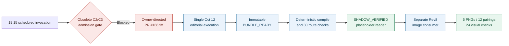
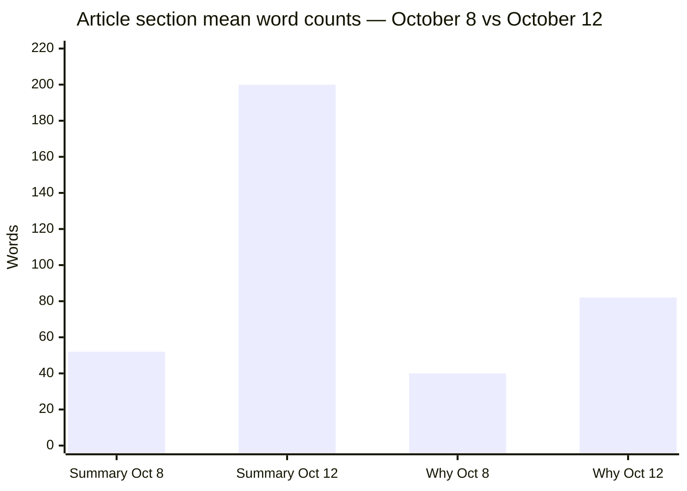
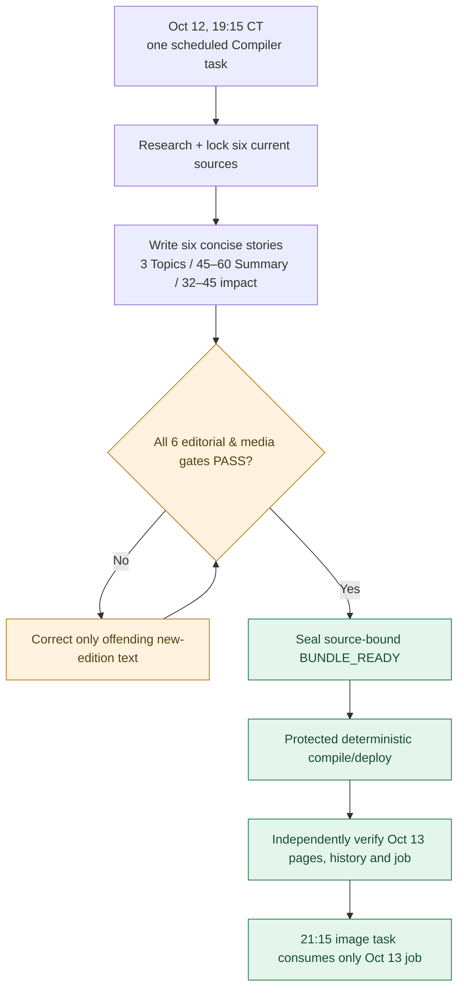

# DAILY AI BRIEF COMPILER
## October 12, 2026 — Compiler Production After-Action Review

**Cycle:** Sunday, October 11, 2026 · **Edition:** Monday, October 12, 2026 · **Timezone:** America/Chicago (CDT, UTC−05)  
**Repository:** [gttome/Daily-AI-Brief-Compiler](https://github.com/gttome/Daily-AI-Brief-Compiler) · **Lane:** 19:15 scheduled editorial producer → deterministic GitHub release  
**Report type:** Operational incident review · Editorial quality audit · October 13 admission plan  
**Evidence cut-off:** October 11, 2026, 22:35 CDT; GitHub compiler, history and image-release receipts.  
**Result:** <b>SHADOW_VERIFIED / reader published</b> · **Autonomy:** <b>not certified</b> · **Editorial presentation:** <b>regression requiring correction</b>

> [!IMPORTANT]
> **Management conclusion:** The October 12 reader and its later six-image replacement reached verified public release. The initial 19:15 invocation, however, stopped on obsolete chat-type/C2–C3 admission rather than publishing the Brief. Protected PR [#166](https://github.com/gttome/Daily-AI-Brief-Compiler/pull/166) removed that gate and the subsequent continuation completed. Therefore **delivery succeeded but an unattended successful 19:15-to-public cycle was NOT proved**. Separately, the October 12 article text is materially longer than the protected October 8 presentation reference. Enforce the October 8-length profile **before** the October 13 production run.

---

> [!NOTE]
> **Post-report implementation addendum (October 11, 2026, ~22:50 CDT).** The October 13+ short-copy P0 described as **OPEN** in the original incident analysis was subsequently **implemented and merged** via protected [PR #176](https://github.com/gttome/Daily-AI-Brief-Compiler/pull/176), merge commit <code>24c53ffeb9b34a9ef0c8073cd43769a99e1a31aa</code>, with required [CI run 38201237573](https://github.com/gttome/Daily-AI-Brief-Compiler/actions/runs/38201237573) **SUCCESS**. The existing enabled 19:15 Chicago Compiler primary task prompt was also updated and read back with exactly 3 Topics, Summary 45–60 words and Why/What-you'll-learn 32–45 words. Protected tests now reject out-of-range October 13+ reader copy and explicitly preserve October 8–12 legacy acceptance. **This resolves the code, contract, test and scheduled-prompt P0; it does not yet prove the October 13 natural unattended production run or eliminate all image preflight risk.** Later OPEN entries reflect the status when the underlying October 12 incidents were first assessed.

---

## 1. Executive scorecard

| Measure | October 12 evidence | Result |
|:--|:--|:--|
| Six article stories | 6; required Technical / Knowledge Worker / Agents distribution 2/2/2 | **PASS** |
| Reusable Agent Skills article | 1 source-bound procedural story | **PASS** |
| Video and podcast selections | 2 videos + 2 source-diverse podcasts, publisher/metadata evidence | **PASS to source/identity contract**; playback not claimed |
| Watchlist / four-book connections | Included in immutable edition bundle | **PASS** |
| Sealed editorial bundle | SHA-256 <code>6be70d9db13ca43759cedcb899b8663cabdd3483e9498ac6d46b16af57193b15</code> | **PASS** |
| Compiler terminal state | <code>SHADOW_VERIFIED</code>, saved 20:38:02 CDT | **PASS** |
| Independently checked reader routes | 30; reader parity v2 and responsive/feedback requirements | **PASS** |
| Original reader image mode | Six article-specific descriptions pointing to one pending SVG | **EXPECTED** interim stage |
| External premium image release | Six independent RGB PNGs eventually replaced placeholders | **PASS separately** |
| October 8 protected objects | 17/17 unchanged in reader/image release | **PASS** |
| Scheduled 19:15 liveness | First invocation blocked by obsolete C2/C3 proof path | **FAIL for unattended completion** |
| Post-recovery continuation | Started 20:24:25; verified 20:38:02 CDT (~13m 37s) | **PASS; not full-cycle wall time** |
| October 8-length editorial presentation | October 12 Summary and Why/What-to-learn exceed reference ranges | **FAIL** |
| Account-level model / weekly usage | No authoritative lane-specific telemetry | **UNKNOWN — do not infer a %** |

**Analytical grades:** Content completeness A; deployment and history integrity A; scheduled autonomy C/NOT PROVEN; presentation consistency D; cost observability INCOMPLETE. Grades are consultant assessments, not repository-certified metrics.

## 2. Scope and evidence policy

The **compiler** produces source-verified content, media, Watchlist, book mappings and a dated reader with a single permitted pending illustration. The later **premium-image lane** consumes the published immutable six-story job and changes only six image objects and bounded reader image references. A compiler state record with <code>images.accepted=[]</code> is **not** proof that the final public edition lacks the separately released images.

**Verified:** protected GitHub state, immutable bundle digest, deterministic compile/history/live receipts, PR #166, actual rendered October 8 and October 12 HTML, image release receipt.  
**Not proved:** continuous unattended runtime from 19:15; independent audiovisual playback; account quota cost; every minute of unlogged creative activity. The continuation producer receipt says <code>owner_intervention:false</code> **for that continuation**; it cannot erase the earlier owner-directed recovery of the overall cycle.

## 3. What happened — dated evidence timeline

| CDT, Oct 11 | Event | Assessment |
|:--|:--|:--|
| **19:15 nominal** | Sole scheduled compiler invoked; stopped on C2/C3 mode/invocation proof and diagnostic write path before substantive edition publication | **Initial liveness failure** |
| Evening | Owner requested elimination of all chat-type gates; protected [PR #166](https://github.com/gttome/Daily-AI-Brief-Compiler/pull/166) fixed the admission logic, updated image policy/runbook and protected regression tests | **Corrective code/contract change** |
| **20:24:25** | Durable October 12 compiler state created on one <code>shadow/2026-10-12</code> execution | **Valid work checkpoint** |
| **20:36–20:38** | Bundle-ready signal and deterministic compile/verification finished; state saved <code>SHADOW_VERIFIED</code> at **20:38:02** | **Reader published** |
| **22:11:06** | Separate image-release receipt recorded <code>RELEASED_VERIFIED</code>; six new image bytes passed live checks | **Not the compiler's own image-generation step** |
| **22:25:55** | PR [#174](https://github.com/gttome/Daily-AI-Brief-Compiler/pull/174) persisted 24-context final image evidence without changing article copy | **Final visual audit evidence** |

The **13m 37s continuation** is derived from the compiler-state timestamps. It must **not** be reported as 13m 37s for the full 19:15 production attempt. The full cycle suffered at least one recovery boundary.

### Actual dependency and release path

## 4. Production board — Backlog / WIP / Done

| Workstream | Durable state on this report | Time / evidence | Next owner action |
|:--|:--|:--|:--|
| Editorial research / six-story lock | **Done** | <code>candidate-evidence.json</code>, <code>locked-selection.json</code> | Preserve, do not rerun |
| Content, media, Watchlist, books | **Done** | <code>semantic-content.json</code>, <code>media-evidence.json</code> | Preserve immutable October 12 output |
| Editorial bundle sealing | **Done** | bundle digest matched, producer receipt PASS | Do not reopen |
| Compiler deterministic publication | **Done** | compile/live receipts PASS; 30 routes | Preserve live site/history |
| Rev8 premium images | **Done** | 6/6, release record, 24/24 visual checks | Preserve accepted bytes |
| Initial host-admission regression | **Corrected; re-proof needed** | PR #166 merged | Validate natural Oct 13 start, no owner rescue |
| **Short article-copy acceptance gate** | **Backlog — P0, not implemented** | Oct 12 vs Oct 8 word audit below | Add producer instructions + deterministic validator/test before next run |
| Account usage attribution | **Backlog — P1** | no authoritative per-lane quota data | Report process proxies; do not invent % |

## 5. Editorial presentation regression — measured

The following counts are computed from the **six article sections** of the exact HTML on the <code>shadow-pages-history</code> branch, not from marketing descriptions or media sections. Words are normalized visible text; topics are comma-separated concepts.

| Story # | Oct 8 Topics | Oct 12 Topics | Oct 8 Summary | Oct 12 Summary | Oct 8 Why it matters | Oct 12 Why it matters |
|:--|--:|--:|--:|--:|--:|--:|
| 1 | 3 | 5 | 48 | 229 | 37 | 75 |
| 2 | 3 | 5 | 60 | 195 | 39 | 86 |
| 3 | 3 | 5 | 55 | 203 | 41 | 87 |
| 4 | 3 | 5 | 49 | 193 | 42 | 84 |
| 5 | 3 | 5 | 48 | 178 | 42 | 82 |
| 6 | 3 | 5 | 51 | 203 | 36 | 78 |
| **Mean** | **3** | **5** | **51.8** | **200.2** | **39.5** | **82.0** |

The rendered **What you'll learn** section is sourced from the same story-level Why-it-matters narrative in the current reader mapping. Therefore its six observed word counts match Why-it-matters: **36–42** on October 8 versus **75–87** on October 12.

**Defect magnitude:** the October 12 Summary averages **3.86×** the October 8 reference; Why-it-matters and What-you'll-learn average **2.08×**. Long copy is duplicated in the reading-context panel and the body, magnifying perceived page length. The research is useful but the reader-facing layer is not a concise daily Brief.

### Where the regression entered

1. The semantic producer stored 178–229-word article summaries and 75–87-word impact narratives in the immutable content bundle.
2. <code>compiler/pending-editorial.mjs</code> tests only **minimum character lengths**, not upper word bounds or a three-topic cap.
3. <code>compiler/reader-adapter.mjs</code> passes the full strings into the canonical renderer; the reading-context "What you'll learn" reflects the same impact text.
4. Structural/route parity tests correctly passed; they do **not** currently enforce the desired editorial length or independent outcome copy.

**Root cause classification:** missing **editorial length contract + generator instructions + measurable validator**, not an HTML/CSS spacing defect. CSS truncation would hide important words rather than fix the prose.

## 6. October 13 mandatory reader-copy fix (P0)

Use the **October 8 edition as the authoritative reader-density reference**. Enforce these **per article** on homepage/latest, dated Brief and permanent story pages:

| Field | Oct 8 observed range | **October 13 admission rule** | Required correction |
|:--|:--|:--|:--|
| **Topics** | 3 concepts | **Exactly 3** short, distinct comma-separated topic phrases | Remove keyword stuffing and near-duplicates |
| **Summary** | 48–60 words | **45–60 words** | 1–3 concise sentences: verified development, factual differentiator, important scope |
| **Why it matters** | 36–42 words | **32–45 words** | One practical implication/decision; distinct from restating Summary |
| **What you'll learn** | 36–42 words | **32–45 words** | One outcome or capability; don't repeat the summary; may map to concise Why text until separately modeled |

**Implementation must-haves before 19:15 CDT October 12 (Oct 13 edition):**

- Update the **saved Compiler primary prompt**, **docs/EDITORIAL-CONTRACT.md**, **contracts/editorial-contract.json**, and the active semantic writer specification consistently.
- Add a deterministic limit in <code>compiler/pending-editorial.mjs</code> or its editorial validation boundary: check **exactly three meaningful topics**, Summary 45–60 words, impact text 32–45 words; add normal/hyphenated/numbered prose fixtures.
- Apply the rule **only to new editions beginning 2026-10-13**. Never rewrite, revalidate into failure, or republish completed October 8–12 historical editions.
- On a word-limit failure, revise **only the offending story text**, preserving original source citations and evidence; reseal the **new** bundle before publication. No silent ellipsis, CSS clipping, deterministic blind truncation or semantic changes to locked prior editions.
- Test all six new-story slots on dated + permanent pages. Check rendered text, not only the data bundle; avoid a duplicate long source paragraph under "What you'll learn".
- Verify ordinary 19:15 execution can correct bad copy in the same bounded semantic invocation; production must not enter a new software-repair loop.

**Acceptance:** 6/6 stories within all four ranges; 0 displayed source/claim distortions; no reduced editorial/source/image quality; full protected CI; no unrelated history changes. The gate is **OPEN** until a protected code/prompt implementation and a passing live or rehearsal fixture prove it.

## 7. Initial runtime admission failure — cause, repair, proof still needed

**Observed:** the first 19:15 scheduled action stopped on C2/C3 mode/host proof and a disposable write rather than producing reader content. **Cause:** nonessential chat-type/scheduler identity became a blocking runtime dependency. **Fix implemented:** PR #166 removed those admission checks in compiler readiness and Rev8 image path while retaining real source, GitHub write, exact PNG, protected-merge and October 8 integrity gates. **Outcome:** the subsequent compiler continuation published the October 12 edition. **Residual risk:** one recovered run does not certify the *next unattended scheduled invocation*.

**October 13 proof:** task <code>6ac9868490b88191ac91f84d5f555994</code> remains the only enabled Compiler primary, set for **19:15 CDT**. Its first action must be real current-edition research/checkpoint, not C2/C3 or proof branch. Require one edition branch, a sealed bundle, protected deterministic build and live verification **without owner rescue**. If it fails, save precise evidence, not fabricated success.

## 8. Reader, publication and immutable-history controls

The October 12 compiler receipts attest <code>reader-surface-parity-v2 PASS</code>, 30 checked routes, ratings, sharing, subscriptions, responsive behavior and isolated Compiler-owned feedback. The publication merge retained earlier editions and reported **17 protected October 8 objects unchanged**. Its initial image mode is intentionally a shared pending illustration, correctly recorded as **not accepted**; the separate image release replaced figures after the six-story job became public.

**Do not** "fix" the original compiler state to retroactively say six images were created inside the compiler. Source identity, current public presentation and image release are separate, truthful records. Do not re-open October 12 as an active image job merely because its immutable source job remains <code>PUBLISHED_PENDING</code>; the same-date <code>release.json</code> says <code>RELEASED_VERIFIED</code>.

## 9. October 13 risk register and must-have admission board

| Priority | Condition to prevent | Required action / proof | Status at cut-off |
|:--|:--|:--|:--|
| **P0** | Another overlong edition | Implement **8-Oct copy-length gate** + producer instructions + 6-story regression tests | **OPEN** |
| **P0** | Nightly startup blocked by chat-mode admission | PR #166 merged; verify scheduled run makes real edition progress | **REPAIR DONE / NATURAL RUN UNPROVEN** |
| **P0** | Image scheduled too late | Restore image task to 21:15 daily; same task, same prompt | **DONE in task settings** |
| **P0** | Unnecessary October 12 incident polling | Disable completed Oct 12 hourly watch and redundant 16:30 restore task | **DONE in task settings** |
| **P0** | Wrong/stale image job selected Oct 13 | Select **only** October 13 new-source <code>PUBLISHED_PENDING</code>; require release-receipt no-op for Oct 12 | **Required next-cycle check** |
| **P0** | Image upload/regression stalls | Keep corrected Git readback >1 MiB fixture, strict manifest vocabulary and path allowlist | **Fixes merged; retain** |
| **P1** | False fully-autonomous success claim | Separate scheduled-attempt result from recovered continuation result | **Reporting change needed** |
| **P1** | Unmeasured weekly usage | Record generation attempts, semantic invocations, CI retries, staging retries and actual owner-supplied quota only when available | **UNKNOWN** |
| **P2** | Drift in concise reader design | Snapshot/reference regression for Oct 8 paragraph density and mobile display | **Proposed** |

## 10. Target operating sequence and acceptance tests

**Test matrix:** (1) new edition accepts 3/55/39 words; (2) new edition rejects 4 topics, 61-word Summary and 46-word impact independently; (3) October 8–12 fixtures remain unaffected; (4) rendered dated/permanent copies preserve all textual facts within constraints; (5) six-story allocation, media, watchlist and book gates still PASS; (6) no C2/C3 blocking at next natural start; (7) 17 protected Oct 8 objects and accepted Oct 12 PNG hashes unchanged.

## 11. Usage efficiency and learning

The observed continuation completed content/verification in under fourteen minutes, but it followed an initially blocked schedule, protected code change and owner-directed intervention. **Do not equate active task duration to full elapsed or cost.** The image lane's 13 creative attempts belong in its separate report. The target policy is **zero Work/Codex/paid API in compiler production**, one substantive editorial pass, no C2/C3 diagnostics and deterministic GitHub publication. Account quota shares remain **UNKNOWN** without first-party attribution; do not fabricate an under-5% outcome.

### Next three run measurement

Record for October 13, 14 and 15: target and actual start; first substantive checkpoint; time to sealed bundle; time to public verification; source/editorial correction count; generated stories; number of code/CI repair PRs; owner interventions; image handoff time; and any real account-usage observation. Success requires **three consecutive unattended current-date completions** plus reader-copy conformity.

## 12. Evidence register

| Record | Link | Proves |
|:--|:--|:--|
| Terminal compiler state | [compiler-state.json](https://github.com/gttome/Daily-AI-Brief-Compiler/blob/shadow/2026-10-12/shadow-runs/2026-10-12/compiler-state.json) | SHADOW_VERIFIED / 20:38 checkpoint / pending-image boundary |
| Immutable content | [edition-bundle.json](https://github.com/gttome/Daily-AI-Brief-Compiler/blob/shadow/2026-10-12/shadow-runs/2026-10-12/edition-bundle.json) | 6 stories, media, Watchlist, books, sealed digest |
| Original content | [semantic-content.json](https://github.com/gttome/Daily-AI-Brief-Compiler/blob/shadow/2026-10-12/shadow-runs/2026-10-12/content/semantic-content.json) | Full October 12 narrative source |
| Deterministic compile | [compile-receipt.json](https://github.com/gttome/Daily-AI-Brief-Compiler/blob/shadow/2026-10-12/shadow-runs/2026-10-12/compiler/compile-receipt.json) | Reader parity, route proof, image placeholder |
| Public route check | [live-verification.json](https://github.com/gttome/Daily-AI-Brief-Compiler/blob/shadow/2026-10-12/shadow-runs/2026-10-12/compiler/live-verification.json) | 30 routes and reader features |
| Startup correction | [PR #166](https://github.com/gttome/Daily-AI-Brief-Compiler/pull/166) | Removed obsolete mode gate |
| October 8 exact reference | [October 8 HTML](https://github.com/gttome/Daily-AI-Brief-Compiler/blob/shadow-pages-history/site/briefs/2026-10-08/index.html) | Reader-copy word-length baseline |
| October 12 exact HTML | [October 12 HTML](https://github.com/gttome/Daily-AI-Brief-Compiler/blob/shadow-pages-history/site/briefs/2026-10-12/index.html) | Excess copy measured in this report |
| Premium image final release | [release.json](https://github.com/gttome/Daily-AI-Brief-Compiler/blob/shadow-pages-history/site/image-jobs/2026-10-12/release.json) | Separate 6/6 public image completion |
| Reader page | [October 12 Daily Brief](https://gttome.github.io/Daily-AI-Brief-Compiler/briefs/2026-10-12/) | Public destination (network/hash evidence preserved above) |

---

**Disposition:** **CLOSED as October 12 delivery; October 13 editorial-length gate remains a P0 pre-run change.** Preserve all completed October 12 assets and source evidence. No duplicate edition execution, legacy repository mutation or accepted-image regeneration is authorized by this review.
