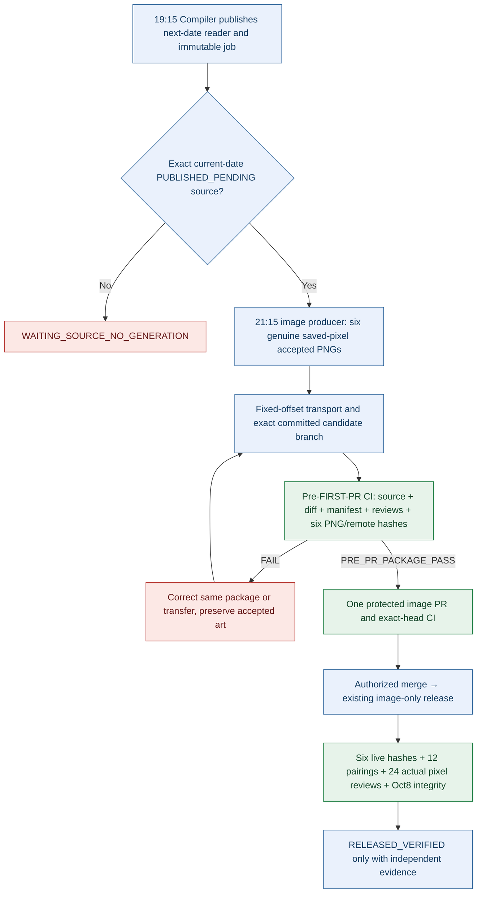

# DAILY AI BRIEF COMPILER
## October 13 Readiness — P0 Image-Package Admission Engineering After-Action Report

> **Report ID:** BC-P0-IMAGE-PREPR-20261012-01
> **Scope:** Engineering implementation and pre-production regression evidence only
> **Authority:** October 11 owner-approved October 13 implementation handoff
> **Repository:** [gttome/Daily-AI-Brief-Compiler](https://github.com/gttome/Daily-AI-Brief-Compiler) — no access or change to retired production
> **Implementation PR:** [#178](https://github.com/gttome/Daily-AI-Brief-Compiler/pull/178)
> **Baseline `main`:** `8b72927882f17e568d1245093f0a6d464f3561bf`
> **Evidence cutoff:** October 11, 2026, ~23:41 America/Chicago (October 12 UTC)
> **Important:** This report was committed to the **implementation PR before merge**. The PR itself is the authoritative source for its later actual merged/not-merged disposition, required head-CI and merge SHA. Do not interpret this record as a publication or an automated-cycle certificate.

### Executive assessment

| Gate | Verified engineering outcome | Qualification |
|:---|:---|:---|
| One full **pre-FIRST-image-PR** package gate | **IMPLEMENTED / regression PASS** | Live Oct13 image package does not yet exist |
| Existing bounded `git cat-file` fix | **PRESERVED** | Existing 8-MiB cap left unchanged |
| 256-KiB fixed-offset transport | **IMPLEMENTED / >1-MiB PASS** | Future image session must use its actual saved bytes |
| Positive and adversarial admission matrix | **PASS** | Synthetic fixtures demonstrate structure, never semantic art quality |
| Exact-head protected CI | [Green on code head `6c08e36d9ef46a413e8a13031cc08a1370c3aead`](https://github.com/gttome/Daily-AI-Brief-Compiler/actions/runs/38204738917) | **321/321** tests; documentation addition requires final-head rerun |
| Bootstrap, fixture, reader parity, Oct8 HTTP audit | **PASS** | Part of the same code-head CI |
| Protected deployment, Oct13 natural schedule | **NOT YET DUE** | Release requires real producer/source/art/Pages evidence |
| Account-level quota usage | **UNKNOWN** | The repository does not expose authoritative percentage |

This implementation addresses the October 12 image-release failures at their earliest deterministic prevention point, without reconstructing the production control plane. Existing Release 8 authority and the single protected `external-image-only-replacement.yml` workflow remain in place. Accepted Oct12 image bytes and older reader objects are not revised.

### What changed and why

| Engineering component | Purpose | Fail-closed invariant |
|---|---|---|
| `scripts/preflight-recurring-image-package.mjs` | One exact-current-cycle staged Git package check before first image PR | Wrong date/job/source/manifest, changed or disallowed paths, old Pages head, bad review receipts, invalid PNG or remote bytes stop the PR |
| `scripts/reassemble-fixed-offset-image.mjs` | Reconstitute previously accepted PNGs above 750 KiB from 256-KiB offsets | Missing/altered segment, wrong length/SHA-256/Git blob, corrupt RGB/RGBA PNG or output overwrite fails |
| `tests/external-image-prepr-admission.test.mjs` | Real local Git fixtures for source/job/branch, committed images and GitHub readback simulation | Positive passage plus adversarial path, date, source, pixel review, CRC, size and transport cases |
| `.github/workflows/ci.yml` | Existing `compiler-validation` checks the pushed `image-package/YYYY-MM-DD-*` candidate **before** image PR and again on its PR head | No separate workflow, no branch-protection weakening |
| Rev8 starter + complete prompt | Bind operator to the new pre-PR check and accepted-byte transport | A pending/current job only; no host-mode admission |
| Two-task operations runbook | Keep future cycle guidance consistent | Only 19:15 editorial task and 21:15 native image task |

The `stage-external-image-package.mjs` SHA-256/Git blob/PNG checks, existing 8-MiB readback and `recurring-image-admission.mjs` Rev8 current-source checks are **reused**, not cloned. The pre-PR admission also checks source-commit ancestry against the current-date `shadow/YYYY-MM-DD` head, not merely a reachable Git object. Existing image-only release CI retains independent downstream checks.

### Admission flow

**Critical distinction:** The deterministic gate can verify review files and bind their claims to exact saved Git PNG hashes. It **cannot infer** a legitimate illustration's causal fidelity, legibility or true visual-inspection history. Each story and the differentiated six-set still requires real native image creation and actual saved-pixel review; all 24 desktop/mobile contexts require genuine subsequent evaluation rather than counting screenshots.

### Regression and CI evidence

**Protected CI (code head):** [run 38204738917](https://github.com/gttome/Daily-AI-Brief-Compiler/actions/runs/38204738917), `compiler-validation / validate`, exact code head `6c08e36d9ef46a413e8a13031cc08a1370c3aead`, **321 tests passed, zero failed**. Also passed `validate:bootstrap`, `fixture:e2e`, `reader:parity`, YAML parsers and independent immutable October 8 network-hash audit.

| Scenario | Expected and observed result |
|:---|:---|
| Six unique genuine-format 1200×630 RGB/RGBA PNG binary fixtures, one >1 MiB | **PASS** exact Git/remote bytes, SHA-256, blob and length |
| Unexpected path or package-root `after-action.md` | **REJECTED** |
| Noncanonical `pixel_inspection_method`, story mismatch, manifest/source mismatch | **REJECTED** |
| Bad individual saved-pixel JSON receipt, missing set review | **REJECTED** |
| PNG mutated after manifest lock, wrong committed blob | **REJECTED** |
| Unsupported indexed/palette PNG | **REJECTED** |
| Older cycle or future stale use | **REJECTED** |
| Missing/truncated remote data or segment, changed segment offset/hash | **REJECTED** |
| Pages-history head stale or source commit not on live current-date source branch | **REJECTED** |
| Same exact candidate validated twice | **PASS, idempotent** |

**Fail-closed test-only correction:** The initial run [38204529420](https://github.com/gttome/Daily-AI-Brief-Compiler/actions/runs/38204529420) reported 318 passing tests and two failed test entries (one nested assertion and its parent) because one test expected a narrower error label when the existing strict Git-object check correctly reported `file_not_at_exact_commit`. The test was corrected without weakening the validator. Follow-up [38204651548](https://github.com/gttome/Daily-AI-Brief-Compiler/actions/runs/38204651548) passed all 320 cases; source-commit ancestry regression was then added and [38204738917](https://github.com/gttome/Daily-AI-Brief-Compiler/actions/runs/38204738917) passed **321/321**. The earlier failures are **not image release failures** and did not touch accepted art.

### Baseline, scheduling and historic-byte safeguards

| Property | Observed / preservation outcome |
|---|---|
| Protected baseline `main` | `8b72927882f17e568d1245093f0a6d464f3561bf` before implementation |
| October 12 six originals | [`RELEASED_VERIFIED` receipt](https://github.com/gttome/Daily-AI-Brief-Compiler/blob/shadow-pages-history/site/image-jobs/2026-10-12/release.json) present, untouched |
| Oct 12 indexed image job state | Terminal release; original immutable `job.json` may still say `PUBLISHED_PENDING`, not a reason to reopen |
| October 13 indexed source job | **Not yet published** as of implementation pre-run |
| Primary Compiler task | `6ac9868490b88191ac91f84d5f555994` enabled, **19:15** America/Chicago |
| Native image task | `6acac88cff048191ba02e5b2bcb3becb` enabled, **21:15** America/Chicago |
| Obsolete watches/recovery tasks | Disabled; no replacement created |
| Oct8 historical public resources | Exact 17-object network audit passed on code-head CI |
| Prior Oct12 art and Oct8 repo files | Not changed by PR #178; no package images, history objects or editorial stories in PR file diff |
| Release workflow and protection policy | Unmodified; PR required and status `validate`; no bypass actors in ruleset 24610983 |

### P0 disposition and readiness

| Priority | Engineering disposition | Live Oct13 disposition |
|---|---|---|
| P0-01 current-date source selector | Existing selector reused and tested | **PENDING** next natural job |
| P0-02 six-story placeholder reader and source job | Existing production boundary intact | **PENDING** 19:15 actual publication |
| P0-03 19:15/21:15 task schedules | Saved-state readback verified | **PENDING** actual invocation |
| P0-04 stale task cleanup | Disabled incident tasks verified | **VERIFIED configuration only** |
| P0-05 package path/token/source/review gate | **IMPLEMENTED / 321-test CI PASS** (pre-documentation head) | **PENDING** actual pushed Oct13 package |
| P0-06 binary readback and segmented transfer | **IMPLEMENTED / large-binary regression PASS** | **PENDING** real image delivery |
| P0-07 authentic pixel QA | Source guidance preserved | **PENDING** six genuine images |
| P0-08 protected image release and 24 contexts | Existing workflow preserved | **PENDING** one image PR/Pages |
| P0-09 Oct8/Oct12 preservation | No history paths changed; Oct8 network CI PASS | **PENDING** post-Oct13 release recheck |
| P0-10 concise reader copy | Already fixed by PR #176, do not duplicate | **PENDING** actual six Oct13 pages |
| P0-11 unattended execution certification | No host-mode gates or extra workers added | **UNKNOWN until actual natural run** |
| P0-12 operational reporting | Existing deterministic workflow preserved | **PENDING** current-cycle JSON/MD rollup |

**GO/HOLD:** Engineering code is eligible for protected merge after *final* documentation-head CI passes and ordinary ruleset approval permits it. If merge cannot safely complete by **October 12, 18:15 CT** pre-run freeze, HOLD changes on the branch and keep the previously enforced release workflow intact. Natural-source readiness remains unproven before the October 12 19:15 cycle; **never** use the October 12 released job as an Oct13 fallback.

### Risk, effort and residual limitations

| Risk | Impact | Control / residual |
|---|---|---|
| Incorrect pre-PR rejection | High | Positive/negative tests, scoped rollback of the single PR, exact snapshot and no gate bypass |
| Git transport truncation | High | Fixed 256-KiB offsets + SHA-256/blob/length and bounded Git readback; real run must supply correct segments |
| Semantic art or mobile-label defect | Critical | Manual/AI genuine saved-pixel inspection remains necessary; no deterministic PASS substitution |
| Source job missing by image schedule | High | `WAITING_SOURCE_NO_GENERATION`, zero attempts and no older-date fallback |
| Scheduled task enabled but no real native-image invocation | Critical | Actual tools, saved assets, CI and Pages required, do not assert 100% autonomy |
| Protected PR review or GitHub Pages unavailable | High | `BLOCKED_INCOMPLETE`, save valid assets and exact blocker; no main bypass |
| Quota target below 5% | Medium | Aspirational; **not measurable** from GitHub source |
| Engineering change near nightly launch | High | No runtime code changes; recommended 18:15 CT freeze |

The implementation handoff estimated **4–6 hours** for the preflight and **1–2 hours** for binary transport; these are planning estimates, not measured engineering elapsed time. One implementation PR avoids duplicative release workflows and aims to eliminate the three avoidable prior-cycle package validation/release failures. It does **not** promise fewer creative candidates or a quantified quota reduction.

### Required next natural-cycle evidence

1. **October 12 at 19:15 CT:** inspect actual primary producer/branch `shadow/2026-10-13`, new date `BUNDLE_READY`, protected compile/Pages and six concise reader stories (exactly 3 Topics, Summary 45–60, Why and What 32–45); do not infer launch from schedule enablement.
2. **Before 21:15:** read exact [history index](https://github.com/gttome/Daily-AI-Brief-Compiler/blob/shadow-pages-history/site/image-jobs/index.json), immutable `2026-10-13/job.json` and source commit/bundle bytes; if missing, report `WAITING_SOURCE_NO_GENERATION`.
3. **October 12 at 21:15 CT:** actual native image creation, individually reviewed original six saved PNGs, six distinct compositions, valid `reviews/` receipt/manifest/assignment, one pushed candidate pre-PR check PASS, then one protected image package PR.
4. **After release:** exact-head CI/merge, six public PNG hashes, twelve story/page image pairings, twenty-four actual desktop/mobile semantic pixel inspections, unchanged seventeen Oct8 objects and older Oct12 hashes, true `2026-10-13/release.json = RELEASED_VERIFIED`.
5. **Morning of October 13:** reconcile deterministic `daily-operations-report.yml` compiler and image AAR + daily rollup, retaining `UNKNOWN` or `NO_START_RECEIPT` when invocation identity is not evidenced.

**P1/P2 defer:** prepare article-specific causal edge/label plans and measurable QA-attempt taxonomy, qualified versioned image-only postrelease correction and three-cycle trend *outside* the production code freeze. Do not add AI polling, schedulers or paid service dependencies.

---

*This file documents completed tested code and the explicitly separate unobserved natural-run acceptance. Follow the protected PR link for final review, exact-head CI, and merge identity.*
