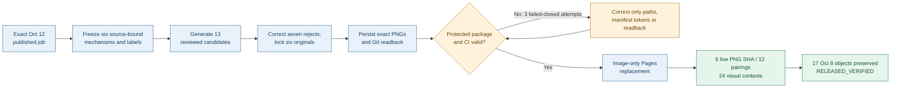
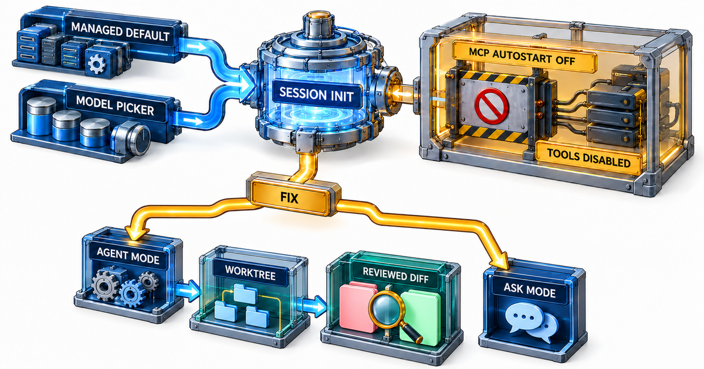
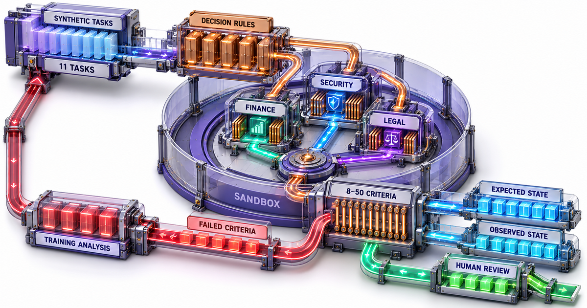
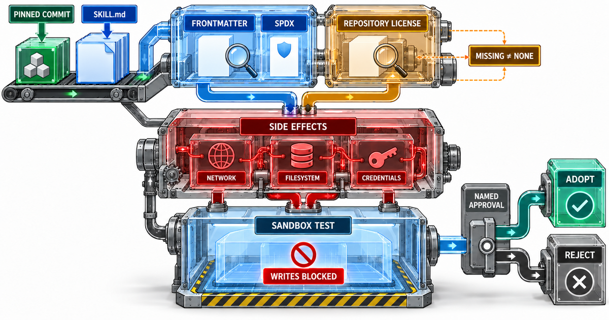
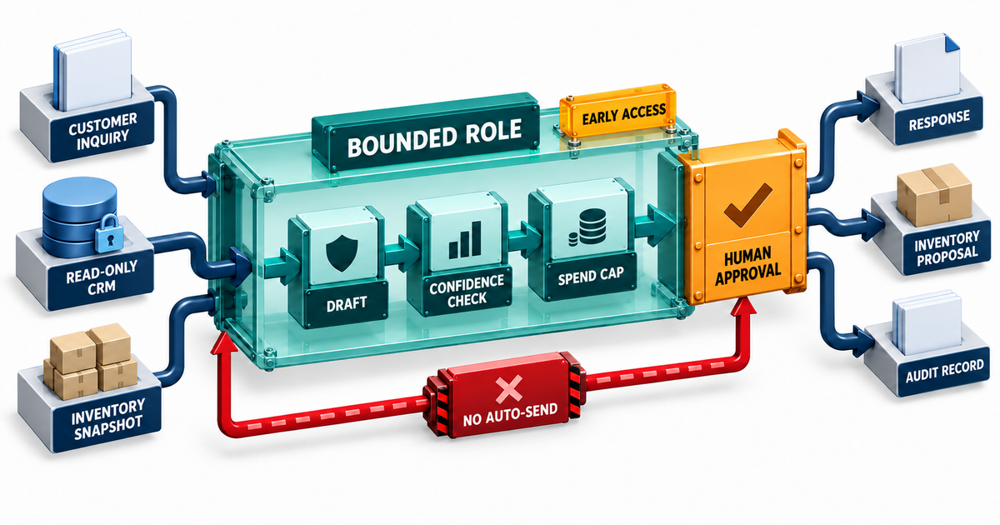
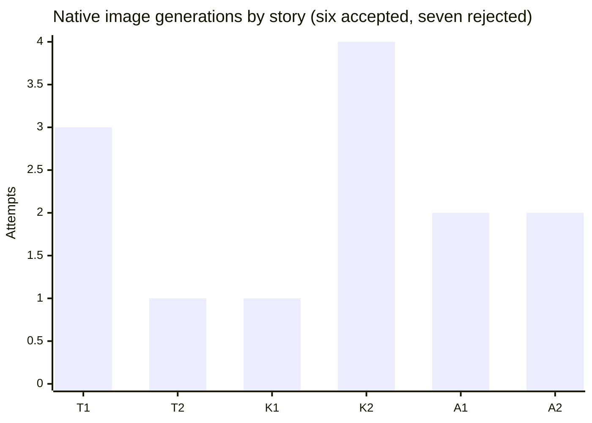
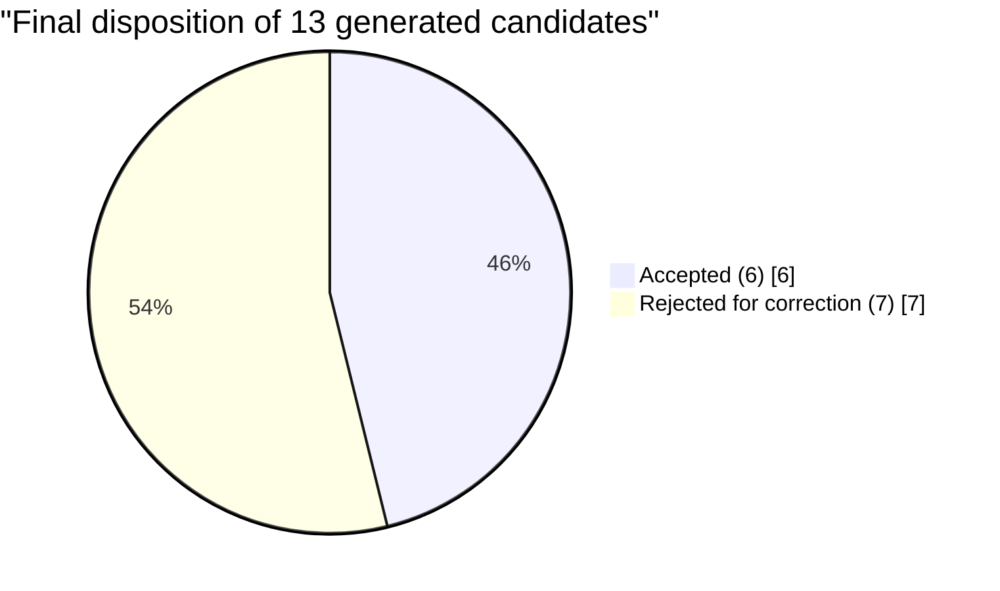
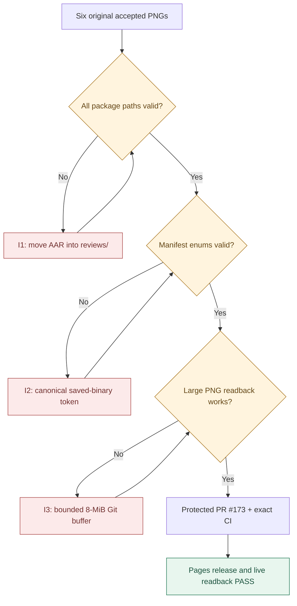
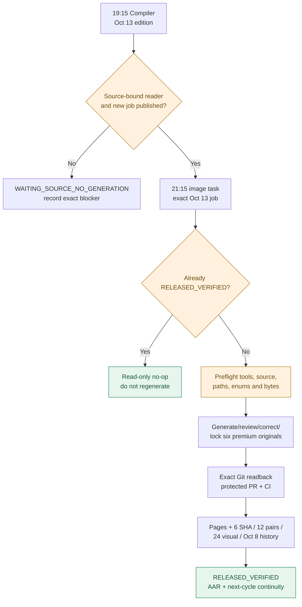

# DAILY AI BRIEF COMPILER
## October 12, 2026 — Premium Image Production After-Action Review

**Production cycle:** Sunday, October 11, 2026 · **Reader edition:** Monday, October 12, 2026  
**Repository:** [gttome/Daily-AI-Brief-Compiler](https://github.com/gttome/Daily-AI-Brief-Compiler) · **Selected image contract:** <code>recurring_work_v8:rev8</code>  
**Report classification:** Image Quality · Release Engineering · Incident Review · Cost Reduction · October 13 Readiness  
**Evidence:** Exact saved image files, generation-attempt register, review receipts, protected PRs, image-only Actions logs, public readback and history-preservation receipts  
**Final disposition:** 🟢 **SIX IMAGES RELEASED AND PUBLICLY VERIFIED** · 🟠 **Avoidable release failures and creative rework** · 🔴 **October 13 proactive admission checks required**

> [!IMPORTANT]
> **Executive assessment.** The October 12 image release is genuinely complete: six differentiated explanatory RGB PNGs, twelve correct article/page image pairings, twenty-four reviewed desktop/mobile image contexts and preservation of all seventeen protected October 8 objects. Recovery succeeded **without regenerating any accepted art**. However, **13 native image attempts produced six accepted and seven rejected candidates**, and **three earlier image-only release runs failed closed** before the corrected run succeeded. The next cycle must eliminate packaging, enum, binary-transport and scheduling surprises upstream. Do not reopen the completed October 12 edition.

---

> [!NOTE]
> **Post-report next-cycle correction (October 11, 2026, ~22:50 CDT).** The October 13 upstream editorial density fix is now **merged and verified** in protected [PR #176](https://github.com/gttome/Daily-AI-Brief-Compiler/pull/176), [CI 38201237573](https://github.com/gttome/Daily-AI-Brief-Compiler/actions/runs/38201237573) SUCCESS; the saved 19:15 Compiler primary instruction is synchronized. The same existing 21:15 Chicago image task was restored and read back, and the completed October 12 hourly incident watch and redundant one-time schedule-restorer were disabled. Only the **next natural October 13 source-job and image scheduled execution** can demonstrate uninterrupted future autonomy. Per-package path/enum preflight remains a process acceptance check and is **not** claimed code-fixed merely by these reports.

---

## Contents

1. [Executive scorecard](#1-executive-scorecard)
2. [Scope and evidence discipline](#2-scope-and-evidence-discipline)
3. [Operational timeline and release path](#3-operational-timeline-and-release-path)
4. [Portfolio of six accepted premium images](#4-portfolio-of-six-accepted-premium-images)
5. [Generation attempts and quality corrections](#5-generation-attempts-and-quality-corrections)
6. [All failed-closed release incidents: problem, cause, fix, outcome](#6-all-failed-closed-release-incidents-problem-cause-fix-outcome)
7. [Final public proof and historical integrity](#7-final-public-proof-and-historical-integrity)
8. [What worked, what did not and why](#8-what-worked-what-did-not-and-why)
9. [Usage economics and below-5-percent goal](#9-usage-economics-and-below-5-percent-goal)
10. [October 13 P0 must-haves and release admission](#10-october-13-p0-must-haves-and-release-admission)
11. [Prioritized continuous-improvement program](#11-prioritized-continuous-improvement-program)
12. [Three-run measurement, acceptance tests and evidence register](#12-three-run-measurement-acceptance-tests-and-evidence-register)

---

## 1. Executive scorecard

| Production and release metric | Evidence-backed October 12 result | Assessment |
|:--|:--|:--|
| Actual generated candidates | **13** | ⚠️ Rework opportunity |
| Accepted article-specific images | **6 / 6** | ✅ PASS |
| Rejected original candidates | **7 / 13** (53.8% of all candidates) | ⚠️ High |
| Accepted on first generation | **2 / 6** (33.3%) | ⚠️ Needs improvement |
| Stories needing any correction | **4 / 6** | ⚠️ Needs improvement |
| Final format | **6 × 1200 × 630, 8-bit RGB PNG** | ✅ PASS |
| Final PNG total stored bytes | **6,081,656** (~5.80 MiB) | ✅ Exact assets preserved |
| Individual accepted saved-pixel review | **6 / 6 PASS** | ✅ |
| Differentiated six-image set review | **PASS** | ✅ |
| Accepted image regenerations after lock | **0** | ✅ |
| Protected initial package PR | [#167](https://github.com/gttome/Daily-AI-Brief-Compiler/pull/167) merged | ✅ |
| Failed image-only release workflow attempts | **3 observed, failed closed** | 🔴 Prevent recurrence |
| Corrected final release run | [38198706684](https://github.com/gttome/Daily-AI-Brief-Compiler/actions/runs/38198706684) SUCCESS | ✅ |
| Live image SHA-256 checks | **6 / 6 PASS** | ✅ |
| Dated and permanent story/image pairings | **12 / 12 PASS** | ✅ |
| Desktop/mobile image contexts semantically reviewed | **24 / 24 PASS** | ✅ |
| Protected October 8 objects | **17 / 17 unchanged** | ✅ |
| Editorial story/source material | **Unchanged during image publication** | ✅ |
| Exact account-level weekly-usage attribution | **UNKNOWN** | ⚪ No invented percentage |
| October 13 next-cycle image task schedule | **Restored to 21:15 CDT (existing task ID)** | ✅ Task setting fixed |
| October 13 source job | **Future — must be validated at 21:15** | ⏳ Admission pending |

**Analytical rating:** A for final quality and publication integrity; B for preserving accepted work; C for creative efficiency; D for first-pass release packaging; incomplete for cost measurement. These are diagnostic judgments, not machine-certified grades.

## 2. Scope and evidence discipline

The compiler first published an immutable six-story October 12 reader with six pending illustration references. This **separate Rev8 image operation** replaced them with six accepted art assets using the *published exact job*, without changing the article prose or regenerating the editorial bundle.

**Source identity — immutable bindings**

| Object | Exact identity |
|:--|:--|
| Edition | <code>2026-10-12</code> |
| External image job SHA-256 | <code>bbfcf47319771f23107569639d66c878b6f0cefdc165d9b829af76e37ef907d2</code> |
| Original bundle SHA-256 | <code>6be70d9db13ca43759cedcb899b8663cabdd3483e9498ac6d46b16af57193b15</code> |
| Original source commit | <code>7038f92bec84b6548cfaae23b38e33ef2b1b303c</code> |
| Six-image binary staging commit | <code>a6c3686a5578e4afc1dc325cfac44454db82a0c1</code> |
| Final package / release-triggering head | <code>f7533bc5b40b3397497e52ad89fa07d4151c7076</code> |
| Final live release record | <code>RELEASED_VERIFIED</code> |

**Evidence standard:** Native generation, saved-pixel inspections, exact Git-object/blob identities, protected workflows, deployment and public readback are represented by the repository's persisted records. The document does not claim the report author separately reran every historic pixel inspection or observed the scheduler's internal invocation identity. The **image quality reviews were recorded separately from screenshot capture** and then finalized through PR #174.

## 3. Operational timeline and release path

All times below are **October 11 CDT (UTC−05)**; October 12 UTC GitHub timestamps are converted to local time.

| CDT | Durable GitHub milestone | Actual result |
|:--|:--|:--|
| **21:49:32** | Accepted original image binaries staged at commit <code>a6c3686a...</code> | Six image assets persisted |
| **21:53:59** | Image package, reviews and exact-source bindings staged | Prepared protected release |
| **21:55:46** | Protected [PR #167](https://github.com/gttome/Daily-AI-Brief-Compiler/pull/167) merged | First automatic release trigger |
| **~21:57–22:00** | Root after-action path rejected; [PRs #168–169](https://github.com/gttome/Daily-AI-Brief-Compiler/pull/169) move/rebind it | First failure fixed |
| **22:00–22:03** | Noncanonical saved-binary inspection token rejected; [PR #170](https://github.com/gttome/Daily-AI-Brief-Compiler/pull/170) rebinds proven <code>persisted_git_binary</code> | Second failure fixed |
| **22:03–22:08** | Greater-than-1 MiB PNG readback raised <code>spawnSync git ENOBUFS</code>; [PR #172](https://github.com/gttome/Daily-AI-Brief-Compiler/pull/172) adds bounded 8-MiB blob-readback buffer and regression | Third failure fixed |
| **22:10:20** | [PR #173](https://github.com/gttome/Daily-AI-Brief-Compiler/pull/173) merges unchanged accepted package rebound to fixed code | Final release trigger |
| **22:10:23** | Image-only Actions [run 38198706684](https://github.com/gttome/Daily-AI-Brief-Compiler/actions/runs/38198706684) starts | Actual validated release |
| **22:11:06** | Public <code>release.json</code> records <code>RELEASED_VERIFIED</code> | Six live bytes/pairings/history checked |
| **22:12:22** | Image-only workflow completes SUCCESS | Pages and verification complete |
| **22:25:55** | [PR #174](https://github.com/gttome/Daily-AI-Brief-Compiler/pull/174) merges final review-only documentation and 24 image-context assessments | Durable quality closeout |

**Measured final release workflow:** about **1m59s** from GitHub start to completion; this is not the entire image creation/review/upload duration. The per-generation wall time and complete elapsed scheduled-worker time are not reliably available and must remain unknown.

### Actual image-to-public process

## 4. Portfolio of six accepted premium images

These are the **accepted original October 12 image files**, not mockups. Their exact Git blob and SHA-256 identities are persisted in the Rev8 manifest and release receipt.

<table>
<tr>
<td width="50%"><b>T1 · JetBrains agent/model/MCP controls</b>

<b>3 attempts</b> · 2 rejected · RGB 1200×630</td>
<td width="50%"><b>T2 · Ironclad contracting rubric</b>

<b>1 attempt</b> · 0 rejected · RGB 1200×630</td>
</tr>
<tr>
<td><b>K1 · Gemini business-context agent</b>

<b>1 attempt</b> · 0 rejected · RGB 1200×630</td>
<td><b>K2 · SAP Joule process context</b>

<b>4 attempts</b> · 3 rejected · RGB 1200×630</td>
</tr>
<tr>
<td><b>A1 · Agent Skill license/provenance intake</b>

<b>2 attempts</b> · 1 rejected · RGB 1200×630</td>
<td><b>A2 · Small-business bounded delegation</b>

<b>2 attempts</b> · 1 rejected · RGB 1200×630</td>
</tr>
</table>

| Slot | Bytes | Full accepted PNG SHA-256 |
|:--|--:|:--|
| T1 | 1,045,105 | <code>4fa4f122bcfa5240671da3fe9a8b49592f21b32fa4b7750a506dedca4687d11f</code> |
| T2 | 1,169,734 | <code>03860512c6632e2fdbcc69d8c1be5f03984e66ca9ece3749a4f5ba5c431638d1</code> |
| K1 | 1,074,852 | <code>72ff485acdbebd4986fd838982c5e67e1e5de2590085d8c715dab13f53d57781</code> |
| K2 | 1,022,965 | <code>30f9b130b33b2a94db22da3cf30df6ccc6e3aa4bbf6097d45c21983b2fe29c24</code> |
| A1 | 985,605 | <code>bfe5103b8b64204bd6b5c24e5807325e1e079eacea840737c93732087a415f36</code> |
| A2 | 783,395 | <code>266725440c0fbadba9403546aa249b1088d69695debea693d3fa2dbdcabc14bd</code> |

**Set assessment:** Every image has story-specific explanatory text, mechanism composition, source-bound factual relationships and independent saved-pixel review. Final reader observations report no clipped labels, missing regions, image substitution or horizontal overflow on tested desktop/mobile image contexts.

## 5. Generation attempts and quality corrections

### Candidate distribution

| Story | Actual correction evidence | Root cause / prevention |
|:--|:--|:--|
| **T1** | Eliminated pseudo-writing in review/diff surface; repaired Fix-mode causal topology so Agent and Ask were alternatives, not a serial sequence | Exact allowed labels plus an explicit **allowed-edge topology** before generation |
| **T2** | Accepted on first candidate | Preserve the successful source-specific design / no mandatory redesign |
| **K1** | Accepted on first candidate | Preserve distinctive source-specific mechanism and successful hierarchy |
| **K2** | Removed humanoid icons, residual UI-like glyphs and pseudo-writing; required fourth clean candidate | Preflight **no avatars / faux UI / illegible microtext**, with simple labeled process geometry |
| **A1** | Removed fake evidence-document prose and logo-like repository glyph | White or blank document surfaces; explicit anti-logo/symbol exclusions |
| **A2** | Removed pseudo-writing from audit record | Label-only audit elements, not decorative paragraphs |

**Why rejection is acceptable but expensive:** The reviewer correctly rejected false causal sequencing, fake text and disallowed figure elements. Lowering the image-quality threshold would be the wrong response. The improvement opportunity is **higher first-pass factual and graphical precision**—prefer source-validated topology, exact label allowlists, intentional spatial composition and candidate correction focused on the specific defect.

### Reusable correction taxonomy

| Failure family | Impact | Prompt/process correction |
|:--|:--|:--|
| Pseudo-writing / placeholder glyphs | Text legibility, false suggestion of evidence | No thin fake-text rules; reserve text only for exact authorized labels |
| Humanoid, logo-like or UI ornaments | Violates professional textbook and no-humanoid/brand rule | Negative examples and region-level inspection before export |
| Wrong arrow/relationship topology | Teaches false mechanisms despite attractive design | Freeze allowed/disallowed edges, independent branches and causal scope |
| Undifferentiated article art | Fails six-set editorial value | Reserve six composition signatures before native generation |
| Transport errors after visual acceptance | Risks regenerating costly accepted work | Freeze accepted hash; resume byte transport or release only |

**Permanent positive:** All six accepted originals were **locked**, and neither the connector transport errors nor the protected workflow repairs triggered new art generations.

## 6. All failed-closed release incidents: problem, cause, fix, outcome

| Incident / evidence | Actual failure | Corrective PR and mechanism | Outcome / next-run regression |
|:--|:--|:--|:--|
| **I1 · Release allowlist**; workflow [38197727518](https://github.com/gttome/Daily-AI-Brief-Compiler/actions/runs/38197727518) | Report file initially located at root <code>external-image-packages/2026-10-12/after-action.md</code>, outside allowed release changed paths | [#168](https://github.com/gttome/Daily-AI-Brief-Compiler/pull/168) moved report to <code>reviews/</code>; [#169](https://github.com/gttome/Daily-AI-Brief-Compiler/pull/169) rebound manifest/assignment to exact repaired package | Failed closed; validate **all package paths** before first PR |
| **I2 · Review method token**; workflow [38198044752](https://github.com/gttome/Daily-AI-Brief-Compiler/actions/runs/38198044752) | Manifest contained an honest but noncanonical persisted-binary inspection method | [#170](https://github.com/gttome/Daily-AI-Brief-Compiler/pull/170) used contract enum <code>persisted_git_binary</code>, after real exact-commit Git readback and saved-pixel inspection | Failed closed; preflight controlled vocabulary against schema |
| **I3 · Large Git blob**; workflow [38198249525](https://github.com/gttome/Daily-AI-Brief-Compiler/actions/runs/38198249525) | <code>spawnSync git ENOBUFS</code> reading legitimate PNG blobs above Node's default ~1 MiB child-process buffer | [#172](https://github.com/gttome/Daily-AI-Brief-Compiler/pull/172) increased **only Git cat-file** readback maxBuffer to 8 MiB, added >1-MiB regression fixture; [#173](https://github.com/gttome/Daily-AI-Brief-Compiler/pull/173) retriggered same unchanged images | Fixed; **keep test and bounded buffer** |
| **I4 · GitHub binary connector transport** | Single-call base64 responses truncated large premium PNG payloads | Deterministic fixed-offset binary/base64 segments, exact Git object SHA and byte-count readback | Preserved accepted originals; segment proactively for PNGs >750 kB |

> [!CAUTION]
> **Do not weaken fail-closed publication.** Each failure prevented partial or mismatched live-image replacement. What must change is upstream validation so a routine six-image package does not spend multiple PR/CI/Actions cycles rediscovering static path, enum and readback limits.

### Actual failure causal chain

## 7. Final public proof and historical integrity

| Integrity gate | Durable evidence | Assessment |
|:--|:--|:--|
| Protected source/job binding | Job digest + original bundle/source commit + recurring assignment manifest digest | **PASS** |
| Accepted PNG format/bytes | Six hash/size-bound RGB 1200×630 files read back from immutable Git | **PASS** |
| Protected main PR & required CI | #167 and bounded corrective PRs #168/#169/#170/#172/#173; no direct main bypass | **PASS** |
| Final image-only workflow | [38198706684](https://github.com/gttome/Daily-AI-Brief-Compiler/actions/runs/38198706684), SUCCESS | **PASS** |
| Exact public-byte identities | Six live image SHA-256s equal accepted originals | **6 / 6** |
| Article-image pairing | Six dated-Brief references and six permanent story references correct | **12 / 12** |
| Visual contexts | Six stories × dated/permanent × 1440×1000 / 390×844, semantically assessed | **24 / 24** |
| October 8 baseline | Protected historical public objects byte-preserved | **17 / 17** |
| Publication boundary | Story/editorial copy unchanged by image-only path | **PASS** |
| Public completion | Dated image job release receipt <code>RELEASED_VERIFIED</code> | **PASS** |

**Important state distinction:** The original published October 12 job's immutable <code>lifecycle:PUBLISHED_PENDING</code> should **not** be overwritten after the fact. The completion source is its **companion** <code>site/image-jobs/2026-10-12/release.json</code>. A future selector must read both and treat already released dates as verification-only no-ops.

The 24 contextual screenshot hashes, semantic assessments and release evidence were committed in [PR #174](https://github.com/gttome/Daily-AI-Brief-Compiler/pull/174); this later review-only PR did not re-release images or rewrite the original editorial.

## 8. What worked, what did not and why

### Effective behaviors to retain

- Six distinct images with mandatory readable explanatory text, individual and set-level correction/review rather than accepting first output.
- Exact source/job/bundle bindings, RGB validation, protected PR/CI, immutable hash readback and 24-context inspection.
- Immediate accepted-image locking: **zero accepted regenerations** even through release/transport failures.
- Failed-closed protection of historical material and October 8 permanent objects.

### Structural causes of avoidable work

1. **Late contract checking:** Simple path allowlists and controlled enum values were enforced only after opening publication PRs.
2. **Small default byte buffer:** Git binary readback could not handle real high-detail PNG size, despite the images being valid and saved.
3. **Long/truncated connector payloads:** Unsegmented base64 transport was too fragile for real premium images.
4. **First-pass visual drafting:** Pseudo-writing and invented relationships persisted in multiple candidates despite strong final acceptance.
5. **Unstable task time during recovery:** Existing image task had been shifted from normal 21:15 to 21:40; external task status cannot prove a particular scheduled host invocation. Multiple schedule edits can introduce uncertainty without improving substantive work.

**Primary remedy:** A fixed, deterministic **pre-PR package admission** and robust binary transport, coupled with improved story-specific composition preflight; **do not** add more background AI recovery workers.

## 9. Usage economics and below-5-percent goal

The owner's desired budget is **less than 5% of weekly ChatGPT usage** for the image run. The authoritative per-lane and account-level quota telemetry was **not available** in this run's durable evidence, so October 12 consumption is **UNKNOWN**. Do not convert 13 attempted generations or a 1m59s GitHub workflow into a fake usage percentage.

| Efficiency proxy | Observed | Proposed Oct 13–15 target | Evidence source |
|:--|--:|--:|:--|
| Native creative attempts | **13** | **≤9**, without reduced quality | Generation-attempt record |
| First-pass acceptable images | **2 / 6** | **≥4 / 6** | Six individual reviews |
| Unnecessary regenerations of locked assets | **0** | **0** nonnegotiable | Locked hashes |
| Image-only release failures | **3** | **0** clean run | GitHub Actions |
| Release repair PRs | **5** (#168, #169, #170, #172, #173) | **0** clean run | Protected PR history |
| Invalid package path or manifest enum on first PR | **Both classes occurred** | **0** | Preflight fixture |
| Public paired image contexts | **12 / 12** | **12 / 12** | Live readback |
| Final semantic desktop/mobile contexts | **24 / 24** | **24 / 24** | Saved captures and reviews |
| Weekly usage % from first-party meter | **Unknown** | **<5% if actually observable** | Do not estimate |

A six-image generation minimum is six. Seven of 13 generated candidates were rejected; therefore about **53.8% of the candidate count** involved corrective candidates. That is *not* a model-quota cost percentage.

## 10. October 13 P0 must-haves and release admission

**These are explicit release-readiness requirements for the October 12 evening → October 13 edition.**

| ID | Required condition | Completion test | Current status |
|:--|:--|:--|:--|
| **P0-01 · Correct date/job** | Select only exact new <code>2026-10-13</code> <code>PUBLISHED_PENDING</code> six-story job; never borrow or re-open October 12 | Index row, edition/date, job digest, bundle digest, source commit, 6 unique story IDs all agree | **Required next-cycle check** |
| **P0-02 · Compiler-first** | October 13 concise editorial reader publicly verified before beginning image production | Dated reader, six story pages, source job and locked images-pending identity exist by 21:15 | **DEPENDENT ON COMPILER** |
| **P0-03 · Schedule alignment** | Use same existing enabled image task at **21:15 America/Chicago**; do not create another producer | Task ID <code>6acac88cff048191ba02e5b2bcb3becb</code> exact recurrence re-read | **FIXED in actual task settings** |
| **P0-04 · Dead watch cleanup** | Oct 12 hourly recovery watch not allowed to act on already released job | Disabled Oct 12 watch; redundant 16:30 restore task disabled | **FIXED in actual task settings** |
| **P0-05 · Preflight paths/tokens** | Every package path is allowlisted, AAR within <code>reviews/</code>, inspection method token canonical and all assignment hashes bound | Local deterministic validation **before** first image PR | **OPEN process/test verification** |
| **P0-06 · Git binary** | Fixed-offset segmented transport for all expected >750 kB images; bounded 8-MiB <code>git cat-file</code> buffer and >1-MiB test retained | Six exact blob-SHA, byte and SHA-256 readbacks; no <code>ENOBUFS</code> | **Buffer fix merged; transport procedure must be followed** |
| **P0-07 · Quality admission** | Six 1200×630 RGB/RGBA saved-pixel mechanism images with exact readable explanatory labels and no disallowed figures | Individual 6/6, set PASS, zero low-quality replacements | **Must execute per edition** |
| **P0-08 · Protected public release** | Protected PR + exact CI + image-only workflow + live hash verification + 12 pairings + 24 contexts | All checks green, source-bound <code>release.json:RELEASED_VERIFIED</code> | **Must execute per edition** |
| **P0-09 · History** | Preserve all 17 protected October 8 objects and prior accepted October 12 images | Byte-identical HTTP/history checks; zero accepted-art regeneration | **Must execute per edition** |
| **P0-10 · Editorial presentation** | Upstream writer keeps **exactly three Topics, Summary 45–60 words, Why/What-you'll-learn 32–45 words** | 6/6 new Oct 13 stories and paired permanent pages meet October 8 density baseline | **OPEN — Compiler P0 change** |

> [!WARNING]
> **Critical dependency:** The October 12 image release succeeded, but this does **not** prove that an unattended October 13 19:15 compiler and 21:15 image run will both fire and complete. The next cycle is the natural real-world scheduled integration test. Do not claim future success from enabled settings or yesterday's release.

### Nightly operating gate

## 11. Prioritized continuous-improvement program

| Priority | Improvement | Owner lane | Exact acceptance / effect |
|:--|:--|:--|:--|
| **P0** | One package preflight validates changed paths, filenames, manifest schema/enums, image dimensions/mode, all six SHA-256s and assignment linkage **before PR creation** | Deterministic GitHub / image producer | No release workflow run merely to discover a static formatting defect |
| **P0** | Pre-segment expected large PNG transfers above 750 kB; retain 8-MiB blob-readback fixture | Image Git transport | No truncation or <code>ENOBUFS</code> and exact hash round-trip |
| **P0** | One current-date handoff only; task schedule stable at 21:15 | Existing image task | No duplicate producer, no false active/inactive claim |
| **P0** | Propagate October 8-length editorial requirement to upstream content generation and validators | Compiler lane | 6/6 correctly concise October 13 article sections before image release |
| **P1** | Freeze each story's causal edge map, label allowlist, blank-surface policy and distinct spatial signature | Image prompt / visual QA | Increase first-pass acceptance from 2/6 toward ≥4/6 without lowering quality |
| **P1** | Create a pre-merge package mock using synthetic >1 MiB valid PNG and malformed-path/enum fixtures | CI regression | Fail fast on pathological transport and contract input |
| **P1** | Store authoritative per-attempt timing and source-correction reason in AAR receipt | Image producer | Cost-proxy attribution for each rejected attempt |
| **P2** | Comparative three-run AAR dashboard by image story and incident fingerprint | Deterministic reporting | Sustainable quality/efficiency trend without adding AI watches |

**Not recommended:** weaker image text/visual review, CSS clipping, swapping a placeholder back in when image release fails, running a second competing image task, disabling branch protection, bypassing CI, or creating a new Supervisor/Watchdog architecture.

### Backlog / WIP / Done board

| Work package | Done | WIP / future acceptance |
|:--|:--|:--|
| Six actual accepted October 12 images | ✅ | No new action; immutable |
| Protected Oct12 public release + 24 quality contexts | ✅ | Preserve records |
| Git readback >1 MiB structural correction | ✅ | Keep regression fixture |
| Original AAR path and token repair | ✅ | Prevent earlier through preflight |
| Oct13 normal 21:15 recurring image task | ✅ | Verify actual natural run |
| Oct12 hourly watch / redundant restoration task cleanup | ✅ | No duplicate post-close workers |
| Pre-first-PR formal package preflight | — | **P0, still to implement/verify** |
| Oct8 concise editorial gate across 4 sections | — | **P0, still to implement/verify** |
| Native candidate-first-pass improvement | — | P1, 3-run measurement |

## 12. Three-run measurement, acceptance tests and evidence register

### October 13–15 acceptance experiment

Record and retain *actual*: scheduled task fired (as far as available), edition date, real source-job created/published time, image first substantial checkpoint, image generation attempts/rejection reasons, time of six locked PNGs, first image PR/open-merge timestamps, number of failed-closed workflows and repair PRs, exact Pages verification timestamp, six published SHA-256s and all 24 visual review decisions. Record quota **only if observed from a genuine account-level measurement**; do not invent a proxy expressed as quota percent.

**Release safety invariants are absolute:** 6 authentic saved-pixel-reviewed PNGs, unique source pairing, precise hashes, 12 image/page pairings, 24 actual visual checks, 17 preserved Oct8 objects, protected CI and zero accepted-art regeneration. Efficiency targets (≤9 attempts; ≥4 first-pass) are *nonblocking improvement goals*: do not weaken or skip any safety/quality gate to meet them.

### Exact evidence index

| Source | Canonical GitHub link | What it establishes |
|:--|:--|:--|
| Detailed existing Oct12 image AAR | [after-action.md](https://github.com/gttome/Daily-AI-Brief-Compiler/blob/main/external-image-packages/2026-10-12/reviews/after-action.md) | Initial permanent release findings and six image digests |
| Machine-readable AAR | [after-action.json](https://github.com/gttome/Daily-AI-Brief-Compiler/blob/main/external-image-packages/2026-10-12/reviews/after-action.json) | Attempts, accepted count, incidents, release outcomes |
| Generation corrections | [generation-attempts.json](https://github.com/gttome/Daily-AI-Brief-Compiler/blob/main/external-image-packages/2026-10-12/reviews/generation-attempts.json) | 13 attempts, 7 rejects, per-story fixes |
| Accepted six-PNG package | [image directory](https://github.com/gttome/Daily-AI-Brief-Compiler/tree/main/external-image-packages/2026-10-12/images) | Exact original image files |
| Source-bound manifest | [manifest.json](https://github.com/gttome/Daily-AI-Brief-Compiler/blob/main/external-image-packages/2026-10-12/manifest.json) | Original source/job/byte/review relationship |
| Recurring source assignment | [recurring-assignment.json](https://github.com/gttome/Daily-AI-Brief-Compiler/blob/main/external-image-packages/2026-10-12/recurring-assignment.json) | Date, task ID, hashes, no chat-type gate |
| 24 semantic contexts | [semantic-reviews.json](https://github.com/gttome/Daily-AI-Brief-Compiler/blob/main/external-image-packages/2026-10-12/reviews/live/image-element24/semantic-reviews.json) | Genuine separate desktop/mobile semantic PASS evidence |
| Image-only final release | [Actions run 38198706684](https://github.com/gttome/Daily-AI-Brief-Compiler/actions/runs/38198706684) | Final successful protected image-only Pages release |
| Full image receipt | [October 12 release.json](https://github.com/gttome/Daily-AI-Brief-Compiler/blob/shadow-pages-history/site/image-jobs/2026-10-12/release.json) | Public RELEASED_VERIFIED, individual hashes |
| Actual upstream job | [October 12 job.json](https://github.com/gttome/Daily-AI-Brief-Compiler/blob/shadow-pages-history/site/image-jobs/2026-10-12/job.json) | Immutable PUBLISHED_PENDING source waiting for separate release |
| Corrected Git binary readback | [PR #172](https://github.com/gttome/Daily-AI-Brief-Compiler/pull/172) | 8-MiB buffer and regression |
| Final QA closeout | [PR #174](https://github.com/gttome/Daily-AI-Brief-Compiler/pull/174) | 24 captured and reviewed visual contexts |
| Public reader | [October 12 Daily Brief](https://gttome.github.io/Daily-AI-Brief-Compiler/briefs/2026-10-12/) | User-facing publication target |

---

**Final decision:** **October 12 image production is CLOSED / VERIFIED.** Preserve original assets and release receipts. For October 13, **GO only through the current-date source, safety and quality gates above**. Keep the daily 21:15 image primary and the 19:15 Compiler primary as the only enabled production AI lanes; the historic October 12 recovery watch is disabled. No additional AI recovery schedule is justified by this result.
