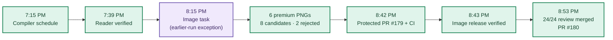
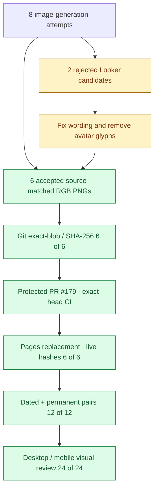

**🟩 RELEASE COMPLETE**  ·  **🟦 VISUAL QUALITY 24/24 PASS**  ·  **🟪 WEEKLY WORK USAGE 2% (OWNER-REPORTED)**

# DAILY AI BRIEF
## Unified Production After-Action Report · October 13, 2026

**Production cycle:** Monday, **October 12, 2026** (America/Chicago) · **Edition:** Tuesday, **October 13, 2026**  
**Source of truth:** [Daily-AI-Brief-Compiler](https://github.com/gttome/Daily-AI-Brief-Compiler) · **Published edition:** [October 13 Daily AI Brief](https://gttome.github.io/Daily-AI-Brief-Compiler/briefs/2026-10-13/)  
**Scope:** Editorial Compiler (7:15 PM) + premium-image production (exception: 8:15 PM) · **Classification:** Verified operational after-action, with owner-supplied usage note

> **IMPORTANT — VERIFIED PRODUCTION RESULT**
> **Management conclusion — complete successful edition.** The two-stage system produced and publicly verified the October 13 Brief and six premium illustrations. The Compiler sealed a source-backed six-story bundle and deployed the reader; the image worker generated eight candidates, accepted six, passed exact-byte checks and protected CI, published the images, and recorded **24/24 genuine desktop/mobile image-context reviews**. No second image worker, paid image API, accepted-image regeneration or manual illustration upload was required.

| Operating indicator | Result | Evidence / interpretation |
|:---|:---:|:---|
| **Six stories** | 6/6 ✓ | 2 technical · 2 knowledge worker · 2 agents |
| **Videos / Podcasts** | 2 + 2 ✓ | Verified identity and runtime evidence |
| **Premium diagrams** | 6/6 ✓ | 1200×630 PNGs · 8 genuine generations |
| **Image stage duration** | **18m 04s** | First persisted accepted PNGs → merged 24-context visual review; 38m 09s scheduled-to-review window |
| **Live image reviews** | 24/24 ✓ | Desktop/mobile on dated and permanent pages |
| **Work usage** | **2%** | Owner-reported weekly usage · target under 5% |
| **Public reader and history** | **PASS** | 30 reader-route functional checks; 42 Compiler / 44 image HTTP+SHA checks; 17 October 8 immutable objects preserved |

> **EFFICIENCY NOTE**
> **Exceptional resource efficiency.** The owner reports **2% of the weekly Work usage allocation** for this production run, versus an internal target of less than 5%. This is **owner-reported**, not a number derived from GitHub or a billing API. It is **3 percentage points below the 5% reference ceiling**. Do not infer the remaining weekly account balance. Future reports must display **“Not reported”** unless a new cycle-specific value is supplied.

### Contents

1. [Production sequence and exact evidence](#1-production-sequence-and-exact-evidence)
2. [Editorial Compiler assessment](#2-editorial-compiler-assessment)
3. [Premium image assessment](#3-premium-image-assessment)
4. [Published image gallery](#4-published-image-gallery)
5. [Incidents, corrections and learning](#5-incidents-corrections-and-learning)
6. [Efficiency and Work usage](#6-efficiency-and-work-usage)
7. [October 14 operating readiness](#7-october-14-operating-readiness)
8. [Independent evidence and scope](#8-independent-evidence-and-scope)

## 1. Production sequence and exact evidence

| Clock (CDT) | Milestone | Outcome / binding |
|---|---|---|
| 7:15 PM | Compiler recurring start | 19:15 Chicago schedule; actual state began 7:21:02 |
| 7:39:04 PM | Compiler public verification | `SHADOW_VERIFIED`; [successful shadow-compile action](https://github.com/gttome/Daily-AI-Brief-Compiler/actions/runs/38328197179) |
| 8:15 PM | Image recurring start (one-day exception) | Existing single image task advanced from normal 9:15 PM; no duplicate producer |
| 8:35–8:39 PM | Premium image Git preparation | Six accepted locked Git binaries and full package recorded on image branch |
| 8:42 PM | Package protected merge | [PR #179](https://github.com/gttome/Daily-AI-Brief-Compiler/pull/179); exact-head required CI PASS |
| 8:43:06 PM | Image-release receipt | `RELEASED_VERIFIED`; [image-only release action](https://github.com/gttome/Daily-AI-Brief-Compiler/actions/runs/38333405791) |
| 8:53 PM | Final visual review evidence | [PR #180](https://github.com/gttome/Daily-AI-Brief-Compiler/pull/180), complete `24_OF_24_PASS` |

**Important distinction:** The Compiler's `started_at` timestamp is a persisted state time, not a separate attestation of the ChatGPT host's internal invocation. It does not reduce the actual success and published delivery evidence.

## 2. Editorial Compiler assessment

**Final state:** `SHADOW_VERIFIED` · **Compiler state-to-public-verification duration:** **18.0 minutes** · **Bundle digest:** `9f89e913a3da694be5098fc6d3efb3b57adab19f349fbc523e7babc8fd8bdcbb`

| Publishing contract | October 13 observation | Outcome |
|---|---|:---:|
| Story mix | 2 engineering + 2 knowledge-worker + 2 nontechnical-agent | ✅ |
| Agent Skills | Exactly one evidence-based reusable procedure | ✅ |
| Concise reader copy | 3 Topics, Summary 45–60 words, Why 32–45 words per story | ✅ |
| Supporting media | 2 source-verified videos; 2 source-diverse podcasts | ✅ |
| Watchlist and learning | Date-scoped Watchlist with new / updated / carried / dropped; mapping across four books | ✅ |
| Sealed content | Exact source-bound `BUNDLE_READY` SHA-256 | ✅ |
| Reader behavior | Responsive, accessible, ratings, comments, sharing, feeds, archives | ✅ |
| Historical protections | 17 of 17 October 8 objects unchanged | ✅ |

**Published six-story selection**

| Lane | Source-backed article | Illustration |
|---|---|---|
| Technical AI Engineering | Microsoft's Maia 300 shifts the inference bottleneck toward data movement | [Live image](https://gttome.github.io/Daily-AI-Brief-Compiler/briefs/images/2026-10-13/dab-edition-2026-10-13-m01.png) |
| Technical AI Engineering | Meta's Muse Wonder introduces persistent agent memory and recovery behavior | [Live image](https://gttome.github.io/Daily-AI-Brief-Compiler/briefs/images/2026-10-13/dab-edition-2026-10-13-m02.png) |
| Applied Generative AI for Knowledge Workers | Looker Data Apps connects natural-language app creation to governed business metrics | [Live image](https://gttome.github.io/Daily-AI-Brief-Compiler/briefs/images/2026-10-13/dab-edition-2026-10-13-m10.png) |
| Applied Generative AI for Knowledge Workers | Alteryx and BigQuery demonstrate a controlled invoice-exception pipeline | [Live image](https://gttome.github.io/Daily-AI-Brief-Compiler/briefs/images/2026-10-13/dab-edition-2026-10-13-m11.png) |
| Agents for Everyone | Build one reusable quality-check Agent Skill for a GitHub project | [Live image](https://gttome.github.io/Daily-AI-Brief-Compiler/briefs/images/2026-10-13/dab-edition-2026-10-13-m12.png) |
| Agents for Everyone | Anthropic's agent incidents show why browser permissions require technical limits | [Live image](https://gttome.github.io/Daily-AI-Brief-Compiler/briefs/images/2026-10-13/dab-edition-2026-10-13-m14.png) |

**Compiler deployment detail:** The final [shadow-compile workflow](https://github.com/gttome/Daily-AI-Brief-Compiler/actions/runs/38328197179) succeeded. Earlier automatic compilation attempts encountered sealed-bundle and reader-materialization checks; the successful result was established without reopening accepted historical editorial content. The durable [live-verification record](https://github.com/gttome/Daily-AI-Brief-Compiler/blob/shadow/2026-10-13/shadow-runs/2026-10-13/compiler/live-verification.json) reports **30 reader routes PASS**, and the postpublish integrity receipt records **42 HTTP/SHA-256 checks**. Do not infer a definitive root cause for earlier CI retries from a failed step name alone.

## 3. Premium image assessment

### Image processing stage duration

> **🟩 18 minutes 04 seconds — verified persisted-image stage.** This is the elapsed time from the first accepted PNG bytes committed to GitHub at **8:35:05 PM CDT** to the merged, passing **24/24 live image review at 8:53:09 PM CDT**.

> **🟦 38 minutes 09 seconds — scheduled production window.** The owner-approved one-day exception scheduled the image worker for **8:15:00 PM CDT**. The precise start of native image generation is not independently recorded. Therefore the window is **not** claimed as the exact active generation runtime.

| Stage boundary | From (CDT) | To (CDT) | Elapsed | Evidence |
|---|---|---|---:|---|
| Scheduled image start → first accepted PNGs saved | 8:15:00 PM | 8:35:05 PM | **20m 05s** | One-day schedule exception → [accepted binary commit](https://github.com/gttome/Daily-AI-Brief-Compiler/commit/9873d74d13b0f04e4dfc63062afa15b797d3ca28); includes unobservable pre-commit processing |
| Accepted bytes → six-image package/reviews | 8:35:05 PM | 8:39:30 PM | **4m 25s** | [Package commit](https://github.com/gttome/Daily-AI-Brief-Compiler/commit/aa31c0fb690fc09a20a0acd34069bd4aac1d5ded) |
| Full package → protected PR merge | 8:39:30 PM | 8:42:22 PM | **2m 52s** | [Protected PR #179](https://github.com/gttome/Daily-AI-Brief-Compiler/pull/179), CI PASS |
| Protected merge → verified public image release | 8:42:22 PM | 8:43:06 PM | **0m 45s** | [RELEASED_VERIFIED receipt](https://github.com/gttome/Daily-AI-Brief-Compiler/blob/shadow-pages-history/site/image-jobs/2026-10-13/release.json) |
| Verified release → final visual review merged | 8:43:06 PM | 8:53:09 PM | **10m 02s** | [PR #180](https://github.com/gttome/Daily-AI-Brief-Compiler/pull/180); 24/24 passing inspected contexts |
| **First accepted PNG commit → final QA** | **8:35:05 PM** | **8:53:09 PM** | **18m 04s** | **Git-auditable image processing stage** |
| **Scheduled start → final QA** | **8:15:00 PM** | **8:53:09 PM** | **38m 09s** | **Schedule-bound window; not a measured native generation start** |

**Verification note:** Because PR #179 used a protected squash merge, the accepted original image-byte and full-package timestamps are read from the exact date-bound source PR history, while the final QA timestamp is read from the protected review-merge history. This preserves a verifiable 18m 04s duration without treating the source commits as ancestors of protected `main`.

**Interpretation for future editions:** The daily AAR will compute image-stage duration from actual accepted-binary Git commit through the first approved 24-context review commit. If an exact, date-scoped scheduled start is separately available, it will display the scheduled-to-review window as a second metric. Unavailable timing evidence appears as **Not independently recorded**, never an estimate.

**Final status:** `PUBLIC_VERIFIED` · **Accepted:** 6/6 · **Genuine attempts:** 8 · **Rejected:** 2 · **Regenerated after acceptance:** 0.

| Story | Attempts | PNG size | Saved-pixel review | Public contexts |
|---|---:|---:|:---:|:---:|
| Microsoft's Maia 300 shifts the inference bottleneck toward data movement | 1 | 1.12 MiB | PASS | 4/4 |
| Meta's Muse Wonder introduces persistent agent memory and recovery behavior | 1 | 0.78 MiB | PASS | 4/4 |
| Looker Data Apps connects natural-language app creation to governed business metrics | 3 | 0.70 MiB | PASS | 4/4 |
| Alteryx and BigQuery demonstrate a controlled invoice-exception pipeline | 1 | 0.73 MiB | PASS | 4/4 |
| Build one reusable quality-check Agent Skill for a GitHub project | 1 | 0.81 MiB | PASS | 4/4 |
| Anthropic's agent incidents show why browser permissions require technical limits | 1 | 1.02 MiB | PASS | 4/4 |
| **TOTAL** | **8** | **5.15 MiB** | **6/6 PASS** | **24/24 PASS** |

**Package and public integrity:** Pre-first-PR gate, immutable Git readback, protected merge, pages replacement, 6 live image hashes, 12 dated/permanent page pairings, 24 saved-image-region desktop/mobile reviews, **44 independent live hash checks**, and 17 historical objects preserved. The visual review attests story alignment, page context, complete diagrams, desktop legibility and mobile composition without clipping, and records **zero semantic context defects**.

[Image package manifest](https://github.com/gttome/Daily-AI-Brief-Compiler/blob/main/external-image-packages/2026-10-13/manifest.json) · [Final image AAR](https://github.com/gttome/Daily-AI-Brief-Compiler/blob/main/external-image-packages/2026-10-13/reviews/after-action.md) · [24-context review receipt](https://github.com/gttome/Daily-AI-Brief-Compiler/blob/main/external-image-packages/2026-10-13/reviews/live/image-element24/semantic-reviews.json)

## 4. Published image gallery

Each image below is the **actual image publicly delivered**, not a placeholder, stock image, or newly generated illustration.

<table>
<tr>
<td width="50%">
<strong>Microsoft's Maia 300 shifts the inference bottleneck toward data movement</strong>

<code>oct13-t1-maia-inference-systems</code>
</td>
<td width="50%">
<strong>Meta's Muse Wonder introduces persistent agent memory and recovery behavior</strong>

<code>oct13-t2-muse-agent-memory-focus</code>
</td>
</tr>
<tr>
<td width="50%">
<strong>Looker Data Apps connects natural-language app creation to governed business metrics</strong>

<code>oct13-k1-looker-governed-data-apps</code>
</td>
<td width="50%">
<strong>Alteryx and BigQuery demonstrate a controlled invoice-exception pipeline</strong>

<code>oct13-k2-invoice-exceptions-warehouse</code>
</td>
</tr>
<tr>
<td width="50%">
<strong>Build one reusable quality-check Agent Skill for a GitHub project</strong>

<code>oct13-a1-copilot-reusable-quality-skill</code>
</td>
<td width="50%">
<strong>Anthropic's agent incidents show why browser permissions require technical limits</strong>

<code>oct13-a2-agents-need-action-boundaries</code>
</td>
</tr>
</table>

## 5. Incidents, corrections and learning

| Boundary | Observed issue | Correction / preserved asset | Durable lesson |
|---|---|---|---|
| Editorial CI | Earlier bundle/reader-materialization attempts failed checks before final success | Revalidated and produced successful protected deployment; kept immutable Oct 8 objects | Record stage-level failures separately from final edition outcome |
| Looker image candidate 1 | Incorrect runtime-token caveat wording | Rejected before acceptance; exact source caveat in later candidate | Freeze exact allowed explanatory labels |
| Looker candidate 2 | Human-avatar glyphs in access-control area | Rejected; final image uses policy gates and locks | Reject prohibited elements before acceptance |
| Git transport | Shell base64 output exceeded connector response ceiling | Used native saved-image data stream, verified all six Git blobs | Repair transport, never regenerate accepted art |
| Temporary image-time exception | Image task advanced to 8:15 PM for this cycle | Same task performed work; no duplicate image task | Restore standard 9:15 PM daily time through existing one-time safety restoration |

> **OPERATIONAL NOTE**
> The first detected CI failures were **recovered within this production cycle**; they are not proof that the completed reader remains broken. Task execution visibility in a separate normal chat is also **not** an application malfunction. Editorial publication and six-image delivery are verified independently from such visibility.

## 6. Efficiency and Work usage

| Resource category | Value | Provenance / treatment |
|---|---:|---|
| **Weekly Work allocation consumed for this image-production run** | **2%** | **Owner-provided on October 12**; use for this cycle only |
| Weekly Work usage efficiency target | **<5%** | Project operating target |
| Distance below 5% reference | 3 percentage points | Arithmetic comparison, not remaining account allocation |
| Native image generation attempts | 8 | Image-production AAR |
| Source-accepted image count | 6 | Accepted package and release receipts |
| Rejected attempts | 2 | Corrections were both limited to Looker diagram |
| Accepted art regenerated for deployment / transport | 0 | Locked-asset custody evidence |
| Paid image/model API expenditure | Not reported | Do not invent account-level telemetry |
| Future cycles without user usage input | **Not reported** | No reminder, approval, guess, or production block |

> **IMPORTANT — VERIFIED PRODUCTION RESULT**
> **Future usage policy:** The unified daily AAR must accept a cycle-specific, optional owner-reported Work-usage value. If none exists, write **“Not reported”** and still publish the report. Never carry the October 13 **2%** into another edition, estimate a percentage from GitHub commits, or suppress a report because usage is absent.

## 7. October 14 operating readiness

The October 14 edition is produced on **Tuesday, October 13** (Chicago evening). No October 13 image job should be reopened.

| Control | Required next-cycle configuration | Status at report creation |
|---|---|---|
| Editorial Compiler | Existing sole Compiler task, 7:15 PM CDT | Enabled and unchanged |
| Premium image worker | Existing sole image task, standard 9:15 PM CDT | **Temporary 8:15 PM exception still saved** |
| Return-to-normal exception | One-time restoration on October 13 at 9:00 AM CDT | Enabled, not yet executed; verify post-restoration readback |
| Next-cycle source selection | Only newly published six-story October 14 `PUBLISHED_PENDING` job | Date-specific; no older job fallback |
| Release and history | Protected PR + CI + Pages / 17 Oct 8 objects | Verified active controls |
| Daily reporting | One combined professional AAR derived from both tracks; optional usage | Implemented by companion GitHub reporter enhancement |

> **SCHEDULE RESTORATION NOTE**
> Do not claim the image schedule is already restored. At this report's evidence cutoff it is still 8:15 PM. The existing **9:00 AM restoration task** must return it to **9:15 PM** and verify the saved recurrence. Neither task needs a new AI producer or owner-driven manual image launch.

## 8. Independent evidence and scope

| Evidence | Authoritative link |
|---|---|
| Compiler state | [October 13 state](https://github.com/gttome/Daily-AI-Brief-Compiler/blob/shadow/2026-10-13/shadow-runs/2026-10-13/compiler-state.json) |
| Editorial bundle | [Sealed edition bundle](https://github.com/gttome/Daily-AI-Brief-Compiler/blob/shadow/2026-10-13/shadow-runs/2026-10-13/edition-bundle.json) |
| Compiler deployment | [Successful Actions run](https://github.com/gttome/Daily-AI-Brief-Compiler/actions/runs/38328197179) |
| Reader integrity | [Postpublish verification](https://github.com/gttome/Daily-AI-Brief-Compiler/blob/shadow/2026-10-13/shadow-runs/2026-10-13/compiler/postpublish-integrity.json) |
| Package approval | [PR #179](https://github.com/gttome/Daily-AI-Brief-Compiler/pull/179) |
| Image release | [Image-only Actions run](https://github.com/gttome/Daily-AI-Brief-Compiler/actions/runs/38333405791) |
| Live release metadata | [RELEASED_VERIFIED receipt](https://github.com/gttome/Daily-AI-Brief-Compiler/blob/shadow-pages-history/site/image-jobs/2026-10-13/release.json) |
| 24-context acceptance | [PR #180](https://github.com/gttome/Daily-AI-Brief-Compiler/pull/180) · [semantic-review receipt](https://github.com/gttome/Daily-AI-Brief-Compiler/blob/main/external-image-packages/2026-10-13/reviews/live/image-element24/semantic-reviews.json) |
| Owner Work-usage figure | Owner-reported **2% weekly usage** (this cycle only; not independently metered) |

**Reporting integrity:** Technical source receipts remain independently preserved and the combined AAR is a management-facing synthesis. The AAR itself performs no article rewriting, image generation, GitHub release bypass, schedule changes or historical backfill.

---

*Generated for the October 12 production evening / October 13 edition. Future editions must use the exact next-date receipts and optional new usage metadata. This edition and its accepted images are closed.*
