**🟨 RELEASE PARTIAL**
**🟩 COMPILER VERIFIED** · **🟨 IMAGES NOT YET COMPLETE** · **🟨 VISUAL QA NOT YET VERIFIED**

# Daily AI Brief — Unified Production After-Action Report
**Edition:** October 27, 2026 · **Production evening:** 2026-10-26 · **Timezone:** America/Chicago
**Primary public reader:** [Open 2026-10-27 Brief](https://gttome.github.io/Daily-AI-Brief-Compiler/briefs/2026-10-27/) · **Repository:** [Daily-AI-Brief-Compiler](https://github.com/gttome/Daily-AI-Brief-Compiler)

> **IMPORTANT — VERIFIED PRODUCTION RESULT**
> **Executive result: PARTIAL.** This is the single management-facing report combining the editorial Compiler and premium-image publication. Compiler public status: **VERIFIED**. Image release: **not complete**. Direct 24-context visual quality: **not yet evidenced**. Autonomous completion: **UNPROVEN**. Missing evidence must not be promoted to a success claim.

**🕒 Production stage durations:** **Compiler 52m 52s** · **Premium Images Not independently recorded** (evidence-bounded elapsed times; the start/end events differ).

> **AAR SCHEMA WARNING:** image_aar:missing_or_inconsistent_source_bound_facts

> **CLOSEOUT WARNING:** The exact image worker has not released its lease and recorded PUBLISHED_COMPLETE with the six accepted hashes.

## Performance dashboard

| Measure | Recorded result | Source / caveat |
|:--|:--:|:--|
| Editorial publication | **PASS** | State and public reader integrity receipt |
| **Unattended autonomy (separate from publication)** | **UNPROVEN** | Owner incident receipt takes precedence over unverified producer self-attestation |
| Recorded protected publishing gate failures | **5** | Actual same-edition GitHub failure sidecar only; earlier unrecorded failures remain unknown |
| Articles | **6** | Exactly 2 technical / 2 knowledge-worker / 2 agents required |
| Verified original sources within preceding 24 hours | **0 / 6** | Original publisher dates only; other sources require a documented fallback rationale |
| Distinct selected article publishers | **5** | Six different primary organizations preferred |
| Videos over seven days old | **2** | Must be labeled evergreen, not a new development |
| Distinct selected video publishers | **1** | One channel is one publisher even across multiple videos |
| Duplicate active Watchlist display titles | **Not recorded** | Published canonical Watchlist only; historical evidence retained |
| Recorded scheduler capability route | **UNPROVEN** | Same-invocation route receipt only; GitHub is not scheduler authentication |
| Avoidable incomplete-staging CI failures | **Not independently audited** | Existing image-package push CI is disabled; exact-head protected PR CI remains required. A failure count requires actual workflow evidence |
| Media | **2 videos + 2 podcasts** | Sealed bundle |
| **Compiler stage duration** | **52m 52s (52.9 min)** | First persisted Compiler state → verified public reader; not a host scheduler attestation |
| **Image processing stage duration** | **Not independently recorded** | First accepted PNG Git checkpoint → final 24/24 review; auditable stage elapsed time |
| Image scheduled-to-final-review window | **Not independently recorded** | Only with a saved one-cycle schedule anchor; does not attest exact generation start |
| Executor-observed generation-to-final-review | **Not independently recorded** | Only if the worker recorded a same-execution clock before its first native call; not independently verified provider runtime |
| Accepted premium PNGs | **Not complete / 6** | Exact package and public release hashes |
| Native image generation attempts | **Not reported** | Image worker AAR; no estimation |
| Rejected candidates | **Not reported** | Image worker AAR |
| Final worker checkpoint reconciliation | **MISMATCH** | Oct25+ verifies exact generation count, per-story attempts, six accepted story/image/hash bindings and final release |
| Saved visual contexts | **Unverified** | Dated/permanent desktop/mobile review |
| Public SHA-256 checks | **Not recorded** | Image release receipt |
| October 8 immutable history | **17 / 17** | Independent content-preservation checks |
| **Owner-reported weekly Work usage for this run** | **Not reported** | No per-cycle usage supplied |

> **EFFICIENCY NOTE**
> **Resource reporting policy:** No usage figure was supplied for this cycle, so none is assumed. Future runs show **Not reported** unless the owner supplies new cycle-specific usage metadata. No approval or extra step is required to generate the AAR.

## Production architecture and checkpoints

```mermaid
flowchart LR
  A["Compiler 19:15 Chicago"] --> B["Sealed editorial bundle"]
  B --> C["Published reader verified"]
  C --> D["Current-date six-story image job"]
  D --> E["Six source-bound premium PNGs"]
  E --> F["Protected PR and CI"]
  F --> G["Pages release and 24 visual reviews"]
  classDef done fill:#dff6eb,color:#165c39,stroke:#168052,stroke-width:2px
  classDef uncertain fill:#fef3c7,color:#804c14,stroke:#d99412,stroke-width:2px
  class A,B,C,D done
  class E,F,G uncertain
```

## Track 1 — Compiler

**State:** `SHADOW_VERIFIED` · **Bundle:** `BUNDLE_READY` · **Compiler duration:** 52m 52s (52.9 min).

| Publication gate | Result |
|---|:---:|
| Canonical reader build | ✅ |
| Reader parity | ✅ |
| Public verification of dated edition | ✅ |
| Previous editions preserved | ✅ |
| Permanent story routes and feeds | ✅ |

**Selected coverage:**

| Lane | Story |
|---|---|
| Technical AI Engineering | OpenAI tests whether Terra respects the spirit of agent restrictions |
| Technical AI Engineering | monday.com layers disposable credentials and independent risk checks around production agents |
| Applied Generative AI for Knowledge Workers | OpenAI finds workplace ChatGPT use spreading beyond the ten most common activities |
| Applied Generative AI for Knowledge Workers | A randomized trial finds ChatGPT can help consultants complete data-science tasks without lasting mastery |
| Agents for Everyone | Google Customize turns output standards into permission-audited routines |
| Agents for Everyone | Oracle frames business agents around objectives, authority and human-approved outcomes |

## Track 2 — Premium images

**Public status:** `NOT_OBSERVED` · **Saved images:** 0/6 · **Actual generation attempts:** Not reported · **Rejected candidates:** Not reported.

### Image production duration — Git-verified milestones

**Auditable image stage duration:** **Not independently recorded** (first accepted binary saved in Git → final 24-context quality-review merge). **First asset to public image release:** **Not independently recorded**.
**Scheduled-to-final-review window:** **Not independently recorded**. This is a scheduled-clock comparison only when a separately recorded exact-date schedule exists; it is **not** measured native image-generation runtime.

| Production milestone | Chicago local time | Evidence |
|---|---|---|
| Scheduled image start (if exact-date record exists) | Not independently recorded | Time planned, not actual execution start |
| First executor-observed start | Not independently recorded | Worker self-attestation, not a first-party scheduler event |
| First native generation observation | Not independently recorded | Worker clock recorded immediately before first native call, not model-provider telemetry |
| First accepted PNG bytes saved to Git | Not independently recorded | Immutable binary-stage commit |
| Six-image package / reviews committed | Not independently recorded | Exact-head PR source commit |
| Protected package merged | Not independently recorded | Merge SHA and required CI |
| Public images verified | Not independently recorded | Image-release receipt |
| Final 24/24 semantic visual review approved | Not independently recorded | Immutable first review-approval commit |

> **Duration interpretation:** The audited stage excludes unobservable pre-checkpoint creative work. The scheduled-start window includes it but must not be interpreted as precise active processing time. Missing timestamps appear as **Not independently recorded**, never an estimate.

| Source-bound image | Attempts | File size | Public page |
|---|---:|---:|---|

**Immutable-release and visual gates:**

| Release gate | Result |
|---|:---:|
| Protected public image receipt | Not yet evidenced |
| Accepted-image Git hash bindings | Not yet evidenced |
| Six live PNGs | Not verified |
| Dated/permanent story placements | Not verified |
| Desktop/mobile visual inspection | Not verified |
| Historical Oct 8 integrity | Not verified |

### Published premium illustrations

No six-image public release gallery available yet.

## Incidents, corrections and learning

**Editor recovery classification:** UNPROVEN. **Owner intervention:** Unproven either way. **Protected same-edition failures recorded:** 5. 
**Latest failed protected stage:** VIDEO_PLAYBACK; [Action evidence](https://github.com/gttome/Daily-AI-Brief-Compiler/actions/runs/40430392908). Exact stage durations are available only where real source timestamps exist.

No image-stage correction receipts were available for this cycle.

> **OPERATIONAL NOTE**
> This report distinguishes a published and verified production outcome from scheduler metadata exposed to another conversation. Lack of a live host heartbeat in a separate normal chat is not a Compiler production failure.

## Usage and cost stewardship

| Item | Per-cycle value |
|---|---|
| **Weekly Work usage reported by owner** | **Not reported** |
| Internal weekly usage reference | Target under 5% |
| Genuine image-generation attempts | Not reported |
| Accepted diagrams | Not reported |
| Regeneration after acceptance | Not reported |
| Account-level billing telemetry | Not independently accessible to deterministic GitHub reporting |

**Future reporting rule:** For cycles without an optional owner-usage record, publish the complete AAR with `Not reported`; do not reuse prior percentages, guess remaining weekly credits or delay tomorrow's production.

## Required October 27 AAR improvement: Full source qualification before October 28

**Owner-approved deadline:** 2026-10-27 19:15 America/Chicago. **Next edition:** 2026-10-28. These five actions must be completed before the October 28 run.

These actions are mandatory AAR follow-ups; the AAR does not claim that any source was successfully checked or qualified without live independent evidence.

| Item | Evidence / status |
|---|---|
| Registered source inventory | 208 |
| Enabled sources / intended public-route checks | 94 |
| Recorded route attempts (requires independent validation) | 94 |
| Editorial sources eligible for original item review | 83 |
| Recorded actual editorial source visits (requires independent validation) | 83 |
| Disabled records requiring qualification review | 114 |
| Reviewed disabled source dispositions | 6 |
| Verified next-edition readiness | NOT_VERIFIED |

### Five required actions before the October 28 run

- **SOURCE-01 — Inspect real October 27 source-coverage receipts** (OPEN_UNTIL_REAL_EVIDENCE). Read actual run-bound route and editorial receipts; record 208 registered IDs, 94 enabled route attempts, 83 editorial source checks, blocked/skipped IDs and source yield. Verify with the protected standalone coverage validators. Never convert an unobserved HTTP request or item into PASS.
- **SOURCE-02 — Qualify the previously disabled source portfolio** (OPEN_UNTIL_REAL_EVIDENCE). Individually examine all 114 disabled source records, keep a source-by-source disposition (verified current route and original dated item, duplicate/publisher alias, stale or unsupported, or still pending). Do not indiscriminately enable old links or generic platform indexes.
- **SOURCE-03 — Enable only currently qualified, nonduplicate sources** (OPEN_UNTIL_REAL_EVIDENCE). For each qualified candidate, verify first-party original item identity and publisher/show ownership; ensure media playback and AI-content admission are checked at item-selection time. Preserve every existing resource ID, accepted edition and editorial selection rule.
- **SOURCE-04 — Merge source-only changes under protected main** (OPEN_UNTIL_REAL_EVIDENCE). Reconcile source candidate changes against fresh main, apply only new safe registry roles/statuses and source-only tests, require exact-head protected CI, permitted merge and independent GitHub readback. No changes to images, schedules, Watchlist, historical editions, paid APIs or publishing workflows.
- **SOURCE-05 — Verify October 28 source-discovery readiness** (OPEN_UNTIL_REAL_EVIDENCE). Before the existing October 27 19:15 CT Compiler start for the October 28 edition, confirm its unchanged task and full-registry instructions, enumerate every enabled source, verify complete source-coverage results or list truthful exceptions, and preserve the 21:15 image handoff.

**Unresolved route IDs:** NOT REPORTED OR NONE VERIFIED.

**Unvisited Article/Video/Podcast IDs:** NOT REPORTED OR NONE VERIFIED.

**Readiness verdict:** NOT_VERIFIED; evidence classification: NOT_INDEPENDENTLY_VERIFIED_BY_AAR_GENERATOR. This AAR section is an obligation register, not proof of next-cycle implementation.

## Next-edition operating handoff

| Control | Recurring contract |
|---|---|
| Primary Compiler | Sole existing task · 19:15 America/Chicago |
| Premium image production | Sole existing task · standard 21:15 America/Chicago |
| Exact image job selection | Newly published next-date `PUBLISHED_PENDING` only |
| AAR | Combined report generated automatically from new GitHub receipts |
| Optional Work usage | Owner-supplied per cycle, otherwise `Not reported` |

> **SCHEDULE RESTORATION NOTE**
> A temporary scheduling exception must be explicitly restored before claiming standard-time readiness. This deterministic document generator reads existing state only; it does not modify production schedules.

## Evidence register

| Evidence | Link |
|---|---|
| Compiler state | [Open receipt](https://github.com/gttome/Daily-AI-Brief-Compiler/blob/shadow/2026-10-27/shadow-runs/2026-10-27/compiler-state.json) |
| Compiler compile receipt | [Open receipt](https://github.com/gttome/Daily-AI-Brief-Compiler/blob/shadow/2026-10-27/shadow-runs/2026-10-27/compiler/compile-receipt.json) |
| Compiler public integrity | [Open receipt](https://github.com/gttome/Daily-AI-Brief-Compiler/blob/shadow/2026-10-27/shadow-runs/2026-10-27/compiler/postpublish-integrity.json) |
| Image release receipt | [Open receipt](https://github.com/gttome/Daily-AI-Brief-Compiler/blob/shadow-pages-history/site/image-jobs/2026-10-27/release.json) |
| Image review | [Open receipt](https://github.com/gttome/Daily-AI-Brief-Compiler/blob/main/external-image-packages/2026-10-27/reviews/live/image-element24/semantic-reviews.json) |
| Original image AAR | [Open receipt](https://github.com/gttome/Daily-AI-Brief-Compiler/blob/main/external-image-packages/2026-10-27/reviews/after-action.md) |

**Image workflow:** Not yet available.

---

*Generated deterministically from edition-specific GitHub records. Primary report is a synthesis; original Compiler, image, hash, and review receipts remain immutable. This reporting action creates no stories, images, releases, extra AI tasks, or schedule changes.*
